# 목회자 감수 자료 (바이블 온유 · 구약 40장면)

## 한 장 안내 (목사님께)

이 게임은 8~19세 아이들이 구약 40장면을 탐험하며 **자기 성경책을 직접 펴서** 답을 찾게 만든 게임입니다. 아직 아이들에게 공개하지 않았고, 목사님 감수를 마치기 전에는 공개하지 않습니다. 기준은 성경과 웨스트민스터 표준문서(신앙고백, 대·소요리문답)입니다.

글은 성경 본문과 두 차례 이상 대조했습니다. 다만 대조한 본문은 **개역한글과 KJV**이고, **개역개정과는 대조하지 못했습니다**(사용 허락 전이라 본문을 갖고 있지 않습니다). 아이들이 펴는 책은 개역개정이니, 낱말이나 표기가 목사님 성경과 다르면 알려 주세요.

**신학 판단은 하지 않고 목사님께 남겨 두었습니다.** 이 자료가 그 목록입니다.

### 무엇을, 얼마나

| 묶음 | 항목 수 | 걸리는 시간(어림) |
|---|---|---|
| ① 원칙 11가지와 공통 항목 | 23 | 약 34분 |
| ② 감수 범위를 정하는 물음 | 3 | 약 6분 |
| ③ 먼저 볼 30항목 | 30 | 약 18분 |
| ④ 감수 필수 장면 24개의 표시 항목(③과 겹치는 것 포함) | 285 | 약 7시간 4분 |
| ⑤ 나머지 장면 16개의 표시 항목 | 143 | 약 2시간 38분 |
| ⑥ 시대 안내·마무리 등 시대마다 하나씩인 항목 | 20 | 약 14분 |
| 전체(표시할 항목, ①④⑤⑥을 더한 수. ②③은 그 안에서 고른 것) | 471 | 약 10시간 29분 |

시간은 1분에 500자를 읽는다고 보고 글자 수로만 어림한 것입니다. **성경을 펴 보시는 시간은 넣지 않았으니 실제로는 두세 배가 걸릴 수 있습니다.**

### 표시하는 방법

- 항목마다 **그대로 / 고침 / 뺌** 가운데 하나를 골라 주세요. "고침"과 "뺌"에는 한 줄만 적어 주셔도 됩니다(어떻게 고칠지, 왜 빼는지).
- **그대로**: 이대로 아이들에게 보여도 된다. **고침**: 적어 주신 대로 고친 뒤 쓴다. **뺌**: 아이들에게 보이지 않는다.
- "검증자가 남긴 것"과 "대표가 여쭙는 것" 항목은 물음의 꼴이라 표시가 다릅니다: **지금대로**(지금 되어 있는 대로 둔다) / **바꿈**(적어 주신 대로 바꾼다) / **의논 필요**.
- "검증자가 남긴 것"의 아래 글은 검증 기록을 옮긴 것입니다(자료 이름만 우리말로 풀었습니다). 그 장면의 글은 같은 장면의 "대목 글"과 다른 항목에 그대로 있습니다. 기록 속의 "위·아래 …"는 검증 기록 안의 다른 곳을 가리키고, "대목 0"처럼 0부터 센 곳도 있으니 **장절로 찾아 주세요.** 그 아래 "지금 게임의 글"은 그 물음이 가리키는 지금 게임의 문장을 자동으로 찾아 붙인 것이라 일부만 실렸을 수 있습니다. 검증 기록과 지금 자료가 다르면 "덧붙임"이 지금 상태를 알려 드립니다.
- 원칙(규칙) 항목에서는 **그대로 = 이 원칙에 동의, 고침 = 조건을 달아 동의, 뺌 = 이 방식은 쓰지 않는다**는 뜻입니다. 원칙에서 "뺌"이 나오면 그 원칙에 딸린 장면 항목은 보실 필요가 없습니다.
- 휴대폰·컴퓨터에서는 `감수자료.html`을 열면 표시한 것이 그 기기에 저장되고, "내보내기"로 글로 뽑아 보내실 수 있습니다. 종이가 편하시면 `감수자료_인쇄용.html`을 인쇄해 주세요(전체는 A4 약 240쪽으로 많습니다. `먼저볼30_인쇄용.html`은 원칙과 먼저 볼 30항목만으로 약 30쪽입니다).
- 성경 본문은 싣지 않았습니다(사용 허락 전). 장절을 보시고 성경책에서 확인해 주세요.
- 3D 장면과 인물의 화면 사진은 전체 감수 자료(`감수자료.html`, `감수자료_인쇄용.html`)에 몇 장씩 실었습니다(컴퓨터에서 휴대폰 크기로 찍은 것). 움직임과 소리는 사진으로 알 수 없으니, 직접 보셔야 판단되는 것은 메모로 남겨 주세요(대표가 미리보기 화면을 보여 드릴 수 있습니다).

### 보시는 순서(권함)

- ① **원칙과 공통 항목**: 여기서 방향이 정해집니다.
- ② **감수 범위**: 지금 "감수 필수 아님"으로 둔 장면을 필수로 올릴지 묻는 물음 몇 가지.
- ③ **먼저 볼 30항목**: 가장 급한 것만 모았습니다. 시간이 넉넉하지 않으시면 ①②③을 먼저 보시고, 나머지는 나누어 보셔도 됩니다.
- ④ **시대별 10묶음**: 감수 필수 장면부터, 나머지는 여유 있을 때.

### 한 장면이 흘러가는 차례 (그 글이 언제 보이는지)

1. 도착: 최현 박사의 통신(탐험대 이야기). 무엇이 고장 났고 무엇을 도울지.
2. (동행 인물의 말이 사건보다 앞이면 여기서 동행 문답)
3. 대목: 사건을 차례로 지켜봄. 대목 사이에 **곁에서 보기 · 함께 머물기 · 손으로 하는 돕기**가 끼어 있음. 하나님의 말씀이 나오는 대목에는 "성경책에서 직접 읽어요"와 펼 장절이 뜸.
4. 관문: 성경을 펴야 답할 수 있는 물음 둘. 틀리면 "틀렸습니다" 대신 읽을 곳을 다시 보여 줌(다른 곳의 내용을 고르면 "타임머신 바늘이 엇나갔어요").
5. (동행 인물의 말이 사건 중이나 뒤이면 여기서 동행 문답)
6. 뜻 묻기: 그 일의 뜻을 묻고, 성경 읽기 물음을 맞히면 14~19세에게만 **신약 연결**이 뜸("목사님 감수 전" 표시와 함께).
7. 수리 재료를 얻음(탐험대 이야기) → **오늘의 물음**(최현 박사가 답함, "감수 전" 표시) → 말씀 카드 → **마무리**(기도·실천·기록. 시대의 마지막 장면이 아니면 접혀 있음).
8. 3D 장면(12개)은 같은 내용을 걸어 다니며 봅니다. 차례가 조금 달라, 탐지기 물음(재료 찾기)이 사건을 지켜보기보다 먼저 나옵니다. 사진을 찍으면 도감 설명이 뜹니다.

글 앞의 "8~10세 / 11~13세 / 14~19세"는 그 나이 단계의 아이에게 보이는 글입니다. 세 단계의 사실은 같고 깊이만 다릅니다.

### 항목의 종류

| 종류 | 무엇인가 | 수 |
|---|---|---|
| 대목 글(장면 전체) | 장면의 사건을 나이 단계별로 풀어 쓴 글. 감수 필수 장면만 표시 항목이고, 나머지는 참고로 실었습니다 | 40 |
| 동행 인물 문답 | 성경 인물이 아이의 물음에 "기록된 자기 말"로 답하는 곳 | 74 |
| 손으로 하는 돕기 | 아이가 그 시대 사람들의 평범한 일을 돕는 단계 | 42 |
| 뜻 묻기 | 도운 뒤 그 일의 뜻을 본문으로 깨닫는 단계 | 40 |
| 신약 연결 | 구약 사건을 신약 장절과 잇는 글(14~19세만) | 16 |
| 오늘의 물음 | 지금 아이가 궁금해할 물음과 최현 박사의 답 | 68 |
| 마무리(기도·실천) | 8~10세 기도, 11~13세 실천, 14~19세 기록 물음. 시대별로 모았습니다 | 10 |
| 공통 · 시대 추리 | 읽어 주기, 마무리의 꼴, 3D 인물의 생김새, 모든 장면에 똑같이 뜨는 글, 요단 강 시대 추리 | 5 |
| 대표가 여쭙는 것 | 대표 결재지에서 목사님 판단이 섞여 넘긴 것(원칙과 공통 항목 묶음 안. 표시는 지금대로 / 바꿈 / 의논 필요) | 6 |
| 3D 설정 / 화면 원칙 | 하나님을 어떻게 표현하는지, 무엇을 그리지 않는지, 본문에 없는 배치 | 12 / 28 |
| 검증자가 남긴 것 | 본문 대조를 한 검증자가 "감수 때 정해 달라"고 남긴 것 | 134 |
| 그 밖의 글(참고) | 관문 물음, 탐지기 물음, 재료, 곁에서 보기 등. 표시 항목은 아니지만 빠짐없이 실었습니다 | 41 |

## 파일

| 파일 | 쓰임 |
|---|---|
| `감수자료.html` | 휴대폰·컴퓨터에서 읽고 표시. 표시는 그 기기에 저장되고 "내보내기"로 글로 뽑습니다 |
| `감수자료_인쇄용.html` | A4 인쇄(원칙 → 먼저 볼 30 → 시대별). 브라우저의 인쇄에서 "PDF로 저장"도 됩니다 |
| `먼저볼30_인쇄용.html` | 먼저 볼 30항목만 A4로 |
| `참고_장면전체글_인쇄용.html` | 대목 글과 그 밖의 글 전부(참고용, 깁니다) |
| `md/시대01.md` ~ `md/시대10.md` | 같은 내용의 글 파일(시대별, 참고 글 포함) |
| `항목목록.json` | 항목 번호와 그 글이 장면 자료의 어디에 있는지(감수 결과를 반영할 때 씁니다) |
| `미해결_분류.json` · `미해결_전체.md` | 검증자가 남긴 것 200건을 목회자/대표/코드/이미 풀림으로 나눈 것과 그 까닭 |
| `대표_결재지.md` · `.html` | 대표가 정할 것(검증자가 대표에게 넘긴 것 포함) |
| `개역개정_신청_준비.md` | 성경 본문 사용 허락 신청 준비(보내지 않음) |

이번 감수의 범위는 구약 40장면(3D 게임, `web3d/`)과 거기서 갈 수 있는 요단 강 시대 추리입니다. 출애굽기 시범판(`web/`, 2D)은 범위가 아니며 아이들에게 공개하지 않습니다.

## 뽑은 수와 진행표의 수 대조

| 항목 | 뽑은 수 | 진행표(`docs/11`)의 수 | 맞는가 | 까닭 |
|---|---|---|---|---|
| 오늘의 물음 | 40장면 / 물음 68개 | 40(장면) | 맞음 | 진행표는 장면 수(40)를 적었다. 물음은 장면마다 1~2개여서 68개다 |
| 뜻 묻기 | 40 | 40 | 맞음 |  |
| 신약 연결 | 16 | 16 | 맞음 |  |
| 손으로 하는 돕기 | 42 | 42 | 맞음 |  |
| 마무리(기도·실천·기록 물음) | 40장면(시대별 10항목으로 모음) | 40(장면마다 하나) | 맞음 | 진행표에 수가 따로 없다 |
| 14~19세 "삶에 적용" 질문(규칙서 3.5) | 0 | — | 맞음 | 아직 쓰지 않았다. 지금은 사실을 적는 기록 물음 한 가지뿐이다("공통·마무리" 항목에서 방향을 여쭘) |
| 코드에 들어 있는 화면 글 | 563줄 + 3D 장면 12개의 도감·안내 | — | 맞음 | 장면 자료가 아니라 게임 코드에 있는 글. 독립 검증의 지적으로 더함 |
| 동행 인물 문답 | 31장면 / 문답 74개 | — | 맞음 | 진행표에 수가 없다. 동행 인물이 없는 장면 9개(본문에 그 장면에서 말한 사람이 없음) |
| 3D 설정 | 12 | 12(3D 장면) | 맞음 | 호렙 산(OT-09) 포함 |
| 검증자가 남긴 것(미해결) | 200 | — | 맞음 | 검증 기록 10개에서 뽑은 전체. 분류는 아래 |
| 감수 필수 장면 | 24 | 장면표(`docs/09`) "예" 24 | 맞음 |  |

검증자가 남긴 것 200건의 분류: 같음 15 · 대표 25 · 목회자 134 · 코드 9 · 풀림 17. "목회자"와 "미분류"만 표시 항목으로 실었고, "대표"는 `대표_결재지.md`로, "코드"·"풀림"·"같음"은 `미해결_전체.md`에 까닭과 함께 적었습니다.

만드는 방법(만드는 사람용): 이 폴더의 파일은 `node tools/make_review_pack.js`가 장면 자료와 게임 코드에서 뽑아 만듭니다(자료 판 `a4be56af`). 내용이 바뀌면 다시 돌리면 되고 손으로 고치지 않습니다. 검사는 `node tools/test/check_review_pack.js`, 화면 점검은 `node tools/test/shot_review_pack.js`.

## 감수 범위를 먼저 정할 것

지금 "감수 필수 아님"으로 둔 장면 가운데, 검증자가 필수로 올릴지 물은 것입니다. 글은 그 장면의 시대 묶음에 있습니다.

- **OT-24·미해결1** 엘리의 집 심판 말씀(삼상 3:11-14)이 있는 OT-24를 감수 필수가 아닌 장면으로 둘까요?
- **OT-36·미해결1** 참소한 사람들과 가족이 굴에 던져진 일(단 6:24) 때문에 이 장면을 감수 필수로 할까요?
- **OT-38·미해결1** 진멸 조서(에 4:7-8, 7:4)와 하만이 나무에 달린 일(7:9-10) 때문에 감수 필수로 할까요?

## 먼저 볼 30항목

뽑은 기준: ① 신약 연결 16곳(규칙서 3.5·13.6. 구약 사건을 신약 장절과 잇는 한두 문장) ② 검증자가 목회자의 판단이 필요하다고 남긴 것 가운데 규칙서 3.5의 주제에 닿는 14가지(어린 나이의 글에 둔 심판·죽음, 주권과 책임, 창 3:15, 범죄한 아담의 동행, 뜻을 돌이키심, 창조를 지켜보는 틀).

| 순서 | 항목 번호 | 장면 | 종류 | 왜 먼저인가 |
|---|---|---|---|---|
| 1 | OT-03·신약 | 노아의 방주와 무지개 언약 (창 6:9-9:17) | 신약 연결 | 구약 사건과 그리스도·신약의 연결(규칙서 3.5, 13.6) |
| 2 | OT-05·신약 | 아브라함을 부르시고 언약을 주심 (창 12:1-9) | 신약 연결 | 구약 사건과 그리스도·신약의 연결(규칙서 3.5, 13.6) |
| 3 | OT-06·신약 | 모리아 산의 아브라함과 이삭 (창 22:1-19) | 신약 연결 | 구약 사건과 그리스도·신약의 연결(규칙서 3.5, 13.6) |
| 4 | OT-08·신약 | 요셉이 애굽으로 팔려 가고 형들을 다시 만남 (창 37:12-36) | 신약 연결 | 구약 사건과 그리스도·신약의 연결(규칙서 3.5, 13.6) |
| 5 | OT-09·신약 | 불붙은 떨기나무와 부르심 (출 3:1-12) | 신약 연결 | 구약 사건과 그리스도·신약의 연결(규칙서 3.5, 13.6) |
| 6 | OT-10·신약 | 마지막 재앙과 유월절 (출 11:1-12:42) | 신약 연결 | 구약 사건과 그리스도·신약의 연결(규칙서 3.5, 13.6) |
| 7 | OT-11·신약 | 바다가 갈라지다 (출 14:1-31) | 신약 연결 | 구약 사건과 그리스도·신약의 연결(규칙서 3.5, 13.6) |
| 8 | OT-12·신약 | 시내 산에서 주신 열 가지 말씀 (출 19:1-20:21) | 신약 연결 | 구약 사건과 그리스도·신약의 연결(규칙서 3.5, 13.6) |
| 9 | OT-13·신약 | 하늘에서 내린 양식, 만나 (출 16:1-36) | 신약 연결 | 구약 사건과 그리스도·신약의 연결(규칙서 3.5, 13.6) |
| 10 | OT-14·신약 | 금송아지 (출 32:1-35) | 신약 연결 | 구약 사건과 그리스도·신약의 연결(규칙서 3.5, 13.6) |
| 11 | OT-15·신약 | 열두 정탐꾼 (민 13:1-14:38) | 신약 연결 | 구약 사건과 그리스도·신약의 연결(규칙서 3.5, 13.6) |
| 12 | OT-16·신약 | 느보 산에서 모세의 마지막 (신 34:1-12) | 신약 연결 | 구약 사건과 그리스도·신약의 연결(규칙서 3.5, 13.6) |
| 13 | OT-19·신약 | 여리고 성이 무너지다 (수 6:1-27) | 신약 연결 | 구약 사건과 그리스도·신약의 연결(규칙서 3.5, 13.6) |
| 14 | OT-25·신약 | 백성이 왕을 구하고 사울이 왕이 됨 (삼상 8:4-22) | 신약 연결 | 구약 사건과 그리스도·신약의 연결(규칙서 3.5, 13.6) |
| 15 | OT-28·신약 | 솔로몬이 성전을 봉헌함 (왕상 8:1-30) | 신약 연결 | 구약 사건과 그리스도·신약의 연결(규칙서 3.5, 13.6) |
| 16 | OT-31·신약 | 요나와 니느웨 (욘 1:1-4:11) | 신약 연결 | 구약 사건과 그리스도·신약의 연결(규칙서 3.5, 13.6) |
| 17 | OT-10·미해결1 | 마지막 재앙과 유월절 (출 11:1-12:42) | 검증자가 남긴 것 | 장자의 죽음을 8~10세 글에 둔 것 |
| 18 | OT-10·미해결2 | 마지막 재앙과 유월절 (출 11:1-12:42) | 검증자가 남긴 것 | 주권과 책임(출 11:10) |
| 19 | OT-11·미해결2 | 바다가 갈라지다 (출 14:1-31) | 검증자가 남긴 것 | 심판 장면을 어린 나이 글에 둔 것 |
| 20 | OT-02·미해결2 | 에덴 동산과 사람의 범죄 (창 2:15-17) | 검증자가 남긴 것 | 죽음과 저주의 말씀을 8~10세 글에 둔 것 |
| 21 | OT-02·미해결1 | 에덴 동산과 사람의 범죄 (창 2:15-17) | 검증자가 남긴 것 | 창 3:15(신약적 의미) |
| 22 | OT-02·미해결3 | 에덴 동산과 사람의 범죄 (창 2:15-17) | 검증자가 남긴 것 | 범죄한 아담을 동행 인물로 둔 것 |
| 23 | OT-03·미해결1 | 노아의 방주와 무지개 언약 (창 6:9-9:17) | 검증자가 남긴 것 | 홍수의 죽음을 8~10세 글에 둔 것 |
| 24 | OT-29·미해결1 | 나라가 둘로 갈라짐 (왕상 12:1-24) | 검증자가 남긴 것 | 주권과 책임(왕상 12:15) |
| 25 | OT-29·미해결5 | 나라가 둘로 갈라짐 (왕상 12:1-24) | 검증자가 남긴 것 | 주권과 책임(왕상 12:24) |
| 26 | OT-31·미해결1 | 요나와 니느웨 (욘 1:1-4:11) | 검증자가 남긴 것 | 하나님이 뜻을 돌이키셨다는 표현 |
| 27 | OT-32·미해결1 | 북 이스라엘이 사로잡혀 감 (왕하 17:1-23) | 검증자가 남긴 것 | 진노를 8~10세 글에 둔 것 |
| 28 | OT-35·미해결5 | 예루살렘이 무너지고 바벨론으로 끌려감 (왕하 25:1-21) | 검증자가 남긴 것 | 진노를 8~10세에게 묻는 것 |
| 29 | OT-37·미해결3 | 고레스의 조서와 성전을 다시 지음 (스 1:1-11) | 검증자가 남긴 것 | 하나님의 주권(다른 나라 왕의 마음) |
| 30 | OT-01·미해결2 | 하나님이 천지를 지으심 (창 1:1-2:3) | 검증자가 남긴 것 | 창조를 "지켜보기" 틀에 넣은 것 |

## 원칙 11가지와 공통 항목

규칙서(`docs/00_공통규칙서.md`) 3절과 13절(대표 결정, 목회자 감수 전)에서 목사님이 먼저 보실 것을 옮겼습니다. "규칙서" 줄은 규칙서의 글 그대로입니다. 그 뒤는 모든 장면에 걸치는 공통 항목입니다.

#### 원칙·3.1 · 원칙

*3.1 출처 우선순위* — 규칙서 3.1절
- 한 줄 요약: 무엇을 근거로 삼는지의 차례입니다: 성경 본문 → 웨스트민스터 표준문서 → 허용 저자 7인. 지금 게임의 글은 성경 본문만 근거로 썼습니다.
  - 규칙서: 1. 성경 본문
  - 규칙서: 2. 웨스트민스터 신앙고백, 대요리문답, 소요리문답
  - 규칙서: 3. 허용 저자 7인의 설교와 저서
  - 규칙서: 뒤의 것이 앞의 것과 충돌하면 앞의 것을 따른다.

표시: ☐ 그대로 ☐ 고침 ☐ 뺌 　적을 칸: 

#### 원칙·3.2 · 원칙

*3.2 허용 저자 7인* — 규칙서 3.2절
- 한 줄 요약: 참고할 수 있는 저자 7인과 그 단서입니다. 지금은 원문을 확인하지 못해 한 곳도 인용하지 않았습니다.
  - 규칙서: 옥한흠, C.S. 루이스, 팀 켈러, 릭 워렌, 마틴 로이드 존스, 찰스 스펄전, 어거스틴.
  - 규칙서: 이 7인 외의 해설·주석·신학 이론·인터넷 자료는 쓰지 않는다.
  - 규칙서: 루이스(성공회), 릭 워렌·스펄전(침례교), 어거스틴(고대 교부)은 장로교가 아니다. 세례, 교회 정치, 성례 등에서 웨스트민스터 문서와 다른 부분은 쓰지 않는다.
  - 규칙서: 인용은 책 이름과 장(또는 설교 제목·날짜)이 확인된 것만 쓴다. 기억에 의존한 인용, 출처를 모르는 "~라고 말했다"는 금지한다.
  - 규칙서: 직접 인용 대신 출처를 밝힌 짧은 요약으로 쓴다(7절 저작권 참조).

표시: ☐ 그대로 ☐ 고침 ☐ 뺌 　적을 칸: 

#### 원칙·3.3 · 원칙

*3.3 하지 않는 것* — 규칙서 3.3절
- 한 줄 요약: 성경에 없는 것을 만들지 않는다, 하나님을 형상으로 그리지 않는다, 아이들은 목격자다. 이 게임 전체의 울타리입니다. (천사도 그리지 않기로 좁게 정해 두었습니다.)
  - 규칙서: 성경에 없는 사건을 사실처럼 만들지 않는다. "만약 ~했다면" 식의 가상 성경 이야기를 만들지 않는다.
  - 규칙서: 성경 인물의 말과 행동은 본문에 기록된 범위를 넘지 않는다. 본문에 없는 속마음이나 대사를 지어내지 않는다.
  - 규칙서: 하나님(성부·성자·성령)을 사람·얼굴·손 등의 형상으로 그리지 않는다(대요리문답 109문).
  - 규칙서: 본문이 말하지 않는 것을 단정하지 않는다. 모르는 것은 "성경은 여기까지 말한다"로 둔다.
  - 규칙서: 아이들이 사건에 끼어들어 결과를 바꾸지 않는다. 세 주인공은 끝까지 목격자다.
  - 규칙서: 신앙을 점수·등급·순위로 매기지 않는다. 구원이나 믿음의 크기를 게임 성적과 연결하지 않는다.
  - 규칙서: 특정 교단·교회·인물을 비판하는 내용을 넣지 않는다.

표시: ☐ 그대로 ☐ 고침 ☐ 뺌 　적을 칸: 

#### 원칙·3.5 · 원칙

*3.5 감수 필수 주제* — 규칙서 3.5절
- 한 줄 요약: 아래 주제가 들어간 장면과 물음은 목사님이 보시기 전에는 확정하지 않습니다.
  - 규칙서: 아래 주제가 들어간 장면·질문은 목회자가 확인하기 전에는 확정하지 않는다.
  - 규칙서: 하나님의 주권과 사람의 책임 (예: 바로의 마음이 완악해짐)
  - 규칙서: 재앙과 심판, 장자의 죽음
  - 규칙서: 유월절 어린 양과 그리스도의 연결 등 구약 사건의 신약적 의미
  - 규칙서: 14~19세 단계의 "삶에 적용" 질문 전체

표시: ☐ 그대로 ☐ 고침 ☐ 뺌 　적을 칸: 

#### 원칙·13.2 · 원칙

*13.2 탐험대 이야기: 비상 착륙과 최현 박사* — 규칙서 13.2절
- 한 줄 요약: 타임머신이 고장 나 그 시대의 평범한 재료(떨어진 것)를 주워 고친다는 설정입니다. 성경 내용이 아닌 "탐험대 이야기"로 표시합니다. 거룩한 것·기적에 속한 것은 재료로 쓰지 않습니다.
  - 규칙서: 타임머신이 비상 착륙해 일부 기능이 멎었다. 원래 시대로 돌아가려면 부속이 필요한데, 그 시대에는 부속이 없다. 통신만 이어져 있고, 현재에 있는 **최현 박사**가 통신으로 돕는다. 최현 박사와 이 이야기는 성경 내용이 아니다("탐험대 이야기"로 표시한다).
  - 규칙서: 최현 박사는 그 시대, 그 자리에서 실제로 구할 수 있는 **재료**로 부속을 대신 만들게 한다. 재료는 **본문에 나오는 평범한 것**만 쓴다(예: 양의 뿔 조각, 광야의 돌, 갈대, 짚). 기적이나 거룩한 것에 속한 것은 재료로 삼지 않는다(불붙은 떨기나무, 만나, 언약궤와 성막·성전의 기구, 제물, 바다에 잠긴 병거 등).
  - 규칙서: 12절의 "과거에서 가져오는 것은 사진과 기록뿐"에 예외를 둔다: 수리에 쓰는 재료. 기념품으로 가져오지 않는 것은 그대로다.
  - 규칙서: 재료는 아이들이 직접 얻는다(떨어진 것을 줍는 등). 사건이 일어나는 자리의 물건에는 손대지 않는다.

표시: ☐ 그대로 ☐ 고침 ☐ 뺌 　적을 칸: 

#### 원칙·13.3 · 원칙

*13.3 그 시대 사람과의 동행* — 규칙서 13.3절
- 한 줄 요약: 모세·다윗 같은 성경 인물이 아이들과 함께 걷습니다. 그 인물은 성경에 기록된 자기 말만(풀어 쓴 간접 서술과 장절로) 합니다.
  - 규칙서: 장면에 따라 그 시대의 성경 인물(모세, 다윗, 예레미야 등)이 세 아이와 **동행**한다. 11절의 "성경 인물에게 말을 걸지 않는다"는 동행 인물에게 묻는 것에 한해 푼다.
  - 규칙서: 동행 인물은 **성경에 기록된 자기 말만** 한다. 아이가 물으면, 답은 그 인물이 본문에서 실제로 한 말(선지자는 그가 전한 말씀)을 풀어 쓴 간접 서술과 장절이다. 본문에 없는 대사·속마음·설명을 지어내지 않는다(3.3은 그대로다). 실제 문장은 아이가 성경책에서 읽는다.
  - 규칙서: 동행 인물의 행동은 함께 걷고 가리키는 것까지만 쓴다. 재료를 구해 주거나 본문에 없는 일을 하게 하지 않는다.
  - 규칙서: 동행과 문답은 사건의 앞이나 뒤에 둔다. 사건이 일어나는 동안 세 아이는 지켜보기만 한다(3.3 "끝까지 목격자"는 그대로다).
  - 규칙서: 본문에 그 장면에서 말한 사람이 없으면 동행 인물을 두지 않는다.

표시: ☐ 그대로 ☐ 고침 ☐ 뺌 　적을 칸: 

#### 원칙·13.4 · 원칙

*13.4 오늘의 물음* — 규칙서 13.4절
- 한 줄 요약: 지금 아이들이 궁금해할 물음에 "최현 박사"(지어낸 인물)가 성경 장절을 근거로 답합니다. 성경 인물의 입으로 답하게 하지 않습니다. 모두 감수 대상입니다.
  - 규칙서: 지금 시대의 아이가 궁금해할 물음과 답을 장면마다 둘 수 있다. 답은 **최현 박사**가 통신으로 하고, 근거는 성경 장절이다. 성경 인물의 입으로 답하게 하지 않는다.
  - 규칙서: 허용 저자 7인(3.2)의 글은 책과 장이 확인된 것만 참고할 수 있다. 그 밖의 자료는 쓰지 않는다. 지금은 원문을 확인하지 못해 성경 본문만 근거로 쓴다.
  - 규칙서: 오늘의 물음은 모두 감수 필수다(3.5).

표시: ☐ 그대로 ☐ 고침 ☐ 뺌 　적을 칸: 

#### 원칙·13.5 · 원칙

*13.5 물음의 세 단계 (대표 결정 2026-11-15. 5절의 "질문 유형"과 "성경 찾기"를 대신한다)* — 규칙서 13.5절
- 한 줄 요약: 모든 물음은 성경책을 펴야 답할 수 있게 했습니다. 나이에 따라 한 절 / 범위 / 떨어진 여러 곳을 읽습니다.
  - 규칙서: 탐지기 물음과 관문은 모두 아이가 성경을 펴서 답을 찾게 만든다. 읽을 곳(장절)을 물음과 함께 보여 준다.
  - 규칙서: **8~10세**: 장과 절을 알려 주고, 그 절에 바로 나와 있는 사실(누가, 어디서, 어디로, 무엇을)을 묻는다.
  - 규칙서:   예: "출애굽기 3장 1절을 찾아보세요. 모세가 양 떼를 이끌고 이른 산은?"
  - 규칙서: **11~13세**: 읽을 범위(몇 절에서 몇 절)를 알려 주고, 읽은 뒤에 답하는 "왜" 물음.
  - 규칙서:   예: "출애굽기 3장 1~4절을 읽고 답해요. 모세가 길에서 돌이켜 떨기나무 쪽으로 간 까닭은?"
  - 규칙서: **14~19세**: 떨어진 두 곳 이상의 절을 함께 읽고 정황을 이어서 이해해야 답할 수 있는 물음.
  - 규칙서:   예: "3장 11절과 12절을 함께 읽자. 모세가 '내가 누구이기에'라고 했을 때, 하나님은 모세의 능력 대신 무엇을 대답으로 주셨나?"
  - 규칙서: 세 단계의 사실관계는 같다(5절 그대로). 답과 보기는 모두 본문 근거(장절)가 있어야 한다. 잘못 고르면 그 물음의 읽을 곳을 다시 읽게 한다.
  - 규칙서: 순서는 유월절(OT-10) 샘플을 먼저 만들고, 대표가 확인한 뒤 40장면 전체(탐지기 물음 108, 관문 240)에 넓힌다.

표시: ☐ 그대로 ☐ 고침 ☐ 뺌 　적을 칸: 

#### 원칙·13.6 · 원칙

*13.6 현장 돕기 (대표 결정 2026-11-15. 목회자 감수 전. 3.3의 "끝까지 목격자"와 13.3의 "사건 동안 지켜보기만"을 아래만큼 푼다)* — 규칙서 13.6절
- 한 줄 요약: 아이들이 그 시대 사람들의 "평범한 일"을 돕습니다(예: 유월절 밤 허리띠·신·지팡이 챙기기). 거룩한 행위와 기적은 돕지 않고 곁에서 봅니다. 도운 뒤 본문으로 뜻을 깨닫는 단계가 있습니다.
  - 규칙서: 세 아이는 그 시대 사람들을 도울 수 있다. 돕는 일은 **본문에 그 사람들이 했다고 적힌 평범한 일**만이다(예: 유월절 밤에 허리띠·신·지팡이를 챙김 출 12:11, 반죽 그릇을 옷에 쌈 12:34).
  - 규칙서: 본문이 행위자를 정한 거룩한 행위(피를 바름, 제사, 언약궤를 멤 등)와 기적은 아이가 대신하지 않는다. 곁에서 본다.
  - 규칙서: 돕기는 사건의 결과를 바꾸지 않는다. 본문에 없는 사건을 만들지 않는다(3.3의 나머지는 그대로다).
  - 규칙서: 도운 뒤에는 그 일의 **뜻을 깨닫는 단계**를 둔다. 본문이 뜻을 말한 곳(예: 출 12:13, 12:26-27)을 아이가 성경에서 읽고, 답은 본문에 기록된 말로만 한다.
  - 규칙서: 돕는 상대가 이름 없는 사람(이스라엘의 한 집 등)이면, 그 사람의 행동은 본문이 그 무리가 했다고 적은 것만, 말은 본문이 그들에게 하라고 한 말만 쓴다(예: 자녀가 물을 때 할 말 12:27).
  - 규칙서: 구약 사건과 그리스도의 연결(예: 유월절 어린 양)은 3.5대로 감수 필수다. 넣을 때는 14~19세에만, 신약 장절을 근거로, "감수 전"을 표시한다.

표시: ☐ 그대로 ☐ 고침 ☐ 뺌 　적을 칸: 

#### 원칙·13.7 · 원칙

*13.7 현장 돕기 넓힘 (대표 결정 2026-11-16. 목회자 감수 전. 13.6의 "본문에 그 사람들이 했다고 적힌 평범한 일만"을 아래만큼 넓힌다)* — 규칙서 13.7절
- 한 줄 요약: 본문에 적힌 일이 없는 장면은 사건 곁의 일상 일(짐 나르기, 길 비켜 주기 등)을 돕습니다. 성경 사건이 아니므로 "탐험대 이야기"로 표시합니다.
  - 규칙서: 장면마다 아이가 손으로 하는 돕기(do)를 **하나 이상** 둔다.
  - 규칙서: 13.6의 돕기에 더해, **사건 곁의 평범한 준비·뒷일**도 도울 수 있다: 그 자리의 이름 없는 사람들(무리, 한 집의 식구 등)이 하는 일상의 일(물 긷기, 짐 나르기, 자리 정리, 길 비켜 주기 등). 이 넓힌 돕기는 성경 사건이 아니므로 **탐험대 이야기**로 표시하고, 근거 장절에는 그 사람들이 그 자리에 있었다는 절을 적는다.
  - 규칙서: 그대로 지키는 것: 거룩한 행위(제사, 피, 언약궤, 성막·성전 기구)와 기적, 싸움, 죄(우상·원망·폭력 등)는 돕지 않는다. 이름 있는 성경 인물에게 본문에 없는 행동이나 말을 시키지 않는다. 사건의 결과를 바꾸지 않고, 본문에 없는 사건을 성경 사실처럼 쓰지 않는다(3.3).

표시: ☐ 그대로 ☐ 고침 ☐ 뺌 　적을 칸: 

#### 원칙·13.8 · 원칙

*13.8 놀이의 다양함과 8~10세의 글 (대표 결정 2026-11-16, 흥미 분석 반영)* — 규칙서 13.8절
- 한 줄 요약: 물음의 놀이 방식을 섞고, 3D 절정 장면에 소리·흔들림 같은 간접 연출을 더했습니다. 하나님의 형상과 음성은 만들지 않습니다.
  - 규칙서: 13.5의 세 단계는 그대로 두고, 물음의 **놀이 방식**을 섞는다: 장면마다 관문의 둘째 물음은 8~10세 **여러 개 고르기**(한 절), 11~13세 **순서 맞추기**(범위), 14~19세 **구절과 내용 잇기**(떨어진 여러 곳)로 한다. 첫째 물음과 3D 탐지기 물음은 찾아 읽고 고르기(find)를 둘 수 있다.
  - 규칙서: 잘못 고른 보기가 성경의 다른 곳에 실제로 있는 내용이면, 타임머신 바늘이 그곳으로 **엇나갔다가** 돌아오는 짧은 탐험대 이야기를 보여 준다(2절의 "잘못된 선택" 방식을 가볍게 되살림).
  - 규칙서: 8~10세의 대목 글은 한 화면 **1~2문장**(5절)으로 쓴다. 사실은 세 단계가 같다.
  - 규칙서: 3D 절정 장면은 본문과 어긋나지 않는 **간접 연출**(그림자, 소리, 땅 흔들림, 먼지)로 현장감을 더한다. 하나님의 형상과 음성은 어떤 경우에도 만들지 않는다. 짐승·폭력의 모습을 직접 그리지 않는다.

표시: ☐ 그대로 ☐ 고침 ☐ 뺌 　적을 칸: 

#### 공통·비상착륙 · 탐험대 이야기

*처음 이야기 "비상 착륙"* — 성경 내용 아님(탐험대 이야기)
- 해설: 시간 속을 달리던 타임머신이 덜컹 흔들리더니 비상 착륙했어요. 계기판의 불이 하나둘 꺼졌어요.
- 최현 박사: 얘들아, 들리니? 나 최현 박사야. 기능이 많이 멎었지만 통신은 살아 있어. 내가 여기 현재에서 도울게.
- 최현 박사: 그 시대에는 우리 부속이 없어. 그러니 그 자리에서 구할 수 있는 평범한 재료로 부속을 대신 만들자. 사건이 일어나는 자리의 물건에는 손대지 말고, 떨어진 것만 줍자.
- 온우: 그리고 우리는 끝까지 지켜보는 사람이야. 본 것은 성경책에서 꼭 확인하자.
- 화면 아래 안내: 과거에는 아무것도 남기지 않아요. 가져오는 것은 사진과 기록, 그리고 수리에 쓸 재료뿐이에요. 기념품은 가져오지 않아요.

표시: ☐ 그대로 ☐ 고침 ☐ 뺌 　적을 칸: 

#### 공통·읽어주기 · 공통

*8~10세의 "읽어 주기" 단추* — 규칙서 13.8과 견주어
- 무엇인가: 8~10세 단계에서는 대목 글 옆에 "읽어 주기" 단추가 있어, 누르면 휴대폰에 들어 있는 한국어 목소리(기계 음성)가 그 글을 읽습니다. 게임이 따로 녹음한 소리는 없습니다.
- 여쭙는 것: 대목 글에는 하나님이 하신 말씀을 풀어 옮긴 문장("하나님은 …라고 하셨어요")도 있습니다. 이런 글을 기계 목소리가 읽는 것이 원칙 13.8의 "하나님의 음성은 소리로 만들지 않는다"에 어긋나지 않는다고 보아도 될까요? (지금 기본값: 읽어 줌. 해설자가 글을 읽는 것으로 봄)

표시: ☐ 그대로 ☐ 고침 ☐ 뺌 　적을 칸: 

#### 공통·마무리 · 공통

*장면의 마무리: 기도 · 실천 · 기록 (규칙서 3.5의 "14~19세 삶에 적용 질문")* — 규칙서 3.5, 5절
- 지금 상태: 14~19세의 "삶에 적용" 질문은 **아직 쓰지 않았습니다.** 지금 들어 있는 것은 사실을 적는 기록 물음 한 가지뿐이며 장면마다 조금씩 다릅니다. 그 아래에 "뜻과 삶의 적용을 묻는 질문은 목사님 감수를 마친 뒤 이 자리에 열립니다."라는 글이 보입니다.
- 14~19세 기록 물음(40장면 공통 꼴): 창 1:1-2:3에서 새로 알게 된 사실을 한 가지 적어 보자.
- 8~10세: 한 문장 기도. 장면마다 다른 문장은 시대별 "마무리" 항목에 모았습니다.
- 11~13세: 한 주 실천 한 가지(대개 그 장면의 몇 절을 소리 내어 읽기). 시대별 "마무리" 항목에 모았습니다.
- 보이는 때: 마무리는 장면의 맨 끝, 말씀 카드 아래에 나옵니다. 시대의 마지막 장면에서만 펼쳐져 있고 다른 장면에서는 "마무리 펼치기"를 눌러야 보입니다.
- 여쭙는 것: ① 기도문과 실천의 꼴을 이대로 써도 될까요? ② 14~19세의 적용 질문을 넣을지, 넣는다면 어떤 방향으로 할지 의견을 적어 주세요(지금 기본값: 넣지 않고 기록 물음만).

표시: ☐ 그대로 ☐ 고침 ☐ 뺌 　적을 칸: 

#### 공통·인물 · 공통

*3D 인물의 옷 색·수염·소품 (본문에 없는 생김새)* — tools/blender/people
- 무엇인가: 3D 장면에 나오는 성경 인물의 생김새 설정입니다. 수염과 옷 색은 본문이 말하지 않아 정한 것입니다. 색 이름 옆의 네모가 실제 색입니다(인쇄하면 흐릴 수 있습니다). 모세·여호수아·제사장은 이 방식보다 먼저 만들어져 설정 글이 따로 없습니다.
- 아론(출 16:2-10, 16:33-34). 이 본문은 생김새와 옷을 말하지 않는다. 제사장 옷(에봇 등)은 이 장면에서 그리지 않는다. 지팡이 없음. 수염과 옷 색은 감수 대상.
  - 
  - 색: 겉옷 #5A6A86 · 속옷 #E6DCC0 · 수염 #9A9488 · 머리 #9A9488 · 띠 #8A6A3A · 수염 모양 긴 수염
- 아브람(창 12:1-9, 15:1-6). 이 본문은 생김새와 옷을 말하지 않는다. 떠날 때 칠십오 세(창 12:4). 지팡이 없음. 수염과 옷 색은 감수 대상.
  - 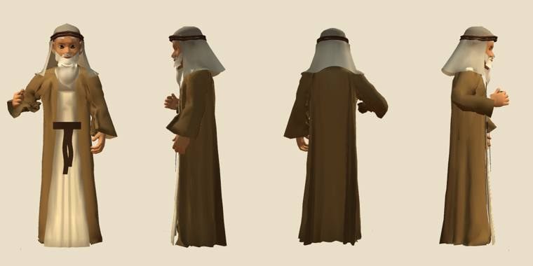
  - 색: 겉옷 #8A6A3E · 속옷 #ECE0C4 · 수염 #D6D0C4 · 머리 #D6D0C4 · 띠 #5A3E28 · 수염 모양 긴 수염
- 다니엘(단 6장). 이 본문은 생김새와 옷을 말하지 않는다. 지팡이 없음. 수염과 옷 색은 감수 대상.
  - 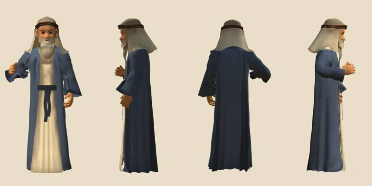
  - 색: 겉옷 #4E5E7E · 속옷 #E8DEC8 · 수염 #A8A296 · 머리 #A8A296 · 수염 모양 긴 수염
- 다리오 왕(단 6장). 이 본문은 생김새와 옷을 말하지 않는다. 왕관과 신상의 무늬는 그리지 않는다. 옷 색은 감수 대상.
  - 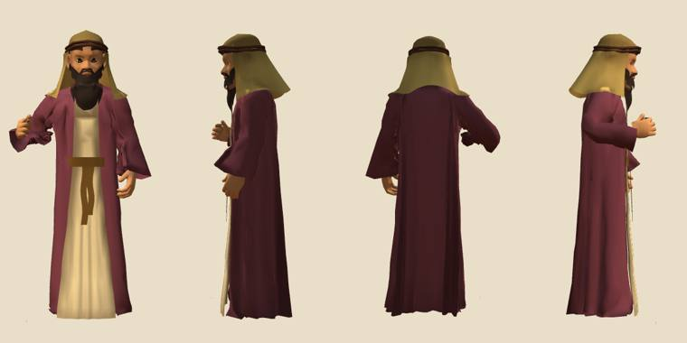
  - 색: 겉옷 #7A3E4E · 속옷 #E2CFA6 · 수염 #2E2420 · 머리 #2E2420 · 띠 #B9893E · 수염 모양 긴 수염
- 다윗(삼상 17장). 소년(17:33, 17:42), 손에 막대기(17:40). 물매와 주머니는 작아서 그리지 않는다. 수염 없음, 옷 색은 본문에 없어 감수 대상. 게임에서 키를 줄여 쓴다(소년).
  - 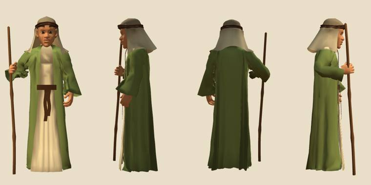
  - 색: 겉옷 #7A8A4A · 속옷 #EADBB6 · 수염 #3A2A1E · 머리 #3A2A1E · 띠 #7A4E2C · 수염 모양 없음
- 엘리야(왕상 18:20-39). 이 본문은 생김새와 옷을 말하지 않는다. 지팡이 없음. 수염과 옷 색은 감수 대상.
  - 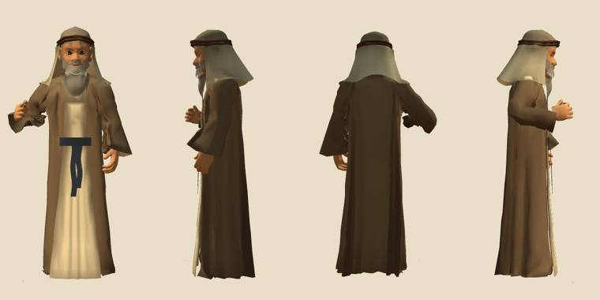
  - 색: 겉옷 #7A6248 · 속옷 #E2D2AE · 수염 #8A8478 · 머리 #8A8478 · 수염 모양 긴 수염
- 학사이며 제사장인 에스라(느 8:1-12). 이 본문은 생김새와 옷을 말하지 않는다. 지팡이 없음(율법책은 게임에서 따로). 제사장 옷은 그리지 않는다. 수염과 옷 색은 감수 대상.
  - 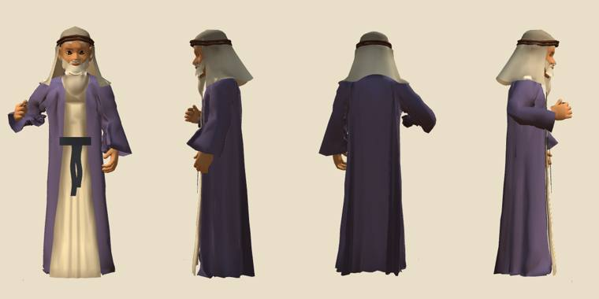
  - 색: 겉옷 #6A5E8A · 속옷 #ECE2CC · 수염 #C8C2B6 · 머리 #C8C2B6 · 수염 모양 긴 수염
- 기드온(삿 6:11-16, 7:1-22). 이 본문은 생김새와 옷을 말하지 않는다. 지팡이 없음. 횃불·항아리·나팔은 게임에서 따로 든다. 수염과 옷 색은 감수 대상.
  - 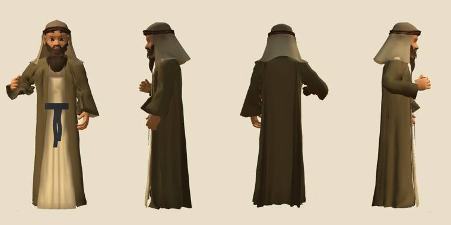
  - 색: 겉옷 #6A5A3A · 속옷 #DCCBA6 · 수염 #3E2E22 · 머리 #3E2E22 · 수염 모양 긴 수염
- 골리앗(삼상 17:4-7). 놋 투구와 비늘 갑옷(17:5), 창(17:7). 놋 각반과 어깨 사이의 단창(17:6)은 그리지 않는다. 키는 여섯 규빗 한 뼘(17:4): 게임에서 크게 늘여 쓴다. 수염과 옷 색은 본문에 없어 감수 대상. 칼과 싸움 장면은 만들지 않는다.
  - 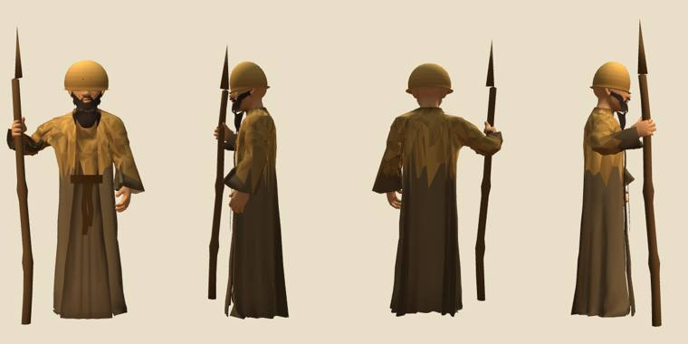
  - 색: 겉옷 #6E5A40 · 속옷 #5E4A34 · 수염 #2E2420 · 머리 #2E2420 · 띠 #6E4A1E · 지팡이 #5A3E22 · 수염 모양 긴 수염
- 느헤미야(느 2:11-20, 6:15-16, 8:1-12). 이 본문은 생김새와 옷을 말하지 않는다. 지팡이 없음. 수염과 옷 색은 감수 대상.
  - 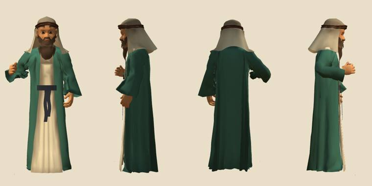
  - 색: 겉옷 #3E6E62 · 속옷 #E6DCC4 · 수염 #4A3A2E · 머리 #4A3A2E · 수염 모양 긴 수염
- 노아(창 6:9-9:17). 본문은 생김새와 옷을 말하지 않는다. 지팡이 없음. 수염과 옷 색은 감수 대상.
  - 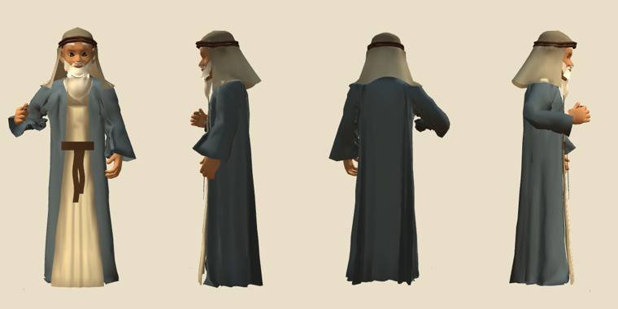
  - 색: 겉옷 #5E6E7A · 속옷 #E6DABA · 수염 #EDE8DC · 머리 #EDE8DC · 띠 #7A5A3A · 수염 모양 긴 수염
- 모세 (설정 글 없이 먼저 만든 인물)
  - 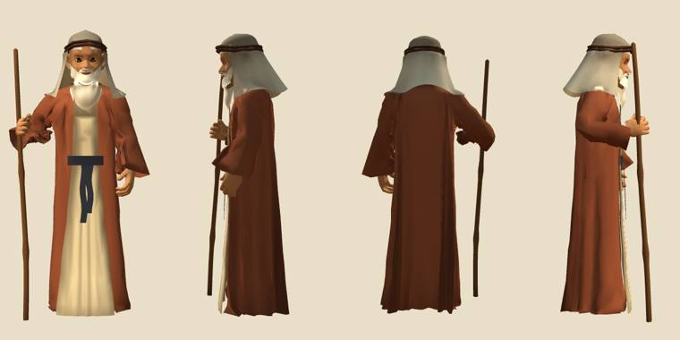
- 여호수아 (설정 글 없이 먼저 만든 인물)
  - 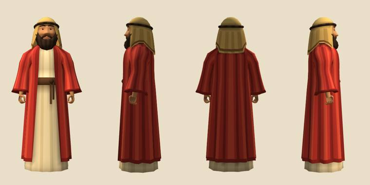
- 제사장 (설정 글 없이 먼저 만든 인물)
  - 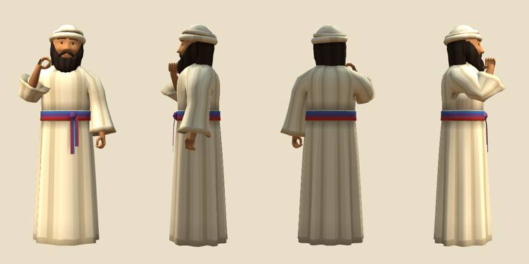

표시: ☐ 그대로 ☐ 고침 ☐ 뺌 　적을 칸: 

#### 공통·화면글 · 공통

*모든 장면에 똑같이 뜨는 글(성경·신앙에 닿는 것)* — 규칙서 4.2, 13.5, 13.8
- 무엇인가: 장면 자료가 아니라 게임 틀에 들어 있어 **모든 장면에서 똑같이 뜨는 글**입니다. 틀린 보기를 골랐을 때의 안내("타임머신 바늘이 엇나갔어요"), 동행·돕기·뜻 묻기의 안내, "감수 전" 표시, 보상 설명 등입니다. 글 가운데가 끊긴 곳은 그 자리에 장절이나 이름이 들어갑니다.
- 여쭙는 것: ① 틀렸을 때의 말투가 아이에게 맞는지 ② "감수 전" 표시 글은 감수를 마친 뒤 지울지, 다른 글로 바꿀지.
- **물음에 답할 때 뜨는 글**
  - 성경에 그렇게 기록되어 있어요.
  - 성경에서 확인해 볼까요?
  - 성경책을 펴서 읽은 뒤 다시 골라 보세요.
  - 타임머신 바늘이 엇나갔어요!
  - 바늘이
  - 쪽으로 흔들렸어요. 그 절은 이 장면의 다른 대목이에요. 물음이 말한 절에는 없어요. 두 절을 읽어 보고, 물음이 말한 절로 돌아와 다시 골라 보세요.
  - 쪽으로 흔들렸어요. 그곳은 이 장면과 다른 이야기예요. 그 절도 읽어 보고, 이 장면의 본문으로 돌아와 다시 골라 보세요.
  - 본문에 없음
  - 그 장과 절에서는 찾는 내용을 확인하지 못했어요. 다시 찾아볼까요?
  - 그 절에 없는 것이 섞여 있어요. 다시 읽고 골라 보세요.
  - 그 절에 나오는 것이 더 있어요. 다시 읽고 모두 골라 보세요.
  - 먼저 구절을 골라요.
  - 왼쪽의 구절 하나를 누른 뒤, 그 구절에 맞는 내용을 눌러 보세요.
  - 구절마다 맞게 이었어요.
  - 그 구절에는 그 내용이 없어요.
  - 성경에 기록된 순서예요.
  - 순서를 다시 살펴볼까요? 성경책을 차례로 읽으며 다시 눌러 보세요.
  - 이 이야기를 성경에서 찾아 읽은 뒤 다시 골라 보세요.
- **이야기 카드 화면의 글**
  - 하나님이 하신 말씀은 성경책에서 직접 읽어요.
  - 감수 필수
  - 놀이 기록 보기
  - 감수 전 시험판입니다. 모든 장면은 목사님 감수를 마치기 전이며, 아이들에게 공개하지 않습니다.
  - 기록 원본
  - 놀이 기록
  - 기록 지우기
  - 장면 사이에 성경이 기록한 곳
  - 이 탐험에서는 장면으로 보지 않지만, 성경은 이 사이에도 이야기를 기록했어요. 성경책에서 직접 찾아 읽어 보세요.
  - 지켜보기
  - 도착했어! 장면을 끝까지 지켜보고, 수리에 쓸 재료를 찾아보자. 사건이 일어나는 자리에는 다가가지 말자.
  - 목사님 감수가 꼭 필요한 장면이에요(감수 전).
  - 지켜보러 가기
  - 성경에 기록된 자기 말만 해요. 실제 말은 성경책에서 읽어요.
  - 의 말은 성경책에서 직접 읽어요.
  - 성경 물음 ·
  - 최현 박사의 대답 · 근거는 성경 장절
  - 오늘의 물음은 목사님 감수를 마치기 전이에요.
  - 눌러서 해 보세요. 성경의 사건은 바꾸지 않고, 곁에서 평범한 일만 해요.
  - 지켜봐요
  - 우리는 손대지 않고 지켜봐요. 성경에 적힌 일은 성경에 적힌 대로 일어나요.
  - 신약과 이어 읽기 · 목사님 감수 전
  - 그 뜻을 성경에서 직접 확인해 보자. 성경책을 펴서 읽어 봐.
  - 탐험 일지에 말씀 카드가 들어왔어요.
  - · 성경책에서 직접 읽어 보세요
  - 한 문장 기도
  - 이번 주 실천 한 가지
  - 기록
  - 탐험 기록
  - 뜻과 삶의 적용을 묻는 질문은 목사님 감수를 마친 뒤 이 자리에 열립니다.
  - 이번 주 실천
  - . 그 시대의 평범한 재료로 부속을 대신 만들어요. 기념품은 가져오지 않아요.
- **3D 탐험 화면의 글**
  - 탐험대가 타고 온 놋쇠 타임머신. 성경에 나오는 물건은 아니다
  - 하나님이 하신 말씀은 성경책에서 직접 읽어요.
  - 지켜보기
  - 성경 물음 ·
  - 이 장면을 끝까지 지켜봐야 떠날 수 있어요.
  - 과거에는 아무것도 남기지 않아요. 가져오는 것은 사진과 기록, 수리에 쓸 재료뿐이에요.
  - 과거에는 아무것도 남기지 않고, 가져오는 것은 사진과 기록뿐이에요.
  - 말씀 카드
  - 다음 장면(하나님의 이름과 세 가지 표징, 출 3:13-4:17)은 목사님 감수를 마친 뒤 열립니다.
  - 찍은 사진이 단서예요. 장절을 성경책에서 찾아보면 더 알 수 있어요.
  - 성경에서 확인
  - 돌아가는 길에 찾은 말씀
  - 길을 잘못 들었지만, 성경의 다른 장면을 직접 보고 왔어요.
  - · 성경책에서 직접 읽어 보세요
  - 성경 탐험대
  - 직접 걸어가서 그 자리를 지켜봐요
  - 감수 전 시험판입니다. 목사님 감수를 마치기 전에는 아이들에게 공개하지 않습니다.
  - 우리는 지켜보는 사람이야. 사건이 일어나는 자리에는 다가가지 말자.
  - 탐험 일지에 말씀 카드가 들어왔어요.
  - 한 문장 기도
  - 이번 주 실천 한 가지
  - 탐험 기록
  - 기록
  - 뜻과 삶의 적용을 묻는 질문은 목사님 감수를 마친 뒤 이 자리에 열립니다.
  - 아지트에서 탐험 모자를 쓸 수 있게 됐어요. 믿음의 점수가 아니라, 다녀온 곳을 기념하는 물건이에요.

표시: ☐ 그대로 ☐ 고침 ☐ 뺌 　적을 칸: 

#### 공통·화면글참고 · 그 밖의 글(참고) · 참고

*단추 이름, 조작 안내, 탐험대 이야기의 고정 글*
- **물음에 답할 때 뜨는 글**
  - 창
  - 창세기
  - 출
  - 출애굽기
  - 레
  - 레위기
  - 민
  - 민수기
  - 신
  - 신명기
  - 수
  - 여호수아
  - 삿
  - 사사기
  - 룻
  - 룻기
  - 삼상
  - 사무엘상
  - 삼하
  - 사무엘하
  - 왕상
  - 열왕기상
  - 왕하
  - 열왕기하
  - 대상
  - 역대상
  - 대하
  - 역대하
  - 스
  - 에스라
  - 느
  - 느헤미야
  - 에
  - 에스더
  - 욥
  - 욥기
  - 시
  - 시편
  - 잠
  - 잠언
  - 전
  - 전도서
  - 아
  - 아가
  - 사
  - 이사야
  - 렘
  - 예레미야
  - 애
  - 예레미야애가
  - 겔
  - 에스겔
  - 단
  - 다니엘
  - 호
  - 호세아
  - 욜
  - 요엘
  - 암
  - 아모스
  - 옵
  - 오바댜
  - 욘
  - 요나
  - 미
  - 미가
  - 나
  - 나훔
  - 합
  - 하박국
  - 습
  - 스바냐
  - 학
  - 학개
  - 슥
  - 스가랴
  - 말
  - 말라기
  - 장
  - 절-
  - 절
  - 읽었어요
  - 찾아서 읽었어요
  - 장과 절을 숫자로 적어 보세요.
  - 맞게 찾았어요.
  - 절.
  - 확인
  - 맞는 것을 모두 찾았어요.
  - 다 골랐어요
  - 을 다시 읽어 볼까요?
  - 다시 놓기
- **이야기 카드 화면의 글**
  - 탐험대 이야기 · 최현 박사의 통신
  - 탐험대 이야기
  - 읽어 주기
  - 🔊 읽어 주기
  - 시대 지도
  - 시대 지도 보기
  - 다음
  - 마침
  - 시대
  - · 잠김
  - 장면 · 부속
  - · 수리 끝!
  - 앞 시대의 장면 하나를 마치면 열려요
  - 구약 전체 · 10개 시대 40장면
  - 마친 장면
  - 모은 재료
  - 시대마다 타임머신 부속을 고쳐요. 앞 시대의 장면 하나를 마치면 다음 시대로 가는 길이 열려요.
  - 수리 현황
  - 비상 착륙 이야기
  - 시대 잠금 다시 켜기
  - 모든 시대 열기(부모·교사)
  - 처음 화면
  - 탐험대 이야기 · 타임머신 부속
  - 고침 (재료
  - 아직 열리지 않았어요
  - 의 장면 하나를 마치면 "
  - " 시대로 가는 길이 열려요.
  - 초
  - 아이 시험용 · 이 기기에만 저장
  - 장면
  - 화면
  - 2초 안에 넘김
  - 머문 시간
  - 나간 곳:
  - 없음
  - 이 시대에서 볼 장면
  - 지도로
  - 첫 장면으로
  - 탐험대 이야기 · 시간 이동
  - · 시대
  - 이 장면은 직접 걸어 다니며 볼 수 있어요. 휴대폰이 느리면 이야기 카드로 볼 수도 있어요.
  - 이야기 카드로
  - 걸어서 탐험 (3D)
  - 동행
  - 현장 돕기
  - 다음으로 가는 관문
  - 재료 찾기
  - 재료 얻기
  - 오늘의 물음
  - 탐험 마치기
  - 이전
  - 이 장면에서 구할 재료
  - 가지
  - 함께 걷기
  - 와
  - 과
  - 함께 걸어요.
  - 는
  - 은
  - 에서 찾아보세요
  - 지금 우리가 궁금한 것
  - 계속
  - 탐험대 이야기 · 현장 돕기
  - 기다렸어요.
  - 탐험대 이야기 · 최현 박사
  - 탐지기가 이 근처를 가리켜요. 땅을 눌러
  - 를
  - 을
  - 찾아보세요.
  - 번 땅
  - 한 번에 찾았어요!
  - 번 만에 찾았어요!
  - 삐삐삐! 아주 가까워요.
  - 삐… 조금 멀어요. 다른 곳을 눌러 보세요.
  - 탐험대 이야기 · 재료 찾기
  - 탐험대 이야기 · 재료를 얻었어요
  - 최현 박사
  - 탐험을 마치며
  - 여기에 적어 보세요. 이 기기에만 저장돼요.
  - 마무리 펼치기 ·
  - 이 장면에서 재료
  - 가지(
  - )를 얻었어요.
  - . 과거에는 아무것도 남기지 않았어요.
  - 다음 시대로
  - 다음 장면
  - 아직 못 얻었어요
  - 재료 정보가 아직 준비되지 않았어요.
  - 타임머신 수리 현황
- **3D 탐험 화면의 글**
  - 타임머신
  - 처음 도착한 자리에 서 있어요.
  - 부품 0 / 3
  - 단서 0 / 5
  - 왼쪽 아래를 누른 채 밀면 걸어요. 오른쪽을 밀면 둘러봐요. 사진기 버튼으로 본 것을 찍어 도감에 담아요.
  - 소리 끄기
  - 소리 켜기
  - 도감 0 / 5
  - 사진 찍기
  - 타임머신에 타기
  - 추리하기
  - 도감
  - 사진에 담긴 것이 없어요. 찍고 싶은 것을 화면 가운데에 놓고 다시 찍어 보세요.
  - 도감에 새로 담았어요:
  - . 도감을 모두 채웠어요!
  - 이미 도감에 있는 사진이에요:
  - 아직 못 찍었어요
  - 탐험 도감
  - 본 것을 사진으로 담아 도감을 채워요.
  - 닫기
  - 재료
  - 부품
  - 계속 탐험하기
  - 탐험대 이야기
  - 탐험대 이야기 · 최현 박사
  - 찾으러 가기
  - 에서 찾아보세요
  - 타임머신까지
  - 얻었어요
  - 끼웠어요
  - 아직 못 찾았어요
  - 빈 액자
  - 잠긴 깃발 색
  - 깃발 색
  - 깃발 없음
  - 없음
  - 쓰고 있어요
  - 쓰기
  - 를 모두 모았고 이 시대의 탐험도 마쳤어요. 이제 떠날 수 있어요.
  - 수리에 쓸 재료가
  - 시간 나침반의 부품이
  - 개 모자라요.
  - 는 모두 모았어요.
  - 다음 시대로 출발
  - 타임머신 아지트
  - 타임머신 수리
  - 시간 나침반 수리
  - 사진 벽
  - 꾸미기
  - 타임머신 깃발 (시대 부속을 고칠 때마다 색이 하나씩 열려요 ·
  - 탐험 모자
  - 탐험 모자 (첫 장면을 마치면 열려요)
  - 밖으로 나가기
  - · 탐험 완료
  - 다음 시대로!
  - 타임머신이 다시 떠올랐어요. 과거에는 아무것도 남기지 않았어요.
  - 장
  - 모은 재료
  - 찾은 부품
  - 시대 지도에서 다음 장면으로 갈 수 있어요.
  - 다른 이름으로 가 보기
  - 처음부터 다시
  - 시대 지도로
  - 시간 이동
  - 타임머신이 이름을 따라 시대를 찾고 있어요.
  - 단서 0 /
  - 추리 수첩 0 /
  - 둘러보자
  - 사진에 단서가 담기지 않았어요. 눈에 띄는 것을 화면 가운데에 놓고 찍어 보세요.
  - 단서
  - 추리 수첩
  - 단서를 찾았어요:
  - 이미 찾은 단서예요:
  - 아직 못 찾은 단서
  - 눈에 띄는 것을 사진으로 찍어 보세요.
  - 다른 점을 모두 찾았어요.
  - 다시 살펴볼까요?
  - 방금 본 장면에 있었던 것만 골라 보세요.
  - 확인
  - 이 물음에 맞는 단서를 아직 못 찾았어요.
  - 조금 더 둘러보며 사진을 찍고 다시 추리해 보세요.
  - 더 찾아보기
  - 그 사진만으로는 알 수 없어요.
  - 다른 단서를 골라 보세요.
  - 증거 고르기
  - 마지막 추리
  - 추리 결과 보기
  - 다음
  - 추리
  - 추리 결과
  - 타임머신 다시 맞추기
  - 모세가 있는 곳으로
  - 살
  - 구약 전체 · 10개 시대 40장면
  - 출애굽기 3장 · 3D 한 장면 샘플
  - 몇 살 탐험대인가요?
  - 누가 되어 탐험할까요?
  - 탐험 시작
  - 탐험대 이야기 ·
  - 최현 박사의 통신
  - 출발하자
  - 이전
  - 다음으로 가는 관문
  - 관문 통과
  - 다음 관문
  - 탐험을 마치며
  - 여기에 적어 보세요.
  - 지금까지
  - 장을 담았어요. 더 둘러보며 남은 사진을 찍을 수 있어요.
  - 남은
  - 개를 찾아 타임머신으로 돌아가요.
  - 를 다 찾았으니 타임머신으로 돌아가요.
  - 처음부터
  - 를 찾아 타임머신으로 돌아가자
  - 타임머신으로 돌아가자

#### 추리·요단강 · 시대 추리

*요단 강 시대 추리 (이름을 잘못 넣으면 가는 곳)* — 수 3:1-17, 출 2:23-25, 3:10
- 무엇인가: 호렙 산 장면(OT-09)을 마친 뒤 "다른 이름으로 가 보기"를 누르면, 타임머신에 넣을 이름을 고르는 물음이 나옵니다. 모세가 아닌 이름을 고르면 요단 강을 건너는 장면(수 3:1-17)에 도착하고, 아이는 단서를 사진으로 찍어 "여기가 언제 어디인지"를 추리한 뒤 돌아옵니다. 규칙서 2절 "잘못된 선택"의 방식이며, 구약 40장면과는 따로 있는 길입니다.
- 여쭙는 것: ① "잘못 간 길"이라는 틀로 성경의 다른 장면을 보여 주는 방식 ② 언약궤를 덮개로 덮은 모습으로 그린 것(민 4:5-6) ③ 아래 글과 배치. 이 길을 공개판에서 닫는 것이 낫다고 보시면 "뺌"으로 표시해 주세요.
- **3D 배치 메모**
  - 3D 샘플의 두 번째 장소: 요단 강을 건너는 백성 (여호수아 3:1-17).
  - 본문에 맞춘 점
  -  - 물은 "심히 멀리" 쌓였고(수 3:16) 건너는 곳에서 보였다는 말이 없으므로 쌓인 물은 그리지 않는다.
  -    보이는 것은 물이 끊어져 드러난 강바닥이다.
  -  - 백성은 궤와 거리를 두라는 명을 받았다(수 3:4, 약 이천 규빗). 화면에 담기 위해 축척을 줄였지만,
  -    행렬과 아이들의 자리를 궤에서 멀리 둔다.
  -  - 궤는 덮개로 덮어 멘다(민 4:5-6). 이 장면에 모세는 없다.
  -  - 지도자는 서 있을 뿐, 강을 가리키거나 손을 내밀지 않는다. 물이 멈춘 것은 제사장들의 발이 물에 닿았을 때다(수 3:15-16).
  - 본문에 근거가 없어 감수가 필요한 설정: 지도자가 선 자리, 제사장의 수(넷), 제사장 옷의 색, 백성이 건너는 쪽,
  -  강가에서 성읍이 보이는 것, 강가의 풀과 곡식밭.
  - 세 아이는 이쪽 둑 위에서만 다닌다. 강바닥과 백성의 행렬 안으로는 들어가지 않는다.
- **이름 고르기 물음**
  - 출 3:10
  - 백성의 부르짖음을 하나님이 들으셨어요. 하나님이 이 백성을 애굽에서 데리고 나오라고 부르신 사람은 누구일까요? 그 사람이 있는 곳으로 가요.
  - 하나님이 백성의 부르짖음을 들으셨어요. 이제 하나님이 이 백성을 인도해 내라고 부르신 사람에게 가야 해요. 타임머신에 누구의 이름을 넣을까요?
  - 다음 목적지는 하나님이 이스라엘을 애굽에서 인도해 내도록 부르신 사람이 있는 곳이다. 타임머신은 인물의 이름으로 시대를 찾는다. 누구의 이름을 입력할까?
  - 보기: 모세
  - 보기: 여호수아
  - 보기: 요셉
- **요단 강 장면의 글(3D)**
  - 여기는 어디일까?
  - 곳: 요단 강, 여리고 맞은편
  - 수 3:1-17
  - 타임머신이 멈췄어요. 그런데 우리가 찾던 곳과 달라 보여요.
  - 타임머신이 멈췄어요. 그런데 우리가 찾던 곳과 달라 보여요. 여기가 언제, 어디인지 사진으로 단서를 모아 알아내요.
  - 타임머신이 멈췄다. 그런데 우리가 찾던 곳과 달라 보인다. 여기가 언제, 어디인지 사진으로 단서를 모아 알아내자.
  - 글: 어? 강이 있어. 사람들이 정말 많아!
  - 사진을 찍어 단서를 모으자
  - 단서가 모였어. 추리해 보자
  - 강바닥에는 내려가지 말자. 우리는 지켜보는 사람이야.
  - 사람들 사이에 끼어들지 말자. 여기서 지켜보자.
  - 이름: 물이 끊어진 강바닥
  - 수 3:16
  - 강바닥이 드러나 있어요. 위에서 흘러오던 강물이 멈추어 멀리 한곳에 쌓였어요.
  - 강바닥이 드러나 있어요. 위에서 흘러내리던 물이 멈추어 멀리 한곳에 쌓였어요.
  - 강바닥이 드러나 있다. 위에서 흘러내리던 물이 그쳐 먼 곳에 한데 쌓였고, 아래로 흘러가던 물은 완전히 끊어졌다.
  - 이름: 궤를 멘 사람들
  - 수 3:17
  - 궤의 덮개는 민수기 4장 5-6절을 따라 그렸어요.
  - 사람들이 궤를 메고 강 한가운데 마른 땅에 서 있어요. 이 사람들이 누구인지 성경에서 찾아보세요.
  - 사람들이 궤를 메고 강 한가운데 마른 땅에 든든히 서 있어요. 이 사람들이 누구이고 무엇을 멨는지 성경에서 찾아보세요.
  - 사람들이 궤를 메고 강 한가운데 마른 땅에 든든히 서 있다. 그들이 누구이고 무엇을 멨는지 본문에서 확인하자.
  - 이름: 백성을 이끄는 사람
  - 수 3:7
  - 백성을 이끄는 사람이 있어요. 이 사람의 이름을 성경에서 찾아보세요.
  - 백성을 이끄는 사람이 있어요. 하나님이 이 사람에게 말씀하셨어요. 이름을 성경에서 찾아보세요.
  - 백성을 이끄는 사람이 있다. 여호와께서 이 사람에게 말씀하셨다. 그의 이름을 본문에서 확인하자.
  - 이름: 강을 건너는 백성
  - 많은 사람이 마른 땅을 밟고 강을 건너고 있어요.
  - 온 백성이 마른 땅을 밟고 강을 건너고 있어요.
  - 온 백성이 마른 땅을 밟고 강을 건너고 있다.
  - 이름: 강 건너편의 성읍
  - 강 건너편에 성읍이 있어요. 백성은 그 성읍 앞쪽으로 건너고 있어요.
  - 강 건너편에 성읍이 있어요. 백성은 그 성읍 앞쪽으로 건너고 있어요. 성읍의 이름을 성경에서 찾아보세요.
  - 강 건너편에 성읍이 있다. 백성은 그 성읍 맞은편으로 곧장 건너고 있다. 성읍의 이름을 본문에서 확인하자.
  - 여기가 어떤 곳인지 보여 주는 사진을 골라 보세요.
  - 이곳이 어떤 곳인지 보여 주는 사진을 고르자.
  - 글: 이곳에는 강이 있고, 백성이 마른 땅을 밟고 그 강을 건너고 있어요.
  - 글: 궤를 멘 사람들이 강 한가운데 마른 땅에 서 있어요. 이곳은 강이에요.
  - 백성을 이끄는 사람이 누구인지 알려 주는 사진을 골라 보세요.
  - 백성을 이끄는 사람이 누구인지 알려면 어느 사진의 장절을 찾아봐야 할까요?
  - 백성을 이끄는 사람이 누구인지 확인하려면 어느 사진의 장절을 찾아야 할까?
  - 성경책에서 여호수아 3장 7절을 찾아 읽어 보세요.
  - 여호수아 3장 7절을 찾아 읽어 보자.
  - 물음: 하나님이 누구에게 말씀하셨나요?
  - 보기: 모세
  - 보기: 여호수아
  - 보기: 아론
  - 이때가 모세가 하나님의 부르심을 받은 때(출애굽기 3장)보다 뒤라는 것을 알려 주는 사진을 골라 보세요.
  - 이때가 모세가 하나님의 부르심을 받은 때(출애굽기 3장)보다 뒤임을 알려 주는 사진을 고르자.
  - 글: 언약궤는 백성이 애굽에서 나와 시내 광야에 머물 때 만들어졌어요.
  - 출 19:1, 37:1
  - 여호수아가 백성을 이끌게 된 것은 모세가 죽은 뒤의 일이에요.
  - 여호수아가 백성을 이끌게 된 것은 모세가 죽은 뒤의 일이다. 어느 절에 적혀 있는지는 뒤의 물음에서 찾아보자.
  - 수 1:1-2
  - 글: 모세가 부르심을 받았을 때 이스라엘 백성은 아직 애굽에 있었어요.
  - 출 3:7, 3:10
  - 이 강의 이름을 성경책에서 찾아보세요. 여호수아 3장 17절이에요.
  - 이 강의 이름을 성경책 여호수아 3장 17절에서 찾아보세요.
  - 이 강의 이름을 여호수아 3장 17절에서 확인하자.
  - 물음: 백성이 건넌 강의 이름은 무엇인가요?
  - 보기: 홍해
  - 보기: 요단
  - 보기: 나일
  - 여기는 요단 강이에요. 모세가 죽은 뒤, 여호수아가 백성을 이끌고 마른 땅으로 강을 건너던 때예요.
  - 이곳은 요단 강이다. 모세가 죽은 뒤, 여호수아가 백성을 이끌고 마른 땅으로 강을 건너던 때다.
  - 글: 궤를 멘 사람들은 제사장들이고, 그 궤는 언약궤예요.
  - 글: 강 건너편의 성읍은 여리고예요.
  - 글: 우리가 찾는 사람은 여호수아가 아니었어. 성경에서 다시 확인하고 가자.
- **돌아오는 관문과 말씀 카드(시범판 자료 ALT-02를 함께 씀)**
  - 제목: 요단 강을 건너는 백성
  - 수 3:1-17
  - 곳: 요단 강, 여리고 맞은편
  - 수 3:1, 3:7
  - 강가에 많은 사람이 모여 있어요. 백성을 이끄는 사람은 여호수아예요.
  - 여호수아와 백성이 요단 강가에 이르렀어요. 하나님이 여호수아에게 말씀하셨어요.
  - 여호와께서 여호수아에게, 모세와 함께 있었던 것같이 그와 함께 있음을 온 이스라엘이 알게 하겠다고 하셨다.
  - 글: 떨기나무는 어디 있지? 여긴 큰 강이잖아.
  - 수 3:14-15
  - 제사장들이 언약궤를 메고 백성 앞에서 나아갔어요.
  - 제사장들이 언약궤를 메고 백성 앞에서 나아갔어요. 곡식 거두는 때라 요단 강물이 언덕까지 넘치고 있었어요.
  - 백성이 요단을 건너려고 장막을 떠날 때 제사장들이 언약궤를 메고 백성 앞에서 나아갔다. 요단은 곡식 거두는 시기 내내 언덕에 넘쳤다.
  - 글: 제사장들이 메고 있는 저것이 언약궤야.
  - 수 3:15-16
  - 제사장들의 발이 물에 닿자, 흘러오던 강물이 멈추어 쌓였어요.
  - 궤를 멘 제사장들이 물가에 발을 들여놓자, 위에서 흘러내리던 물이 멈추어 멀리 아담 성읍 쪽에 쌓였어요.
  - 궤를 멘 제사장들이 물가에 발을 들여놓자 위에서 흘러내리던 물이 그쳐, 멀리 사르단에 가까운 아담 성읍 쪽에 쌓였다. 염해로 흘러가던 물은 완전히 끊어졌다.
  - 글: 물이 멈췄어! 그런데 여기는 호렙 산이 아니라 요단 강이야.
  - 수 3:16-17
  - 제사장들은 강 가운데 마른 땅에 서 있었고, 백성은 마른 땅으로 강을 건넜어요.
  - 제사장들은 강 한가운데 마른 땅에 든든히 서 있었고, 그동안 온 백성이 마른 땅을 밟고 건넜어요. 건너편은 여리고 앞이에요.
  - 백성은 여리고 맞은편으로 곧장 건넜다. 궤를 멘 제사장들이 강 한가운데 마른 땅에 든든히 서 있는 동안, 온 이스라엘이 마른 땅을 밟고 건너갔다.
  - 글: 모세가 보이지 않아. 우리가 가려던 곳이 맞는지 확인해 보자.
  - 물음: 우리가 가려던 곳과 다른 점 세 가지를 찾아 눌러 보세요.
  - 글: 여기는 호렙 산이 아니라 요단 강이에요.
  - 수 3:15
  - 글: 제사장들이 언약궤를 메고 있어요.
  - 수 3:14
  - 글: 백성을 이끄는 사람은 모세가 아니라 여호수아예요.
  - 수 3:7
  - 물음: 이곳이 우리가 가려던 곳과 다른 점을 모두 골라 보세요.
  - 보기: 백성이 강을 건너고 있다
  - 수 3:17
  - 보기: 백성을 이끄는 사람이 여호수아다
  - 보기: 떨기나무에 불이 붙어 있다
  - 보기: 제사장들이 언약궤를 메고 있다
  - 물음: 여호수아가 백성을 이끌게 된 것은 모세가 죽은 뒤의 일이다. 그 사실이 적힌 절을 여호수아 1장에서 찾아 장과 절을 적어 보자.
  - 여호수아
  - 찾는 실마리: 1장의 첫머리를 읽어 보자.
  - 출 3:4
  - 성경책에서 출애굽기 3장 4절을 찾아 읽어 보세요.
  - 타임머신을 다시 맞춰야 해요. 성경책에서 출애굽기 3장 4절을 찾아 읽어 보세요.
  - 목적지를 다시 정하자. 출애굽기 3장 4절을 찾아 읽어 보자.
  - 물음: 하나님이 떨기나무 가운데서 부르신 사람은 누구인가요?
  - 보기: 모세
  - 보기: 아론
  - 제목: 마른 땅으로 요단을 건넘
- **이름 고르기 앞에 보여 주는 배경(시범판 자료 EX-00. 3D 게임은 이 가운데 넷째 대목을 씀)**
  - 제목: 애굽의 종살이와 부르짖음
  - 출 1:8-14, 2:23-25
  - 곳: 애굽, 국고성을 짓는 곳
  - 출 1:8-10
  - 애굽에 새 왕이 나타났어요. 이 왕은 요셉을 알지 못했어요.
  - 요셉을 알지 못하는 새 왕이 애굽을 다스리게 되었어요. 왕은 이스라엘 자손이 점점 많아지는 것을 두려워했어요.
  - 요셉을 알지 못하는 새 왕이 일어났다. 그는 이스라엘 자손이 자기 백성보다 많고 강하다고 말하며, 더 많아지는 것을 두려워했다.
  - 글: 여기가 애굽이야? 햇볕이 정말 뜨거워.
  - 출 1:11
  - 애굽 사람들은 감독들을 세워서 이스라엘 사람들에게 무거운 짐을 지게 했어요.
  - 애굽 사람들은 감독들을 세워 무거운 짐을 지웠어요. 이스라엘 자손은 바로를 위해 국고성 비돔과 라암셋을 지어야 했어요.
  - 애굽 사람들은 감독들을 세워 이스라엘 자손에게 무거운 짐을 지워 괴롭게 했다. 이스라엘 자손은 바로를 위해 국고성 비돔과 라암셋을 건축했다.
  - 글: 저 성을 짓는 사람들이 이스라엘 자손이구나. 일지에 적어 둘게.
  - 출 1:13-14
  - 흙을 이기고 벽돌을 굽는 힘든 일을 해야 했어요.
  - 흙 이기기, 벽돌 굽기, 밭일까지. 애굽 사람들은 이스라엘 자손에게 고된 일을 시켰어요.
  - 흙 이기기와 벽돌 굽기, 온갖 농사일로 그들의 삶은 괴로웠다. 시키는 일이 모두 가혹했다.
  - 글: 우리는 지켜보기만 하자. 여기서 일어난 일은 성경에 기록된 그대로야.
  - 출 2:23-25
  - 이스라엘 사람들은 너무 힘들어서 부르짖었어요. 하나님이 그 소리를 들으셨어요.
  - 고된 일 때문에 이스라엘 자손이 부르짖었어요. 하나님은 그 소리를 들으시고 아브라함, 이삭, 야곱과 세우신 언약을 기억하셨어요.
  - 이스라엘 자손이 고된 노동 때문에 탄식하며 부르짖었고, 그 소리가 하나님께 이르렀다. 하나님은 그들의 신음을 들으시고, 아브라함, 이삭, 야곱과 맺으신 언약을 기억하셨다.
  - 글: 하나님이 들으셨대! 그럼 이제 어떻게 되는 거야?
  - 물음: 애굽 사람들이 이스라엘 사람들에게 시킨 힘든 일은 무엇인가요?
  - 출 1:14
  - 보기: 흙을 이겨 벽돌을 만드는 일
  - 보기: 큰 배를 만드는 일
  - 보기: 밤마다 별을 세는 일
  - 물음: 이스라엘 자손이 바로를 위해 지은 국고성 두 곳은 어디인가요?
  - 보기: 비돔과 라암셋
  - 보기: 소돔과 고모라
  - 보기: 벧엘과 아이
  - 물음: 하나님은 부르짖는 소리를 들으시고 누구와 세우신 언약을 기억하셨나요?
  - 출 2:24
  - 보기: 아브라함, 이삭, 야곱
  - 보기: 노아, 셈, 함
  - 보기: 모세, 아론, 미리암
  - 물음: 부르짖음을 들으신 하나님이 무엇을 기억하셨는지 적힌 절을 출애굽기 2장에서 찾아 장과 절을 적어 보자.
  - 출애굽기
  - 찾는 실마리: 2장의 끝부분을 천천히 읽어 보자.
  - 제목: 언약을 기억하심
  - 글: 하나님, 오늘 읽은 말씀을 잊지 않게 해 주세요. 예수님의 이름으로 기도합니다. 아멘.
  - 글: 이번 주에 출애굽기 1장 8절부터 14절, 2장 23절부터 25절까지 소리 내어 읽어 보세요.
  - 물음: 출 1:8-14와 2:23-25에서 새로 알게 된 사실을 한 가지 적어 보자.

표시: ☐ 그대로 ☐ 고침 ☐ 뺌 　적을 칸: 

#### 여쭘·마2 · 대표가 여쭙는 것

*시대 묶음(만나를 "광야" 시대에 둔 것)이 괜찮은지는 목사님께도 여쭙니다.* — 대표 결재지 마2
- 배경: 만나 장면(OT-13, 출 16장)이 시내 산 장면(OT-12, 출 19~20장) 뒤에 있어 본문의 차례와 반대입니다. 장면 번호는 그대로 두고, 만나 장면 첫머리에 "시내 산에 이르기 전의 일"이라는 안내 한 줄을 넣을까요?
- 지금: 그대로 둠
- 대표에게 드린 추천: 예 — 번호를 바꾸면 모든 갈래의 파일 이름과 기록이 어긋납니다. 안내 한 줄은 본문(출 16:1, 19:1)이 말하는 사실입니다.

표시: ☐ 지금대로 ☐ 바꿈 ☐ 의논 필요 　적을 칸: 

#### 여쭘·마6 · 대표가 여쭙는 것

*야곱의 꿈(OT-07)의 사닥다리를 그릴지는 그 위에 여호와께서 서 계셨다는 본문(창 28:13) 때문에 목사님께 여쭙니다. 지금은 그리지 않습니다.* — 대표 결재지 마6
- 배경: 이야기 카드 배경 그림에서 본문이 생김새를 말하지 않는 것(에덴의 열매, 바벨의 대, 애굽의 방, 창의 붉은 줄 등)을 지금처럼 눈에 띄지 않게, 그리지 않는 쪽으로 둘까요?
- 지금: 거의 눈에 띄지 않게 또는 그리지 않음
- 대표에게 드린 추천: 예 — 본문이 말하지 않는 것은 덜 그리는 쪽이 규칙서 3.3에 맞습니다.

표시: ☐ 지금대로 ☐ 바꿈 ☐ 의논 필요 　적을 칸: 

#### 여쭘·마10 · 대표가 여쭙는 것

*말씀을 "모으는 물건"처럼 느끼게 하지 않는지는 목사님께도 여쭙니다(규칙서 3.3 "신앙을 점수로 매기지 않는다").* — 대표 결재지 마10
- 배경: (play 갈래에서 새로 만든 기능. 지금 미리보기에는 아직 없음) 아이 화면에 모은 수(말씀 카드 "N / 80", 재료 "N / 64")를 보여 줄까요?
- 지금: 보여 줌
- 대표에게 드린 추천: 예 — 모은 것을 돌아볼 거리가 되지만, 다 채우고 싶게 할 수 있습니다(규칙서 6절 점검표). 64는 3D 장면 수에 따라 바뀝니다(마1). 깃발 색 수("N / M")와 3D 장면 안의 재료 수는 지금 미리보기에도 이미 있습니다.

표시: ☐ 지금대로 ☐ 바꿈 ☐ 의논 필요 　적을 칸: 

#### 여쭘·마11 · 대표가 여쭙는 것

*하나님이 나타나신 자리의 불을 이렇게 그려도 되는지 목사님께도 여쭙니다. 감수 자료의 3D 화면 사진(OT-09 떨기나무, OT-30_3 갈멜 산의 불)에 불이 보입니다. 이야기 카드 그림은 합친 뒤 따로 보여 드립니다.* — 대표 결재지 마11
- 배경: 불을 그린 곳(이야기 카드 그림의 OT-09 불붙은 떨기나무 출 3:2, OT-30 여호와의 불 왕상 18:38, OT-12 산 위의 불 출 19:18, 그리고 3D의 OT-09·OT-30)을 대표께서 한 번 보시고, 불 안에 얼굴이나 사람 모양으로 보이는 것이 없는지 확인해 주시겠습니까?
- 지금: 그림: 떨기나무는 불꽃 세 겹, 갈멜 산은 단을 덮는 불(빛줄기·번개 없음), 시내 산은 구름 뒤의 붉은 빛
- 대표에게 드린 추천: 예 — 규칙서 2절(하나님 표현: 형상 없이 성경에 기록된 불·구름·빛과 말씀 자막만)과 3.3에 걸리는지는 사람 눈으로 봐야 압니다. art 갈래는 OT-12에서 불길이 구름과 겹쳐 얼굴처럼 보여 빛으로만 바꿨다고 적었습니다. 3D의 두 장면은 지금 미리보기에 있고, 이야기 카드 그림은 art 갈래를 합친 뒤에 보실 수 있습니다.

표시: ☐ 지금대로 ☐ 바꿈 ☐ 의논 필요 　적을 칸: 

#### 여쭘·마12 · 대표가 여쭙는 것

*유월절의 핵심 표지인 피를 그림에서 빼는 것이 이 장면의 뜻을 흐리지 않는지 목사님께도 여쭙니다.* — 대표 결재지 마12
- 배경: 유월절에 문에 바른 피(OT-10, 출 12:7·12:22)를 이야기 카드 그림에서 지금처럼 빼 둘까요? (다른 길: 멀리서 문설주에 색만 넣기)
- 지금: 그리지 않음(설주와 인방이 있는 문만)
- 대표에게 드린 추천: 예 — 피는 "피·폭력을 그리지 않는다"는 규칙에 걸립니다. 글과 성경 읽기로는 그대로 나옵니다. art 갈래는 멀리서 색만 넣는 길도 대표·목회자가 정할 일로 남겼습니다.

표시: ☐ 지금대로 ☐ 바꿈 ☐ 의논 필요 　적을 칸: 

#### 여쭘·마26 · 대표가 여쭙는 것

*하나님의 말씀만 있는 대목(OT-40 전체, OT-20 수 24:2-7)을 풍경으로 꾸며도 되는지 목사님께도 여쭙니다. OT-40은 감수 필수 장면입니다.* — 대표 결재지 마26
- 배경: 말씀만 나오는 대목의 이야기 카드 그림을 장면 자료대로 꾸미지 않을까요? OT-40은 장면 자료가 "배경을 꾸미지 않고 말씀 자막과 성경책을 펴는 화면"으로 정했는데 그림은 본문에 나오는 자리(멀리 전, 호렙, 그 땅)를 그렸고, OT-20의 되돌아보는 말씀(수 24:2-7)도 '강 저편'·'광야' 풍경으로 그렸습니다.
- 지금: 그림은 본문의 자리를 꾸밈없이 그림(장면 자료와 다름)
- 대표에게 드린 추천: 예 — 장면 자료와 규칙서 2절(하나님 표현: 말씀 자막만)에 맞추는 쪽입니다. "예"이면 OT-40은 시대 풍경 한 장, OT-20은 세겜의 같은 자리를 되풀이합니다.

표시: ☐ 지금대로 ☐ 바꿈 ☐ 의논 필요 　적을 칸: 

