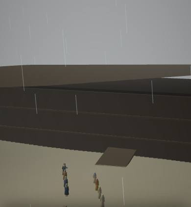
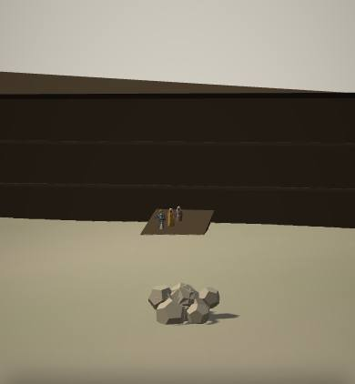
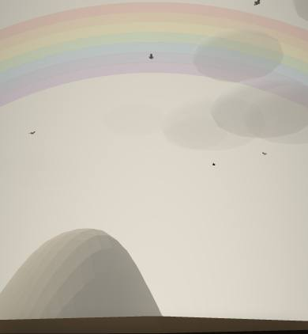

# 감수 자료 · 시대 1. 창조와 타락

자료 판 `0a3481ff` · `node tools/make_review_pack.js`가 만든 파일입니다(손으로 고치지 않습니다). 게임에 나오는 문장은 글자 그대로이고, 성경 본문은 싣지 않았습니다(장절만).

#### 시대1·안내 · 시대 안내

*1. 창조와 타락*
- 최현 박사의 통신(탐험대 이야기): 시간 계기판이 맨 처음 시대를 가리키고 있어. 여기서부터 차례로 가 보자.
- "이 사이에 성경이 기록한 곳"으로 보여 주는 장절(요약 없이 장절만): 창 2:4-14 · 창 2:18-25 · 창 4:1-6:8 · 창 9:18-10:32

표시: ☐ 그대로 ☐ 고침 ☐ 뺌 　적을 칸: 

#### 시대1·마무리 · 마무리(기도·실천)

*이 시대 장면들의 한 문장 기도(8~10세)와 한 주 실천(11~13세). 꼴은 "공통·마무리"에서*
- **OT-01 하나님이 천지를 지으심** (창 1:1-2:3)
  - 8~10세 기도: 하나님, 하늘과 땅과 모든 것을 하나님이 지으셨음을 기억하게 해 주세요. 예수님의 이름으로 기도합니다. 아멘.
  - 11~13세 실천: 이번 주에 창세기 1장 1절부터 2장 3절까지 소리 내어 읽어 보세요.
  - 14~19세 기록 물음: 창 1:1-2:3에서 새로 알게 된 사실을 한 가지 적어 보자.
- **OT-02 에덴 동산과 사람의 범죄** (창 2:15-17)
  - 8~10세 기도: 하나님, 하나님이 하신 말씀을 잘 듣고 기억하게 해 주세요. 예수님의 이름으로 기도합니다. 아멘.
  - 11~13세 실천: 이번 주에 창세기 3장 1절부터 13절까지 소리 내어 읽어 보세요.
  - 14~19세 기록 물음: 창 3:1-24에서 새로 알게 된 사실을 한 가지 적어 보자.
- **OT-03 노아의 방주와 무지개 언약** (창 6:9-9:17)
  - 8~10세 기도: 하나님, 무지개를 볼 때 하나님이 세우신 언약을 기억하게 해 주세요. 예수님의 이름으로 기도합니다. 아멘.
  - 11~13세 실천: 이번 주에 창세기 9장 8절부터 17절까지 소리 내어 읽어 보세요.
  - 14~19세 기록 물음: 창 6:9-9:17에서 새로 알게 된 사실을 한 가지 적어 보자.
- **OT-04 바벨에서 흩어짐** (창 11:1-9)
  - 8~10세 기도: 하나님, 바벨에서 있었던 일을 성경에서 읽고 기억하게 해 주세요. 예수님의 이름으로 기도합니다. 아멘.
  - 11~13세 실천: 이번 주에 창세기 11장 1절부터 9절까지 소리 내어 읽어 보세요.
  - 14~19세 기록 물음: 창 11:1-9에서 새로 알게 된 사실을 한 가지 적어 보자.

표시: ☐ 그대로 ☐ 고침 ☐ 뺌 　적을 칸: 

### OT-01 하나님이 천지를 지으심 (창 1:1-2:3)

- 곳: 하나님이 지으신 하늘과 땅
- 감수 필수: 아니오
- 화면: 이야기 카드 · 감수 상태: 미감수

#### OT-01·대목 · 대목 글(장면 전체) · 참고

*대목 7개* — 창 1:1-2:3
- 이 장면에서 검증자가 여쭌 것 2가지는 아래 "검증자가 남긴 것" 항목에 따로 있습니다. 대목 글을 고치실 때는 "대목 몇, 몇 세 글"인지 적어 주세요.
- **대목 1** (창 1:1-2)
- 8~10세: 맨 처음에 하나님이 하늘과 땅을 지으셨어요. 땅은 아직 비어 있었고, 깊은 물 위에는 어둠이 있었어요.
- 11~13세: 태초에 하나님이 하늘과 땅을 창조하셨어요. 땅은 모양이 잡히지 않은 채 비어 있었고, 어둠이 깊은 물 위에 있었어요. 하나님의 영은 물 위에 움직이고 계셨어요.
- 14~19세: 태초에 하나님이 천지를 창조하셨다. 땅은 혼돈하고 공허했으며 어둠이 깊음 위에 있었고, 하나님의 영은 수면 위에 운행하고 계셨다.
  - 휴의 말: 성경의 맨 처음이야. 창세기 1장 1절부터 차례대로 적어 둘게.
- **대목 2** (창 1:3-5)
- 8~10세: 하나님이 빛이 있으라고 하시자 빛이 생겼어요. 빛을 낮, 어둠을 밤이라 부르신 이날이 첫째 날이에요.
- 11~13세: 하나님이 빛이 있으라고 하시자 빛이 있었어요. 그 빛은 하나님이 보시기에 좋았어요. 하나님은 빛과 어둠을 나누시고 빛을 낮, 어둠을 밤이라 부르셨어요. 저녁이 되고 아침이 되니 첫째 날이었어요.
- 14~19세: 하나님이 빛이 있으라고 하시니 빛이 있었고, 그 빛은 하나님 보시기에 좋았다. 하나님은 빛과 어둠을 나누어 빛을 낮이라, 어둠을 밤이라 부르셨다. 저녁이 되고 아침이 되니 첫째 날이었다.
  - 온우의 말: 하나님이 하신 말씀은 우리가 지어내면 안 돼. 창세기 1장 3절에서 직접 읽어 보자.
- **대목 3** (창 1:6-13)
- 8~10세: 둘째 날에 하나님은 궁창을 만드시고 하늘이라 부르셨어요. 셋째 날에는 물을 한곳에 모아 땅과 바다가 되게 하시고, 땅에서 풀과 나무가 나게 하셨어요.
- 11~13세: 둘째 날에 하나님은 궁창을 만들어 그 아래의 물과 위의 물을 나누시고, 궁창을 하늘이라 부르셨어요. 셋째 날에는 하늘 아래의 물을 한곳에 모아 뭍이 드러나게 하시고, 뭍을 땅, 모인 물을 바다라 부르셨어요. 땅은 풀과 씨 맺는 채소와 열매 맺는 나무를 냈어요.
- 14~19세: 둘째 날, 하나님은 물 가운데 궁창을 만들어 궁창 아래의 물과 궁창 위의 물을 나누시고 궁창을 하늘이라 부르셨다. 셋째 날, 하늘 아래의 물이 한곳으로 모여 뭍이 드러났고, 하나님은 뭍을 땅이라, 모인 물을 바다라 부르셨다. 땅은 풀과 씨 맺는 채소와 씨 가진 열매를 맺는 나무를 저마다 종류대로 냈고, 하나님 보시기에 좋았다.
  - 최온의 말: 하늘이 생기고, 땅과 바다가 나뉘고, 땅에서 풀과 나무가 났대!
- **대목 4** (창 1:14-19)
- 8~10세: 넷째 날에 하나님은 하늘에 큰 빛 둘과 별들을 만드셨어요. 큰 빛은 낮을, 작은 빛은 밤을 맡았어요.
- 11~13세: 넷째 날에 하나님은 하늘의 궁창에 두 큰 광명을 만드셨어요. 큰 광명은 낮을, 작은 광명은 밤을 맡게 하셨고 별들도 만드셨어요. 이 빛들은 낮과 밤을 나누고 땅을 비추었어요.
- 14~19세: 넷째 날, 하나님은 하늘의 궁창에 광명들이 있어 낮과 밤을 나누고 징조와 계절과 날과 해를 이루게 하셨다. 두 큰 광명을 만들어 큰 것은 낮을, 작은 것은 밤을 주관하게 하시고 별들도 만드셨다. 그 광명들을 궁창에 두어 땅을 비추게 하셨고, 하나님 보시기에 좋았다.
  - 휴의 말: 넷째 날은 낮을 맡은 큰 빛, 밤을 맡은 작은 빛, 그리고 별들. 일지에 적었어.
- **대목 5** (창 1:20-23)
- 8~10세: 다섯째 날에 하나님은 물에 사는 생물과 날개 달린 새를 지으셨어요. 그리고 그들에게 복을 주시며 많아지라고 하셨어요.
- 11~13세: 다섯째 날에 하나님은 큰 물고기와 물속에서 움직이는 온갖 생물, 날개 달린 온갖 새를 종류대로 창조하셨어요. 하나님은 그들에게 복을 주시며, 바닷물에 가득하고 새들도 땅에서 많아지라고 하셨어요.
- 14~19세: 다섯째 날, 하나님은 물이 생물로 가득하고 새가 땅 위 하늘의 궁창을 날게 하셨다. 큰 물고기와 물속에서 움직이는 온갖 생물, 날개 달린 온갖 새를 그 종류대로 창조하셨고, 하나님 보시기에 좋았다. 하나님은 그들에게 복을 주시며 생육하고 번성하여 바닷물에 가득하고 새들도 땅에서 번성하라고 하셨다.
  - 최온의 말: 물에는 물고기, 하늘에는 새! 모두 종류대로 지으셨대.
- **대목 6** (창 1:24-31)
- 8~10세: 여섯째 날에 하나님은 땅의 짐승들을 만드시고, 사람을 자기 형상대로 남자와 여자로 지으셨어요. 하나님이 보시기에 모든 것이 매우 좋았어요.
- 11~13세: 여섯째 날에 하나님은 가축과 기는 것과 땅의 짐승을 종류대로 만드셨어요. 또 하나님은 자기의 형상대로 사람을 지으셨는데, 남자와 여자로 창조하셨어요. 하나님은 그들에게 복을 주시며 땅에 가득하고 물고기와 새와 땅의 모든 생물을 다스리라고 하셨어요. 하나님이 지으신 모든 것을 보시니 매우 좋았어요.
- 14~19세: 여섯째 날, 하나님은 들짐승과 가축과 땅 위를 기는 것들을 저마다 종류대로 만드셨고, 보시기에 좋았다. 그리고 자기 형상대로 사람을 지으시되 남자와 여자로 창조하셨다. 하나님은 그들에게 복을 주시며 생육하고 번성하여 땅에 가득하고, 땅을 정복하며, 바다의 물고기와 하늘의 새와 땅에서 움직이는 온갖 생물을 다스리라고 하셨다. 또 씨 맺는 채소와 열매 맺는 나무를 사람에게, 푸른 풀을 짐승과 새와 기는 것에게 먹을거리로 주셨다. 하나님이 지으신 모든 것을 보시니 심히 좋았고, 저녁이 되고 아침이 되니 여섯째 날이었다.
  - 온우의 말: 사람을 어떻게 지으셨는지는 창세기 1장 27절에 적혀 있어. 같이 찾아보자.
- **대목 7** (창 2:1-3)
- 8~10세: 하나님은 모든 일을 마치시고 일곱째 날에 안식하셨어요. 그리고 그날을 복 주시고 거룩하게 하셨어요.
- 11~13세: 하늘과 땅과 모든 것이 다 이루어졌어요. 하나님은 하시던 일을 일곱째 날에 마치시고 그날에 안식하셨어요. 하나님은 일곱째 날을 복 주시고 거룩하게 하셨어요.
- 14~19세: 천지와 만물이 다 이루어졌다. 하나님은 지으시던 일을 일곱째 날에 마치시고 그날에 안식하셨다. 하나님은 일곱째 날을 복되게 하시고 거룩하게 하셨는데, 창조하며 만드시던 일을 모두 마치고 그날에 안식하셨기 때문이다.
  - 휴의 말: 첫째 날부터 여섯째 날까지 지으시고, 일곱째 날에는 안식하셨어. 순서대로 다 적었어.

#### OT-01·돕기1 · 손으로 하는 돕기

*관찰 기록표 정리 · 첫째 날부터 셋째 날까지* — 창 1:3-13
- 돕는 상대: 돕는 상대 없음(창조의 날들을 타임머신 안에서 지켜보며, 우리 관찰 기록을 정리한다)
- 8~10세: 우리는 타임머신 안에서 지금까지 본 것을 관찰 기록표에 정리해요. 날마다 생긴 것을 그날 칸에 적어요.
- 11~13세: 우리는 타임머신 안에서 첫째 날부터 셋째 날까지 지켜본 것을 관찰 기록표에 정리해요. 저녁이 되고 아침이 될 때마다 날이 바뀌었으니, 그 사이에 생긴 것을 그날 칸에 적어요.
- 14~19세: 탐험대는 타임머신 안에서 첫째 날부터 셋째 날까지 지켜본 것을 관찰 기록표에 정리한다. 본문은 날마다 저녁과 아침으로 그날을 맺는다(1:5, 1:8, 1:13). 그 사이에 생긴 것을 그날 칸에 옮겨 적는다.
  - 누르는 일 1: 첫째 날 칸에 빛 적기
  - 누르는 일 2: 둘째 날 칸에 하늘 적기
  - 누르는 일 3: 셋째 날 칸에 땅과 바다, 풀과 나무 적기
  - 마친 뒤 휴의 말: 세 날의 칸을 다 채웠어. 다음 날도 지켜보자.

표시: ☐ 그대로 ☐ 고침 ☐ 뺌 　적을 칸: 

#### OT-01·돕기2 · 손으로 하는 돕기

*관찰 기록표 정리 · 넷째 날부터 여섯째 날까지* — 창 1:14-31
- 돕는 상대: 돕는 상대 없음(창조의 날들을 타임머신 안에서 지켜보며, 우리 관찰 기록을 정리한다)
- 8~10세: 우리는 타임머신 안에서 넷째 날부터 여섯째 날까지 본 것을 관찰 기록표에 이어서 적어요.
- 11~13세: 우리는 타임머신 안에서 넷째 날부터 여섯째 날까지 지켜본 것을 관찰 기록표에 이어서 정리해요. 무엇이 어느 날에 생겼는지 칸을 맞춰 적어요.
- 14~19세: 탐험대는 타임머신 안에서 넷째 날부터 여섯째 날까지 지켜본 것을 관찰 기록표에 이어서 정리한다. 넷째 날은 1:19, 다섯째 날은 1:23, 여섯째 날은 1:31에서 맺는다. 그 사이에 생긴 것을 그날 칸에 옮겨 적는다.
  - 누르는 일 1: 넷째 날 칸에 두 큰 광명과 별들 적기
  - 누르는 일 2: 다섯째 날 칸에 물고기와 새 적기
  - 누르는 일 3: 여섯째 날 칸에 짐승과 사람 적기
  - 마친 뒤 온우의 말: 여섯째 날까지 다 적었어. 맞게 적었는지 창세기 1장에서 다시 확인하자.

표시: ☐ 그대로 ☐ 고침 ☐ 뺌 　적을 칸: 

#### OT-01·뜻 · 뜻 묻기

*사람을 지으신 일은 무슨 뜻이에요?* — 창 1:26-28
- 최온의 물음: 하나님이 사람을 지으시고 복을 주신 건 무슨 뜻이에요?
- 답하는 사람: 최현 박사
- 답 8~10세: 성경은 하나님이 자기 형상대로 사람을 지으시되 남자와 여자로 지으셨다고 말해요. 그리고 그들에게 복을 주시며, 땅에 가득하고 바다와 하늘과 땅의 생물을 다스리라고 하셨어요. 성경은 여기까지 말해요.
- 답 11~13세: 창세기는 하나님이 사람을 만들자고 하시며, 사람이 바다의 물고기와 하늘의 새와 가축과 온 땅을 다스리게 하자고 하셨다고 말해요(1:26). 그리고 자기 형상대로 사람을 남자와 여자로 지으시고(1:27), 복을 주시며 번성하여 땅에 가득하고 모든 생물을 다스리라고 하셨어요(1:28). 형상이 무엇인지는 이 본문이 더 풀어 말하지 않아요.
- 답 14~19세: 창세기는 하나님이 사람을 만들자고 하시며, 그들이 바다의 물고기와 하늘의 새와 가축과 온 땅과 땅을 기는 것들을 다스리게 하자고 하셨다고 기록한다(1:26). 하나님은 자기 형상대로 사람을 지으시되 남자와 여자로 지으셨고(1:27), 그들에게 복을 주시며 번성하여 땅을 채우고 정복하며 땅 위에서 움직이는 생물을 모두 다스리라고 하셨다(1:28). 이 본문은 형상이 무엇인지 더 풀어 말하지 않는다. 성경은 여기까지 말한다.
- **성경을 펴서 뜻 확인하기**
- 8~10세 · 찾아 읽고 고르기: 성경책에서 창세기 1장 27절을 찾아 읽어 보세요. (창 1:27)
  - 물음: 하나님은 사람을 누구의 형상대로 지으셨나요?
  - 맞는 보기: 하나님의 형상
  - 다른 보기: 천사의 모양 (본문에 없음)
  - 다른 보기: 짐승의 모양 (본문에 없음)
- 11~13세 · 찾아 읽고 고르기: 성경책에서 창세기 1장 26절부터 28절까지 읽어 보세요. (창 1:26-28)
  - 물음: 하나님은 무엇을 하게 하시려고 사람을 만들자고 하셨나요?
  - 맞는 보기: 바다와 하늘과 땅의 생물을 다스리게 하시려고
  - 다른 보기: 하나님 대신 해와 별을 움직이게 하시려고 (본문에 없음)
  - 다른 보기: 짐승들을 모두 길들여 가축으로 삼게 하시려고 (본문에 없음)
- 14~19세 · 찾아 읽고 고르기: 창세기 1장 22절과 28절을 함께 찾아 읽어 보자. (창 1:22 · 창 1:28)
  - 물음: 두 곳을 이어 읽으면, 하나님이 복을 주시며 하신 말씀은 물의 생물과 새에게, 그리고 사람에게 각각 어떠했는가?
  - 맞는 보기: 물의 생물과 새에게도 사람에게도 번성하라고 복을 주셨고, 사람에게는 땅을 정복하고 모든 생물을 다스리라는 말씀을 더하셨다
  - 다른 보기: 물의 생물과 새에게는 아무 복도 주지 않으셨다 (본문에 없음)
  - 다른 보기: 사람에게만 번성하라고 하셨고, 다스리라는 말씀은 없었다 (본문에 없음)

표시: ☐ 그대로 ☐ 고침 ☐ 뺌 　적을 칸: 

#### OT-01·오늘1 · 오늘의 물음

*최현 박사가 답함* — 창 2:2-3 · 사 40:28
- 물음: 하나님도 피곤해서 쉬셨어요?
- 답 8~10세: 성경은 하나님이 하시던 일을 다 마치시고 일곱째 날에 안식하셨다고 말해요. 그리고 이사야서는 땅 끝까지 지으신 하나님은 피곤하지도 지치지도 않으신다고 말해요.
- 답 11~13세: 창세기는 하나님이 지으시던 일을 일곱째 날에 다 마치시고 그날에 안식하셨다고 말해요. 그리고 그날을 복 주시고 거룩하게 하셨어요. 이사야서는 땅 끝까지 창조하신 여호와는 피곤하지도 지치지도 않으신다고 말해요.
- 답 14~19세: 창세기는 하나님이 창조하며 만드시던 일을 모두 마치시고 일곱째 날에 안식하셨으며, 그 때문에 그날을 복 주시고 거룩하게 하셨다고 말한다(창 2:2-3). 이사야서는 땅 끝까지 창조하신 영원하신 여호와는 피곤하지도 지치지도 않으신다고 말한다(사 40:28). 성경은 여기까지 말한다.

표시: ☐ 그대로 ☐ 고침 ☐ 뺌 　적을 칸: 

#### OT-01·오늘2 · 오늘의 물음

*최현 박사가 답함* — 창 1:1 · 창 1:3 · 창 1:9 · 시 33:6 · 시 33:9
- 물음: 세상은 처음에 어떻게 생겨났어요?
- 답 8~10세: 성경은 맨 처음에 하나님이 하늘과 땅을 지으셨다고 말해요. 하나님이 말씀하시자 그대로 되었다고 적혀 있어요.
- 답 11~13세: 성경의 첫 절은 태초에 하나님이 하늘과 땅을 창조하셨다고 말해요. 창세기 1장에는 하나님이 말씀하시자 그대로 되었다는 기록이 거듭 나와요. 시편도 여호와의 말씀으로 하늘이 지어졌다고 노래해요.
- 답 14~19세: 성경의 첫 절은 태초에 하나님이 천지를 창조하셨다고 말한다(창 1:1). 창세기 1장은 하나님이 말씀하시자 빛이 있었고, 그 뒤에도 말씀하시는 대로 되었다고 거듭 기록한다(창 1:3, 1:9). 시편 33편도 여호와의 말씀으로 하늘이 지어졌고, 그가 말씀하시자 이루어졌다고 노래한다(시 33:6, 33:9). 성경은 여기까지 말한다.

표시: ☐ 그대로 ☐ 고침 ☐ 뺌 　적을 칸: 

#### OT-01·화면 · 화면 원칙 · 참고

*이야기 카드 장면: 하나님 표현과 그리지 않는 것* — 창 1:1-2:3
- 하나님 표현: 말씀 자막만. 형상 없음. 창 1:3의 빛은 하나님이 있게 하신 것으로 그리고, 하나님을 나타내는 형상으로 쓰지 않음. 음성은 소리로 만들지 않음. 하나님의 영(창 1:2)도 형상으로 그리지 않음
  - 그리지 않는 것: 하나님을 사람, 손, 얼굴로 그리는 것
  - 그리지 않는 것: 하나님의 영을 새나 바람의 형상으로 그리는 것(창 1:2는 글로만)
  - 그리지 않는 것: 사람을 손으로 빚는 모습(이 본문에 없음)
  - 그리지 않는 것: 사람의 벗은 몸을 드러내 그리는 것(멀리서, 풀과 나무에 가려지게 한다)
  - 그리지 않는 것: 세 아이가 창조의 자리에 서 있는 모습(사람이 지어지기 전의 일이다)
  - 그리지 않는 것: 본문에 없는 동물 이름을 본문 사실처럼 붙이는 것

#### OT-01·미해결1 · 검증자가 남긴 것

*8~10세 글에 '궁창'(창 1:6-8)을 풀이말 없이 그대로 둘까요?*
- 검증 기록(OT-01 하나님이 천지를 지으심): 8~10세 문장에 "궁창"이라는 낱말을 그대로 썼다(창 1:6-8). 아이가 펴는 성경책의 낱말과 같게 한 것이다. 쉬운 풀이말을 덧붙일지는 감수 때 정한다.
  - 지금 게임의 글 · 대목 3 · 8~10세: 둘째 날에 하나님은 궁창을 만드시고 하늘이라 부르셨어요. 셋째 날에는 물을 한곳에 모아 땅과 바다가 되게 하시고, 땅에서 풀과 나무가 나게 하셨어요.

표시: ☐ 지금대로 ☐ 바꿈 ☐ 의논 필요 　적을 칸: 

#### OT-01·미해결2 · 검증자가 남긴 것 · ★먼저 볼 30

*창조(창 1:9)를 아이들이 타임머신 안에서 '지켜보기' 단계로 보게 해도 될까요?*
- 검증 기록(물음의 세 단계·현장 돕기): 창조(하나님이 하시는 일)를 "지켜보기" 단계로 두는 것 자체. 형상 없이 글로만 보이고 본문 근거(1:9, 1:7, 1:11)가 있어 원칙에는 맞다고 보았으나, 하나님의 일을 사람의 거룩한 행위와 같은 틀(13.6의 곁에서 보기)에 넣어도 되는지는 목회자가 본다. 작성자가 적은 1:26-28 답의 좁힘도 함께 본다.
  - 지금 게임의 글 · 현장 돕기 단계 1 · 제목: 타임머신 안에서 보기 · 말씀하시자 그대로 됨
  - 지금 게임의 글 · 현장 돕기 단계 1 · 8~10세: 하나님이 물은 한곳에 모이고 뭍은 드러나라고 하시자 그대로 되었어요. 하나님이 하시는 일이에요. 우리는 타임머신 안에서 지켜봐요.
  - 지금 게임의 글 · 현장 돕기 단계 1 · 11~13세: 하나님이 하늘 아래의 물은 한곳에 모이고 뭍은 드러나라고 말씀하시자 그대로 되었어요. 궁창을 만드실 때에도, 땅에 풀과 나무를 내라고 하실 때에도 말씀하신 대로 되었어요. 이것은 하나님이 하시는 일이에요. 우리는 손대지 않고 타임머신 안에서 지켜봐요.
  - 지금 게임의 글 · 현장 돕기 단계 1 · 14~19세: 하나님이 하늘 아래의 물은 한곳에 모이고 뭍은 드러나라고 하시니 그대로 되었다(1:9). 궁창을 만드실 때에도(1:7), 땅에 풀과 채소와 나무를 내라고 하실 때에도(1:11) 그대로 되었다고 적혀 있다. 이것은 하나님이 하시는 일이다. 탐험대는 타임머신 안에서 지켜본다.
  - 지금 게임의 글 · 돕는 상대: 돕는 상대 없음(창조의 날들을 타임머신 안에서 지켜보며, 우리 관찰 기록을 정리한다)
  - 지금 게임의 글 · 현장 돕기 단계 4 · 뜻 묻기의 답 · 8~10세: 성경은 하나님이 자기 형상대로 사람을 지으시되 남자와 여자로 지으셨다고 말해요. 그리고 그들에게 복을 주시며, 땅에 가득하고 바다와 하늘과 땅의 생물을 다스리라고 하셨어요. 성경은 여기까지 말해요.
  - 덧붙임: 마지막 자리는 검증 기록이 함께 보라고 한 창 1:26-28 답(8~10세 글)이다.

표시: ☐ 지금대로 ☐ 바꿈 ☐ 의논 필요 　적을 칸: 

#### OT-01·기타 · 그 밖의 글(참고) · 참고

*통신·재료·관문·탐지기 물음·곁에서 보기·말씀 카드* — 창 1:1-2:3
- **최현 박사의 통신(탐험대 이야기)**
- 8~10세: 최현 박사예요. 타임머신이 비상 착륙하면서 회전축에 끼우는 작은 구슬이 빠졌어요. 지금은 타임머신 안에서 지켜보다가, 나중에 구슬 대신 쓸 것을 찾아봐요.
- 11~13세: 최현 박사예요. 비상 착륙 때 회전축에 끼우는 작은 구슬이 빠져서 타임머신이 움직이지 못해요. 이 시대에는 우리 부속이 없으니, 이곳에서 구할 수 있는 것으로 대신 만들어야 해요. 그때까지는 타임머신 안에서 지켜봐요.
- 14~19세: 최현 박사다. 비상 착륙으로 회전축의 작은 구슬이 빠져 타임머신이 멈췄고, 지금은 통신만 이어져 있다. 이 시대에는 부속을 구할 수 없으니 이곳에서 얻을 수 있는 재료로 구슬을 대신해야 한다. 그때까지는 타임머신 안에서 지켜보자.
- **수리 재료(탐험대 이야기)**
- 재료: 씨앗 (창 1:12)
  - 박사의 말: 단단하고 동그란 씨앗을 빠진 구슬 대신 회전축에 끼워 쓸 수 있어요.
  - 얻는 방법: 사람이 지어진 뒤에 타임머신에서 내려, 사람이 있는 곳에서 멀리 떨어진 나무 아래 땅에 떨어진 씨앗 몇 알을 줍는다. 나무에서 열매를 따지 않는다.
  - 얻었을 때 아이의 말: 씨앗을 주웠어! 나무 아래 땅에 떨어져 있었어.
- **관문 물음**
- 관문 1 8~10세 · 찾아 읽고 고르기: 성경책에서 창세기 1장 3절을 찾아 읽어 보세요. (창 1:3)
  - 물음: 하나님이 있으라고 말씀하시자 무엇이 생겼나요?
  - 맞는 보기: 빛
  - 다른 보기: 별들 (창 1:16)
  - 다른 보기: 풀과 나무 (창 1:12)
- 관문 2 8~10세 · 여러 개 고르기: 성경책에서 창세기 1장 21절을 찾아 읽어 보세요. (창 1:21)
  - 물음: 이 절에서 하나님이 종류대로 창조하신 것을 모두 고르세요.
  - 맞는 보기: 큰 물고기
  - 다른 보기: 가축과 땅의 짐승 (창 1:25)
  - 맞는 보기: 물에서 움직이는 생물
  - 맞는 보기: 날개 있는 새
  - 다른 보기: 두 큰 광명과 별들 (창 1:16)
- 관문 1 11~13세 · 찾아 읽고 고르기: 성경책에서 창세기 2장 1절부터 3절까지 읽어 보세요. (창 2:1-3)
  - 물음: 하나님이 일곱째 날에 복을 주시고 그날을 거룩하게 하신 까닭은 무엇인가요?
  - 맞는 보기: 창조하며 만드시던 일을 모두 마치시고 그날에 안식하셨기 때문에
  - 다른 보기: 사람이 그날에 하나님께 제사를 드렸기 때문에 (본문에 없음)
  - 다른 보기: 그날에 사람을 지으셨기 때문에 (본문에 없음)
- 관문 2 11~13세 · 순서 맞추기: 성경책에서 창세기 1장 3절부터 23절까지 읽고, 일어난 차례대로 눌러 보세요. (창 1:3-23)
  - 차례 1: 빛이 생기고 첫째 날이 되었다
  - 차례 2: 궁창을 만들어 하늘이라 부르셨다
  - 차례 3: 뭍이 드러나 땅과 바다가 되었다
  - 차례 4: 하늘에 두 큰 광명과 별들을 두셨다
  - 차례 5: 물고기와 새를 지으시고 복을 주셨다
- 관문 1 14~19세 · 찾아 읽고 고르기: 창세기 1장 4절, 10절, 31절을 함께 찾아 읽어 보자. (창 1:4 · 창 1:10 · 창 1:31)
  - 물음: 세 곳을 이어 읽으면, 하나님이 지으신 것을 보시고 어떠했다고 적혀 있는가?
  - 맞는 보기: 빛도 좋았고 땅과 바다도 좋았으며, 마지막에는 지으신 것을 모두 보시고 매우 좋다고 여기셨다
  - 다른 보기: 처음에는 좋았으나 마지막에는 좋지 않다고 하셨다 (본문에 없음)
  - 다른 보기: 빛만 좋았다고 하셨고, 나머지는 아무 말씀이 없었다 (본문에 없음)
- 관문 2 14~19세 · 구절과 내용 잇기: 창세기 1장 5절, 8절, 10절을 찾아 읽고, 구절마다 맞는 내용을 이어 보자. (창 1:5 · 창 1:8 · 창 1:10)
  - 잇기: 빛은 낮, 어둠은 밤이라 부르셨다 (창 1:5)
  - 잇기: 궁창을 하늘이라 부르셨다 (창 1:8)
  - 잇기: 뭍은 땅, 모인 물은 바다라 부르셨다 (창 1:10)
  - 이은 뒤 글: 세 곳을 이으면, 하나님은 첫째 날에 낮과 밤, 둘째 날에 하늘, 셋째 날에 땅과 바다라는 이름을 붙이셨다.
- **곁에서 보기 · 함께 머물기**
- 보기: 타임머신 안에서 보기 · 말씀하시자 그대로 됨 (창 1:9)
  - 8~10세: 하나님이 물은 한곳에 모이고 뭍은 드러나라고 하시자 그대로 되었어요. 하나님이 하시는 일이에요. 우리는 타임머신 안에서 지켜봐요.
  - 11~13세: 하나님이 하늘 아래의 물은 한곳에 모이고 뭍은 드러나라고 말씀하시자 그대로 되었어요. 궁창을 만드실 때에도, 땅에 풀과 나무를 내라고 하실 때에도 말씀하신 대로 되었어요. 이것은 하나님이 하시는 일이에요. 우리는 손대지 않고 타임머신 안에서 지켜봐요.
  - 14~19세: 하나님이 하늘 아래의 물은 한곳에 모이고 뭍은 드러나라고 하시니 그대로 되었다(1:9). 궁창을 만드실 때에도(1:7), 땅에 풀과 채소와 나무를 내라고 하실 때에도(1:11) 그대로 되었다고 적혀 있다. 이것은 하나님이 하시는 일이다. 탐험대는 타임머신 안에서 지켜본다.
  - 휴의 말: 하나님이 말씀하시자 그대로 됐어. 일지에 적어 둘게.
- **말씀 카드**
- 카드: 태초에 천지를 창조하심 (창 1:1)
- 카드: 하나님의 형상대로 (창 1:27)
- **곳과 사람(설계 메모, 화면에 그릴 때의 근거)**
- 곳: 하나님이 지으신 하늘과 땅
- 곳(설계): 하나님이 지으신 하늘과 땅(창 1:1). 본문에 지명은 없음
- 땅: 어둠과 깊은 물(창 1:2)에서 시작해 하늘과 뭍과 바다가 나뉘고(창 1:6-10) 풀과 나무가 난 땅(창 1:12)
  - 사람: 사람: 남자와 여자(창 1:27). 이름과 생김새는 이 본문에 없음
  - 물건: 빛(창 1:3)
  - 물건: 궁창(창 1:7)
  - 물건: 풀, 씨 맺는 채소, 열매 맺는 나무(창 1:12)
  - 물건: 두 큰 광명과 별들(창 1:16)
  - 물건: 큰 물고기와 물의 생물, 날개 있는 새(창 1:21)
  - 물건: 가축, 기는 것, 땅의 짐승(창 1:25)
  - 절정 장면: 3D로 만들지 않고 이야기 카드로 잇는 장면

### OT-02 에덴 동산과 사람의 범죄 (창 2:15-17)

- 곳: 에덴 동산
- 감수 필수: 예 — 재앙과 심판 / 구약 사건의 신약적 의미(창 3:15)
- 화면: 이야기 카드 · 감수 상태: 미감수

#### OT-02·대목 · 대목 글(장면 전체)

*대목 7개* — 창 2:15-17
- 이 장면에서 검증자가 여쭌 것 5가지는 아래 "검증자가 남긴 것" 항목에 따로 있습니다. 대목 글을 고치실 때는 "대목 몇, 몇 세 글"인지 적어 주세요.
- **대목 1** (창 2:15-17)
- 8~10세: 하나님은 사람을 에덴 동산에 두시고, 선악을 알게 하는 나무 열매만은 먹지 말라고 하셨어요. 먹는 날에는 반드시 죽는다고 하셨어요.
- 11~13세: 여호와 하나님은 사람을 에덴 동산에 두어 그곳을 다스리며 지키게 하셨어요. 동산의 여러 나무 열매는 마음대로 먹어도 된다고 하셨어요. 그러나 선악을 알게 하는 나무의 열매는 먹지 말라고 하시고, 먹는 날에는 반드시 죽는다고 하셨어요.
- 14~19세: 여호와 하나님은 그 사람을 이끌어 에덴 동산에 두시고 동산을 다스리며 지키게 하셨다. 그리고 동산 여러 나무의 열매는 마음대로 먹되 선악을 알게 하는 나무의 열매는 먹지 말라고 명하시며, 먹는 날에는 반드시 죽을 것이라고 하셨다.
  - 온우의 말: 하나님이 무엇을 명하셨는지 정확히 알아야 해. 창세기 2장 16절과 17절을 직접 읽어 보자.
- **대목 2** (창 3:1-5)
- 8~10세: 뱀이 여자에게, 하나님이 정말 동산 모든 나무의 열매를 먹지 말라고 하셨느냐고 물었어요. 여자가 대답하자, 뱀은 먹어도 결코 죽지 않는다고 말했어요.
- 11~13세: 뱀은 하나님이 지으신 들짐승 가운데 가장 간교했어요. 뱀은 여자에게, 하나님이 정말 동산 모든 나무의 열매를 먹지 말라고 하셨느냐고 물었어요. 여자는 동산 나무의 열매는 먹을 수 있지만 동산 가운데 있는 나무의 열매는 먹지도 만지지도 말라고 하셨다고 대답했어요. 뱀은 결코 죽지 않는다고 말했어요.
- 14~19세: 여호와 하나님이 지으신 들짐승 가운데 뱀이 가장 간교했다. 뱀은 여자에게, 하나님이 참으로 동산 모든 나무의 열매를 먹지 말라고 하셨는지 물었다. 여자는 동산 나무의 열매는 먹을 수 있으나, 동산 중앙에 있는 나무의 열매는 죽지 않도록 먹지도 만지지도 말라고 하셨다고 대답했다. 뱀은 결코 죽지 않을 것이며, 그것을 먹는 날에는 눈이 밝아져 하나님처럼 되어 선악을 알게 될 줄을 하나님이 아신다고 말했다.
  - 최온의 말: 뱀이 여자에게 묻고 있어.
- **대목 3** (창 3:6-7)
- 8~10세: 여자는 그 나무의 열매를 따서 먹고, 함께 있던 남편에게도 주어 그도 먹었어요. 그러자 두 사람은 자기들이 벗은 것을 알게 되었어요.
- 11~13세: 여자가 보니 그 나무는 먹음직하고 보기에도 좋고 지혜롭게 할 만큼 탐스러웠어요. 여자는 열매를 따서 먹고, 함께 있던 남편에게도 주어 그도 먹었어요. 그러자 두 사람의 눈이 밝아져 자기들이 벗은 줄을 알았고, 무화과나무 잎을 엮어 치마를 만들었어요.
- 14~19세: 여자가 그 나무를 보니 먹음직하고 보암직하며 지혜롭게 할 만큼 탐스러웠다. 여자는 그 열매를 따 먹고 자기와 함께 있던 남편에게도 주었고 그도 먹었다. 그러자 그들의 눈이 밝아져 자기들이 벗었음을 알게 되었고, 무화과나무 잎을 엮어 치마로 삼았다.
  - 휴의 말: 여자가 먼저 먹고, 남편에게도 주었고, 그도 먹었어. 순서대로 적어 둘게.
- **대목 4** (창 3:8-13)
- 8~10세: 아담과 그의 아내는 하나님의 소리를 듣고 동산 나무 사이에 숨었어요. 하나님은 아담을 부르시며 어디 있느냐고 물으셨어요.
- 11~13세: 날이 서늘할 때 아담과 그의 아내는 동산을 거니시는 여호와 하나님의 소리를 듣고 나무 사이에 숨었어요. 하나님은 아담을 부르시며 어디 있느냐고 물으셨어요. 아담은 벗었으므로 두려워 숨었다고 대답했어요. 아담은 여자가 주어서 먹었다고 했고, 여자는 뱀이 꾀어서 먹었다고 했어요.
- 14~19세: 날이 서늘할 때, 그들은 동산을 거니시는 여호와 하나님의 소리를 듣고 그분의 낯을 피해 동산 나무 사이에 숨었다. 여호와 하나님은 아담을 부르시며 어디 있느냐고 물으셨다. 아담은 벗었으므로 두려워 숨었다고 답했고, 하나님은 먹지 말라고 명한 나무의 열매를 먹었느냐고 물으셨다. 아담은 하나님이 함께 있게 하신 여자가 그 열매를 주어서 먹었다고 했고, 여자는 뱀이 꾀어서 먹었다고 했다.
  - 최온의 말: 두 사람이 나무 사이에 숨었어.
- **대목 5** (창 3:14-19)
- 8~10세: 하나님은 뱀과 여자와 아담에게 차례로 말씀하셨어요. 뱀은 저주를 받아 배로 기어 다니고, 아담은 평생 수고해야 먹을 것을 얻다가 흙으로 돌아간다고 하셨어요.
- 11~13세: 여호와 하나님은 뱀에게 저주를 받아 배로 다니고 평생 흙을 먹을 것이라고 하셨어요. 또 뱀의 후손과 여자의 후손을 원수가 되게 하겠다고 하시고, 여자의 후손은 뱀의 머리를, 뱀은 그의 발꿈치를 상하게 할 것이라고 하셨어요. 여자에게는 아이를 낳는 고통이 크게 더해진다고 하셨어요. 아담에게는 땅이 그로 인해 저주를 받아, 평생 수고해야 먹을 것을 얻고 마침내 흙으로 돌아간다고 하셨어요.
- 14~19세: 여호와 하나님은 뱀에게, 이 일을 하였으니 모든 가축과 들짐승보다 더 저주를 받아 배로 다니고 사는 날 동안 흙을 먹을 것이라고 하셨다. 또 뱀과 여자를, 뱀의 후손과 여자의 후손을 원수가 되게 하겠다고 하시고, 여자의 후손은 뱀의 머리를 상하게 하고 뱀은 그의 발꿈치를 상하게 할 것이라고 하셨다. 여자에게는 잉태하는 고통을 크게 더하여 수고하며 자식을 낳을 것이고, 남편을 사모하며 남편은 그를 다스릴 것이라고 하셨다. 아담에게는 아내의 말을 듣고 먹지 말라 한 열매를 먹었으므로 땅이 그 때문에 저주를 받아 가시덤불과 엉겅퀴를 낼 것이며, 그는 얼굴에 땀을 흘려야 먹을 것을 먹다가, 흙에서 취해졌으므로 마침내 흙으로 돌아갈 것이라고 하셨다.
  - 온우의 말: 여기는 하나님의 말씀이 길게 이어져. 창세기 3장 14절부터 19절까지 성경책에서 직접 읽어 보자.
- **대목 6** (창 3:20-21)
- 8~10세: 아담은 아내의 이름을 하와라고 지었어요. 하나님은 아담과 그의 아내에게 가죽옷을 지어 입히셨어요.
- 11~13세: 아담은 아내의 이름을 하와라고 지었어요. 하와가 모든 산 사람의 어머니가 되기 때문이에요. 여호와 하나님은 아담과 그의 아내를 위해 가죽옷을 지어 입히셨어요.
- 14~19세: 아담은 아내를 하와라고 이름 지었는데, 그가 모든 산 자의 어머니가 되었기 때문이다. 여호와 하나님은 아담과 그의 아내에게 가죽옷을 지어 입히셨다.
  - 최온의 말: 하나님이 두 사람에게 가죽옷을 지어 입히셨대.
- **대목 7** (창 3:22-24)
- 8~10세: 하나님은 사람을 에덴 동산에서 내보내셨어요. 그리고 동산 동쪽에 그룹들과 불 칼을 두어 생명나무로 가는 길을 지키게 하셨어요.
- 11~13세: 여호와 하나님은 사람이 생명나무 열매도 따 먹고 영원히 살까 한다고 하시며, 그를 에덴 동산에서 내보내 땅을 갈게 하셨어요. 그리고 에덴 동산 동쪽에 그룹들과 두루 도는 불 칼을 두어 생명나무로 가는 길을 지키게 하셨어요.
- 14~19세: 여호와 하나님은 사람이 선악을 알게 되어 우리 가운데 하나처럼 되었다고 하시고, 그가 손을 들어 생명나무 열매도 따 먹고 영원히 살까 한다고 하셨다. 그래서 그를 에덴 동산에서 내보내어 그가 나온 근본인 땅을 갈게 하셨다. 하나님은 그 사람을 쫓아내시고 에덴 동산 동쪽에 그룹들과 두루 도는 불 칼을 두어 생명나무로 가는 길을 지키게 하셨다.
  - 휴의 말: 에덴 동산 동쪽. 생명나무로 가는 길을 지키게 하신 곳이라고 적어 둘게.

표시: ☐ 그대로 ☐ 고침 ☐ 뺌 　적을 칸: 

#### OT-02·동행1 · 동행 인물 문답

*아담에게 묻기* — 창 3:10
- 동행 인물: 아담 (이 자리에 있다는 근거 창 3:23, 사건과 관문 뒤에 문답)
- 최온의 물음: 아까 왜 동산 나무 사이에 숨으셨어요?
- 답 8~10세: 아담은 하나님의 소리를 동산에서 들었을 때, 자기가 벗은 몸이라 두려워서 숨었다고 대답했어요.
- 답 11~13세: 아담은 하나님께 이렇게 대답했어요. 동산에서 하나님의 소리를 들었는데, 자기가 벗은 몸이어서 두려워 숨었다고요.
- 답 14~19세: 아담은 하나님께, 동산에서 하나님의 소리를 들었으나 자기가 벗은 몸이었으므로 두려워 몸을 숨겼다고 대답했다.
- 아이가 펼 곳: 창 3:10

표시: ☐ 그대로 ☐ 고침 ☐ 뺌 　적을 칸: 

#### OT-02·동행2 · 동행 인물 문답

*아담에게 묻기* — 창 3:12
- 동행 인물: 아담 (이 자리에 있다는 근거 창 3:23, 사건과 관문 뒤에 문답)
- 휴의 물음: 그 나무의 열매는 어떻게 드시게 되었어요?
- 답 8~10세: 아담은 하나님이 함께 있게 하신 여자가 그 나무의 열매를 주어서 먹었다고 대답했어요.
- 답 11~13세: 아담은 하나님께 이렇게 대답했어요. 하나님이 주셔서 자기와 함께 있게 하신 여자가 그 나무의 열매를 건네주어서 먹었다고요.
- 답 14~19세: 아담은 하나님께, 하나님이 자기와 함께 있도록 주신 여자가 그 나무의 열매를 자기에게 주었고 그래서 먹었다고 대답했다.
- 아이가 펼 곳: 창 3:12

표시: ☐ 그대로 ☐ 고침 ☐ 뺌 　적을 칸: 

#### OT-02·돕기1 · 손으로 하는 돕기

*탐험 일지 정리 · 누구에게 하신 말씀인가* — 창 3:14-19
- 돕는 상대: 아담과 그의 아내(죄를 돕는 일은 없다. 곁에서 보기와 뜻 묻기, 그리고 우리 탐험 일지 정리만 한다)
- 8~10세: 우리는 탐험 일지를 정리해요. 하나님이 뱀과 여자와 아담에게 차례로 하신 말씀이 몇 절에 있는지 나누어 적어요.
- 11~13세: 우리는 탐험 일지를 정리해요. 여호와 하나님이 뱀과 여자와 아담에게 차례로 말씀하셨으니, 어느 절이 누구에게 하신 말씀인지 나누어 적어요. 말씀의 뜻은 우리가 지어 붙이지 않아요.
- 14~19세: 탐험대는 탐험 일지를 정리한다. 여호와 하나님은 뱀에게(3:14-15), 여자에게(3:16), 아담에게(3:17-19) 차례로 말씀하셨다. 어느 절이 누구에게 하신 말씀인지만 나누어 적고, 뜻을 지어 덧붙이지 않는다.
  - 누르는 일 1: 뱀 칸에 3장 14~15절 적기
  - 누르는 일 2: 여자 칸에 3장 16절 적기
  - 누르는 일 3: 아담 칸에 3장 17~19절 적기
  - 마친 뒤 온우의 말: 세 칸을 다 적었어. 말씀은 성경책 3장 14절부터 직접 읽자.

표시: ☐ 그대로 ☐ 고침 ☐ 뺌 　적을 칸: 

#### OT-02·뜻 · 뜻 묻기

*그 열매를 먹은 일은 무슨 뜻이에요?* — 창 3:11
- 휴의 물음: 두 사람이 그 나무의 열매를 먹은 건 무슨 뜻이에요?
- 답하는 사람: 최현 박사
- 답 8~10세: 성경은 그 일이 하나님이 먹지 말라고 명하신 나무의 열매를 먹은 일이었다고 말해요. 그 뒤에 여호와 하나님은 사람을 에덴 동산에서 내보내셨어요.
- 답 11~13세: 창세기는 여호와 하나님이 선악을 알게 하는 나무의 열매는 먹지 말라고 명하셨다고 말해요(2:17). 하나님은 아담에게 먹지 말라고 명한 그 나무의 열매를 먹었느냐고 물으셨고(3:11), 아내의 말을 듣고 그 열매를 먹었으므로 땅이 그 때문에 저주를 받는다고 하셨어요(3:17). 그리고 사람을 에덴 동산에서 내보내셨어요(3:23).
- 답 14~19세: 창세기는 여호와 하나님이 사람에게, 동산의 나무 열매는 마음대로 먹되 선악을 알게 하는 나무의 열매는 먹지 말라고 명하셨다고 기록한다(2:16-17). 하나님은 아담에게 먹지 말라고 명한 그 나무의 열매를 먹었느냐고 물으셨고(3:11), 아내의 말을 듣고 먹지 말라 한 열매를 먹었으므로 땅이 그로 말미암아 저주를 받는다고 하셨다(3:17). 그리고 그를 에덴 동산에서 내보내셨다(3:23). 성경은 여기까지 말한다.
- **성경을 펴서 뜻 확인하기**
- 8~10세 · 찾아 읽고 고르기: 성경책에서 창세기 3장 11절을 찾아 읽어 보세요. (창 3:11)
  - 물음: 하나님은 아담에게 무엇을 먹었느냐고 물으셨나요?
  - 맞는 보기: 먹지 말라고 명하신 나무의 열매
  - 다른 보기: 생명나무의 열매 (본문에 없음)
  - 다른 보기: 밭의 채소 (본문에 없음)
- 11~13세 · 찾아 읽고 고르기: 성경책에서 창세기 3장 17절부터 19절까지 읽어 보세요. (창 3:17-19)
  - 물음: 하나님이 땅이 아담 때문에 저주를 받는다고 하신 까닭은 무엇인가요?
  - 맞는 보기: 아담이 아내의 말을 듣고, 먹지 말라고 하신 나무의 열매를 먹었기 때문에
  - 다른 보기: 아담이 동산을 지키지 않고 잠만 잤기 때문에 (본문에 없음)
  - 다른 보기: 아담이 땅에 씨를 뿌리지 않았기 때문에 (본문에 없음)
- 14~19세 · 찾아 읽고 고르기: 창세기 2장 17절, 3장 11절, 17절을 함께 찾아 읽어 보자. (창 2:17 · 창 3:11 · 창 3:17)
  - 물음: 세 곳을 이어 읽으면, 사람이 먹은 열매에 대해 성경은 무엇을 말하는가?
  - 맞는 보기: 하나님이 먹지 말라고 명하신 나무의 열매였고, 하나님은 그것을 먹었느냐고 물으셨으며, 그 일 때문에 땅이 저주를 받는다고 하셨다
  - 다른 보기: 하나님이 먹어도 된다고 하신 열매였는데, 뱀이 먹지 못하게 막았다 (본문에 없음)
  - 다른 보기: 하나님은 그 일을 묻지 않으시고 그냥 지나가셨다 (본문에 없음)

표시: ☐ 그대로 ☐ 고침 ☐ 뺌 　적을 칸: 

#### OT-02·오늘1 · 오늘의 물음

*최현 박사가 답함* — 창 3:1 · 창 3:4-5
- 물음: 뱀이 어떻게 사람처럼 말을 할 수 있었어요?
- 답 8~10세: 성경은 뱀이 여자에게 말했다고 적고 있어요. 하지만 창세기는 뱀이 어떻게 말할 수 있었는지는 말하지 않아요.
- 답 11~13세: 창세기는 뱀이 여호와 하나님이 지으신 들짐승 가운데 가장 간교했다고 말해요. 그리고 뱀이 여자에게 묻고, 먹어도 결코 죽지 않는다고 말했다고 적어요. 하지만 뱀이 어떻게 말할 수 있었는지는 창세기가 말하지 않아요.
- 답 14~19세: 창세기는 뱀이 여호와 하나님이 지으신 들짐승 가운데 가장 간교했다고 소개하고, 뱀이 여자에게 묻고 결코 죽지 않을 것이라고 말했다고 기록한다(창 3:1, 3:4-5). 뱀이 어떻게 말할 수 있었는지는 창세기가 말하지 않는다. 창세기는 여기까지 말한다.

표시: ☐ 그대로 ☐ 고침 ☐ 뺌 　적을 칸: 

#### OT-02·오늘2 · 오늘의 물음

*최현 박사가 답함* — 창 2:8 · 창 2:10-14 · 창 3:24
- 물음: 에덴 동산은 지금 어디에 있어요?
- 답 8~10세: 성경은 하나님이 에덴에 동산을 만드시고 사람을 거기에 두셨다고 말해요. 지금 그곳이 어디인지는 성경이 말하지 않아요.
- 답 11~13세: 성경은 여호와 하나님이 에덴에 동산을 만드셨다고 말해요. 에덴에서 강 하나가 흘러나와 비손, 기혼, 힛데겔, 유브라데 네 강으로 갈라졌다고도 적어요. 사람을 내보내신 뒤에는 동산 동쪽에 그룹들과 불 칼을 두어 생명나무로 가는 길을 지키게 하셨어요. 지금 그곳이 어디인지는 성경이 말하지 않아요.
- 답 14~19세: 성경은 여호와 하나님이 에덴에 동산을 만드셨고, 에덴에서 흘러나온 강이 갈라져 비손, 기혼, 힛데겔, 유브라데 네 강이 되었다고 기록한다(창 2:8, 2:10-14). 사람을 쫓아내신 뒤에는 에덴 동산 동쪽에 그룹들과 두루 도는 불 칼을 두어 생명나무로 가는 길을 지키게 하셨다(창 3:24). 지금 그곳이 어디인지는 성경이 말하지 않는다.

표시: ☐ 그대로 ☐ 고침 ☐ 뺌 　적을 칸: 

#### OT-02·화면 · 화면 원칙

*이야기 카드 장면: 하나님 표현과 그리지 않는 것* — 창 2:15-17
- 하나님 표현: 말씀 자막만. 형상 없음. 동산을 거니시는 소리(창 3:8)는 발이나 그림자로 그리지 않음. 음성은 소리로 만들지 않음
  - 그리지 않는 것: 하나님의 형상, 걷는 발, 그림자
  - 그리지 않는 것: 그룹들의 형상(창 3:24는 글로만)
  - 그리지 않는 것: 열매를 사과처럼 특정 과일로 그리는 것(본문에 없음)
  - 그리지 않는 것: 벗은 몸의 묘사(나무와 잎에 가려지게 한다)
  - 그리지 않는 것: 뱀에게 다리나 날개를 붙이는 등 본문에 없는 생김새
  - 그리지 않는 것: 가죽옷을 만드는 과정(본문에 없음)
  - 그리지 않는 것: 동산에서 나가는 두 사람의 표정이나 눈물(본문에 없음)
  - 그리지 않는 것: 세 아이가 여자나 아담을 말리거나 뱀에게 말을 거는 것(세 아이는 목격자다)

표시: ☐ 그대로 ☐ 고침 ☐ 뺌 　적을 칸: 

#### OT-02·미해결1 · 검증자가 남긴 것 · ★먼저 볼 21

*11~13세 글에 창 3:15(여자의 후손과 뱀)를 사실로만 적어 둔 것을 그대로 둘까요?*
- 검증 기록(OT-02 에덴 동산과 사람의 범죄): 창 3:15를 11~13세 대목(11~13세 글)과 14~19세 장절 찾기 물음에 사실로 싣는 것 자체가 적절한지는 목회자 판단이 필요하다(감수 필수 주제: 구약 사건의 신약적 의미). 고치지 않았다.
  - 지금 게임의 글 · 대목 5 · 11~13세: 여호와 하나님은 뱀에게 저주를 받아 배로 다니고 평생 흙을 먹을 것이라고 하셨어요. 또 뱀의 후손과 여자의 후손을 원수가 되게 하겠다고 하시고, 여자의 후손은 뱀의 머리를, 뱀은 그의 발꿈치를 상하게 할 것이라고 하셨어요. 여자에게는 아이를 낳는 고통이 크게 더해진다고 하셨어요. 아담에게는 땅이 그로 인해 저주를 받아, 평생 수고해야 먹을 것을 얻고 마침내 흙으로 돌아간다고 하셨어요.
  - 덧붙임: 검증 기록은 14~19세 장절 찾기 물음에도 창 3:15가 있다고 했으나, 지금 그 물음들에는 이 절이 없다. 14~19세 대목 글에는 있다.

표시: ☐ 지금대로 ☐ 바꿈 ☐ 의논 필요 　적을 칸: 

#### OT-02·미해결2 · 검증자가 남긴 것 · ★먼저 볼 20

*8~10세 글에 죽음과 저주의 말씀(창 2:17, 3:14, 3:19)을 짧게 둔 것을 그대로 둘까요?*
- 검증 기록(OT-02 에덴 동산과 사람의 범죄): 8~10세 문장에 죽음과 저주의 말씀(창 2:17, 3:14, 3:19)이 본문 사실대로 짧게 들어 있다. 수위는 감수 때 정한다(감수 필수 주제: 심판).
  - 지금 게임의 글 · 대목 1 · 8~10세: 하나님은 사람을 에덴 동산에 두시고, 선악을 알게 하는 나무 열매만은 먹지 말라고 하셨어요. 먹는 날에는 반드시 죽는다고 하셨어요.
  - 지금 게임의 글 · 대목 5 · 8~10세: 하나님은 뱀과 여자와 아담에게 차례로 말씀하셨어요. 뱀은 저주를 받아 배로 기어 다니고, 아담은 평생 수고해야 먹을 것을 얻다가 흙으로 돌아간다고 하셨어요.

표시: ☐ 지금대로 ☐ 바꿈 ☐ 의논 필요 　적을 칸: 

#### OT-02·미해결3 · 검증자가 남긴 것 · ★먼저 볼 22

*범죄 뒤의 아담을 아이들과 함께 걷는 동행 인물로 두고 창 3:10, 3:12를 묻게 해도 될까요?*
- 검증 기록(임무 독립 대조): (감수 때 확인) 범죄 바로 뒤의 아담을 아이와 함께 걷는 동행 인물로 두는 것 자체. 더 볼 점: 아이의 두 물음은 하나님이 아담에게 하신 물음(창 3:9, 3:11)을 아이가 되풀이하는 꼴이 되고, 둘째 답(창 3:12)은 아담이 하나님께 드린 변명이며 문답에는 그에 대한 하나님의 말씀이 따라 나오지 않는다(대목 4에는 있다). 받아들여지지 않으면 동행 인물: null로 바꾼다(작성자 메모와 같은 대안).
  - 지금 게임의 글 · 동행 인물: 아담
  - 지금 게임의 글 · 동행 문답 1 · 아이의 물음: 아까 왜 동산 나무 사이에 숨으셨어요?
  - 지금 게임의 글 · 동행 문답 1 · 답 · 8~10세: 아담은 하나님의 소리를 동산에서 들었을 때, 자기가 벗은 몸이라 두려워서 숨었다고 대답했어요.
  - 지금 게임의 글 · 동행 문답 2 · 아이의 물음: 그 나무의 열매는 어떻게 드시게 되었어요?
  - 지금 게임의 글 · 동행 문답 2 · 답 · 8~10세: 아담은 하나님이 함께 있게 하신 여자가 그 나무의 열매를 주어서 먹었다고 대답했어요.
  - 덧붙임: 답은 세 나이 단계에 다 있다. 여기에는 8~10세 글만 실었다.

표시: ☐ 지금대로 ☐ 바꿈 ☐ 의논 필요 　적을 칸: 

#### OT-02·미해결4 · 검증자가 남긴 것

*11~13세 뜻 묻기에 땅이 저주를 받는다는 말씀(창 3:17)을 물음과 답으로 둔 것을 그대로 둘까요?*
- 검증 기록(물음의 세 단계·현장 돕기): 작성자가 적은 대로, 뜻 묻기의 11~13세 물음과 답에 3:17(땅이 저주를 받음)을 둔 것(심판).
  - 지금 게임의 글 · 현장 돕기 단계 3 · 성경 읽기 물음 · 11~13세: 하나님이 땅이 아담 때문에 저주를 받는다고 하신 까닭은 무엇인가요?
  - 지금 게임의 글 · 현장 돕기 단계 3 · 성경 읽기 물음 · 11~13세: 아담이 아내의 말을 듣고, 먹지 말라고 하신 나무의 열매를 먹었기 때문에
  - 지금 게임의 글 · 현장 돕기 단계 3 · 뜻 묻기의 답 · 11~13세: 창세기는 여호와 하나님이 선악을 알게 하는 나무의 열매는 먹지 말라고 명하셨다고 말해요(2:17). 하나님은 아담에게 먹지 말라고 명한 그 나무의 열매를 먹었느냐고 물으셨고(3:11), 아내의 말을 듣고 그 열매를 먹었으므로 땅이 그 때문에 저주를 받는다고 하셨어요(3:17). 그리고 사람을 에덴 동산에서 내보내셨어요(3:23).

표시: ☐ 지금대로 ☐ 바꿈 ☐ 의논 필요 　적을 칸: 

#### OT-02·미해결5 · 검증자가 남긴 것

*아이들이 창 3:14-19를 누구에게 하신 말씀인지 나누어 적는 일지 정리를 그대로 둘까요?*
- 검증 기록(놀이 다양화·돕기 넓힘·8~10세 글): 작성자가 적은 대로, 심판의 말씀이 적힌 3:14-19를 아이들 기록 일(손으로 하는 돕기)의 장절로 쓴 것. 이름 없는 사람이 없는 장면에 아이들 자신의 일을 둔 것은 아래 공통에 적는다.
  - 지금 게임의 글 · 현장 돕기 단계 1 · 제목: 탐험 일지 정리 · 누구에게 하신 말씀인가
  - 지금 게임의 글 · 현장 돕기 단계 1 · 8~10세: 우리는 탐험 일지를 정리해요. 하나님이 뱀과 여자와 아담에게 차례로 하신 말씀이 몇 절에 있는지 나누어 적어요.
  - 지금 게임의 글 · 현장 돕기 단계 1 · 11~13세: 우리는 탐험 일지를 정리해요. 여호와 하나님이 뱀과 여자와 아담에게 차례로 말씀하셨으니, 어느 절이 누구에게 하신 말씀인지 나누어 적어요. 말씀의 뜻은 우리가 지어 붙이지 않아요.
  - 지금 게임의 글 · 현장 돕기 단계 1 · 14~19세: 탐험대는 탐험 일지를 정리한다. 여호와 하나님은 뱀에게(3:14-15), 여자에게(3:16), 아담에게(3:17-19) 차례로 말씀하셨다. 어느 절이 누구에게 하신 말씀인지만 나누어 적고, 뜻을 지어 덧붙이지 않는다.
  - 지금 게임의 글 · 현장 돕기 단계 1 · 누르는 일: 뱀 칸에 3장 14~15절 적기
  - 지금 게임의 글 · 현장 돕기 단계 1 · 누르는 일: 아담 칸에 3장 17~19절 적기

표시: ☐ 지금대로 ☐ 바꿈 ☐ 의논 필요 　적을 칸: 

#### OT-02·기타 · 그 밖의 글(참고) · 참고

*통신·재료·관문·탐지기 물음·곁에서 보기·말씀 카드* — 창 2:15-17
- **최현 박사의 통신(탐험대 이야기)**
- 8~10세: 최현 박사예요. 타임머신이 비상 착륙하면서 균형을 잡아 주는 무게추가 떨어져 나갔어요. 이곳에서 구할 수 있는 것으로 대신해 봐요.
- 11~13세: 최현 박사예요. 비상 착륙 때 타임머신의 균형을 잡아 주는 무게추가 떨어져 나가서 제대로 출발할 수 없어요. 이 시대에는 우리 부속이 없으니, 이곳에서 구할 수 있는 재료로 대신 만들어야 해요.
- 14~19세: 최현 박사다. 비상 착륙으로 타임머신의 균형을 잡는 무게추가 떨어져 나갔고, 지금은 통신만 이어져 있다. 이 시대에는 부속이 없으니 이곳에서 얻을 수 있는 재료로 무게추를 대신해야 한다.
- **수리 재료(탐험대 이야기)**
- 재료: 흙 한 줌 (창 3:23)
  - 박사의 말: 흙을 주머니에 꼭꼭 눌러 담으면 떨어져 나간 무게추 대신 쓸 수 있어요.
  - 얻는 방법: 에덴 동산 밖의 빈 땅에서 아이들이 직접 흙 한 줌을 떠 주머니에 담는다. 동산 동쪽, 생명나무로 가는 길 쪽으로는 가지 않는다.
  - 얻었을 때 아이의 말: 흙 한 줌을 담았어! 동산 밖 빈 땅에서 떴어.
- **관문 물음**
- 관문 1 8~10세 · 찾아 읽고 고르기: 성경책에서 창세기 3장 8절을 찾아 읽어 보세요. (창 3:8)
  - 물음: 아담과 그의 아내는 어디에 숨었나요?
  - 맞는 보기: 동산 나무 사이
  - 다른 보기: 동굴 속 (본문에 없음)
  - 다른 보기: 큰 바위 뒤 (본문에 없음)
- 관문 2 8~10세 · 여러 개 고르기: 성경책에서 창세기 2장 15절을 찾아 읽어 보세요. (창 2:15)
  - 물음: 하나님이 사람을 에덴 동산에 두시고 맡기신 일을 모두 고르세요.
  - 맞는 보기: 동산을 다스리기
  - 다른 보기: 양 치기 (창 4:2)
  - 맞는 보기: 동산을 지키기
  - 다른 보기: 방주 짓기 (창 6:14)
  - 다른 보기: 성과 탑 쌓기 (창 11:4)
- 관문 1 11~13세 · 찾아 읽고 고르기: 성경책에서 창세기 3장 8절부터 10절까지 읽어 보세요. (창 3:8-10)
  - 물음: 아담은 하나님께, 자기가 숨은 까닭을 무엇이라고 대답했나요?
  - 맞는 보기: 벗은 몸이어서 두려웠기 때문에
  - 다른 보기: 뱀이 숨으라고 시켰기 때문에 (본문에 없음)
  - 다른 보기: 하나님께 드릴 것을 찾고 있었기 때문에 (본문에 없음)
- 관문 2 11~13세 · 순서 맞추기: 성경책에서 창세기 3장 20절부터 24절까지 읽고, 일어난 차례대로 눌러 보세요. (창 3:20-24)
  - 차례 1: 아담이 아내의 이름을 하와라고 지었다
  - 차례 2: 여호와 하나님이 가죽옷을 만들어 입히셨다
  - 차례 3: 사람을 동산에서 내보내 땅을 갈게 하셨다
  - 차례 4: 두루 도는 불 칼과 그룹들을 동산 동쪽에 두셨다
- 관문 1 14~19세 · 찾아 읽고 고르기: 창세기 2장 15절과 3장 23절을 함께 찾아 읽어 보자. (창 2:15 · 창 3:23)
  - 물음: 두 곳을 이어 읽으면, 사람이 있던 곳과 맡은 일은 어떻게 달라졌는가?
  - 맞는 보기: 처음에는 에덴 동산에 두어 동산을 다스리고 지키게 하셨고, 뒤에는 동산에서 내보내 그가 나온 땅을 갈게 하셨다
  - 다른 보기: 처음부터 동산 밖에서 땅을 갈다가, 뒤에 동산 안으로 들어왔다 (본문에 없음)
  - 다른 보기: 동산에서 내보내신 뒤에는 아무 일도 맡기지 않으셨다 (본문에 없음)
- 관문 2 14~19세 · 구절과 내용 잇기: 창세기 3장 7절, 10절, 21절을 찾아 읽고, 구절마다 맞는 내용을 이어 보자. (창 3:7 · 창 3:10 · 창 3:21)
  - 잇기: 눈이 밝아져 벗은 줄 알고 무화과나무 잎으로 치마를 엮었다 (창 3:7)
  - 잇기: 아담이 벗은 몸이라 두려워서 숨었다고 대답했다 (창 3:10)
  - 잇기: 여호와 하나님이 두 사람에게 가죽옷을 입혀 주셨다 (창 3:21)
  - 이은 뒤 글: 세 곳을 이으면, 벗은 줄을 안 두 사람은 무화과나무 잎으로 치마를 엮었고, 아담은 벗은 몸이라 두려워 숨었다고 했으며, 여호와 하나님은 그들에게 가죽옷을 지어 입히셨다.
- **곁에서 보기 · 함께 머물기**
- 보기: 곁에서 보기 · 하와라는 이름 (창 3:20)
  - 8~10세: 아담이 아내의 이름을 하와라고 지었어요. 이름을 지은 것은 아담이에요. 우리는 곁에서 지켜봐요.
  - 11~13세: 아담이 아내의 이름을 하와라고 지었어요. 본문은 아담이 이 이름을 지었다고 적어요. 우리는 손대지 않고 곁에서 지켜봐요.
  - 14~19세: 아담이 그 아내의 이름을 하와라고 지었다(3:20). 본문은 이름을 지은 이가 아담이라고 적는다. 탐험대는 곁에서 지켜본다. 그 이름의 까닭은 같은 절에 적혀 있다.
  - 휴의 말: 이름을 지은 까닭은 3장 20절에 같이 적혀 있어.
- **말씀 카드**
- 카드: 아담을 부르심 (창 3:9)
- 카드: 가죽옷을 지어 입히심 (창 3:21)
- **곳과 사람(설계 메모, 화면에 그릴 때의 근거)**
- 곳: 에덴 동산
- 곳(설계): 에덴 동산(창 2:15)과 동산 동쪽(창 3:24)
- 땅: 나무가 많은 동산(창 2:16, 3:8), 동산 가운데 있는 나무(창 3:3)
  - 사람: 아담(창 3:8)
  - 사람: 아담의 아내 하와(창 3:20)
  - 물건: 선악을 알게 하는 나무와 그 열매(창 2:17, 3:6). 열매의 종류는 본문에 없음
  - 물건: 뱀(창 3:1)
  - 물건: 무화과나무 잎으로 엮은 치마(창 3:7)
  - 물건: 가죽옷(창 3:21)
  - 물건: 생명나무(창 3:22)
  - 물건: 두루 도는 불 칼(창 3:24)
  - 절정 장면: 3D로 만들지 않고 이야기 카드로 잇는 장면

### OT-03 노아의 방주와 무지개 언약 (창 6:9-9:17)

- 곳: 방주, 아라랏 산
- 감수 필수: 예 — 재앙과 심판 / 구약 사건의 신약적 의미(히 11:7)
- 화면: 3D 장면 · 감수 상태: 미감수

#### OT-03·대목 · 대목 글(장면 전체)

*대목 7개* — 창 6:9-9:17
- 이 장면에서 검증자가 여쭌 것 3가지는 아래 "검증자가 남긴 것" 항목에 따로 있습니다. 대목 글을 고치실 때는 "대목 몇, 몇 세 글"인지 적어 주세요.
- **대목 1** (창 6:9-12)
- 8~10세: 노아는 의인이었고 하나님과 동행했어요. 그때 온 땅은 하나님 앞에서 부패했고 포악함이 가득했어요.
- 11~13세: 노아는 의인이고 그 시대에 완전한 사람이었으며 하나님과 동행했어요. 그는 셈과 함과 야벳, 세 아들을 낳았어요. 그때 온 땅은 하나님 앞에서 부패했고 포악함이 땅에 가득했어요.
- 14~19세: 노아는 의인이며 그 시대에 완전한 사람이었고 하나님과 동행했다. 그는 셈과 함과 야벳 세 아들을 낳았다. 그때 온 땅이 하나님 앞에서 부패하여 포악함이 땅에 가득했고, 하나님이 보시니 땅 위 모든 혈육 있는 자의 행위가 부패해 있었다.
  - 휴의 말: 노아의 아들은 셈, 함, 야벳이야. 이름을 적어 둘게.
- **대목 2** (창 6:13-22)
- 8~10세: 하나님은 노아에게 홍수를 일으키겠다고 하시며, 방주를 짓고 가족과 짐승들을 데리고 들어가라고 하셨어요. 노아는 명하신 대로 다 했어요.
- 11~13세: 하나님은 노아에게, 포악함이 땅에 가득하므로 모든 혈육 있는 자를 땅과 함께 멸하겠다고 하셨어요. 그리고 방주를 짓고 안팎에 역청을 칠하라고 하셨어요. 노아와는 언약을 세우겠다고 하시며, 가족과 함께 방주로 들어가고 모든 생물을 암수 한 쌍씩 데리고 들어가라고 하셨어요. 노아는 하나님이 명하신 대로 다 했어요.
- 14~19세: 하나님은 노아에게, 모든 혈육 있는 자의 포악함이 땅에 가득하여 그 끝 날이 이르렀으니 그들을 땅과 함께 멸하겠다고 하셨다. 그리고 방주를 짓되 안에 칸들을 만들고 안팎에 역청을 칠하며, 길이 삼백 규빗, 너비 오십 규빗, 높이 삼십 규빗에 창과 옆문을 내고 삼 층으로 만들라고 하셨다. 하나님은 홍수를 땅에 일으키겠다고 하셨으나 노아와는 언약을 세우겠다고 하시고, 그의 아내와 아들들과 며느리들과 함께 방주로 들어가며 모든 생물을 암수 한 쌍씩 데리고 들어가 살아남게 하고 먹을 양식도 모아 두라고 하셨다. 노아는 하나님이 명하신 대로 모두 따라 했다.
  - 온우의 말: 하나님이 노아에게 하신 말씀은 창세기 6장 13절부터야. 성경책에서 직접 읽어 보자.
- **대목 3** (창 7:1-16)
- 8~10세: 노아의 가족과 짐승들이 방주에 들어가자, 여호와께서 노아를 안에 두고 닫으셨어요. 비가 사십 일 밤낮으로 땅에 쏟아졌어요.
- 11~13세: 여호와께서는 노아에게 온 집안과 함께 방주로 들어가라고 하셨어요. 노아는 아내와 아들들과 며느리들과 함께 들어갔고, 짐승과 새와 땅에 기는 것들도 암수 둘씩 노아에게 나아와 들어갔어요. 여호와께서 노아를 안에 두고 닫으셨어요. 큰 깊음의 샘들이 터지고 하늘의 창들이 열려, 사십 일 밤낮으로 비가 쏟아졌어요.
- 14~19세: 여호와께서는 노아에게 온 집과 함께 방주로 들어가라고 하시며, 이 세대에서 그의 의로움을 보셨다고 하셨다. 정결한 짐승과 공중의 새는 암수 일곱씩, 정결하지 않은 짐승은 암수 둘씩 데려오게 하시고, 이레 뒤에 사십 주야 동안 비를 내리겠다고 하셨다. 노아는 명하신 대로 다 했다. 노아가 육백 세 되던 해 둘째 달 십칠일, 큰 깊음의 샘들이 터지고 하늘의 창들이 열려 사십 주야 비가 쏟아졌다. 바로 그날 노아와 아내, 세 아들 셈과 함과 야벳, 세 며느리가 방주로 들어갔고, 숨 쉬는 모든 생물이 둘씩 노아에게 나아와 들어갔으며, 여호와께서 그를 닫아 넣으셨다.
  - 최온의 말: 짐승들이 둘씩 방주로 들어가고 있어!
- **대목 4** (창 7:17-24)
- 8~10세: 물이 높은 산들까지 다 덮었고, 방주는 물 위에 떠 있었어요. 땅 위의 생물은 다 죽고, 노아와 방주에 함께 있던 이들만 남았어요.
- 11~13세: 홍수가 사십 일 동안 땅에 있었어요. 물이 많아져 방주가 땅에서 떠올라 물 위를 떠다녔고, 하늘 아래 높은 산들이 다 덮였어요. 땅 위에서 움직이던 생물은 다 죽었고, 노아와 방주에 함께 있던 이들만 남았어요. 물은 백오십 일 동안 땅에 넘쳤어요.
- 14~19세: 홍수가 사십 일 동안 땅에 있었고, 물이 불어나 방주가 땅에서 떠올라 물 위를 떠다녔다. 물이 땅에 더욱 넘쳐 온 하늘 아래 높은 산들이 다 덮였고, 물이 십오 규빗이나 올라 산들이 잠겼다. 땅 위에서 움직이던 생물, 곧 새와 가축과 들짐승과 땅에 기는 것과 모든 사람이 죽었으며, 오직 노아와 방주에 함께 있던 이들만 남았다. 물은 백오십 일 동안 땅에 넘쳤다.
  - 휴의 말: 방주가 물 위에 떠 있어. 높은 산들도 물에 덮였다고 적어 둘게.
- **대목 5** (창 8:1-14)
- 8~10세: 하나님이 노아를 기억하셔서 물이 줄었고, 방주는 아라랏 산에 머물렀어요. 노아가 내보낸 비둘기가 감람나무 새 잎을 물고 돌아왔어요.
- 11~13세: 하나님은 노아와 방주에 있는 모든 짐승을 기억하시고 땅 위에 바람이 불게 하셔서 물이 줄어들었어요. 방주는 아라랏 산에 머물렀어요. 노아는 까마귀를 내보내고, 또 비둘기를 내보냈어요. 이레 뒤에 다시 내보낸 비둘기는 저녁때 감람나무 새 잎을 물고 돌아왔고, 또 이레 뒤에 내보낸 비둘기는 돌아오지 않았어요.
- 14~19세: 하나님이 노아와 방주에 함께 있는 모든 들짐승과 가축을 기억하셔서 바람이 땅 위에 불게 하시니 물이 줄어들었다. 깊음의 샘들과 하늘의 창들이 닫히고 비가 그쳤으며, 일곱째 달 십칠일에는 방주가 아라랏 산 위에 머물게 되었다. 사십 일이 지나 노아는 방주의 창을 열고 까마귀를 내보냈고, 이어 비둘기를 내보냈으나 비둘기는 발 붙일 곳을 찾지 못해 돌아왔다. 이레 뒤 다시 내보낸 비둘기는 저녁때 감람나무 새 잎사귀를 물고 돌아왔고, 또 이레 뒤에 내보낸 비둘기는 돌아오지 않았다. 육백일 년 첫째 달 초하루에 지면에서 물이 걷혔고, 둘째 달 이십칠일에 땅이 말랐다.
  - 최온의 말: 비둘기가 잎사귀를 물고 돌아왔어!
- **대목 6** (창 8:15-22)
- 8~10세: 하나님이 나오라고 하시자 노아는 가족과 짐승들과 함께 방주에서 나왔어요. 그리고 여호와께 단을 쌓고 번제를 드렸어요.
- 11~13세: 하나님은 노아에게 가족과 모든 생물을 데리고 방주에서 나오라고 하셨어요. 노아는 가족과 함께 나왔고 짐승과 새들도 종류대로 나왔어요. 노아는 여호와께 단을 쌓고 정결한 짐승과 새 가운데서 골라 번제를 드렸어요. 여호와께서는 다시는 전에 한 것처럼 모든 생물을 멸하지 않겠다고 하셨어요.
- 14~19세: 하나님은 노아에게 아내와 아들들과 며느리들과 함께 방주에서 나오고, 모든 생물도 이끌어 내어 땅에서 생육하고 번성하게 하라고 하셨다. 노아와 가족이 나왔고 짐승과 기는 것과 새도 종류대로 나왔다. 노아는 여호와를 위해 단을 쌓고 정결한 짐승과 정결한 새 가운데서 골라 번제로 드렸다. 여호와께서는 그 향기를 받으시고 중심에 이르시기를, 다시는 사람 때문에 땅을 저주하지 않겠다고 하시며 사람의 마음이 계획하는 것이 어려서부터 악하다고 하셨다. 또 전에 한 것같이 모든 생물을 멸하지 않겠다고 하시고, 땅이 있는 동안 심고 거두는 일과 추위와 더위, 여름과 겨울, 낮과 밤이 그치지 않을 것이라고 하셨다.
  - 휴의 말: 방주에서 나온 뒤에 노아가 단을 쌓았어. 일지에 적어 둘게.
- **대목 7** (창 9:1-17)
- 8~10세: 하나님은 다시는 홍수로 모든 생물을 멸하지 않겠다는 언약을 세우셨어요. 그 언약의 증거로 구름 속에 무지개를 두셨어요.
- 11~13세: 하나님은 노아와 그의 아들들에게 복을 주시며 땅에 가득하라고 하셨어요. 그리고 노아와 그의 아들들과 그 후손, 방주에서 나온 모든 생물과 언약을 세우시고, 다시는 홍수가 모든 생물을 멸하지 않을 것이라고 하셨어요. 하나님은 무지개를 구름 속에 두시고 이것이 언약의 증거라고 하셨어요. 무지개가 구름 속에 나타나면 그 언약을 기억하겠다고 하셨어요.
- 14~19세: 하나님은 노아와 그의 아들들에게 복을 주시며 생육하고 번성하여 땅에 가득하라고 하셨다. 산 동물을 먹을거리로 주시되 고기를 그 생명인 피째 먹지는 말라고 하셨다. 이어 노아와 그의 아들들과 그 후손, 그리고 방주에서 나온 모든 생물과 언약을 세우시고, 다시는 모든 생물을 홍수로 멸하지 않으며 땅을 잠기게 할 홍수가 다시 없을 것이라고 하셨다. 하나님은 자기의 무지개를 구름 속에 두셨고, 그것이 하나님과 땅의 모든 생물 사이에 세우는 언약의 증거라고 하셨다. 구름이 땅을 덮을 때 무지개가 나타나면 그 영원한 언약을 기억하겠다고 하셨다.
  - 온우의 말: 언약의 증거가 무엇인지는 하나님의 말씀으로 적혀 있어. 창세기 9장 13절을 직접 읽어 보자.

표시: ☐ 그대로 ☐ 고침 ☐ 뺌 　적을 칸: 

#### OT-03·돕기1 · 손으로 하는 돕기

*길 비켜 주기 · 방주에서 나오는 짐승들* — 창 8:18-19
- 돕는 상대: 노아와 그의 가족(방주에서 멀리 떨어져 함께 기다리고, 방주에서 나오는 짐승들에게 길을 비켜 주며, 단은 멀리서 지켜본다)
- 8~10세: 방주에서 짐승과 새들이 종류대로 나와요. 우리는 멀리 떨어진 마른 땅에서, 짐승들이 지나갈 길을 비켜 주며 도와요.
- 11~13세: 하나님이 나오라고 하시자 노아의 가족이 방주에서 나왔고, 짐승과 기는 것과 새들도 종류대로 나와요. 우리는 방주에 다가가지 않고, 멀리 떨어진 마른 땅에서 짐승들이 지나갈 길을 비켜 주며 도와요.
- 14~19세: 노아는 아들들과 아내와 며느리들과 함께 방주에서 나왔고(8:18), 땅 위의 짐승과 기는 것과 새도 종류대로 나왔다(8:19). 탐험대는 방주에 다가가지 않는다. 멀리 떨어진 마른 땅에서, 나오는 짐승들이 지나갈 길을 비켜 준다.
  - 누르는 일 1: 길에 둔 우리 짐 치우기
  - 누르는 일 2: 길 가장자리로 물러서기
  - 누르는 일 3: 짐승들이 다 지나가도록 기다리기
  - 마친 뒤 최온의 말: 짐승과 새들이 종류대로 지나갔어. 우리는 길 밖에 비켜 서 있었어.

표시: ☐ 그대로 ☐ 고침 ☐ 뺌 　적을 칸: 

#### OT-03·뜻 · 뜻 묻기

*방주로 살아남은 일은 무슨 뜻이에요?* — 창 6:17-19
- 최온의 물음: 노아의 가족과 짐승들이 방주에 들어가 살아남은 건 무슨 뜻이에요?
- 답하는 사람: 최현 박사
- 답 8~10세: 성경은 하나님이 노아와 언약을 세우겠다고 하시며, 가족과 함께 방주로 들어가라고 하셨다고 말해요. 짐승들도 노아와 함께 살아 있게 하라고 하셨어요. 성경은 여기까지 말해요.
- 답 11~13세: 성경은 하나님이 홍수를 땅에 일으키겠다고 하시면서도, 노아와는 언약을 세우겠다고 하셨다고 말해요(6:17-18). 노아에게 아들들과 아내와 며느리들과 함께 방주로 들어가고, 모든 생물을 암컷과 수컷 한 쌍씩 데리고 들어가 함께 살아남게 하라고 하셨어요(6:18-19). 홍수 가운데서 노아와 방주에 함께 있던 이들이 남았어요(7:23).
- 답 14~19세: 성경은 하나님이 홍수를 땅에 일으키겠다고 하시면서도 노아와는 자기 언약을 세우겠다고 하셨다고 기록한다(6:17-18). 하나님은 노아에게 아들들과 아내와 며느리들과 함께 방주로 들어가고, 숨 쉬는 모든 생물을 암컷과 수컷 한 쌍씩 데리고 들어가 함께 살아 있게 하라고 하셨다(6:18-19). 여호와께서는 이 세대에서 노아가 하나님 앞에 의로운 것을 보셨다고 하셨고(7:1), 홍수 가운데서 노아와, 방주에 그와 함께 있던 이들만 남았다(7:23). 성경은 여기까지 말한다.
- **성경을 펴서 뜻 확인하기**
- 8~10세 · 찾아 읽고 고르기: 성경책에서 창세기 6장 18절을 찾아 읽어 보세요. (창 6:18)
  - 물음: 하나님은 노아와 무엇을 세우겠다고 하셨나요?
  - 맞는 보기: 언약
  - 다른 보기: 나라 (본문에 없음)
  - 다른 보기: 성전 (본문에 없음)
- 11~13세 · 찾아 읽고 고르기: 성경책에서 창세기 6장 17절부터 19절까지 읽어 보세요. (창 6:17-19)
  - 물음: 하나님이 노아에게 짐승들을 암컷과 수컷 한 쌍씩 방주에 데려가라고 하신 까닭은 무엇인가요?
  - 맞는 보기: 노아와 함께 생명을 보존하게 하시려고
  - 다른 보기: 노아의 양식으로 삼게 하시려고 (본문에 없음)
  - 다른 보기: 방주를 지키게 하시려고 (본문에 없음)
- 14~19세 · 찾아 읽고 고르기: 창세기 6장 18절, 7장 1절, 23절을 함께 찾아 읽어 보자. (창 6:18 · 창 7:1 · 창 7:23)
  - 물음: 세 곳을 이어 읽으면, 노아의 집이 방주에 들어가 남은 일에 대해 성경은 무엇을 말하는가?
  - 맞는 보기: 하나님이 노아와 언약을 세우겠다고 하시며 가족과 함께 방주로 들어가라고 하셨고, 이 세대에서 노아가 의로운 것을 보셨다고 하셨으며, 홍수 가운데서 노아와 방주에 함께 있던 이들만 남았다
  - 다른 보기: 노아의 가족은 스스로 방주를 생각해 내어 그 안에 숨었다 (본문에 없음)
  - 다른 보기: 노아의 가족은 홍수가 끝난 뒤에도 방주에서 나오지 못했다 (본문에 없음)

표시: ☐ 그대로 ☐ 고침 ☐ 뺌 　적을 칸: 

#### OT-03·신약 · 신약 연결 · ★먼저 볼 1

*14~19세에게만 보임 · 화면에 "감수 전" 표시* — 히 11:7
- 14~19세: 신약의 히브리서 11장 7절은 노아가 믿음으로, 아직 보지 못한 일에 대해 경고를 받고 경외함으로 방주를 준비하여 자기 집을 구원했다고 말한다.
- 보이는 때: 뜻 묻기의 성경 읽기 물음을 맞힌 뒤에 뜹니다. 위 글은 문장 전체가 화면에 그대로 나옵니다("…감수를 마친 뒤 확정한다" 같은 문장이 들어 있으면 그것도 보입니다).

표시: ☐ 그대로 ☐ 고침 ☐ 뺌 　적을 칸: 

#### OT-03·오늘1 · 오늘의 물음

*최현 박사가 답함* — 창 8:22 · 창 9:9-11 · 창 9:13-16
- 물음: 비가 아주 많이 오면, 또 온 세상이 물에 잠길 수도 있어요?
- 답 8~10세: 하나님은 다시는 홍수로 모든 생물을 멸하지 않겠다고 언약을 세우셨어요. 그리고 그 언약의 증거로 무지개를 구름 속에 두셨어요.
- 답 11~13세: 하나님은 노아와 그의 아들들과 모든 생물과 언약을 세우시고, 다시는 홍수로 모든 생물을 멸하지 않으며 땅을 잠기게 할 홍수도 다시 없을 것이라고 하셨어요. 무지개가 구름 속에 나타나면 그 언약을 기억하겠다고 하셨어요. 또 땅이 있는 동안 심고 거두는 때와 추위와 더위, 여름과 겨울, 낮과 밤이 그치지 않을 것이라고 하셨어요.
- 답 14~19세: 하나님은 노아와 그의 아들들과 그 후손, 방주에서 나온 모든 생물과 언약을 세우시고, 모든 생물을 다시는 홍수로 멸하지 않으며 땅을 잠기게 할 홍수가 다시 없을 것이라고 하셨다(창 9:9-11). 무지개는 그 언약의 증거이고, 하나님은 무지개를 보고 그 언약을 기억하겠다고 하셨다(창 9:13-16). 하나님이 다시 없겠다고 하신 것은 모든 생물을 멸하고 땅을 잠기게 하는 홍수다. 또 땅이 있는 동안 심고 거둠, 추위와 더위, 여름과 겨울, 낮과 밤이 그치지 않을 것이라고 하셨다(창 8:22).

표시: ☐ 그대로 ☐ 고침 ☐ 뺌 　적을 칸: 

#### OT-03·오늘2 · 오늘의 물음

*최현 박사가 답함* — 창 6:19-20 · 창 7:9 · 창 7:15
- 물음: 노아는 그 많은 짐승을 어떻게 다 모았어요?
- 답 8~10세: 하나님은 짐승들이 둘씩 노아에게 나아올 것이라고 하셨어요. 그리고 짐승들은 암수 둘씩 노아에게 와서 방주에 들어갔어요.
- 답 11~13세: 하나님은 노아에게 모든 생물을 암수 한 쌍씩 방주로 이끌어 들이라고 하시고, 그것들이 종류대로 둘씩 노아에게 나아올 것이라고 하셨어요. 성경은 짐승들이 하나님이 명하신 대로 둘씩 노아에게 와서 방주에 들어갔다고 말해요. 어떻게 왔는지는 성경이 더 말하지 않아요.
- 답 14~19세: 하나님은 노아에게 혈육 있는 모든 생물을 암수 한 쌍씩 방주로 이끌어 들이라고 하시고, 새와 가축과 땅에 기는 것이 종류대로 둘씩 그에게 나아올 것이라고 하셨다(창 6:19-20). 본문은 짐승들이 명하신 대로 둘씩 노아에게 와서 방주에 들어갔다고 기록한다(창 7:9, 7:15). 짐승들이 어떻게 왔는지는 성경이 더 말하지 않는다.

표시: ☐ 그대로 ☐ 고침 ☐ 뺌 　적을 칸: 

#### OT-03·3D · 3D 설정

*3D로 만든 장면: 본문에 없는 배치·생김새* — 창 6:9-9:17
- 하나님 표현: 말씀 자막만. 형상 없음. 구름 속 무지개(창 9:13)는 하나님이 두신 언약의 증거로 그리고, 하나님을 나타내는 형상으로 쓰지 않음. 음성은 소리로 만들지 않음
  - 그리지 않는 것: 하나님의 형상, 방주를 닫는 손(창 7:16은 자막으로만)
  - 그리지 않는 것: 물에 빠진 사람이나 짐승, 주검(창 7:21-23은 글로만 담담하게)
  - 그리지 않는 것: 방주 밖에서 문을 두드리거나 비웃는 사람들(본문에 없음)
  - 그리지 않는 것: 노아가 사람들에게 외치는 장면(이 본문에 없음)
  - 그리지 않는 것: 번제물을 잡는 모습이나 피(창 8:20은 멀리서 단만 보인다)
  - 그리지 않는 것: 무지개를 하나님의 활이나 무기로 그리는 것(본문에 없음)
  - 그리지 않는 것: 방주 안에서 지내는 모습을 지어내 그리는 것(본문에 없음)
  - 그리지 않는 것: 세 아이가 방주에 타거나 노아의 가족과 짐승에게 다가가 어울리는 것(세 아이는 목격자다)
- **3D 장면을 만들며 정한 것(본문에 맞춘 점, 감수가 필요한 설정)**
  - 3D 장면 설정: OT-03 노아의 방주와 무지개 언약 (창 6:9-9:17).
  - 아이들이 다니는 때: 방주가 아라랏 산에 머문 뒤 땅이 마른 때(창 8:4-5, 8:13-14). 방주의 문은 아직 닫혀 있다(8:16 앞).
  -   까마귀(8:7)와 비둘기가 감람 잎을 물고 온 일(8:11)은 이미 지난 뒤라, 재료(까마귀 깃털, 감람나무 잔가지)와 맞는다.
  - 그 앞의 일(창 6:9-22, 재료를 주울 때 보는 대목)에는 "그 앞의 일"이라는 한 줄을 붙인다.
  - 방주에 들어가고 물이 불어 높은 산들이 덮이는 대목(창 7:1-24)은 design3d대로 "타임머신 창 너머로 보는 장면"으로 보여 준다(아이들은 화면에 없음).
  -   이때는 비와 짙은 안개로 땅을 가린다(방주를 탄 곳은 본문에 없다).
  - 본문에 맞춘 점
  -  - 방주: 길이 삼백, 너비 오십, 높이 삼십 규빗(약 135×22.5×13.5m, 한 규빗을 0.45m로), 삼 층, 옆의 문, 위의 창, 역청(창 6:14-16). 나무 종류는 단정하지 않는다.
  -  - 까마귀와 비둘기(창 8:6-12), 가족과 짐승·새가 나옴(창 8:18-19), 단은 멀리서만(창 8:20), 구름 속 무지개(창 9:13-14).
  -  - 물에 빠진 사람·짐승·주검, 문을 닫는 손, 하나님의 형상, 무지개를 활이나 무기로 그리는 것은 없다. 짐승의 이름은 본문에 없어 단순한 꼴로만.
  - 감수가 필요한 설정: 방주의 생김새(지붕, 문과 창의 자리, 문 앞 경사판), 산의 생김새, 가족의 생김새, 짐승의 수와 모양, 단의 자리, 무지개의 자리,
  -   7장의 일을 아라랏 자리에서(안개로 가려) 보여 주는 것.
- **화면 사진(사건을 지켜보는 동안의 화면. 컴퓨터에서 휴대폰 크기로 찍음)**
  - 
  - 
  - 
- **3D 화면에만 나오는 글(도착 글, 사진 도감의 이름·설명, 안내)**
  - 글: 방주 쪽으로는 더 가지 말자. 우리는 멀리서 지켜보는 사람이야.
  - 글: 비탈이 가팔라. 이 등성이 위에서만 다니자.
  - 그 앞의 일이에요. 지금 방주는 아라랏 산에 머물러 있어요.
  - 타임머신 창 너머로 그 앞의 일을 봐요. 물이 넘치는 동안 땅에는 설 곳이 없었어요.
  - 물이 줄어 땅이 마르기까지, 그 앞의 일을 이어서 봐요.
  - 탐지기
  - 탐지기 물음 풀기
  - 글: 타임머신이 높은 산 위에 내려앉았어요. 땅이 말라 있어요. 방주의 문은 아직 닫혀 있어요.
  - 글: 비탈이 가팔라. 등성이 위에서만 다니자.
  - 다시 읽기 안내: 노아의 방주 이야기를 성경에서 찾아 읽은 뒤 다시 골라 보세요.
  - 떠나기 전 안내: 방주 장면을 끝까지 지켜봐야 떠날 수 있어요.
  - 이름: 방주
  - 설명: 길이 삼백, 너비 오십, 높이 삼십 규빗에 삼 층으로 지은 방주
  - 창 6:15-16
  - 찾는 실마리: 등성이 아래쪽을 보세요.
  - 이름: 산봉우리들
  - 설명: 물이 줄어 드러난 산들의 봉우리
  - 창 8:5
  - 찾는 실마리: 멀리 솟은 봉우리를 담아 보세요.
  - 이름: 노아
  - 설명: 의인이고 하나님과 동행한 사람
  - 창 6:9
  - 찾는 실마리: 방주에서 나온 뒤에 찍을 수 있어요.
  - 이름: 구름 속의 무지개
  - 설명: 하나님이 구름 속에 두신 언약의 증거
  - 창 9:13
  - 찾는 실마리: 마지막에 하늘을 보세요.

표시: ☐ 그대로 ☐ 고침 ☐ 뺌 　적을 칸: 

#### OT-03·미해결1 · 검증자가 남긴 것 · ★먼저 볼 23

*8~10세 글에 땅 위 생물이 다 죽었다는 한 문장(창 7:21-23)을 그대로 둘까요?*
- 검증 기록(OT-03 노아의 방주와 무지개 언약): 8~10세 문장에 땅 위의 생물이 죽었다는 사실(창 7:21-23)이 한 문장으로 들어 있다. 본문대로이며 묘사는 없다. 이 나이에 이 문장을 둘지는 감수 때 정한다(감수 필수 주제: 심판).
  - 지금 게임의 글 · 대목 4 · 8~10세: 물이 높은 산들까지 다 덮었고, 방주는 물 위에 떠 있었어요. 땅 위의 생물은 다 죽고, 노아와 방주에 함께 있던 이들만 남았어요.

표시: ☐ 지금대로 ☐ 바꿈 ☐ 의논 필요 　적을 칸: 

#### OT-03·미해결3 · 검증자가 남긴 것

*노아 장면 끝에 히 11:7을 요약한 신약 문장을 보여 주는 것과 그 문구를 그대로 둘까요?*
- 검증 기록(물음의 세 단계·현장 돕기): 히 11:7 신약 연결의 문구와 보여 주는 때(작성자와 같은 의견). 이 장면의 감수 주제에는 "구약 사건의 신약적 의미"가 없다. 신약 연결는 화면에서 "목사님 감수 전"으로 보이지만, 신약 연결가 있는 장면의 감수 주제를 장면표에 더할지는 대표가 정한다(시대 2의 OT-05도 같다).
  - 지금 게임의 글 · 현장 돕기 단계 4 · 신약 연결: 신약의 히브리서 11장 7절은 노아가 믿음으로, 아직 보지 못한 일에 대해 경고를 받고 경외함으로 방주를 준비하여 자기 집을 구원했다고 말한다.

표시: ☐ 지금대로 ☐ 바꿈 ☐ 의논 필요 　적을 칸: 

#### OT-03·미해결4 · 검증자가 남긴 것

*14~19세 읽기에 창 7:1(노아의 의로움)과 7:23(방주 안만 남음)을 묻는 것을 그대로 둘까요?*
- 검증 기록(물음의 세 단계·현장 돕기): 작성자가 적은 대로, 14~19세 성경 읽기에 7:1(노아의 의로움)과 7:23(방주에 있던 이들만 남음)을 둔 것(심판).
  - 지금 게임의 글 · 현장 돕기 단계 4 · 성경 읽기 물음 · 14~19세: 창세기 6장 18절, 7장 1절, 23절을 함께 찾아 읽어 보자.
  - 지금 게임의 글 · 현장 돕기 단계 4 · 성경 읽기 물음 · 14~19세: 세 곳을 이어 읽으면, 노아의 집이 방주에 들어가 남은 일에 대해 성경은 무엇을 말하는가?
  - 지금 게임의 글 · 현장 돕기 단계 4 · 성경 읽기 물음 · 14~19세: 하나님이 노아와 언약을 세우겠다고 하시며 가족과 함께 방주로 들어가라고 하셨고, 이 세대에서 노아가 의로운 것을 보셨다고 하셨으며, 홍수 가운데서 노아와 방주에 함께 있던 이들만 남았다

표시: ☐ 지금대로 ☐ 바꿈 ☐ 의논 필요 　적을 칸: 

#### OT-03·기타 · 그 밖의 글(참고) · 참고

*통신·재료·관문·탐지기 물음·곁에서 보기·말씀 카드* — 창 6:9-9:17
- **최현 박사의 통신(탐험대 이야기)**
- 8~10세: 최현 박사예요. 타임머신이 비상 착륙하면서 렌즈와 안테나와 용수철이 망가졌어요. 탐지기가 가리키는 곳에서 대신 쓸 재료를 찾아봐요.
- 11~13세: 최현 박사예요. 비상 착륙 때 렌즈와 안테나와 용수철이 망가져서 타임머신이 떠날 수 없어요. 이 시대에는 우리 부속이 없으니, 탐지기가 가리키는 곳에서 대신 쓸 재료를 하나씩 찾아야 해요.
- 14~19세: 최현 박사다. 비상 착륙으로 렌즈, 안테나, 용수철이 망가졌고 지금은 통신만 이어져 있다. 이 시대에는 부속이 없으니 탐지기가 가리키는 곳마다 재료를 구해 세 부속을 대신 만들어야 한다.
- **수리 재료(탐험대 이야기)**
- 재료: 반들반들한 돌 (창 8:4)
  - 박사의 말: 반들반들한 돌을 렌즈 자리에 대면 거울처럼 빛을 되비춰서 렌즈 대신 쓸 수 있어요.
  - 얻는 방법: 방주에는 가까이 가지 않고, 방주가 보이는 쪽에서 멀찍이 떨어진 돌 틈에 끼어 있는 반들반들한 돌 하나를 줍는다.
  - 얻었을 때 아이의 말: 반들반들한 돌을 찾았어! 방주에서 멀찍이 떨어진 돌 틈에 끼어 있었네.
- 재료: 까마귀 깃털 (창 8:7)
  - 박사의 말: 길고 곧은 깃대를 세우면 안테나 대신 쓸 수 있어요.
  - 얻는 방법: 산봉우리가 보이는 쪽, 산비탈 아래 돌무더기 사이에 떨어져 있는 까만 깃털 하나를 줍는다. 새에게 다가가거나 새를 잡지 않는다.
  - 얻었을 때 아이의 말: 까마귀 깃털이 여기 있었네! 산비탈 아래쪽 돌무더기 사이야.
- 재료: 감람나무 잔가지 (창 8:11)
  - 박사의 말: 푸른 잔가지는 휘었다가 다시 펴지니까, 둥글게 감아서 용수철 대신 쓸 수 있어요.
  - 얻는 방법: 방주에는 가까이 가지 않고, 물이 걷혀 마른 등성이 끝 땅 한쪽에 떨어져 있는 잔가지 하나를 줍는다. 나무에서 꺾지 않는다.
  - 얻었을 때 아이의 말: 감람나무 잔가지를 찾았어! 등성이 끝 마른 땅 한쪽에 있었네.
- **관문 물음**
- 관문 1 8~10세 · 찾아 읽고 고르기: 성경책에서 창세기 6장 14절을 찾아 읽어 보세요. (창 6:14)
  - 물음: 하나님은 노아에게 무엇을 지으라고 하셨나요?
  - 맞는 보기: 방주
  - 다른 보기: 성과 탑 (창 11:4)
  - 다른 보기: 성막 (출 26:1)
- 관문 2 8~10세 · 여러 개 고르기: 성경책에서 창세기 7장 13절을 찾아 읽어 보세요. (창 7:13)
  - 물음: 그날 노아와 함께 방주로 들어간 사람을 모두 고르세요.
  - 맞는 보기: 셈과 함과 야벳
  - 다른 보기: 이웃 사람들 (본문에 없음)
  - 맞는 보기: 노아의 아내
  - 다른 보기: 롯 (창 12:4)
  - 맞는 보기: 세 며느리
- 관문 1 11~13세 · 찾아 읽고 고르기: 성경책에서 창세기 6장 11절부터 13절까지 읽어 보세요. (창 6:11-13)
  - 물음: 하나님이 노아에게 혈육 있는 자들을 땅과 함께 멸하겠다고 하신 까닭은 무엇인가요?
  - 맞는 보기: 그들의 포악함이 땅에 가득했기 때문에
  - 다른 보기: 사람들이 방주를 비웃었기 때문에 (본문에 없음)
  - 다른 보기: 땅에 비가 너무 오래 오지 않았기 때문에 (본문에 없음)
- 관문 2 11~13세 · 순서 맞추기: 성경책에서 창세기 8장 6절부터 12절까지 읽고, 일어난 차례대로 눌러 보세요. (창 8:6-12)
  - 차례 1: 노아가 방주에 낸 창을 열었다
  - 차례 2: 까마귀를 내보냈다
  - 차례 3: 비둘기가 발 디딜 곳을 찾지 못해 방주로 돌아왔다
  - 차례 4: 비둘기가 저녁때 감람나무 새 잎을 물고 왔다
  - 차례 5: 비둘기가 다시는 돌아오지 않았다
- 관문 1 14~19세 · 찾아 읽고 고르기: 창세기 7장 11절, 8장 13절, 14절을 함께 찾아 읽어 보자. (창 7:11 · 창 8:13 · 창 8:14)
  - 물음: 세 곳을 이어 읽으면, 홍수가 시작된 날과 땅이 마른 날은 언제인가?
  - 맞는 보기: 홍수는 노아가 육백 세 되던 해 둘째 달 십칠일에 시작되었고, 땅은 육백일 년 둘째 달 이십칠일에 말랐다
  - 다른 보기: 홍수가 시작된 그해 안에 땅이 다 말랐다 (본문에 없음)
  - 다른 보기: 홍수가 시작되고 사십 일 만에 땅이 말랐다 (본문에 없음)
- 관문 2 14~19세 · 구절과 내용 잇기: 창세기 7장 24절, 8장 1절, 9장 15절을 찾아 읽고, 구절마다 맞는 내용을 이어 보자. (창 7:24 · 창 8:1 · 창 9:15)
  - 잇기: 물이 백오십 일 동안 땅에 넘쳤다 (창 7:24)
  - 잇기: 하나님이 노아와 방주의 짐승들을 기억하시고 바람을 불게 하셨다 (창 8:1)
  - 잇기: 하나님이 언약을 기억하시겠다고, 다시는 물이 홍수가 되어 멸하지 않으리라고 하셨다 (창 9:15)
  - 이은 뒤 글: 세 곳을 이으면, 물이 오래 땅에 넘쳤으나 하나님이 노아를 기억하시자 물이 줄었고, 뒤에는 언약을 기억하여 다시는 홍수로 멸하지 않으시겠다고 하셨다.
- **3D 탐지기 물음**
- 부품 1: 렌즈
  - 부품: lens
  - 있는 곳: 탐지기가 방주 쪽을 가리켜요.
  - 휴의 말: 탐지기 바늘이 방주 쪽으로 돌아갔어. 가까이 가지는 말고 여기서 보고 적자.
  - 찾았을 때: 렌즈를 찾았어! 방주에서 멀찍이 떨어진 돌 틈에 끼어 있었네.
- 탐지기 1 8~10세 · 찾아 읽고 고르기: 성경책에서 창세기 6장 16절을 찾아 읽어 보세요. (창 6:16)
  - 물음: 하나님은 방주를 몇 층으로 지으라고 하셨나요?
  - 맞는 보기: 삼 층
  - 다른 보기: 일 층 (본문에 없음)
  - 다른 보기: 칠 층 (본문에 없음)
- 탐지기 1 11~13세 · 찾아 읽고 고르기: 성경책에서 창세기 6장 21절과 22절을 읽어 보세요. (창 6:21-22)
  - 물음: 하나님이 노아에게 먹을 것을 모두 가져다가 모아 두라고 하신 까닭은 무엇인가요?
  - 맞는 보기: 노아와 짐승들이 먹을 양식이 되게 하시려고
  - 다른 보기: 이웃 사람들에게 나누어 주게 하시려고 (본문에 없음)
  - 다른 보기: 방주를 무겁게 해서 떠내려가지 않게 하시려고 (본문에 없음)
- 탐지기 1 14~19세 · 찾아 읽고 고르기: 창세기 6장 16절과 7장 16절을 함께 찾아 읽어 보자. (창 6:16 · 창 7:16)
  - 물음: 두 곳을 이어 읽으면, 방주의 문에 대해 무엇을 알 수 있는가?
  - 맞는 보기: 하나님이 방주의 문을 옆으로 내라고 하셨고, 모두 들어간 뒤에 여호와께서 노아를 그 안에 닫아 넣으셨다
  - 다른 보기: 문은 지붕 위에 내라고 하셨고, 노아가 스스로 문을 닫았다 (본문에 없음)
  - 다른 보기: 방주에는 문이 없어서 모두 창으로 들어갔다 (본문에 없음)
- 부품 2: 안테나
  - 부품: antenna
  - 있는 곳: 탐지기가 물이 줄어 드러난 산봉우리 쪽을 가리켜요.
  - 최온의 말: 저기 산봉우리들이 보여! 물이 저 산들을 다 덮었었대.
  - 찾았을 때: 안테나가 여기 있었네! 산비탈 아래쪽 돌무더기 사이야.
- 탐지기 2 8~10세 · 찾아 읽고 고르기: 성경책에서 창세기 7장 19절을 찾아 읽어 보세요. (창 7:19)
  - 물음: 물이 땅에 넘쳤을 때 높은 산들은 어떻게 되었나요?
  - 맞는 보기: 물에 다 덮였어요
  - 다른 보기: 불에 탔어요 (본문에 없음)
  - 다른 보기: 눈으로 하얗게 덮였어요 (본문에 없음)
- 탐지기 2 11~13세 · 찾아 읽고 고르기: 성경책에서 창세기 8장 1절부터 3절까지 읽어 보세요. (창 8:1-3)
  - 물음: 물이 줄어들기 시작한 까닭은 무엇인가요?
  - 맞는 보기: 하나님이 노아와 방주의 짐승들을 기억하시고 땅 위에 바람이 불게 하셨기 때문에
  - 다른 보기: 노아가 방주의 창을 열었기 때문에 (본문에 없음)
  - 다른 보기: 산들이 물을 모두 마셨기 때문에 (본문에 없음)
- 탐지기 2 14~19세 · 찾아 읽고 고르기: 창세기 7장 19절과 8장 5절을 함께 찾아 읽어 보자. (창 7:19 · 창 8:5)
  - 물음: 두 곳을 이어 읽으면, 산들은 어떻게 되었다가 다시 보이게 되었는가?
  - 맞는 보기: 물이 높은 산들을 다 덮었다가, 물이 점점 줄어 열째 달 초하루에 산꼭대기들이 드러나 보였다
  - 다른 보기: 물이 산 중턱까지만 차서 봉우리는 늘 보였다 (본문에 없음)
  - 다른 보기: 봉우리가 보인 뒤에 물이 다시 불어 산을 덮었다 (본문에 없음)
- 부품 3: 용수철
  - 부품: spring
  - 있는 곳: 탐지기가 등성이 끝 마른 땅 쪽을 가리켜요.
  - 온우의 말: 방주 쪽으로는 가지 말자. 방주에서 떨어진 여기가 우리 자리야. 구름 속에 무엇을 두셨는지는 9장 13절에서 확인하자.
  - 찾았을 때: 용수철을 찾았어! 등성이 끝 마른 땅 한쪽에 있었네.
- 탐지기 3 8~10세 · 찾아 읽고 고르기: 성경책에서 창세기 9장 13절을 찾아 읽어 보세요. (창 9:13)
  - 물음: 하나님은 무지개를 어디에 두셨나요?
  - 맞는 보기: 구름 속
  - 다른 보기: 방주 지붕 위 (본문에 없음)
  - 다른 보기: 바다 밑 (본문에 없음)
- 탐지기 3 11~13세 · 찾아 읽고 고르기: 성경책에서 창세기 9장 12절과 13절을 읽어 보세요. (창 9:12-13)
  - 물음: 하나님이 무지개를 구름 속에 두신 까닭은 무엇인가요?
  - 맞는 보기: 하나님과 땅의 모든 생물 사이에 세우신 언약의 증거가 되게 하시려고
  - 다른 보기: 비가 그쳤다는 것을 알리시려고 (본문에 없음)
  - 다른 보기: 노아에게 갈 길을 알려 주시려고 (본문에 없음)
- 탐지기 3 14~19세 · 찾아 읽고 고르기: 창세기 8장 21절과 9장 11절을 함께 찾아 읽어 보자. (창 8:21 · 창 9:11)
  - 물음: 두 곳을 이어 읽으면, 홍수 뒤에 하나님이 하신 말씀은 어떻게 이어지는가?
  - 맞는 보기: 노아가 단을 쌓은 뒤 여호와께서 중심에 다시는 생물을 다 멸하지 않겠다고 하셨고, 노아와 그 아들들과 언약을 세우시며 다시는 홍수로 생물을 모두 멸하지 않겠다고 말씀하셨다
  - 다른 보기: 다시는 땅에 비가 오지 않게 하겠다고 하셨다 (본문에 없음)
  - 다른 보기: 홍수를 한 번 더 보내겠다고 하셨다 (본문에 없음)
- **곁에서 보기 · 함께 머물기**
- 머물기: 땅이 마르기까지 (창 8:13-14)
  - 8~10세: 노아가 방주의 덮개를 걷고 보니 땅에 물이 걷혀 있었어요. 땅이 다 마르기까지 우리도 멀리서 함께 기다려요.
  - 11~13세: 노아가 방주의 덮개를 걷고 보니 땅 위에 물이 걷혀 있었어요. 둘째 달 이십칠일에 땅이 다 말랐어요. 우리도 방주에서 멀리 떨어진 마른 땅에서 함께 기다려요.
  - 14~19세: 육백일 년 첫째 달 초하루에 땅 위에서 물이 걷혔고, 노아는 방주의 덮개를 걷고 그것을 보았다(8:13). 둘째 달 이십칠일에 땅이 말랐다(8:14). 탐험대는 방주에 다가가지 않고, 멀리 떨어진 마른 땅에서 함께 기다린다.
  - 단추 글: 멀리서 함께 기다리기
  - 최온의 말: 땅이 다 말랐어. 우리는 방주 쪽으로 가지 않고 여기서 기다릴게.
- 보기: 멀리서 보기 · 노아가 쌓은 단 (창 8:20)
  - 8~10세: 노아가 방주에서 나와 여호와께 단을 쌓고 번제를 드렸어요. 우리는 손대지 않고 멀리서 지켜봐요.
  - 11~13세: 노아가 여호와께 단을 쌓고, 정결한 짐승과 새 가운데서 골라 번제로 드렸어요. 이 일은 노아가 했어요. 우리는 손대지 않고 멀리서 지켜봐요.
  - 14~19세: 노아는 여호와께 단을 쌓았고, 정결한 짐승과 정결한 새 가운데서 골라 그 단에 번제로 드렸다(8:20). 본문은 이 일을 노아가 했다고 적는다. 탐험대는 단에 다가가지 않고 멀리서 지켜본다.
  - 휴의 말: 단을 쌓은 것은 방주에서 나온 뒤야. 8장 20절에 적혀 있어.
- **말씀 카드**
- 카드: 명하신 대로 다 준행함 (창 6:22)
- 카드: 구름 속에 둔 무지개 (창 9:13)
- **곳과 사람(설계 메모, 화면에 그릴 때의 근거)**
- 곳: 방주, 아라랏 산
- 곳(설계): 방주가 머문 아라랏 산(창 8:4)과 물이 걷혀 마른 땅(창 8:13-14)
- 땅: 산 위의 마른 땅(창 8:14)과 멀리 보이는 산봉우리들(창 8:5). 물이 불어 방주가 떠오르고 높은 산이 덮이는 모습(창 7:17-20)은 아이들이 타임머신 안에서 지켜보는 영상으로 만든다
  - 사람: 노아(창 6:9)
  - 사람: 노아의 아내(창 7:13)
  - 사람: 세 아들 셈, 함, 야벳(창 7:13)
  - 사람: 세 며느리(창 7:13)
  - 물건: 방주: 길이 삼백, 너비 오십, 높이 삼십 규빗에 삼 층, 옆으로 낸 문, 위에 낸 창, 안팎에 역청(창 6:14-16). 나무 이름은 개역한글 '잣나무', KJV 'gopher wood'로 달라 특정 나무로 단정하지 않는다
  - 물건: 방주에서 나오는 짐승, 기는 것, 새(창 8:19). 본문은 동물의 이름을 말하지 않고 들짐승, 가축, 기는 것, 새로만 나눈다(창 7:14)
  - 물건: 까마귀(창 8:7)
  - 물건: 비둘기와 감람 새 잎사귀(창 8:11)
  - 물건: 노아가 쌓은 단(창 8:20)
  - 물건: 구름과 무지개(창 9:13-14)
  - 절정 장면: 구름 속에 둔 무지개와 언약(창 9:12-17). 물 위에 떠오른 방주와 물에 덮인 산(창 7:17-20)

### OT-04 바벨에서 흩어짐 (창 11:1-9)

- 곳: 시날 평지, 바벨
- 감수 필수: 아니오
- 화면: 이야기 카드 · 감수 상태: 미감수

#### OT-04·대목 · 대목 글(장면 전체) · 참고

*대목 6개* — 창 11:1-9
- 이 장면에서 검증자가 여쭌 것 2가지는 아래 "검증자가 남긴 것" 항목에 따로 있습니다. 대목 글을 고치실 때는 "대목 몇, 몇 세 글"인지 적어 주세요.
- **대목 1** (창 11:1-2)
- 8~10세: 온 땅의 말이 하나였어요. 사람들은 옮겨 다니다가 시날 평지에 이르러 그곳에서 살았어요.
- 11~13세: 그때는 온 땅의 언어가 하나였고 쓰는 말도 하나였어요. 사람들은 동방으로 옮겨 가다가 시날 평지를 만나 거기에서 살았어요.
- 14~19세: 온 땅의 언어가 하나였고 말도 하나였다. 사람들이 동방으로 옮겨 가다가 시날 평지를 만나 거기에 머물러 살았다.
  - 휴의 말: 여기는 시날 평지야. 일지에 적어 둘게.
- **대목 2** (창 11:3)
- 8~10세: 사람들은 벽돌을 만들어 단단히 굽자고 했어요. 돌 대신 벽돌을 쓰고, 진흙 대신 역청을 썼어요.
- 11~13세: 사람들은 서로 벽돌을 만들어 단단히 굽자고 말했어요. 그래서 돌 대신 벽돌을 쓰고, 진흙 대신 역청을 썼어요.
- 14~19세: 그들은 서로 벽돌을 만들어 단단히 굽자고 말하고, 돌이 쓰일 자리에 벽돌을, 진흙이 쓰일 자리에 역청을 썼다.
  - 최온의 말: 벽돌을 굽고 있어. 돌 대신 벽돌을 쓰네.
- **대목 3** (창 11:4)
- 8~10세: 사람들은 성과 탑을 쌓아 탑 꼭대기가 하늘에 닿게 하자고 했어요. 자기들의 이름을 내고, 온 땅에 흩어지지 않게 하자고 했어요.
- 11~13세: 사람들은 성과 탑을 쌓아 탑 꼭대기가 하늘에 닿게 하자고 했어요. 그렇게 해서 자기들의 이름을 내고, 온 땅 위에 흩어지는 것을 피하자고 했어요.
- 14~19세: 또 그들은 성과 탑을 쌓아 그 꼭대기가 하늘에 닿게 하고, 자기들의 이름을 내어 온 지면에 흩어지는 일을 피하자고 말했다.
  - 휴의 말: 성과 탑을 쌓자고 했어. 그 까닭도 사람들의 말로 4절에 적혀 있어.
- **대목 4** (창 11:5-7)
- 8~10세: 여호와께서 사람들이 쌓는 성과 탑을 보시려고 내려오셨어요. 그리고 그들의 말을 뒤섞어 서로 말을 못 알아듣게 하겠다고 하셨어요.
- 11~13세: 여호와께서는 사람들이 쌓는 성과 탑을 보시려고 내려오셨어요. 여호와께서는 이들이 한 족속이고 언어도 하나여서 이 일을 시작했다고 하셨어요. 그리고 그들의 언어를 뒤섞어 서로 알아듣지 못하게 하겠다고 하셨어요.
- 14~19세: 여호와께서 사람들이 쌓는 성과 탑을 보시려고 내려오셨다. 여호와께서는 이 무리가 한 족속이고 언어도 하나여서 이 일을 시작했으니, 이후로는 그들이 하려는 일을 막을 수 없을 것이라고 하셨다. 그리고 내려가서 그들의 언어를 혼잡하게 하여 서로 말을 알아듣지 못하게 하자고 하셨다.
  - 온우의 말: 하나님이 하신 말씀은 우리가 지어내면 안 돼. 창세기 11장 6절과 7절을 직접 읽어 보자.
- **대목 5** (창 11:8)
- 8~10세: 여호와께서 사람들을 거기에서 온 땅으로 흩으셨어요. 사람들은 성 쌓기를 그만두었어요.
- 11~13세: 여호와께서 그들을 거기에서 온 땅 위에 흩으셨어요. 그래서 사람들은 성 쌓는 일을 그쳤어요.
- 14~19세: 여호와께서 거기에서 그들을 온 땅 위에 흩으셨으므로, 그들은 성 쌓는 일을 그쳤다.
  - 최온의 말: 사람들이 흩어지고 있어. 성 쌓는 일이 멈췄어.
- **대목 6** (창 11:9)
- 8~10세: 그래서 그곳의 이름을 바벨이라고 했어요. 여호와께서 거기에서 온 땅의 말을 뒤섞으셨기 때문이에요.
- 11~13세: 그래서 그곳의 이름을 바벨이라고 불렀어요. 여호와께서 거기에서 온 땅의 언어를 뒤섞으시고, 사람들을 온 땅 위에 흩으셨기 때문이에요.
- 14~19세: 그러므로 그곳의 이름을 바벨이라 했다. 여호와께서 거기에서 온 땅의 언어를 혼잡하게 하셨고, 그들을 온 땅 위에 흩으셨기 때문이다.
  - 휴의 말: 이곳의 이름은 바벨. 그 이름의 까닭도 9절에 같이 적혀 있어.

#### OT-04·돕기1 · 손으로 하는 돕기

*길 비켜 주기 · 흩어져 떠나는 사람들* — 창 11:8
- 돕는 상대: 시날 평지의 사람들(성과 탑을 쌓는 일은 돕지 않고 멀리서 지켜본다. 흩어져 떠날 때에는 길을 비켜 준다)
- 8~10세: 여호와께서 사람들을 거기에서 온 땅으로 흩으셔서, 사람들이 떠나가요. 우리는 성과 탑에서 멀리 떨어진 평지 가장자리에서, 떠나는 사람들이 지나갈 길을 비켜 줘요.
- 11~13세: 여호와께서 사람들을 거기에서 온 땅 위에 흩으셔서, 그들은 성 쌓는 일을 그치고 떠나가요. 우리는 성과 탑에 다가가지 않고, 평지 가장자리에서 떠나는 사람들이 지나갈 길을 비켜 줘요.
- 14~19세: 여호와께서 그들을 거기에서 온 지면에 흩으셨고, 그들은 성 쌓기를 그쳤다(11:8). 탐험대는 성과 탑에 다가가지 않고, 사람들이 만든 벽돌과 역청에도 손대지 않는다. 평지 가장자리에서, 흩어져 떠나는 사람들이 지나갈 길을 비켜 준다.
  - 누르는 일 1: 우리 짐을 길 밖으로 옮기기
  - 누르는 일 2: 평지 가장자리로 물러서기
  - 누르는 일 3: 사람들이 다 지나가도록 기다리기
  - 마친 뒤 최온의 말: 사람들이 여러 쪽으로 떠나갔어. 우리는 길 밖에 비켜 서 있었어.

표시: ☐ 그대로 ☐ 고침 ☐ 뺌 　적을 칸: 

#### OT-04·뜻 · 뜻 묻기

*흩어진 일은 무슨 뜻이에요?* — 창 11:8
- 휴의 물음: 사람들이 성 쌓기를 그치고 흩어진 일은 무슨 뜻이에요?
- 답하는 사람: 최현 박사
- 답 8~10세: 성경은 사람들이 이름을 내고 온 땅에 흩어지지 말자며 성과 탑을 쌓자고 했다고 말해요. 그런데 여호와께서 그들을 온 땅 위에 흩으셨고, 그들은 성 쌓기를 그쳤어요. 성경은 여기까지 말해요.
- 답 11~13세: 성경은 사람들이 탑 끝이 하늘에 닿게 하고 자기들의 이름을 내어, 온 땅에 흩어지는 것을 피하자고 말했다고 적어요(11:4). 여호와께서는 그들이 쌓는 성과 탑을 보시려고 내려오셨고(11:5), 그들을 온 땅 위에 흩으셨어요. 그래서 그들은 성 쌓는 일을 그쳤어요(11:8).
- 답 14~19세: 성경은 사람들이 성과 탑을 쌓아 탑의 끝이 하늘에 닿게 하고 자기 이름을 내어, 온 땅에 흩어지는 것을 면하자고 말했다고 기록한다(11:4). 여호와께서는 사람들이 쌓는 성과 탑을 보시려고 내려오셨고(11:5), 그들을 그곳에서 온 땅 위에 흩으셨으므로 그들이 성을 쌓던 일을 그쳤다(11:8). 성경은 여기까지 말한다.
- **성경을 펴서 뜻 확인하기**
- 8~10세 · 찾아 읽고 고르기: 성경책에서 창세기 11장 8절을 찾아 읽어 보세요. (창 11:8)
  - 물음: 여호와께서 사람들을 흩으시자 그들은 무엇을 그쳤나요?
  - 맞는 보기: 성을 쌓는 일
  - 다른 보기: 벽돌을 굽는 일 (본문에 없음)
  - 다른 보기: 양을 치는 일 (본문에 없음)
- 11~13세 · 찾아 읽고 고르기: 성경책에서 창세기 11장 3절과 4절을 읽어 보세요. (창 11:3-4)
  - 물음: 사람들이 성과 탑을 쌓자고 한 까닭은 무엇인가요?
  - 맞는 보기: 자기들의 이름을 내고, 온 땅에 흩어지는 것을 피하려고
  - 다른 보기: 하나님께 예배할 곳을 지으려고 (본문에 없음)
  - 다른 보기: 큰 물을 피할 곳을 만들려고 (본문에 없음)
- 14~19세 · 찾아 읽고 고르기: 창세기 11장 4절과 8절을 함께 찾아 읽어 보자. (창 11:4 · 창 11:8)
  - 물음: 두 곳을 이어 읽으면, 사람들이 하려던 일과 일어난 일은 어떻게 이어지는가?
  - 맞는 보기: 사람들은 온 땅에 흩어지지 않으려고 성과 탑을 쌓자고 했으나, 여호와께서 그들을 온 땅 위에 흩으셨고 그들은 성 쌓기를 그쳤다
  - 다른 보기: 사람들은 탑을 다 쌓고 나서 스스로 흩어져 떠났다 (본문에 없음)
  - 다른 보기: 사람들은 흩어지자고 했고, 여호와께서 그들을 한곳에 모으셨다 (본문에 없음)

표시: ☐ 그대로 ☐ 고침 ☐ 뺌 　적을 칸: 

#### OT-04·오늘1 · 오늘의 물음

*최현 박사가 답함* — 창 11:1 · 창 11:7-9
- 물음: 세상에는 왜 이렇게 여러 가지 말이 있어요?
- 답 8~10세: 성경은 처음에는 온 땅의 말이 하나였다고 말해요. 그런데 바벨에서 여호와께서 온 땅의 말을 뒤섞으시고, 사람들을 온 땅에 흩으셨다고 말해요.
- 답 11~13세: 성경은 처음에 온 땅의 언어가 하나였다고 말해요. 그런데 사람들이 시날 평지에서 성과 탑을 쌓을 때, 여호와께서 그들의 언어를 뒤섞어 서로 알아듣지 못하게 하셨어요. 그리고 그들을 거기에서 온 땅 위에 흩으셨어요. 그래서 그곳 이름을 바벨이라고 했어요.
- 답 14~19세: 성경은 처음에 온 땅의 언어가 하나였고 말도 하나였다고 기록한다(창 11:1). 그리고 바벨에서 여호와께서 온 땅의 언어를 혼잡하게 하여 서로 알아듣지 못하게 하시고, 그들을 거기에서 온 지면에 흩으셨다고 말한다(창 11:7-9). 성경은 여기까지 말한다.

표시: ☐ 그대로 ☐ 고침 ☐ 뺌 　적을 칸: 

#### OT-04·오늘2 · 오늘의 물음

*최현 박사가 답함* — 창 11:8
- 물음: 그 탑은 무너졌어요? 지금도 남아 있어요?
- 답 8~10세: 성경은 사람들이 흩어져서 성 쌓기를 그쳤다고만 말해요. 탑이 무너졌는지, 지금 남아 있는지는 말하지 않아요.
- 답 11~13세: 성경은 여호와께서 사람들을 온 땅 위에 흩으시자 그들이 성 쌓는 일을 그쳤다고 말해요. 탑이 무너졌다거나 다 지어졌다는 말은 없어요. 지금 남아 있는지도 성경은 말하지 않아요.
- 답 14~19세: 성경은 여호와께서 그들을 거기에서 온 지면에 흩으셨으므로 그들이 성 쌓기를 그쳤다고 기록한다(창 11:8). 탑이 무너졌는지, 끝까지 지어졌는지, 지금 남아 있는지는 말하지 않는다. 성경은 여기까지 말한다.

표시: ☐ 그대로 ☐ 고침 ☐ 뺌 　적을 칸: 

#### OT-04·화면 · 화면 원칙 · 참고

*이야기 카드 장면: 하나님 표현과 그리지 않는 것* — 창 11:1-9
- 하나님 표현: 말씀 자막만. 형상 없음. 내려오심(창 11:5)은 모습이나 빛줄기로 그리지 않음. 음성은 소리로 만들지 않음
  - 그리지 않는 것: 하나님이 내려오시는 모습
  - 그리지 않는 것: 탑이 무너지거나 벼락을 맞는 장면(본문에 없음. 창 11:8은 성 쌓기를 그쳤다고만 한다)
  - 그리지 않는 것: 하늘에 닿은 완성된 탑(본문에 없음)
  - 그리지 않는 것: 사람들이 서로 다투거나 싸우는 장면(본문에 없음)
  - 그리지 않는 것: 언어가 뒤섞인 뒤 사람들이 주고받는 말을 지어내 대사로 넣는 것(창 11:7-9는 서로 알아듣지 못하게 하셨다고만 한다)
  - 그리지 않는 것: 특정 나라나 민족의 이름과 옷차림을 붙이는 것(본문에 없음)

#### OT-04·미해결1 · 검증자가 남긴 것

*창 11:2의 옮겨 간 방향을 개역한글대로 '동방으로'라고 적은 것을 그대로 둘까요?*
- 검증 기록(OT-04 바벨에서 흩어짐): 사람들이 옮겨 간 방향(창 11:2)이 개역한글과 KJV에서 서로 다르게 읽힌다. 자료의 11~13세 글·14~19세 글와 11~13세 빈칸 물음의 문장은 한국어 성경의 표기를 따랐다(빈칸의 답은 지명이어서 방향과 상관없다). 그대로 둘지는 감수 때 확인한다.
  - 지금 게임의 글 · 대목 1 · 11~13세: 그때는 온 땅의 언어가 하나였고 쓰는 말도 하나였어요. 사람들은 동방으로 옮겨 가다가 시날 평지를 만나 거기에서 살았어요.
  - 지금 게임의 글 · 대목 1 · 14~19세: 온 땅의 언어가 하나였고 말도 하나였다. 사람들이 동방으로 옮겨 가다가 시날 평지를 만나 거기에 머물러 살았다.
  - 덧붙임: 8~10세 글에는 방향을 적지 않았다. 검증 기록이 말한 11~13세 빈칸 물음은 지금 자료에서 찾지 못했다.

표시: ☐ 지금대로 ☐ 바꿈 ☐ 의논 필요 　적을 칸: 

#### OT-04·미해결3 · 검증자가 남긴 것

*여호와께서 흩으신 뒤(창 11:8) 떠나는 사람들에게 길을 비켜 주는 돕기를 그대로 둘까요?*
- 검증 기록(놀이 다양화·돕기 넓힘·8~10세 글): 작성자가 적은 물음(흩으신 뒤 떠나는 사람들에게 길을 비켜 주는 것)을 고친 글로 다시 본다.
  - 지금 게임의 글 · 현장 돕기 단계 2 · 제목: 길 비켜 주기 · 흩어져 떠나는 사람들
  - 지금 게임의 글 · 현장 돕기 단계 2 · 8~10세: 여호와께서 사람들을 거기에서 온 땅으로 흩으셔서, 사람들이 떠나가요. 우리는 성과 탑에서 멀리 떨어진 평지 가장자리에서, 떠나는 사람들이 지나갈 길을 비켜 줘요.
  - 지금 게임의 글 · 현장 돕기 단계 2 · 11~13세: 여호와께서 사람들을 거기에서 온 땅 위에 흩으셔서, 그들은 성 쌓는 일을 그치고 떠나가요. 우리는 성과 탑에 다가가지 않고, 평지 가장자리에서 떠나는 사람들이 지나갈 길을 비켜 줘요.
  - 지금 게임의 글 · 현장 돕기 단계 2 · 14~19세: 여호와께서 그들을 거기에서 온 지면에 흩으셨고, 그들은 성 쌓기를 그쳤다(11:8). 탐험대는 성과 탑에 다가가지 않고, 사람들이 만든 벽돌과 역청에도 손대지 않는다. 평지 가장자리에서, 흩어져 떠나는 사람들이 지나갈 길을 비켜 준다.
  - 지금 게임의 글 · 돕는 상대: 시날 평지의 사람들(성과 탑을 쌓는 일은 돕지 않고 멀리서 지켜본다. 흩어져 떠날 때에는 길을 비켜 준다)
  - 지금 게임의 글 · 현장 돕기 단계 2 · 누르는 일: 우리 짐을 길 밖으로 옮기기

표시: ☐ 지금대로 ☐ 바꿈 ☐ 의논 필요 　적을 칸: 

#### OT-04·기타 · 그 밖의 글(참고) · 참고

*통신·재료·관문·탐지기 물음·곁에서 보기·말씀 카드* — 창 11:1-9
- **최현 박사의 통신(탐험대 이야기)**
- 8~10세: 최현 박사예요. 타임머신이 비상 착륙하면서 착륙 다리의 받침이 부서져 한쪽으로 기울었어요. 이곳에서 받침 대신 쓸 것을 찾아봐요.
- 11~13세: 최현 박사예요. 비상 착륙 때 착륙 다리의 받침이 부서져서 타임머신이 한쪽으로 기울었어요. 이대로는 떠날 수 없어요. 이 시대에는 우리 부속이 없으니, 이곳에서 구할 수 있는 재료로 받침을 대신해야 해요.
- 14~19세: 최현 박사다. 비상 착륙으로 착륙 다리의 받침이 부서져 타임머신이 기울었고, 지금은 통신만 이어져 있다. 이 시대에는 부속이 없으니 이곳에서 얻을 수 있는 재료로 받침을 대신해야 한다.
- **수리 재료(탐험대 이야기)**
- 재료: 진흙 한 덩이 (창 11:3)
  - 박사의 말: 진흙을 뭉쳐 꼭꼭 다지면 기울어진 착륙 다리 밑에 괴어 부서진 받침 대신 쓸 수 있어요.
  - 얻는 방법: 사람들이 흩어진 뒤에, 성과 탑에서 멀리 떨어진 평지 가장자리에서 진흙 한 덩이를 손으로 떠 낸다. 사람들이 만든 벽돌과 역청, 성과 탑에는 손대지 않는다.
  - 얻었을 때 아이의 말: 진흙 한 덩이를 떴어! 성에서 멀리 떨어진 평지 가장자리에서 떴어.
- **관문 물음**
- 관문 1 8~10세 · 찾아 읽고 고르기: 성경책에서 창세기 11장 2절을 찾아 읽어 보세요. (창 11:2)
  - 물음: 사람들이 옮겨 가다가 자리 잡고 산 곳은 어느 평지인가요?
  - 맞는 보기: 시날 평지
  - 다른 보기: 모압 평지 (신 34:1)
  - 다른 보기: 요단 들 (창 13:10)
- 관문 2 8~10세 · 여러 개 고르기: 성경책에서 창세기 11장 3절을 찾아 읽어 보세요. (창 11:3)
  - 물음: 사람들이 돌과 진흙 대신 쓴 것을 모두 고르세요.
  - 맞는 보기: 벽돌
  - 다른 보기: 잣나무 (창 6:14)
  - 맞는 보기: 역청
  - 다른 보기: 짚 (출 5:7)
  - 다른 보기: 쇠 (본문에 없음)
- 관문 1 11~13세 · 찾아 읽고 고르기: 성경책에서 창세기 11장 4절과 5절을 읽어 보세요. (창 11:4-5)
  - 물음: 여호와께서 내려오신 까닭은 무엇인가요?
  - 맞는 보기: 사람들이 쌓고 있는 성과 탑을 보시려고
  - 다른 보기: 사람들에게 벽돌 굽는 법을 알려 주시려고 (본문에 없음)
  - 다른 보기: 탑 꼭대기에 머무시려고 (본문에 없음)
- 관문 2 11~13세 · 순서 맞추기: 성경책에서 창세기 11장 3절부터 9절까지 읽고, 일어난 차례대로 눌러 보세요. (창 11:3-9)
  - 차례 1: 사람들이 벽돌을 만들어 굽자고 했다
  - 차례 2: 사람들이 성과 탑을 쌓자고 했다
  - 차례 3: 여호와께서 내려오셨다
  - 차례 4: 여호와께서 사람들을 흩으시자 성 쌓기를 그쳤다
  - 차례 5: 그곳의 이름을 바벨이라 했다
- 관문 1 14~19세 · 찾아 읽고 고르기: 창세기 11장 1절과 7절을 함께 찾아 읽어 보자. (창 11:1 · 창 11:7)
  - 물음: 두 곳을 이어 읽으면, 사람들의 말에 대해 무엇을 알 수 있는가?
  - 맞는 보기: 처음에는 온 땅의 말이 하나였는데, 여호와께서 그들의 말을 뒤섞어 서로의 말을 못 알아듣게 하자고 하셨다
  - 다른 보기: 처음부터 땅마다 말이 달라서 서로 통하지 않았다 (본문에 없음)
  - 다른 보기: 사람들이 스스로 새 말을 만들자고 했다 (본문에 없음)
- 관문 2 14~19세 · 구절과 내용 잇기: 창세기 11장 2절, 5절, 9절을 찾아 읽고, 구절마다 맞는 내용을 이어 보자. (창 11:2 · 창 11:5 · 창 11:9)
  - 잇기: 사람들이 옮겨 다니다가 시날 평지에 이르러 그곳에 살았다 (창 11:2)
  - 잇기: 여호와께서 사람들이 쌓는 성과 탑을 보시려고 내려오셨다 (창 11:5)
  - 잇기: 그곳의 이름을 바벨이라 했다 (창 11:9)
  - 이은 뒤 글: 세 곳을 이으면, 사람들이 머물러 성과 탑을 쌓던 시날 평지에 여호와께서 내려오셨고, 그곳은 바벨이라는 이름을 얻었다.
- **곁에서 보기 · 함께 머물기**
- 보기: 멀리서 보기 · 성과 탑을 쌓자는 말 (창 11:4)
  - 8~10세: 사람들이 성과 탑을 쌓자고 서로 말했어요. 우리는 그 일을 돕지 않고 멀리서 지켜봐요.
  - 11~13세: 사람들이 서로 성과 탑을 쌓자고 말했어요. 우리는 그 일을 돕지 않아요. 사람들이 만든 벽돌과 역청에도 손대지 않고 멀리서 지켜봐요.
  - 14~19세: 사람들은 서로 성과 탑을 쌓자고 말했다(11:4). 탐험대는 그 일을 돕지 않고, 사람들이 만든 벽돌과 역청에도 손대지 않는다(11:3). 멀리서 지켜본다. 그렇게 하자고 한 까닭은 사람들의 말로 같은 절에 적혀 있다.
  - 최온의 말: 우리는 탑 쌓는 일에 끼지 않을 거야. 여기서 지켜보자.
- **말씀 카드**
- 카드: 온 지면에 흩으심 (창 11:8)
- 카드: 그 이름을 바벨이라 함 (창 11:9)
- **곳과 사람(설계 메모, 화면에 그릴 때의 근거)**
- 곳: 시날 평지, 바벨
- 곳(설계): 시날 평지(창 11:2), 뒤에 바벨이라 불린 곳(창 11:9)
- 땅: 평지(창 11:2). 강이나 산은 본문에 없음
  - 사람: 성과 탑을 쌓는 사람들(창 11:4-5). 이름과 수는 본문에 없음
  - 물건: 구운 벽돌(창 11:3)
  - 물건: 역청(창 11:3)
  - 물건: 쌓고 있던 성과 탑(창 11:4-5)
  - 절정 장면: 3D로 만들지 않고 이야기 카드로 잇는 장면

