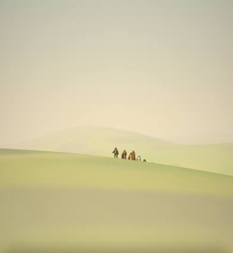
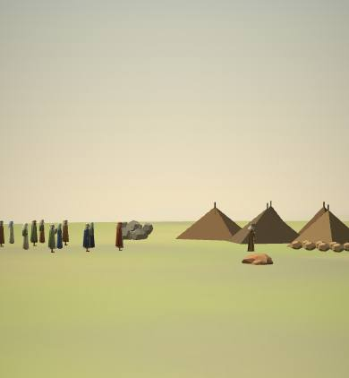

# 감수 자료 · 시대 2. 족장

자료 판 `0a3481ff` · `node tools/make_review_pack.js`가 만든 파일입니다(손으로 고치지 않습니다). 게임에 나오는 문장은 글자 그대로이고, 성경 본문은 싣지 않았습니다(장절만).

#### 시대2·안내 · 시대 안내

*2. 족장*
- 최현 박사의 통신(탐험대 이야기): 계기판이 다음 시대로 넘어왔어. 장막과 길이 많은 시대라고 나오는구나.
- "이 사이에 성경이 기록한 곳"으로 보여 주는 장절(요약 없이 장절만): 창 11:10-32 · 창 12:10-14:24 · 창 15:7-21:34 · 창 22:20-28:9 · 창 29:1-37:11 · 창 38:1-44:34 · 창 45:16-50:26

표시: ☐ 그대로 ☐ 고침 ☐ 뺌 　적을 칸: 

#### 시대2·마무리 · 마무리(기도·실천)

*이 시대 장면들의 한 문장 기도(8~10세)와 한 주 실천(11~13세). 꼴은 "공통·마무리"에서*
- **OT-05 아브라함을 부르시고 언약을 주심** (창 12:1-9)
  - 8~10세 기도: 하나님, 아브람에게 하신 약속의 말씀을 기억하게 해 주세요. 예수님의 이름으로 기도합니다. 아멘.
  - 11~13세 실천: 이번 주에 창세기 12장 1절부터 9절까지, 그리고 15장 1절부터 6절까지 소리 내어 읽어 보세요.
  - 14~19세 기록 물음: 창 12:1-9와 창 15:1-6에서 새로 알게 된 사실을 한 가지 적어 보자.
- **OT-06 모리아 산의 아브라함과 이삭** (창 22:1-19)
  - 8~10세 기도: 하나님, 모리아 땅의 산에서 있었던 일을 성경에서 읽고 기억하게 해 주세요. 예수님의 이름으로 기도합니다. 아멘.
  - 11~13세 실천: 이번 주에 창세기 22장 1절부터 19절까지 소리 내어 읽어 보세요.
  - 14~19세 기록 물음: 창 22:1-19에서 새로 알게 된 사실을 한 가지 적어 보자.
- **OT-07 벧엘에서 야곱이 꾼 꿈** (창 28:10-22)
  - 8~10세 기도: 하나님, 야곱에게 함께 있겠다고 하신 말씀을 기억하게 해 주세요. 예수님의 이름으로 기도합니다. 아멘.
  - 11~13세 실천: 이번 주에 창세기 28장 10절부터 22절까지 소리 내어 읽어 보세요.
  - 14~19세 기록 물음: 창 28:10-22에서 새로 알게 된 사실을 한 가지 적어 보자.
- **OT-08 요셉이 애굽으로 팔려 가고 형들을 다시 만남** (창 37:12-36)
  - 8~10세 기도: 하나님, 요셉과 형들의 이야기를 성경에서 읽고 기억하게 해 주세요. 예수님의 이름으로 기도합니다. 아멘.
  - 11~13세 실천: 이번 주에 창세기 45장 1절부터 15절까지 소리 내어 읽어 보세요.
  - 14~19세 기록 물음: 창 37:12-36과 창 45:1-15에서 새로 알게 된 사실을 한 가지 적어 보자.

표시: ☐ 그대로 ☐ 고침 ☐ 뺌 　적을 칸: 

### OT-05 아브라함을 부르시고 언약을 주심 (창 12:1-9)

- 곳: 하란, 가나안 땅의 세겜 땅 모레 상수리나무, 벧엘 동쪽 산
- 감수 필수: 예 — 구약 사건의 신약적 의미(롬 4:3)
- 화면: 3D 장면 · 감수 상태: 미감수

#### OT-05·대목 · 대목 글(장면 전체)

*대목 7개* — 창 12:1-9
- 이 장면에서 검증자가 여쭌 것 5가지는 아래 "검증자가 남긴 것" 항목에 따로 있습니다. 대목 글을 고치실 때는 "대목 몇, 몇 세 글"인지 적어 주세요.
- **대목 1** (창 12:1)
- 8~10세: 하나님이 아브람에게 말씀하셨어요. 고향과 친척과 아버지의 집을 떠나, 하나님이 일러 주실 땅으로 가라고 하셨어요.
- 11~13세: 여호와께서 아브람에게 말씀하셨어요. 살던 땅과 친척과 아버지의 집을 떠나, 하나님이 일러 주실 땅으로 가라고 하셨어요.
- 14~19세: 여호와께서 아브람에게 그의 본토와 친척과 아버지의 집을 떠나라고 하셨다. 가야 할 곳은 하나님이 그에게 일러 주실 땅이었다.
  - 온우의 말: 성경은 여기서 이 사람을 아브람이라고 불러. 하나님이 하신 말씀은 창세기 12장 1절에서 직접 읽자.
- **대목 2** (창 12:2-3)
- 8~10세: 하나님은 아브람을 큰 민족이 되게 하고 복을 주겠다고 약속하셨어요.
- 11~13세: 하나님은 아브람을 큰 민족이 되게 하고, 복을 주고, 그의 이름을 크게 하겠다고 하셨어요. 땅의 모든 족속이 아브람 때문에 복을 얻을 것이라고도 하셨어요.
- 14~19세: 하나님은 아브람을 큰 민족이 되게 하고 그에게 복을 주어 이름을 크게 하겠다고 하셨고, 그가 복의 근원이 될 것이라고 하셨다. 아브람을 축복하는 사람에게는 복을, 저주하는 사람에게는 저주를 내리겠다고 하셨으며, 땅의 모든 족속이 그로 말미암아 복을 얻을 것이라고 하셨다.
  - 휴의 말: 약속을 일지에 적어 둘게. 큰 민족, 복, 큰 이름.
- **대목 3** (창 12:4-5)
- 8~10세: 아브람은 하나님의 말씀대로 아내 사래와 조카 롯과 함께 길을 떠났어요. 그리고 가나안 땅에 들어갔어요.
- 11~13세: 아브람은 여호와의 말씀을 따라 하란을 떠났어요. 그때 아브람은 일흔다섯 살이었어요. 아내 사래와 조카 롯, 하란에서 모은 재산과 사람들을 데리고 가나안 땅에 들어갔어요.
- 14~19세: 아브람은 여호와께서 이르신 대로 떠났고 롯도 함께 갔다. 하란을 떠날 때 그의 나이는 일흔다섯이었다. 그는 아내 사래와 조카 롯, 그리고 하란에서 얻은 재산과 사람들을 모두 데리고 가나안 땅을 향해 길을 떠나 그 땅에 들어갔다.
  - 휴의 말: 하란에서 가나안 땅까지. 떠난 곳과 들어간 곳을 적어 둘게.
- **대목 4** (창 12:6-7)
- 8~10세: 아브람이 세겜 땅의 모레 상수리나무 곁에 오자, 하나님이 나타나 이 땅을 그의 자손에게 주겠다고 하셨어요. 아브람은 그곳에 제단을 쌓았어요.
- 11~13세: 아브람은 그 땅을 지나 세겜 땅 모레 상수리나무에 이르렀어요. 그때 그 땅에는 가나안 사람이 살고 있었어요. 여호와께서 아브람에게 나타나 이 땅을 그의 자손에게 주겠다고 하셨고, 아브람은 그곳에 여호와께 제단을 쌓았어요.
- 14~19세: 아브람은 그 땅을 지나 세겜 땅 모레 상수리나무에 이르렀다. 그때 그 땅에는 가나안 사람이 살고 있었다. 여호와께서 아브람에게 나타나 이 땅을 그의 자손에게 주겠다고 하셨고, 아브람은 그곳에, 자기에게 나타나신 여호와께 제단을 쌓았다.
  - 최온의 말: 상수리나무가 있는 곳이야. 아브람이 제단을 쌓았어.
- **대목 5** (창 12:8-9)
- 8~10세: 아브람은 벧엘 동쪽 산으로 옮겨 가서 장막을 쳤어요. 거기서도 제단을 쌓아 여호와의 이름을 불렀어요.
- 11~13세: 아브람은 거기서 벧엘 동쪽 산으로 옮겨 장막을 쳤어요. 서쪽은 벧엘, 동쪽은 아이였어요. 그곳에서도 여호와께 제단을 쌓고 여호와의 이름을 불렀어요. 그 뒤에 점점 남쪽으로 옮겨 갔어요.
- 14~19세: 아브람은 거기서 벧엘 동쪽 산으로 옮겨 장막을 쳤는데, 서쪽에는 벧엘이, 동쪽에는 아이가 있었다. 그는 그곳에서도 여호와께 제단을 쌓고 여호와의 이름을 불렀으며, 그 뒤 점점 남방으로 옮겨 갔다.
  - 휴의 말: 서쪽은 벧엘, 동쪽은 아이. 장막을 친 자리를 일지에 그려 둘게.
- **대목 6** (창 15:1-4)
- 8~10세: 그 뒤에 하나님은 아브람에게 두려워하지 말라고 하셨어요. 자식이 없다고 아뢰는 아브람에게, 그의 몸에서 태어날 사람이 뒤를 이을 것이라고 하셨어요.
- 11~13세: 이 일들 뒤에 여호와의 말씀이 환상 가운데 아브람에게 임했어요. 두려워하지 말라고 하시며, 하나님이 아브람의 방패요 매우 큰 상급이라고 하셨어요. 아브람은 자식이 없어서 다메섹 사람 엘리에셀이 상속자가 될 것이라고 아뢰었어요. 하나님은 그 사람이 아니라 아브람의 몸에서 태어날 사람이 상속자가 될 것이라고 하셨어요.
- 14~19세: 이 일들 뒤에 여호와의 말씀이 환상 가운데 아브람에게 임했다. 두려워하지 말라고 하시며, 자신이 아브람의 방패요 지극히 큰 상급이라고 하셨다. 아브람은 자기에게 자식이 없는데 무엇을 주시려는지 여쭈었고, 상속자는 다메섹 사람 엘리에셀이며 자기 집에서 자란 사람이 뒤를 잇게 될 것이라고 아뢰었다. 여호와의 말씀이 다시 임하여, 그 사람이 아니라 아브람의 몸에서 날 사람이 상속자가 될 것이라고 하셨다.
  - 온우의 말: 여기부터는 창세기 15장이야. 아브람이 아뢴 말과 하나님의 대답은 2절부터 4절에 있어. 성경책에서 읽어 보자.
- **대목 7** (창 15:5-6)
- 8~10세: 하나님은 아브람에게 하늘의 별을 셀 수 있는지 보라고 하시며, 자손이 그와 같을 것이라고 하셨어요. 아브람은 여호와를 믿었어요.
- 11~13세: 하나님은 아브람을 이끌고 밖으로 나가, 하늘을 올려다보고 별들을 셀 수 있는지 보라고 하셨어요. 그리고 아브람의 자손이 이와 같을 것이라고 하셨어요. 아브람은 여호와를 믿었고, 여호와께서는 이것을 그의 의로 여기셨어요.
- 14~19세: 하나님은 그를 이끌고 밖으로 나가, 하늘을 우러러 뭇별을 셀 수 있는지 보라고 하셨다. 그리고 그의 자손이 이와 같을 것이라고 하셨다. 아브람은 여호와를 믿었고, 여호와께서는 이것을 그의 의로 여기셨다.
  - 최온의 말: 하늘에 별이 많아!

표시: ☐ 그대로 ☐ 고침 ☐ 뺌 　적을 칸: 

#### OT-05·동행1 · 동행 인물 문답

*아브람에게 묻기* — 창 15:2
- 동행 인물: 아브람 (이 자리에 있다는 근거 창 15:1, 사건과 관문 뒤에 문답)
- 휴의 물음: 하나님이 큰 상급이 되신다고 하셨을 때, 하나님께 무엇을 여쭈었어요?
- 답 8~10세: 아브람은 하나님께 자기에게 무엇을 주시려느냐고 여쭈었어요. 자기에게는 자식이 없다고 했어요.
- 답 11~13세: 아브람은 주 여호와께, 자기에게 무엇을 주시려느냐고 여쭈었어요. 그러면서 자기에게는 자식이 없다고 아뢰었어요.
- 답 14~19세: 아브람은 주 여호와께 자기에게 무엇을 주시려느냐고 여쭈며, 자기는 자식 없이 지내고 있다고 아뢰었다.
- 아이가 펼 곳: 창 15:2

표시: ☐ 그대로 ☐ 고침 ☐ 뺌 　적을 칸: 

#### OT-05·동행2 · 동행 인물 문답

*아브람에게 묻기* — 창 15:2-3
- 동행 인물: 아브람 (이 자리에 있다는 근거 창 15:1, 사건과 관문 뒤에 문답)
- 최온의 물음: 그때 누가 뒤를 이을 거라고 아뢰셨어요?
- 답 8~10세: 아브람은 다메섹 사람 엘리에셀이 상속자라고 아뢰었어요. 하나님이 자식을 주지 않으셨으니, 집에서 자란 사람이 뒤를 이을 것이라고 했어요.
- 답 11~13세: 아브람은 자기 상속자가 다메섹 사람 엘리에셀이라고 아뢰었어요. 또 하나님이 자기에게 씨를 주지 않으셨으니, 자기 집에서 자란 사람이 뒤를 이을 것이라고 아뢰었어요.
- 답 14~19세: 아브람은 자기의 상속자가 다메섹 사람 엘리에셀이라고 아뢰었다. 또 주께서 자기에게 씨를 주지 않으셨으므로 자기 집에서 길러진 사람이 후사가 될 것이라고 아뢰었다.
- 아이가 펼 곳: 창 15:3

표시: ☐ 그대로 ☐ 고침 ☐ 뺌 　적을 칸: 

#### OT-05·돕기1 · 손으로 하는 돕기

*길 비켜 주기 · 가나안 땅에 들어오는 일행* — 창 12:5
- 돕는 상대: 아브람과 그 일행(일행이 지나갈 길을 비켜 주고, 장막과 제단에는 손대지 않고 언덕 가장자리에서 지켜본다)
- 8~10세: 아브람 일행이 사람들과 짐을 데리고 가나안 땅에 들어와요. 우리는 일행이 지나갈 길을 비켜 주며 도와요.
- 11~13세: 아브람이 사래와 롯, 하란에서 모은 재산과 함께한 사람들을 데리고 가나안 땅에 들어와요. 우리는 일행에게 가까이 가지 않고, 그들이 지나갈 길을 비켜 주며 도와요.
- 14~19세: 아브람은 아내 사래와 조카 롯, 그리고 하란에서 얻은 재산과 사람들을 데리고 가나안 땅에 들어왔다(12:5). 탐험대는 일행의 짐과 사람들에게 가까이 가지 않고, 그들이 지나갈 길을 비켜 준다.
  - 누르는 일 1: 길가에 둔 우리 짐 언덕 쪽으로 옮기기
  - 누르는 일 2: 언덕 위로 물러서기
  - 누르는 일 3: 일행이 다 지나가도록 기다리기
  - 마친 뒤 휴의 말: 사람들과 짐이 다 지나갔어. 일행이 지나간 길을 일지에 적어 둘게.

표시: ☐ 그대로 ☐ 고침 ☐ 뺌 　적을 칸: 

#### OT-05·뜻 · 뜻 묻기

*아브람이 믿은 일은 무슨 뜻이에요?* — 창 15:6
- 최온의 물음: 아브람이 여호와를 믿은 일은 무슨 뜻이에요?
- 답하는 사람: 최현 박사
- 답 8~10세: 성경은 아브람이 하나님의 말씀을 듣고 여호와를 믿었다고 말해요. 여호와께서는 그것을 아브람의 의로 여기셨어요. 성경은 여기까지 말해요.
- 답 11~13세: 하나님은 아브람을 밖으로 이끌어 하늘의 뭇별을 보게 하시고, 그의 자손이 그와 같을 것이라고 하셨어요(15:5). 성경은 아브람은 여호와를 믿었고, 여호와께서 그것을 아브람의 의로 여기셨다고 말해요(15:6). 성경은 여기까지 말해요.
- 답 14~19세: 하나님은 자식이 없다고 아뢴 아브람에게, 그의 몸에서 날 사람이 상속자가 되리라고 하셨다(15:4). 그리고 그를 밖으로 이끌어 뭇별을 보게 하시며 그의 자손이 이와 같으리라고 하셨다(15:5). 성경은 아브람은 여호와를 믿었고, 여호와께서 그것을 그의 의로 여기셨다고 기록한다(15:6). 성경은 여기까지 말한다.
- **성경을 펴서 뜻 확인하기**
- 8~10세 · 찾아 읽고 고르기: 성경책에서 창세기 15장 6절을 찾아 읽어 보세요. (창 15:6)
  - 물음: 여호와께서는 아브람이 믿은 것을 무엇으로 여기셨나요?
  - 맞는 보기: 그의 의
  - 다른 보기: 그의 상급 (본문에 없음)
  - 다른 보기: 그의 재산 (본문에 없음)
- 11~13세 · 찾아 읽고 고르기: 성경책에서 창세기 15장 4절부터 6절까지 읽어 보세요. (창 15:4-6)
  - 물음: 여호와께서 의로 여기신 것은 아브람이 무엇을 했기 때문인가요?
  - 맞는 보기: 여호와를 믿었기 때문에
  - 다른 보기: 제단을 두 번 쌓았기 때문에 (본문에 없음)
  - 다른 보기: 많은 소유를 모았기 때문에 (본문에 없음)
- 14~19세 · 찾아 읽고 고르기: 창세기 12장 4절과 15장 6절을 함께 찾아 읽어 보자. (창 12:4 · 창 15:6)
  - 물음: 두 곳을 이어 읽으면, 여호와의 말씀 앞에서 아브람은 어떻게 했다고 적혀 있는가?
  - 맞는 보기: 12장에서는 여호와의 말씀을 따라 하란을 떠났고, 15장에서는 여호와를 믿었으며 여호와께서 그것을 그의 의로 여기셨다
  - 다른 보기: 12장에서는 떠나기를 거절했고, 15장에서는 말씀을 믿지 않았다 (본문에 없음)
  - 다른 보기: 12장에서는 롯의 말을 따라 떠났고, 15장에서는 별을 다 세어 보았다 (본문에 없음)

표시: ☐ 그대로 ☐ 고침 ☐ 뺌 　적을 칸: 

#### OT-05·신약 · 신약 연결 · ★먼저 볼 2

*14~19세에게만 보임 · 화면에 "감수 전" 표시* — 롬 4:3
- 14~19세: 신약의 로마서 4장 3절은 성경이 무엇을 말하는지 물으며, 하나님을 믿은 아브라함에게 그것이 의로 여겨졌다고 말한다.
- 보이는 때: 뜻 묻기의 성경 읽기 물음을 맞힌 뒤에 뜹니다. 위 글은 문장 전체가 화면에 그대로 나옵니다("…감수를 마친 뒤 확정한다" 같은 문장이 들어 있으면 그것도 보입니다).

표시: ☐ 그대로 ☐ 고침 ☐ 뺌 　적을 칸: 

#### OT-05·오늘1 · 오늘의 물음

*최현 박사가 답함* — 창 12:4 · 창 15:1
- 물음: 낯선 곳으로 떠나는 게 무서울 때가 있어요. 아브람도 무서웠을까요?
- 답 8~10세: 성경은 아브람이 무서웠는지 말하지 않아요. 아브람은 여호와의 말씀대로 길을 떠났어요. 그 뒤에 하나님은 아브람에게 두려워하지 말라고 하셨어요.
- 답 11~13세: 성경은 아브람의 마음이 어땠는지 적지 않아요. 아브람이 여호와의 말씀을 따라 하란을 떠났다고만 해요. 그 뒤에 하나님은 아브람에게 두려워하지 말라고 하시며, 하나님이 아브람의 방패라고 하셨어요.
- 답 14~19세: 성경은 아브람의 마음이 어땠는지 적지 않는다. 아브람이 여호와의 말씀을 따라 하란을 떠났다고 말할 뿐이다(창 12:4). 그 뒤에 하나님은 아브람에게 두려워하지 말라고 하시며, 자신이 그의 방패요 지극히 큰 상급이라고 하셨다(창 15:1). 성경은 여기까지 말한다.

표시: ☐ 그대로 ☐ 고침 ☐ 뺌 　적을 칸: 

#### OT-05·오늘2 · 오늘의 물음

*최현 박사가 답함* — 창 15:5 · 신 10:22
- 물음: 자손이 하늘의 별처럼 많아진다는 약속은 정말 이루어졌어요?
- 답 8~10세: 하나님은 아브람의 자손이 하늘의 별과 같을 것이라고 하셨어요. 나중에 모세는, 여호와께서 이스라엘 백성을 하늘의 별처럼 많게 하셨다고 말했어요.
- 답 11~13세: 창세기 15장에서 하나님은 아브람의 자손이 하늘의 별과 같을 것이라고 하셨어요. 나중에 모세는 이스라엘 백성에게, 애굽으로 내려간 조상은 칠십 명뿐이었지만 이제 여호와께서 백성을 하늘의 별처럼 많게 하셨다고 말했어요.
- 답 14~19세: 창 15:5에서 하나님은 아브람의 자손이 하늘의 뭇별과 같을 것이라고 하셨다. 신명기에서 모세는 이스라엘 백성에게, 애굽으로 내려간 조상은 칠십 명뿐이었으나 이제 여호와께서 백성을 하늘의 별처럼 많게 하셨다고 말했다(신 10:22). 성경은 여기까지 말한다.

표시: ☐ 그대로 ☐ 고침 ☐ 뺌 　적을 칸: 

#### OT-05·3D · 3D 설정

*3D로 만든 장면: 본문에 없는 배치·생김새* — 창 12:1-9
- 하나님 표현: 말씀 자막만. 형상 없음. 별은 하나님이 보라고 하신 것이지 하나님의 나타나심이 아니다(창 15:5). 창 12:7의 나타나심과 창 15:5의 이끌고 나가심도 형상이나 손이나 빛으로 그리지 않음. 음성은 소리로 만들지 않음
  - 그리지 않는 것: 하나님이 아브람의 손을 잡고 이끄는 모습(형상)
  - 그리지 않는 것: 손가락으로 별을 세는 아브람(본문에 없음)
  - 그리지 않는 것: 무릎 꿇거나 엎드린 아브람(본문에 없음)
  - 그리지 않는 것: 제단 위의 제물과 불(창 12:7-8에 없음)
  - 그리지 않는 것: 낙타와 양 떼 등 이 본문 범위에 나오지 않는 짐승
  - 그리지 않는 것: 별똥별과 별자리 그림
  - 그리지 않는 것: 별을 보는 곳에 벧엘 동쪽 산이라는 지명 표지를 붙이는 것(창 15장은 장소를 말하지 않는다. 창 13:18)
  - 그리지 않는 것: 세 아이가 아브람 일행에게 말을 걸거나 제단과 장막에 손대는 것(목격자)
- **3D 장면을 만들며 정한 것(본문에 맞춘 점, 감수가 필요한 설정)**
  - 3D 장면 설정: OT-05 아브람을 부르시고 언약을 주심 (창 12:1-9, 15:1-6).
  - 아이들이 다니는 때: 아브람이 벧엘 동쪽 산에 장막을 친 때(창 12:8). 장막과 제단, 일행이 있다.
  - 지켜보기: 하란을 떠나 가나안에 들어오는 길(12:4-5)과 모레 상수리나무의 제단(12:6-7)은 장막을 치기 전의 일이므로 장막을 숨기고 길과 먼 나무를 보여 준다(탐험대 이야기 한 줄로 알림).
  -   12:8-9 장막과 제단 → 15:1-4 (장소 이름 없음) → 15:5-6 밖에서 하늘의 뭇별을 본다(압도 장면 후보, 게임 안 효과로).
  - 본문에 맞춘 점
  -  - 하나님의 형상·손·빛은 없다. 별은 하나님이 보라고 하신 것이다. 별똥별과 별자리 그림은 없다.
  -  - 아브람은 서 있기만 한다(손가락으로 세거나 무릎 꿇지 않는다). 제단 위의 제물과 불은 없다. 낙타와 양 떼는 없다.
  -  - 롯은 12장 대목까지만 있고 15장 대목에는 없다(창 13:11). 별을 보는 곳에는 지명 표지를 붙이지 않는다.
  - 감수가 필요한 설정: 산과 길의 생김새, 장막과 제단의 자리, 일행의 수, 15장의 자리를 같은 장막 곁으로 둔 것(본문은 장소를 말하지 않는다).
- **화면 사진(사건을 지켜보는 동안의 화면. 컴퓨터에서 휴대폰 크기로 찍음)**
  - 
  - 
  - 
- **3D 화면에만 나오는 글(도착 글, 사진 도감의 이름·설명, 안내)**
  - 글: 장막 쪽으로는 가지 말자. 우리는 멀리서 지켜보는 사람이야.
  - 글: 이 언덕 위에서만 다니자.
  - 이 대목은 아브람이 이곳에 장막을 치기 전의 일이에요. 장막을 잠시 걷어 내고 보여 줘요.
  - 이 돕기도 장막을 치기 전, 일행이 가나안 땅에 막 들어오던 때의 이야기예요. 우리가 재료를 주운 길은 이 일행이 지나간 뒤의 길이에요.
  - 탐지기
  - 탐지기 물음 풀기
  - 글: 타임머신이 언덕 위에 내려앉았어요. 저쪽에 장막 몇 채가 보여요.
  - 글: 장막에서 멀리 떨어진 곳에서만 다니자.
  - 다시 읽기 안내: 아브람을 부르신 이야기를 성경에서 찾아 읽은 뒤 다시 골라 보세요.
  - 떠나기 전 안내: 아브람 장면을 끝까지 지켜봐야 떠날 수 있어요.
  - 이름: 아브람
  - 설명: 여호와의 말씀을 따라 하란을 떠난 사람. 그때 일흔다섯 살이었다
  - 창 12:4
  - 찾는 실마리: 장막 가까이에 서 있어요.
  - 이름: 장막
  - 설명: 벧엘 동쪽 산에 친 아브람의 장막
  - 창 12:8
  - 찾는 실마리: 언덕 아래를 보세요.
  - 이름: 제단
  - 설명: 아브람이 여호와께 쌓은 제단
  - 찾는 실마리: 장막 너머를 보세요.
  - 이름: 하늘의 뭇별
  - 설명: 셀 수 있는지 보라고 하신 하늘의 별들
  - 창 15:5
  - 찾는 실마리: 마지막에 하늘을 보세요.

표시: ☐ 그대로 ☐ 고침 ☐ 뺌 　적을 칸: 

#### OT-05·미해결1 · 검증자가 남긴 것

*창 15:5를 장막에서 나와 밤하늘의 별을 보는 모습으로 만들어도 될까요?(본문은 장막·밤을 말하지 않음)*
- 검증 기록(OT-05 아브라함을 부르시고 언약을 주심): 창 15:5의 장면을 "장막에서 나와 밤하늘을 보는" 것으로 만드는 것(장면표의 볼거리도 그렇게 적혀 있다). 본문은 장막도 밤도 말하지 않고, 말씀이 이상 가운데 임했다고 하며(창 15:1), 같은 장 뒤쪽에 해가 지는 때가 따로 나온다(창 15:12, 15:17). 3D로 어떻게 나타낼지는 대표와 목회자가 정한다. 장면표는 이 검증의 범위가 아니어서 고치지 않았다.
  - 지금 게임의 글 · 화면 설계의 물건: 장막(창 12:8. 창 15:5는 '밖으로'라고만 하고 어디에서 나왔는지는 말하지 않는다. 장막에서 나오는 동선은 설계상의 선택이다)
  - 지금 게임의 글 · 화면 설계의 물건: 하늘의 뭇별(창 15:5. 본문은 '밤'이라는 말을 쓰지 않지만 별을 세어 보라는 말씀에 따라 별이 보이는 하늘로 만든다)
  - 지금 게임의 글 · 대목 7 · 11~13세: 하나님은 아브람을 이끌고 밖으로 나가, 하늘을 올려다보고 별들을 셀 수 있는지 보라고 하셨어요. 그리고 아브람의 자손이 이와 같을 것이라고 하셨어요. 아브람은 여호와를 믿었고, 여호와께서는 이것을 그의 의로 여기셨어요.
  - 지금 게임의 글 · 화면 설계의 곳: 아브람이 장막을 친 곳(창 12:8)과 별을 보는 곳(창 15:5). 창 15장은 장소 이름을 말하지 않고, 아브람은 그 사이에 장막을 옮겼다(창 12:9, 13:18). 그래서 별을 보는 곳에는 지명 표지를 붙이지 않고 벧엘 동쪽 산이라고 하지 않는다
  - 덧붙임: 그림 설계 글에 '장막에서 나오는 동선은 설계상의 선택', '본문은 밤이라는 말을 쓰지 않는다'는 설명이 지금 적혀 있다.

표시: ☐ 지금대로 ☐ 바꿈 ☐ 의논 필요 　적을 칸: 

#### OT-05·미해결2 · 검증자가 남긴 것

*창 12:1의 첫 낱말을 8~10세는 '고향', 11~13세는 '살던 땅'으로 다르게 푼 것을 그대로 둘까요?*
- 검증 기록(OT-05 아브라함을 부르시고 언약을 주심): 창 12:1의 첫 낱말을 8~10세 글은 "고향", 11~13세 글는 "살던 땅", 14~19세 글는 본문의 낱말로 적었다. 서로 어긋나지는 않지만 풀이말이 둘이다. 어느 풀이말로 맞출지는 감수 때 정한다.
  - 지금 게임의 글 · 대목 1 · 8~10세: 하나님이 아브람에게 말씀하셨어요. 고향과 친척과 아버지의 집을 떠나, 하나님이 일러 주실 땅으로 가라고 하셨어요.
  - 지금 게임의 글 · 대목 1 · 11~13세: 여호와께서 아브람에게 말씀하셨어요. 살던 땅과 친척과 아버지의 집을 떠나, 하나님이 일러 주실 땅으로 가라고 하셨어요.

표시: ☐ 지금대로 ☐ 바꿈 ☐ 의논 필요 　적을 칸: 

#### OT-05·미해결3 · 검증자가 남긴 것

*창 15:6(믿음을 의로 여기심)을 뜻 묻기와 14~19세 읽기 물음, 롬 4:3 연결로 다뤄도 될까요?*
- 검증 기록(OT-05 아브라함을 부르시고 언약을 주심): 창 15:6(믿음을 의로 여기심)이 대목 11~13세 글·14~19세 글, 14~19세 글 관문, 셋째 부품의 14~19세 글 물음에 사실로 실려 있다. 풀이는 없다. 이 장면은 장면표에서 감수 필수가 아니지만, 이 절을 14~19세 물음으로 묻는 것이 적절한지는 목회자 판단이 필요하다.
  - 지금 게임의 글 · 현장 돕기 단계 3 · 제목: 아브람이 믿은 일은 무슨 뜻이에요?
  - 지금 게임의 글 · 현장 돕기 단계 3 · 뜻 묻기의 답 · 11~13세: 하나님은 아브람을 밖으로 이끌어 하늘의 뭇별을 보게 하시고, 그의 자손이 그와 같을 것이라고 하셨어요(15:5). 성경은 아브람은 여호와를 믿었고, 여호와께서 그것을 아브람의 의로 여기셨다고 말해요(15:6). 성경은 여기까지 말해요.
  - 지금 게임의 글 · 현장 돕기 단계 3 · 성경 읽기 물음 · 14~19세: 두 곳을 이어 읽으면, 여호와의 말씀 앞에서 아브람은 어떻게 했다고 적혀 있는가?
  - 지금 게임의 글 · 현장 돕기 단계 3 · 성경 읽기 물음 · 14~19세: 12장에서는 여호와의 말씀을 따라 하란을 떠났고, 15장에서는 여호와를 믿었으며 여호와께서 그것을 그의 의로 여기셨다
  - 지금 게임의 글 · 현장 돕기 단계 3 · 신약 연결: 신약의 로마서 4장 3절은 성경이 무엇을 말하는지 물으며, 하나님을 믿은 아브라함에게 그것이 의로 여겨졌다고 말한다.
  - 지금 게임의 글 · 현장 돕기 단계 3 · 성경 읽기 물음 · 11~13세: 여호와께서 의로 여기신 것은 아브람이 무엇을 했기 때문인가요?

표시: ☐ 지금대로 ☐ 바꿈 ☐ 의논 필요 　적을 칸: 

#### OT-05·미해결5 · 검증자가 남긴 것

*11~13세 물음에서 창 12:6-7의 '위하여'를 제단을 쌓은 '까닭'으로 묻는 것을 그대로 둘까요?*
- 검증 기록(물음의 세 단계·현장 돕기): 나침반 바늘의 11~13세 물음(12:6-7)은 "누구를 위하여"를 "까닭"으로 묻는다. 본문의 말이어서 두었다.
  - 지금 게임의 글 · 탐지기 물음 2 · 11~13세: 아브람이 그곳에 제단을 쌓은 까닭은 무엇이라고 적혀 있나요?
  - 지금 게임의 글 · 탐지기 물음 2 · 보기 · 11~13세: 자기에게 나타나 말씀하신 여호와를 위해서

표시: ☐ 지금대로 ☐ 바꿈 ☐ 의논 필요 　적을 칸: 

#### OT-05·미해결7 · 검증자가 남긴 것

*창 15:1 물음에서 틀린 보기를 고르면 바늘이 시편(시 23:1, 27:1)으로 엇나가는 것을 그대로 둘까요?*
- 검증 기록(놀이 다양화·돕기 넓힘·8~10세 글): 작성자 물음: 여러 개 고르기의 맞지 않는 보기를 고르면 바늘이 다른 시대의 책(시편)으로 엇나간다.
  - 지금 게임의 글 · 관문 물음 2 · 8~10세: 하나님은 자신이 아브람의 무엇이라고 하셨나요? 모두 고르세요.
  - 지금 게임의 글 · 관문 물음 2 · 보기 · 8~10세: 목자
  - 지금 게임의 글 · 관문 물음 2 · 보기 · 8~10세: 빛
  - 덧붙임: 틀린 보기 둘은 '목자'(시 23:1)와 '빛'(시 27:1)이다.

표시: ☐ 지금대로 ☐ 바꿈 ☐ 의논 필요 　적을 칸: 

#### OT-05·기타 · 그 밖의 글(참고) · 참고

*통신·재료·관문·탐지기 물음·곁에서 보기·말씀 카드* — 창 12:1-9
- **최현 박사의 통신(탐험대 이야기)**
- 8~10세: 타임머신이 비상 착륙했어요! 부속 세 개가 고장 났어요. 탐지기가 가리키는 곳에서 재료를 찾아 대신 만들어요.
- 11~13세: 최현 박사예요. 타임머신이 비상 착륙하면서 부속 세 개가 망가졌어요. 그 시대에는 부속을 구할 수 없으니, 그곳에서 얻을 수 있는 재료로 대신 만들어야 해요. 탐지기가 재료가 있는 곳을 하나씩 가리켜 줄 거예요.
- 14~19세: 타임머신이 비상 착륙하면서 부속 세 개가 망가졌다. 그 시대에는 부속이 없으니 그 자리에서 얻을 수 있는 재료로 대신 만들어야 한다. 탐지기가 가리키는 곳으로 가되, 사람들의 물건과 사건이 일어나는 자리에는 손대지 않아야 한다.
- **수리 재료(탐험대 이야기)**
- 재료: 납작한 돌 (창 12:5)
  - 박사의 말: 둥글고 납작한 돌 가장자리에 홈을 파면 톱니바퀴 대신 쓸 수 있어요.
  - 얻는 방법: 아브람 일행이 지나간 뒤, 일행이 지나온 길가에 굴러 있는 둥글고 납작한 돌을 줍는다. 일행의 짐과 사람들에게는 가까이 가지 않는다.
  - 얻었을 때 아이의 말: 길가에서 둥글고 납작한 돌을 주웠어. 아브람 일행이 지나온 길이야.
- 재료: 길쭉한 돌 조각 (창 12:8)
  - 박사의 말: 길쭉한 돌 조각을 매끈하게 갈면 나침반 바늘 대신 쓸 수 있어요.
  - 얻는 방법: 장막이 건너다보이는 언덕 가장자리에 떨어져 있는 길쭉한 돌 조각을 줍는다. 장막과 제단에는 손대지 않고, 그쪽으로는 가지 않는다.
  - 얻었을 때 아이의 말: 장막이 건너다보이는 언덕 가장자리에서 길쭉한 돌 조각을 주웠어.
- 재료: 흙 (창 12:6)
  - 박사의 말: 흙을 얇고 동그랗게 빚어 말린 뒤 가운데에 작은 구멍을 내면, 바늘구멍 사진기처럼 렌즈 대신 쓸 수 있어요.
  - 얻는 방법: 장막과 아브람에게서 멀리 떨어진 언덕 위 트인 땅바닥에서 흙을 한 줌 뜬다.
  - 얻었을 때 아이의 말: 장막에서 멀리 떨어진 땅바닥에서 흙을 한 줌 떴어.
- **관문 물음**
- 관문 1 8~10세 · 찾아 읽고 고르기: 성경책에서 창세기 12장 4절을 찾아 읽어 보세요. (창 12:4)
  - 물음: 하란을 떠날 때 아브람의 나이는 몇 살이었나요?
  - 맞는 보기: 일흔다섯 살
  - 다른 보기: 아흔아홉 살 (창 17:1)
  - 다른 보기: 백 살 (창 21:5)
- 관문 2 8~10세 · 여러 개 고르기: 성경책에서 창세기 15장 1절을 찾아 읽어 보세요. (창 15:1)
  - 물음: 하나님은 자신이 아브람의 무엇이라고 하셨나요? 모두 고르세요.
  - 맞는 보기: 방패
  - 다른 보기: 목자 (시 23:1)
  - 맞는 보기: 지극히 큰 상급
  - 다른 보기: 빛 (시 27:1)
- 관문 1 11~13세 · 찾아 읽고 고르기: 성경책에서 창세기 12장 1절부터 4절까지 읽어 보세요. (창 12:1-4)
  - 물음: 아브람이 하란을 떠난 까닭은 무엇인가요?
  - 맞는 보기: 여호와께서 본토와 친척과 아버지의 집을 떠나라고 하셨고, 그 말씀을 따랐기 때문에
  - 다른 보기: 하란에 먹을 것이 떨어졌기 때문에 (본문에 없음)
  - 다른 보기: 롯이 먼저 떠나자고 했기 때문에 (본문에 없음)
- 관문 2 11~13세 · 순서 맞추기: 성경책에서 창세기 12장 4절부터 9절까지 읽고, 일어난 차례대로 눌러 보세요. (창 12:4-9)
  - 차례 1: 아브람이 일흔다섯 살에 하란을 떠났다
  - 차례 2: 가나안 땅에 들어갔다
  - 차례 3: 세겜 땅의 모레 상수리나무까지 갔다
  - 차례 4: 벧엘 동쪽 산으로 옮겨 장막을 쳤다
  - 차례 5: 점점 남쪽으로 옮겨 갔다
- 관문 1 14~19세 · 찾아 읽고 고르기: 창세기 12장 6절, 8절, 9절을 함께 찾아 읽어 보자. (창 12:6 · 창 12:8 · 창 12:9)
  - 물음: 세 곳을 이어 읽으면, 가나안 땅에 들어온 아브람은 어디에서 어디로 옮겨 갔는가?
  - 맞는 보기: 모레 상수리나무가 있는 세겜 땅에 이르렀고, 거기서 벧엘 동쪽의 산에 장막을 쳤으며, 그 뒤에는 남쪽으로 조금씩 옮겨 갔다
  - 다른 보기: 벧엘 동쪽 산에서 곧바로 하란으로 돌아갔다 (본문에 없음)
  - 다른 보기: 세겜에서 떠나지 않고 그곳에서만 지냈다 (본문에 없음)
- 관문 2 14~19세 · 구절과 내용 잇기: 창세기 12장 2절, 12장 7절, 15장 4절을 찾아 읽고, 구절마다 맞는 내용을 이어 보자. (창 12:2 · 창 12:7 · 창 15:4)
  - 잇기: 아브람으로 큰 민족을 이루게 하겠다고 하셨다 (창 12:2)
  - 잇기: 이 땅을 아브람의 자손에게 주겠다고 하셨다 (창 12:7)
  - 잇기: 아브람의 몸에서 날 사람이 상속자가 되리라고 하셨다 (창 15:4)
  - 이은 뒤 글: 세 곳을 이으면, 하나님은 아브람으로 큰 민족을 이루게 하고 이 땅을 그 자손에게 주겠다고 하셨으며, 자식이 없던 아브람에게 그의 몸에서 날 사람이 상속자가 되리라고 하셨다.
- **3D 탐지기 물음**
- 부품 1: 톱니바퀴
  - 부품: gear
  - 있는 곳: 탐지기가 아브람 일행이 가나안 땅으로 들어온 길 쪽을 가리켜요.
  - 휴의 말: 탐지기 바늘이 길 쪽으로 돌아갔어. 일지에 적어 둘게.
  - 찾았을 때: 톱니바퀴를 찾았어! 일행이 지나온 길가에 떨어져 있었네.
- 탐지기 1 8~10세 · 찾아 읽고 고르기: 성경책에서 창세기 12장 5절을 찾아 읽어 보세요. (창 12:5)
  - 물음: 아브람과 함께 길을 떠난 아내는 누구인가요?
  - 맞는 보기: 사래
  - 다른 보기: 하와 (창 3:20)
  - 다른 보기: 미리암 (출 15:20)
- 탐지기 1 11~13세 · 찾아 읽고 고르기: 성경책에서 창세기 12장 4절과 5절을 읽어 보세요. (창 12:4-5)
  - 물음: 아브람 일행은 무엇을 하려고 하란을 떠났나요?
  - 맞는 보기: 가나안 땅에 가려고
  - 다른 보기: 애굽 땅에서 곡식을 사려고 (본문에 없음)
  - 다른 보기: 갈대아 우르로 돌아가려고 (본문에 없음)
- 탐지기 1 14~19세 · 찾아 읽고 고르기: 창세기 12장 1절과 5절을 함께 찾아 읽어 보자. (창 12:1 · 창 12:5)
  - 물음: 두 곳을 이어 읽으면, 하나님이 가라고 하신 땅과 아브람이 들어간 땅은 어떻게 이어지는가?
  - 맞는 보기: 하나님은 일러 주실 땅으로 가라고만 하셨고, 아브람은 가나안 땅을 향해 길을 떠나 끝내 그 땅에 들어갔다
  - 다른 보기: 하나님이 처음부터 그 땅의 이름을 가나안이라고 일러 주셨다 (본문에 없음)
  - 다른 보기: 아브람은 가나안 땅에 들어가지 못하고 하란으로 돌아갔다 (본문에 없음)
- 부품 2: 나침반 바늘
  - 부품: needle
  - 있는 곳: 탐지기가 장막 쪽을 가리켜요.
  - 온우의 말: 언덕 가장자리까지만 가자. 장막과 제단 가까이는 가지 말자. 여기서 지켜보자.
  - 찾았을 때: 나침반 바늘이 여기 있었네! 장막이 건너다보이는 언덕 가장자리야.
- 탐지기 2 8~10세 · 찾아 읽고 고르기: 성경책에서 창세기 12장 8절을 찾아 읽어 보세요. (창 12:8)
  - 물음: 아브람은 벧엘 동쪽 산에서 무엇을 쳤나요?
  - 맞는 보기: 장막
  - 다른 보기: 고기 잡는 그물 (본문에 없음)
  - 다른 보기: 양 우리의 울타리 (본문에 없음)
- 탐지기 2 11~13세 · 찾아 읽고 고르기: 성경책에서 창세기 12장 6절과 7절을 읽어 보세요. (창 12:6-7)
  - 물음: 아브람이 그곳에 제단을 쌓은 까닭은 무엇이라고 적혀 있나요?
  - 맞는 보기: 자기에게 나타나 말씀하신 여호와를 위해서
  - 다른 보기: 가나안 사람들에게 보이려고 (본문에 없음)
  - 다른 보기: 비가 오게 해 달라고 빌려고 (본문에 없음)
- 탐지기 2 14~19세 · 찾아 읽고 고르기: 창세기 12장 7절과 8절을 함께 찾아 읽어 보자. (창 12:7 · 창 12:8)
  - 물음: 두 곳을 이어 읽으면, 아브람이 머문 두 곳에서 한 일은 무엇인가?
  - 맞는 보기: 세겜 땅에서도 벧엘 동쪽 산에서도 여호와를 위하여 제단을 쌓았고, 벧엘 동쪽 산에서는 여호와의 이름을 불렀다
  - 다른 보기: 세겜 땅에서만 제단을 쌓고, 벧엘 동쪽 산에서는 장막만 쳤다 (본문에 없음)
  - 다른 보기: 두 곳 모두에서 제단 대신 우물을 팠다 (본문에 없음)
- 부품 3: 렌즈
  - 부품: lens
  - 있는 곳: 탐지기가 장막에서 멀리 떨어진 언덕 위 트인 땅을 가리켜요.
  - 최온의 말: 여기서는 아래쪽 땅이 멀리까지 보여!
  - 찾았을 때: 렌즈를 찾았어! 장막에서 떨어진 땅바닥에 있었어.
- 탐지기 3 8~10세 · 찾아 읽고 고르기: 성경책에서 창세기 15장 5절을 찾아 읽어 보세요. (창 15:5)
  - 물음: 하나님은 아브람에게 하늘의 무엇을 셀 수 있는지 보라고 하셨나요?
  - 맞는 보기: 별
  - 다른 보기: 구름 (본문에 없음)
  - 다른 보기: 달 (본문에 없음)
- 탐지기 3 11~13세 · 찾아 읽고 고르기: 성경책에서 창세기 15장 1절부터 4절까지 읽어 보세요. (창 15:1-4)
  - 물음: 아브람이 두려워하지 않아도 되는 까닭으로 하나님이 하신 말씀은 무엇인가요?
  - 맞는 보기: 하나님이 아브람의 방패요 지극히 큰 상급이시라는 말씀
  - 다른 보기: 아브람에게 큰 군대를 주겠다는 말씀 (본문에 없음)
  - 다른 보기: 아브람이 다시는 길을 떠나지 않아도 된다는 말씀 (본문에 없음)
- 탐지기 3 14~19세 · 찾아 읽고 고르기: 창세기 15장 2절과 5절을 함께 찾아 읽어 보자. (창 15:2 · 창 15:5)
  - 물음: 두 곳을 이어 읽으면, 아브람이 아뢴 말과 하나님이 하신 일은 어떻게 이어지는가?
  - 맞는 보기: 아브람은 자식이 없다고 아뢰었고, 하나님은 그를 밖으로 이끌어 하늘의 뭇별을 보게 하시며 그의 자손이 그와 같으리라고 하셨다
  - 다른 보기: 아브람이 엘리에셀을 데려오자, 하나님은 그가 상속자라고 하셨다 (본문에 없음)
  - 다른 보기: 아브람이 자식이 없다고 아뢰자, 하나님은 자손이 없으리라고 하셨다 (본문에 없음)
- **곁에서 보기 · 함께 머물기**
- 보기: 멀리서 보기 · 벧엘 동쪽 산의 제단 (창 12:8)
  - 8~10세: 아브람이 벧엘 동쪽 산에서 여호와께 제단을 쌓아 여호와의 이름을 불렀어요. 우리는 언덕 가장자리에서 지켜봐요.
  - 11~13세: 아브람이 장막을 친 곳에서 여호와께 제단을 쌓아 여호와의 이름을 불렀어요. 이 일은 아브람이 했어요. 우리는 장막과 제단에 가까이 가지 않고 언덕 가장자리에서 지켜봐요.
  - 14~19세: 아브람은 벧엘 동쪽 산에 장막을 친 곳에서 여호와께 제단을 쌓아 여호와의 이름을 불렀다(12:8). 본문은 이 일을 아브람이 했다고 적는다. 탐험대는 장막과 제단에 가까이 가지 않고, 장막이 건너다보이는 언덕 가장자리에서 지켜본다.
  - 휴의 말: 아브람이 이곳에서 한 일은 12장 8절에 적혀 있어. 일지에 적어 둘게.
- **말씀 카드**
- 카드: 큰 민족과 복의 약속 (창 12:2)
- 카드: 하늘의 뭇별 (창 15:5)
- **곳과 사람(설계 메모, 화면에 그릴 때의 근거)**
- 곳: 하란, 가나안 땅의 세겜 땅 모레 상수리나무, 벧엘 동쪽 산
- 곳(설계): 아브람이 장막을 친 곳(창 12:8)과 별을 보는 곳(창 15:5). 창 15장은 장소 이름을 말하지 않고, 아브람은 그 사이에 장막을 옮겼다(창 12:9, 13:18). 그래서 별을 보는 곳에는 지명 표지를 붙이지 않고 벧엘 동쪽 산이라고 하지 않는다
- 땅: 벧엘 동쪽의 산(창 12:8). 별을 보는 곳은 하늘이 보이는 바깥(창 15:5). 본문은 그 밖의 지형을 말하지 않는다
  - 사람: 아브람(창 12:1, 15:1)
  - 사람: 사래(창 12:5)
  - 사람: 롯(창 12:4-5. 길을 떠나 장막을 치는 대목까지만. 창 13:11에서 서로 떠나므로 별을 보는 대목에는 두지 않는다)
  - 사람: 하란에서 얻은 사람들(창 12:5)
  - 물건: 장막(창 12:8. 창 15:5는 '밖으로'라고만 하고 어디에서 나왔는지는 말하지 않는다. 장막에서 나오는 동선은 설계상의 선택이다)
  - 물건: 제단(창 12:7, 12:8)
  - 물건: 모레 상수리나무(창 12:6. 세겜 땅이므로 장막 자리와 떨어진 먼 배경으로만)
  - 물건: 하늘의 뭇별(창 15:5. 본문은 '밤'이라는 말을 쓰지 않지만 별을 세어 보라는 말씀에 따라 별이 보이는 하늘로 만든다)
  - 절정 장면: 하늘을 우러러 뭇별을 셀 수 있는지 보라는 말씀(창 15:5)

### OT-06 모리아 산의 아브라함과 이삭 (창 22:1-19)

- 곳: 모리아 땅의 한 산, 브엘세바
- 감수 필수: 예 — 구약 사건의 신약적 의미
- 화면: 이야기 카드 · 감수 상태: 미감수

#### OT-06·대목 · 대목 글(장면 전체)

*대목 7개* — 창 22:1-19
- 이 장면에서 검증자가 여쭌 것 7가지는 아래 "검증자가 남긴 것" 항목에 따로 있습니다. 대목 글을 고치실 때는 "대목 몇, 몇 세 글"인지 적어 주세요.
- **대목 1** (창 22:1-2)
- 8~10세: 하나님이 시험하시려고 아브라함을 부르셨어요. 아들 이삭을 모리아 땅으로 데려가, 하나님이 일러 주실 산에서 번제로 드리라고 하셨어요.
- 11~13세: 그 일 뒤에 하나님은 아브라함을 시험하시려고 부르셨어요. 아브라함은 자기가 여기 있다고 대답했어요. 하나님은 아브라함에게, 그가 사랑하는 외아들 이삭을 데리고 모리아 땅으로 가서, 일러 주실 한 산에서 그를 번제로 드리라고 하셨어요.
- 14~19세: 그 일 뒤에 하나님은 아브라함을 시험하시려고 그의 이름을 부르셨고, 아브라함은 자기가 여기 있다고 대답했다. 하나님은 그가 사랑하는 독자 이삭과 함께 모리아 땅으로 가서, 일러 주실 한 산에서 그를 번제로 드리라고 하셨다.
  - 온우의 말: 1절은 이 일이 시험이었다고 먼저 알려 줘. 하나님이 하신 말씀은 창세기 22장 2절에서 직접 읽자.
- **대목 2** (창 22:3-5)
- 8~10세: 아브라함은 아침 일찍 두 사환과 이삭을 데리고 길을 떠났어요. 사흘째 되는 날 그곳을 멀리서 보고, 사환들에게 나귀와 함께 기다리라고 했어요.
- 11~13세: 아브라함은 아침 일찍 일어나 나귀에 안장을 얹었어요. 두 사환과 아들 이삭을 데리고, 번제 때 쓸 나무를 쪼개어 길을 떠났어요. 사흘째 되는 날 눈을 들어 그곳을 멀리서 보았어요. 아브라함은 사환들에게 나귀와 함께 기다리라고 하고, 아이와 함께 가서 경배하고 돌아오겠다고 말했어요.
- 14~19세: 아브라함은 아침 일찍 일어나 나귀에 안장을 얹고, 두 사환과 아들 이삭을 데리고, 번제 때 쓸 나무를 쪼개어 하나님이 일러 주신 곳으로 떠났다. 사흘째 되는 날 그는 눈을 들어 그곳을 멀리서 보았다. 그는 사환들에게 나귀와 함께 그 자리에서 기다리라고 하고, 자기는 아이와 함께 저쪽으로 가서 경배한 뒤 그들에게 돌아오겠다고 말했다.
  - 휴의 말: 길을 떠난 지 사흘째야. 아브라함이 사환 둘에게 나귀와 함께 여기서 기다리라고 했어. 일지에 적어 둘게.
- **대목 3** (창 22:6-8)
- 8~10세: 아브라함은 번제 나무는 이삭이 지게 하고, 불과 칼은 자기가 들었어요. 이삭이 어린 양은 어디 있느냐고 묻자, 아브라함은 하나님이 준비하실 것이라고 대답했어요.
- 11~13세: 아브라함은 번제에 쓸 나무를 이삭이 지게 하고, 자기는 불과 칼을 손에 들었어요. 두 사람이 함께 걸어갔어요. 이삭은 불과 나무는 있는데 번제로 드릴 어린 양은 어디 있느냐고 물었어요. 아브라함은 하나님이 친히 준비하실 것이라고 대답했어요.
- 14~19세: 아브라함은 번제 나무를 아들 이삭이 지게 하고 자기는 불과 칼을 손에 들었으며, 두 사람은 함께 갔다. 이삭이 아버지를 부르자 아브라함은 자기가 여기 있다고 대답했다. 이삭은 불과 나무는 있는데 번제로 드릴 어린 양은 어디 있는지 물었고, 아브라함은 그 어린 양은 하나님이 친히 마련하실 것이라고 대답했다. 두 사람은 함께 나아갔다.
  - 최온의 말: 이삭이 나무를 지고 가. 아브라함은 불과 칼을 들었어.
- **대목 4** (창 22:9-10)
- 8~10세: 하나님이 일러 주신 곳에서 아브라함은 제단을 쌓아 나무를 늘어놓았어요. 그리고 이삭을 묶어 나무 위에 놓았어요.
- 11~13세: 하나님이 일러 주신 곳에 이르자, 아브라함은 그곳에 제단을 쌓고 나무를 벌여 놓았어요. 아들 이삭을 묶어 제단 나무 위에 놓았어요. 그리고 손을 내밀어 칼을 잡았어요.
- 14~19세: 하나님이 일러 주신 곳에 이르러 아브라함은 제단을 쌓고 나무를 벌여 놓았다. 그리고 아들 이삭을 묶어 제단의 나무 위에 놓은 뒤, 손을 내밀어 칼을 잡고 아들을 잡으려 했다.
  - 휴의 말: 하나님이 일러 주신 곳에서 제단을 쌓고 나무를 놓은 순서는 9절에 있어. 일지에 적어 둘게.
- **대목 5** (창 22:11-12)
- 8~10세: 그때 하늘에서 여호와의 사자가 아브라함을 불렀어요. 아이에게 손을 대지 말고 아무 일도 하지 말라고 했어요.
- 11~13세: 여호와의 사자가 하늘에서 아브라함의 이름을 두 번 불렀고, 아브라함은 자기가 여기 있다고 대답했어요. 사자는 아이에게 손을 대지 말고 아무 일도 하지 말라고 했어요. 아브라함이 외아들까지도 아끼지 않았으니, 그가 하나님을 경외하는 줄을 이제 안다고 했어요.
- 14~19세: 여호와의 사자가 하늘에서 아브라함의 이름을 거듭 불렀고, 아브라함은 자기가 여기 있다고 대답했다. 사자는 그 아이에게 손을 대지 말고 아무 일도 하지 말라고 했다. 아브라함이 독자까지도 아끼지 않았으므로 그가 하나님을 경외하는 줄을 이제 안다고 했다.
  - 온우의 말: 하늘에서 들린 말은 11절과 12절에 있어. 우리가 지어내지 말고 성경책에서 직접 읽어 보자.
- **대목 6** (창 22:13-14)
- 8~10세: 아브라함이 보니 숫양 한 마리가 뿔이 수풀에 걸려 있었고, 아브라함은 그 숫양을 아들 대신 번제로 드렸어요. 그 땅 이름은 여호와이레라고 불렀어요.
- 11~13세: 아브라함이 눈을 들어 살펴보니, 뒤에 숫양 한 마리가 있었는데 뿔이 수풀에 걸려 있었어요. 아브라함은 가서 그 숫양을 가져다가 아들 대신 번제로 드렸어요. 아브라함은 그 땅 이름을 여호와이레라고 했어요.
- 14~19세: 아브라함이 눈을 들어 살펴보니 뒤에 숫양 한 마리가 있었는데, 뿔이 수풀에 걸려 있었다. 아브라함은 가서 그 숫양을 가져다가 아들 대신 번제로 드렸다. 그는 그 땅 이름을 여호와이레라 하였고, 그래서 지금까지도 사람들이 여호와의 산에서 준비되리라고 말한다고 성경은 적는다.
  - 최온의 말: 수풀에 숫양 한 마리가 뿔이 걸려 있었대!
- **대목 7** (창 22:15-19)
- 8~10세: 여호와의 사자가 다시 아브라함을 불러, 큰 복을 주고 자손을 하늘의 별처럼 많게 하겠다는 여호와의 말씀을 전했어요. 아브라함은 사환들에게 돌아가 함께 브엘세바로 가서 살았어요.
- 11~13세: 여호와의 사자가 하늘에서 두 번째로 아브라함을 불러 여호와의 말씀을 전했어요. 아브라함이 외아들을 아끼지 않았으니, 큰 복을 주고 자손을 하늘의 별과 바닷가의 모래처럼 많게 하겠다고 하셨어요. 아브라함은 사환들에게 돌아가 함께 브엘세바로 가서 거기서 살았어요.
- 14~19세: 여호와의 사자가 하늘에서 두 번째로 아브라함을 불러 여호와의 말씀을 전했다. 여호와께서는 자신을 가리켜 맹세하시며, 아브라함이 이렇게 행하여 독자를 아끼지 않았으므로 그에게 큰 복을 주고 그의 씨를 하늘의 별과 바닷가의 모래처럼 크게 번성하게 하겠다고 하셨다. 그의 씨가 대적의 성문을 차지할 것이며, 천하 만민이 그의 씨로 말미암아 복을 얻을 것이라고 하셨는데, 이는 아브라함이 하나님의 말씀을 따랐기 때문이라고 하셨다. 아브라함은 사환들에게 돌아가 함께 브엘세바로 가서 거기서 살았다.
  - 휴의 말: 아브라함이 사환들과 함께 가서 산 곳은 브엘세바야. 일지에 적어 둘게.

표시: ☐ 그대로 ☐ 고침 ☐ 뺌 　적을 칸: 

#### OT-06·동행1 · 동행 인물 문답

*아브라함에게 묻기* — 창 22:1
- 동행 인물: 아브라함 (이 자리에 있다는 근거 창 22:19, 사건과 관문 뒤에 문답)
- 온우의 물음: 하나님이 처음 부르셨을 때 뭐라고 대답하셨어요?
- 답 8~10세: 아브라함은 자기가 여기 있다고 대답했어요.
- 답 11~13세: 하나님이 아브라함의 이름을 부르셨어요. 그때 아브라함은 자기가 여기 있다고 대답했어요.
- 답 14~19세: 하나님이 그의 이름을 부르셨을 때 아브라함은 자기가 여기 있다고 대답했다.
- 아이가 펼 곳: 창 22:1

표시: ☐ 그대로 ☐ 고침 ☐ 뺌 　적을 칸: 

#### OT-06·동행2 · 동행 인물 문답

*아브라함에게 묻기* — 창 22:5
- 동행 인물: 아브라함 (이 자리에 있다는 근거 창 22:19, 사건과 관문 뒤에 문답)
- 휴의 물음: 산으로 가기 전에 사환들에게 뭐라고 하셨어요?
- 답 8~10세: 아브라함은 사환들에게 나귀와 같이 이곳에 있으라고 했어요. 자기는 아이와 저쪽으로 가서 경배한 뒤 돌아오겠다고 했어요.
- 답 11~13세: 아브라함은 사환들에게 나귀와 함께 이곳에서 기다리라고 했어요. 그리고 자기와 아이가 저쪽으로 가서 경배한 뒤 그들에게 돌아오겠다고 말했어요.
- 답 14~19세: 아브라함은 사환들에게 나귀와 함께 이곳에서 기다리라고 했다. 자기는 아이와 함께 저쪽으로 가서 경배한 뒤 그들에게 돌아오겠다고 말했다.
- 아이가 펼 곳: 창 22:5

표시: ☐ 그대로 ☐ 고침 ☐ 뺌 　적을 칸: 

#### OT-06·돕기1 · 손으로 하는 돕기

*나귀 곁 지키기 · 사환들과 함께* — 창 22:5
- 돕는 상대: 두 사환(나귀와 함께 그 자리에서 기다리는 사람들)
- 8~10세: 우리는 사환들 곁에서 나귀가 있는 자리를 함께 지켜요. 번제 나무와 불과 칼에는 손대지 않아요.
- 11~13세: 아브라함은 사환들에게 나귀와 함께 이곳에서 기다리라고 했어요. 우리는 사환들 곁에서 나귀가 있는 자리를 함께 지켜요. 번제 나무와 불과 칼에는 손대지 않아요.
- 14~19세: 사환들은 나귀와 함께 그 자리에서 기다리라는 말을 들었다(22:5). 탐험대는 사환들 곁에서 나귀가 있는 자리를 함께 지킨다. 번제 나무와 불과 칼(22:6)에는 손대지 않고, 산 위로 가지 않는다.
  - 누르는 일 1: 나귀 곁에 서 있기
  - 누르는 일 2: 나귀가 멀리 가지 않게 지켜보기
  - 누르는 일 3: 사환들과 함께 자리 지키기
  - 마친 뒤 최온의 말: 나귀도 사환들도 이 자리에 그대로 있어. 우리도 여기서 기다리자.

표시: ☐ 그대로 ☐ 고침 ☐ 뺌 　적을 칸: 

#### OT-06·뜻 · 뜻 묻기

*모리아 산의 일은 무슨 뜻이에요?* — 창 22:12
- 최온의 물음: 모리아 산에서 있었던 일은 무슨 뜻이에요?
- 답하는 사람: 최현 박사
- 답 8~10세: 성경은 처음부터 이 일이 하나님께서 아브라함에게 하신 시험이었다고 말해요. 여호와의 사자는 아브라함이 아들을 아끼지 않았으니, 그가 하나님을 경외한다는 것을 이제 알겠다고 했어요.
- 답 11~13세: 창세기 22장은 첫 절에서 이 일이 하나님께서 아브라함에게 하신 시험이라고 밝혀요(22:1). 여호와의 사자는 아브라함이 아들, 곧 독자라도 아끼지 않았으니 그가 하나님을 경외한다는 것을 이제 알겠다고 했어요(22:12). 그리고 사자는, 여호와께서 아브라함이 말씀을 따랐으므로 큰 복을 주시겠다고 하셨다고 전했어요(22:16-18).
- 답 14~19세: 창세기 22장은 첫 절에서 이 일이 하나님께서 아브라함에게 하신 시험이라고 밝힌다(22:1). 여호와의 사자는 아브라함이 아들, 곧 독자라도 아끼지 않았으니 그가 하나님을 경외한다는 것을 이제 알겠다고 했다(22:12). 사자는 두 번째로 불러 여호와의 말씀을 전했는데, 여호와께서는 아브라함이 이같이 행하여 독자를 아끼지 않았으므로 크게 복을 주시고 그의 씨로 말미암아 온 세상 민족이 복을 얻게 하겠다고 하셨으며, 이는 그가 여호와의 말씀을 따랐기 때문이라고 하셨다(22:15-18). 성경은 여기까지 말한다.
- **성경을 펴서 뜻 확인하기**
- 8~10세 · 찾아 읽고 고르기: 성경책에서 창세기 22장 12절을 찾아 읽어 보세요. (창 22:12)
  - 물음: 여호와의 사자는 아브라함에게 그 아이에게 무엇을 하지 말라고 했나요?
  - 맞는 보기: 손을 대지 말라고
  - 다른 보기: 산에서 내려가지 말라고 (본문에 없음)
  - 다른 보기: 나무를 더 모으지 말라고 (본문에 없음)
- 11~13세 · 찾아 읽고 고르기: 성경책에서 창세기 22장 15절부터 18절까지 읽어 보세요. (창 22:15-18)
  - 물음: 여호와께서 아브라함에게 큰 복을 주시겠다고 하신 까닭은 무엇인가요?
  - 맞는 보기: 아브라함이 아들, 곧 독자를 아끼지 않고 여호와의 말씀을 따랐기 때문에
  - 다른 보기: 아브라함이 큰 제단을 여러 개 쌓았기 때문에 (본문에 없음)
  - 다른 보기: 아브라함이 사환들을 잘 돌보았기 때문에 (본문에 없음)
- 14~19세 · 찾아 읽고 고르기: 창세기 22장 1절, 12절, 18절을 함께 찾아 읽어 보자. (창 22:1 · 창 22:12 · 창 22:18)
  - 물음: 세 곳을 이어 읽으면, 이 일에 대해 성경은 무엇을 말하는가?
  - 맞는 보기: 하나님께서 아브라함에게 하신 시험이었고, 사자는 그가 독자를 아끼지 않았으니 하나님을 경외한다는 것을 안다고 했으며, 여호와께서는 그가 말씀을 따랐으므로 그의 씨로 말미암아 온 세상 민족이 복을 얻으리라고 하셨다
  - 다른 보기: 하나님이 아브라함을 벌하신 일이었고, 아브라함은 끝내 말씀을 따르지 않았다 (본문에 없음)
  - 다른 보기: 아브라함이 스스로 생각해 낸 일이었고, 하나님은 아무 말씀도 하지 않으셨다 (본문에 없음)

표시: ☐ 그대로 ☐ 고침 ☐ 뺌 　적을 칸: 

#### OT-06·신약 · 신약 연결 · ★먼저 볼 3

*14~19세에게만 보임 · 화면에 "감수 전" 표시* — 히 11:17
- 14~19세: 신약의 히브리서 11장 17절은, 시험을 받은 아브라함이 믿음으로 이삭을 바쳤으며 약속을 받은 사람이면서도 독생자를 드렸다고 말한다.
- 보이는 때: 뜻 묻기의 성경 읽기 물음을 맞힌 뒤에 뜹니다. 위 글은 문장 전체가 화면에 그대로 나옵니다("…감수를 마친 뒤 확정한다" 같은 문장이 들어 있으면 그것도 보입니다).

표시: ☐ 그대로 ☐ 고침 ☐ 뺌 　적을 칸: 

#### OT-06·오늘1 · 오늘의 물음

*최현 박사가 답함* — 창 22:2
- 물음: 아브라함은 이삭을 사랑하지 않았던 거예요?
- 답 8~10세: 성경은 아브라함이 이삭을 사랑했다고 말해요. 하나님은 이삭을 아브라함이 사랑하는 외아들이라고 부르셨어요.
- 답 11~13세: 하나님은 아브라함에게 말씀하시면서 이삭을 아브라함이 사랑하는 외아들이라고 부르셨어요. 그 일을 하는 동안 아브라함의 마음이 어땠는지는 성경에 적혀 있지 않아요.
- 답 14~19세: 창 22:2에서 하나님은 이삭을 아브라함이 사랑하는 독자라고 부르셨다. 성경은 아브라함이 이삭을 사랑했다고 말하지만, 그 일을 하는 동안 아브라함의 마음이 어땠는지는 적지 않는다.

표시: ☐ 그대로 ☐ 고침 ☐ 뺌 　적을 칸: 

#### OT-06·화면 · 화면 원칙

*이야기 카드 장면: 하나님 표현과 그리지 않는 것* — 창 22:1-19
- 하나님 표현: 말씀 자막만. 형상 없음. 여호와의 사자는 그리지 않고, 하늘에서 부른 일(창 22:11, 22:15)을 자막으로만 나타냄. 음성은 소리로 만들지 않음
  - 그리지 않는 것: 하나님과 여호와의 사자의 형상
  - 그리지 않는 것: 칼을 든 손을 가까이서 크게 잡은 그림
  - 그리지 않는 것: 묶인 이삭의 표정, 우는 모습, 저항하는 모습(본문에 없음)
  - 그리지 않는 것: 아브라함의 눈물이나 망설이는 모습(본문에 없음)
  - 그리지 않는 것: 숫양을 잡는 장면과 피
  - 그리지 않는 것: 하늘에서 내려오는 빛 기둥이나 날개(본문에 없음)
  - 그리지 않는 것: 세 아이가 아브라함이나 이삭에게 말을 걸거나 일을 말리는 것(목격자)

표시: ☐ 그대로 ☐ 고침 ☐ 뺌 　적을 칸: 

#### OT-06·미해결1 · 검증자가 남긴 것

*8~10세 글에 아들을 번제로 드리라는 명령(창 22:2)과 이삭을 묶은 일(22:9)을 그대로 둘까요?*
- 검증 기록(OT-06 모리아 산의 아브라함과 이삭): 8~10세 문장에 아들을 번제로 드리라는 명령(창 22:2)과 이삭을 묶어 나무 위에 놓은 일(창 22:9)이 본문 사실대로 들어 있다. 칼을 잡은 일(창 22:10)은 11~13세 글·14~19세 글에만 있다. 이 수위가 맞는지는 감수 때 정한다.
  - 지금 게임의 글 · 대목 1 · 8~10세: 하나님이 시험하시려고 아브라함을 부르셨어요. 아들 이삭을 모리아 땅으로 데려가, 하나님이 일러 주실 산에서 번제로 드리라고 하셨어요.
  - 지금 게임의 글 · 대목 4 · 8~10세: 하나님이 일러 주신 곳에서 아브라함은 제단을 쌓아 나무를 늘어놓았어요. 그리고 이삭을 묶어 나무 위에 놓았어요.

표시: ☐ 지금대로 ☐ 바꿈 ☐ 의논 필요 　적을 칸: 

#### OT-06·미해결2 · 검증자가 남긴 것

*창 22:12는 사자가 한 말로, 22:16-18은 사자가 전한 여호와의 말씀으로 나누어 적어도 될까요?*
- 검증 기록(OT-06 모리아 산의 아브라함과 이삭): 창 22:12와 22:16-18에서 여호와의 사자는 일인칭으로 말한다. 자료는 창 22:12를 "사자는 ~라고 했다"로, 창 22:16-18을 "여호와의 말씀을 전했다, ~하겠다고 하셨다"로 나누어 적었다. 본문의 겉모습과는 맞지만, 이 구분이 적절한지는 목회자 판단이 필요하다.
  - 지금 게임의 글 · 대목 5 · 11~13세: 여호와의 사자가 하늘에서 아브라함의 이름을 두 번 불렀고, 아브라함은 자기가 여기 있다고 대답했어요. 사자는 아이에게 손을 대지 말고 아무 일도 하지 말라고 했어요. 아브라함이 외아들까지도 아끼지 않았으니, 그가 하나님을 경외하는 줄을 이제 안다고 했어요.
  - 지금 게임의 글 · 대목 7 · 11~13세: 여호와의 사자가 하늘에서 두 번째로 아브라함을 불러 여호와의 말씀을 전했어요. 아브라함이 외아들을 아끼지 않았으니, 큰 복을 주고 자손을 하늘의 별과 바닷가의 모래처럼 많게 하겠다고 하셨어요. 아브라함은 사환들에게 돌아가 함께 브엘세바로 가서 거기서 살았어요.
  - 지금 게임의 글 · 대목 5 · 14~19세: 여호와의 사자가 하늘에서 아브라함의 이름을 거듭 불렀고, 아브라함은 자기가 여기 있다고 대답했다. 사자는 그 아이에게 손을 대지 말고 아무 일도 하지 말라고 했다. 아브라함이 독자까지도 아끼지 않았으므로 그가 하나님을 경외하는 줄을 이제 안다고 했다.
  - 지금 게임의 글 · 대목 7 · 14~19세: 여호와의 사자가 하늘에서 두 번째로 아브라함을 불러 여호와의 말씀을 전했다. 여호와께서는 자신을 가리켜 맹세하시며, 아브라함이 이렇게 행하여 독자를 아끼지 않았으므로 그에게 큰 복을 주고 그의 씨를 하늘의 별과 바닷가의 모래처럼 크게 번성하게 하겠다고 하셨다. 그의 씨가 대적의 성문을 차지할 것이며, 천하 만민이 그의 씨로 말미암아 복을 얻을 것이라고 하셨는데, 이는 아브라함이 하나님의 말씀을 따랐기 때문이라고 하셨다. 아브라함은 사환들에게 돌아가 함께 브엘세바로 가서 거기서 살았다.
  - 지금 게임의 글 · 대목 5 · 8~10세: 그때 하늘에서 여호와의 사자가 아브라함을 불렀어요. 아이에게 손을 대지 말고 아무 일도 하지 말라고 했어요.
  - 지금 게임의 글 · 대목 7 · 8~10세: 여호와의 사자가 다시 아브라함을 불러, 큰 복을 주고 자손을 하늘의 별처럼 많게 하겠다는 여호와의 말씀을 전했어요. 아브라함은 사환들에게 돌아가 함께 브엘세바로 가서 살았어요.

표시: ☐ 지금대로 ☐ 바꿈 ☐ 의논 필요 　적을 칸: 

#### OT-06·미해결3 · 검증자가 남긴 것

*말씀 카드 두 장(창 22:8, 22:14)을 본문 표현 제목 그대로 카드로 남겨도 될까요?*
- 검증 기록(OT-06 모리아 산의 아브라함과 이삭): 말씀 카드 두 장(창 22:8, 22:14)의 제목은 본문의 표현이지만 이 장면의 감수 주제(구약 사건의 신약적 의미)와 닿는 절이다. 카드로 남길지는 감수 때 정한다.
  - 지금 게임의 글 · 말씀 카드 1: 하나님이 준비하시리라
  - 지금 게임의 글 · 말씀 카드 2: 여호와이레

표시: ☐ 지금대로 ☐ 바꿈 ☐ 의논 필요 　적을 칸: 

#### OT-06·미해결4 · 검증자가 남긴 것

*모리아 산의 일의 뜻을 창 22:1, 22:12로 8~10세에게도 답하는 것을 그대로 둘까요?*
- 검증 기록(임무 독립 대조): 오늘의 물음 1(왜 번제로 드리라고 하셨는가): 이 장면의 감수 주제(구약 사건의 신약적 의미)에 닿는 물음이다. 판정: 답은 본문이 직접 밝힌 목적(창 22:1의 시험)과 사자의 말(창 22:12)만 적고 신약·예표·풀이가 없으며 "성경은 여기까지 말한다"로 끝난다. 작성규칙 2절 8의 "본문이 까닭을 직접 말하는 경우"에 들어 고치지 않았다. 다만 감수 주제와 바로 닿는 물음을 이 장면에, 특히 8~10세에게 둘지는 목회자가 정한다(감수 때 확인).
  - 지금 게임의 글 · 현장 돕기 단계 3 · 뜻 묻기의 답 · 8~10세: 성경은 처음부터 이 일이 하나님께서 아브라함에게 하신 시험이었다고 말해요. 여호와의 사자는 아브라함이 아들을 아끼지 않았으니, 그가 하나님을 경외한다는 것을 이제 알겠다고 했어요.
  - 지금 게임의 글 · 현장 돕기 단계 3 · 제목: 모리아 산의 일은 무슨 뜻이에요?
  - 지금 게임의 글 · 현장 돕기 단계 3 · 아이의 물음: 모리아 산에서 있었던 일은 무슨 뜻이에요?
  - 덧붙임: 검증 기록은 '오늘의 물음 1'이라고 했으나, 지금 이 물음과 답은 뜻 묻기 자리에 있다.

표시: ☐ 지금대로 ☐ 바꿈 ☐ 의논 필요 　적을 칸: 

#### OT-06·미해결5 · 검증자가 남긴 것

*아이들이 사환들 곁에 남아(창 22:5) 산 위의 일(22:9-14)을 보지 않게 한 설정을 그대로 둘까요?*
- 검증 기록(물음의 세 단계·현장 돕기): (새로) 탐험대를 사환들 곁에 두어 산 위의 일(22:9-14)을 곁에서 보지 않게 한 설정. OT-08의 45장 설정(방 밖에서 기다림)과 같은 판단이다.
  - 지금 게임의 글 · 현장 돕기 단계 1 · 제목: 사환들과 함께 기다리기
  - 지금 게임의 글 · 현장 돕기 단계 1 · 8~10세: 아브라함은 사환들에게 나귀 곁에서 이곳에 머물러 있으라고 했어요. 우리도 사환들과 함께 여기서 기다려요. 산 위로는 올라가지 않아요.
  - 지금 게임의 글 · 현장 돕기 단계 1 · 11~13세: 아브라함은 두 사환에게 나귀를 데리고 이 자리에 머물라고 했어요. 우리도 사환들 곁에서 함께 기다려요. 번제 나무와 불과 칼에는 손대지 않고, 산 위로도 올라가지 않아요.
  - 지금 게임의 글 · 현장 돕기 단계 1 · 14~19세: 아브라함은 사환들에게 나귀를 데리고 그 자리에 머물러 기다리라고 했다(22:5). 아브라함은 그곳을 멀리 바라본 뒤에 이 말을 했다(22:4-5). 탐험대도 사환들 곁에서 함께 기다린다. 번제 나무와 불과 칼에는 손대지 않고, 산 위로 올라가지 않는다.
  - 지금 게임의 글 · 돕는 상대: 두 사환(나귀와 함께 그 자리에서 기다리는 사람들)
  - 덧붙임: 설정에 대한 물음이다. 그 설정을 적은 글을 실었다.

표시: ☐ 지금대로 ☐ 바꿈 ☐ 의논 필요 　적을 칸: 

#### OT-06·미해결7 · 검증자가 남긴 것

*모리아 장면 끝에 히 11:17('믿음으로')을 요약한 신약 문장을 보여 주는 것을 그대로 둘까요?*
- 검증 기록(물음의 세 단계·현장 돕기): 히 11:17 신약 연결: 그 절의 "믿음으로"는 창세기 22장에 없는 신약의 말이다. 그 절을 그대로 옮긴 것이어서 두었지만 문구와 보여 주는 때를 본다.
  - 지금 게임의 글 · 현장 돕기 단계 3 · 신약 연결: 신약의 히브리서 11장 17절은, 시험을 받은 아브라함이 믿음으로 이삭을 바쳤으며 약속을 받은 사람이면서도 독생자를 드렸다고 말한다.

표시: ☐ 지금대로 ☐ 바꿈 ☐ 의논 필요 　적을 칸: 

#### OT-06·미해결8 · 검증자가 남긴 것

*순서 맞추기(창 22:6-15)에 묶음·칼(22:9-10), 22:8, 22:13의 대신함, 22:14를 뺀 것을 그대로 둘까요?*
- 검증 기록(놀이 다양화·돕기 넓힘·8~10세 글): 작성자 물음: 순서 맞추기에 묶음·칼(22:9-10), 22:8, 22:13의 대신함, 22:14를 넣지 않은 좁힘과 21:30 근거 장절. 이 대조도 같은 판단이다.
  - 지금 게임의 글 · 관문 물음 2 · 11~13세: 성경책에서 창세기 22장 6절부터 15절까지 읽고, 일어난 차례대로 눌러 보세요.
  - 지금 게임의 글 · 관문 물음 2 · 차례 항목 · 11~13세: 아브라함이 나무를 이삭에게 지우고 불과 칼을 들었다
  - 지금 게임의 글 · 관문 물음 2 · 차례 항목 · 11~13세: 하나님이 일러 주신 곳에 이르러 제단을 쌓았다
  - 지금 게임의 글 · 관문 물음 2 · 차례 항목 · 11~13세: 하늘에서 여호와의 사자가 아브라함을 불렀다
  - 지금 게임의 글 · 관문 물음 2 · 차례 항목 · 11~13세: 아브라함이 뿔이 수풀에 걸린 숫양을 보았다
  - 지금 게임의 글 · 관문 물음 2 · 차례 항목 · 11~13세: 여호와의 사자가 두 번째로 아브라함을 불렀다
  - 덧붙임: 뺀 것은 글이 없으므로, 순서 맞추기에 지금 실린 다섯 문장을 실었다.

표시: ☐ 지금대로 ☐ 바꿈 ☐ 의논 필요 　적을 칸: 

#### OT-06·기타 · 그 밖의 글(참고) · 참고

*통신·재료·관문·탐지기 물음·곁에서 보기·말씀 카드* — 창 22:1-19
- **최현 박사의 통신(탐험대 이야기)**
- 8~10세: 최현 박사예요. 이번에는 타임머신 덮개를 묶는 끈이 끊어졌어요. 이 근처에서 대신 쓸 재료를 찾아봐요.
- 11~13세: 최현 박사예요. 착륙하면서 타임머신 덮개를 묶는 고정 끈이 끊어졌어요. 그 시대에는 부속이 없으니, 이 근처에서 얻을 수 있는 재료로 대신 만들어야 해요.
- 14~19세: 착륙하면서 타임머신 덮개를 묶는 고정 끈이 끊어졌다. 그 시대에는 부속이 없으니 이 근처에서 얻을 수 있는 재료로 대신 만들어야 한다. 사람들의 물건과 사건이 일어나는 자리에는 손대지 않아야 한다.
- **수리 재료(탐험대 이야기)**
- 재료: 나귀 털 (창 22:5)
  - 박사의 말: 나귀 털을 꼬아 만든 끈은 끊어진 고정 끈 대신 쓸 수 있어요.
  - 얻는 방법: 사환들이 나귀와 함께 기다리던 자리에서 땅에 떨어진 나귀 털을 줍는다. 나귀에게서 털을 뽑지 않고, 산 위 제단 쪽으로는 가지 않는다.
  - 얻었을 때 아이의 말: 사환들이 나귀와 함께 기다리던 곳에서 나귀 털을 주웠어.
- **관문 물음**
- 관문 1 8~10세 · 찾아 읽고 고르기: 성경책에서 창세기 22장 4절을 찾아 읽어 보세요. (창 22:4)
  - 물음: 아브라함이 하나님이 일러 주신 곳을 멀리서 보게 된 것은 며칠째 되는 날인가요?
  - 맞는 보기: 사흘째 되는 날
  - 다른 보기: 이레째 되는 날 (본문에 없음)
  - 다른 보기: 사십 일째 되는 날 (본문에 없음)
- 관문 2 8~10세 · 여러 개 고르기: 성경책에서 창세기 22장 3절을 찾아 읽어 보세요. (창 22:3)
  - 물음: 아브라함이 아침 일찍 일어나 한 일을 모두 고르세요.
  - 맞는 보기: 나귀에 안장을 얹었다
  - 다른 보기: 제단을 쌓았다 (창 22:9)
  - 맞는 보기: 두 사환과 이삭을 데리고 떠났다
  - 다른 보기: 우물을 팠다 (창 21:30)
  - 맞는 보기: 나무를 쪼개어 챙겼다
- 관문 1 11~13세 · 찾아 읽고 고르기: 성경책에서 창세기 22장 1절과 2절을 읽어 보세요. (창 22:1-2)
  - 물음: 하나님이 아브라함을 부르신 까닭을 성경은 무엇이라고 말하나요?
  - 맞는 보기: 아브라함을 시험해 보시려고
  - 다른 보기: 아브라함을 벌하시려고 (본문에 없음)
  - 다른 보기: 아브라함에게 새 땅을 보여 주시려고 (본문에 없음)
- 관문 2 11~13세 · 순서 맞추기: 성경책에서 창세기 22장 6절부터 15절까지 읽고, 일어난 차례대로 눌러 보세요. (창 22:6-15)
  - 차례 1: 아브라함이 나무를 이삭에게 지우고 불과 칼을 들었다
  - 차례 2: 하나님이 일러 주신 곳에 이르러 제단을 쌓았다
  - 차례 3: 하늘에서 여호와의 사자가 아브라함을 불렀다
  - 차례 4: 아브라함이 뿔이 수풀에 걸린 숫양을 보았다
  - 차례 5: 여호와의 사자가 두 번째로 아브라함을 불렀다
- 관문 1 14~19세 · 찾아 읽고 고르기: 창세기 22장 5절과 19절을 함께 찾아 읽어 보자. (창 22:5 · 창 22:19)
  - 물음: 두 곳을 이어 읽으면, 아브라함이 사환들에게 한 말과 마지막에 한 일은 어떻게 이어지는가?
  - 맞는 보기: 사환들에게 나귀와 함께 기다리라고 하며 아이와 함께 가서 경배하고 돌아오겠다고 했고, 마지막에 사환들에게 돌아와 함께 브엘세바로 갔다
  - 다른 보기: 사환들에게 먼저 집으로 돌아가라고 했고, 혼자 브엘세바로 갔다 (본문에 없음)
  - 다른 보기: 사환들과 함께 산 위로 올라갔고, 그곳에서 살았다 (본문에 없음)
- 관문 2 14~19세 · 구절과 내용 잇기: 창세기 22장 3절, 6절, 9절을 찾아 읽고, 구절마다 맞는 내용을 이어 보자. (창 22:3 · 창 22:6 · 창 22:9)
  - 잇기: 아브라함이 나무를 쪼개어 챙긴 뒤 길을 떠났다 (창 22:3)
  - 잇기: 그 나무를 이삭이 지게 하고, 아브라함은 불과 칼을 들었다 (창 22:6)
  - 잇기: 일러 주신 곳에 이르러 제단을 쌓아 그 위에 나무를 벌여 두었다 (창 22:9)
  - 이은 뒤 글: 세 곳을 이으면, 아브라함이 쪼개어 챙긴 나무를 이삭이 지고 갔고, 일러 주신 곳에서 아브라함이 제단을 쌓아 그 나무를 벌여 두었다.
- **곁에서 보기 · 함께 머물기**
- 머물기: 사환들과 함께 기다리기 (창 22:5)
  - 8~10세: 아브라함은 사환들에게 나귀 곁에서 이곳에 머물러 있으라고 했어요. 우리도 사환들과 함께 여기서 기다려요. 산 위로는 올라가지 않아요.
  - 11~13세: 아브라함은 두 사환에게 나귀를 데리고 이 자리에 머물라고 했어요. 우리도 사환들 곁에서 함께 기다려요. 번제 나무와 불과 칼에는 손대지 않고, 산 위로도 올라가지 않아요.
  - 14~19세: 아브라함은 사환들에게 나귀를 데리고 그 자리에 머물러 기다리라고 했다(22:5). 아브라함은 그곳을 멀리 바라본 뒤에 이 말을 했다(22:4-5). 탐험대도 사환들 곁에서 함께 기다린다. 번제 나무와 불과 칼에는 손대지 않고, 산 위로 올라가지 않는다.
  - 단추 글: 사환들과 함께 기다리기
  - 휴의 말: 우리는 사환들과 여기 있을 거야. 산 위로는 올라가지 않아.
- **말씀 카드**
- 카드: 하나님이 준비하시리라 (창 22:8)
- 카드: 여호와이레 (창 22:14)
- **곳과 사람(설계 메모, 화면에 그릴 때의 근거)**
- 곳: 모리아 땅의 한 산, 브엘세바
- 곳(설계): 모리아 땅의 한 산과 그 산이 멀리 보이는 자리(창 22:2, 22:4), 브엘세바(창 22:19)
- 땅: 산(창 22:2). 제단 자리 뒤쪽의 수풀(창 22:13). 사환과 나귀가 기다리는 곳은 산이 멀리 보이는 자리(창 22:4-5)
  - 사람: 아브라함(창 22:1)
  - 사람: 이삭(창 22:2)
  - 사람: 두 사환(창 22:3)
  - 물건: 안장을 얹은 나귀(창 22:3)
  - 물건: 쪼갠 번제 나무(창 22:3, 22:6)
  - 물건: 불과 칼(창 22:6)
  - 물건: 제단(창 22:9)
  - 물건: 뿔이 수풀에 걸린 숫양(창 22:13)
  - 절정 장면: 이야기 카드로 잇는 장면. 3D로 만들지 않는다

### OT-07 벧엘에서 야곱이 꾼 꿈 (창 28:10-22)

- 곳: 브엘세바에서 하란으로 가는 길의 한 곳, 벧엘(본래 이름은 루스)
- 감수 필수: 아니오
- 화면: 이야기 카드 · 감수 상태: 미감수

#### OT-07·대목 · 대목 글(장면 전체) · 참고

*대목 7개* — 창 28:10-22
- 이 장면에서 검증자가 여쭌 것 2가지는 아래 "검증자가 남긴 것" 항목에 따로 있습니다. 대목 글을 고치실 때는 "대목 몇, 몇 세 글"인지 적어 주세요.
- **대목 1** (창 28:10-11)
- 8~10세: 야곱은 브엘세바를 떠나 하란으로 가다가, 어느 곳에서 해가 졌어요. 야곱은 그곳의 돌 하나를 베개로 삼아 누워 잤어요.
- 11~13세: 야곱은 브엘세바를 떠나 하란을 향해 갔어요. 한 곳에 이르렀을 때 해가 져서 거기서 밤을 지내기로 했어요. 그곳의 돌 하나를 가져다 베개로 삼고 누워 잤어요.
- 14~19세: 야곱은 브엘세바를 떠나 하란을 향해 갔다. 한 곳에 이르렀을 때 해가 졌으므로 거기서 밤을 지내려고, 그곳의 돌 하나를 가져다 베개로 삼고 그 자리에 누워 잤다.
  - 휴의 말: 브엘세바에서 하란으로 가는 길이야. 해가 진 때라고 적어 둘게.
- **대목 2** (창 28:12)
- 8~10세: 야곱은 꿈에서 하늘에 닿은 사닥다리를 보았어요. 하나님의 사자들이 그 위를 오르락내리락했어요.
- 11~13세: 야곱은 꿈을 꾸었어요. 꿈에 보니 사닥다리가 땅 위에 서 있고 그 꼭대기는 하늘에 닿아 있었어요. 하나님의 사자들이 그 사닥다리를 오르락내리락하고 있었어요.
- 14~19세: 그는 꿈을 꾸었다. 꿈에 보니 땅 위에 선 사닥다리의 꼭대기가 하늘에 닿아 있었고, 하나님의 사자들이 그 위를 오르락내리락하고 있었다.
  - 최온의 말: 야곱이 꿈에서 사닥다리를 보았대! 꼭대기가 하늘에 닿았대.
- **대목 3** (창 28:13-14)
- 8~10세: 여호와께서 사닥다리 위에 서서 말씀하셨어요. 야곱이 누운 땅을 야곱과 그의 자손에게 주겠다고 하셨어요.
- 11~13세: 여호와께서 그 위에 서서, 자신이 아브라함의 하나님이며 이삭의 하나님이라고 하셨어요. 야곱이 누운 땅을 야곱과 그의 자손에게 주겠다고 하셨어요. 자손이 땅의 티끌처럼 되어 동서남북으로 퍼지고, 땅의 모든 족속이 야곱과 그의 자손 때문에 복을 얻을 것이라고 하셨어요.
- 14~19세: 여호와께서 그 위에 서서, 자신이 여호와이며 야곱의 조부 아브라함의 하나님이고 이삭의 하나님이라고 하셨다. 야곱이 누운 땅을 그와 그의 자손에게 주겠다고 하셨고, 그의 자손이 땅의 티끌처럼 되어 동서남북으로 퍼져 나갈 것이며 땅의 모든 족속이 그와 그의 자손으로 말미암아 복을 얻을 것이라고 하셨다.
  - 온우의 말: 하나님이 하신 말씀은 우리가 지어내면 안 돼. 13절과 14절을 성경책에서 직접 읽어 보자.
- **대목 4** (창 28:15)
- 8~10세: 하나님은 야곱과 함께 있겠다고 하셨어요. 야곱이 어디로 가든지 지키고, 이 땅으로 돌아오게 하겠다고 하셨어요.
- 11~13세: 하나님은 야곱과 함께 있어 그가 어디로 가든지 지키고, 이 땅으로 돌아오게 하겠다고 하셨어요. 약속한 것을 다 이루기까지 야곱을 떠나지 않겠다고 하셨어요.
- 14~19세: 하나님은 야곱과 함께 있어 그가 어디로 가든지 그를 지키며 이 땅으로 다시 이끌어 오겠다고 하셨다. 그에게 말씀하신 것을 다 이루기까지 그를 떠나지 않겠다고 하셨다.
  - 휴의 말: 함께 계심, 지키심, 이 땅으로 돌아오게 하심. 15절의 약속을 일지에 적어 둘게.
- **대목 5** (창 28:16-17)
- 8~10세: 야곱이 잠에서 깨어, 여호와께서 여기 계신데 자기가 몰랐다고 말했어요. 그리고 두려워했어요.
- 11~13세: 야곱은 잠에서 깨어, 여호와께서 참으로 여기 계신데 자기가 알지 못했다고 말했어요. 야곱은 두려워하며, 이곳이 하나님의 집이요 하늘의 문이라고 말했어요.
- 14~19세: 야곱은 잠에서 깨어, 여호와께서 참으로 이곳에 계신데 자기가 알지 못했다고 말했다. 그는 두려워하며, 이곳은 두려운 곳이고 다름 아닌 하나님의 집이며 하늘의 문이라고 말했다.
  - 최온의 말: 야곱이 잠에서 깼어. 두려워하고 있어.
- **대목 6** (창 28:18-19)
- 8~10세: 아침 일찍 야곱은 베개로 삼았던 돌을 세워 기둥으로 삼고, 기름을 부었어요. 그리고 그곳 이름을 벧엘이라고 불렀어요.
- 11~13세: 야곱은 아침 일찍 일어나, 베개로 삼았던 돌을 가져다 기둥으로 세우고 그 위에 기름을 부었어요. 그곳 이름을 벧엘이라고 했어요. 그 성의 본래 이름은 루스였어요.
- 14~19세: 야곱은 아침 일찍 일어나, 베개로 삼았던 돌을 가져다 기둥으로 세우고 그 위에 기름을 부었다. 그리고 그곳 이름을 벧엘이라 하였다. 그 성의 본래 이름은 루스였다.
  - 휴의 말: 야곱이 붙인 이름은 벧엘, 본래 이름은 루스. 둘 다 적어 둘게.
- **대목 7** (창 28:20-22)
- 8~10세: 야곱은 하나님께 서원했어요. 하나님이 함께 계셔서 지켜 주시고 아버지 집으로 평안히 돌아가게 하시면, 여호와께서 자기의 하나님이 되실 것이라고 했어요.
- 11~13세: 야곱은 서원했어요. 하나님이 함께 계셔서 가는 길에서 지켜 주시고, 먹을 양식과 입을 옷을 주시고, 평안히 아버지 집으로 돌아가게 하시면 여호와께서 자기의 하나님이 되실 것이라고 했어요. 기둥으로 세운 돌이 하나님의 집이 될 것이고, 하나님이 주신 모든 것에서 십분의 일을 드리겠다고 했어요.
- 14~19세: 야곱은 서원하여 말했다. 하나님이 자기와 함께 계셔서 가는 길에서 지켜 주시고 먹을 양식과 입을 옷을 주셔서 평안히 아버지 집으로 돌아가게 하시면, 여호와께서 자기의 하나님이 되실 것이고, 기둥으로 세운 그 돌이 하나님의 집이 될 것이며, 하나님이 주신 모든 것에서 십분의 일을 반드시 하나님께 드리겠다고 했다.
  - 온우의 말: 야곱이 서원한 말은 20절부터 22절까지야. 성경책에서 끝까지 읽어 보자.

#### OT-07·동행1 · 동행 인물 문답

*야곱에게 묻기* — 창 28:16
- 동행 인물: 야곱 (이 자리에 있다는 근거 창 28:18, 사건과 관문 뒤에 문답)
- 최온의 물음: 잠에서 깨어나서 뭐라고 하셨어요?
- 답 8~10세: 야곱은 여호와께서 정말 여기 계신데 자기가 몰랐다고 말했어요.
- 답 11~13세: 야곱은 잠에서 깨어났어요. 그리고 여호와께서 참으로 이곳에 계신데 자기가 그것을 알지 못했다고 말했어요.
- 답 14~19세: 야곱은 잠에서 깨어, 여호와께서 참으로 이곳에 계시는데 자기가 알지 못했다고 말했다.
- 아이가 펼 곳: 창 28:16

표시: ☐ 그대로 ☐ 고침 ☐ 뺌 　적을 칸: 

#### OT-07·동행2 · 동행 인물 문답

*야곱에게 묻기* — 창 28:17
- 동행 인물: 야곱 (이 자리에 있다는 근거 창 28:18, 사건과 관문 뒤에 문답)
- 휴의 물음: 이곳이 어떤 곳이라고 하셨어요?
- 답 8~10세: 야곱은 두려워하며, 이곳이 하나님의 집이고 하늘의 문이라고 말했어요.
- 답 11~13세: 야곱은 두려워하며 이곳이 두려운 곳이라고 말했어요. 다름 아닌 하나님의 집이요 하늘의 문이라고 했어요.
- 답 14~19세: 야곱은 두려워하며, 이곳은 두려운 곳이고 다름 아닌 하나님의 집이며 하늘의 문이라고 말했다.
- 아이가 펼 곳: 창 28:17

표시: ☐ 그대로 ☐ 고침 ☐ 뺌 　적을 칸: 

#### OT-07·동행3 · 동행 인물 문답

*야곱에게 묻기* — 창 28:20-22
- 동행 인물: 야곱 (이 자리에 있다는 근거 창 28:18, 사건과 관문 뒤에 문답)
- 온우의 물음: 하나님께 무엇을 서원하셨어요?
- 답 8~10세: 야곱은 하나님이 함께 계셔서 지켜 주시고 아버지 집으로 평안히 돌아가게 하시면, 여호와께서 자기의 하나님이 되실 것이라고 서원했어요.
- 답 11~13세: 야곱은, 하나님이 함께 계셔서 가는 길에서 지켜 주시고 먹을 양식과 입을 옷을 주셔서 평안히 아버지 집으로 돌아가게 하시면 여호와께서 자기의 하나님이 되실 것이라고 서원했어요. 기둥으로 세운 돌이 하나님의 집이 될 것이고, 받은 모든 것의 십분의 일을 드리겠다고 했어요.
- 답 14~19세: 야곱은 하나님이 자기와 함께 계셔서 가는 길에서 지켜 주시고, 먹을 양식과 입을 옷을 주셔서 평안히 아버지 집으로 돌아가게 하시면 여호와께서 자기의 하나님이 되실 것이라고 서원했다. 또 기둥으로 세운 그 돌이 하나님의 집이 될 것이며, 하나님이 주신 모든 것에서 십분의 일을 반드시 하나님께 드리겠다고 했다.
- 아이가 펼 곳: 창 28:20

표시: ☐ 그대로 ☐ 고침 ☐ 뺌 　적을 칸: 

#### OT-07·돕기1 · 손으로 하는 돕기

*밤 지낼 자리 마련 · 멀리 떨어진 곳에* — 창 28:11
- 돕는 상대: 야곱(깨우거나 말을 걸지 않고, 돌과 기둥에 손대지 않으며 멀리서 지켜본다. 우리 쉴 자리는 멀리 떨어진 곳에 따로 마련한다)
- 8~10세: 해가 졌어요. 우리는 야곱이 누운 곳에서 멀리 떨어진 곳에, 우리가 밤을 지낼 자리를 마련해요.
- 11~13세: 야곱이 그곳에 이르렀을 때 해가 졌어요. 우리는 야곱을 깨우지 않도록, 멀리 떨어진 곳에 우리가 밤을 지낼 자리를 조용히 마련해요.
- 14~19세: 야곱이 그곳에 이르렀을 때 해가 졌다(28:11). 탐험대는 야곱이 누운 곳과 그가 베개로 삼은 돌에서 멀리 떨어진 곳에, 우리가 밤을 지낼 자리를 조용히 마련한다.
  - 누르는 일 1: 멀리 떨어진 자리 고르기
  - 누르는 일 2: 우리 겉옷을 깔아 자리 펴기
  - 누르는 일 3: 타임머신 불빛 줄이기
  - 마친 뒤 온우의 말: 자리를 다 폈어. 야곱을 깨우지 않게 조용히 지내자.

표시: ☐ 그대로 ☐ 고침 ☐ 뺌 　적을 칸: 

#### OT-07·뜻 · 뜻 묻기

*꿈에서 하신 말씀은 무슨 뜻이에요?* — 창 28:13-15
- 최온의 물음: 야곱이 꿈에서 본 사닥다리와 들은 말씀은 무슨 뜻이에요?
- 답하는 사람: 최현 박사
- 답 8~10세: 성경은 꿈에서 여호와께서 야곱에게, 그가 누운 땅을 그와 자손에게 주겠다고 하셨다고 말해요. 그리고 야곱과 함께 있어 어디로 가든지 지키고 이 땅으로 돌아오게 하겠다고 하셨어요. 사닥다리가 무엇을 뜻하는지는 이 본문이 더 말하지 않아요.
- 답 11~13세: 성경은 여호와께서 사닥다리 위에 서서, 자신이 아브라함과 이삭의 하나님이라고 하셨다고 말해요(28:13). 야곱이 누운 땅을 그와 자손에게 주고, 그 자손이 땅의 티끌처럼 되어 사방으로 퍼지게 하겠다고 하셨어요(28:13-14). 또 야곱과 함께 있어 어디로 가든지 지키고 이 땅으로 돌아오게 하겠다고 하셨어요(28:15). 사닥다리가 무엇을 뜻하는지는 이 본문이 더 말하지 않아요.
- 답 14~19세: 성경은 여호와께서 사닥다리 위에 서서, 자신이 여호와이며 야곱의 할아버지 아브라함과 이삭의 하나님이라고 하셨다고 기록한다(28:13). 하나님은 야곱이 누운 땅을 그와 그의 자손에게 주고, 자손이 땅의 티끌처럼 되어 사방으로 퍼지며 땅의 모든 족속이 그와 그의 자손으로 말미암아 복을 얻으리라고 하셨다(28:13-14). 또 야곱과 함께 있어 어디로 가든지 그를 지키고 이 땅으로 데려오며, 말씀하신 것을 다 이루기까지 떠나지 않겠다고 하셨다(28:15). 사닥다리와 그 위를 오르내린 하나님의 사자들이 무엇을 뜻하는지는 이 본문이 더 말하지 않는다.
- **성경을 펴서 뜻 확인하기**
- 8~10세 · 찾아 읽고 고르기: 성경책에서 창세기 28장 13절을 찾아 읽어 보세요. (창 28:13)
  - 물음: 여호와께서는 자신을 누구의 하나님이라고 하셨나요?
  - 맞는 보기: 아브라함과 이삭의 하나님
  - 다른 보기: 모세와 아론의 하나님 (본문에 없음)
  - 다른 보기: 요셉과 베냐민의 하나님 (본문에 없음)
- 11~13세 · 찾아 읽고 고르기: 성경책에서 창세기 28장 13절부터 15절까지 읽어 보세요. (창 28:13-15)
  - 물음: 하나님은 무엇을 하시려고 야곱과 함께 있겠다고 하셨나요?
  - 맞는 보기: 야곱이 어디로 가든지 지키시고, 이 땅으로 다시 이끌어 오시려고
  - 다른 보기: 야곱에게 하란의 재산을 모두 주시려고 (본문에 없음)
  - 다른 보기: 야곱이 다시는 길을 떠나지 못하게 하시려고 (본문에 없음)
- 14~19세 · 찾아 읽고 고르기: 창세기 28장 13절, 15절, 21절을 함께 찾아 읽어 보자. (창 28:13 · 창 28:15 · 창 28:21)
  - 물음: 세 곳을 이어 읽으면, 하나님의 약속과 야곱의 서원은 어떻게 이어지는가?
  - 맞는 보기: 하나님은 야곱이 누운 땅을 그와 자손에게 주고 그를 이 땅으로 돌아오게 하겠다고 하셨고, 야곱은 아버지 집에 평안히 돌아가게 해 주시면 여호와께서 자기 하나님이 되시리라고 서원했다
  - 다른 보기: 하나님은 야곱에게 다시는 돌아오지 말라고 하셨고, 야곱은 아무 서원도 하지 않았다 (본문에 없음)
  - 다른 보기: 야곱이 먼저 서원했고, 그 뒤에 하나님이 꿈에서 약속하셨다 (본문에 없음)

표시: ☐ 그대로 ☐ 고침 ☐ 뺌 　적을 칸: 

#### OT-07·오늘1 · 오늘의 물음

*최현 박사가 답함* — 창 28:15 · 창 35:3 · 창 35:6
- 물음: 하나님은 야곱에게 하신 약속을 지키셨어요?
- 답 8~10세: 하나님은 야곱과 함께 있으면서 지키고 이 땅으로 돌아오게 하겠다고 하셨어요. 나중에 야곱은 하나님이 자기가 가는 길에서 함께하셨다고 말했어요. 그리고 야곱은 벧엘로 다시 왔어요.
- 답 11~13세: 벧엘에서 하나님은 야곱과 함께 있어 어디로 가든지 지키고 이 땅으로 돌아오게 하겠다고 하셨어요. 나중에 야곱은 집안 사람들에게, 자기가 어려울 때 응답하시고 가는 길에서 함께하신 하나님께 벧엘에서 제단을 쌓겠다고 말했어요. 그리고 야곱은 가나안 땅의 루스, 곧 벧엘로 갔어요.
- 답 14~19세: 창 28:15에서 하나님은 야곱과 함께 있어 어디로 가든지 지키고 이 땅으로 돌아오게 하겠다고 하셨다. 창세기 35장에서 야곱은 자기 집 사람들에게, 환난 날에 자기에게 응답하시고 자기가 가는 길에서 함께하신 하나님께 벧엘에서 제단을 쌓겠다고 말했다(창 35:3). 그리고 야곱은 자기와 함께한 모든 사람과 함께 가나안 땅의 루스, 곧 벧엘로 갔다(창 35:6).

표시: ☐ 그대로 ☐ 고침 ☐ 뺌 　적을 칸: 

#### OT-07·화면 · 화면 원칙 · 참고

*이야기 카드 장면: 하나님 표현과 그리지 않는 것* — 창 28:10-22
- 하나님 표현: 말씀 자막만(이 본문에는 불·구름·빛이 없다). 형상 없음. 사닥다리 위에 서신 여호와(창 28:13)를 형상으로 그리지 않고, 하나님의 사자들(창 28:12)도 그리지 않음. 음성은 소리로 만들지 않음
  - 그리지 않는 것: 하나님과 하나님의 사자의 형상, 날개 달린 사람
  - 그리지 않는 것: 사닥다리를 오르는 야곱(본문에 없음)
  - 그리지 않는 것: 무릎 꿇거나 엎드린 야곱(본문에 없음)
  - 그리지 않는 것: 돌 여러 개로 쌓은 제단(본문은 베개로 삼았던 돌을 기둥으로 세웠다고 한다)
  - 그리지 않는 것: 야곱의 짐, 지팡이, 나귀 등 이 본문에 나오지 않는 물건과 짐승
  - 그리지 않는 것: 세 아이가 야곱을 깨우거나 말을 걸거나 돌에 손대는 것(목격자)

#### OT-07·미해결1 · 검증자가 남긴 것

*창 28:12의 하나님의 사자들은 그림 없이 글로만 전해도 될까요?*
- 검증 기록(OT-07 벧엘에서 야곱이 꾼 꿈): 하나님의 사자들을 그리지 않기로 했으므로(장면표의 원칙), 창 28:12의 오르내림을 이야기 카드에서 어떻게 나타낼지(글로만 둘지)는 정해져 있지 않다. 감수 뒤에 정한다.
  - 지금 게임의 글 · 대목 2 · 8~10세: 야곱은 꿈에서 하늘에 닿은 사닥다리를 보았어요. 하나님의 사자들이 그 위를 오르락내리락했어요.
  - 지금 게임의 글 · 대목 2 · 11~13세: 야곱은 꿈을 꾸었어요. 꿈에 보니 사닥다리가 땅 위에 서 있고 그 꼭대기는 하늘에 닿아 있었어요. 하나님의 사자들이 그 사닥다리를 오르락내리락하고 있었어요.
  - 지금 게임의 글 · 대목 2 · 14~19세: 그는 꿈을 꾸었다. 꿈에 보니 땅 위에 선 사닥다리의 꼭대기가 하늘에 닿아 있었고, 하나님의 사자들이 그 위를 오르락내리락하고 있었다.
  - 지금 게임의 글 · 하나님 표현: 말씀 자막만(이 본문에는 불·구름·빛이 없다). 형상 없음. 사닥다리 위에 서신 여호와(창 28:13)를 형상으로 그리지 않고, 하나님의 사자들(창 28:12)도 그리지 않음. 음성은 소리로 만들지 않음
  - 지금 게임의 글 · 그리지 않는 것: 하나님과 하나님의 사자의 형상, 날개 달린 사람

표시: ☐ 지금대로 ☐ 바꿈 ☐ 의논 필요 　적을 칸: 

#### OT-07·미해결2 · 검증자가 남긴 것

*11~13세 읽기에서 창 28:15를 '무엇을 하시려고 함께 있겠다 하셨나'로 묻는 것을 그대로 둘까요?*
- 검증 기록(물음의 세 단계·현장 돕기): 작성자가 적은 대로, 성경 읽기 11~13세 글(28:13-15)의 "무엇을 하시려고 함께 있겠다고 하셨나"는 15절의 이어진 약속(함께 있어 지키고 돌아오게 함)을 목적으로 읽은 것이다. 본문을 넘지는 않아 두었다.
  - 지금 게임의 글 · 현장 돕기 단계 4 · 성경 읽기 물음 · 11~13세: 하나님은 무엇을 하시려고 야곱과 함께 있겠다고 하셨나요?
  - 지금 게임의 글 · 현장 돕기 단계 4 · 성경 읽기 물음 · 11~13세: 야곱이 어디로 가든지 지키시고, 이 땅으로 다시 이끌어 오시려고
  - 지금 게임의 글 · 현장 돕기 단계 4 · 성경 읽기 물음 · 11~13세: 성경책에서 창세기 28장 13절부터 15절까지 읽어 보세요.

표시: ☐ 지금대로 ☐ 바꿈 ☐ 의논 필요 　적을 칸: 

#### OT-07·기타 · 그 밖의 글(참고) · 참고

*통신·재료·관문·탐지기 물음·곁에서 보기·말씀 카드* — 창 28:10-22
- **최현 박사의 통신(탐험대 이야기)**
- 8~10세: 최현 박사예요. 타임머신 문 손잡이의 꼭지가 부러졌어요. 이 근처에서 대신 쓸 재료를 찾아봐요.
- 11~13세: 최현 박사예요. 착륙하면서 타임머신 문 손잡이의 꼭지가 부러졌어요. 그 시대에는 부속이 없으니, 이 근처에서 얻을 수 있는 재료로 대신 만들어야 해요.
- 14~19세: 착륙하면서 타임머신 문 손잡이의 꼭지가 부러졌다. 그 시대에는 부속이 없으니 이 근처에서 얻을 수 있는 재료로 대신 만들어야 한다. 사람들의 물건과 사건이 일어나는 자리에는 손대지 않아야 한다.
- **수리 재료(탐험대 이야기)**
- 재료: 작은 돌멩이 (창 28:10)
  - 박사의 말: 손에 쥐기 좋은 둥근 돌멩이를 부러진 손잡이 꼭지 대신 쓸 수 있어요.
  - 얻는 방법: 야곱이 머문 곳에서 멀리 떨어진, 브엘세바 쪽에서 오는 길가에 굴러 있는 작은 돌멩이를 줍는다. 야곱이 누운 곳과, 베개로 삼았다가 기둥으로 세운 돌에는 가까이 가지 않는다.
  - 얻었을 때 아이의 말: 야곱이 머문 곳에서 멀리 떨어진, 브엘세바 쪽에서 오는 길가에서 작은 돌멩이를 주웠어.
- **관문 물음**
- 관문 1 8~10세 · 찾아 읽고 고르기: 성경책에서 창세기 28장 11절을 찾아 읽어 보세요. (창 28:11)
  - 물음: 야곱은 무엇을 베개로 삼아 누워 잤나요?
  - 맞는 보기: 그곳에 있던 돌
  - 다른 보기: 둘둘 만 겉옷 (본문에 없음)
  - 다른 보기: 양털 뭉치 (본문에 없음)
- 관문 2 8~10세 · 여러 개 고르기: 성경책에서 창세기 28장 12절을 찾아 읽어 보세요. (창 28:12)
  - 물음: 야곱이 꿈에서 본 것을 모두 고르세요.
  - 맞는 보기: 땅 위에 선 사닥다리
  - 다른 보기: 사람들이 쌓아 올리던 탑 (창 11:4)
  - 맞는 보기: 하늘에 닿은 사닥다리 꼭대기
  - 다른 보기: 불이 붙은 떨기나무 (출 3:2)
  - 맞는 보기: 오르락내리락하는 하나님의 사자들
- 관문 1 11~13세 · 찾아 읽고 고르기: 성경책에서 창세기 28장 10절과 11절을 읽어 보세요. (창 28:10-11)
  - 물음: 야곱이 그곳에서 밤을 지내게 된 까닭은 무엇인가요?
  - 맞는 보기: 그곳에 이르렀을 때 해가 졌기 때문에
  - 다른 보기: 하나님이 그곳에 머물라고 하셨기 때문에 (본문에 없음)
  - 다른 보기: 그곳에 친척의 집이 있었기 때문에 (본문에 없음)
- 관문 2 11~13세 · 순서 맞추기: 성경책에서 창세기 28장 11절부터 18절까지 읽고, 일어난 차례대로 눌러 보세요. (창 28:11-18)
  - 차례 1: 야곱이 돌 하나를 베개로 삼아 누웠다
  - 차례 2: 꿈에 하늘에 닿은 사닥다리를 보았다
  - 차례 3: 여호와께서 사닥다리 위에 서서 말씀하셨다
  - 차례 4: 야곱이 잠에서 깨어 두려워했다
  - 차례 5: 아침에 그 돌을 세워 기둥으로 삼았다
- 관문 1 14~19세 · 찾아 읽고 고르기: 창세기 28장 11절과 18절을 함께 찾아 읽어 보자. (창 28:11 · 창 28:18)
  - 물음: 두 곳을 이어 읽으면, 야곱이 베개로 삼은 돌은 어디에 있던 것이고 아침에 어떻게 되었는가?
  - 맞는 보기: 그곳에 있던 돌 하나를 가져다 베개로 삼아 누워 잤고, 아침에는 그 돌을 세워 기둥으로 삼고 기름을 부었다
  - 다른 보기: 브엘세바에서부터 가지고 온 돌을 베개로 삼았고, 아침에 그 돌을 세워 기둥으로 삼았다 (본문에 없음)
  - 다른 보기: 그곳에 있던 돌을 베개로 삼았고, 아침에 그 돌로 여러 개의 제단을 쌓았다 (본문에 없음)
- 관문 2 14~19세 · 구절과 내용 잇기: 창세기 28장 17절, 19절, 22절을 찾아 읽고, 구절마다 맞는 내용을 이어 보자. (창 28:17 · 창 28:19 · 창 28:22)
  - 잇기: 야곱이 두려워하며 이곳을 하나님의 집이요 하늘의 문이라고 했다 (창 28:17)
  - 잇기: 그곳을 벧엘이라 이름 지었고, 그 성은 본래 루스였다 (창 28:19)
  - 잇기: 세워 둔 돌기둥이 하나님의 집이 되리라 하고, 받은 모든 것의 십분의 일을 바치겠다고 했다 (창 28:22)
  - 이은 뒤 글: 세 곳을 이으면, 야곱은 그곳을 하나님의 집이라 하고 벧엘이라 이름 지었으며, 세워 둔 돌이 하나님의 집이 되리라고 서원했다.
- **곁에서 보기 · 함께 머물기**
- 머물기: 그곳에서 함께 밤 지내기 (창 28:11)
  - 8~10세: 해가 져서 야곱이 그곳에서 밤을 지내요. 우리도 멀리 떨어진 곳에서 조용히 밤을 지내요.
  - 11~13세: 야곱이 그곳에 이르렀을 때 해가 졌어요. 야곱은 돌을 베개로 삼고 누워 잤어요. 우리는 야곱을 깨우지 않고, 멀리 떨어진 곳에서 조용히 밤을 지내요.
  - 14~19세: 야곱이 그곳에 이르렀을 때 해가 져서 거기서 밤을 지냈다(28:11). 그는 그곳의 돌 하나를 베개로 삼고 누웠다. 탐험대는 야곱을 깨우지 않고, 그 돌에도 손대지 않으며, 멀리 떨어진 곳에서 조용히 밤을 지낸다.
  - 단추 글: 조용히 밤 지내기
  - 최온의 말: 해가 졌어. 우리도 여기서 조용히 밤을 지낼게.
- 보기: 멀리서 보기 · 기둥으로 세운 돌 (창 28:18)
  - 8~10세: 아침에 야곱이 베개로 삼았던 돌을 기둥으로 세우고 기름을 부었어요. 우리는 손대지 않고 멀리서 지켜봐요.
  - 11~13세: 야곱이 아침 일찍 일어나, 베개로 삼았던 돌을 세워 기둥으로 삼고 그 위에 기름을 부었어요. 이 일은 야곱이 했어요. 우리는 돌에 가까이 가지 않고 멀리서 지켜봐요.
  - 14~19세: 야곱은 아침 일찍 일어나 베개로 삼았던 돌을 세워 기둥으로 삼고 그 위에 기름을 부었다(28:18). 본문은 이 일을 야곱이 했다고 적는다. 탐험대는 그 돌에 가까이 가지 않고 멀리서 지켜본다.
  - 휴의 말: 아침에 세운 돌기둥. 18절에 적혀 있어. 일지에 적어 둘게.
- **말씀 카드**
- 카드: 어디로 가든지 지키리라 (창 28:15)
- 카드: 하나님의 집, 하늘의 문 (창 28:17)
- **곳과 사람(설계 메모, 화면에 그릴 때의 근거)**
- 곳: 브엘세바에서 하란으로 가는 길의 한 곳, 벧엘(본래 이름은 루스)
- 곳(설계): 브엘세바에서 하란으로 가는 길의 한 곳. 야곱이 벧엘이라 이름 붙였고 본래 이름은 루스(창 28:10-11, 28:19)
- 땅: 돌이 있는 땅(창 28:11). 본문은 그 밖의 지형을 말하지 않는다
  - 사람: 야곱(창 28:10)
  - 물건: 베개로 삼은 돌 하나, 아침에는 기둥으로 세움(창 28:11, 28:18)
  - 물건: 기름(창 28:18)
  - 물건: 꿈속의 사닥다리, 땅 위에 서서 꼭대기가 하늘에 닿음(창 28:12)
  - 절정 장면: 이야기 카드로 잇는 장면. 3D로 만들지 않는다

### OT-08 요셉이 애굽으로 팔려 가고 형들을 다시 만남 (창 37:12-36)

- 곳: 헤브론 골짜기, 세겜, 도단, 애굽
- 감수 필수: 예 — 하나님의 주권과 사람의 책임(창 45:5-8) / 구약 사건의 신약적 의미(행 7:9-10)
- 화면: 이야기 카드 · 감수 상태: 미감수

#### OT-08·대목 · 대목 글(장면 전체)

*대목 8개* — 창 37:12-36
- 이 장면에서 검증자가 여쭌 것 6가지는 아래 "검증자가 남긴 것" 항목에 따로 있습니다. 대목 글을 고치실 때는 "대목 몇, 몇 세 글"인지 적어 주세요.
- **대목 1** (창 37:12-17)
- 8~10세: 아버지는 요셉에게, 세겜에서 양 떼를 치는 형들이 잘 있는지 보고 오라고 했어요. 요셉은 형들을 찾아 도단까지 갔어요.
- 11~13세: 형들이 세겜에서 아버지의 양 떼를 칠 때, 아버지 이스라엘은 요셉에게 형들과 양 떼가 잘 있는지 보고 와서 알려 달라고 했어요. 요셉은 헤브론 골짜기를 떠나 세겜으로 갔어요. 들에서 헤매던 요셉은 어떤 사람에게서 형들이 도단으로 가자고 하더라는 말을 듣고, 뒤따라가 도단에서 형들을 만났어요.
- 14~19세: 형들이 세겜에 가서 아버지의 양 떼를 칠 때, 이스라엘은 요셉을 형들에게 보내며 형들과 양 떼가 잘 있는지 보고 돌아와 알리라고 했다. 요셉은 헤브론 골짜기에서 떠나 세겜으로 갔다. 그가 들에서 헤매고 있을 때 어떤 사람이 무엇을 찾느냐고 물었고, 요셉은 형들을 찾고 있으니 양 치는 곳을 알려 달라고 했다. 그 사람은 형들이 도단으로 가자고 하는 말을 들었다고 했고, 요셉은 형들을 뒤따라가 도단에서 그들을 만났다.
  - 휴의 말: 헤브론 골짜기에서 세겜으로, 세겜에서 도단으로. 요셉이 간 길을 적어 둘게. 성경은 요셉의 아버지를 37장 1절에서는 야곱, 13절에서는 이스라엘이라고 불러.
- **대목 2** (창 37:18-22)
- 8~10세: 형들은 멀리서 요셉이 오는 것을 보고 요셉을 해치려고 꾀했어요. 르우벤은 요셉을 구해 내려고, 해치지 말고 구덩이에 던지자고 말했어요.
- 11~13세: 요셉이 가까이 오기 전에 형들은 멀리서 그를 보고 죽이려고 꾀했어요. 꿈꾸는 자가 온다고 서로 말했어요. 르우벤은 그 말을 듣고 요셉을 구해 내려고, 죽이지 말고 광야의 구덩이에 던지자고 했어요. 요셉을 아버지에게 돌려보내려는 것이었어요.
- 14~19세: 요셉이 가까이 오기 전에 형들은 멀리서 그를 보고 죽이기를 꾀했다. 그들은 꿈꾸는 자가 온다고 서로 말하며, 그를 죽여 구덩이에 던진 뒤 악한 짐승이 잡아먹었다고 말하자고 했고, 그의 꿈이 어떻게 되는지 보자고 했다. 르우벤은 이 말을 듣고 요셉을 그들의 손에서 건져 내려고, 그의 생명을 해치지 말자고 했다. 피를 흘리지 말고 광야에 있는 구덩이에 던지되 손은 대지 말라고 했는데, 이는 요셉을 건져 아버지에게 돌려보내려는 것이었다.
  - 온우의 말: 형들이 한 말과 르우벤이 한 말은 19절부터 22절에 있어. 성경책에서 확인하자.
- **대목 3** (창 37:23-24)
- 8~10세: 형들은 요셉이 입은 채색옷을 벗기고, 요셉을 구덩이에 던졌어요. 구덩이는 비어 있었고 물이 없었어요.
- 11~13세: 요셉이 형들에게 이르자, 형들은 요셉이 입고 있던 채색옷을 벗겼어요. 그리고 그를 붙잡아 구덩이에 던졌어요. 그 구덩이는 빈 구덩이여서 안에 물이 없었어요.
- 14~19세: 요셉이 형들에게 이르자 형들은 그가 입고 있던 채색옷을 벗기고, 그를 붙잡아 구덩이에 던졌다. 그 구덩이는 비어 있어서 안에 물이 없었다.
  - 최온의 말: 형들이 요셉의 채색옷을 벗겼어. 구덩이에는 물이 없어.
- **대목 4** (창 37:25-28)
- 8~10세: 유다가 지나가던 이스마엘 사람들에게 요셉을 팔자고 했어요. 요셉은 은 스무 개에 팔려 애굽으로 가게 되었어요.
- 11~13세: 형들이 앉아 음식을 먹다가 눈을 들어 보니, 이스마엘 사람들의 무리가 길르앗에서 오고 있었어요. 낙타에는 향품과 유향과 몰약이 실려 있었고, 그들은 애굽으로 내려가는 길이었어요. 유다는 동생을 죽이지 말고 이스마엘 사람들에게 팔자고 했고, 형제들이 그 말을 따랐어요. 미디안 상인들이 지나갈 때 요셉은 구덩이에서 끌어올려져 은 스무 개에 이스마엘 사람들에게 팔렸고, 그 상인들은 요셉을 데리고 애굽으로 갔어요.
- 14~19세: 그들이 앉아 음식을 먹다가 눈을 들어 보니, 이스마엘 사람들의 무리가 길르앗에서 오고 있었다. 낙타에는 향품과 유향과 몰약이 실려 있었고, 그들은 애굽으로 내려가는 길이었다. 유다는 형제들에게, 동생을 죽이고 그 피를 감춘들 무슨 유익이 있겠느냐며 그를 이스마엘 사람들에게 팔고 손을 대지 말자고 했다. 요셉이 자기들의 동생이요 혈육이라는 것이었다. 형제들은 그 말을 따랐다. 그때 미디안 사람 상인들이 지나갔고, 요셉은 구덩이에서 끌어올려져 은 이십에 이스마엘 사람들에게 팔렸으며, 상인들은 그를 데리고 애굽으로 갔다.
  - 휴의 말: 길르앗에서 와서 애굽으로 가는 사람들이야. 은 이십이라고 적어 둘게.
- **대목 5** (창 37:29-36)
- 8~10세: 형들은 요셉의 옷을 숫염소의 피에 적셔 아버지에게 가져갔고, 아버지는 오랫동안 슬퍼했어요. 요셉은 애굽에서 바로의 신하 보디발에게 팔렸어요.
- 11~13세: 르우벤이 구덩이에 돌아와 보니 요셉이 없어서 자기 옷을 찢었어요. 형들은 숫염소를 잡아 요셉의 옷을 그 피에 적시고, 아버지에게 가져가 아들의 옷인지 보라고 했어요. 아버지 야곱은 그 옷을 알아보고 악한 짐승이 요셉을 먹었다고 말하며 오랫동안 애통했어요. 미디안 사람들은 애굽에서 요셉을 바로의 신하 보디발에게 팔았어요.
- 14~19세: 르우벤이 구덩이에 돌아와 보니 요셉이 없었다. 그는 옷을 찢고 아우들에게 가서, 아이가 없으니 자기는 어디로 가야 하느냐고 말했다. 그들은 숫염소를 잡아 요셉의 옷을 그 피에 적시고, 그 채색옷을 아버지에게 가져가 아들의 옷인지 보라고 했다. 아버지는 그것을 알아보고, 악한 짐승이 그를 먹었으며 요셉이 분명히 찢겼다고 말했다. 야곱은 자기 옷을 찢고 굵은 베를 허리에 두르고 오랫동안 아들을 위해 애통했으며, 모든 자녀가 위로해도 받아들이지 않고 울었다. 한편 미디안 사람들은 애굽에서 요셉을 바로의 신하 보디발에게 팔았다.
  - 최온의 말: 아버지가 요셉의 옷을 알아봤어. 오래도록 슬퍼해.
- **대목 6** (창 45:1-4)
- 8~10세: 애굽에서 요셉은 형들에게 자기가 누구인지 알리며 큰 소리로 울었어요. 형들은 놀라서 대답하지 못했어요.
- 11~13세: 요셉은 곁에 선 사람들 앞에서 마음을 누를 수 없어, 모든 사람을 물러가게 했어요. 그리고 형들에게 자기를 알리며 큰 소리로 울었고, 그 소리가 애굽 사람들과 바로의 궁에 들렸어요. 요셉은 자기가 요셉이라고 말하고 아버지가 아직 살아 계신지 물었지만, 형들은 놀라서 대답하지 못했어요. 요셉은 형들을 가까이 오게 하고, 자기가 형들이 애굽에 판 아우 요셉이라고 말했어요.
- 14~19세: 요셉은 곁에서 시중드는 사람들 앞에서 자기 마음을 누르지 못하고, 소리를 질러 모든 사람을 자기 앞에서 물러가게 했다. 그가 형제들에게 자기를 알릴 때 그와 함께 있는 사람은 아무도 없었다. 요셉이 큰 소리로 우니 애굽 사람들에게 들렸고 바로의 궁에도 들렸다. 요셉은 형들에게 자기가 요셉이라고 말하고 아버지가 아직 살아 계신지 물었으나, 형들은 그 앞에서 놀라 대답하지 못했다. 요셉은 형들에게 가까이 오라고 했고, 그들이 가까이 오자 자기가 형들이 애굽에 판 아우 요셉이라고 말했다.
  - 휴의 말: 여기부터는 창세기 45장, 애굽이야. 37장과 45장 사이의 일은 성경책 38장부터 44장에 적혀 있어.
- **대목 7** (창 45:5-8)
- 8~10세: 요셉은 형들에게, 자기를 이곳에 판 일로 근심하지 말라고 했어요. 하나님이 생명을 구하시려고 자기를 형들보다 먼저 보내셨다고 말했어요.
- 11~13세: 요셉은 형들에게, 자기를 이곳에 판 일로 근심하지도 한탄하지도 말라고 했어요. 하나님이 생명을 구원하시려고 자기를 형들보다 앞서 보내셨다고 말했어요. 흉년이 이 년 동안 있었고 아직 다섯 해가 남았다고 했어요. 자기를 이리로 보낸 이는 형들이 아니라 하나님이시라고 말했어요.
- 14~19세: 요셉은 형들에게, 자기를 이곳에 팔았다고 해서 근심하지도 한탄하지도 말라고 했다. 하나님이 생명을 구원하시려고 자기를 형들보다 앞서 보내셨다고 말했다. 그는 이 땅에 흉년이 든 지 이 년이 되었고 앞으로 다섯 해 동안은 밭을 갈지도 거두지도 못할 것이라고 했다. 또 하나님이 큰 구원으로 형들의 생명을 보존하고 그들의 후손을 세상에 남기시려고 자기를 앞서 보내셨다고 말했다. 그러므로 자기를 이리로 보낸 이는 형들이 아니라 하나님이시며, 하나님이 자기를 바로의 아버지로, 바로의 온 집의 주로, 애굽 온 땅을 다스리는 사람으로 삼으셨다고 말했다.
  - 온우의 말: 이 대목은 요셉이 형들에게 한 말이야. 5절부터 8절까지 성경책에서 한 절씩 읽어 보자.
- **대목 8** (창 45:9-15)
- 8~10세: 요셉은 형들에게 어서 아버지를 모시고 오라고 했어요. 요셉이 아우 베냐민을 안고 울고 형들과도 입 맞추며 울자, 그 뒤에야 형들이 요셉과 말했어요.
- 11~13세: 요셉은 형들에게, 서둘러 아버지께 올라가서 하나님이 자기를 애굽 온 나라의 주로 세우셨다고 전하라고 했어요. 아버지와 온 가족이 고센 땅에 살며 자기와 가까이 있게 하고, 남은 다섯 해의 흉년 동안 자기가 아버지를 봉양하겠다고 했어요. 요셉은 아우 베냐민의 목을 안고 울었고 베냐민도 울었어요. 요셉이 형들과도 입 맞추며 안고 우니, 그제야 형들이 요셉과 말했어요.
- 14~19세: 요셉은 형들에게 속히 아버지께 올라가서, 하나님이 자기를 애굽 온 나라의 주로 세우셨으니 지체하지 말고 내려오시라는 말을 전하라고 했다. 아버지와 그 아들들과 손자들, 양 떼와 소 떼와 모든 소유가 고센 땅에 머물러 자기와 가까이 있게 하고, 흉년이 아직 다섯 해 남았으니 거기서 자기가 아버지를 봉양하겠다고 했다. 그는 지금 말하는 것이 자기 입임을 형들과 아우 베냐민이 눈으로 보고 있다고 했고, 애굽에서 자기가 누리는 영화와 형들이 본 모든 것을 아버지께 알리고 속히 모시고 내려오라고 했다. 요셉이 아우 베냐민의 목을 안고 울자 베냐민도 요셉의 목을 안고 울었다. 요셉은 형들과도 입 맞추고 그들을 안고 울었으며, 그 뒤에야 형들이 요셉과 말을 나누었다.
  - 최온의 말: 요셉이 베냐민의 목을 안고 울었대. 형들도 그제야 요셉과 말했대.

표시: ☐ 그대로 ☐ 고침 ☐ 뺌 　적을 칸: 

#### OT-08·동행1 · 동행 인물 문답

*요셉에게 묻기* — 창 37:16
- 동행 인물: 요셉 (이 자리에 있다는 근거 창 45:1, 사건과 관문 뒤에 문답)
- 휴의 물음: 형들을 찾아 들에서 헤매실 때, 만난 사람에게 뭐라고 하셨어요?
- 답 8~10세: 요셉은 형들을 찾고 있다고 했어요. 형들이 양 치는 곳을 알려 달라고 했어요.
- 답 11~13세: 요셉은 그 사람에게 자기가 형들을 찾고 있다고 말했어요. 그리고 형들이 양 떼를 치는 곳을 가르쳐 달라고 부탁했어요.
- 답 14~19세: 요셉은 그 사람에게, 자기가 형들을 찾고 있으니 그들이 양을 치는 곳을 가르쳐 달라고 부탁했다.
- 아이가 펼 곳: 창 37:16

표시: ☐ 그대로 ☐ 고침 ☐ 뺌 　적을 칸: 

#### OT-08·동행2 · 동행 인물 문답

*요셉에게 묻기* — 창 45:3
- 동행 인물: 요셉 (이 자리에 있다는 근거 창 45:1, 사건과 관문 뒤에 문답)
- 최온의 물음: 형들에게 자기가 요셉이라고 밝히고 나서 무엇을 물으셨어요?
- 답 8~10세: 요셉은 아버지가 아직 살아 계시냐고 물었어요.
- 답 11~13세: 요셉은 형들에게 자기가 요셉이라고 말했어요. 그리고 아버지가 아직 살아 계시냐고 물었어요.
- 답 14~19세: 요셉은 형들에게 자기가 요셉이라고 밝히고, 아버지가 아직 살아 계시느냐고 물었다.
- 아이가 펼 곳: 창 45:3

표시: ☐ 그대로 ☐ 고침 ☐ 뺌 　적을 칸: 

#### OT-08·동행3 · 동행 인물 문답

*요셉에게 묻기* — 창 45:10-11
- 동행 인물: 요셉 (이 자리에 있다는 근거 창 45:1, 사건과 관문 뒤에 문답)
- 온우의 물음: 아버지와 가족이 어디에서 살게 하겠다고 하셨어요?
- 답 8~10세: 요셉은 형들에게, 아버지께 고센 땅에서 자기 가까이 사시라고 전하라고 했어요. 흉년이 다섯 해 더 남았으니 거기서 아버지를 봉양하겠다고 했어요.
- 답 11~13세: 요셉은 형들에게, 아버지께 아들들과 손자들과 양과 소와 모든 소유와 함께 고센 땅에 살며 자기 가까이 계시라고 전하라고 했어요. 흉년이 아직 다섯 해 남았으니, 거기서 자기가 아버지를 봉양하겠다고 했어요.
- 답 14~19세: 요셉은 형들에게, 아버지께 아들들과 손자들과 양 떼와 소 떼와 모든 소유와 함께 고센 땅에 머물러 자기와 가까이 있으시라는 말을 전하게 했다. 흉년이 아직 다섯 해 남았으니 거기서 자기가 아버지를 봉양하겠다고 했고, 아버지와 온 집안과 모든 소유가 궁핍해지지 않게 하려는 것이라고 했다.
- 아이가 펼 곳: 창 45:10

표시: ☐ 그대로 ☐ 고침 ☐ 뺌 　적을 칸: 

#### OT-08·돕기1 · 손으로 하는 돕기

*함께 물러나기 · 시중들던 사람들과* — 창 45:1
- 돕는 상대: 요셉 곁에서 시중들던 사람들(창 45:1). 37장의 일은 돕지 않는다. 45장에서는 그 사람들과 함께 물러나 밖에서 기다린다
- 8~10세: 요셉이 모든 사람을 물러가라고 했을 때, 우리는 시중들던 사람들 곁에서 함께 밖으로 물러났어요.
- 11~13세: 요셉은 곁에서 시중들던 사람들 앞에서 마음을 누르지 못하고, 모든 사람을 물러가게 했어요. 우리는 시중들던 사람들 곁에서, 물러가는 그들에게 길을 비켜 주며 함께 밖으로 물러났어요.
- 14~19세: 요셉은 시중드는 이들 앞에서 마음을 억누르지 못해 모든 사람을 자기 앞에서 물러가게 했다(45:1). 탐험대는 시중들던 사람들 곁에서, 물러가는 그들에게 길을 비켜 주며 함께 밖으로 물러났다. 그래서 요셉이 형제들에게 자기를 알릴 때 탐험대는 그 자리에 없었다.
  - 누르는 일 1: 물러가는 사람들에게 길 터 주기
  - 누르는 일 2: 시중들던 사람들과 함께 밖으로 나가기
  - 누르는 일 3: 밖에서 조용히 자리 잡기
  - 마친 뒤 온우의 말: 다 같이 밖으로 나왔어. 그때 요셉과 함께 있던 사람이 없었다는 건 45장 1절에 적혀 있어.

표시: ☐ 그대로 ☐ 고침 ☐ 뺌 　적을 칸: 

#### OT-08·뜻 · 뜻 묻기

*요셉이 팔려 간 일은 무슨 뜻이에요?* — 창 45:5-8
- 휴의 물음: 형들에게 팔려 애굽에 오신 일은 무슨 뜻이에요?
- 답하는 사람: 요셉
- 답 8~10세: 요셉은 형들에게, 자기를 이곳에 팔았다고 근심하지 말라고 말했어요. 하나님이 생명을 살리시려고 자기를 형들보다 먼저 보내셨다고 했어요.
- 답 11~13세: 요셉은 형들에게, 자기를 이곳에 팔았다고 해서 근심하지도 한탄하지도 말라고 말했어요. 하나님이 생명을 살리시려고 자기를 형들보다 앞서 보내셨다고 했어요(45:5). 그리고 자기를 이리로 보낸 이는 형들이 아니라 하나님이시라고 말했어요(45:8).
- 답 14~19세: 요셉은 형들에게, 자기를 이곳에 팔았다고 근심하지도 한탄하지도 말라고 했다. 하나님이 생명을 살리시려고 자기를 형들보다 앞서 보내셨다는 것이다(45:5). 또 큰 구원으로 형들을 살리고 그 후손을 세상에 남기시려고 하나님이 자기를 앞서 보내셨다고 했고(45:7), 그러므로 자기를 이리로 보낸 이는 형들이 아니라 하나님이시며, 하나님이 자기를 바로의 아버지와 그 온 집의 주와 애굽 온 땅을 다스리는 사람으로 삼으셨다고 말했다(45:8). 요셉이 한 말은 여기까지다.
- **성경을 펴서 뜻 확인하기**
- 8~10세 · 찾아 읽고 고르기: 성경책에서 창세기 45장 7절을 찾아 읽어 보세요. (창 45:7)
  - 물음: 요셉은 하나님이 누구의 생명을 보존하시려고 자기를 앞서 보내셨다고 말했나요?
  - 맞는 보기: 형들의 생명
  - 다른 보기: 바로의 생명 (본문에 없음)
  - 다른 보기: 보디발의 생명 (본문에 없음)
- 11~13세 · 찾아 읽고 고르기: 성경책에서 창세기 45장 5절부터 8절까지 읽어 보세요. (창 45:5-8)
  - 물음: 요셉이 형들에게 근심하지도 한탄하지도 말라고 한 까닭은 무엇인가요?
  - 맞는 보기: 하나님이 생명을 살리시려고 자기를 형들보다 앞서 보내셨기 때문에
  - 다른 보기: 형들이 이미 큰 벌을 받았기 때문에 (본문에 없음)
  - 다른 보기: 바로가 형들을 용서하라고 명했기 때문에 (본문에 없음)
- 14~19세 · 찾아 읽고 고르기: 창세기 37장 28절, 45장 4절, 8절을 함께 찾아 읽어 보자. (창 37:28 · 창 45:4 · 창 45:8)
  - 물음: 세 곳을 이어 읽으면, 요셉이 애굽에 오게 된 일에 대해 성경은 무엇을 말하는가?
  - 맞는 보기: 요셉은 은 이십에 팔려 애굽으로 갔고, 요셉도 형들이 자기를 애굽에 팔았다고 말했으며, 그러면서도 자기를 이리로 보낸 이는 형들이 아니라 하나님이시라고 말했다
  - 다른 보기: 요셉은 팔리지 않고 스스로 애굽에 내려갔다 (본문에 없음)
  - 다른 보기: 요셉은 형들이 아니라 바로가 자기를 데려왔다고 말했다 (본문에 없음)

표시: ☐ 그대로 ☐ 고침 ☐ 뺌 　적을 칸: 

#### OT-08·신약 · 신약 연결 · ★먼저 볼 4

*14~19세에게만 보임 · 화면에 "감수 전" 표시* — 행 7:9-10
- 14~19세: 신약의 사도행전 7장 9절과 10절은, 조상들이 시기하여 요셉을 애굽에 팔았으나 하나님이 그와 함께 계셔서 온갖 어려움에서 건지시고 바로 앞에서 은혜와 지혜를 주셨다고 말한다.
- 보이는 때: 뜻 묻기의 성경 읽기 물음을 맞힌 뒤에 뜹니다. 위 글은 문장 전체가 화면에 그대로 나옵니다("…감수를 마친 뒤 확정한다" 같은 문장이 들어 있으면 그것도 보입니다).

표시: ☐ 그대로 ☐ 고침 ☐ 뺌 　적을 칸: 

#### OT-08·오늘1 · 오늘의 물음

*최현 박사가 답함* — 창 45:1-2 · 창 45:4 · 창 45:15
- 물음: 요셉은 자기를 판 형들이 밉지 않았을까요?
- 답 8~10세: 성경은 요셉의 속마음을 다 적지 않아요. 요셉은 마음을 누르지 못하고 소리 내어 울었어요. 그리고 형들과 입 맞추며 안고 울었어요.
- 답 11~13세: 성경은 요셉이 형들을 어떻게 생각했는지 다 적지 않아요. 다만 요셉이 마음을 누르지 못해 소리 내어 울었고, 형들에게 가까이 오라고 했고, 형들과 입 맞추며 안고 울었다고 적어요.
- 답 14~19세: 성경은 요셉이 형들을 미워했는지 말하지 않는다. 요셉이 곁에 선 사람들 앞에서 마음을 누르지 못해 그들을 모두 물러가게 한 뒤 소리 내어 울었고(창 45:1-2), 형들에게 가까이 오라고 했으며(창 45:4), 형들과 입 맞추고 안고 울었다고 적는다(창 45:15). 성경은 여기까지 말한다.

표시: ☐ 그대로 ☐ 고침 ☐ 뺌 　적을 칸: 

#### OT-08·오늘2 · 오늘의 물음

*최현 박사가 답함* — 창 45:25-28 · 창 46:29
- 물음: 아버지 야곱은 요셉이 살아 있다는 것을 알게 되었어요?
- 답 8~10세: 형들이 아버지께 요셉이 살아 있다고 전했어요. 야곱은 처음에는 믿지 않다가, 요셉이 보낸 수레를 보고 기운을 차렸어요. 나중에 야곱은 고센에서 요셉을 만났어요.
- 답 11~13세: 형들은 가나안 땅으로 돌아가 아버지 야곱에게 요셉이 살아 있고 애굽 땅의 총리가 되었다고 전했어요. 야곱은 그 말을 믿지 못했지만, 자기를 데려가려고 요셉이 보낸 수레를 보고 기운을 되찾았어요. 야곱은 가서 요셉을 보겠다고 했고, 나중에 고센에서 요셉을 만났어요. 요셉은 아버지의 목을 안고 한참 울었어요.
- 답 14~19세: 형들은 가나안 땅으로 돌아가 아버지 야곱에게 요셉이 살아 있으며 애굽 땅의 총리가 되었다고 전했다. 야곱은 그 말을 믿지 못했으나, 요셉이 전한 말을 듣고, 자기를 데려가려고 요셉이 보낸 수레를 보고서야 기운을 되찾았다(창 45:25-27). 그는 죽기 전에 가서 아들을 보겠다고 했다(창 45:28). 나중에 요셉은 고센으로 올라가 아버지를 맞았고, 아버지의 목을 안고 한참 울었다(창 46:29).

표시: ☐ 그대로 ☐ 고침 ☐ 뺌 　적을 칸: 

#### OT-08·화면 · 화면 원칙

*이야기 카드 장면: 하나님 표현과 그리지 않는 것* — 창 37:12-36
- 하나님 표현: 이 본문 범위에는 하나님의 나타나심이 없다. 불·구름·빛을 만들지 않는다. 창 45:5-8은 말씀 자막이 아니라 요셉이 한 말로 싣는다. 형상 없음
  - 그리지 않는 것: 형들이 요셉을 때리는 모습(본문에 없음)
  - 그리지 않는 것: 구덩이 안에서 울거나 비는 요셉(창 37장에는 적혀 있지 않다)
  - 그리지 않는 것: 사슬이나 밧줄에 묶여 끌려가는 요셉(본문에 없음)
  - 그리지 않는 것: 숫염소를 잡는 장면, 피 묻은 옷을 가까이서 크게 잡은 그림
  - 그리지 않는 것: 애굽 궁의 왕좌나 보물 등 본문에 없는 꾸밈
  - 그리지 않는 것: 하늘에서 내려오는 빛처럼 하나님의 일하심을 그림으로 나타내는 것
  - 그리지 않는 것: 세 아이가 형들을 말리거나 요셉을 구덩이에서 꺼내거나 말을 거는 것(목격자)

표시: ☐ 그대로 ☐ 고침 ☐ 뺌 　적을 칸: 

#### OT-08·미해결1 · 검증자가 남긴 것

*창 45:5-8(하나님이 보내셨다는 요셉의 말)을 8~10세 글부터 싣고 뜻 묻기로 물어도 될까요?*
- 검증 기록(OT-08 요셉이 애굽으로 팔려 가고 형들을 다시 만남): 창 45:5-8(하나님의 주권과 사람의 책임)이 8~10세 대목, 11~13세 대목, 14~19세 장절 찾기 물음에 요셉의 말로 실려 있다. 풀이는 없지만 이 절들을 어느 단계까지, 어떤 물음으로 다룰지는 목회자 판단이 필요하다(감수 필수 주제). 고치지 않았다.
  - 지금 게임의 글 · 대목 7 · 8~10세: 요셉은 형들에게, 자기를 이곳에 판 일로 근심하지 말라고 했어요. 하나님이 생명을 구하시려고 자기를 형들보다 먼저 보내셨다고 말했어요.
  - 지금 게임의 글 · 현장 돕기 단계 3 · 뜻 묻기의 답 · 8~10세: 요셉은 형들에게, 자기를 이곳에 팔았다고 근심하지 말라고 말했어요. 하나님이 생명을 살리시려고 자기를 형들보다 먼저 보내셨다고 했어요.
  - 지금 게임의 글 · 현장 돕기 단계 3 · 제목: 요셉이 팔려 간 일은 무슨 뜻이에요?
  - 지금 게임의 글 · 현장 돕기 단계 3 · 아이의 물음: 형들에게 팔려 애굽에 오신 일은 무슨 뜻이에요?
  - 지금 게임의 글 · 대목 7 · 11~13세: 요셉은 형들에게, 자기를 이곳에 판 일로 근심하지도 한탄하지도 말라고 했어요. 하나님이 생명을 구원하시려고 자기를 형들보다 앞서 보내셨다고 말했어요. 흉년이 이 년 동안 있었고 아직 다섯 해가 남았다고 했어요. 자기를 이리로 보낸 이는 형들이 아니라 하나님이시라고 말했어요.
  - 지금 게임의 글 · 현장 돕기 단계 3 · 성경 읽기 물음 · 14~19세: 요셉은 은 이십에 팔려 애굽으로 갔고, 요셉도 형들이 자기를 애굽에 팔았다고 말했으며, 그러면서도 자기를 이리로 보낸 이는 형들이 아니라 하나님이시라고 말했다

표시: ☐ 지금대로 ☐ 바꿈 ☐ 의논 필요 　적을 칸: 

#### OT-08·미해결2 · 검증자가 남긴 것

*창 37:25-28, 37:36의 이스마엘 사람과 미디안 사람을 풀이 없이 본문 이름대로만 적어도 될까요?*
- 검증 기록(OT-08 요셉이 애굽으로 팔려 가고 형들을 다시 만남): 창 37:25-28에는 이스마엘 사람과 미디안 상인이 함께 나오고, 창 37:36은 미디안 사람이 애굽에서 팔았다고 한다. 자료는 본문의 이름을 그대로 따라 적었고 둘의 관계를 풀이하지 않았다. 아이에게 덧붙여 설명할지는 감수 때 정한다.
  - 지금 게임의 글 · 대목 4 · 11~13세: 형들이 앉아 음식을 먹다가 눈을 들어 보니, 이스마엘 사람들의 무리가 길르앗에서 오고 있었어요. 낙타에는 향품과 유향과 몰약이 실려 있었고, 그들은 애굽으로 내려가는 길이었어요. 유다는 동생을 죽이지 말고 이스마엘 사람들에게 팔자고 했고, 형제들이 그 말을 따랐어요. 미디안 상인들이 지나갈 때 요셉은 구덩이에서 끌어올려져 은 스무 개에 이스마엘 사람들에게 팔렸고, 그 상인들은 요셉을 데리고 애굽으로 갔어요.
  - 지금 게임의 글 · 대목 4 · 14~19세: 그들이 앉아 음식을 먹다가 눈을 들어 보니, 이스마엘 사람들의 무리가 길르앗에서 오고 있었다. 낙타에는 향품과 유향과 몰약이 실려 있었고, 그들은 애굽으로 내려가는 길이었다. 유다는 형제들에게, 동생을 죽이고 그 피를 감춘들 무슨 유익이 있겠느냐며 그를 이스마엘 사람들에게 팔고 손을 대지 말자고 했다. 요셉이 자기들의 동생이요 혈육이라는 것이었다. 형제들은 그 말을 따랐다. 그때 미디안 사람 상인들이 지나갔고, 요셉은 구덩이에서 끌어올려져 은 이십에 이스마엘 사람들에게 팔렸으며, 상인들은 그를 데리고 애굽으로 갔다.
  - 지금 게임의 글 · 대목 5 · 11~13세: 르우벤이 구덩이에 돌아와 보니 요셉이 없어서 자기 옷을 찢었어요. 형들은 숫염소를 잡아 요셉의 옷을 그 피에 적시고, 아버지에게 가져가 아들의 옷인지 보라고 했어요. 아버지 야곱은 그 옷을 알아보고 악한 짐승이 요셉을 먹었다고 말하며 오랫동안 애통했어요. 미디안 사람들은 애굽에서 요셉을 바로의 신하 보디발에게 팔았어요.
  - 지금 게임의 글 · 대목 5 · 14~19세: 르우벤이 구덩이에 돌아와 보니 요셉이 없었다. 그는 옷을 찢고 아우들에게 가서, 아이가 없으니 자기는 어디로 가야 하느냐고 말했다. 그들은 숫염소를 잡아 요셉의 옷을 그 피에 적시고, 그 채색옷을 아버지에게 가져가 아들의 옷인지 보라고 했다. 아버지는 그것을 알아보고, 악한 짐승이 그를 먹었으며 요셉이 분명히 찢겼다고 말했다. 야곱은 자기 옷을 찢고 굵은 베를 허리에 두르고 오랫동안 아들을 위해 애통했으며, 모든 자녀가 위로해도 받아들이지 않고 울었다. 한편 미디안 사람들은 애굽에서 요셉을 바로의 신하 보디발에게 팔았다.
  - 지금 게임의 글 · 대목 4 · 8~10세: 유다가 지나가던 이스마엘 사람들에게 요셉을 팔자고 했어요. 요셉은 은 스무 개에 팔려 애굽으로 가게 되었어요.
  - 덧붙임: 8~10세 글에는 이스마엘 사람만 나오고 미디안 사람은 나오지 않는다.

표시: ☐ 지금대로 ☐ 바꿈 ☐ 의논 필요 　적을 칸: 

#### OT-08·미해결3 · 검증자가 남긴 것

*말씀 카드 창 45:5를 '요셉이 형들에게 한 말'이라는 제목으로 남겨도 될까요?*
- 검증 기록(OT-08 요셉이 애굽으로 팔려 가고 형들을 다시 만남): 말씀 카드의 둘째 장(창 45:5)은 제목이 "요셉이 형들에게 한 말"로 내용을 담지 않게 되어 있다. 감수 주제에 닿는 절이어서 그대로 두었다. 카드로 남길지와 제목은 감수 때 정한다.
  - 지금 게임의 글 · 말씀 카드 2: 요셉이 형들에게 한 말

표시: ☐ 지금대로 ☐ 바꿈 ☐ 의논 필요 　적을 칸: 

#### OT-08·미해결6 · 검증자가 남긴 것

*요셉 장면 끝에 행 7:9-10을 요약한 신약 문장을 보여 주는 것과 그 문구를 그대로 둘까요?*
- 검증 기록(물음의 세 단계·현장 돕기): 행 7:9-10 신약 연결의 문구.
  - 지금 게임의 글 · 현장 돕기 단계 3 · 신약 연결: 신약의 사도행전 7장 9절과 10절은, 조상들이 시기하여 요셉을 애굽에 팔았으나 하나님이 그와 함께 계셔서 온갖 어려움에서 건지시고 바로 앞에서 은혜와 지혜를 주셨다고 말한다.

표시: ☐ 지금대로 ☐ 바꿈 ☐ 의논 필요 　적을 칸: 

#### OT-08·미해결7 · 검증자가 남긴 것

*창 45:1에 따라 아이들을 방 밖에 두고 요셉이 우는 소리만 듣게 한 설정을 그대로 둘까요?*
- 검증 기록(물음의 세 단계·현장 돕기): 45장에서 탐험대를 방 밖에 두는 설정(45:1).
  - 지금 게임의 글 · 현장 돕기 단계 2 · 제목: 물러간 사람들과 함께 밖에서
  - 지금 게임의 글 · 현장 돕기 단계 2 · 8~10세: 요셉이 모든 사람을 자기 앞에서 물러가게 했어요. 우리도 물러난 사람들과 함께 밖에서 기다려요. 요셉이 우는 소리가 밖에까지 들렸어요.
  - 지금 게임의 글 · 현장 돕기 단계 2 · 11~13세: 요셉은 형제들에게 자기를 알릴 때, 모든 사람을 자기 앞에서 물러가게 했어요. 그래서 그 자리에는 요셉과 형제들만 있었어요. 우리도 물러난 사람들과 함께 밖에서 기다려요. 요셉이 크게 우는 소리가 애굽 사람들에게까지 들렸어요.
  - 지금 게임의 글 · 현장 돕기 단계 2 · 14~19세: 요셉은 모든 사람을 자기 앞에서 물러가게 한 뒤 형제들에게 자기를 알렸고, 그때 그와 함께 있는 사람은 아무도 없었다(45:1). 탐험대도 물러난 사람들과 함께 밖에서 기다린다. 요셉이 크게 우는 소리가 애굽 사람들에게 들렸고 바로의 궁에도 들렸다(45:2).
  - 지금 게임의 글 · 돕는 상대: 요셉 곁에서 시중들던 사람들(창 45:1). 37장의 일은 돕지 않는다. 45장에서는 그 사람들과 함께 물러나 밖에서 기다린다
  - 덧붙임: 설정에 대한 물음이다. 그 설정을 적은 글을 실었다.

표시: ☐ 지금대로 ☐ 바꿈 ☐ 의논 필요 　적을 칸: 

#### OT-08·미해결10 · 검증자가 남긴 것

*창 45:1의 물러감을, 아이들이 시중들던 사람들과 함께 물러나는 돕기로 만든 것을 그대로 둘까요?*
- 검증 기록(놀이 다양화·돕기 넓힘·8~10세 글): 작성자 물음: 45:1의 물러감을 손으로 하는 돕기로 둔 것(물러가는 모습은 본문에 적혀 있지 않음).
  - 지금 게임의 글 · 현장 돕기 단계 1 · 제목: 함께 물러나기 · 시중들던 사람들과
  - 지금 게임의 글 · 현장 돕기 단계 1 · 8~10세: 요셉이 모든 사람을 물러가라고 했을 때, 우리는 시중들던 사람들 곁에서 함께 밖으로 물러났어요.
  - 지금 게임의 글 · 현장 돕기 단계 1 · 11~13세: 요셉은 곁에서 시중들던 사람들 앞에서 마음을 누르지 못하고, 모든 사람을 물러가게 했어요. 우리는 시중들던 사람들 곁에서, 물러가는 그들에게 길을 비켜 주며 함께 밖으로 물러났어요.
  - 지금 게임의 글 · 현장 돕기 단계 1 · 14~19세: 요셉은 시중드는 이들 앞에서 마음을 억누르지 못해 모든 사람을 자기 앞에서 물러가게 했다(45:1). 탐험대는 시중들던 사람들 곁에서, 물러가는 그들에게 길을 비켜 주며 함께 밖으로 물러났다. 그래서 요셉이 형제들에게 자기를 알릴 때 탐험대는 그 자리에 없었다.
  - 지금 게임의 글 · 현장 돕기 단계 1 · 누르는 일: 물러가는 사람들에게 길 터 주기
  - 지금 게임의 글 · 현장 돕기 단계 1 · 누르는 일: 시중들던 사람들과 함께 밖으로 나가기

표시: ☐ 지금대로 ☐ 바꿈 ☐ 의논 필요 　적을 칸: 

#### OT-08·기타 · 그 밖의 글(참고) · 참고

*통신·재료·관문·탐지기 물음·곁에서 보기·말씀 카드* — 창 37:12-36
- **최현 박사의 통신(탐험대 이야기)**
- 8~10세: 최현 박사예요. 타임머신의 흔들림을 막는 완충 고무가 닳아 버렸어요. 이 근처에서 대신 쓸 재료를 찾아봐요.
- 11~13세: 최현 박사예요. 착륙하면서 흔들림을 막아 주는 완충 고무가 닳아 버렸어요. 그 시대에는 부속이 없으니, 이 근처에서 얻을 수 있는 재료로 대신 만들어야 해요.
- 14~19세: 착륙하면서 흔들림을 막아 주는 완충 고무가 닳아 버렸다. 그 시대에는 부속이 없으니 이 근처에서 얻을 수 있는 재료로 대신 만들어야 한다. 사람들의 물건과 사건이 일어나는 자리에는 손대지 않아야 한다.
- **수리 재료(탐험대 이야기)**
- 재료: 양털 (창 37:12)
  - 박사의 말: 양털을 단단히 뭉치면 닳아 버린 완충 고무 대신 쓸 수 있어요.
  - 얻는 방법: 형들이 아버지의 양 떼를 치던 세겜의 들에서 땅에 떨어진 양털 뭉치를 줍는다. 양에게서 털을 뜯지 않는다.
  - 얻었을 때 아이의 말: 형들이 양 떼를 치던 세겜의 들에서 양털 뭉치를 주웠어.
- **관문 물음**
- 관문 1 8~10세 · 찾아 읽고 고르기: 성경책에서 창세기 37장 24절을 찾아 읽어 보세요. (창 37:24)
  - 물음: 형들은 요셉을 어디에 던졌나요?
  - 맞는 보기: 물이 없는 빈 구덩이
  - 다른 보기: 물살이 센 강 (본문에 없음)
  - 다른 보기: 사자가 있는 굴 (단 6:16)
- 관문 2 8~10세 · 여러 개 고르기: 성경책에서 창세기 37장 25절을 찾아 읽어 보세요. (창 37:25)
  - 물음: 이스마엘 사람들이 낙타에 싣고 가던 것을 모두 고르세요.
  - 맞는 보기: 향품
  - 다른 보기: 곡식 (창 42:25)
  - 맞는 보기: 유향
  - 다른 보기: 양털 (본문에 없음)
  - 맞는 보기: 몰약
- 관문 1 11~13세 · 찾아 읽고 고르기: 성경책에서 창세기 37장 21절과 22절을 읽어 보세요. (창 37:21-22)
  - 물음: 르우벤이 요셉을 광야의 구덩이에 던지자고 한 까닭은 무엇인가요?
  - 맞는 보기: 요셉을 형들의 손에서 건져 아버지에게 돌려보내려고
  - 다른 보기: 요셉의 채색옷을 자기가 가지려고 (본문에 없음)
  - 다른 보기: 이스마엘 사람들에게 더 비싸게 팔려고 (본문에 없음)
- 관문 2 11~13세 · 순서 맞추기: 성경책에서 창세기 45장 1절부터 4절까지 읽고, 일어난 차례대로 눌러 보세요. (창 45:1-4)
  - 차례 1: 요셉이 곁에 선 사람들을 모두 물러가게 했다
  - 차례 2: 요셉이 크게 울어 애굽 사람들과 바로의 궁에까지 들렸다
  - 차례 3: 요셉이 자기가 요셉이라고 말했으나 형들은 놀라 대답하지 못했다
  - 차례 4: 요셉이 형들을 가까이 오게 하고, 형들이 애굽에 판 아우라고 말했다
- 관문 1 14~19세 · 찾아 읽고 고르기: 창세기 37장 20절과 33절을 함께 찾아 읽어 보자. (창 37:20 · 창 37:33)
  - 물음: 두 곳을 이어 읽으면, 형들이 꾀한 말과 아버지가 한 말은 어떻게 이어지는가?
  - 맞는 보기: 형들은 악한 짐승이 요셉을 잡아먹었다고 말하자고 꾀했고, 아버지는 형들이 보낸 그 옷을 알아보고 악한 짐승이 아들을 먹었다고 말했다
  - 다른 보기: 형들은 요셉이 팔렸다고 아버지께 사실대로 말했다 (본문에 없음)
  - 다른 보기: 아버지는 옷을 보고 요셉이 살아 있다고 말했다 (본문에 없음)
- 관문 2 14~19세 · 구절과 내용 잇기: 창세기 37장 23절, 29절, 34절을 찾아 읽고, 구절마다 맞는 내용을 이어 보자. (창 37:23 · 창 37:29 · 창 37:34)
  - 잇기: 형들이 요셉에게서 채색옷을 벗겼다 (창 37:23)
  - 잇기: 르우벤이 구덩이로 돌아와 보니 요셉이 없어서 옷을 찢었다 (창 37:29)
  - 잇기: 아버지 야곱이 옷을 찢고 굵은 베를 두른 채 오래도록 슬퍼했다 (창 37:34)
  - 이은 뒤 글: 세 곳을 이으면, 형들이 요셉의 채색옷을 벗겼고, 요셉이 없어진 것을 안 르우벤과 그 옷을 알아본 아버지가 저마다 자기 옷을 찢었다.
- **곁에서 보기 · 함께 머물기**
- 머물기: 물러간 사람들과 함께 밖에서 (창 45:1-2)
  - 8~10세: 요셉이 모든 사람을 자기 앞에서 물러가게 했어요. 우리도 물러난 사람들과 함께 밖에서 기다려요. 요셉이 우는 소리가 밖에까지 들렸어요.
  - 11~13세: 요셉은 형제들에게 자기를 알릴 때, 모든 사람을 자기 앞에서 물러가게 했어요. 그래서 그 자리에는 요셉과 형제들만 있었어요. 우리도 물러난 사람들과 함께 밖에서 기다려요. 요셉이 크게 우는 소리가 애굽 사람들에게까지 들렸어요.
  - 14~19세: 요셉은 모든 사람을 자기 앞에서 물러가게 한 뒤 형제들에게 자기를 알렸고, 그때 그와 함께 있는 사람은 아무도 없었다(45:1). 탐험대도 물러난 사람들과 함께 밖에서 기다린다. 요셉이 크게 우는 소리가 애굽 사람들에게 들렸고 바로의 궁에도 들렸다(45:2).
  - 단추 글: 밖에서 함께 기다리기
  - 최온의 말: 우리는 밖에서 기다리고 있어. 안에는 요셉과 형제들만 있어.
- **말씀 카드**
- 카드: 은 이십에 팔려 애굽으로 (창 37:28)
- 카드: 요셉이 형들에게 한 말 (창 45:5)
- **곳과 사람(설계 메모, 화면에 그릴 때의 근거)**
- 곳: 헤브론 골짜기, 세겜, 도단, 애굽
- 곳(설계): 도단의 들과 광야의 구덩이(창 37:17, 37:22), 애굽에서 요셉이 형들과 있던 곳(창 45:1-2. 본문은 그곳의 모습을 말하지 않는다)
- 땅: 양 떼를 치는 들(창 37:12-17), 물이 없는 빈 구덩이(창 37:24), 길르앗에서 애굽으로 내려가는 길(창 37:25)
  - 사람: 요셉(창 37:13)
  - 사람: 요셉의 형들(창 37:12)
  - 사람: 르우벤(창 37:21)
  - 사람: 유다(창 37:26)
  - 사람: 들에서 만난 어떤 사람(창 37:15)
  - 사람: 이스마엘 사람들과 미디안 상인들(창 37:25, 37:28)
  - 사람: 아버지 야곱(창 37:13-14, 37:32-35. 야곱이라는 이름은 창 37:1-2)
  - 사람: 베냐민(창 45:14)
  - 사람: 요셉 곁에서 시중들다가 물러가는 사람들(창 45:1)
  - 물건: 양 떼(창 37:12)
  - 물건: 채색옷(창 37:23)
  - 물건: 빈 구덩이(창 37:24)
  - 물건: 향품과 유향과 몰약을 실은 낙타(창 37:25)
  - 물건: 은 이십(창 37:28)
  - 물건: 숫염소(창 37:31)
  - 물건: 굵은 베(창 37:34)
  - 절정 장면: 이야기 카드로 잇는 장면. 3D로 만들지 않는다

