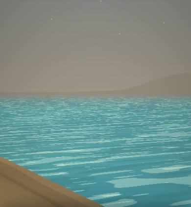
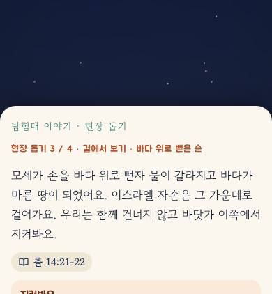
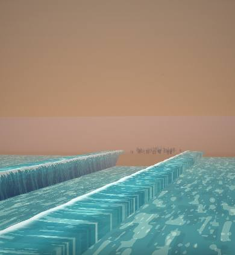

# 감수 자료 · 시대 3. 출애굽

자료 판 `02bd8cbd` · `node tools/make_review_pack.js`가 만든 파일입니다(손으로 고치지 않습니다). 게임에 나오는 문장은 글자 그대로이고, 성경 본문은 싣지 않았습니다(장절만).

#### 시대3·안내 · 시대 안내

*3. 출애굽*
- 최현 박사의 통신(탐험대 이야기): 이번 시대는 애굽과 광야 사이야. 모래바람 때문에 통신이 조금 끊길 수 있어.
- "이 사이에 성경이 기록한 곳"으로 보여 주는 장절(요약 없이 장절만): 출 1:1-2:25 · 출 3:13-10:29 · 출 12:43-13:22 · 출 15:1-15:27 · 출 17:1-18:27

표시: ☐ 그대로 ☐ 고침 ☐ 뺌 　적을 칸: 

#### 시대3·마무리 · 마무리(기도·실천)

*이 시대 장면들의 한 문장 기도(8~10세)와 한 주 실천(11~13세). 꼴은 "공통·마무리"에서*
- **OT-09 불붙은 떨기나무와 부르심** (출 3:1-12)
  - 8~10세 기도: 하나님, 모세를 부르신 이야기를 기억하게 해 주세요. 예수님의 이름으로 기도합니다. 아멘.
  - 11~13세 실천: 이번 주에 출애굽기 3장 1절부터 12절까지 소리 내어 읽어 보세요.
  - 14~19세 기록 물음: 출 3:1-12에서 새로 알게 된 사실을 한 가지 적어 보자.
- **OT-10 마지막 재앙과 유월절** (출 11:1-12:42)
  - 8~10세 기도: 하나님, 이스라엘 자손을 애굽 땅에서 인도해 내신 밤을 성경에서 읽고 기억하게 해 주세요. 예수님의 이름으로 기도합니다. 아멘.
  - 11~13세 실천: 이번 주에 출애굽기 12장 21절부터 28절까지 소리 내어 읽어 보세요.
  - 14~19세 기록 물음: 출 11:1-12:42에서 새로 알게 된 사실을 한 가지 적어 보자.
- **OT-11 바다가 갈라지다** (출 14:1-31)
  - 8~10세 기도: 하나님, 이스라엘 자손이 바다 가운데 마른 땅으로 지나간 이야기를 기억하게 해 주세요. 예수님의 이름으로 기도합니다. 아멘.
  - 11~13세 실천: 이번 주에 출애굽기 14장 13절부터 22절까지 소리 내어 읽어 보세요.
  - 14~19세 기록 물음: 출 14:1-31에서 새로 알게 된 사실을 한 가지 적어 보자.
- **OT-12 시내 산에서 주신 열 가지 말씀** (출 19:1-20:21)
  - 8~10세 기도: 하나님, 시내 산에서 하신 말씀을 성경에서 읽고 기억하게 해 주세요. 예수님의 이름으로 기도합니다. 아멘.
  - 11~13세 실천: 이번 주에 출애굽기 20장 1절부터 17절까지 소리 내어 읽어 보세요.
  - 14~19세 기록 물음: 출 19:1-20:21에서 새로 알게 된 사실을 한 가지 적어 보자.

표시: ☐ 그대로 ☐ 고침 ☐ 뺌 　적을 칸: 

### OT-09 불붙은 떨기나무와 부르심 (출 3:1-12)

- 곳: 광야, 하나님의 산 호렙
- 감수 필수: 예 — 구약 사건의 신약적 의미(행 7:30-34)
- 화면: 3D 장면 · 감수 상태: 미감수

#### OT-09·대목 · 대목 글(장면 전체)

*대목 7개* — 출 3:1-12
- **대목 1** (출 3:1)
- 8~10세: 모세는 장인 이드로의 양 떼를 돌보고 있었어요. 양들을 데리고 하나님의 산 호렙까지 왔어요.
- 11~13세: 모세는 미디안 제사장인 장인 이드로의 양 떼를 치고 있었어요. 양 떼를 이끌고 하나님의 산 호렙에 이르렀어요.
- 14~19세: 모세는 장인인 미디안 제사장 이드로의 양 떼를 치다가 하나님의 산 호렙에 이르렀다.
  - 휴의 말: 저분이 모세야. 양 떼를 데리고 여기까지 왔네.
- **대목 2** (출 3:2-3)
- 8~10세: 떨기나무에서 불이 타오르는데도 나무는 타서 없어지지 않아요. 모세는 그것을 보려고 가까이 갔어요.
- 11~13세: 떨기나무 가운데 불꽃이 일었어요. 불이 붙었는데도 나무는 타서 없어지지 않았어요. 모세는 이 놀라운 광경을 보려고 가까이 갔어요.
- 14~19세: 여호와의 사자가 떨기나무 가운데 불꽃 안에서 그에게 나타났다. 떨기나무에 불이 붙었으나 사라지지 않았고, 모세는 어찌하여 타지 않는지 보려고 그쪽으로 갔다.
  - 최온의 말: 불이 붙었는데 나무가 타서 없어지지 않아!
- **대목 3** (출 3:4)
- 8~10세: 하나님이 떨기나무 속에서 모세의 이름을 부르셨어요. 모세가 대답했어요.
- 11~13세: 모세가 보려고 오는 것을 보시고, 하나님이 떨기나무 가운데서 모세를 부르셨어요. 이름을 두 번 부르셨고, 모세는 자기가 여기 있다고 대답했어요.
- 14~19세: 여호와께서 그가 보려고 오는 것을 보셨다. 하나님이 떨기나무 가운데서 그의 이름을 거듭 부르셨고, 모세는 자신이 여기 있다고 대답했다.
  - 온우의 말: 하나님이 하신 말씀은 우리가 지어내면 안 돼. 성경책에서 직접 읽어 보자.
- **대목 4** (출 3:5)
- 8~10세: 하나님은 모세에게 가까이 오지 말고 신을 벗으라고 하셨어요. 모세가 선 곳이 거룩한 땅이기 때문이에요.
- 11~13세: 하나님은 가까이 오지 말고 발에서 신을 벗으라고 하셨어요. 모세가 선 곳이 거룩한 땅이기 때문이에요.
- 14~19세: 하나님은 그에게 가까이 오지 말고 발에서 신을 벗으라고 하셨다. 그가 선 곳이 거룩한 땅이기 때문이다.
  - 최온의 말: 신을 벗으라고 하셨대. 여기가 거룩한 땅이래.
- **대목 5** (출 3:6)
- 8~10세: 하나님은 자신이 아브라함, 이삭, 야곱의 하나님이라고 알려 주셨어요. 모세는 얼굴을 가렸어요.
- 11~13세: 하나님은 자신이 모세의 조상의 하나님, 곧 아브라함과 이삭과 야곱의 하나님이라고 하셨어요. 모세는 하나님 뵙기를 두려워해서 얼굴을 가렸어요.
- 14~19세: 하나님은 자신이 모세의 조상의 하나님, 곧 아브라함과 이삭과 야곱의 하나님이라고 밝히셨다. 모세는 하나님 뵙기를 두려워하여 얼굴을 가렸다.
  - 휴의 말: 아브라함, 이삭, 야곱. 조상들의 이름이야. 적어 둘게.
- **대목 6** (출 3:7-8)
- 8~10세: 하나님은 애굽에 있는 백성의 아픔을 보셨고, 부르짖는 소리를 들으셨다고 하셨어요.
- 11~13세: 하나님은 애굽에 있는 백성의 고통을 보셨고 부르짖음을 들으셨다고 하셨어요. 그들을 건져 내어 젖과 꿀이 흐르는 넓은 땅으로 데려가겠다고 하셨어요.
- 14~19세: 여호와께서는 애굽에 있는 자기 백성이 겪는 괴로움을 똑똑히 보셨고, 감독들 때문에 부르짖는 소리를 들으셨으며, 그들의 아픔을 아신다고 하셨다. 그들을 애굽 사람의 손에서 구해 내어 젖과 꿀이 흐르는 좋고 넓은 땅으로 데려가겠다고 하셨다.
  - 최온의 말: 아까 애굽에서 본 그 사람들 이야기야!
- **대목 7** (출 3:10-12)
- 8~10세: 하나님은 모세를 바로에게 보내겠다고 하셨어요. 모세가 자기가 누구이기에 가겠느냐고 여쭈자, 하나님은 꼭 함께 있겠다고 하셨어요.
- 11~13세: 하나님은 모세를 바로에게 보내어 백성을 애굽에서 인도해 내게 하겠다고 하셨어요. 모세는 자기가 누구이기에 그 일을 하겠느냐고 여쭈었고, 하나님은 반드시 함께 있겠다고 하셨어요.
- 14~19세: 하나님은 모세를 바로에게 보내어 이스라엘 자손을 애굽에서 인도해 내게 하겠다고 하셨다. 모세는 자기가 누구이기에 바로에게 가며 그 일을 하겠느냐고 아뢰었고, 하나님은 반드시 그와 함께 있겠다고 하셨다.
  - 온우의 말: 모세의 물음에 하나님이 어떻게 대답하셨는지, 12절에서 확인해 보자.

표시: ☐ 그대로 ☐ 고침 ☐ 뺌 　적을 칸: 

#### OT-09·동행1 · 동행 인물 문답

*모세에게 묻기* — 출 3:3
- 동행 인물: 모세 (이 자리에 있다는 근거 출 3:1, 사건과 관문 뒤에 문답)
- 최온의 물음: 저 떨기나무 쪽으로는 왜 가셨어요?
- 답 8~10세: 모세는 가서 이 큰 광경을 보겠다고 말했어요. 떨기나무가 왜 타지 않는지 보겠다고 했어요.
- 답 11~13세: 모세는 발길을 돌려 가서 이 큰 광경을 보겠다고 말했어요. 떨기나무가 어찌하여 타지 않는지 보겠다고 했어요.
- 답 14~19세: 모세는 발길을 돌려 가서 이 큰 광경을 보겠다고, 떨기나무가 어찌하여 타지 않는지 보겠다고 말했다.
- 아이가 펼 곳: 출 3:3

표시: ☐ 그대로 ☐ 고침 ☐ 뺌 　적을 칸: 

#### OT-09·동행2 · 동행 인물 문답

*모세에게 묻기* — 출 3:11
- 동행 인물: 모세 (이 자리에 있다는 근거 출 3:1, 사건과 관문 뒤에 문답)
- 온우의 물음: 바로에게 보내겠다는 말씀을 들으셨을 때 하나님께 무엇이라고 아뢰셨어요?
- 답 8~10세: 모세는 자기가 누구이기에 바로에게 가겠느냐고 하나님께 여쭈었어요.
- 답 11~13세: 모세는 하나님께, 자기가 누구이기에 바로에게 가겠느냐고 여쭈었어요. 자기가 누구이기에 이스라엘 자손을 애굽에서 이끌어 내겠느냐고도 했어요.
- 답 14~19세: 모세는 하나님께, 자기가 누구이기에 바로에게 가서 이스라엘 자손을 애굽에서 이끌어 내겠느냐고 아뢰었다.
- 아이가 펼 곳: 출 3:11

표시: ☐ 그대로 ☐ 고침 ☐ 뺌 　적을 칸: 

#### OT-09·돕기1 · 손으로 하는 돕기

*양 떼에게 길 비켜 주기* — 출 3:1
- 돕는 상대: 모세
- 8~10세: 모세가 양 떼를 이끌고 광야를 지나 호렙 산까지 왔어요. 우리는 양 떼 곁에서 길을 비켜 주며 도와요.
- 11~13세: 모세가 장인의 양 떼를 이끌고 광야를 지나 하나님의 산 호렙까지 왔어요. 우리는 양 떼가 잘 지나가도록 곁에서 길을 비켜 주며 도와요. 본문에 적힌 일이 아니라 탐험대 이야기예요.
- 14~19세: 모세는 장인의 양 떼를 몰고 광야를 지나 호렙, 곧 하나님의 산까지 왔다(3:1). 탐험대는 양 떼가 지나는 길 곁에서 길을 비켜 주고 길 위의 돌멩이를 치우며 돕는다. 본문에 적힌 일이 아니라 탐험대 이야기다. 양을 붙잡거나 모세의 일을 대신하지 않는다.
  - 누르는 일 1: 양 떼가 오는 쪽 살피기
  - 누르는 일 2: 길 위의 돌멩이 길가로 치우기
  - 누르는 일 3: 길가로 비켜서기
  - 마친 뒤 휴의 말: 양 떼가 다 지나갔어. 모세가 양 떼를 이끌고 산 쪽으로 가고 있어.

표시: ☐ 그대로 ☐ 고침 ☐ 뺌 　적을 칸: 

#### OT-09·뜻 · 뜻 묻기

*떨기나무에서 부르신 일은 무슨 뜻이에요?* — 출 3:8-10
- 휴의 물음: 떨기나무에서 하나님이 모세를 부르신 일은 무슨 뜻이에요?
- 답하는 사람: 최현 박사
- 답 8~10세: 성경은 하나님이 백성을 애굽 사람의 손에서 건져 내려고 내려오셨다고 적어요(출 3:8). 그래서 모세를 바로에게 보내어 백성을 이끌어 내게 하겠다고 하셨어요(출 3:10).
- 답 11~13세: 출애굽기 3장 8절에서 하나님은 내려와서 백성을 애굽 사람의 손에서 구해 내고, 젖과 꿀이 흐르는 넓고 좋은 땅으로 데려가겠다고 하셨어요. 10절에서는 모세를 바로에게 보내어, 그가 이스라엘 자손을 이끌고 애굽을 나오게 하겠다고 하셨어요. 성경은 이 장면에서 여기까지 말해요.
- 답 14~19세: 하나님은 친히 내려와 백성을 애굽 사람의 손에서 구해 내고, 그 땅에서 이끌어 올려 젖과 꿀이 흐르는 좋고 넓은 땅, 곧 가나안 족속과 헷 족속 등이 사는 곳으로 데려가겠다고 하셨다(출 3:8). 그리고 모세를 바로에게 보내어, 그가 하나님의 백성인 이스라엘 자손을 이끌고 애굽을 나오게 하겠다고 하셨다(출 3:10). 성경은 이 장면에서 여기까지 말한다.
- **성경을 펴서 뜻 확인하기**
- 8~10세 · 찾아 읽고 고르기: 성경책에서 출애굽기 3장 12절을 찾아 읽어 보세요. (출 3:12)
  - 물음: 하나님은 바로에게 가는 모세와 어떻게 하겠다고 하셨나요?
  - 맞는 보기: 반드시 함께 있겠다
  - 다른 보기: 멀리서 지켜보기만 하겠다 (본문에 없음)
  - 다른 보기: 모세 혼자 가게 하겠다 (본문에 없음)
- 11~13세 · 찾아 읽고 고르기: 성경책에서 출애굽기 3장 10절부터 12절까지 읽어 보세요. (출 3:10-12)
  - 물음: 하나님이 백성이 애굽에서 나온 뒤 하나님을 이 산에서 섬기게 되리라고 하신 까닭은 무엇인가요?
  - 맞는 보기: 그것이 하나님이 모세를 보내셨다는 증거가 되기 때문에
  - 다른 보기: 모세가 그 산에 집을 짓게 하시려고 (본문에 없음)
  - 다른 보기: 백성이 애굽으로 다시 돌아가게 하시려고 (본문에 없음)
- 14~19세 · 찾아 읽고 고르기: 출애굽기 3장 7절, 10절, 12절을 함께 찾아 읽어 보자. (출 3:7 · 출 3:10 · 출 3:12)
  - 물음: 세 곳을 이어 읽으면, 떨기나무에서 하나님이 하신 말씀은 무엇을 말하는가?
  - 맞는 보기: 하나님은 애굽에 있는 백성의 고통을 보시고 부르짖음을 들으셨으며, 모세를 바로에게 보내어 그들을 이끌어 내게 하시고, 반드시 그와 함께 있겠다고 하셨다
  - 다른 보기: 하나님은 백성의 부르짖음을 듣지 못하셨고, 모세에게 미디안에 머물라고 하셨다 (본문에 없음)
  - 다른 보기: 하나님은 백성 스스로 길을 찾아 애굽을 떠나라고 하셨고, 모세와는 함께하지 않겠다고 하셨다 (본문에 없음)

표시: ☐ 그대로 ☐ 고침 ☐ 뺌 　적을 칸: 

#### OT-09·신약 · 신약 연결 · ★먼저 볼 5

*14~19세에게만 보임 · 화면에 "감수 전" 표시* — 행 7:30-34
- 14~19세: 신약의 사도행전 7장 30~34절에서 스데반은 이 일을 다시 이야기한다. 떨기나무 불꽃 가운데 모세에게 보인 일과, 하나님이 백성의 괴로움을 보시고 그들을 구원하려고 내려오셨으며 모세를 애굽으로 보내신다고 하신 일을 전한다.
- 보이는 때: 뜻 묻기의 성경 읽기 물음을 맞힌 뒤에 뜹니다. 위 글은 문장 전체가 화면에 그대로 나옵니다("…감수를 마친 뒤 확정한다" 같은 문장이 들어 있으면 그것도 보입니다).

표시: ☐ 그대로 ☐ 고침 ☐ 뺌 　적을 칸: 

#### OT-09·오늘1 · 오늘의 물음

*최현 박사가 답함* — 출 3:5
- 물음: 모세는 왜 신을 벗어야 했어요?
- 답 8~10세: 하나님은 모세가 선 곳이 거룩한 땅이라고 하셨어요. 그래서 발에서 신을 벗으라고 하셨어요.
- 답 11~13세: 하나님은 모세에게 가까이 오지 말고 발에서 신을 벗으라고 하셨어요. 모세가 선 곳이 거룩한 땅이기 때문이라고 하셨어요. 성경은 여기까지 말해요.
- 답 14~19세: 하나님은 모세에게 가까이 오지 말고 발에서 신을 벗으라고 하시며, 그가 선 곳이 거룩한 땅이라고 까닭을 밝히셨다(출 3:5). 성경은 이 장면에서 여기까지 말한다.

표시: ☐ 그대로 ☐ 고침 ☐ 뺌 　적을 칸: 

#### OT-09·오늘2 · 오늘의 물음

*최현 박사가 답함* — 출 2:23-25 · 출 3:7 · 출 3:9
- 물음: 하나님은 힘들어서 부르짖는 사람의 소리를 들으실까요?
- 답 8~10세: 이 장면에서 하나님은 애굽에 있는 자기 백성이 부르짖는 소리를 들으셨다고 하셨어요. 그들의 아픔을 아신다고 하셨어요.
- 답 11~13세: 출애굽기는 이스라엘 자손이 고된 일 때문에 부르짖었고, 하나님이 그 소리를 들으셨다고 기록해요. 떨기나무 가운데서도 하나님은 애굽에 있는 자기 백성의 고통을 보셨고, 부르짖음을 들으셨고, 아픔을 아신다고 하셨어요. 성경은 이 장면에서 여기까지 말해요.
- 답 14~19세: 출애굽기는 이스라엘 자손이 고된 일 때문에 탄식하며 부르짖었고 그 소리가 하나님께 이르렀으며, 하나님은 그들의 탄식을 들으셨으며 아브라함과 이삭과 야곱과 세우신 언약을 기억하셨다고 기록한다(출 2:23-25). 떨기나무 가운데서 하나님은 애굽에 있는 자기 백성의 고통을 똑똑히 보셨고 감독들 때문에 부르짖는 소리를 들으셨으며 그들의 근심을 아신다고 하셨다(출 3:7, 3:9). 성경은 이 장면에서 여기까지 말한다.

표시: ☐ 그대로 ☐ 고침 ☐ 뺌 　적을 칸: 

#### OT-09·3D · 3D 설정

*3D로 만든 장면: 본문에 없는 배치·생김새* — 출 3:1-12
- 하나님 표현: 불과 말씀 자막만. 형상 없음. 음성은 소리로 만들지 않음
  - 그리지 않는 것: 신을 벗는 모습
  - 그리지 않는 것: 무릎 꿇는 모세
  - 그리지 않는 것: 연기와 재
- **3D 장면을 만들며 정한 것(본문에 맞춘 점, 감수가 필요한 설정)**
  - 3D 장면 설정: OT-09 불붙은 떨기나무와 부르심 (출 3:1-12). 호렙 산 기슭.
  - 3D 샘플의 세계: 지형, 하늘, 빛, 소품 배치.
  - 장소 좌표 (x, z)
  - 떨기나무는 호렙 산 기슭의 언덕 위에 있다. 언덕은 아이들 쪽(남쪽)이 가파른 바위 비탈이고,
  - 서쪽은 완만한 어깨라서 모세는 그쪽으로 올라간다. 세 아이는 언덕 아래에서 올려다본다(목격자).
  - 떨기나무 앞쪽 왼편. 떨기나무를 바라보므로 아래에서는 뒷모습이 보인다 (Blender 영상과 같은 자리)
  - 부품 2를 찾기 전까지 모세는 mosesPath의 이 번호 자리(언덕 기슭)에서 기다린다
  - 부품이 떨어진 곳: 양 떼 사이, 호렙으로 가는 길목, 언덕 아래 우묵한 곳
  - 본문에 없어 정한 것: 떨기나무와 언덕의 자리, 모세가 올라가는 길(완만한 서쪽 어깨), 떨기나무 앞에 선 모세의 뒷모습, 양 떼의 수(40마리), 압도 장면 영상(불붙은 떨기나무를 올려다보는 영상에 자막 두 줄, 효과음이 멎고 낮은 음악).
- **호렙 산 3D에만 나오는 글(영상 자막 포함)**
  - 제목: 시간 나침반
  - 타임머신은 이름을 따라 시대를 찾아가요.
  - 요셉 (준비 중)
  - 출 2:23-25
  - 찾는 실마리: 잘 모르겠으면 성경책 출애굽기 3장을 펴 보세요.
  - 이름을 따라 시간 이동 중
  - 글: 타임머신이 광야에 거칠게 내려앉았어요. 시간 나침반의 부품 세 개가 튕겨 나갔어요. 부품을 모두 찾아야 다시 떠날 수 있어요.
  - 글: 부품 탐지기가 이 시대를 몰라서 방향을 못 잡아. 이 시대의 성경 이야기로 물음에 답하면, 그 답에 나오는 곳을 가리킬 거야.
  - 부품 탐지기
  - 글: 여기까지만 가자. 우리는 지켜보는 사람이야.
  - 탐지기 물음 풀기
  - 이름: 톱니바퀴
  - 톱니바퀴를 찾았어! 양 떼 사이에 떨어져 있었네.
  - 탐지기가 양 떼 쪽을 가리켜요.
  - 글: 탐지기 바늘이 양 떼 쪽으로 돌아갔어. 일지에 적어 둘게.
  - 출 3:1
  - 물음: 모세는 무엇을 돌보고 있었나요?
  - 보기: 양 떼
  - 보기: 고기잡이 배
  - 보기: 벽돌 가마
  - 물음: 모세가 치던 양 떼는 누구의 양 떼였나요?
  - 보기: 장인 이드로의 양 떼
  - 보기: 애굽 왕 바로의 양 떼
  - 보기: 형 아론의 양 떼
  - 출애굽기
  - 찾는 실마리: 모세가 떨기나무를 본 이야기의 맨 처음을 읽어 보자.
  - 물음: 모세가 누구의 양 떼를 치고 있었는지 적힌 절을 출애굽기에서 찾아 장과 절을 적어 보자. 모세가 하나님의 산에 이른 이야기에 있다.
  - 그 절에 따르면 모세는 장인 이드로의 양 떼를 치고 있었다.
  - 이름: 나침반 바늘
  - 나침반 바늘이 여기 있었네! 산으로 가는 길목이야.
  - 탐지기가 호렙 산 쪽으로 난 길을 가리켜요.
  - 글: 저 큰 산 쪽이야! 저기가 호렙이구나.
  - 물음: 모세는 양 떼를 데리고 어디에 이르렀나요?
  - 보기: 하나님의 산 호렙
  - 보기: 넓은 바닷가
  - 보기: 벽돌로 지은 성
  - 물음: 빈칸에 들어갈 말을 골라 보세요. "모세는 양 떼를 이끌고 하나님의 산 ____에 이르렀어요."
  - 보기: 호렙
  - 보기: 갈멜
  - 보기: 시온
  - 물음: 모세는 왜 양 떼를 이끌고 하나님의 산 호렙까지 갔을까? 모세가 호렙에 이른 이야기를 출애굽기에서 찾아, 성경이 말하는 만큼 골라 보자.
  - 보기: 성경은 까닭을 말하지 않는다. 장인의 양 떼를 치다가 이르렀다고만 한다
  - 보기: 하나님이 그곳으로 오라고 부르셨기 때문이다
  - 보기: 애굽 사람들을 피해 숨으려고 갔다
  - 이름: 나사
  - 나사를 찾았어! 언덕 아래 우묵한 곳에 굴러 들어가 있었어.
  - 탐지기가 불빛이 어른거리는 언덕 아래를 가리켜요.
  - 글: 언덕 아래까지만 가자. 위로 올라가지는 말자. 우리는 지켜보는 사람이야.
  - 출 3:2
  - 물음: 모세는 하나님의 산 호렙에서 무엇을 보았나요?
  - 보기: 불이 붙은 떨기나무
  - 보기: 열매가 가득한 나무
  - 보기: 반짝이는 별
  - 출 3:1-4
  - 물음: 모세가 떨기나무 쪽으로 가기까지 일어난 일을 순서대로 눌러 보세요.
  - 양 떼를 이끌고 하나님의 산 호렙에 이르렀다
  - 떨기나무에 불이 붙었는데 타서 없어지지 않는 것을 보았다
  - 왜 타지 않는지 보려고 그쪽으로 갔다
  - 출 3:3-4
  - 물음: 모세가 그 떨기나무 쪽으로 간 까닭은 무엇인가?
  - 보기: 불이 붙었는데도 나무가 왜 타지 않는지 알고 싶어서
  - 보기: 불을 끄려고
  - 보기: 양 떼를 불에서 지키려고
  - 글: 하나님이 떨기나무 가운데서 모세를 부르셨다
  - 출 3:4
  - 글: 모세는 두려워서 얼굴을 가렸다
  - 출 3:6
  - 끝난 뒤 글: 하나님이 하신 말씀은 성경책에서 직접 읽어 보세요.
  - 건너뛰기
- **3D 화면에만 나오는 글(도착 글, 사진 도감의 이름·설명, 안내)**
  - 글: 여기까지만 가자. 우리는 지켜보는 사람이야.
  - 탐지기
  - 탐지기 물음 풀기
  - 다시 읽기 안내: 모세가 하나님의 산에 이른 이야기를 성경에서 찾아 읽은 뒤 다시 골라 보세요.
  - 떠나기 전 안내: 떨기나무 장면을 끝까지 지켜봐야 떠날 수 있어요.
  - 이름: 양 떼
  - 설명: 모세가 치던 장인 이드로의 양 떼
  - 출 3:1
  - 찾는 실마리: 출발한 곳에서 가까운 곳에 모여 있어요.
  - 이름: 모세
  - 설명: 미디안 제사장 이드로의 사위. 장인의 양 떼를 치고 있었다
  - 찾는 실마리: 양 떼 가까이에서 찾아보세요.
  - 이름: 하나님의 산 호렙
  - 설명: 모세가 양 떼를 이끌고 이른 산
  - 찾는 실마리: 가장 높은 봉우리를 화면 가운데에 담아 보세요.
  - 이름: 불붙은 떨기나무
  - 설명: 불이 붙었으나 타서 없어지지 않은 떨기나무
  - 출 3:2
  - 찾는 실마리: 모세가 가는 쪽으로 따라가면 보여요.

표시: ☐ 그대로 ☐ 고침 ☐ 뺌 　적을 칸: 

#### OT-09·기타 · 그 밖의 글(참고) · 참고

*통신·재료·관문·탐지기 물음·곁에서 보기·말씀 카드* — 출 3:1-12
- **최현 박사의 통신(탐험대 이야기)**
- 8~10세: 최현 박사예요. 타임머신이 광야에 비상 착륙하면서 부속 세 개가 망가졌어요. 이 근처에서 대신 쓸 재료를 찾아보세요.
- 11~13세: 최현 박사예요. 타임머신이 호렙 산 가까운 광야에 비상 착륙하면서 톱니바퀴와 나침반 바늘과 나사가 망가졌어요. 이 시대에는 맞는 부속이 없으니 땅에 떨어진 것 가운데서 대신 쓸 재료를 찾아보세요. 사람의 물건에는 손대지 말아요.
- 14~19세: 최현 박사다. 타임머신이 호렙 산 가까운 광야에 비상 착륙하면서 톱니바퀴, 나침반 바늘, 나사가 망가졌다. 이 시대에는 맞는 부속이 없으니 그 자리에서 구할 수 있는 재료로 대신 만들어야 한다. 땅에 떨어진 것만 줍고, 사람의 물건과 일이 일어나는 자리에는 손대지 말자.
- **수리 재료(탐험대 이야기)**
- 재료: 양털 (출 3:1)
  - 박사의 말: 양털을 꼬아 끈을 만들면 톱니바퀴 대신 바퀴를 돌리는 줄로 쓸 수 있어요.
  - 얻는 방법: 양 떼가 지나간 땅바닥에 떨어진 양털 한 뭉치를 줍는다. 양을 붙잡거나 털을 뽑지 않는다.
  - 얻었을 때 아이의 말: 양 떼가 지나간 땅바닥에서 양털 한 뭉치를 찾았어!
- 재료: 돌 조각 (출 3:1)
  - 박사의 말: 가늘고 뾰족한 돌 조각을 끼우면 나침반 바늘 대신 쓸 수 있어요.
  - 얻는 방법: 호렙 산 쪽으로 난 길목에서 길가에 굴러 있는 돌 조각을 줍는다. 산 위로는 올라가지 않는다.
  - 얻었을 때 아이의 말: 호렙 산으로 가는 길목에서 뾰족한 돌 조각을 찾았어!
- 재료: 양의 뿔 조각 (출 3:1)
  - 박사의 말: 양의 뿔 조각을 깎아 끼우면 나사 대신 쓸 수 있어요.
  - 얻는 방법: 언덕 아래 우묵한 곳에 떨어져 있는 양의 뿔 조각을 줍는다. 언덕 위로 올라가지 않고, 떨기나무 쪽에는 가까이 가지 않는다.
  - 얻었을 때 아이의 말: 언덕 아래 우묵한 곳에서 양의 뿔 조각을 찾았어!
- **관문 물음**
- 관문 1 8~10세 · 찾아 읽고 고르기: 성경책에서 출애굽기 3장 5절을 찾아 읽어 보세요. (출 3:5)
  - 물음: 하나님은 모세에게 무엇을 벗으라고 하셨나요?
  - 맞는 보기: 신
  - 다른 보기: 겉옷 (본문에 없음)
  - 다른 보기: 머리쓰개 (본문에 없음)
- 관문 2 8~10세 · 여러 개 고르기: 성경책에서 출애굽기 3장 6절을 찾아 읽어 보세요. (출 3:6)
  - 물음: 하나님은 자신을 누구의 하나님이라고 하셨나요? 모두 고르세요.
  - 맞는 보기: 아브라함
  - 다른 보기: 노아 (본문에 없음)
  - 맞는 보기: 이삭
  - 다른 보기: 요셉 (본문에 없음)
  - 맞는 보기: 야곱
- 관문 1 11~13세 · 찾아 읽고 고르기: 성경책에서 출애굽기 3장 3절과 4절을 읽어 보세요. (출 3:3-4)
  - 물음: 하나님이 모세의 이름을 두 번 부르신 것은 무엇을 보셨기 때문인가요?
  - 맞는 보기: 모세가 그 광경을 보려고 발길을 돌려 오는 것을 보셨기 때문에
  - 다른 보기: 모세가 양 떼를 잃어버리고 헤매는 것을 보셨기 때문에 (본문에 없음)
  - 다른 보기: 모세가 떨기나무의 불을 끄려는 것을 보셨기 때문에 (본문에 없음)
- 관문 2 11~13세 · 순서 맞추기: 성경책에서 출애굽기 3장 2절부터 6절까지 읽고, 일어난 차례대로 눌러 보세요. (출 3:2-6)
  - 차례 1: 불붙은 떨기나무가 타서 없어지지 않았다
  - 차례 2: 모세가 그 광경을 보려고 발길을 돌렸다
  - 차례 3: 하나님이 모세의 이름을 두 번 부르셨다
  - 차례 4: 하나님이 가까이 오지 말고 신을 벗으라고 하셨다
  - 차례 5: 모세가 두려워 얼굴을 가렸다
- 관문 1 14~19세 · 찾아 읽고 고르기: 출애굽기 3장 11절과 12절을 함께 찾아 읽어 보자. (출 3:11 · 출 3:12)
  - 물음: 모세가 '내가 누구이기에' 하고 아뢰었을 때, 하나님은 무엇으로 대답하셨는가?
  - 맞는 보기: 모세는 자기가 누구이기에 바로에게 가겠느냐고 아뢰었고, 하나님은 반드시 그와 함께 있겠다고 대답하셨다
  - 다른 보기: 모세는 기꺼이 가겠다고 아뢰었고, 하나님은 그가 말을 잘하는 사람이라고 칭찬하셨다 (본문에 없음)
  - 다른 보기: 모세는 자기가 누구이기에 가겠느냐고 아뢰었고, 하나님은 바로가 곧 허락할 것이라고 대답하셨다 (본문에 없음)
- 관문 2 14~19세 · 구절과 내용 잇기: 출애굽기 2장 24절, 3장 2절, 3장 6절을 찾아 읽고, 구절마다 맞는 내용을 이어 보자. (출 2:24 · 출 3:2 · 출 3:6)
  - 잇기: 하나님이 아브라함, 이삭, 야곱과 세우신 언약을 기억하셨다 (출 2:24)
  - 잇기: 떨기나무의 불꽃 속에서 여호와의 사자가 모세에게 나타났다 (출 3:2)
  - 잇기: 하나님이 자신을 모세의 조상들의 하나님이라고 밝히셨다 (출 3:6)
  - 이은 뒤 글: 세 곳을 이으면, 하나님은 아브라함·이삭·야곱과 세우신 언약을 기억하셨고, 떨기나무 불꽃 속에서 여호와의 사자가 모세에게 나타났으며, 하나님은 자신을 바로 그 조상들의 하나님이라고 밝히셨다.
- **3D 탐지기 물음**
- 부품 1: 톱니바퀴
  - 부품: gear
  - 있는 곳: 탐지기가 양 떼 쪽을 가리켜요.
  - 휴의 말: 탐지기 바늘이 양 떼 쪽으로 돌아갔어. 일지에 적어 둘게.
  - 찾았을 때: 톱니바퀴를 찾았어! 양 떼 사이에 떨어져 있었네.
- 탐지기 1 8~10세 · 찾아 읽고 고르기: 성경책에서 출애굽기 3장 1절을 찾아 읽어 보세요. (출 3:1)
  - 물음: 모세는 누구의 양 떼를 치고 있었나요?
  - 맞는 보기: 장인 이드로의 양 떼
  - 다른 보기: 애굽 왕 바로의 양 떼 (본문에 없음)
  - 다른 보기: 형 아론의 양 떼 (본문에 없음)
- 탐지기 1 11~13세 · 찾아 읽고 고르기: 성경책에서 출애굽기 3장 1절부터 3절까지 읽어 보세요. (출 3:1-3)
  - 물음: 양 떼를 치던 모세가 발길을 돌려 떨기나무 쪽으로 간 까닭은 무엇인가요?
  - 맞는 보기: 불이 붙었는데도 떨기나무가 타지 않는 큰 광경을 보려고
  - 다른 보기: 양 떼를 불에서 지키려고 (본문에 없음)
  - 다른 보기: 불을 꺼서 나무를 살리려고 (본문에 없음)
- 탐지기 1 14~19세 · 찾아 읽고 고르기: 출애굽기 2장 21절과 3장 1절을 함께 찾아 읽어 보자. (출 2:21 · 출 3:1)
  - 물음: 두 곳을 이어 읽으면, 모세가 미디안 제사장의 양 떼를 치게 된 정황은 어떠한가?
  - 맞는 보기: 모세는 미디안 제사장과 함께 살며 그 딸 십보라를 아내로 맞았고, 그 장인의 양 떼를 치다가 호렙, 곧 하나님의 산에 이르렀다
  - 다른 보기: 모세는 애굽 왕궁에 살며 바로의 양 떼를 맡아 기르다가 호렙에 이르렀다 (본문에 없음)
  - 다른 보기: 모세는 미디안 제사장의 양 떼를 사서 혼자 길렀고, 그 집에서 아내를 맞은 일은 없었다 (본문에 없음)
- 부품 2: 나침반 바늘
  - 부품: needle
  - 있는 곳: 탐지기가 호렙 산 쪽으로 난 길을 가리켜요.
  - 최온의 말: 저 큰 산 쪽이야! 저기가 호렙이구나.
  - 찾았을 때: 나침반 바늘이 여기 있었네! 산으로 가는 길목이야.
- 탐지기 2 8~10세 · 찾아 읽고 고르기: 성경책에서 출애굽기 3장 1절을 찾아 읽어 보세요. (출 3:1)
  - 물음: 모세는 양 떼를 이끌고 어느 산에 이르렀나요?
  - 맞는 보기: 하나님의 산 호렙
  - 다른 보기: 갈멜 산 (본문에 없음)
  - 다른 보기: 시온 산 (본문에 없음)
- 탐지기 2 11~13세 · 찾아 읽고 고르기: 성경책에서 출애굽기 3장 1절부터 5절까지 읽어 보세요. (출 3:1-5)
  - 물음: 하나님의 산 호렙에서 하나님이 모세에게 신을 벗으라고 하신 까닭은 무엇인가요?
  - 맞는 보기: 모세가 선 곳이 거룩한 땅이기 때문에
  - 다른 보기: 산길이 미끄러웠기 때문에 (본문에 없음)
  - 다른 보기: 신이 낡아 해어졌기 때문에 (본문에 없음)
- 탐지기 2 14~19세 · 찾아 읽고 고르기: 출애굽기 3장 1절과 12절을 함께 찾아 읽어 보자. (출 3:1 · 출 3:12)
  - 물음: 두 곳을 이어 읽으면, 모세가 이른 산을 두고 무엇을 알 수 있는가?
  - 맞는 보기: 모세가 양 떼를 이끌고 이른 곳은 하나님의 산 호렙이고, 하나님은 백성이 애굽에서 나온 뒤에 하나님을 이 산에서 섬기게 되리라고 하셨다
  - 다른 보기: 모세가 이른 곳은 바닷가였고, 하나님은 백성이 그곳에 성을 쌓으리라고 하셨다 (본문에 없음)
  - 다른 보기: 모세가 이른 곳은 하나님의 산이었지만, 하나님은 백성이 다시는 이 산에 오지 못하리라고 하셨다 (본문에 없음)
- 부품 3: 나사
  - 부품: screw
  - 있는 곳: 탐지기가 불빛이 어른거리는 언덕 아래를 가리켜요.
  - 온우의 말: 언덕 아래까지만 가자. 위로 올라가지는 말자. 우리는 지켜보는 사람이야.
  - 찾았을 때: 나사를 찾았어! 언덕 아래 우묵한 곳에 굴러 들어가 있었어.
- 탐지기 3 8~10세 · 찾아 읽고 고르기: 성경책에서 출애굽기 3장 2절을 찾아 읽어 보세요. (출 3:2)
  - 물음: 모세가 보니 떨기나무는 어떻게 되었나요?
  - 맞는 보기: 불이 붙었지만 사라지지 않았어요
  - 다른 보기: 다 타서 재가 되었어요 (본문에 없음)
  - 다른 보기: 열매가 주렁주렁 열렸어요 (본문에 없음)
- 탐지기 3 11~13세 · 찾아 읽고 고르기: 성경책에서 출애굽기 3장 4절부터 6절까지 읽어 보세요. (출 3:4-6)
  - 물음: 떨기나무 앞에서 모세가 얼굴을 가린 까닭은 무엇인가요?
  - 맞는 보기: 하나님 뵙기를 두려워했기 때문에
  - 다른 보기: 불빛이 너무 눈부셨기 때문에 (본문에 없음)
  - 다른 보기: 연기가 매웠기 때문에 (본문에 없음)
- 탐지기 3 14~19세 · 찾아 읽고 고르기: 출애굽기 3장 3절과 5절을 함께 찾아 읽어 보자. (출 3:3 · 출 3:5)
  - 물음: 두 곳을 이어 읽으면, 떨기나무 쪽으로 가던 모세에게 어떤 일이 있었는가?
  - 맞는 보기: 모세는 타지 않는 떨기나무를 보려고 돌이켜 갔고, 하나님은 그에게 이리로 가까이 오지 말고 신을 벗으라고 하셨다
  - 다른 보기: 모세는 떨기나무 곁까지 가서 불을 만졌고, 하나님은 그를 꾸짖지 않으셨다 (본문에 없음)
  - 다른 보기: 모세는 떨기나무를 보고 산 위로 달아났고, 하나님은 그를 다시 부르지 않으셨다 (본문에 없음)
- **곁에서 보기 · 함께 머물기**
- 보기: 곁에서 보기 · 타지 않는 떨기나무 (출 3:2-3)
  - 8~10세: 떨기나무가 불타는데도 사라지지 않아요. 모세는 그것을 보려고 그쪽으로 갔어요. 우리는 멀리서 지켜봐요.
  - 11~13세: 떨기나무의 불꽃 속에서 여호와의 사자가 모세에게 나타났어요. 불이 붙었는데도 나무는 사라지지 않았고, 모세는 그 광경을 보려고 발길을 돌렸어요. 우리는 떨기나무 쪽으로 다가가지 않고 멀리서 지켜봐요.
  - 14~19세: 떨기나무의 불꽃 속에서 여호와의 사자가 모세에게 나타났고, 불이 붙은 떨기나무는 사라지지 않았다(3:2). 모세는 이 큰 광경을 보려고 돌이켜 갔다(3:3). 탐험대는 떨기나무 쪽으로 다가가지 않고 멀리서 지켜본다.
  - 온우의 말: 우리는 여기까지만. 떨기나무 쪽으로는 다가가지 않을 거야.
- 머물기: 언덕 아래에서 기다리기 (출 3:5)
  - 8~10세: 하나님은 모세에게 이리로 가까이 오지 말라고 하셨어요. 우리도 떨기나무 쪽으로 가지 않고 언덕 아래에서 기다려요.
  - 11~13세: 하나님은 모세에게 이리로 가까이 오지 말라고 하셨어요. 모세가 선 곳은 거룩한 땅이라고 하셨어요. 우리도 더 다가가지 않고 언덕 아래에 머물며 기다려요.
  - 14~19세: 하나님은 모세에게 이리로 가까이 오지 말라고 하시며, 그가 선 곳이 거룩한 땅이라고 하셨다(3:5). 탐험대도 떨기나무 쪽으로 더 다가가지 않고 언덕 아래에 머물며 기다린다.
  - 단추 글: 언덕 아래에서 기다리기
  - 최온의 말: 우리는 여기 언덕 아래에 있을게. 더 가까이 가지 않아.
- **말씀 카드**
- 카드: 거룩한 땅 (출 3:5)
- 카드: 함께 있겠다는 약속 (출 3:12)
- **곳과 사람(설계 메모, 화면에 그릴 때의 근거)**
- 곳: 광야, 하나님의 산 호렙
- 곳(설계): 광야, 하나님의 산 호렙 기슭의 언덕
- 땅: 호렙 산줄기 끝의 낮은 언덕, 모래와 바위
  - 사람: 모세(출 3:1)
  - 물건: 양 떼(출 3:1)
  - 물건: 떨기나무(출 3:2)
  - 물건: 지팡이(출 4:2)
  - 절정 장면: 타지 않는 떨기나무와 부르심(출 3:2-6)

### OT-10 마지막 재앙과 유월절 (출 11:1-12:42)

- 곳: 애굽 땅, 라암셋에서 숙곳으로
- 감수 필수: 예 — 재앙과 심판, 장자의 죽음 / 구약 사건의 신약적 의미(유월절) / 하나님의 주권과 사람의 책임(출 11:10)
- 화면: 이야기 카드 · 감수 상태: 미감수

#### OT-10·대목 · 대목 글(장면 전체)

*대목 7개* — 출 11:1-12:42
- 이 장면에서 검증자가 여쭌 것 3가지는 아래 "검증자가 남긴 것" 항목에 따로 있습니다. 대목 글을 고치실 때는 "대목 몇, 몇 세 글"인지 적어 주세요.
- **대목 1** (출 11:1-3)
- 8~10세: 하나님은 애굽에 재앙을 하나 더 내리겠다고 하셨어요. 그 뒤에 바로가 백성을 내보낼 거라고 하셨어요.
- 11~13세: 하나님은 모세에게 바로와 애굽에 재앙을 하나 더 내리겠다고 하셨어요. 그 뒤에는 바로가 백성을 보낼 것이고, 보낼 때에는 아예 다 쫓아낼 것이라고 하셨어요. 또 백성이 이웃들에게 은과 금으로 된 패물을 구하게 하라고 하셨어요.
- 14~19세: 여호와께서는 모세에게 바로와 애굽에 재앙을 하나 더 내리겠다고, 그런 뒤에야 바로가 그들을 보내되 아예 쫓아낼 것이라고 하셨다. 백성의 남자와 여자가 저마다 이웃에게 은과 금으로 된 패물을 구하게 하라고도 하셨다. 여호와께서는 백성이 애굽 사람에게 은혜를 입게 하셨고, 모세는 애굽 땅에서 바로의 신하들과 백성의 눈에 매우 큰 사람으로 보였다.
  - 휴의 말: 여기는 애굽 땅이야. 재앙이 하나 더 남았다고 하셨어. 일지에 적어 둘게.
- **대목 2** (출 11:4-10)
- 8~10세: 모세는 밤중에 애굽 땅의 처음 난 것이 죽을 거라는 말씀을 바로에게 전했어요. 이스라엘 자손에게는 개조차 혀를 움직이지 않을 거라고 했어요.
- 11~13세: 모세는 바로에게 여호와의 말씀을 전했어요. 밤중에 여호와께서 애굽 가운데로 들어가실 것이고, 바로의 맏아들부터 여종의 맏아들까지, 그리고 가축의 처음 난 것까지 죽을 것이라고 했어요. 그러나 이스라엘 자손에게는 개조차 혀를 놀리지 않아서, 여호와께서 애굽 사람과 이스라엘을 구별하시는 줄 알게 될 것이라고 했어요. 모세는 몹시 노하여 바로 앞에서 나왔어요.
- 14~19세: 모세는 바로에게 여호와의 말씀을 전했다. 밤중에 여호와께서 애굽 가운데로 들어가실 것이며, 왕위에 앉은 바로의 맏아들부터 맷돌 뒤에 있는 여종의 맏아들까지, 또 가축의 처음 난 것까지 죽을 것이라고 했다. 애굽 온 땅에 전에도 없었고 뒤에도 없을 큰 울부짖음이 있겠으나, 이스라엘 자손에게는 사람에게든 짐승에게든 개조차 혀를 놀리지 않아 여호와께서 애굽 사람과 이스라엘을 구별하시는 줄 알게 될 것이라고 했다. 모세는 바로의 신하들이 자기에게 내려와 절하며 온 백성과 함께 나가라고 한 뒤에야 나가겠다고 말하고, 몹시 노하여 바로에게서 나왔다. 여호와께서는 모세에게 바로가 듣지 않을 것이라고 하셨다. 모세와 아론이 바로 앞에서 이 모든 기적을 행했지만 여호와께서 바로의 마음을 강퍅하게 하셨으므로 바로는 이스라엘 자손을 자기 나라에서 내보내지 않았다.
  - 온우의 말: 모세가 전한 여호와의 말씀은 11장 4절부터 7절에 있어. 성경책에서 직접 읽어 보자.
- **대목 3** (출 12:1-11)
- 8~10세: 하나님은 집마다 어린 양을 잡아 그 피를 문 양쪽 기둥과 문 위에 바르라고 하셨어요. 고기는 구워서 무교병과 쓴 나물과 함께 먹으라고 하셨어요.
- 11~13세: 하나님은 애굽 땅에서 모세와 아론에게, 이 달을 한 해의 첫 달로 삼으라고 하셨어요. 이 달 열흘에 가족마다 흠 없고 일 년 된 수컷 어린 양을 고르고, 십사일 해 질 때에 잡으라고 하셨어요. 그 피는 양을 먹을 집 문의 양쪽 기둥과 인방에 바르고, 고기는 그 밤에 불에 구워 무교병과 쓴 나물과 함께 먹으라고 하셨어요. 허리에 띠를 매고 신을 신고 지팡이를 든 채 서둘러 먹으라고 하셨어요.
- 14~19세: 여호와께서는 애굽 땅에서 모세와 아론에게 이 달을 한 해의 첫 달로 삼으라고 하셨다. 이 달 열흘에 가족마다 어린 양을 고르되, 식구가 너무 적으면 이웃과 함께 사람 수에 맞추어 고르라고 하셨다. 양이나 염소 가운데서 흠 없고 일 년 된 수컷을 골라 십사일까지 두었다가 해 질 때에 이스라엘 회중이 잡고, 그 피를 양을 먹을 집 문의 좌우 설주와 인방에 바르라고 하셨다. 그 밤에 고기를 날것이나 물에 삶은 것으로 먹지 말고 불에 구워 무교병과 쓴 나물과 함께 먹되, 아침까지 남은 것은 불사르라고 하셨다. 허리에 띠를 매고 신을 신고 지팡이를 손에 든 채 서둘러 먹으라고 하셨고, 이것이 여호와의 유월절이라고 하셨다.
  - 최온의 말: 문 양쪽 기둥이랑 문 위에 어린 양의 피를 바르라고 하셨대.
- **대목 4** (출 12:12-20)
- 8~10세: 하나님은 피가 있는 집은 넘어가겠다고 하셨어요. 이 날을 대대로 지키라고 하셨어요.
- 11~13세: 하나님은 그 밤에 애굽 땅을 두루 다니며 사람이든 짐승이든 처음 난 것을 다 치겠다고 하셨어요. 집에 있는 피가 표적이 되어, 그 피를 보면 넘어가겠다고 하셨고 재앙이 그들을 멸하지 않을 것이라고 하셨어요. 이 날을 기념하여 여호와의 절기로 대대에 지키고, 이레 동안 무교병을 먹으라고 하셨어요.
- 14~19세: 여호와께서는 그 밤에 애굽 땅을 두루 다니며 사람과 짐승을 가리지 않고 애굽에서 처음 난 것을 모두 치시고, 애굽의 모든 신에게도 벌을 내리겠다고 하셨다. 그들이 사는 집에 있는 피가 그들을 위한 표적이 되어, 그 피를 보실 때에 그들을 넘어가실 것이며 재앙이 내려 그들을 멸하지 않을 것이라고 하셨다. 이 날을 기념하여 여호와의 절기로 삼고 영원한 규례로 삼아 대대로 지키라고 하셨다. 또 첫 달 십사일 저녁에 시작하여 이십일일 저녁까지 이레 동안 무교병을 먹고, 첫날에 집에서 누룩을 없애라고 하셨다. 첫날과 일곱째 날은 성회가 되니 그 두 날에는 각 사람이 먹을 것을 마련하는 일 말고는 아무 일도 하지 말라고 하셨다.
  - 휴의 말: 피가 표적이 된다고 하셨어. 이 날을 대대로 지키라는 말씀도 적어 둘게.
- **대목 5** (출 12:21-28)
- 8~10세: 모세는 장로들에게 아침까지 아무도 문밖에 나가지 말라고 전했어요. 백성은 경배하고 그대로 했어요.
- 11~13세: 모세는 이스라엘의 모든 장로를 불러, 어린 양을 잡고 우슬초 묶음을 그릇의 피에 적셔 문 인방과 양쪽 기둥에 뿌리라고 했어요. 날이 밝을 때까지 아무도 집 문밖으로 나가지 말라고 했어요. 뒷날 자녀가 이 예식의 뜻을 물으면, 여호와께서 이스라엘 자손의 집을 넘어 구원하신 유월절 제사라고 대답하라고 했어요. 백성은 머리 숙여 경배했고, 가서 그대로 했어요.
- 14~19세: 모세는 이스라엘의 모든 장로를 불러, 가족대로 어린 양을 골라 유월절 양으로 잡으라고 했다. 우슬초 묶음을 그릇에 담긴 피에 적셔 문 인방과 좌우 설주에 뿌리라고 했고, 날이 밝을 때까지 아무도 자기 집 문밖으로 나가지 말라고 했다. 여호와께서 애굽 사람을 치려고 지나가실 때 문에 있는 피를 보시면 그 문을 넘어가시고, 멸하는 자가 그 집에 들어가 치는 것을 허락하지 않으실 것이라고 했다. 이 일을 규례로 삼아 자손과 함께 영원히 지키고, 여호와께서 주시는 땅에 이르러서도 이 예식을 지키라고 했다. 뒷날 자녀가 이 예식의 뜻을 묻거든, 이것은 여호와의 유월절 제사이며 여호와께서 애굽 사람을 치시던 때 이스라엘 자손의 집은 넘어 구원하셨다고 대답하라고 했다. 백성은 머리 숙여 경배했고, 이스라엘 자손은 돌아가서 모세와 아론이 여호와께 받은 명령대로 했다.
  - 최온의 말: 백성이 머리를 숙여 경배하고 있어.
- **대목 6** (출 12:29-32)
- 8~10세: 밤중에 하나님이 애굽 땅의 처음 난 것을 치셨고, 애굽에 큰 울음소리가 있었어요. 그 밤에 바로는 모세와 아론에게 떠나라고 했어요.
- 11~13세: 밤중에 여호와께서 애굽 땅의 처음 난 것을 다 치셨어요. 바로의 맏아들부터 옥에 갇힌 사람의 맏아들까지, 가축의 처음 난 것까지였어요. 애굽에 큰 울부짖음이 있었고, 그 밤에 바로는 모세와 아론을 불러 이스라엘 자손과 함께 떠나서 여호와를 섬기라고 했어요.
- 14~19세: 밤중에 여호와께서 애굽 땅의 처음 난 것을, 왕위에 앉은 바로의 맏아들부터 옥에 갇힌 사람의 맏아들까지, 또 가축의 처음 난 것까지 다 치셨다. 그 밤에 바로도, 그의 신하들도, 애굽 사람들도 모두 일어났고 애굽에 큰 울부짖음이 있었으니, 죽은 사람이 없는 집이 하나도 없었기 때문이다. 바로는 밤에 모세와 아론을 불러, 이스라엘 자손과 함께 자기 백성 가운데서 떠나 그들이 말한 대로 가서 여호와를 섬기라고 했다. 양과 소도 몰고 가라고 했고, 자기를 위하여 복을 빌어 달라고 했다.
  - 온우의 말: 이 밤의 일은 성경이 적은 만큼만 읽자. 12장 29절과 30절이야.
- **대목 7** (출 12:33-42)
- 8~10세: 백성은 부풀지 않은 반죽을 그릇째 싸서 메고 서둘러 떠났어요. 라암셋을 떠나 숙곳에 이르렀어요.
- 11~13세: 애굽 사람들은 백성을 재촉하여 그 땅에서 서둘러 내보내려 했어요. 백성은 아직 부풀지 않은 반죽이 담긴 그릇을 옷에 싸서 어깨에 멨고, 모세의 말대로 애굽 사람에게 은금 패물과 옷을 구했어요. 이스라엘 자손은 라암셋을 떠나 숙곳에 이르렀는데, 아이들 말고 걸어서 가는 장정만 육십만쯤이었어요. 성경은 이 밤을 여호와의 밤이라고 해요.
- 14~19세: 애굽 사람들은 자기들이 다 죽게 되었다고 하며 백성을 재촉하여 그 땅에서 서둘러 내보내려 했다. 백성은 아직 부풀지 않은 반죽이 담긴 그릇을 옷에 싸서 어깨에 멨고, 모세의 말대로 애굽 사람에게 은과 금으로 된 패물과 옷을 구했으며, 여호와께서 애굽 사람이 백성에게 은혜를 베풀어 구하는 대로 주게 하셨다. 이스라엘 자손은 라암셋을 떠나 숙곳에 이르렀는데, 아이들 외에 걸어서 가는 장정이 육십만쯤이었고 여러 족속이 섞인 많은 무리와 양과 소와 매우 많은 가축이 함께했다. 그들은 가지고 나온 반죽으로 무교병을 구웠는데, 애굽에서 쫓겨나 머뭇거릴 수 없었고 아무 양식도 마련하지 못했기 때문이다. 이스라엘 자손이 애굽에 머문 기간은 사백삼십 년이었고, 그 기간이 끝나는 바로 그 날에 여호와의 군대가 모두 애굽 땅에서 나왔다. 이 밤은 여호와께서 그들을 애굽 땅에서 인도하여 내신 일 때문에 여호와 앞에 지킬 여호와의 밤이며, 이스라엘 자손이 대대로 지킬 밤이다.
  - 휴의 말: 라암셋에서 숙곳까지. 떠난 곳과 이른 곳을 일지에 적어 둘게.

표시: ☐ 그대로 ☐ 고침 ☐ 뺌 　적을 칸: 

#### OT-10·동행1 · 동행 인물 문답

*모세에게 묻기* — 출 12:21-23
- 동행 인물: 모세 (이 자리에 있다는 근거 출 12:21, 사건과 관문 뒤에 문답)
- 휴의 물음: 그 밤에 사람들이 집 밖으로 나가도 됐어요?
- 답 8~10세: 모세는 장로들에게, 아침까지 아무도 자기 집 문밖으로 나가지 말라고 말했어요.
- 답 11~13세: 모세는 이스라엘의 모든 장로를 불러, 날이 밝을 때까지 아무도 자기 집 문밖으로 나가지 말라고 했어요. 여호와께서 애굽 사람을 치러 지나가실 때 문에 있는 피를 보시면 그 문을 넘어가실 것이라고 했어요.
- 답 14~19세: 모세는 이스라엘의 모든 장로를 불러, 아침이 될 때까지 아무도 자기 집 문밖으로 나가지 말라고 일렀다. 여호와께서 애굽 사람을 치려고 두루 다니실 때 문 위와 양쪽 기둥에 있는 피를 보시면 그 문을 넘어가시고, 멸하는 자가 그들의 집에 들어가 치지 못하게 하실 것이라고 했다.
- 아이가 펼 곳: 출 12:22

표시: ☐ 그대로 ☐ 고침 ☐ 뺌 　적을 칸: 

#### OT-10·동행2 · 동행 인물 문답

*모세에게 묻기* — 출 12:24-25
- 동행 인물: 모세 (이 자리에 있다는 근거 출 12:21, 사건과 관문 뒤에 문답)
- 온우의 물음: 이 일을 언제까지 지키라고 하셨어요?
- 답 8~10세: 모세는 이 일을 규례로 삼아 자손과 함께 영원히 지키라고 말했어요.
- 답 11~13세: 모세는 이 일을 규례로 삼아 자손과 함께 영원히 지키라고 했어요. 여호와께서 주시는 땅에 들어가서도 이 예식을 지키라고 했어요.
- 답 14~19세: 모세는 이 일을 규례로 삼아 그들과 그 자손이 영원히 지키라고 했고, 여호와께서 약속하신 대로 주시는 땅에 이르러서도 이 예식을 지키라고 했다.
- 아이가 펼 곳: 출 12:24

표시: ☐ 그대로 ☐ 고침 ☐ 뺌 　적을 칸: 

#### OT-10·돕기1 · 손으로 하는 돕기

*띠·신·지팡이 챙기기* — 출 12:11
- 돕는 상대: 이스라엘 자손의 한 집
- 8~10세: 우리는 이스라엘 자손의 한 집에 함께 있어요. 오늘 밤 양을 먹을 때는 띠를 매고, 신을 신고, 지팡이를 손에 들고 급히 먹으라고 하셨어요. 식구들이 챙기도록 도와요.
- 11~13세: 우리는 이스라엘 자손의 한 집에 머물고 있어요. 모세와 아론이 전한 여호와의 명령대로, 이 집 식구들은 띠를 매고 신을 신고 지팡이를 손에 든 채 급히 먹어야 해요. 챙기는 일을 도와요.
- 14~19세: 탐험대는 이스라엘 자손의 한 집에 머문다. 양을 먹을 때에는 띠를 허리에 매고, 신을 신고, 지팡이를 손에 든 채 급히 먹으라는 말씀이 있었다(12:11). 식구들이 그것을 챙기도록 돕는다.
  - 누르는 일 1: 허리띠 건네기
  - 누르는 일 2: 신 챙겨 주기
  - 누르는 일 3: 지팡이 손에 쥐여 주기
  - 마친 뒤 온우의 말: 다 챙겼어. 띠를 매고, 신을 신고, 지팡이를 손에 쥐었어.

표시: ☐ 그대로 ☐ 고침 ☐ 뺌 　적을 칸: 

#### OT-10·돕기2 · 손으로 하는 돕기

*반죽 그릇 싸기* — 출 12:34
- 돕는 상대: 이스라엘 자손의 한 집
- 8~10세: 애굽 사람들이 어서 떠나라고 재촉했어요. 이 집 식구들이 반죽 그릇을 옷에 싸서 어깨에 메도록 도와요.
- 11~13세: 애굽 사람들이 재촉해서 백성은 서둘러 떠나야 했어요. 아직 부풀지 않은 반죽을 그릇째 옷에 싸서 어깨에 메는 일을 도와요.
- 14~19세: 애굽 사람들이 백성을 재촉했다(12:33). 백성은 아직 부풀지 않은 반죽을 그릇째 옷에 싸서 어깨에 메었다(12:34). 탐험대는 이 집 식구들이 짐을 꾸리는 것을 돕는다.
  - 누르는 일 1: 반죽 그릇 들어 주기
  - 누르는 일 2: 옷으로 싸기
  - 누르는 일 3: 어깨에 멜 수 있게 건네기
  - 마친 뒤 최온의 말: 반죽이 아직 부풀지도 않았어. 정말 서둘러 떠나는구나.

표시: ☐ 그대로 ☐ 고침 ☐ 뺌 　적을 칸: 

#### OT-10·뜻 · 뜻 묻기

*그 밤의 일은 무슨 뜻이에요?* — 출 12:26-27
- 최온의 물음: 그 밤에 피를 바르고 양을 먹은 일은 무슨 뜻이에요?
- 답하는 사람: 이 집 사람
- 답 8~10세: 이 집 사람은, 뒷날 자녀가 물으면 이렇게 말하라고 모세가 전했다고 들려주었어요. 이것은 여호와의 유월절이고, 여호와께서 애굽 사람을 치실 때 이스라엘 자손의 집은 넘어가셔서 그 집들을 구원하셨다고요.
- 답 11~13세: 이 집 사람은, 뒷날 자녀가 이 예식의 뜻을 물으면 이렇게 대답하라고 모세가 전한 말을 들려주었어요. 이것은 여호와께 드리는 유월절 제사이고, 여호와께서 애굽 사람을 치실 때 이스라엘 자손의 집은 넘어가셔서 그 집들을 구원하셨다고요.
- 답 14~19세: 이 집 사람은, 뒷날 자녀가 이 예식의 뜻을 물을 때 하라고 모세가 장로들에게 전한 말을 들려주었다. 이것은 여호와께 드리는 유월절 제사이며, 여호와께서 애굽 사람을 치시던 때에 이스라엘 자손의 집들은 넘어가셔서 그 집들을 구원하셨다는 것이다.
- **성경을 펴서 뜻 확인하기**
- 8~10세 · 찾아 읽고 고르기: 성경책에서 출애굽기 12장 13절을 찾아 읽어 보세요. (출 12:13)
  - 물음: 집에 바른 피는 그 집에 무엇이 되었나요?
  - 맞는 보기: 표적
  - 다른 보기: 장식 (본문에 없음)
  - 다른 보기: 문패 (본문에 없음)
- 11~13세 · 찾아 읽고 고르기: 성경책에서 출애굽기 12장 12절과 13절을 읽어 보세요. (출 12:12-13)
  - 물음: 여호와께서 그 집을 넘어가신 까닭은 무엇인가요?
  - 맞는 보기: 그 집에 바른 피를 보셨기 때문에
  - 다른 보기: 그 집 사람들이 밤새 깨어 있었기 때문에 (본문에 없음)
  - 다른 보기: 그 집이 애굽 사람의 집보다 컸기 때문에 (본문에 없음)
- 14~19세 · 찾아 읽고 고르기: 출애굽기 12장 13절, 23절, 27절을 함께 찾아 읽어 보자. (출 12:13 · 출 12:23 · 출 12:27)
  - 물음: 세 곳을 이어 읽으면, 문에 바른 피에 대해 성경은 무엇을 말하는가?
  - 맞는 보기: 피는 그 집의 표적이 되었고, 여호와께서 그 피를 보시고 그 문을 넘으셔서 멸하는 자가 들어오지 못했으며, 뒷날 자녀에게 그 밤에 집을 구원하셨다고 말하게 하셨다
  - 다른 보기: 피는 표적이 되었지만, 멸하는 자는 피가 있는 집에도 들어갔다 (본문에 없음)
  - 다른 보기: 피는 그 밤에만 쓰였고, 뒷날에는 그 일을 말하지 말라고 하셨다 (본문에 없음)

표시: ☐ 그대로 ☐ 고침 ☐ 뺌 　적을 칸: 

#### OT-10·신약 · 신약 연결 · ★먼저 볼 6

*14~19세에게만 보임 · 화면에 "감수 전" 표시* — 고전 5:7
- 14~19세: 신약의 고린도전서 5장 7절은 그리스도를 '우리의 유월절 양'이라고 부르고, 그가 희생되셨다고 말한다. 유월절 양과 그리스도의 연결은 목사님 감수를 마친 뒤 확정한다.
- 보이는 때: 뜻 묻기의 성경 읽기 물음을 맞힌 뒤에 뜹니다. 위 글은 문장 전체가 화면에 그대로 나옵니다("…감수를 마친 뒤 확정한다" 같은 문장이 들어 있으면 그것도 보입니다).

표시: ☐ 그대로 ☐ 고침 ☐ 뺌 　적을 칸: 

#### OT-10·오늘1 · 오늘의 물음

*최현 박사가 답함* — 출 12:14 · 출 12:17 · 출 12:42
- 물음: 왜 이 밤을 대대로 지키라고 했어요?
- 답 8~10세: 성경은 여호와께서 이스라엘 자손을 애굽 땅에서 이끌어 내신 일 때문에, 그 밤을 대대로 지키라고 말해요.
- 답 11~13세: 하나님은 이 날을 기념하여 여호와의 절기로 대대로 지키라고 하셨어요. 성경은 여호와께서 이스라엘 자손을 애굽 땅에서 이끌어 내신 일 때문에, 그 밤을 여호와 앞에 지킬 여호와의 밤이라고 말해요.
- 답 14~19세: 하나님은 이 날을 기념하여 여호와의 절기로 삼고 영원한 규례로 대대로 지키라고 하셨다(출 12:14). 무교절을 지키라고 하실 때에는, 바로 이 날에 그들의 군대를 애굽 땅에서 인도하여 내셨기 때문이라고 하셨다(출 12:17). 성경은 여호와께서 그들을 애굽 땅에서 이끌어 내신 일 때문에 그 밤이 여호와 앞에 지킬 여호와의 밤이며 이스라엘 자손이 대대로 지킬 밤이라고 말한다(출 12:42).

표시: ☐ 그대로 ☐ 고침 ☐ 뺌 　적을 칸: 

#### OT-10·화면 · 화면 원칙

*이야기 카드 장면: 하나님 표현과 그리지 않는 것* — 출 11:1-12:42
- 하나님 표현: 말씀 자막만. 형상 없음. 여호와께서 애굽 가운데로 들어가심(출 11:4)과 넘어가심(출 12:13, 12:23)은 그림자나 빛으로도 그리지 않고 글로만 전함. 멸하는 자(출 12:23)도 그리지 않음. 음성은 소리로 만들지 않음
  - 그리지 않는 것: 하나님의 형상, 집 위를 지나가는 그림자·빛·안개(본문에 없음)
  - 그리지 않는 것: 멸하는 자의 형상(출 12:23은 글로만)
  - 그리지 않는 것: 죽은 사람이나 짐승, 우는 얼굴을 가까이서 보여 주는 그림(출 12:29-30은 글로만 담담하게)
  - 그리지 않는 것: 어린 양을 잡는 모습과 흐르는 피(문에 있는 표시만 멀리서)
  - 그리지 않는 것: 피를 특정한 모양으로 바르는 것(본문은 좌우 설주와 인방이라고만 한다, 출 12:7)
  - 그리지 않는 것: 애굽 사람의 집 안 장면(본문에 없음)
  - 그리지 않는 것: 이스라엘 자손이 환호하거나 춤추는 모습(이 본문에 없음)
  - 그리지 않는 것: 아이들이 문에 피를 바르거나 음식을 함께 먹는 것(목격자다)

표시: ☐ 그대로 ☐ 고침 ☐ 뺌 　적을 칸: 

#### OT-10·미해결1 · 검증자가 남긴 것 · ★먼저 볼 17

*8~10세 글에 처음 난 것이 죽으리라는 말씀과 그 일(출 11:5, 12:29)을 한 문장씩 그대로 둘까요?*
- 검증 기록(OT-10 마지막 재앙과 유월절): 8~10세 대목(대목 2와 대목 6의 8~10세 글)에 처음 난 것이 죽으리라는 말씀과 그 일(출 11:5, 12:29)이 한 문장씩 담담하게 들어 있다. 이 나이에 이 문장을 둘지는 감수 때 정한다(감수 필수: 재앙과 심판, 장자의 죽음).
  - 지금 게임의 글 · 대목 2 · 8~10세: 모세는 밤중에 애굽 땅의 처음 난 것이 죽을 거라는 말씀을 바로에게 전했어요. 이스라엘 자손에게는 개조차 혀를 움직이지 않을 거라고 했어요.
  - 지금 게임의 글 · 대목 6 · 8~10세: 밤중에 하나님이 애굽 땅의 처음 난 것을 치셨고, 애굽에 큰 울음소리가 있었어요. 그 밤에 바로는 모세와 아론에게 떠나라고 했어요.

표시: ☐ 지금대로 ☐ 바꿈 ☐ 의논 필요 　적을 칸: 

#### OT-10·미해결2 · 검증자가 남긴 것 · ★먼저 볼 18

*14~19세 글에 여호와께서 바로의 마음을 강퍅하게 하셨다(출 11:10)를 사실로만 적어 둘까요?*
- 검증 기록(OT-10 마지막 재앙과 유월절): 출 11:10의 강퍅하게 하심이 대목 2의 14~19세 글에 사실로만 적혀 있다. 감수 때 확인한다(주권과 책임).
  - 지금 게임의 글 · 대목 2 · 14~19세: 모세는 바로에게 여호와의 말씀을 전했다. 밤중에 여호와께서 애굽 가운데로 들어가실 것이며, 왕위에 앉은 바로의 맏아들부터 맷돌 뒤에 있는 여종의 맏아들까지, 또 가축의 처음 난 것까지 죽을 것이라고 했다. 애굽 온 땅에 전에도 없었고 뒤에도 없을 큰 울부짖음이 있겠으나, 이스라엘 자손에게는 사람에게든 짐승에게든 개조차 혀를 놀리지 않아 여호와께서 애굽 사람과 이스라엘을 구별하시는 줄 알게 될 것이라고 했다. 모세는 바로의 신하들이 자기에게 내려와 절하며 온 백성과 함께 나가라고 한 뒤에야 나가겠다고 말하고, 몹시 노하여 바로에게서 나왔다. 여호와께서는 모세에게 바로가 듣지 않을 것이라고 하셨다. 모세와 아론이 바로 앞에서 이 모든 기적을 행했지만 여호와께서 바로의 마음을 강퍅하게 하셨으므로 바로는 이스라엘 자손을 자기 나라에서 내보내지 않았다.

표시: ☐ 지금대로 ☐ 바꿈 ☐ 의논 필요 　적을 칸: 

#### OT-10·미해결3 · 검증자가 남긴 것

*어린 양의 피(출 12:7, 12:13, 12:22-23)와 유월절 제사(12:27)를 본문대로만 싣고 그대로 둘까요?*
- 검증 기록(OT-10 마지막 재앙과 유월절): 어린 양의 피(출 12:7, 12:13, 12:22-23)와 "유월절 제사"(출 12:27)가 대목·관문·카드에 본문대로 들어 있다. 신약과의 연결은 없다. 그대로 둘지는 감수 때 정한다(유월절의 신약적 의미).
  - 지금 게임의 글 · 대목 3 · 8~10세: 하나님은 집마다 어린 양을 잡아 그 피를 문 양쪽 기둥과 문 위에 바르라고 하셨어요. 고기는 구워서 무교병과 쓴 나물과 함께 먹으라고 하셨어요.
  - 지금 게임의 글 · 대목 4 · 8~10세: 하나님은 피가 있는 집은 넘어가겠다고 하셨어요. 이 날을 대대로 지키라고 하셨어요.
  - 지금 게임의 글 · 대목 5 · 14~19세: 모세는 이스라엘의 모든 장로를 불러, 가족대로 어린 양을 골라 유월절 양으로 잡으라고 했다. 우슬초 묶음을 그릇에 담긴 피에 적셔 문 인방과 좌우 설주에 뿌리라고 했고, 날이 밝을 때까지 아무도 자기 집 문밖으로 나가지 말라고 했다. 여호와께서 애굽 사람을 치려고 지나가실 때 문에 있는 피를 보시면 그 문을 넘어가시고, 멸하는 자가 그 집에 들어가 치는 것을 허락하지 않으실 것이라고 했다. 이 일을 규례로 삼아 자손과 함께 영원히 지키고, 여호와께서 주시는 땅에 이르러서도 이 예식을 지키라고 했다. 뒷날 자녀가 이 예식의 뜻을 묻거든, 이것은 여호와의 유월절 제사이며 여호와께서 애굽 사람을 치시던 때 이스라엘 자손의 집은 넘어 구원하셨다고 대답하라고 했다. 백성은 머리 숙여 경배했고, 이스라엘 자손은 돌아가서 모세와 아론이 여호와께 받은 명령대로 했다.
  - 지금 게임의 글 · 관문 물음 1 · 보기 · 11~13세: 여호와께서 문에 바른 피를 보시면 그 집을 넘어가시고, 멸하는 자가 들어와 치지 못하게 하신다고 했기 때문에
  - 지금 게임의 글 · 말씀 카드 1: 피를 볼 때에 넘어가심
  - 지금 게임의 글 · 현장 돕기 단계 5 · 신약 연결: 신약의 고린도전서 5장 7절은 그리스도를 '우리의 유월절 양'이라고 부르고, 그가 희생되셨다고 말한다. 유월절 양과 그리스도의 연결은 목사님 감수를 마친 뒤 확정한다.
  - 덧붙임: 검증 기록은 신약과의 연결이 없다고 했지만, 지금은 돕기 마지막 걸음에 고린도전서 5장 7절을 잇는 한 줄이 들어 있다(감수 뒤 확정이라고 적혀 있음).

표시: ☐ 지금대로 ☐ 바꿈 ☐ 의논 필요 　적을 칸: 

#### OT-10·기타 · 그 밖의 글(참고) · 참고

*통신·재료·관문·탐지기 물음·곁에서 보기·말씀 카드* — 출 11:1-12:42
- **최현 박사의 통신(탐험대 이야기)**
- 8~10세: 최현 박사예요. 타임머신이 애굽 땅에 비상 착륙하면서 공기 거름망이 찢어졌어요. 길에 떨어진 것으로 대신 쓸 재료를 찾고, 이스라엘 자손의 집에서는 피를 바르는 일만 빼고 식구들을 도와요.
- 11~13세: 최현 박사예요. 타임머신이 애굽 땅에 비상 착륙하면서 공기 거름망이 찢어졌어요. 이 시대에는 맞는 부속이 없으니 길에 떨어진 것 가운데 대신 쓸 재료를 찾아보세요. 이스라엘 자손의 집에 머물게 되면 그 집 사람들이 하는 평범한 일만 돕고, 피를 바르는 일처럼 그 집 사람이 하는 일에는 손대지 말아요.
- 14~19세: 최현 박사다. 타임머신이 애굽 땅에 비상 착륙하면서 공기 거름망이 찢어졌다. 이 시대에는 맞는 부속이 없으니 길에 떨어진 것으로 대신 만들어야 한다. 이스라엘 자손의 집에 머물게 되면 그 집 사람들이 하는 평범한 일만 돕자. 피를 바르는 일처럼 본문이 그 집 사람이 한다고 적은 일에는 손대지 않는다.
- **수리 재료(탐험대 이야기)**
- 재료: 소털 (출 12:38)
  - 박사의 말: 소털을 촘촘하게 겹쳐 넣으면 찢어진 공기 거름망 대신 쓸 수 있어요.
  - 얻는 방법: 라암셋에서 숙곳으로 가는 길가, 소 떼가 지나간 자리에 떨어진 소털 몇 가닥을 줍는다. 소를 붙잡거나 털을 뽑지 않고, 무리의 짐과 가축에는 손대지 않는다.
  - 얻었을 때 아이의 말: 소 떼가 지나간 길가에서 소털 몇 가닥을 찾았어!
- **관문 물음**
- 관문 1 8~10세 · 찾아 읽고 고르기: 성경책에서 출애굽기 12장 7절을 찾아 읽어 보세요. (출 12:7)
  - 물음: 어린 양의 피를 집의 어디에 바르라고 하셨나요?
  - 맞는 보기: 문 양쪽 기둥과 문 위
  - 다른 보기: 집 지붕 위 (본문에 없음)
  - 다른 보기: 우물가의 돌 (본문에 없음)
- 관문 2 8~10세 · 여러 개 고르기: 성경책에서 출애굽기 12장 8절을 찾아 읽어 보세요. (출 12:8)
  - 물음: 그 밤에 함께 먹으라고 한 것을 모두 고르세요.
  - 맞는 보기: 불에 구운 고기
  - 맞는 보기: 무교병
  - 다른 보기: 꿀 (본문에 없음)
  - 맞는 보기: 쓴 나물
  - 다른 보기: 포도주 (본문에 없음)
- 관문 1 11~13세 · 찾아 읽고 고르기: 성경책에서 출애굽기 12장 21절부터 23절까지 읽어 보세요. (출 12:21-23)
  - 물음: 아침까지 한 사람도 집 문밖에 나가지 말라고 한 까닭은 무엇인가요?
  - 맞는 보기: 여호와께서 문에 바른 피를 보시면 그 집을 넘어가시고, 멸하는 자가 들어와 치지 못하게 하신다고 했기 때문에
  - 다른 보기: 애굽 군사들이 밤새 길을 지키고 있었기 때문에 (본문에 없음)
  - 다른 보기: 밤에 큰비가 내릴 것이기 때문에 (본문에 없음)
- 관문 2 11~13세 · 순서 맞추기: 성경책에서 출애굽기 12장 29절부터 34절까지 읽고, 일어난 차례대로 눌러 보세요. (출 12:29-34)
  - 차례 1: 여호와께서 밤중에 애굽 땅의 처음 난 것을 치셨다
  - 차례 2: 애굽에 큰 울음소리가 있었다
  - 차례 3: 바로가 밤에 모세와 아론을 불러 떠나라고 했다
  - 차례 4: 애굽 사람들이 백성을 서둘러 내보내려고 재촉했다
  - 차례 5: 백성이 반죽 그릇을 옷에 싸서 어깨에 멨다
- 관문 1 14~19세 · 찾아 읽고 고르기: 출애굽기 12장 11절, 33절, 39절을 함께 찾아 읽어 보자. (출 12:11 · 출 12:33 · 출 12:39)
  - 물음: 세 곳에 공통으로 나타나는 그 밤의 모습은 무엇인가?
  - 맞는 보기: 서두름이다. 급히 먹으라고 하셨고, 애굽 사람들은 속히 내보내려 재촉했고, 백성은 지체할 수 없었다
  - 다른 보기: 느긋함이다. 백성은 며칠 동안 잔치를 하며 쉬다가 떠났다 (본문에 없음)
  - 다른 보기: 망설임이다. 백성은 떠나기를 두려워하여 오래 머뭇거렸다 (본문에 없음)
- 관문 2 14~19세 · 구절과 내용 잇기: 출애굽기 11장 7절, 12장 28절, 12장 31절을 찾아 읽고, 구절마다 맞는 내용을 이어 보자. (출 11:7 · 출 12:28 · 출 12:31)
  - 잇기: 여호와께서 애굽 사람과 이스라엘을 구별하신다고 하셨다 (출 11:7)
  - 잇기: 이스라엘 자손이 물러가 명하신 대로 행했다 (출 12:28)
  - 잇기: 바로가 밤에 모세와 아론을 불러 떠나라고 했다 (출 12:31)
  - 이은 뒤 글: 세 곳을 이으면, 구별하겠다고 하신 말씀이 있었고 이스라엘은 명하신 대로 행했으며, 그 밤에 바로가 떠나라고 했다.
- **곁에서 보기 · 함께 머물기**
- 보기: 곁에서 보기 · 문에 바른 피 (출 12:22)
  - 8~10세: 이 집 사람이 우슬초 묶음을 그릇의 피에 적셔 문에 발랐어요.
  - 11~13세: 이 집 사람이 우슬초 묶음을 그릇에 담은 피에 적셔 문에 발랐어요.
  - 14~19세: 이 집 사람이 우슬초 묶음을 그릇에 담은 피에 적셔 문에 발랐다. 각 집이 그렇게 하라고 했고(12:7, 12:22) 이스라엘 자손은 그대로 행했다(12:28). 탐험대는 손대지 않고 곁에서 본다.
  - 휴의 말: 문의 어디에 발랐는지는 12장 7절에서 확인하자.
- 머물기: 아침까지 집 안에 (출 12:22-23)
  - 8~10세: 모세가 전한 대로, 이 집 식구들은 아침까지 문밖에 나가지 않아요. 우리도 이 집 안에서 함께 기다려요.
  - 11~13세: 모세가 전한 대로, 이 집 식구들은 아침까지 한 사람도 문밖에 나가지 않아요. 우리도 피를 바른 문 안쪽에서 함께 기다려요.
  - 14~19세: 아침까지 아무도 자기 집 문밖에 나가지 말라고 했다(12:22). 이 집 식구들은 그대로 문 안에 머문다. 탐험대도 피를 바른 문 안쪽에서 함께 기다린다. 그렇게 한 까닭은 12장 23절에 있다.
  - 단추 글: 문 안에서 함께 기다리기
  - 최온의 말: 우리는 이 집 문 안에 있어. 아침까지 나가지 않을 거야.
- **말씀 카드**
- 카드: 피를 볼 때에 넘어가심 (출 12:13)
- 카드: 여호와의 밤 (출 12:42)
- **곳과 사람(설계 메모, 화면에 그릴 때의 근거)**
- 곳: 애굽 땅, 라암셋에서 숙곳으로
- 곳(설계): 애굽 땅(출 12:1), 라암셋에서 숙곳으로 가는 길(출 12:37)
- 땅: 이스라엘 자손이 사는 집들과 그 문(출 12:7, 12:22). 바로가 있는 곳(출 11:8, 12:31). 본문은 집과 땅의 생김새를 더 말하지 않는다
  - 사람: 모세(출 11:1)
  - 사람: 아론(출 12:1)
  - 사람: 바로(출 11:8, 12:31)
  - 사람: 바로의 신하들(출 12:30)
  - 사람: 이스라엘의 장로들(출 12:21)
  - 사람: 이스라엘 자손(출 12:28)
  - 사람: 애굽 사람들(출 12:33)
  - 사람: 함께 나온 여러 족속의 많은 무리(출 12:38)
  - 물건: 흠 없고 일 년 된 수컷 어린 양, 양이나 염소(출 12:5)
  - 물건: 문의 좌우 설주와 인방(출 12:7)
  - 물건: 우슬초 묶음과 피를 담은 그릇(출 12:22)
  - 물건: 무교병과 쓴 나물(출 12:8)
  - 물건: 허리띠, 신, 지팡이(출 12:11)
  - 물건: 반죽 그릇과 그것을 싼 옷(출 12:34)
  - 물건: 은금 패물과 의복(출 12:35)
  - 물건: 양과 소와 많은 가축(출 12:38)
  - 절정 장면: 3D로 만들지 않고 이야기 카드로 잇는 장면

### OT-11 바다가 갈라지다 (출 14:1-31)

- 곳: 바다와 믹돌 사이 비하히롯 앞, 바알스본 맞은편 바닷가
- 감수 필수: 예 — 하나님의 주권과 사람의 책임(출 14:4, 14:8, 14:17) / 재앙과 심판(출 14:26-28) / 구약 사건의 신약적 의미(히 11:29)
- 화면: 3D 장면 · 감수 상태: 미감수

#### OT-11·대목 · 대목 글(장면 전체)

*대목 7개* — 출 14:1-31
- 이 장면에서 검증자가 여쭌 것 4가지는 아래 "검증자가 남긴 것" 항목에 따로 있습니다. 대목 글을 고치실 때는 "대목 몇, 몇 세 글"인지 적어 주세요.
- **대목 1** (출 14:1-9)
- 8~10세: 하나님은 이스라엘 자손이 바닷가에 장막을 치게 하셨어요. 애굽 왕 바로는 병거와 군대를 이끌고 뒤쫓아 왔어요.
- 11~13세: 하나님은 모세에게, 이스라엘 자손이 돌이켜 바다와 믹돌 사이 비하히롯 앞 바닷가에 장막을 치게 하라고 하셨어요. 백성이 떠났다는 말을 들은 바로와 신하들은 마음이 바뀌었어요. 바로는 가려 뽑은 병거 육백 대와 애굽의 모든 병거를 이끌고 뒤쫓아, 바닷가 장막 친 곳까지 따라왔어요.
- 14~19세: 여호와께서는 모세에게, 이스라엘 자손이 돌이켜 바다와 믹돌 사이 비하히롯 앞, 바알스본 맞은편 바닷가에 장막을 치게 하라고 하셨다. 바로가 그들이 광야에 갇혔다고 말할 것이며, 여호와께서 바로의 마음을 강퍅하게 하여 뒤따르게 하시고 바로와 그 온 군대로 말미암아 영광을 얻어 애굽 사람이 여호와를 알게 하겠다고 하셨다. 이스라엘 자손은 그대로 했다. 백성이 도망했다는 말이 애굽 왕에게 전해지자 바로와 신하들은 마음이 변하여, 이스라엘을 놓아 보내 자기들을 섬기지 않게 한 것을 두고 어찌하여 그리했느냐고 했다. 바로는 자기 병거를 갖추고 백성을 데리고 나섰고, 가려 뽑은 병거 육백 대와 애굽의 모든 병거를 동원했는데 장관들이 그것을 다 거느렸다. 여호와께서 바로 왕의 마음을 강퍅하게 하셨으므로 그는 담대히 나간 이스라엘 자손의 뒤를 따랐고, 말과 병거와 마병과 군대가 바알스본 맞은편 비하히롯 곁 바닷가의 장막 친 곳에 이르렀다.
  - 휴의 말: 바다와 믹돌 사이, 비하히롯 앞 바닷가야. 뒤에서는 애굽의 병거들이 오고 있어. 일지에 적어 둘게.
- **대목 2** (출 14:10-14)
- 8~10세: 이스라엘 자손은 뒤따라온 애굽 사람들을 보고 몹시 두려워했어요. 모세는 두려워하지 말라고, 여호와께서 그들을 위해 싸우실 거라고 했어요.
- 11~13세: 바로가 가까이 오자 이스라엘 자손은 몹시 두려워하며 여호와께 부르짖었어요. 그리고 모세에게, 왜 애굽에서 이끌어 내어 광야에서 죽게 하느냐고 했어요. 모세는 두려워하지 말고 가만히 서서 여호와께서 오늘 행하시는 구원을 보라고 했어요. 여호와께서 그들을 위해 싸우실 것이니 가만히 있으라고 했어요.
- 14~19세: 바로가 가까이 올 때 이스라엘 자손은 눈을 들어 애굽 사람들이 뒤에 이른 것을 보고 몹시 두려워하여 여호와께 부르짖었다. 또 모세에게, 애굽에 묻힐 곳이 없어서 자기들을 이끌어 내어 광야에서 죽게 하느냐고 했고, 애굽에서 이미 자기들을 내버려 두라고 말하지 않았느냐고 했으며, 애굽 사람을 섬기는 편이 광야에서 죽는 것보다 낫겠다고 했다. 모세는 백성에게 두려워하지 말고 가만히 서서 여호와께서 오늘 그들을 위해 행하시는 구원을 보라고 했다. 오늘 본 애굽 사람을 다시는 영원히 보지 못할 것이며, 여호와께서 그들을 위해 싸우실 것이니 가만히 있으라고 했다.
  - 최온의 말: 이스라엘 사람들이 눈을 들어 뒤쪽을 보고 있어. 애굽 사람들이 바로 뒤까지 왔어!
- **대목 3** (출 14:15-18)
- 8~10세: 하나님은 모세에게 백성을 앞으로 나아가게 하라고 하셨어요. 지팡이를 들고 바다 위로 손을 내밀라고 하셨어요.
- 11~13세: 하나님은 모세에게 이스라엘 자손을 앞으로 나아가게 하라고 하셨어요. 지팡이를 들고 바다 위로 손을 내밀어 바다가 갈라지게 하라고 하셨어요. 그러면 이스라엘 자손이 바다 가운데 마른 땅으로 지나갈 것이라고 하셨어요.
- 14~19세: 여호와께서는 모세에게 어찌하여 부르짖느냐고 하시며, 이스라엘 자손을 앞으로 나아가게 하라고 하셨다. 지팡이를 들고 바다 위로 손을 내밀어 바다가 갈라지게 하면 이스라엘 자손이 바다 가운데 마른 땅으로 지나갈 것이라고 하셨다. 또 애굽 사람들의 마음을 강퍅하게 하여 뒤따라 들어가게 하시고, 바로와 그 군대와 병거와 마병으로 말미암아 영광을 얻으실 때에 애굽 사람들이 여호와를 알게 될 것이라고 하셨다.
  - 온우의 말: 하나님이 모세에게 하신 말씀은 14장 15절과 16절에 있어. 성경책에서 직접 읽어 보자.
- **대목 4** (출 14:19-20)
- 8~10세: 구름 기둥이 이스라엘 진 앞에서 뒤로 옮겨 가 두 진 사이에 섰어요. 그래서 밤새도록 애굽 진이 가까이 오지 못했어요.
- 11~13세: 이스라엘 진 앞에서 가던 하나님의 사자가 뒤로 옮겨 갔고, 구름 기둥도 앞에서 뒤로 옮겨 애굽 진과 이스라엘 진 사이에 섰어요. 애굽 쪽에는 구름과 어둠이 있었고 이스라엘 쪽은 밤이 밝았어요. 그래서 밤새도록 애굽 진이 이스라엘 진에 가까이 오지 못했어요.
- 14~19세: 이스라엘 진 앞에서 가던 하나님의 사자가 그 뒤로 옮겨 갔고, 구름 기둥도 앞에서 뒤로 옮겨 애굽 진과 이스라엘 진 사이에 섰다. 저편에는 구름과 흑암이 있었고 이편은 밤이 밝았다. 그래서 밤이 새도록 저편이 이편에 가까이 오지 못했다.
  - 휴의 말: 구름 기둥이 앞에서 뒤로 옮겨 갔어. 지금은 두 진 사이에 서 있어. 적어 둘게.
- **대목 5** (출 14:21-22)
- 8~10세: 모세가 손을 바다 위로 뻗자, 하나님이 밤새 큰 동풍으로 바닷물을 물리셨어요. 바다가 마른 땅이 되었고, 이스라엘 자손은 그 가운데로 걸어갔어요.
- 11~13세: 모세가 바다 위로 손을 내밀자, 여호와께서 큰 동풍을 써서 밤이 새도록 바닷물이 물러가게 하셨어요. 물이 갈라지고 바다는 마른 땅이 되었어요. 이스라엘 자손은 바다 가운데 마른 땅으로 걸어갔고, 물은 그들의 왼쪽과 오른쪽에서 벽이 되었어요.
- 14~19세: 모세가 바다 위로 손을 내밀자, 여호와께서 큰 동풍을 써서 밤이 새도록 바닷물이 물러가게 하셨다. 물이 갈라지고 바다는 마른 땅이 되었다. 이스라엘 자손은 바다 가운데 마른 땅으로 걸어갔고, 물은 그들의 왼쪽과 오른쪽에서 벽이 되었다.
  - 최온의 말: 바다가 갈라졌어! 물이 양쪽에 벽이 되어 서 있어!
- **대목 6** (출 14:23-28)
- 8~10세: 애굽 군대가 그 뒤를 따라 바다로 들어왔어요. 하나님의 말씀대로 모세가 다시 손을 뻗자, 바닷물이 돌아와 바로의 군대를 덮었어요.
- 11~13세: 애굽 사람들과 바로의 말과 병거와 마병이 뒤쫓아 바다 가운데로 들어왔어요. 새벽에 여호와께서 불과 구름 기둥 가운데서 애굽 사람들의 군대를 보시고 어지럽게 하셨고, 병거 바퀴를 벗겨 달리기 어렵게 하셨어요. 하나님의 말씀대로 모세가 바다 위로 손을 내밀자 새벽에 바다가 제 힘을 되찾았어요. 물이 다시 흘러, 뒤쫓아 들어온 바로의 군대를 다 덮었어요.
- 14~19세: 애굽 사람들과 바로의 말과 병거와 마병이 다 뒤쫓아 바다 가운데로 들어왔다. 새벽에 여호와께서 불과 구름 기둥 가운데서 애굽 사람들의 군대를 보시고 그들을 어지럽게 하셨으며, 병거 바퀴를 벗겨 달리기 몹시 어렵게 하셨다. 애굽 사람들은 여호와가 이스라엘을 위하여 싸워 자기들을 치신다고 하며 이스라엘 앞에서 도망하자고 했다. 여호와께서는 모세에게 바다 위로 손을 내밀어 물이 애굽 사람들과 병거와 마병 위로 되돌아오게 하라고 하셨다. 모세가 손을 내밀자 새벽이 되어 바다가 제 힘을 되찾았고, 애굽 사람들은 물을 거슬러 도망했으나 여호와께서 그들을 바다 가운데 엎으셨다. 물이 다시 흘러 병거와 기병을 덮었고, 뒤쫓아 바다에 들어간 바로의 군대는 하나도 남지 않았다.
  - 온우의 말: 이 대목은 성경이 적은 만큼만 읽자. 14장 26절부터 28절이야.
- **대목 7** (출 14:29-31)
- 8~10세: 이스라엘 자손은 마른 땅이 된 바다 가운데를 지나갔고, 그날 하나님이 이스라엘을 구원하셨어요. 백성은 여호와를 경외하고, 여호와와 모세를 믿었어요.
- 11~13세: 이스라엘 자손은 바다 가운데 마른 땅으로 지나갔고, 물은 좌우에서 벽이 되어 있었어요. 그날 여호와께서 애굽 사람의 손에서 이스라엘을 구원하셨어요. 이스라엘은 여호와께서 하신 큰 일을 보았고, 백성은 여호와를 경외했으며 여호와와 그분의 종 모세를 믿었어요.
- 14~19세: 이스라엘 자손은 바다 가운데 마른 땅으로 지나갔고 물은 좌우에서 벽이 되어 있었다. 그날 여호와께서 이렇게 애굽 사람의 손에서 이스라엘을 구원하셨고, 이스라엘은 바닷가에서 죽은 애굽 사람들을 보았다. 이스라엘은 여호와께서 애굽 사람들에게 행하신 큰 일을 보았으므로, 백성은 여호와를 경외했고 여호와와 그분의 종 모세를 믿었다.
  - 휴의 말: 이스라엘 자손은 마른 땅으로 지나갔어. 그날 있었던 일을 순서대로 일지에 적어 둘게.

표시: ☐ 그대로 ☐ 고침 ☐ 뺌 　적을 칸: 

#### OT-11·동행1 · 동행 인물 문답

*모세에게 묻기* — 출 14:13
- 동행 인물: 모세 (이 자리에 있다는 근거 출 14:31, 사건과 관문 뒤에 문답)
- 최온의 물음: 애굽 사람들이 뒤에 다가왔을 때 백성에게 뭐라고 하셨어요?
- 답 8~10세: 모세는 백성에게 두려워하지 말라고 했어요. 가만히 서서 여호와께서 그날 그들을 위해 하실 구원을 보라고 했어요.
- 답 11~13세: 모세는 두려워하는 백성에게 겁내지 말고 가만히 서 있으라고 했어요. 그리고 여호와께서 그날 그들을 위해 행하실 구원을 보라고 했어요.
- 답 14~19세: 모세는 백성에게 두려워하지 말고 가만히 서서, 여호와께서 그날 그들을 위하여 행하실 구원을 보라고 말했다.
- 아이가 펼 곳: 출 14:13

표시: ☐ 그대로 ☐ 고침 ☐ 뺌 　적을 칸: 

#### OT-11·동행2 · 동행 인물 문답

*모세에게 묻기* — 출 14:13
- 동행 인물: 모세 (이 자리에 있다는 근거 출 14:31, 사건과 관문 뒤에 문답)
- 휴의 물음: 그때 뒤쫓아 온 애굽 사람들을 두고는 뭐라고 하셨어요?
- 답 8~10세: 모세는 백성이 그날 본 애굽 사람들을 다시는 보지 못할 것이라고 말했어요.
- 답 11~13세: 모세는 백성에게 두려워하지 말라고 하면서 이렇게도 말했어요. 그날 본 애굽 사람들을 다시는 영원히 보지 못할 것이라고 했어요.
- 답 14~19세: 모세는 백성에게, 그날 그들이 본 애굽 사람들을 다시는 영원히 보지 못할 것이라고 말했다.
- 아이가 펼 곳: 출 14:13

표시: ☐ 그대로 ☐ 고침 ☐ 뺌 　적을 칸: 

#### OT-11·돕기1 · 손으로 하는 돕기

*앞으로 나아갈 짐 꾸리기 돕기* — 출 14:2
- 돕는 상대: 바닷가에 장막을 친 이스라엘 자손
- 8~10세: 하나님은 모세에게 백성을 앞으로 나아가게 하라고 하셨어요. 우리는 진 가장자리의 한 집 식구들 곁에서 짐 꾸리는 일을 도와요.
- 11~13세: 하나님은 모세에게 이스라엘 자손을 앞으로 나아가게 하라고 하셨어요. 우리는 바닷가 진 가장자리에 장막을 친 한 집 식구들 곁에서 짐을 꾸리고 나르는 일을 도와요. 짐은 식구들에게 건네고, 우리는 바닷가 이쪽에 남아요. 본문에 적힌 일이 아니라 탐험대 이야기예요.
- 14~19세: 이스라엘 자손은 바닷가에 장막을 쳤고(14:2, 14:9), 여호와께서는 모세에게 그들을 앞으로 나아가게 하라고 하셨다(14:15). 탐험대는 진 가장자리의 한 집 식구들 곁에서 짐을 꾸리고 나르는 일을 거든다. 짐은 식구들에게 건네고, 탐험대는 바다로 들어가는 행렬에 끼지 않고 바닷가 이쪽에 남는다. 본문에 적힌 일이 아니라 탐험대 이야기다.
  - 누르는 일 1: 짐 꾸러미 함께 묶기
  - 누르는 일 2: 짐을 함께 들어 옮기기
  - 누르는 일 3: 다 꾸린 짐 식구들에게 건네기
  - 마친 뒤 온우의 말: 짐을 다 건넸어. 우리는 여기 바닷가 이쪽에 남아서 지켜보자.

표시: ☐ 그대로 ☐ 고침 ☐ 뺌 　적을 칸: 

#### OT-11·뜻 · 뜻 묻기

*바다에서 일어난 일은 무슨 뜻이에요?* — 출 14:14
- 최온의 물음: 바다에서 일어난 일은 무슨 뜻이에요?
- 답하는 사람: 모세
- 답 8~10세: 모세는 백성에게, 여호와께서 그들을 위해 싸우실 것이라고 말했어요. 그러니 백성은 가만히 있으라고 했어요.
- 답 11~13세: 애굽 사람들이 바로 뒤까지 쫓아와 백성이 몹시 두려워할 때, 모세는 백성에게 말했어요. 여호와께서 그들을 위해 싸우실 것이니 그들은 가만히 있으라고 했어요.
- 답 14~19세: 애굽 사람들이 뒤에 이르러 백성이 몹시 두려워할 때, 모세는 백성에게 말했다. 여호와께서 그들을 위하여 싸우실 것이니 그들은 가만히 있으라는 것이었다(14:14).
- **성경을 펴서 뜻 확인하기**
- 8~10세 · 찾아 읽고 고르기: 성경책에서 출애굽기 14장 30절을 찾아 읽어 보세요. (출 14:30)
  - 물음: 그날 여호와께서 이스라엘을 누구의 손에서 구원하셨나요?
  - 맞는 보기: 애굽 사람의 손
  - 다른 보기: 블레셋 사람의 손 (본문에 없음)
  - 다른 보기: 가나안 사람의 손 (본문에 없음)
- 11~13세 · 찾아 읽고 고르기: 성경책에서 출애굽기 14장 30절과 31절을 읽어 보세요. (출 14:30-31)
  - 물음: 그날 이스라엘이 여호와를 경외하게 되고, 여호와와 모세를 믿게 된 까닭은 무엇인가요?
  - 맞는 보기: 애굽 사람들에게 하신 여호와의 큰 일을 눈으로 보았기 때문에
  - 다른 보기: 모세가 백성을 오래 타일렀기 때문에 (본문에 없음)
  - 다른 보기: 바다 건너편에서 양식을 넉넉히 얻었기 때문에 (본문에 없음)
- 14~19세 · 찾아 읽고 고르기: 출애굽기 14장 14절과 31절을 함께 찾아 읽어 보자. (출 14:14 · 출 14:31)
  - 물음: 두 곳을 이어 읽으면, 모세가 백성에게 한 말과 그날 백성이 본 것은 어떻게 이어지는가?
  - 맞는 보기: 모세는 여호와께서 그들을 위해 싸우시리라고 했고, 백성은 애굽 사람들에게 내리신 여호와의 큰 일을 보고, 여호와를 경외하게 되었으며 여호와와 그의 종인 모세를 믿었다
  - 다른 보기: 모세는 백성이 스스로 칼을 들고 싸우라고 했고, 백성은 싸움에 이겨 자기 힘을 자랑했다 (본문에 없음)
  - 다른 보기: 모세는 애굽으로 돌아가자고 했고, 백성은 그날 모세를 믿지 않았다 (본문에 없음)

표시: ☐ 그대로 ☐ 고침 ☐ 뺌 　적을 칸: 

#### OT-11·신약 · 신약 연결 · ★먼저 볼 7

*14~19세에게만 보임 · 화면에 "감수 전" 표시* — 히 11:29
- 14~19세: 신약의 히브리서 11장 29절은 그들이 믿음으로 홍해를 마른 땅처럼 건넜고, 애굽 사람들은 그렇게 해 보려다가 물에 빠져 죽었다고 말한다.
- 보이는 때: 뜻 묻기의 성경 읽기 물음을 맞힌 뒤에 뜹니다. 위 글은 문장 전체가 화면에 그대로 나옵니다("…감수를 마친 뒤 확정한다" 같은 문장이 들어 있으면 그것도 보입니다).

표시: ☐ 그대로 ☐ 고침 ☐ 뺌 　적을 칸: 

#### OT-11·오늘1 · 오늘의 물음

*최현 박사가 답함* — 출 14:21-22 · 출 14:31
- 물음: 바다가 정말 갈라질 수 있어요?
- 답 8~10세: 성경은 모세가 바다 위로 손을 내밀자 하나님이 밤새 큰 동풍을 써서 바닷물을 물리셨다고 말해요. 그래서 바다가 마른 땅이 되었다고 해요.
- 답 11~13세: 성경은 모세가 바다 위로 손을 내밀자, 여호와께서 큰 동풍으로 밤이 새도록 바닷물을 뒤로 물리셨다고 기록해요. 물이 갈라지고 바다가 마른 땅이 되어, 이스라엘 자손이 바다 가운데로 걸어갔어요. 성경은 여호와께서 애굽 사람들에게 하신 큰 일을 이스라엘이 보았다고 해요.
- 답 14~19세: 성경은 모세가 바다 위로 손을 내밀자 여호와께서 큰 동풍으로 밤이 새도록 바닷물을 뒤로 물리셨고, 물이 나뉘어 바다 밑이 마른 땅이 되었다고 기록한다(출 14:21). 이스라엘 자손은 바다 가운데 마른 땅으로 걸어갔고 물은 그들의 좌우에서 벽이 되었다(출 14:22). 이스라엘은 여호와께서 애굽 사람들에게 하신 큰 일을 보았다(출 14:31). 성경은 여기까지 말한다.

표시: ☐ 그대로 ☐ 고침 ☐ 뺌 　적을 칸: 

#### OT-11·오늘2 · 오늘의 물음

*최현 박사가 답함* — 출 14:10-14
- 물음: 나도 무서울 때가 있는데, 그때 이스라엘 사람들은 어떻게 했어요?
- 답 8~10세: 이스라엘 사람들은 몹시 두려워서 여호와께 부르짖었어요. 모세는 두려워하지 말라고, 여호와께서 그들을 위해 싸우실 것이라고 했어요.
- 답 11~13세: 애굽 사람들이 뒤따라온 것을 보고 이스라엘 자손은 몹시 두려워하며 여호와께 부르짖었어요. 모세에게는 왜 자기들을 이끌어 내어 광야에서 죽게 하느냐고 따지기도 했어요. 모세는 두려워하지 말고 가만히 서서 여호와의 구원을 보라고 했고, 여호와께서 그들을 위해 싸우실 것이라고 했어요.
- 답 14~19세: 애굽 사람들이 뒤에 이른 것을 보고 이스라엘 자손은 몹시 두려워하여 여호와께 부르짖었고, 모세에게는 어찌하여 자기들을 이끌어 내어 광야에서 죽게 하느냐고 했다(출 14:10-12). 모세는 백성에게 두려워하지 말고 가만히 서서 여호와께서 그날 행하실 구원을 보라고 했고, 여호와께서 그들을 위하여 싸우실 것이니 가만히 있으라고 했다(출 14:13-14). 성경은 이 장면에서 여기까지 말한다.

표시: ☐ 그대로 ☐ 고침 ☐ 뺌 　적을 칸: 

#### OT-11·3D · 3D 설정

*3D로 만든 장면: 본문에 없는 배치·생김새* — 출 14:1-31
- 하나님 표현: 구름 기둥(출 14:19), 이스라엘 쪽의 밤을 밝힌 빛(출 14:20), 불과 구름 기둥(출 14:24), 말씀 자막만. 형상 없음. 큰 동풍(출 14:21)은 여호와께서 바닷물을 물러가게 하신 바람으로 그리고, 하나님의 나타나심으로 그리지 않음. 하나님의 사자(출 14:19)는 그리지 않고 구름 기둥이 옮겨 가는 것으로만 나타냄. 음성은 소리로 만들지 않음
  - 그리지 않는 것: 하나님과 하나님의 사자의 형상, 바다를 가르는 손이나 하늘에서 내려오는 빛줄기(본문은 큰 동풍이라고 한다, 출 14:21)
  - 그리지 않는 것: 모세가 지팡이로 바다를 내리치는 모습(본문은 지팡이를 들고 손을 바다 위로 내밀었다고 한다, 출 14:16, 14:21)
  - 그리지 않는 것: 물에 빠지는 사람과 말을 가까이서 보여 주는 그림, 주검(출 14:27-28, 14:30은 글로만 담담하게)
  - 그리지 않는 것: 바로 자신이 바다에 들어가거나 물에 덮이는 모습(출 14:23, 14:28은 바로의 말과 병거와 마병과 군대라고 적는다)
  - 그리지 않는 것: 물 벽 속의 물고기 같은 본문에 없는 볼거리
  - 그리지 않는 것: 이스라엘 자손이 건너며 노래하거나 환호하는 모습(이 본문에 없음)
  - 그리지 않는 것: 아이들이 이스라엘 자손과 함께 바다를 건너거나 애굽 진에 다가가는 것(목격자다)
- **3D 장면을 만들며 정한 것(본문에 맞춘 점, 감수가 필요한 설정)**
  - 3D 장면 설정: OT-11 바다가 갈라지다 (출 14:1-31). 바다와 믹돌 사이 비하히롯 앞 바닷가.
  - 간접 연출(규칙서 13.8, 2026-11-16, 감수 전): 물이 돌아올 때 합성 땅울림과 흔들림. 움직임 줄이기 설정이면 흔들지 않는다.
  - 본문에 맞춘 점
  -  - 구름 기둥이 진 앞에서 뒤로 옮겨 두 진 사이에 서고, 밤에 이스라엘 쪽을 비춘다(출 14:19-20). 둥근 구름 덩이만, 형상 없음.
  -  - 큰 동풍으로 밤새 물이 물러가 마른 땅이 되고, 물은 좌우에서 벽이 된다(출 14:21-22). 바람은 소리로만.
  -  - 모세는 지팡이를 들고 손을 바다 위로 내민다(출 14:16, 14:21, 14:26). 지팡이로 바다를 치지 않는다.
  -  - 새벽에 물이 돌아와 병거를 덮는다(출 14:27-28). 멀리서만 보이고, 물이 덮을 때 병거는 물에 가려진다. 사람이 빠지는 모습·주검은 그리지 않는다.
  -  - 이스라엘 자손이 건너며 노래하거나 환호하지 않는다(이 본문에 없음). 세 아이는 진 가장자리 바닷가에서만 다닌다.
  - 감수가 필요한 설정: 진과 길의 자리와 방향, 물 벽의 높이, 병거의 수(육백 대 가운데 일부만 그림), 병거에 사람을 태우지 않은 것, 모세가 선 자리, 하늘빛(밤과 새벽).
- **화면 사진(사건을 지켜보는 동안의 화면. 컴퓨터에서 휴대폰 크기로 찍음)**
  - 
  - 
  - 
- **3D 화면에만 나오는 글(도착 글, 사진 도감의 이름·설명, 안내)**
  - 글: 바다 쪽으로는 들어가지 말자. 우리는 바닷가에서 지켜보는 사람이야.
  - 글: 진 안쪽으로는 들어가지 말자. 여기 가장자리에서 지켜보자.
  - 글: 애굽 진 쪽으로는 가지 말자.
  - 탐지기
  - 탐지기 물음 풀기
  - 글: 타임머신이 넓은 바닷가에 내려앉았어요. 장막이 끝없이 늘어서 있어요.
  - 글: 진 가장자리에서만 다니자.
  - 다시 읽기 안내: 바다가 갈라진 이야기를 성경에서 찾아 읽은 뒤 다시 골라 보세요.
  - 떠나기 전 안내: 바다가 갈라지는 장면을 끝까지 지켜봐야 떠날 수 있어요.
  - 이름: 바다
  - 설명: 이스라엘 자손이 장막을 친 바닷가 앞의 바다
  - 출 14:2
  - 찾는 실마리: 진 앞에 펼쳐진 바다를 담아 보세요.
  - 이름: 이스라엘 자손의 장막
  - 설명: 바닷가에 친 이스라엘 자손의 진
  - 찾는 실마리: 진 가장자리에서 장막들을 보세요.
  - 이름: 모세
  - 설명: 하나님이 지팡이를 들고 손을 바다 위로 내밀라고 하신 사람
  - 출 14:16
  - 찾는 실마리: 바닷가에 서 있어요.
  - 이름: 구름 기둥
  - 설명: 이스라엘 진 앞에서 뒤로 옮겨 두 진 사이에 선 구름 기둥
  - 출 14:19
  - 찾는 실마리: 하늘까지 닿은 구름을 화면 가운데에 담아 보세요.
  - 이름: 애굽의 병거
  - 설명: 바로가 이끌고 뒤쫓아 온 병거
  - 출 14:7
  - 찾는 실마리: 진 뒤 멀리 남쪽을 보세요.

표시: ☐ 그대로 ☐ 고침 ☐ 뺌 　적을 칸: 

#### OT-11·미해결1 · 검증자가 남긴 것

*출 14:20의 '저편·이편'을 8~13세 글에서 애굽 진과 이스라엘 진으로 풀어 적은 것을 그대로 둘까요?*
- 검증 기록(OT-11 바다가 갈라지다): 출 14:20의 "저편"과 "이편": 대목 4의 8~10세 글·11~13세 글와 부품 2의 14~19세 글 물음은 이것을 애굽 진과 이스라엘 진으로 풀었다. 개역한글은 저편이 이편에 가까이 못했다고, KJV는 서로 가까이 못했다고 읽힌다. 문맥(출 14:19-20)에서 자연스러운 풀이이지만 감수 때 확인한다.
  - 지금 게임의 글 · 대목 4 · 8~10세: 구름 기둥이 이스라엘 진 앞에서 뒤로 옮겨 가 두 진 사이에 섰어요. 그래서 밤새도록 애굽 진이 가까이 오지 못했어요.
  - 지금 게임의 글 · 대목 4 · 11~13세: 이스라엘 진 앞에서 가던 하나님의 사자가 뒤로 옮겨 갔고, 구름 기둥도 앞에서 뒤로 옮겨 애굽 진과 이스라엘 진 사이에 섰어요. 애굽 쪽에는 구름과 어둠이 있었고 이스라엘 쪽은 밤이 밝았어요. 그래서 밤새도록 애굽 진이 이스라엘 진에 가까이 오지 못했어요.
  - 지금 게임의 글 · 탐지기 물음 2 · 11~13세: 밤새도록 애굽 진이 이스라엘 진에 가까이 오지 못한 까닭은 무엇인가요?
  - 덧붙임: 지금 애굽 진·이스라엘 진으로 풀어 묻는 물음은 부품 둘째의 11~13세 물음이다. 14~19세 글은 저편·이편을 본문 낱말대로 적는다.

표시: ☐ 지금대로 ☐ 바꿈 ☐ 의논 필요 　적을 칸: 

#### OT-11·미해결2 · 검증자가 남긴 것 · ★먼저 볼 19

*8~10세 글의 물이 군대를 덮음(출 14:28)과 14~19세 글의 죽은 애굽 사람들(14:30)을 그대로 둘까요?*
- 검증 기록(OT-11 바다가 갈라지다): 8~10세 대목 6의 8~10세 글에 물이 바로의 군대를 덮었다는 문장(출 14:28)이, 14~19세 글 대목 7에 바닷가의 죽은 애굽 사람들(출 14:30)이 묘사 없이 한 문장으로 들어 있다. 수위는 감수 때 정한다(감수 필수: 심판).
  - 지금 게임의 글 · 대목 6 · 8~10세: 애굽 군대가 그 뒤를 따라 바다로 들어왔어요. 하나님의 말씀대로 모세가 다시 손을 뻗자, 바닷물이 돌아와 바로의 군대를 덮었어요.
  - 지금 게임의 글 · 대목 7 · 14~19세: 이스라엘 자손은 바다 가운데 마른 땅으로 지나갔고 물은 좌우에서 벽이 되어 있었다. 그날 여호와께서 이렇게 애굽 사람의 손에서 이스라엘을 구원하셨고, 이스라엘은 바닷가에서 죽은 애굽 사람들을 보았다. 이스라엘은 여호와께서 애굽 사람들에게 행하신 큰 일을 보았으므로, 백성은 여호와를 경외했고 여호와와 그분의 종 모세를 믿었다.

표시: ☐ 지금대로 ☐ 바꿈 ☐ 의논 필요 　적을 칸: 

#### OT-11·미해결3 · 검증자가 남긴 것

*14~19세 글에만 바로의 마음을 강퍅하게 하심(출 14:4, 14:8, 14:17)을 사실로 적어 둘까요?*
- 검증 기록(OT-11 바다가 갈라지다): 출 14:4, 14:8, 14:17의 강퍅하게 하심은 14~19세 글 대목에만 사실로 적혀 있다. 감수 때 확인한다(주권과 책임).
  - 지금 게임의 글 · 대목 1 · 14~19세: 여호와께서는 모세에게, 이스라엘 자손이 돌이켜 바다와 믹돌 사이 비하히롯 앞, 바알스본 맞은편 바닷가에 장막을 치게 하라고 하셨다. 바로가 그들이 광야에 갇혔다고 말할 것이며, 여호와께서 바로의 마음을 강퍅하게 하여 뒤따르게 하시고 바로와 그 온 군대로 말미암아 영광을 얻어 애굽 사람이 여호와를 알게 하겠다고 하셨다. 이스라엘 자손은 그대로 했다. 백성이 도망했다는 말이 애굽 왕에게 전해지자 바로와 신하들은 마음이 변하여, 이스라엘을 놓아 보내 자기들을 섬기지 않게 한 것을 두고 어찌하여 그리했느냐고 했다. 바로는 자기 병거를 갖추고 백성을 데리고 나섰고, 가려 뽑은 병거 육백 대와 애굽의 모든 병거를 동원했는데 장관들이 그것을 다 거느렸다. 여호와께서 바로 왕의 마음을 강퍅하게 하셨으므로 그는 담대히 나간 이스라엘 자손의 뒤를 따랐고, 말과 병거와 마병과 군대가 바알스본 맞은편 비하히롯 곁 바닷가의 장막 친 곳에 이르렀다.
  - 지금 게임의 글 · 대목 3 · 14~19세: 여호와께서는 모세에게 어찌하여 부르짖느냐고 하시며, 이스라엘 자손을 앞으로 나아가게 하라고 하셨다. 지팡이를 들고 바다 위로 손을 내밀어 바다가 갈라지게 하면 이스라엘 자손이 바다 가운데 마른 땅으로 지나갈 것이라고 하셨다. 또 애굽 사람들의 마음을 강퍅하게 하여 뒤따라 들어가게 하시고, 바로와 그 군대와 병거와 마병으로 말미암아 영광을 얻으실 때에 애굽 사람들이 여호와를 알게 될 것이라고 하셨다.

표시: ☐ 지금대로 ☐ 바꿈 ☐ 의논 필요 　적을 칸: 

#### OT-11·미해결8 · 검증자가 남긴 것

*출 14장에 없는 '짐 꾸리기 돕기'를 14:15 뒤의 탐험대 이야기로 둔 것을 그대로 둘까요?*
- 검증 기록(놀이 다양화·돕기 넓힘·8~10세 글): 감수: 짐 꾸리기는 14장에 없는 준비를 탐험대 이야기로 지은 것이다(작성자의 물음과 같음).
  - 지금 게임의 글 · 현장 돕기 단계 1 · 제목: 앞으로 나아갈 짐 꾸리기 돕기
  - 지금 게임의 글 · 현장 돕기 단계 1 · 8~10세: 하나님은 모세에게 백성을 앞으로 나아가게 하라고 하셨어요. 우리는 진 가장자리의 한 집 식구들 곁에서 짐 꾸리는 일을 도와요.
  - 지금 게임의 글 · 현장 돕기 단계 1 · 11~13세: 하나님은 모세에게 이스라엘 자손을 앞으로 나아가게 하라고 하셨어요. 우리는 바닷가 진 가장자리에 장막을 친 한 집 식구들 곁에서 짐을 꾸리고 나르는 일을 도와요. 짐은 식구들에게 건네고, 우리는 바닷가 이쪽에 남아요. 본문에 적힌 일이 아니라 탐험대 이야기예요.
  - 지금 게임의 글 · 현장 돕기 단계 1 · 14~19세: 이스라엘 자손은 바닷가에 장막을 쳤고(14:2, 14:9), 여호와께서는 모세에게 그들을 앞으로 나아가게 하라고 하셨다(14:15). 탐험대는 진 가장자리의 한 집 식구들 곁에서 짐을 꾸리고 나르는 일을 거든다. 짐은 식구들에게 건네고, 탐험대는 바다로 들어가는 행렬에 끼지 않고 바닷가 이쪽에 남는다. 본문에 적힌 일이 아니라 탐험대 이야기다.

표시: ☐ 지금대로 ☐ 바꿈 ☐ 의논 필요 　적을 칸: 

#### OT-11·기타 · 그 밖의 글(참고) · 참고

*통신·재료·관문·탐지기 물음·곁에서 보기·말씀 카드* — 출 14:1-31
- **최현 박사의 통신(탐험대 이야기)**
- 8~10세: 최현 박사예요. 타임머신이 바닷가에 비상 착륙하면서 손잡이와 전구와 건전지가 망가졌어요. 바닷가에서 대신 쓸 재료를 찾아보세요.
- 11~13세: 최현 박사예요. 타임머신이 비하히롯 앞 바닷가에 비상 착륙하면서 손잡이와 전구와 건전지가 망가졌어요. 이 시대에는 맞는 부속이 없으니 바닷가에서 구할 수 있는 것으로 대신 만들어야 해요. 재료는 바닷가에 떨어진 것만 줍고, 사람들의 장막과 물건은 가져오지 말아요.
- 14~19세: 최현 박사다. 타임머신이 비하히롯 앞 바닷가에 비상 착륙하면서 손잡이, 전구, 건전지가 망가졌다. 이 시대에는 맞는 부속이 없으니 바닷가에서 구할 수 있는 재료로 대신 만들어야 한다. 재료는 바닷가에 떨어진 것만 줍고, 사람들의 장막과 물건은 가져오지 말자. 일이 일어나는 자리에는 다가가지 말자.
- **수리 재료(탐험대 이야기)**
- 재료: 조약돌 (출 14:2)
  - 박사의 말: 둥글고 매끈한 조약돌을 붙이면 손잡이 대신 쓸 수 있어요.
  - 얻는 방법: 장막들에서 멀찍이 떨어진 바닷가에서 조약돌 하나를 줍는다. 장막 사이로 들어가지 않는다.
  - 얻었을 때 아이의 말: 장막들에서 떨어진 바닷가에서 둥근 조약돌을 찾았어!
- 재료: 고운 모래 (출 14:9)
  - 박사의 말: 고운 모래를 타임머신 열판으로 녹이면 유리가 되어서 깨진 전구 유리 대신 쓸 수 있어요.
  - 얻는 방법: 진 뒤쪽 가장자리 바닷가의 고운 모래를 한 줌 뜬다. 장막 사이로 들어가지 않고, 두 진 사이로도 들어가지 않는다.
  - 얻었을 때 아이의 말: 진 뒤쪽 가장자리에서 고운 모래를 한 줌 떴어!
- 재료: 소금 덩이 (출 14:2)
  - 박사의 말: 소금을 물에 녹이면 전기가 흐르는 소금물이 되어서 건전지 대신 쓸 수 있어요.
  - 얻는 방법: 바닷가 이쪽, 물가에서 멀리 떨어진 땅에 하얗게 말라붙은 소금을 조금 긁어 모은다. 바다 쪽으로는 들어가지 않는다.
  - 얻었을 때 아이의 말: 바닷가 이쪽, 물가에서 멀리 떨어진 곳에서 하얗게 말라붙은 소금 덩이를 찾았어!
- **관문 물음**
- 관문 1 8~10세 · 찾아 읽고 고르기: 성경책에서 출애굽기 14장 9절을 찾아 읽어 보세요. (출 14:9)
  - 물음: 이스라엘 자손이 장막을 친 바닷가까지 뒤따라온 것은 누구였나요?
  - 맞는 보기: 바로의 군대와 애굽 사람들
  - 다른 보기: 미디안의 양치기들 (본문에 없음)
  - 다른 보기: 가나안의 왕들 (본문에 없음)
- 관문 2 8~10세 · 여러 개 고르기: 성경책에서 출애굽기 14장 21절을 찾아 읽어 보세요. (출 14:21)
  - 물음: 14장 21절에 나오는 것을 모두 고르세요.
  - 맞는 보기: 바다 위로 내민 모세의 손
  - 맞는 보기: 큰 동풍
  - 다른 보기: 구름 기둥 (출 14:19)
  - 맞는 보기: 마른 땅
  - 다른 보기: 큰 비 (본문에 없음)
- 관문 1 11~13세 · 찾아 읽고 고르기: 성경책에서 출애굽기 14장 15절과 16절을 읽어 보세요. (출 14:15-16)
  - 물음: 하나님이 모세에게 지팡이를 든 손을 바다 위로 뻗으라고 하신 까닭은 무엇인가요?
  - 맞는 보기: 바다를 갈라 백성이 그 가운데 마른 땅으로 건너가게 하시려고
  - 다른 보기: 바닷물로 애굽 진을 막는 담을 쌓게 하시려고 (본문에 없음)
  - 다른 보기: 바다 건너편에 있는 배를 부르게 하시려고 (본문에 없음)
- 관문 2 11~13세 · 순서 맞추기: 성경책에서 출애굽기 14장 23절부터 27절까지 읽고, 일어난 차례대로 눌러 보세요. (출 14:23-27)
  - 차례 1: 애굽 군대가 이스라엘의 뒤를 따라 바다로 들어왔다
  - 차례 2: 여호와께서 애굽 군대를 혼란에 빠뜨리시고 병거 바퀴를 벗기셨다
  - 차례 3: 애굽 사람들이 이스라엘 앞에서 도망하자고 했다
  - 차례 4: 모세에게 다시 손을 바다 위로 내밀라는 여호와의 말씀이 있었다
  - 차례 5: 모세가 손을 내밀자 바다가 제 힘을 되찾았다
- 관문 1 14~19세 · 찾아 읽고 고르기: 출애굽기 14장 18절과 25절을 함께 찾아 읽어 보자. (출 14:18 · 출 14:25)
  - 물음: 두 곳을 이어 읽으면, 애굽 사람들을 두고 무엇을 알 수 있는가?
  - 맞는 보기: 하나님은 애굽 사람들이 하나님을 여호와인 줄 알게 되리라고 하셨고, 바다 가운데서 애굽 사람들은 여호와께서 이스라엘 편에서 싸우신다며 도망하자고 했다
  - 다른 보기: 하나님은 애굽 사람들이 끝내 아무것도 모르리라고 하셨고, 애굽 사람들은 바다에서 이스라엘을 이겼다고 했다 (본문에 없음)
  - 다른 보기: 하나님은 애굽 사람들을 그냥 돌려보내겠다고 하셨고, 애굽 사람들은 바로를 떠나 이스라엘 편에 섰다 (본문에 없음)
- 관문 2 14~19세 · 구절과 내용 잇기: 출애굽기 14장 5절, 10절, 13절을 찾아 읽고, 구절마다 맞는 내용을 이어 보자. (출 14:5 · 출 14:10 · 출 14:13)
  - 잇기: 바로와 신하들이 백성을 놓아 보낸 일을 두고 마음이 바뀌었다 (출 14:5)
  - 잇기: 뒤에 이른 애굽 사람들을 보고 백성이 몹시 두려워 여호와께 부르짖었다 (출 14:10)
  - 잇기: 모세가 겁내지 말고 그대로 서서 여호와께서 이루실 구원을 보라고 했다 (출 14:13)
  - 이은 뒤 글: 세 곳을 이으면, 바로와 신하들은 백성을 놓아 보낸 일을 두고 마음을 바꾸어 뒤쫓았고, 뒤에 이른 그들을 본 백성은 몹시 두려워 부르짖었으며, 모세는 겁내지 말고 여호와의 구원을 보라고 했다.
- **3D 탐지기 물음**
- 부품 1: 손잡이
  - 부품: handle
  - 있는 곳: 탐지기가 바닷가에 친 장막들 쪽을 가리켜요.
  - 휴의 말: 탐지기 바늘이 바닷가의 장막 쪽으로 돌아갔어. 장막 사이로 들어가지는 말고 바깥쪽에서 찾자.
  - 찾았을 때: 손잡이를 찾았어! 장막들에서 떨어진 바닷가 모래 위에 있었네.
- 탐지기 1 8~10세 · 찾아 읽고 고르기: 성경책에서 출애굽기 14장 2절을 찾아 읽어 보세요. (출 14:2)
  - 물음: 이스라엘 자손은 어디에 장막을 쳤나요?
  - 맞는 보기: 바닷가
  - 다른 보기: 높은 산꼭대기 (본문에 없음)
  - 다른 보기: 벽돌로 지은 성 안 (본문에 없음)
- 탐지기 1 11~13세 · 찾아 읽고 고르기: 성경책에서 출애굽기 14장 9절과 10절을 읽어 보세요. (출 14:9-10)
  - 물음: 바닷가에 장막을 친 이스라엘 자손이 몹시 두려워하며 여호와께 부르짖은 까닭은 무엇인가요?
  - 맞는 보기: 눈을 들어 보니 애굽 사람들이 바로 뒤까지 쫓아와 있었기 때문에
  - 다른 보기: 바닷물이 장막까지 차올랐기 때문에 (본문에 없음)
  - 다른 보기: 장막이 바람에 쓰러졌기 때문에 (본문에 없음)
- 탐지기 1 14~19세 · 찾아 읽고 고르기: 출애굽기 14장 2절과 9절을 함께 찾아 읽어 보자. (출 14:2 · 출 14:9)
  - 물음: 두 곳을 이어 읽으면, 애굽 군대가 이스라엘 자손을 따라잡은 곳은 어디인가?
  - 맞는 보기: 하나님이 장막을 치라고 하신 그곳, 곧 비하히롯 앞 바알스본 맞은편 바닷가의 장막 친 곳이다
  - 다른 보기: 하나님이 머물라고 하신 곳에서 멀리 떨어진 사막 한가운데다 (본문에 없음)
  - 다른 보기: 바다를 다 건넌 뒤의 건너편 바닷가다 (본문에 없음)
- 부품 2: 전구
  - 부품: bulb
  - 있는 곳: 탐지기가 진 뒤쪽을 가리켜요.
  - 최온의 말: 진 뒤쪽이야! 장막 바깥 가장자리를 따라 가 보자.
  - 찾았을 때: 전구를 찾았어! 진 뒤쪽 가장자리에 있었네.
- 탐지기 2 8~10세 · 찾아 읽고 고르기: 성경책에서 출애굽기 14장 19절을 찾아 읽어 보세요. (출 14:19)
  - 물음: 구름 기둥은 어디에서 어디로 옮겨 갔나요?
  - 맞는 보기: 이스라엘 진 앞에서 뒤로
  - 다른 보기: 이스라엘 진 뒤에서 앞으로 (본문에 없음)
  - 다른 보기: 바다 건너편에서 진 한가운데로 (본문에 없음)
- 탐지기 2 11~13세 · 찾아 읽고 고르기: 성경책에서 출애굽기 14장 19절과 20절을 읽어 보세요. (출 14:19-20)
  - 물음: 밤새도록 애굽 진이 이스라엘 진에 가까이 오지 못한 까닭은 무엇인가요?
  - 맞는 보기: 구름 기둥이 두 진 사이에 섰고, 한쪽에는 구름과 어둠이 있고 다른 쪽은 밤이 밝았기 때문에
  - 다른 보기: 애굽의 말들이 지쳐 더 달리지 못했기 때문에 (본문에 없음)
  - 다른 보기: 이스라엘 자손이 진 둘레에 담을 쌓았기 때문에 (본문에 없음)
- 탐지기 2 14~19세 · 찾아 읽고 고르기: 출애굽기 13장 21절과 14장 19절을 함께 찾아 읽어 보자. (출 13:21 · 출 14:19)
  - 물음: 두 곳을 이어 읽으면, 구름 기둥이 바닷가에서 한 일은 그전과 어떻게 달랐는가?
  - 맞는 보기: 그전에는 여호와께서 낮에 구름 기둥으로 백성 앞에서 길을 인도하셨는데, 바닷가에서는 구름 기둥이 진 앞에서 뒤로 옮겨 갔다
  - 다른 보기: 그전에는 백성 뒤를 따라왔는데, 바닷가에서는 사라져 보이지 않았다 (본문에 없음)
  - 다른 보기: 그전에는 밤에만 나타났는데, 바닷가에서는 바다 위로 올라갔다 (본문에 없음)
- 부품 3: 건전지
  - 부품: battery
  - 있는 곳: 탐지기가 바닷가 물가 쪽을 가리켜요.
  - 온우의 말: 바닷가까지만 가자. 바다 안으로는 들어가지 말자. 우리는 지켜보는 사람이야.
  - 찾았을 때: 건전지를 찾았어! 바닷가 이쪽, 물가에서 조금 떨어진 곳에 있었네.
- 탐지기 3 8~10세 · 찾아 읽고 고르기: 성경책에서 출애굽기 14장 22절을 찾아 읽어 보세요. (출 14:22)
  - 물음: 이스라엘 자손의 왼쪽과 오른쪽에서 물은 무엇이 되었나요?
  - 맞는 보기: 벽
  - 다른 보기: 얼음 (본문에 없음)
  - 다른 보기: 안개 (본문에 없음)
- 탐지기 3 11~13세 · 찾아 읽고 고르기: 성경책에서 출애굽기 14장 21절과 22절을 읽어 보세요. (출 14:21-22)
  - 물음: 백성이 바다 한가운데로 걸어갈 수 있었던 까닭은 무엇인가요?
  - 맞는 보기: 여호와께서 큰 동풍을 보내 밤새 물을 물리시고 바다를 마른 땅으로 만드셨기 때문에
  - 다른 보기: 바다가 얕아서 물이 무릎까지밖에 오지 않았기 때문에 (본문에 없음)
  - 다른 보기: 백성이 배를 타고 건넜기 때문에 (본문에 없음)
- 탐지기 3 14~19세 · 찾아 읽고 고르기: 출애굽기 14장 16절, 21절, 22절을 함께 찾아 읽어 보자. (출 14:16 · 출 14:21 · 출 14:22)
  - 물음: 세 곳을 이어 읽으면, 하나님의 말씀과 그 뒤에 일어난 일은 어떠한가?
  - 맞는 보기: 하나님은 모세에게 손을 내밀어 바다를 가르라 하시며 백성이 마른 땅으로 지나가리라 하셨고, 모세가 손을 내밀자 큰 동풍으로 바다가 마른 땅이 되었으며, 백성은 그 가운데로 걸어갔다
  - 다른 보기: 하나님은 백성에게 헤엄쳐 건너라고 하셨고, 모세가 손을 내밀자 비가 그쳤으며, 백성은 바닷가에 머물렀다 (본문에 없음)
  - 다른 보기: 하나님은 바다를 말리겠다고 하신 적이 없고, 모세가 혼자 바다를 건넜으며, 백성은 애굽으로 돌아갔다 (본문에 없음)
- **곁에서 보기 · 함께 머물기**
- 머물기: 진 가장자리에서 함께 기다리기 (출 14:19-20)
  - 8~10세: 구름 기둥이 두 진 사이에 섰어요. 우리는 진 가장자리에서 이스라엘 자손과 함께 기다려요.
  - 11~13세: 구름 기둥이 앞에서 뒤로 옮겨, 두 진 사이에 섰어요. 우리는 두 진 사이로 가지 않고, 진 가장자리에서 이스라엘 자손과 함께 기다려요.
  - 14~19세: 구름 기둥이 앞에서 뒤로 옮겨, 이스라엘 진과 애굽 진 사이에 섰다(14:19-20). 탐험대는 두 진 사이로 가지 않고, 진 가장자리에서 이스라엘 자손과 함께 기다린다.
  - 단추 글: 진 가장자리에서 기다리기
  - 휴의 말: 우리는 진 가장자리에 있어. 두 진 사이로는 가지 않을 거야.
- 보기: 곁에서 보기 · 바다 위로 뻗은 손 (출 14:21-22)
  - 8~10세: 모세가 손을 바다 위로 뻗었어요. 바다가 갈라져 마른 땅이 되었어요. 우리는 바닷가 이쪽에서 지켜봐요.
  - 11~13세: 모세가 손을 바다 위로 뻗자 물이 갈라지고 바다가 마른 땅이 되었어요. 이스라엘 자손은 그 가운데로 걸어가요. 우리는 함께 건너지 않고 바닷가 이쪽에서 지켜봐요.
  - 14~19세: 모세가 손을 바다 위로 뻗었고, 물이 나뉘며 바다 밑이 마른 땅으로 드러났다(14:21). 백성은 그 가운데로 걸어 들어갔고, 그들의 왼쪽과 오른쪽에서 물이 벽처럼 섰다(14:22). 탐험대는 함께 건너지 않고 바닷가 이쪽에서 지켜본다.
  - 온우의 말: 우리는 건너지 않아. 바닷가 이쪽에서 지켜보자.
- **말씀 카드**
- 카드: 여호와께서 싸우신다 (출 14:14)
- 카드: 좌우에 벽이 된 물 (출 14:22)
- **곳과 사람(설계 메모, 화면에 그릴 때의 근거)**
- 곳: 바다와 믹돌 사이 비하히롯 앞, 바알스본 맞은편 바닷가
- 곳(설계): 바다와 믹돌 사이 비하히롯 앞, 바알스본 맞은편 바닷가(출 14:2, 14:9)
- 땅: 바닷가에 친 이스라엘 진(출 14:2, 14:9)과 그 뒤로 다가온 애굽 진(출 14:9-10), 두 진 사이(출 14:20), 갈라진 바다와 마른 땅, 좌우의 물 벽(출 14:21-22). 때는 밤부터 새벽까지(출 14:20-21, 14:24, 14:27). 아이들은 진 가장자리의 바닷가에서 지켜보고 갈라진 바다 안으로 들어가지 않는다(탐험대 이야기)
  - 사람: 모세(출 14:1)
  - 사람: 이스라엘 자손(출 14:2)
  - 사람: 바로와 그 신하들(출 14:5)
  - 사람: 애굽의 장관들과 마병과 군대(출 14:7, 14:9)
  - 물건: 이스라엘 자손의 장막(출 14:2)
  - 물건: 가려 뽑은 병거 육백 대와 애굽의 모든 병거(출 14:7)
  - 물건: 바로의 말들(출 14:9)
  - 물건: 모세의 지팡이(출 14:16)
  - 물건: 구름 기둥(출 14:19)
  - 물건: 병거 바퀴(출 14:25)
  - 절정 장면: 물이 갈라져 바다가 마른 땅이 되고 물이 좌우에 벽이 됨(출 14:21-22). 두 진 사이에 선 구름 기둥(출 14:19-20)

### OT-12 시내 산에서 주신 열 가지 말씀 (출 19:1-20:21)

- 곳: 시내 광야, 시내 산 앞
- 감수 필수: 예 — 구약 사건의 신약적 의미(히 12:18-19)
- 화면: 이야기 카드 · 감수 상태: 미감수

#### OT-12·대목 · 대목 글(장면 전체)

*대목 7개* — 출 19:1-20:21
- 이 장면에서 검증자가 여쭌 것 2가지는 아래 "검증자가 남긴 것" 항목에 따로 있습니다. 대목 글을 고치실 때는 "대목 몇, 몇 세 글"인지 적어 주세요.
- **대목 1** (출 19:1-2)
- 8~10세: 이스라엘 자손은 애굽 땅에서 나온 뒤 시내 광야에 이르렀어요. 산 앞에 장막을 쳤어요.
- 11~13세: 이스라엘 자손은 애굽 땅에서 나온 지 셋째 달에 시내 광야에 이르렀어요. 르비딤을 떠나 그 광야에 와서, 산 앞에 장막을 쳤어요.
- 14~19세: 이스라엘 자손은 애굽 땅에서 나온 지 셋째 달에 시내 광야에 이르렀다. 그들은 르비딤을 떠나 그 광야에 와서 산 앞에 장막을 쳤다.
  - 휴의 말: 르비딤을 떠나 시내 광야에 왔어. 산 앞에 장막을 쳤다고 적어 둘게.
- **대목 2** (출 19:3-8)
- 8~10세: 하나님은 백성이 하나님의 말을 잘 듣고 언약을 지키면 하나님의 소유, 거룩한 백성이 될 거라고 하셨어요. 백성은 여호와께서 명하신 것을 다 하겠다고 대답했어요.
- 11~13세: 모세가 하나님 앞에 올라가자 여호와께서 산에서 그를 부르셨어요. 하나님은 애굽 사람에게 하신 일과, 독수리 날개로 업어 백성을 인도해 오신 것을 그들이 보았다고 하셨어요. 하나님의 말을 잘 듣고 언약을 지키면 모든 민족 가운데서 하나님의 소유가 되고, 제사장 나라와 거룩한 백성이 될 것이라고 하셨어요. 모세가 장로들에게 이 말씀을 전하자, 백성은 한목소리로 여호와께서 명하신 것을 다 하겠다고 대답했어요.
- 14~19세: 모세가 하나님께로 올라가자, 여호와께서 산에서 모세를 부르시고, 야곱 족속 곧 이스라엘 자손에게 전할 말씀을 주셨다. 여호와께서 애굽 사람에게 하신 일과 독수리 날개로 그들을 업어 자기에게로 인도하신 것을 그들이 보았다고 하셨다. 온 세계가 여호와께 속했으니, 그들이 여호와의 말을 잘 듣고 언약을 지키면 모든 민족 가운데서 여호와의 소유가 되고 여호와께 제사장 나라와 거룩한 백성이 될 것이라고 하셨다. 모세가 와서 장로들을 불러 모으고 여호와께서 명하신 말씀을 모두 전하자, 백성은 한목소리로 여호와께서 명하신 것을 다 행하겠다고 응답했고, 모세는 백성의 말을 여호와께 아뢰었다.
  - 온우의 말: 하나님이 백성에게 전하라고 하신 말씀이 19장 4절부터 6절에 있어. 성경책에서 직접 읽어 보자.
- **대목 3** (출 19:9-15)
- 8~10세: 하나님은 백성이 옷을 빨고 셋째 날을 준비하게 하라고 하셨고, 산 둘레에 경계를 정해 아무도 산에 오르지 말라고 하셨어요. 백성은 옷을 빨았어요.
- 11~13세: 하나님은 모세에게 빽빽한 구름 가운데서 임하겠다고 하셨어요. 오늘과 내일 백성을 성결하게 하고 옷을 빨게 하여 셋째 날을 준비하게 하라고 하셨어요. 셋째 날에 온 백성이 보는 앞에서 시내 산에 강림하겠다고 하셨기 때문이에요. 또 산 둘레에 경계를 정해 아무도 산에 오르거나 경계를 넘지 않게 하라고 하셨고, 모세는 내려와 백성을 성결하게 했어요.
- 14~19세: 여호와께서는 모세에게, 빽빽한 구름 가운데서 그에게 임하여 여호와께서 모세와 말씀하시는 것을 백성이 듣게 하고 모세를 길이 믿게 하겠다고 하셨다. 오늘과 내일 백성을 성결하게 하고 옷을 빨게 하여 셋째 날을 준비하게 하라고 하셨는데, 셋째 날에 여호와께서 온 백성이 보는 앞에서 시내 산에 강림하실 것이기 때문이다. 백성을 위하여 사방에 경계를 정하고, 산에 오르거나 그 경계를 범하는 자는 사람이든 짐승이든 반드시 죽임을 당할 것이라고 이르게 하셨다. 나팔 소리가 길게 울리면 산 앞으로 나아오라고 하셨다. 모세는 산에서 내려와 백성을 성결하게 했고 백성은 자기 옷을 빨았으며, 모세는 셋째 날을 준비하라고 백성에게 일렀다.
  - 휴의 말: 오늘, 내일, 그리고 셋째 날. 산 둘레에는 경계가 정해졌어. 날짜와 장소를 적어 둘게.
- **대목 4** (출 19:16-25)
- 8~10세: 셋째 날 아침, 산 위에 우레와 번개가 있고 구름이 빽빽했으며 나팔 소리가 아주 컸어요. 백성이 산기슭에 서자, 여호와께서 산에 불 가운데 강림하셨고 온 산이 크게 흔들렸어요.
- 11~13세: 셋째 날 아침에 산 위에 우레와 번개와 빽빽한 구름이 있었고 나팔 소리가 매우 커서, 진에 있던 백성이 다 떨었어요. 모세는 백성을 이끌고 진 밖으로 나왔고, 백성은 산기슭에 섰어요. 여호와께서 불 가운데서 강림하셔서 시내 산에 연기가 자욱했고 온 산이 크게 흔들렸어요. 여호와께서는 모세를 산꼭대기로 부르셨고, 백성이 경계를 넘어 올라오지 않도록 내려가서 이르라고 하셨어요.
- 14~19세: 셋째 날 아침에 산 위에 우레와 번개와 빽빽한 구름이 있었고 나팔 소리가 매우 커서 진에 있던 모든 백성이 떨었다. 모세는 백성을 이끌고 진 밖으로 나와 하나님을 맞으려 했고, 백성은 산기슭에 섰다. 여호와께서 불 가운데서 강림하셨으므로 시내 산은 연기로 자욱했는데, 그 연기는 가마의 연기처럼 올랐고 온 산이 크게 진동했다. 나팔 소리가 점점 커질 때 모세가 말하자 하나님이 음성으로 대답하셨다. 여호와께서 시내 산 꼭대기에 강림하시고 모세를 그리로 부르시니 모세가 올라갔다. 여호와께서는 백성이 여호와를 보려고 경계를 넘어 들어오다가 많이 죽지 않도록 내려가서 단단히 이르라고 하셨고, 여호와께 가까이 나아오는 제사장들도 몸을 성결하게 하라고 하셨다. 모세는, 산 사방에 경계를 세워 산을 거룩하게 하라고 여호와께서 명하셨으므로 백성이 시내 산에 오르지 못할 것이라고 아뢰었다. 여호와께서는 내려가서 아론과 함께 올라오되 제사장들과 백성은 경계를 넘어 올라오지 못하게 하라고 하셨고, 모세는 백성에게 내려가 그들에게 말했다.
  - 최온의 말: 산 위에 번개가 치고 구름이 빽빽해! 산에서 연기가 오르고 온 산이 흔들려!
- **대목 5** (출 20:1-11)
- 8~10세: 하나님은 백성을 애굽 땅에서 인도해 내신 여호와라고 하셨어요. 다른 신을 두지 말고, 우상을 만들어 절하지 말고, 하나님의 이름을 헛되이 부르지 말고, 안식일을 거룩하게 지키라고 하셨어요.
- 11~13세: 하나님이 이 모든 말씀을 하셨어요. 하나님은 그들을 애굽 땅, 종으로 있던 집에서 인도해 내신 여호와라고 하셨어요. 하나님 외에 다른 신들을 두지 말고, 어떤 것의 형상으로도 우상을 만들어 절하거나 섬기지 말라고 하셨어요. 또 여호와의 이름을 헛되이 부르지 말고, 안식일을 기억하여 거룩하게 지키라고 하셨어요.
- 14~19세: 하나님이 이 모든 말씀을 하셨다. 하나님은 자신이 그들을 종살이하던 집 애굽 땅에서 이끌어 내신 그들의 하나님 여호와라고 하셨다. 하나님 외에 다른 신들을 두지 말라고 하셨다. 위로 하늘, 아래로 땅, 땅 아래 물속에 있는 어떤 것의 형상으로도 새긴 우상을 만들지 말고, 그것들에게 절하거나 그것들을 섬기지 말라고 하셨다. 여호와는 질투하는 하나님이어서 그를 미워하는 자의 죄는 아버지에게서 자손 삼사 대에 이르도록 갚으시고, 그를 사랑하고 계명을 지키는 이들에게는 천 대에 이르도록 은혜를 베푸신다고 하셨다. 여호와의 이름을 망령되게 부르지 말라고 하셨고, 그렇게 부르는 자를 죄 없다 하지 않으신다고 하셨다. 안식일을 기억하여 거룩하게 지키되, 엿새 동안은 힘써 모든 일을 하고 일곱째 날은 여호와의 안식일이니 아들과 딸, 남종과 여종, 가축, 문 안에 머무는 나그네까지 아무 일도 하지 말라고 하셨다. 여호와께서 엿새 동안 하늘과 땅과 바다, 그리고 그 안의 모든 것을 지으시고 일곱째 날에 쉬셨으므로 안식일에 복을 주시고 그 날을 거룩하게 하셨기 때문이다.
  - 온우의 말: 하나님이 하신 말씀은 우리가 줄여서 말하기보다 성경책에서 직접 읽자. 20장 1절부터 펴 보자.
- **대목 6** (출 20:12-17)
- 8~10세: 하나님은 부모를 공경하라고 하셨어요. 사람을 죽이지 말고, 도둑질하지 말고, 거짓으로 증언하지 말고, 이웃의 것을 탐내지 말라고 하셨어요.
- 11~13세: 하나님은 부모를 공경하라고 하셨고, 그러면 하나님이 주신 땅에서 오래 살 것이라고 하셨어요. 살인하지 말고, 간음하지 말고, 도둑질하지 말고, 이웃을 두고 거짓으로 증언하지 말라고 하셨어요. 이웃의 집과 이웃이 가진 어떤 것도 탐내지 말라고 하셨어요.
- 14~19세: 하나님은 부모를 공경하라고 하셨고, 그리하면 여호와께서 주신 땅에서 생명이 길 것이라고 하셨다. 살인하지 말고, 간음하지 말고, 도둑질하지 말고, 이웃을 두고 거짓으로 증언하지 말라고 하셨다. 이웃의 집을 탐내지 말고, 이웃의 아내나 남종이나 여종이나 소나 나귀나 이웃에게 속한 어떤 것도 탐내지 말라고 하셨다.
  - 휴의 말: 12절부터 17절까지 이어지는 말씀이야. 순서를 놓치지 않게 절 번호를 적어 둘게.
- **대목 7** (출 20:18-21)
- 8~10세: 백성은 우레와 번개, 나팔 소리, 산에서 오르는 연기를 보고 떨며 멀리 섰어요. 모세는 두려워하지 말라고 하고, 하나님이 계신 짙은 어둠 쪽으로 가까이 갔어요.
- 11~13세: 온 백성이 우레와 번개와 나팔 소리, 그리고 산에서 오르는 연기를 보고 떨며 멀리 섰어요. 그들은 모세에게, 모세가 말해 주면 듣겠으니 하나님이 직접 말씀하시지 않게 해 달라고 했어요. 모세는 두려워하지 말라고 하며, 하나님이 강림하신 것은 그들을 시험하시고 하나님을 경외하여 죄를 짓지 않게 하시려는 것이라고 했어요. 백성은 멀리 서 있었고, 모세는 하나님이 계신 짙은 어둠 쪽으로 가까이 갔어요.
- 14~19세: 온 백성이 우레와 번개와 나팔 소리, 그리고 산에서 오르는 연기를 보았고, 보면서 떨며 멀리 섰다. 그들은 모세에게, 모세가 말하면 자기들이 듣겠으니 하나님이 자기들에게 말씀하시지 않게 해 달라고 했고, 그러지 않으면 죽을까 두렵다고 했다. 모세는 백성에게 두려워하지 말라고 하며, 하나님이 강림하신 것은 그들을 시험하시고 그들이 하나님을 경외하여 죄를 짓지 않게 하시려는 것이라고 했다. 백성은 멀리 서 있었고, 모세는 하나님이 계신 짙은 어둠 쪽으로 가까이 갔다.
  - 최온의 말: 사람들이 떨면서 멀리 서 있어. 모세만 짙은 어둠 쪽으로 가까이 가고 있어.

표시: ☐ 그대로 ☐ 고침 ☐ 뺌 　적을 칸: 

#### OT-12·동행1 · 동행 인물 문답

*모세에게 묻기* — 출 19:5-7
- 동행 인물: 모세 (이 자리에 있다는 근거 출 20:20, 사건과 관문 뒤에 문답)
- 온우의 물음: 하나님께 올라갔다가 돌아와서 장로들에게 무엇을 전하셨어요?
- 답 8~10세: 모세는 하나님이 하신 말씀을 장로들에게 전했어요. 하나님의 말을 잘 듣고 언약을 지키면 하나님의 소유가 되고 거룩한 백성이 될 것이라고 하나님이 말씀하셨다고 전했어요.
- 답 11~13세: 모세는 백성의 장로들을 불러 모아, 여호와께 받은 말씀을 모두 전했어요. 백성이 하나님의 말을 잘 듣고 언약을 지키면 모든 민족 가운데서 하나님의 소유가 되고, 제사장 나라와 거룩한 백성이 될 것이라고 하나님이 말씀하셨다고 전했어요.
- 답 14~19세: 모세는 백성의 장로들을 불러 모으고, 여호와께 받은 말씀을 하나도 빼지 않고 그들 앞에 전했다. 그들이 여호와의 말을 잘 듣고 언약을 지키면 모든 민족 가운데서 여호와의 소유가 되고, 여호와께 제사장 나라와 거룩한 백성이 될 것이라고 여호와께서 말씀하셨다고 전한 것이다.
- 아이가 펼 곳: 출 19:5

표시: ☐ 그대로 ☐ 고침 ☐ 뺌 　적을 칸: 

#### OT-12·동행2 · 동행 인물 문답

*모세에게 묻기* — 출 19:23
- 동행 인물: 모세 (이 자리에 있다는 근거 출 20:20, 사건과 관문 뒤에 문답)
- 최온의 물음: 백성은 왜 산에 올라가면 안 됐어요?
- 답 8~10세: 모세는 하나님께, 산 둘레에 경계를 세워 산을 거룩하게 하라고 명하셨으니 백성이 산에 오르지 못할 것이라고 말씀드렸어요.
- 답 11~13세: 모세는 여호와께, 백성은 시내 산에 오르지 못할 것이라고 아뢰었어요. 여호와께서 산 둘레에 경계를 세워 산을 거룩하게 하라고 명하셨기 때문이라고 했어요.
- 답 14~19세: 모세는 여호와께, 산 사방에 경계를 세워 산을 거룩하게 하라고 주께서 명하셨으므로 백성이 시내 산에 오르지 못할 것이라고 아뢰었다.
- 아이가 펼 곳: 출 19:23

표시: ☐ 그대로 ☐ 고침 ☐ 뺌 　적을 칸: 

#### OT-12·돕기1 · 손으로 하는 돕기

*옷 빨기 돕기* — 출 19:14
- 돕는 상대: 산 앞에 장막을 친 이스라엘 백성
- 8~10세: 모세가 내려와 백성에게 갔어요. 백성은 저마다 옷을 빨았어요. 우리도 옷 빠는 일을 도와요.
- 11~13세: 하나님은 오늘과 내일 백성이 옷을 빨고 준비하게 하라고 하셨어요. 모세가 내려와 백성을 성결하게 하자, 백성은 저마다 옷을 빨았어요. 우리는 옷을 빠는 일만 도와요.
- 14~19세: 여호와께서는 오늘과 내일 백성을 성결하게 하고 옷을 빨게 하라고 하셨다(19:10). 모세는 산에서 내려와 백성을 성결하게 했고, 백성은 저마다 옷을 빨았다(19:14). 성결하게 하는 일은 모세가 했고, 탐험대는 백성이 옷을 빠는 일만 돕는다.
  - 누르는 일 1: 빨 옷 건네받기
  - 누르는 일 2: 함께 옷 빨기
  - 누르는 일 3: 빤 옷 돌려주기
  - 마친 뒤 최온의 말: 옷을 다 빨았어. 이제 셋째 날을 기다리는 거야.

표시: ☐ 그대로 ☐ 고침 ☐ 뺌 　적을 칸: 

#### OT-12·뜻 · 뜻 묻기

*산에 내려오셔서 말씀하신 일은 무슨 뜻이에요?* — 출 20:20
- 휴의 물음: 하나님이 시내 산에 내려오셔서 말씀하신 일은 무슨 뜻이에요?
- 답하는 사람: 모세
- 답 8~10세: 모세는 백성에게 두려워하지 말라고 했어요. 하나님이 오신 것은 그들을 시험하시고, 하나님을 경외하여 죄를 짓지 않게 하시려는 것이라고 말했어요.
- 답 11~13세: 모세는 떨며 멀리 선 백성에게 두려워하지 말라고 했어요. 하나님이 내려오신 것은 그들을 시험하시려는 것이고, 그들이 하나님을 경외하여 죄를 짓지 않게 하시려는 것이라고 말했어요.
- 답 14~19세: 모세는 떨며 멀리 서서 하나님이 직접 말씀하지 않게 해 달라고 한 백성에게 두려워하지 말라고 했다. 하나님이 강림하신 것은 그들을 시험하시고, 그들이 하나님을 경외하여 죄를 범하지 않게 하시려는 것이라고 말했다(20:20).
- **성경을 펴서 뜻 확인하기**
- 8~10세 · 찾아 읽고 고르기: 성경책에서 출애굽기 20장 2절을 찾아 읽어 보세요. (출 20:2)
  - 물음: 하나님은 자신이 백성을 어디에서 이끌어 내신 여호와라고 하셨나요?
  - 맞는 보기: 종살이하던 애굽 땅
  - 다른 보기: 바벨론 땅 (본문에 없음)
  - 다른 보기: 미디안 광야 (본문에 없음)
- 11~13세 · 찾아 읽고 고르기: 성경책에서 출애굽기 19장 8절과 9절을 읽어 보세요. (출 19:8-9)
  - 물음: 하나님이 짙은 구름 속에서 모세에게 오시겠다고 하신 까닭은 무엇인가요?
  - 맞는 보기: 하나님이 모세와 말씀하시는 것을 백성이 듣고, 모세를 영원히 믿게 하시려고
  - 다른 보기: 백성이 하나님의 모습을 보게 하시려고 (본문에 없음)
  - 다른 보기: 모세를 산 위에 숨기시려고 (본문에 없음)
- 14~19세 · 찾아 읽고 고르기: 출애굽기 19장 9절과 20장 20절을 함께 찾아 읽어 보자. (출 19:9 · 출 20:20)
  - 물음: 두 곳을 이어 읽으면, 하나님이 산에 임하신 까닭을 성경은 무엇이라고 말하는가?
  - 맞는 보기: 하나님은 모세와 말씀하시는 것을 백성이 듣고 모세를 영원히 믿게 하시려고 짙은 구름 속에서 임하신다고 하셨고, 모세는 하나님이 그들을 시험하시고 그들이 하나님을 경외하여 죄를 짓지 않게 하시려고 강림하셨다고 했다
  - 다른 보기: 하나님은 백성이 하나님의 모습을 보게 하시려고 임하신다고 하셨고, 모세는 하나님이 그들을 벌하러 오셨다고 했다 (본문에 없음)
  - 다른 보기: 하나님은 모세를 산 위에 숨기시려고 임하신다고 하셨고, 모세는 하나님이 그를 왕으로 세우러 오셨다고 했다 (본문에 없음)

표시: ☐ 그대로 ☐ 고침 ☐ 뺌 　적을 칸: 

#### OT-12·신약 · 신약 연결 · ★먼저 볼 8

*14~19세에게만 보임 · 화면에 "감수 전" 표시* — 히 12:18-19
- 14~19세: 신약의 히브리서 12장 18~19절은 만질 수 있는 불붙는 산과 검은 구름과 어둠과 폭풍, 나팔 소리와 말씀하시는 소리를 말하고, 그 소리를 들은 사람들이 더 말씀하지 않으시기를 구했다고 적는다. 그러면서 그 편지를 받는 사람들이 이른 곳은 그런 곳이 아니라고 말한다.
- 보이는 때: 뜻 묻기의 성경 읽기 물음을 맞힌 뒤에 뜹니다. 위 글은 문장 전체가 화면에 그대로 나옵니다("…감수를 마친 뒤 확정한다" 같은 문장이 들어 있으면 그것도 보입니다).

표시: ☐ 그대로 ☐ 고침 ☐ 뺌 　적을 칸: 

#### OT-12·오늘1 · 오늘의 물음

*최현 박사가 답함* — 출 20:8-11 · 창 2:2-3
- 물음: 하나님은 왜 일곱째 날을 쉬는 날로 지키라고 하셨어요?
- 답 8~10세: 하나님이 엿새 동안 하늘과 땅과 바다와 그 안의 모든 것을 지으시고 일곱째 날에 쉬셨기 때문이라고 하셨어요. 그래서 그 날에 복을 주시고 거룩하게 하셨다고 하셨어요.
- 답 11~13세: 하나님은 안식일을 기억하여 거룩하게 지키라고 하시며 그 까닭도 말씀하셨어요. 엿새 동안 하늘과 땅과 바다와 그 안의 모든 것을 지으시고 일곱째 날에 쉬셨으므로, 그 날에 복을 주시고 거룩하게 하셨다는 거예요. 창세기 2장에도 하나님이 일곱째 날에 쉬시고 그 날을 거룩하게 하셨다고 적혀 있어요.
- 답 14~19세: 하나님은 안식일을 기억하여 거룩하게 지키라고 하시며, 여호와께서 엿새 동안 하늘과 땅과 바다와 그 안에 있는 모든 것을 지으시고 일곱째 날에 쉬셨으므로 안식일에 복을 주시고 그 날을 거룩하게 하셨다고 까닭을 밝히셨다(출 20:8-11). 창세기도 하나님이 지으시던 일을 마치시고 일곱째 날에 쉬셨으며 그 날을 복 주시고 거룩하게 하셨다고 기록한다(창 2:2-3). 성경은 이 장면에서 여기까지 말한다.

표시: ☐ 그대로 ☐ 고침 ☐ 뺌 　적을 칸: 

#### OT-12·오늘2 · 오늘의 물음

*최현 박사가 답함* — 출 20:18-21 · 출 20:4 · 신 4:12 · 신 4:15-16
- 물음: 하나님이 시내 산에서 말씀하시던 날, 백성은 하나님의 모습을 보았어요?
- 답 8~10세: 백성은 우레와 번개와 연기를 보고 나팔 소리를 들었어요. 뒷날 모세는 그날 백성이 하나님의 음성만 듣고 아무 형상도 보지 못했다고 말했어요.
- 답 11~13세: 백성은 우레와 번개와 나팔 소리와 산에서 오르는 연기를 보고 떨며 멀리 섰고, 모세는 하나님이 계신 짙은 어둠 쪽으로 가까이 갔어요. 뒷날 모세는 백성에게, 호렙 산 불 가운데서 여호와께서 말씀하시던 날 그들이 음성만 듣고 아무 형상도 보지 못했다고 일깨웠어요. 그러니 어떤 형상으로도 우상을 만들지 않도록 깊이 조심하라고 했어요.
- 답 14~19세: 백성은 우레와 번개와 나팔 소리와 산의 연기를 보고 떨며 멀리 섰고, 모세는 하나님이 계신 짙은 어둠으로 가까이 나아갔다(출 20:18-21). 시내 산에서 하나님은 어떤 것의 형상으로도 우상을 만들지 말라고 하셨다(출 20:4). 뒷날 모세는 백성에게, 여호와께서 호렙 산 불 가운데서 말씀하시던 날 그들이 말소리만 들었을 뿐 아무 형상도 보지 못했으니, 스스로 부패하여 어떤 형상으로든 우상을 새겨 만들지 않도록 깊이 삼가라고 일렀다(신 4:12, 4:15-16). 성경은 여기까지 말한다.

표시: ☐ 그대로 ☐ 고침 ☐ 뺌 　적을 칸: 

#### OT-12·화면 · 화면 원칙

*이야기 카드 장면: 하나님 표현과 그리지 않는 것* — 출 19:1-20:21
- 하나님 표현: 빽빽한 구름(출 19:9, 19:16)과 불(출 19:18)과 말씀 자막만. 형상 없음. 연기(출 19:18)는 여호와께서 불 가운데 강림하셨으므로 산에 자욱한 것으로 그리고, 하나님의 나타나심으로 따로 그리지 않음. 하나님의 음성(출 19:19, 20:1)은 소리로 만들지 않음. 하나님이 계신 짙은 어둠(출 20:21)의 안쪽은 보여 주지 않음
  - 그리지 않는 것: 하나님의 형상, 구름 속의 얼굴이나 손
  - 그리지 않는 것: 돌판(이 본문 범위에는 나오지 않는다)
  - 그리지 않는 것: 나팔을 부는 사람이나 천사(본문은 나팔 소리만 말한다, 출 19:16)
  - 그리지 않는 것: 경계를 넘다가 벌을 받는 사람이나 짐승(이 본문에 그런 일은 없다)
  - 그리지 않는 것: 산꼭대기에서 모세가 본 것(본문에 없음)
  - 그리지 않는 것: 말씀에 번호를 매겨 보여 주는 것(이 본문은 번호나 개수를 말하지 않는다)
  - 그리지 않는 것: 아이들이 경계 안으로 들어가거나 산에 오르는 것(목격자다)

표시: ☐ 그대로 ☐ 고침 ☐ 뺌 　적을 칸: 

#### OT-12·미해결1 · 검증자가 남긴 것

*출 19:1-20:21은 말씀의 개수를 말하지 않는데 장면 제목 '열 가지 말씀'을 그대로 둘까요?*
- 검증 기록(OT-12 시내 산에서 주신 열 가지 말씀): 제목 "열 가지 말씀"은 장면표의 제목이다. 이 본문 범위는 말씀의 개수를 말하지 않는다(그리지 않는 것 목록에도 번호와 개수를 보여 주지 않는다고 적혀 있다). 개수는 출 34:28, 신 4:13에 나온다. 제목은 장면표를 따르므로 그대로 두었다. 감수 때 확인한다.
  - 지금 게임의 글 · 장면 제목: 시내 산에서 주신 열 가지 말씀

표시: ☐ 지금대로 ☐ 바꿈 ☐ 의논 필요 　적을 칸: 

#### OT-12·미해결2 · 검증자가 남긴 것

*아이들이 백성의 옷 빨기(출 19:14)를 돕는 것을 그대로 둘까요?*
- 검증 기록(물음의 세 단계·현장 돕기): 아래 공통 2. 작성자가 남긴 옷 빨기의 감수 항목은 그대로 둔다.
  - 지금 게임의 글 · 현장 돕기 단계 1 · 제목: 옷 빨기 돕기
  - 지금 게임의 글 · 현장 돕기 단계 1 · 8~10세: 모세가 내려와 백성에게 갔어요. 백성은 저마다 옷을 빨았어요. 우리도 옷 빠는 일을 도와요.
  - 지금 게임의 글 · 현장 돕기 단계 1 · 11~13세: 하나님은 오늘과 내일 백성이 옷을 빨고 준비하게 하라고 하셨어요. 모세가 내려와 백성을 성결하게 하자, 백성은 저마다 옷을 빨았어요. 우리는 옷을 빠는 일만 도와요.
  - 지금 게임의 글 · 현장 돕기 단계 1 · 14~19세: 여호와께서는 오늘과 내일 백성을 성결하게 하고 옷을 빨게 하라고 하셨다(19:10). 모세는 산에서 내려와 백성을 성결하게 했고, 백성은 저마다 옷을 빨았다(19:14). 성결하게 하는 일은 모세가 했고, 탐험대는 백성이 옷을 빠는 일만 돕는다.

표시: ☐ 지금대로 ☐ 바꿈 ☐ 의논 필요 　적을 칸: 

#### OT-12·기타 · 그 밖의 글(참고) · 참고

*통신·재료·관문·탐지기 물음·곁에서 보기·말씀 카드* — 출 19:1-20:21
- **최현 박사의 통신(탐험대 이야기)**
- 8~10세: 최현 박사예요. 타임머신이 시내 광야에 비상 착륙하면서 연료통 마개에 금이 갔어요. 진 가장자리에서 대신 쓸 재료를 찾고, 백성이 하는 평범한 일만 도우며, 산 둘레의 경계는 넘지 말아요.
- 11~13세: 최현 박사예요. 타임머신이 시내 광야에 비상 착륙하면서 연료통 마개에 금이 갔어요. 이 시대에는 맞는 부속이 없으니 땅에서 구할 수 있는 것으로 대신 만들어야 해요. 산 쪽으로는 가지 말고 진 가장자리에서 찾아요. 백성과 함께 있게 되면 그들이 하는 평범한 일만 돕고, 산 둘레의 경계는 넘지 말아요.
- 14~19세: 최현 박사다. 타임머신이 시내 광야에 비상 착륙하면서 연료통 마개에 금이 갔다. 이 시대에는 맞는 부속이 없으니 땅에서 구할 수 있는 재료로 대신 만들어야 한다. 산 쪽으로는 가지 말자. 백성과 함께 있게 되면 그들이 하는 평범한 일만 돕고, 산 둘레의 경계는 넘지 않으며 산에 손대지 않는다.
- **수리 재료(탐험대 이야기)**
- 재료: 흙 (출 19:2)
  - 박사의 말: 흙을 물에 이겨 빚으면 금 간 연료통 마개 대신 쓸 수 있어요.
  - 얻는 방법: 산 앞에 친 진의 가장자리, 산 둘레의 경계에서 멀리 떨어진 땅에서 흙 한 줌을 뜬다. 경계 쪽으로는 가지 않고, 사람들의 장막 안으로는 들어가지 않는다.
  - 얻었을 때 아이의 말: 진 가장자리 땅에서 흙을 한 줌 떴어!
- **관문 물음**
- 관문 1 8~10세 · 찾아 읽고 고르기: 성경책에서 출애굽기 19장 2절을 찾아 읽어 보세요. (출 19:2)
  - 물음: 이스라엘 자손은 시내 광야에 이르러 어디에 장막을 쳤나요?
  - 맞는 보기: 산 앞
  - 다른 보기: 바닷가 (출 14:2)
  - 다른 보기: 강 건너편 (본문에 없음)
- 관문 2 8~10세 · 여러 개 고르기: 성경책에서 출애굽기 19장 16절을 찾아 읽어 보세요. (출 19:16)
  - 물음: 셋째 날 아침, 산 위에 있었던 것을 모두 고르세요.
  - 맞는 보기: 우레
  - 다른 보기: 무지개 (창 9:13)
  - 맞는 보기: 번개
  - 맞는 보기: 빽빽한 구름
  - 다른 보기: 눈보라 (본문에 없음)
- 관문 1 11~13세 · 찾아 읽고 고르기: 성경책에서 출애굽기 19장 10절과 11절을 읽어 보세요. (출 19:10-11)
  - 물음: 백성이 옷을 빨고 셋째 날을 기다리며 준비해야 했던 까닭은 무엇인가요?
  - 맞는 보기: 셋째 날에 여호와께서 온 백성이 보는 앞에서 시내 산에 내려오실 것이기 때문에
  - 다른 보기: 셋째 날에 애굽 군대가 다시 쫓아올 것이기 때문에 (본문에 없음)
  - 다른 보기: 셋째 날에 산 위에서 큰 잔치가 열릴 것이기 때문에 (본문에 없음)
- 관문 2 11~13세 · 순서 맞추기: 성경책에서 출애굽기 19장 16절부터 20절까지 읽고, 일어난 차례대로 눌러 보세요. (출 19:16-20)
  - 차례 1: 산 위에 우레와 번개가 있고 구름이 빽빽했다
  - 차례 2: 모세가 백성을 데리고 진 밖으로 나왔다
  - 차례 3: 백성이 산기슭에 섰다
  - 차례 4: 연기가 가득 오르고 온 산이 크게 흔들렸다
  - 차례 5: 여호와께서 모세를 산꼭대기로 부르셨고 모세가 올라갔다
- 관문 1 14~19세 · 찾아 읽고 고르기: 출애굽기 19장 16절과 20장 18절을 함께 찾아 읽어 보자. (출 19:16 · 출 20:18)
  - 물음: 두 곳을 이어 읽으면, 산 위의 일을 보고 들은 백성의 모습은 어떠했는가?
  - 맞는 보기: 셋째 날 아침 천둥과 번개와 빽빽한 구름과 아주 큰 나팔 소리에 진에 있던 백성이 모두 떨었고, 또 백성은 천둥과 번개, 나팔 소리, 연기를 보고 떨면서 멀찍이 섰다
  - 다른 보기: 두 번 모두 백성은 기뻐하며 산 위로 올라갔다 (본문에 없음)
  - 다른 보기: 처음에는 떨었지만, 나중에는 아무도 떨지 않고 산 가까이 다가갔다 (본문에 없음)
- 관문 2 14~19세 · 구절과 내용 잇기: 출애굽기 19장 4절, 19장 8절, 20장 19절을 찾아 읽고, 구절마다 맞는 내용을 이어 보자. (출 19:4 · 출 19:8 · 출 20:19)
  - 잇기: 하나님이 독수리 날개로 업듯이 백성을 인도해 오신 것을 그들이 보았다고 하셨다 (출 19:4)
  - 잇기: 백성이 한목소리로 여호와께서 명하신 대로 다 하겠다고 대답했다 (출 19:8)
  - 잇기: 백성이 죽을까 두려워 하나님이 직접 말씀하시지 않게 해 달라고 모세에게 청했다 (출 20:19)
  - 이은 뒤 글: 세 곳을 이으면, 하나님은 백성을 업어 인도해 오셨다고 하셨고, 백성은 처음에 명하신 대로 다 하겠다고 했으며, 나중에는 죽을까 두려워 하나님이 직접 말씀하시지 말고 모세가 대신 말해 달라고 했다.
- **곁에서 보기 · 함께 머물기**
- 머물기: 경계 밖 산기슭에 서기 (출 19:17)
  - 8~10세: 모세가 백성과 함께 진 밖으로 나왔고, 백성은 산기슭에 섰어요. 우리도 경계를 넘지 않고 백성과 함께 서 있어요.
  - 11~13세: 셋째 날 아침, 하나님을 맞으러 모세가 백성과 함께 진 밖으로 나왔어요. 백성은 산기슭에 섰어요. 우리도 산 둘레의 경계를 넘지 않고, 산에 손대지 않으며, 백성과 함께 서 있어요.
  - 14~19세: 하나님을 맞으러 모세가 백성과 함께 진 밖으로 나왔고, 백성은 산기슭에 섰다(19:17). 산 둘레에는 경계가 정해져 있어, 아무도 산에 올라가거나 경계를 넘어서는 안 되었다(19:12). 탐험대도 경계를 넘지 않고 산을 만지지 않으며 백성과 함께 선다.
  - 단추 글: 경계 밖에서 함께 서 있기
  - 온우의 말: 경계 안으로는 들어가지 않을 거야. 산에도 손대지 않아.
- 보기: 곁에서 보기 · 짙은 어둠으로 가는 모세 (출 20:21)
  - 8~10세: 백성은 멀리 서 있었어요. 모세는 하나님이 계신 짙은 어둠 쪽으로 가까이 갔어요. 우리는 백성과 함께 멀리서 지켜봐요.
  - 11~13세: 백성은 떨며 멀찍이 서 있었어요. 모세는 하나님이 계신 짙은 어둠 쪽으로 가까이 갔어요. 우리는 따라가지 않고 백성과 함께 멀리서 지켜봐요.
  - 14~19세: 백성은 멀찍이 서 있었고, 모세는 하나님이 계신 짙은 어둠으로 다가갔다(20:21). 탐험대는 따라가지 않고 백성과 함께 멀리서 지켜본다.
- **말씀 카드**
- 카드: 제사장 나라, 거룩한 백성 (출 19:6)
- 카드: 애굽 땅에서 인도하여 내신 여호와 (출 20:2)
- **곳과 사람(설계 메모, 화면에 그릴 때의 근거)**
- 곳: 시내 광야, 시내 산 앞
- 곳(설계): 시내 광야, 시내 산 앞(출 19:1-2)
- 땅: 산 앞에 친 진(출 19:2), 백성이 선 산기슭(출 19:17), 산 사방에 정한 경계(출 19:12, 19:23), 산꼭대기(출 19:20). 산 위에는 빽빽한 구름과 연기와 불(출 19:16, 19:18)
  - 사람: 모세(출 19:3)
  - 사람: 이스라엘 백성(출 19:2, 19:8)
  - 사람: 백성의 장로들(출 19:7)
  - 사람: 제사장들(출 19:22, 말씀 속에서만 나온다)
  - 사람: 아론(출 19:24, 말씀 속에서만 나온다)
  - 물건: 장막(출 19:2)
  - 물건: 백성이 빤 옷(출 19:14)
  - 물건: 우레와 번개와 빽빽한 구름(출 19:16)
  - 물건: 나팔 소리(출 19:16, 19:19. 누가 부는지는 본문에 없다)
  - 물건: 가마의 연기처럼 오르는 연기(출 19:18)
  - 절정 장면: 3D로 만들지 않고 이야기 카드로 잇는 장면

