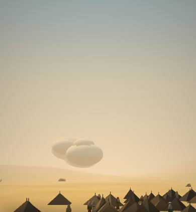
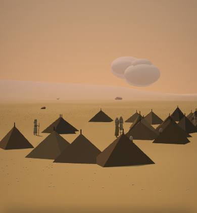
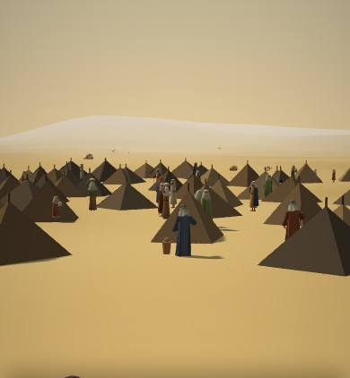

# 감수 자료 · 시대 4. 광야

자료 판 `a4be56af` · `node tools/make_review_pack.js`가 만든 파일입니다(손으로 고치지 않습니다). 게임에 나오는 문장은 글자 그대로이고, 성경 본문은 싣지 않았습니다(장절만).

#### 시대4·안내 · 시대 안내

*4. 광야*
- 최현 박사의 통신(탐험대 이야기): 광야 시대야. 넓고 마른 땅이 계기판에 가득 잡혀.
- "이 사이에 성경이 기록한 곳"으로 보여 주는 장절(요약 없이 장절만): 출 20:22-31:18 · 출 33:1-40:38 · 레 1:1-27:34 · 민 1:1-12:16 · 민 14:39-36:13 · 신 1:1-33:29

표시: ☐ 그대로 ☐ 고침 ☐ 뺌 　적을 칸: 

#### 시대4·마무리 · 마무리(기도·실천)

*이 시대 장면들의 한 문장 기도(8~10세)와 한 주 실천(11~13세). 꼴은 "공통·마무리"에서*
- **OT-13 하늘에서 내린 양식, 만나** (출 16:1-36)
  - 8~10세 기도: 하나님, 광야에서 백성에게 양식을 주신 이야기를 기억하게 해 주세요. 예수님의 이름으로 기도합니다. 아멘.
  - 11~13세 실천: 이번 주에 출애굽기 16장 11절부터 21절까지 소리 내어 읽어 보세요.
  - 14~19세 기록 물음: 출 16:1-36에서 새로 알게 된 사실을 한 가지 적어 보자.
- **OT-14 금송아지** (출 32:1-35)
  - 8~10세 기도: 하나님, 산 아래에서 있었던 일을 성경에서 읽고 기억하게 해 주세요. 예수님의 이름으로 기도합니다. 아멘.
  - 11~13세 실천: 이번 주에 출애굽기 32장 1절부터 14절까지 소리 내어 읽어 보세요.
  - 14~19세 기록 물음: 출 32:1-35에서 새로 알게 된 사실을 한 가지 적어 보자.
- **OT-15 열두 정탐꾼** (민 13:1-14:38)
  - 8~10세 기도: 하나님, 여호수아와 갈렙의 이야기를 성경에서 읽고 기억하게 해 주세요. 예수님의 이름으로 기도합니다. 아멘.
  - 11~13세 실천: 이번 주에 민수기 14장 1절부터 10절까지 소리 내어 읽어 보세요.
  - 14~19세 기록 물음: 민 13:1-14:38에서 새로 알게 된 사실을 한 가지 적어 보자.
- **OT-16 느보 산에서 모세의 마지막** (신 34:1-12)
  - 8~10세 기도: 하나님, 느보 산에서 있었던 모세의 이야기를 성경에서 읽고 기억하게 해 주세요. 예수님의 이름으로 기도합니다. 아멘.
  - 11~13세 실천: 이번 주에 신명기 34장 1절부터 12절까지 소리 내어 읽어 보세요.
  - 14~19세 기록 물음: 신 34:1-12에서 새로 알게 된 사실을 한 가지 적어 보자.

표시: ☐ 그대로 ☐ 고침 ☐ 뺌 　적을 칸: 

### OT-13 하늘에서 내린 양식, 만나 (출 16:1-36)

- 곳: 엘림과 시내 산 사이 신 광야
- 감수 필수: 예 — 구약 사건의 신약적 의미(요 6:31-32)
- 화면: 3D 장면 · 감수 상태: 미감수

#### OT-13·대목 · 대목 글(장면 전체)

*대목 7개* — 출 16:1-36
- 이 장면에서 검증자가 여쭌 것 3가지는 아래 "검증자가 남긴 것" 항목에 따로 있습니다. 대목 글을 고치실 때는 "대목 몇, 몇 세 글"인지 적어 주세요.
- **대목 1** (출 16:1-3)
- 8~10세: 이스라엘 온 회중이 신 광야에 왔어요. 백성은 애굽에서는 배불리 먹었는데 이 광야에서는 굶어 죽게 되었다며 모세와 아론을 원망했어요.
- 11~13세: 이스라엘 온 회중이 엘림을 떠나, 엘림과 시내 산 사이에 있는 신 광야에 왔어요. 애굽에서 나온 뒤 둘째 달 십오일이었어요. 백성은 모두 그곳에서 모세와 아론을 원망했어요. 애굽에서는 고기 가마 곁에 앉아 떡을 배불리 먹었는데, 두 사람이 자기들을 광야로 데리고 나와 굶어 죽게 한다고 했어요.
- 14~19세: 이스라엘 자손의 온 회중은 엘림을 떠나, 애굽에서 나온 뒤 둘째 달 십오일에 엘림과 시내 산 사이에 있는 신 광야에 닿았다. 거기서 온 회중이 모세와 아론을 원망했다. 애굽 땅에서 고기 가마 곁에 앉아 떡을 배부르게 먹을 때 여호와의 손에 죽는 편이 나았겠다고 하며, 두 사람이 자기들을 이 광야로 데리고 나와 온 회중을 굶겨 죽이려 한다고 했다.
  - 휴의 말: 여기는 신 광야야. 엘림과 시내 산 사이라고 일지에 적어 둘게.
- **대목 2** (출 16:4-5)
- 8~10세: 하나님은 모세에게 하늘에서 양식을 비처럼 내려 주겠다고 하셨어요. 백성이 날마다 나가서 그날 먹을 것을 거두게 하겠다고 하셨어요.
- 11~13세: 여호와께서는 모세에게 하늘에서 양식을 비처럼 내려 주겠다고 하셨어요. 백성이 날마다 나가서 그날 먹을 것을 거두게 하겠다고 하셨어요. 여섯째 날에는 거두어 온 것을 준비하면 다른 날 거두던 것의 두 배가 될 것이라고 하셨어요.
- 14~19세: 여호와께서는 모세에게, 백성을 위해 하늘에서 양식을 비처럼 내리겠다고 하셨다. 백성이 날마다 나가 그날 쓸 것을 거두게 하여, 그들이 하나님의 율법대로 행하는지 아닌지 시험하겠다고 하셨다. 여섯째 날에 거두어 들인 것을 준비하면 다른 날 거두던 것의 갑절이 될 것이라고도 하셨다.
  - 온우의 말: 하나님이 모세에게 하신 말씀은 출애굽기 16장 4절부터야. 성경책에서 직접 읽어 보자.
- **대목 3** (출 16:6-12)
- 8~10세: 백성이 광야 쪽을 바라보니 구름 속에 여호와의 영광이 나타났어요. 하나님은 백성의 원망을 들으셨다며, 저녁에는 고기를, 아침에는 떡을 먹게 하겠다고 하셨어요.
- 11~13세: 모세와 아론은 백성에게, 그들의 원망은 두 사람이 아니라 여호와를 향한 것이며 여호와께서 그 원망을 들으셨다고 말했어요. 아론이 온 회중에게 말할 때 그들이 광야 쪽을 바라보니, 구름 속에 여호와의 영광이 나타났어요. 여호와께서는 모세에게, 백성이 해 질 무렵에는 고기를, 아침에는 떡을 배부르게 먹을 것이라고 전하게 하셨어요.
- 14~19세: 모세와 아론은 온 이스라엘 자손에게, 저녁이 되면 그들을 애굽에서 이끌어 내신 분이 여호와이심을 알게 되고 아침에는 여호와의 영광을 보게 될 것이라고 말했다. 여호와께서 원망을 들으셨으며, 그 원망은 자기들이 아니라 여호와를 향한 것이라고 했다. 모세는 아론에게, 온 회중더러 여호와께 가까이 나아오게 하라고 했다. 아론이 온 회중에게 말할 때 그들이 광야 쪽을 바라보니, 구름 속에 여호와의 영광이 나타났다. 여호와께서는 모세에게, 이스라엘 자손의 원망을 들었다고 하시고, 그들이 해 질 무렵에는 고기를 먹고 아침에는 떡을 배부르게 먹어 여호와가 그들의 하나님인 줄 알게 될 것이라고 전하게 하셨다.
  - 최온의 말: 사람들이 모두 광야 쪽을 바라보고 있어. 저기 구름이 보여.
- **대목 4** (출 16:13-15)
- 8~10세: 저녁에 메추라기 떼가 진을 덮었고, 아침에는 이슬이 마르자 땅 위에 작고 둥근 것이 있었어요. 모세는 그것이 여호와께서 먹으라고 주신 양식이라고 했어요.
- 11~13세: 저녁에는 메추라기가 와서 진을 덮었고, 아침에는 진 둘레에 이슬이 있었어요. 이슬이 마르자 광야의 땅 위에 작고 둥글며 서리처럼 가는 것이 있었어요. 이스라엘 자손은 그것이 무엇인지 몰라 서로 이것이 무엇이냐고 했어요. 모세는 그것이 여호와께서 먹으라고 주신 양식이라고 말했어요.
- 14~19세: 저녁에는 메추라기가 와서 진을 덮었고, 아침에는 진 사방에 이슬이 있었다. 이슬이 걷히자 광야의 땅 위에 작고 둥글며 서리처럼 가는 것이 있었다. 이스라엘 자손은 그것이 무엇인지 몰라 서로 이것이 무엇이냐고 했고, 모세는 여호와께서 그들에게 먹으라고 주신 양식이라고 말했다.
  - 최온의 말: 이슬이 마르니까 땅에 작고 둥근 것이 있어. 서리처럼 가늘어!
- **대목 5** (출 16:16-21)
- 8~10세: 하나님은 한 사람에 한 오멜씩 거두라고 하셨어요. 모세가 아침까지 남겨 두지 말라고 했는데도 몇몇이 남겨 두자, 벌레가 생기고 고약한 냄새가 났어요.
- 11~13세: 여호와께서 명하신 것은, 장막에 있는 사람 수대로 한 사람에 한 오멜씩 거두라는 것이었어요. 많이 거둔 사람도 있고 적게 거둔 사람도 있었지만, 오멜로 되어 보니 많이 거둔 사람도 남지 않았고 적게 거둔 사람도 모자라지 않았어요. 모세는 아침까지 남겨 두지 말라고 했으나, 몇몇이 듣지 않고 남겨 두자 거기에 벌레가 생기고 냄새가 났어요. 백성은 아침마다 거두었고, 해가 뜨거워지면 그것은 녹아 없어졌어요.
- 14~19세: 모세는 여호와께서 명하신 바를 전했다. 각 사람이 먹을 만큼, 자기 장막에 있는 사람 수대로 한 명에 한 오멜씩 거두라는 것이었다. 이스라엘 자손이 그렇게 하니 많이 거둔 사람도 적게 거둔 사람도 있었으나, 오멜로 되어 보면 많이 거둔 사람에게 남는 것이 없고 적게 거둔 사람에게 모자라는 것이 없었다. 모세가 아무도 그것을 아침까지 남기지 말라고 했는데도 몇몇은 듣지 않고 아침까지 두었고, 거기에 벌레가 생기고 냄새가 나서 모세가 그들에게 노했다. 무리는 아침마다 각자 먹을 만큼 거두었으며, 해가 뜨겁게 내리쬐면 그것은 스러졌다.
  - 휴의 말: 한 사람에 한 오멜씩이야. 아침마다 거둔다고 적어 둘게.
- **대목 6** (출 16:22-30)
- 8~10세: 여섯째 날에는 한 사람에 두 오멜씩 거두었고, 아침까지 두어도 벌레가 생기지 않았어요. 일곱째 날은 여호와의 안식일이라서 백성은 쉬었어요.
- 11~13세: 여섯째 날에는 한 사람에 두 오멜씩, 갑절을 거두었어요. 모세는 다음 날이 여호와께 거룩한 안식일이니 남은 것을 아침까지 간수하라고 했고, 그렇게 둔 것은 냄새도 벌레도 없었어요. 일곱째 날에 몇몇 사람이 거두러 나갔지만 얻지 못했어요. 여호와께서는 일곱째 날에는 아무도 자기 처소에서 나오지 말라고 하셨고, 백성은 일곱째 날에 안식했어요.
- 14~19세: 여섯째 날에는 각 사람이 갑절, 곧 한 사람에 두 오멜씩 거두었고, 회중의 지도자들이 모두 와서 모세에게 알렸다. 모세는 여호와의 말씀을 전했다. 내일은 쉬는 날, 여호와께 거룩한 안식일이니 굽거나 삶을 것은 그날 하고 남는 것은 아침까지 간수하라는 것이었다. 그대로 두었더니 냄새도 벌레도 생기지 않았다. 모세는 그날이 여호와께 안식일이므로 들에서 그것을 얻지 못할 것이라 했는데, 일곱째 날에 백성 가운데 몇몇이 거두러 나갔으나 얻지 못했다. 여호와께서는 모세에게, 언제까지 계명과 율법을 지키지 않으려느냐고 하시고, 안식일을 주셨으므로 여섯째 날에 이틀 치 양식을 주는 것이니 일곱째 날에는 아무도 자기 처소에서 나오지 말라고 하셨다. 그리하여 백성은 일곱째 날에 안식했다.
  - 온우의 말: 일곱째 날에 대해 하나님이 무엇이라고 하셨는지 16장 29절에서 확인해 보자.
- **대목 7** (출 16:31-36)
- 8~10세: 이스라엘 사람들은 그 양식을 만나라고 불렀어요. 이스라엘 자손은 가나안 땅의 경계에 닿을 때까지 사십 년 동안 그것을 먹었어요.
- 11~13세: 이스라엘 족속은 그것의 이름을 만나라고 했어요. 만나는 깟씨 같고 희었으며, 맛은 꿀을 섞은 과자 같았어요. 아론은 여호와께서 모세에게 명령하신 그대로, 만나 한 오멜을 항아리에 담아 대대로 간수하게 했어요. 이스라엘 자손은 가나안 땅의 경계에 닿을 때까지 사십 년 동안 만나를 먹었어요.
- 14~19세: 이스라엘 족속은 그 이름을 만나라고 했다. 깟씨 같고 희며, 맛은 꿀을 섞은 과자와 같았다. 모세는 여호와께서 명하신 바를 전했다. 애굽에서 인도해 내실 때 광야에서 먹이신 양식을 후손이 볼 수 있도록, 그것을 한 오멜 채워 대대로 간수하라는 것이었다. 모세는 아론에게, 항아리 하나에 만나를 한 오멜 담아서 여호와 앞에 두라고 했고, 아론은 여호와께서 모세에게 명령하신 그대로 증거판 앞에 그것을 두어 보관하게 했다. 이스라엘 자손은 사람이 사는 땅, 곧 가나안 땅의 경계에 닿을 때까지 사십 년 동안 만나를 먹었다. 한 오멜은 에바의 십분의 일이다.
  - 휴의 말: 이름은 만나. 사십 년 동안 먹었다고 일지에 적었어.

표시: ☐ 그대로 ☐ 고침 ☐ 뺌 　적을 칸: 

#### OT-13·동행1 · 동행 인물 문답

*모세에게 묻기* — 출 16:15
- 동행 인물: 모세 (이 자리에 있다는 근거 출 16:2, 사건과 관문 뒤에 문답)
- 최온의 물음: 땅 위에 있던 작고 둥근 것은 무엇이에요?
- 답 8~10세: 모세는 그것이 여호와께서 먹으라고 주신 양식이라고 말했어요.
- 답 11~13세: 모세는 이스라엘 자손에게 말했어요. 그것은 여호와께서 그들이 먹도록 주신 양식이라고 했어요.
- 답 14~19세: 모세는 이스라엘 자손에게, 그것은 여호와께서 그들이 먹도록 주신 양식이라고 말했다.
- 아이가 펼 곳: 출 16:15

표시: ☐ 그대로 ☐ 고침 ☐ 뺌 　적을 칸: 

#### OT-13·동행2 · 동행 인물 문답

*모세에게 묻기* — 출 16:25-26
- 동행 인물: 모세 (이 자리에 있다는 근거 출 16:2, 사건과 관문 뒤에 문답)
- 휴의 물음: 일곱째 날에도 거두러 나가요?
- 답 8~10세: 모세는 그날이 여호와의 안식일이라서 들에서 그것을 얻지 못할 것이라고 말했어요. 엿새 동안은 거두고 일곱째 날에는 없을 것이라고 했어요.
- 답 11~13세: 모세는 그날이 여호와께 안식일이어서 들에서 그것을 얻지 못할 것이라고 말했어요. 엿새 동안은 거두지만, 안식일인 일곱째 날에는 그것이 없을 것이라고 했어요.
- 답 14~19세: 모세는 그날 그것을 먹으라고 하며, 그날은 여호와께 안식일이므로 들에서 그것을 얻지 못할 것이라고 말했다. 엿새 동안은 거두되 안식일인 일곱째 날에는 그것이 없으리라고 했다.
- 아이가 펼 곳: 출 16:26

표시: ☐ 그대로 ☐ 고침 ☐ 뺌 　적을 칸: 

#### OT-13·동행3 · 동행 인물 문답

*모세에게 묻기* — 출 16:32-33
- 동행 인물: 모세 (이 자리에 있다는 근거 출 16:2, 사건과 관문 뒤에 문답)
- 온우의 물음: 만나 한 오멜을 항아리에 담아 두라고 하신 것은 무엇 때문이에요?
- 답 8~10세: 모세는 여호와께서 그것을 한 오멜 채워 대대로 간수하라고 명하셨다고 전했어요. 광야에서 먹이신 양식을 후손에게 보이기 위해서라고 했어요.
- 답 11~13세: 모세는 여호와께서 그것을 한 오멜 채워 대대로 간수하라고 명하셨다고 전했어요. 애굽에서 인도해 내실 때 광야에서 먹이신 양식을 후손이 볼 수 있게 하려는 것이라고 했어요. 그리고 아론에게, 항아리 하나에 만나를 한 오멜 넣어서 여호와 앞에 두라고 했어요.
- 답 14~19세: 모세는 여호와께서 명하신 것을 전했다. 그것을 한 오멜 채워 대대로 간수하라는 것이었고, 애굽 땅에서 인도해 내실 때 광야에서 먹이신 양식을 후손이 보게 하려는 것이라고 했다. 모세는 또 아론에게, 항아리 하나를 가져다 만나를 한 오멜 넣어서 여호와 앞에 두고 대대로 간수하라고 했다.
- 아이가 펼 곳: 출 16:32

표시: ☐ 그대로 ☐ 고침 ☐ 뺌 　적을 칸: 

#### OT-13·돕기1 · 손으로 하는 돕기

*짐 내리기 돕기* — 출 16:1
- 돕는 상대: 신 광야에 장막을 친 이스라엘 자손
- 8~10세: 온 회중이 신 광야에 머물러요. 우리는 진 가장자리의 한 집 식구들 곁에서 짐을 내리고 나르는 일을 도와요.
- 11~13세: 엘림을 떠난 이스라엘 온 회중이 신 광야에 와 있어요. 우리는 진 가장자리의 한 집 식구들 곁에서 짐을 내리고 장막 둘레를 정리하는 일을 도와요. 본문에 적힌 일이 아니라 탐험대 이야기예요.
- 14~19세: 엘림을 떠난 이스라엘 온 회중이 신 광야에 와 있다(16:1). 탐험대는 진 가장자리의 한 집 식구들 곁에서 짐을 내리고 장막 둘레를 정리하는 일을 거든다. 본문에 적힌 일이 아니라 탐험대 이야기다.
  - 누르는 일 1: 짐 꾸러미 내려 주기
  - 누르는 일 2: 짐을 장막 곁으로 함께 옮기기
  - 누르는 일 3: 장막 둘레 자리 정리하기
  - 마친 뒤 최온의 말: 짐을 다 옮겼어. 이 집 식구들도 여기 진 가장자리에 자리를 잡았어.

표시: ☐ 그대로 ☐ 고침 ☐ 뺌 　적을 칸: 

#### OT-13·뜻 · 뜻 묻기

*저녁의 메추라기와 아침의 양식은 무슨 뜻이에요?* — 출 16:6-8
- 최온의 물음: 저녁의 메추라기와 아침의 양식은 무슨 뜻이에요?
- 답하는 사람: 모세
- 답 8~10세: 모세는 아론과 함께, 저녁이 되면 여호와께서 그들을 애굽에서 이끌어 내셨음을 알게 될 것이라고 말했어요. 아침에는 여호와의 영광을 보게 될 것이라고 했어요.
- 답 11~13세: 모세는 아론과 함께 이스라엘 자손에게 말했어요. 저녁이 되면 여호와께서 그들을 애굽에서 이끌어 내셨음을 알게 되고, 아침에는 여호와의 영광을 보게 될 것이라고 했어요. 모세는 또, 해 질 무렵에는 고기로, 아침에는 떡으로 여호와께서 그들을 넉넉히 먹이실 것이라고 말했어요.
- 답 14~19세: 모세는 아론과 함께 이스라엘 자손 모두에게, 저녁이 되면 그들을 애굽에서 인도해 내신 분이 여호와이심을 알게 되고 아침에는 여호와의 영광을 보게 되리라고 말했다(16:6-7). 모세는 또 해 질 무렵에는 고기로, 아침에는 떡으로 여호와께서 그들을 넉넉히 먹이실 것이라고 말했다(16:8).
- **성경을 펴서 뜻 확인하기**
- 8~10세 · 찾아 읽고 고르기: 성경책에서 출애굽기 16장 12절을 찾아 읽어 보세요. (출 16:12)
  - 물음: 여호와께서는 그 고기와 떡으로 백성이 무엇을 알게 되리라고 하셨나요?
  - 맞는 보기: 여호와가 그들의 하나님이신 줄
  - 다른 보기: 모세가 그들의 왕인 줄 (본문에 없음)
  - 다른 보기: 광야에 물이 많은 줄 (본문에 없음)
- 11~13세 · 찾아 읽고 고르기: 성경책에서 출애굽기 16장 7절과 8절을 읽어 보세요. (출 16:7-8)
  - 물음: 모세가, 저녁의 고기와 아침의 떡을 여호와께서 주실 것이라고 하면서 말한 까닭은 무엇인가요?
  - 맞는 보기: 여호와께서 그들이 여호와를 향해 원망하는 말을 들으셨기 때문에
  - 다른 보기: 백성이 그동안 일을 열심히 했기 때문에 (본문에 없음)
  - 다른 보기: 모세와 아론이 먹을 것을 숨겨 두었기 때문에 (본문에 없음)
- 14~19세 · 찾아 읽고 고르기: 출애굽기 16장 3절, 6절, 8절을 함께 찾아 읽어 보자. (출 16:3 · 출 16:6 · 출 16:8)
  - 물음: 세 곳을 이어 읽으면, 백성을 광야로 이끌어 낸 이를 두고 무엇을 알 수 있는가?
  - 맞는 보기: 백성은 모세와 아론이 자기들을 광야로 이끌어 냈다고 원망했지만, 모세와 아론은 저녁에 여호와께서 그들을 애굽에서 인도해 내셨음을 알게 되리라 했고, 모세는 그 원망이 자기들이 아니라 여호와를 향한 것이라고 했다
  - 다른 보기: 백성은 여호와께 감사했고, 모세와 아론은 자기들이 백성을 이끌어 냈다고 자랑했다 (본문에 없음)
  - 다른 보기: 백성은 아론만 원망했고, 모세는 그 원망이 아론을 향한 것이라고 했다 (본문에 없음)

표시: ☐ 그대로 ☐ 고침 ☐ 뺌 　적을 칸: 

#### OT-13·신약 · 신약 연결 · ★먼저 볼 9

*14~19세에게만 보임 · 화면에 "감수 전" 표시* — 요 6:31-32
- 14~19세: 신약의 요한복음 6장 31~32절에서 사람들이 조상들이 먹은 광야의 만나를 말하자, 예수님은 하늘에서 내린 떡을 준 이는 모세가 아니라고 하시며 아버지께서 하늘에서 참 떡을 주신다고 말씀하신다.
- 보이는 때: 뜻 묻기의 성경 읽기 물음을 맞힌 뒤에 뜹니다. 위 글은 문장 전체가 화면에 그대로 나옵니다("…감수를 마친 뒤 확정한다" 같은 문장이 들어 있으면 그것도 보입니다).

표시: ☐ 그대로 ☐ 고침 ☐ 뺌 　적을 칸: 

#### OT-13·오늘1 · 오늘의 물음

*최현 박사가 답함* — 출 16:4 · 신 8:2-3
- 물음: 하나님은 왜 광야에서 날마다 만나를 주셨어요?
- 답 8~10세: 하나님은 백성이 날마다 그날 먹을 것을 거두게 하여, 하나님의 율법대로 행하는지 시험하겠다고 하셨어요. 신명기에서 모세는, 사람은 떡만으로 살지 않고 여호와께서 하시는 모든 말씀으로 산다는 것을 알게 하시려고 만나를 먹이셨다고 말했어요.
- 답 11~13세: 출애굽기 16장 4절에서 하나님은, 백성이 날마다 나가서 그날 먹을 것을 거두게 하여 그들이 하나님의 율법대로 행하는지 시험하겠다고 하셨어요. 신명기 8장 3절에서 모세는, 하나님이 백성을 낮추시고 주리게 하시며 그들도 조상도 알지 못하던 만나를 먹이신 것은 사람이 떡만으로 살지 않고 여호와께서 하시는 모든 말씀으로 산다는 것을 알게 하시려는 것이었다고 말했어요.
- 답 14~19세: 하나님은 백성이 날마다 나가 그날 쓸 것을 거두게 하여, 그들이 하나님의 율법대로 행하는지 시험하겠다고 하셨다(출 16:4). 신명기에서 모세는, 하나님이 사십 년 동안 광야 길을 걷게 하신 것은 그들을 낮추시고 시험하여 그 마음이 어떠한지, 명령을 지키는지 알려 하신 것이며(신 8:2), 그들도 조상도 알지 못하던 만나를 먹이신 것은 사람이 떡만으로 살지 않고 여호와께서 하시는 모든 말씀으로 산다는 것을 알게 하시려는 것이었다고 말했다(신 8:3). 성경은 여기까지 말한다.

표시: ☐ 그대로 ☐ 고침 ☐ 뺌 　적을 칸: 

#### OT-13·오늘2 · 오늘의 물음

*최현 박사가 답함* — 출 16:17-18
- 물음: 많이 거둔 사람도 남지 않고 적게 거둔 사람도 모자라지 않았다니, 어떻게 그렇게 돼요?
- 답 8~10세: 성경은 오멜로 되어 보니 그렇게 되었다고만 적어요. 어떻게 그렇게 되었는지는 성경이 말하지 않아요.
- 답 11~13세: 이스라엘 자손은 많이 거두기도 하고 적게 거두기도 했어요. 그런데 오멜로 되어 보니 많이 거둔 사람도 남는 것이 없고 적게 거둔 사람도 모자라는 것이 없었다고 성경은 적어요. 어떻게 그렇게 되었는지는 성경이 더 말하지 않아요.
- 답 14~19세: 본문은 이스라엘 자손이 많이 거두기도 하고 적게 거두기도 했으나, 오멜로 되어 보니 많이 거둔 이에게 남는 것이 없고 적게 거둔 이에게 모자라는 것이 없어 저마다 먹을 만큼 거두었다고 기록한다(출 16:17-18). 어떻게 그렇게 되었는지는 말하지 않는다. 성경은 여기까지 말한다.

표시: ☐ 그대로 ☐ 고침 ☐ 뺌 　적을 칸: 

#### OT-13·3D · 3D 설정

*3D로 만든 장면: 본문에 없는 배치·생김새* — 출 16:1-36
- 하나님 표현: 구름과 말씀 자막만. 여호와의 영광이 구름 속에 나타난 일(출 16:10)은 광야 쪽에 구름을 두고 자막으로 알린다. 영광의 모양과 빛깔은 본문에 없으므로 지어 그리지 않는다. 형상 없음. 음성은 소리로 만들지 않음
  - 그리지 않는 것: 하나님의 형상, 구름 속의 얼굴이나 손
  - 그리지 않는 것: 만나가 하늘에서 떨어지는 순간(출 16:13-14는 이슬이 마른 뒤 땅에 있었다고만 한다)
  - 그리지 않는 것: 만나를 떡 덩이나 과자 모양으로 그리는 것(출 16:14, 16:31의 생김새와 다르다)
  - 그리지 않는 것: 세 아이가 만나나 메추라기를 줍거나 맛보는 것
  - 그리지 않는 것: 벌레를 가까이서 크게 잡은 그림(출 16:20은 멀리서 담담하게)
  - 그리지 않는 것: 증거판과 궤의 모습(출 16:34는 글로만)
  - 그리지 않는 것: 원망하는 사람들이 돌을 들거나 모세를 밀치는 등 본문에 없는 행동
- **3D 장면을 만들며 정한 것(본문에 맞춘 점, 감수가 필요한 설정)**
  - 3D 장면 설정: OT-13 하늘에서 내린 양식, 만나 (출 16:1-36). 신 광야의 이스라엘 진.
  - 본문에 맞춘 점
  -  - 광야 쪽에 구름을 두고, 여호와의 영광은 자막으로만 알린다(16:10). 영광의 모양과 빛깔을 지어 그리지 않는다.
  -  - 저녁에 메추라기가 진을 덮고(16:13), 아침에 진 둘레에 이슬이 있다가 마르면 땅 위에 작고 둥글고 서리처럼 가는 흰 것이 있다(16:13-14, 16:31).
  -    만나가 하늘에서 떨어지는 모습은 그리지 않는다. 떡이나 과자 모양으로 그리지 않는다.
  -  - 백성이 나가서 거두고(16:16-18), 여섯째 날에는 갑절을 거두고, 일곱째 날에는 진에 머문다(16:22-30). 몇몇이 나갔다가 얻지 못한다(16:27).
  -  - 아론이 만나 한 오멜을 항아리에 담는다(16:33). 항아리의 생김새는 본문에 없어 단순한 꼴로만. 증거판과 궤는 그리지 않는다.
  -  - 세 아이는 만나나 메추라기를 줍거나 맛보지 않는다. 벌레는 그리지 않는다(16:20은 글로만).
  - 감수가 필요한 설정: 진의 생김새, 구름의 자리, 메추라기와 만나의 양, 모세와 아론의 생김새와 선 자리, 항아리.
- **화면 사진(사건을 지켜보는 동안의 화면. 컴퓨터에서 휴대폰 크기로 찍음)**
  - 
  - 
  - 
- **3D 화면에만 나오는 글(도착 글, 사진 도감의 이름·설명, 안내)**
  - 글: 진 안쪽으로는 들어가지 말자. 우리는 가장자리에서 지켜보는 사람이야.
  - 글: 진에서 너무 멀리 가지는 말자.
  - 탐지기
  - 탐지기 물음 풀기
  - 글: 타임머신이 넓은 광야에 내려앉았어요. 장막이 가득한 진이 보여요.
  - 글: 진 가장자리에서만 다니자.
  - 다시 읽기 안내: 만나 이야기를 성경에서 찾아 읽은 뒤 다시 골라 보세요.
  - 떠나기 전 안내: 만나 장면을 끝까지 지켜봐야 떠날 수 있어요.
  - 이름: 이스라엘의 진
  - 설명: 엘림과 시내 산 사이 신 광야에 친 진
  - 출 16:1
  - 찾는 실마리: 장막들을 담아 보세요.
  - 이름: 모세와 아론
  - 설명: 백성이 원망한 두 사람. 원망은 여호와를 향한 것이라고 말했다
  - 출 16:2
  - 찾는 실마리: 진 동쪽에 서 있어요.
  - 이름: 광야 쪽의 구름
  - 설명: 백성이 광야 쪽을 바라보니 구름 속에 여호와의 영광이 나타났다
  - 출 16:10
  - 찾는 실마리: 구름이 나타난 뒤 진 너머를 보세요.
  - 이름: 작고 둥근 것
  - 설명: 이슬이 마른 뒤 광야 땅 위에 있던, 서리처럼 가는 작고 둥근 것
  - 출 16:14
  - 찾는 실마리: 아침에 진 둘레의 땅을 보세요.

표시: ☐ 그대로 ☐ 고침 ☐ 뺌 　적을 칸: 

#### OT-13·미해결1 · 검증자가 남긴 것

*출 16:34의 증거판이 아직 주어지기 전이라는 설명 없이 본문대로 둘까요?*
- 검증 기록(OT-13 하늘에서 내린 양식, 만나): 출 16:34의 증거판은 이 장면보다 뒤에 주어지는 것인데(출 31:18, 32:15) 본문이 미리 적고 있다. 대목 7의 14~19세 글는 본문대로 적었다. 아이에게 덧붙여 설명할지는 감수 때 정한다.
  - 지금 게임의 글 · 대목 7 · 14~19세: 이스라엘 족속은 그 이름을 만나라고 했다. 깟씨 같고 희며, 맛은 꿀을 섞은 과자와 같았다. 모세는 여호와께서 명하신 바를 전했다. 애굽에서 인도해 내실 때 광야에서 먹이신 양식을 후손이 볼 수 있도록, 그것을 한 오멜 채워 대대로 간수하라는 것이었다. 모세는 아론에게, 항아리 하나에 만나를 한 오멜 담아서 여호와 앞에 두라고 했고, 아론은 여호와께서 모세에게 명령하신 그대로 증거판 앞에 그것을 두어 보관하게 했다. 이스라엘 자손은 사람이 사는 땅, 곧 가나안 땅의 경계에 닿을 때까지 사십 년 동안 만나를 먹었다. 한 오멜은 에바의 십분의 일이다.

표시: ☐ 지금대로 ☐ 바꿈 ☐ 의논 필요 　적을 칸: 

#### OT-13·미해결2 · 검증자가 남긴 것

*출 16:15에서 백성이 서로 한 말을 한국어 성경 읽기대로 물어도 될까요?*
- 검증 기록(OT-13 하늘에서 내린 양식, 만나): 출 16:15에서 백성이 서로 한 말을 개역한글과 KJV가 다르게 옮긴다(두 번역 모두 무엇인지 알지 못했다는 점은 같다). 부품 3의 11~13세 글·14~19세 글 물음은 한국어 성경을 따랐다. 그대로 둘지 감수 때 확인한다.
  - 지금 게임의 글 · 탐지기 물음 3 · 11~13세: 이스라엘 자손이 땅 위의 것을 보고 서로 그것이 무엇인지 물은 까닭은 무엇인가요?
  - 지금 게임의 글 · 대목 4 · 11~13세: 저녁에는 메추라기가 와서 진을 덮었고, 아침에는 진 둘레에 이슬이 있었어요. 이슬이 마르자 광야의 땅 위에 작고 둥글며 서리처럼 가는 것이 있었어요. 이스라엘 자손은 그것이 무엇인지 몰라 서로 이것이 무엇이냐고 했어요. 모세는 그것이 여호와께서 먹으라고 주신 양식이라고 말했어요.
  - 지금 게임의 글 · 대목 4 · 14~19세: 저녁에는 메추라기가 와서 진을 덮었고, 아침에는 진 사방에 이슬이 있었다. 이슬이 걷히자 광야의 땅 위에 작고 둥글며 서리처럼 가는 것이 있었다. 이스라엘 자손은 그것이 무엇인지 몰라 서로 이것이 무엇이냐고 했고, 모세는 여호와께서 그들에게 먹으라고 주신 양식이라고 말했다.
  - 지금 게임의 글 · 탐지기 물음 3 · 보기 · 11~13세: 그것이 무엇인지 몰랐기 때문에
  - 덧붙임: 지금 백성이 서로 한 말을 묻는 것은 부품 셋째의 11~13세 물음이다. 14~19세 물음은 그것의 생김새와 이름을 묻는다.

표시: ☐ 지금대로 ☐ 바꿈 ☐ 의논 필요 　적을 칸: 

#### OT-13·미해결5 · 검증자가 남긴 것

*만나 장면 끝에 요 6:31-32(하늘에서 내린 참 떡) 연결을 그대로 둘까요?*
- 검증 기록(물음의 세 단계·현장 돕기): 아래 공통 1·2·3. 작성자가 남긴 감수 항목(오늘의 물음 1과 뜻 묻기의 가까움, 일곱째 날 함께 쉬는 설정, 요 6:31-32)은 그대로 둔다.
  - 지금 게임의 글 · 현장 돕기 단계 5 · 신약 연결: 신약의 요한복음 6장 31~32절에서 사람들이 조상들이 먹은 광야의 만나를 말하자, 예수님은 하늘에서 내린 떡을 준 이는 모세가 아니라고 하시며 아버지께서 하늘에서 참 떡을 주신다고 말씀하신다.

표시: ☐ 지금대로 ☐ 바꿈 ☐ 의논 필요 　적을 칸: 

#### OT-13·기타 · 그 밖의 글(참고) · 참고

*통신·재료·관문·탐지기 물음·곁에서 보기·말씀 카드* — 출 16:1-36
- **최현 박사의 통신(탐험대 이야기)**
- 8~10세: 최현 박사예요. 타임머신이 신 광야에 비상 착륙하면서 전구와 손잡이와 건전지가 망가졌어요. 탐지기가 가리키는 곳에서 대신 쓸 재료를 찾아봐요.
- 11~13세: 최현 박사예요. 비상 착륙한 곳은 신 광야예요. 전구와 손잡이와 건전지가 망가졌는데, 이 시대에는 우리 부속이 없어요. 탐지기가 가리키는 곳에서 대신 쓸 재료를 하나씩 찾아야 해요.
- 14~19세: 최현 박사다. 타임머신이 신 광야에 비상 착륙해 전구, 손잡이, 건전지가 망가졌고 지금은 통신만 이어져 있다. 이 시대에는 부속이 없으니 탐지기가 가리키는 곳마다 재료를 구해 세 부속을 대신 만들어야 한다. 진 가장자리에서 사람들의 평범한 일은 거들 수 있지만, 그 밖의 일에는 손대지 말고 지켜보기만 하자.
- **수리 재료(탐험대 이야기)**
- 재료: 고운 모래 (출 16:1)
  - 박사의 말: 고운 모래를 녹여 유리로 만들면 깨진 전구 대신 쓸 수 있어요.
  - 얻는 방법: 진에서 멀찍이 떨어진 광야 땅, 사람이 없는 곳에서 고운 모래를 한 줌 떠 담는다.
  - 얻었을 때 아이의 말: 진에서 멀찍이 떨어진 광야 땅에서 고운 모래를 한 줌 담았어!
- 재료: 장막 끈 토막 (출 16:16)
  - 박사의 말: 장막 끈 토막을 단단히 감으면 부러진 손잡이 대신 쓸 수 있어요.
  - 얻는 방법: 장막들에서 멀리 떨어진 진 가장자리 땅에 끊어져 떨어져 있는 끈 토막 하나를 줍는다. 장막에서 끊어 내지 않는다.
  - 얻었을 때 아이의 말: 장막들에서 떨어진 진 가장자리에서 장막 끈 토막을 주웠어!
- 재료: 광야의 흙 (출 16:14)
  - 박사의 말: 흙을 물통의 물로 축축하게 적셔 흙 전지를 만들면 건전지 대신 쓸 수 있어요.
  - 얻는 방법: 진에서 멀리 떨어진 광야의 빈 땅에서 흙을 한 줌 떠 담는다. 진 안쪽으로는 들어가지 않는다.
  - 얻었을 때 아이의 말: 진에서 떨어진 광야의 빈 땅에서 흙을 한 줌 담았어!
- **관문 물음**
- 관문 1 8~10세 · 찾아 읽고 고르기: 성경책에서 출애굽기 16장 22절을 찾아 읽어 보세요. (출 16:22)
  - 물음: 여섯째 날에는 한 사람에 몇 오멜씩 거두었나요?
  - 맞는 보기: 두 오멜
  - 다른 보기: 한 오멜 (출 16:16)
  - 다른 보기: 세 오멜 (본문에 없음)
- 관문 2 8~10세 · 여러 개 고르기: 성경책에서 출애굽기 16장 31절을 찾아 읽어 보세요. (출 16:31)
  - 물음: 31절에서 만나는 어떠했다고 하나요? 모두 고르세요.
  - 맞는 보기: 깟씨 같았다
  - 맞는 보기: 빛깔이 희었다
  - 다른 보기: 서리처럼 가늘었다 (출 16:14)
  - 맞는 보기: 꿀 섞은 과자 같은 맛이었다
  - 다른 보기: 빛깔이 붉었다 (본문에 없음)
- 관문 1 11~13세 · 찾아 읽고 고르기: 성경책에서 출애굽기 16장 19절과 20절을 읽어 보세요. (출 16:19-20)
  - 물음: 모세가 몇몇 사람에게 노한 까닭은 무엇인가요?
  - 맞는 보기: 아침까지 남기지 말라는 말을 듣지 않고 그대로 두었다가, 그것에 벌레가 나고 냄새가 났기 때문에
  - 다른 보기: 몇몇 사람이 다른 사람의 몫을 빼앗았기 때문에 (본문에 없음)
  - 다른 보기: 몇몇 사람이 아침에 거두러 나가지 않았기 때문에 (본문에 없음)
- 관문 2 11~13세 · 순서 맞추기: 성경책에서 출애굽기 16장 22절부터 30절까지 읽고, 일어난 차례대로 눌러 보세요. (출 16:22-30)
  - 차례 1: 여섯째 날, 한 사람이 두 오멜씩 거두었다
  - 차례 2: 모세가 다음 날은 쉬는 안식일이라고 일렀다
  - 차례 3: 아침까지 둔 것에 냄새도 벌레도 생기지 않았다
  - 차례 4: 일곱째 날에 몇몇이 들에 나갔지만 아무것도 얻지 못했다
  - 차례 5: 백성이 일곱째 날에 쉬었다
- 관문 1 14~19세 · 찾아 읽고 고르기: 출애굽기 16장 20절과 24절을 함께 찾아 읽어 보자. (출 16:20 · 출 16:24)
  - 물음: 두 곳을 이어 읽으면, 아침까지 남겨 둔 것은 어떻게 달랐는가?
  - 맞는 보기: 모세의 말을 듣지 않고 아침까지 둔 것에는 벌레가 나고 냄새가 났지만, 안식일을 앞두고 모세가 말한 대로 아침까지 둔 것에는 냄새도 벌레도 없었다
  - 다른 보기: 두 번 모두 벌레가 생겨 아무것도 먹지 못했다 (본문에 없음)
  - 다른 보기: 두 번 모두 아무 일도 없었고, 모세는 노하지 않았다 (본문에 없음)
- 관문 2 14~19세 · 구절과 내용 잇기: 출애굽기 16장 5절, 22절, 29절을 찾아 읽고, 구절마다 맞는 내용을 이어 보자. (출 16:5 · 출 16:22 · 출 16:29)
  - 잇기: 여섯째 날에는 거두어 온 것을 준비하라고 하시며, 그것이 다른 날의 두 배가 되리라고 하셨다 (출 16:5)
  - 잇기: 회중의 지도자들이 모두 와서 모세에게 알렸다 (출 16:22)
  - 잇기: 일곱째 날에는 저마다 있는 곳에 머물고 나오지 말라고 하셨다 (출 16:29)
  - 이은 뒤 글: 세 곳을 이으면, 여호와께서 여섯째 날에는 두 배를 얻게 되리라 하셨고, 그날 백성이 갑절을 거두자 지도자들이 모세에게 알렸으며, 여호와께서는 안식일을 주셨으므로 여섯째 날에 이틀 치 양식을 주시니 일곱째 날에는 저마다 있는 곳에 머물라고 하셨다.
- **3D 탐지기 물음**
- 부품 1: 전구
  - 부품: bulb
  - 있는 곳: 탐지기가 진 바깥의 광야 쪽을 가리켜요.
  - 휴의 말: 탐지기 바늘이 진 바깥 광야 쪽으로 돌아갔어. 여기가 신 광야라고 일지에 적어 둘게.
  - 찾았을 때: 전구를 찾았어! 진에서 멀찍이 떨어진 광야 땅 위에 있었네.
- 탐지기 1 8~10세 · 찾아 읽고 고르기: 성경책에서 출애굽기 16장 1절을 찾아 읽어 보세요. (출 16:1)
  - 물음: 이스라엘 온 회중은 엘림을 떠나 어느 광야에 이르렀나요?
  - 맞는 보기: 신 광야
  - 다른 보기: 수르 광야 (출 15:22)
  - 다른 보기: 바란 광야 (민 13:3)
- 탐지기 1 11~13세 · 찾아 읽고 고르기: 성경책에서 출애굽기 16장 2절과 3절을 읽어 보세요. (출 16:2-3)
  - 물음: 신 광야에서 온 회중이 모세와 아론을 원망한 까닭은 무엇인가요?
  - 맞는 보기: 애굽에서는 떡을 배불리 먹었는데, 이 광야에서는 온 회중이 굶주려 죽게 되었다고 여겼기 때문에
  - 다른 보기: 모세와 아론이 물을 혼자 다 마셨기 때문에 (본문에 없음)
  - 다른 보기: 광야에 비가 그치지 않았기 때문에 (본문에 없음)
- 탐지기 1 14~19세 · 찾아 읽고 고르기: 출애굽기 15장 27절과 16장 1절을 함께 찾아 읽어 보자. (출 15:27 · 출 16:1)
  - 물음: 두 곳을 이어 읽으면, 회중이 신 광야에 이르기 전에 머문 곳은 어떤 곳이었는가?
  - 맞는 보기: 물샘 열둘과 종려나무 일흔 그루가 있는 엘림에 장막을 쳤다가, 엘림을 떠나 시내 산과 엘림 사이에 있는 신 광야로 왔다
  - 다른 보기: 바닷가의 큰 성에 머물다가, 그 성을 떠나 바란 광야에 이르렀다 (본문에 없음)
  - 다른 보기: 시내 산 꼭대기에 머물다가, 산에서 내려와 엘림에 이르렀다 (본문에 없음)
- 부품 2: 손잡이
  - 부품: handle
  - 있는 곳: 탐지기가 장막이 가득한 진 쪽을 가리켜요.
  - 최온의 말: 장막이 정말 많아! 진이 끝없이 넓어.
  - 찾았을 때: 손잡이가 여기 있었네! 장막들에서 떨어진 진 가장자리야.
- 탐지기 2 8~10세 · 찾아 읽고 고르기: 성경책에서 출애굽기 16장 13절을 찾아 읽어 보세요. (출 16:13)
  - 물음: 저녁에 와서 진을 덮은 것은 무엇인가요?
  - 맞는 보기: 메추라기
  - 다른 보기: 메뚜기 (출 10:15)
  - 다른 보기: 까마귀 (본문에 없음)
- 탐지기 2 11~13세 · 찾아 읽고 고르기: 성경책에서 출애굽기 16장 11절과 12절을 읽어 보세요. (출 16:11-12)
  - 물음: 여호와께서 저녁에는 고기를, 아침에는 떡을 주시겠다고 하신 것은 무엇 때문이라고 하셨나요?
  - 맞는 보기: 그들이 여호와가 그들의 하나님인 줄 알게 하시려고
  - 다른 보기: 그들이 모세를 왕으로 세우게 하시려고 (본문에 없음)
  - 다른 보기: 그들이 애굽으로 돌아가는 길을 알게 하시려고 (본문에 없음)
- 탐지기 2 14~19세 · 찾아 읽고 고르기: 출애굽기 16장 12절과 13절을 함께 찾아 읽어 보자. (출 16:12 · 출 16:13)
  - 물음: 두 곳을 이어 읽으면, 여호와께서 하신 말씀과 그 저녁과 아침에 있었던 일은 어떠한가?
  - 맞는 보기: 여호와께서 저녁에 고기를 먹고 아침에 떡으로 배부르리라 하셨고, 저녁에는 메추라기 떼가 진을 덮었으며 아침에는 진 사방에 이슬이 있었다
  - 다른 보기: 여호와께서 고기는 주지 않겠다고 하셨고, 저녁에 메뚜기가 와서 밭을 먹었다 (본문에 없음)
  - 다른 보기: 여호와께서 아무 말씀도 하지 않으셨고, 저녁과 아침에 아무 일도 없었다 (본문에 없음)
- 부품 3: 건전지
  - 부품: battery
  - 있는 곳: 탐지기가 진에서 떨어진 광야의 빈 땅을 가리켜요.
  - 온우의 말: 진 안쪽으로는 들어가지 말고 보기만 하자. 우리는 지켜보는 사람이야. 이 광야에서 있었던 일은 16장 14절과 15절에서 확인하자.
  - 찾았을 때: 건전지를 찾았어! 진에서 떨어진 빈 땅에 있었네.
- 탐지기 3 8~10세 · 찾아 읽고 고르기: 성경책에서 출애굽기 16장 14절을 찾아 읽어 보세요. (출 16:14)
  - 물음: 이슬이 마른 뒤 광야 땅 위에 있던 것은 어떤 모양이었나요?
  - 맞는 보기: 작고 둥글었어요
  - 다른 보기: 크고 네모났어요 (본문에 없음)
  - 다른 보기: 길고 뾰족했어요 (본문에 없음)
- 탐지기 3 11~13세 · 찾아 읽고 고르기: 성경책에서 출애굽기 16장 14절과 15절을 읽어 보세요. (출 16:14-15)
  - 물음: 이스라엘 자손이 땅 위의 것을 보고 서로 그것이 무엇인지 물은 까닭은 무엇인가요?
  - 맞는 보기: 그것이 무엇인지 몰랐기 때문에
  - 다른 보기: 모세가 먹지 말라고 했기 때문에 (본문에 없음)
  - 다른 보기: 애굽에서 먹던 것과 같았기 때문에 (본문에 없음)
- 탐지기 3 14~19세 · 찾아 읽고 고르기: 출애굽기 16장 14절과 31절을 함께 찾아 읽어 보자. (출 16:14 · 출 16:31)
  - 물음: 두 곳을 이어 읽으면, 땅 위에 있던 그것은 어떤 것이었는가?
  - 맞는 보기: 서리처럼 가늘고 작고 둥근 것이었고, 이스라엘 족속은 그 이름을 만나라 했으며, 깟씨처럼 생겼고 빛깔은 희며 꿀을 섞은 과자 맛이 났다
  - 다른 보기: 크고 네모난 떡 덩이였고, 이름은 오멜이라 했다 (본문에 없음)
  - 다른 보기: 붉은 열매였고, 맛은 쓴 나물 같았다 (본문에 없음)
- **곁에서 보기 · 함께 머물기**
- 보기: 곁에서 보기 · 구름 속에 나타난 영광 (출 16:10)
  - 8~10세: 아론이 회중에게 말할 때, 사람들이 광야 쪽을 보았어요. 구름 속에 여호와의 영광이 나타났어요. 우리는 진 가장자리에서 함께 그쪽을 봐요.
  - 11~13세: 아론이 회중에게 말하는 동안 사람들이 광야 쪽으로 눈을 돌렸어요. 구름 속에 여호와의 영광이 나타났어요. 우리는 구름 쪽으로 다가가지 않고 진 가장자리에서 함께 봐요.
  - 14~19세: 아론이 회중에게 말하는 동안 사람들이 광야 쪽으로 눈을 돌렸고, 구름 속에 여호와의 영광이 보였다(16:10). 탐험대는 구름 쪽으로 다가가지 않고 진 가장자리에서 그쪽을 바라본다.
  - 최온의 말: 모두 광야 쪽을 보고 있어. 우리도 여기서 보자.
- 보기: 곁에서 보기 · 아침마다 거두는 사람들 (출 16:21)
  - 8~10세: 사람들은 아침마다 먹을 만큼 거두었어요. 해가 뜨거워지면 그것은 스러졌어요. 우리는 거두지 않고 곁에서 지켜봐요.
  - 11~13세: 사람들은 아침마다 저마다 먹을 만큼 거두었어요. 해가 뜨겁게 내리쬐면 땅 위의 그것은 스러졌어요. 여호와께서 주신 그 양식은 우리가 거두지도 맛보지도 않고, 곁에서 지켜봐요.
  - 14~19세: 이스라엘 자손은 아침마다 각자 먹을 만큼 거두었고, 햇볕이 뜨거워지면 그것은 스러졌다(16:21). 여호와께서 주신 그 양식을 탐험대는 거두지도 맛보지도 않는다. 곁에서 지켜볼 뿐이다.
  - 온우의 말: 우리는 거두지 않아. 곁에서 보기만 하자.
- 머물기: 일곱째 날, 그 자리에서 함께 쉬기 (출 16:29-30)
  - 8~10세: 일곱째 날이에요. 여호와께서 그날에는 각자 머무는 곳에 있으라고 하셨어요. 우리도 들로 나가지 않고 그 자리에서 쉬어요.
  - 11~13세: 여호와께서는 일곱째 날에 아무도 각자 머무는 곳을 떠나 나가지 말라고 하셨어요. 그래서 백성은 일곱째 날에 쉬었어요. 우리도 들로 나가지 않고 그 자리에 머물며 함께 쉬어요.
  - 14~19세: 여호와께서는 일곱째 날에 아무도 각자 머무는 곳을 떠나 나가지 말라고 하셨고, 백성은 그날 쉬었다(16:29-30). 탐험대도 들로 나가지 않고 그 자리에 머물며 함께 쉰다.
  - 단추 글: 그 자리에서 함께 쉬기
  - 휴의 말: 오늘은 일곱째 날이야. 들에 나가지 않아.
- **말씀 카드**
- 카드: 하늘에서 내리는 양식 (출 16:4)
- 카드: 여호와께서 주신 양식 (출 16:15)
- **곳과 사람(설계 메모, 화면에 그릴 때의 근거)**
- 곳: 엘림과 시내 산 사이 신 광야
- 곳(설계): 엘림과 시내 산 사이 신 광야에 있는 이스라엘의 진(출 16:1, 16:13)
- 땅: 광야의 땅(출 16:14), 진과 장막들(출 16:13, 16:16), 진 바깥의 들(출 16:25). 본문은 산이나 물, 나무를 말하지 않는다
  - 사람: 모세(출 16:2)
  - 사람: 아론(출 16:2)
  - 사람: 이스라엘 자손의 온 회중(출 16:1)
  - 사람: 회중의 지도자들(출 16:22)
  - 물건: 장막(출 16:16)
  - 물건: 저녁에 진을 덮은 메추라기(출 16:13)
  - 물건: 아침에 진 둘레에 있는 이슬(출 16:13)
  - 물건: 이슬이 걷힌 뒤 땅 위에 있는 작고 둥글며 서리처럼 가는 것, 깟씨 같고 흰 만나(출 16:14, 16:31)
  - 물건: 거둔 것을 되는 오멜(출 16:18). 그릇의 생김새는 본문에 없음
  - 물건: 만나 한 오멜을 담은 항아리(출 16:33). 재료와 생김새는 본문에 없음
  - 물건: 광야 쪽의 구름(출 16:10)
  - 절정 장면: 장면표에 압도 장면 후보가 없다. 볼거리는 이슬이 걷힌 뒤 땅 위의 작고 둥근 것(출 16:13-15)

### OT-14 금송아지 (출 32:1-35)

- 곳: 시내 산 아래의 진
- 감수 필수: 예 — 재앙과 심판(출 32:10, 32:26-28, 32:33-35) / 구약 사건의 신약적 의미(행 7:39-41)
- 화면: 이야기 카드 · 감수 상태: 미감수

#### OT-14·대목 · 대목 글(장면 전체)

*대목 7개* — 출 32:1-35
- 이 장면에서 검증자가 여쭌 것 4가지는 아래 "검증자가 남긴 것" 항목에 따로 있습니다. 대목 글을 고치실 때는 "대목 몇, 몇 세 글"인지 적어 주세요.
- **대목 1** (출 32:1-4)
- 8~10세: 모세가 산에서 내려오는 것이 늦어지자, 백성은 아론에게 자기들을 인도할 신을 만들라고 했어요. 아론은 백성이 가져온 금고리로 송아지 형상을 만들었어요.
- 11~13세: 백성은 모세가 산에서 내려오는 것이 늦어지자 아론에게 모여들었어요. 모세가 어떻게 되었는지 알 수 없으니 자기들을 인도할 신을 만들라고 했어요. 아론은 아내와 자녀들의 귀에 있는 금고리를 빼어 가져오라고 했고, 그것을 받아 송아지 형상을 만들었어요. 백성은 그것이 자기들을 애굽에서 인도해 낸 신이라고 말했어요.
- 14~19세: 백성은 모세가 산에서 내려오는 것이 더딘 것을 보고 아론에게 모여, 자기들을 인도할 신을 만들라고 했다. 자기들을 애굽 땅에서 이끌어 낸 사람 모세가 어떻게 되었는지 모르겠다는 것이 그들의 말이었다. 아론은 아내와 자녀의 귀에서 금고리를 빼어 가져오게 했고, 모든 백성이 금고리를 가져오자 그것을 받아 부어서 새기는 연장으로 다듬어 송아지 형상을 만들었다. 그들은 이것이 이스라엘을 애굽 땅에서 인도해 낸 신이라고 말했다.
  - 휴의 말: 모세는 아직 산 위에 있어. 여기는 산 아래 진이야. 일지에 적어 둘게.
- **대목 2** (출 32:5-6)
- 8~10세: 아론은 송아지 앞에 단을 쌓았어요. 다음 날 백성은 제사를 드리고, 먹고 마시며 뛰놀았어요.
- 11~13세: 아론은 그것을 보고 송아지 앞에 단을 쌓고, 내일은 여호와의 절일이라고 알렸어요. 이튿날 백성은 일찍 일어나 번제와 화목제를 드렸어요. 그리고 앉아서 먹고 마시다가 일어나 뛰놀았어요.
- 14~19세: 아론은 그것을 보고 그 앞에 단을 쌓은 뒤, 내일은 여호와의 절일이라고 선포했다. 이튿날 그들은 일찍 일어나 번제를 드리고 화목제를 드렸으며, 앉아서 먹고 마신 뒤 일어나 뛰놀았다.
  - 최온의 말: 송아지 앞에 단이 있어. 사람들이 먹고 마시고 뛰놀고 있어.
- **대목 3** (출 32:7-10)
- 8~10세: 하나님은 모세에게 내려가라고 하시며, 백성이 송아지를 만들어 숭배했다고 하셨어요. 하나님은 그들에게 진노하여 멸하겠다고 하셨어요.
- 11~13세: 여호와께서는 모세에게 내려가라고 하셨어요. 백성이 명하신 길을 빨리 떠나 송아지를 만들어 숭배하고 제물을 드렸다고 하셨어요. 또 이 백성은 목이 곧은 백성이라고 하시며, 그들에게 진노하여 멸하고 모세를 큰 나라가 되게 하겠다고 하셨어요.
- 14~19세: 여호와께서는 모세에게 내려가라고 하시며, 모세가 애굽 땅에서 이끌어 낸 백성이 부패했다고 하셨다. 그들이 명하신 길을 속히 떠나 자기들을 위해 송아지를 부어 만든 뒤 숭배하고 희생을 드리며, 그것이 이스라엘을 애굽에서 인도해 낸 신이라고 말했다는 것이다. 여호와께서는 또 이 백성이 목이 곧은 백성임을 보았다고 하시고, 하시는 대로 두라고 하시며, 그들에게 진노하여 멸하고 모세를 큰 나라가 되게 하겠다고 하셨다.
  - 온우의 말: 하나님이 모세에게 하신 말씀은 출애굽기 32장 7절부터야. 성경책에서 직접 읽어 보자.
- **대목 4** (출 32:11-14)
- 8~10세: 모세는 아브라함, 이삭, 이스라엘을 기억해 달라고 하며, 그들에게 하신 맹세를 하나님께 아뢰었어요. 여호와께서는 뜻을 돌이키셔서 그 화를 백성에게 내리지 않으셨어요.
- 11~13세: 모세는 여호와께 구했어요. 큰 권능으로 애굽에서 인도해 내신 주의 백성에게 화를 내리지 말아 달라고 했어요. 아브라함과 이삭과 이스라엘을 기억해 달라고 하며, 주께서 그들에게 하늘의 별같이 자손을 많게 하겠다고 맹세하셨다고 아뢰었어요. 여호와께서는 뜻을 돌이키셔서, 말씀하신 그 화를 백성에게 내리지 않으셨어요.
- 14~19세: 모세는 자기 하나님 여호와께 구했다. 큰 능력과 강한 손으로 애굽 땅에서 이끌어 내신 주의 백성에게 어찌하여 진노하시느냐고 아뢰고, 애굽 사람들이 여호와가 그 백성을 산에서 죽이고 땅 위에서 없애려고 이끌어 냈다고 말하게 하시겠느냐고 했다. 맹렬한 노를 그치고 뜻을 돌이켜 이 화를 내리지 말아 주시기를 구했으며, 주의 종 아브라함, 이삭, 이스라엘을 기억해 주시기를 구했다. 주께서 그들에게 하늘의 별같이 자손을 많게 하고 허락하신 온 땅을 그 자손에게 영원한 기업으로 주겠다고 맹세하셨다는 것이다. 여호와께서는 뜻을 돌이키셔서, 말씀하신 그 화를 백성에게 내리지 않으셨다.
  - 휴의 말: 모세가 여호와께 구했어. 그다음에 일어난 일은 14절에 있어. 순서대로 적어 둘게.
- **대목 5** (출 32:15-20)
- 8~10세: 모세는 두 판을 들고 산에서 내려와, 송아지와 춤추는 것을 보고 크게 노하여 판들을 던져 깨뜨렸어요. 그리고 송아지를 불살라 가루로 만들었어요.
- 11~13세: 모세는 증거의 두 판을 손에 들고 산에서 내려왔어요. 그 판은 하나님이 만드셨고, 글자도 하나님이 써서 새기신 것이었어요. 진에 가까이 와서 송아지와 춤추는 것을 본 모세는 크게 노하여 판들을 산 아래로 던져 깨뜨렸어요. 그리고 송아지를 불사르고 부수어 가루로 만든 뒤, 그 가루를 물에 뿌려 이스라엘 자손이 마시게 했어요.
- 14~19세: 모세는 몸을 돌려 산에서 내려왔다. 손에는 증거의 두 판이 있었는데, 양면 이쪽저쪽에 글자가 있었고, 판은 하나님이 만드셨으며 글자도 하나님이 써서 판에 새기신 것이었다. 여호수아가 백성이 떠드는 소리를 듣고 진에서 싸우는 소리가 난다고 하자, 모세는 이긴 자의 노래도 진 자의 부르짖음도 아니고 자기가 듣기에는 노래하는 소리라고 대답했다. 진에 가까이 와서 송아지와 춤추는 것을 본 모세는 크게 노하여 손에 든 판들을 산 아래로 던져 깨뜨렸다. 그리고 그들이 만든 송아지를 가져다가 불사르고 부수어 가루로 만든 다음, 그 가루를 물에 뿌려 이스라엘 자손이 마시게 했다.
  - 최온의 말: 모세가 내려왔어. 손에 든 판들을 산 아래로 던져 깨뜨렸어.
- **대목 6** (출 32:21-29)
- 8~10세: 모세는 아론에게, 백성이 어떻게 했기에 그가 그들을 큰 죄에 빠지게 했느냐고 물었어요. 모세가 진 문에서 부르자 레위 자손이 모였고, 그날 백성 가운데 삼천 명쯤이 죽었어요.
- 11~13세: 모세는 아론에게, 백성이 그에게 어떻게 했기에 그가 그들을 큰 죄에 빠지게 했느냐고 물었어요. 아론은 백성이 신을 만들라고 하기에 금을 받아 불 속에 던지니 이 송아지가 나왔다고 대답했어요. 모세가 진 문에 서서 여호와의 편에 있는 사람은 자기에게 나아오라고 하자 레위 자손이 모두 모였어요. 레위 자손은 모세가 말한 대로 했고, 그날 백성 가운데 삼천 명가량이 죽임을 당했어요.
- 14~19세: 모세는 아론에게, 이 백성이 그에게 어떻게 했기에 그가 그들을 큰 죄에 빠지게 했느냐고 물었다. 아론은 노하지 말라고 하며, 이 백성이 악한 것을 모세가 안다고 했다. 백성이 자기들을 인도할 신을 만들라고 하기에 금이 있는 사람은 빼어 내라고 했고, 가져온 것을 불 속에 던지니 이 송아지가 나왔다고 했다. 모세가 보니 백성이 방자했는데, 아론이 그들을 방자하게 하여 원수의 조롱거리가 되게 한 것이었다. 모세가 진 문에 서서 여호와의 편에 있는 사람은 누구든지 자기에게 나아오라고 하자 레위 자손이 다 모였다. 모세는 그들에게 이스라엘의 하나님 여호와의 말씀을 전했는데, 각자 허리에 칼을 차고 진의 이 문에서 저 문까지 오가라는 것이었다. 레위 자손은 모세가 말한 대로 했고, 그날 백성 가운데 삼천 명가량이 죽임을 당했다. 모세는 그들이 오늘 여호와께 헌신하게 되었으며 여호와께서 복을 내리실 것이라고 말했다.
  - 온우의 말: 모세가 전한 말씀과 그날 일어난 일은 32장 26절부터 28절에 적혀 있어. 성경책에서 확인하자.
- **대목 7** (출 32:30-35)
- 8~10세: 다음 날 모세는 여호와께 다시 나아가 백성의 죄를 사해 주시기를 구했어요. 여호와께서는 모세에게 백성을 인도하라고 하셨고, 송아지를 만든 일 때문에 백성을 치셨어요.
- 11~13세: 이튿날 모세는 백성에게 그들이 큰 죄를 지었다고 말하고, 여호와께 다시 나아갔어요. 모세는 백성의 죄를 사해 주시기를 구하며, 그렇게 하지 않으시려면 주께서 기록하신 책에서 자기 이름을 지워 달라고 했어요. 여호와께서는 누구든지 범죄한 사람을 그 책에서 지우겠다고 하시고, 모세에게 가서 백성을 인도하라고 하셨어요. 그리고 여호와께서는 송아지를 만든 일 때문에 백성을 치셨어요.
- 14~19세: 이튿날 모세는 백성에게 그들이 큰 죄를 범했다고 말하고, 혹시 그 죄를 속할 수 있을까 하여 여호와께 올라가겠다고 했다. 모세는 여호와께 다시 나아가, 이 백성이 자기들을 위해 금으로 신을 만들어 큰 죄를 범했다고 아뢰었다. 그리고 그들의 죄를 사해 주시기를 구하며, 그렇게 하지 않으시려거든 주께서 기록하신 책에서 자기 이름을 지워 달라고 했다. 여호와께서는 누구든지 여호와께 범죄한 사람을 그 책에서 지우겠다고 하셨다. 또 모세에게 이제 가서 말씀하신 곳으로 백성을 인도하라고 하시며, 여호와의 사자가 모세 앞에서 갈 것이나 보응하는 날에는 그들의 죄를 보응하겠다고 하셨다. 여호와께서는 백성을 치셨는데, 아론이 만든 그 송아지를 그들이 만들었기 때문이다.
  - 휴의 말: 이튿날 일이야. 모세가 여호와께 다시 나아갔다고 적어 둘게.

표시: ☐ 그대로 ☐ 고침 ☐ 뺌 　적을 칸: 

#### OT-14·동행1 · 동행 인물 문답

*모세에게 묻기* — 출 32:11-13
- 동행 인물: 모세 (이 자리에 있다는 근거 출 32:19, 사건과 관문 뒤에 문답)
- 최온의 물음: 산 위에서 여호와께 무엇을 구하셨어요?
- 답 8~10세: 모세는 주의 백성에게 화를 내리지 말아 달라고 구했어요. 아브라함과 이삭과 이스라엘, 곧 주의 종들을 기억해 달라고 했어요.
- 답 11~13세: 모세는 큰 능력으로 애굽에서 이끌어 내신 주의 백성에게 어찌하여 진노하시느냐고 아뢰었어요. 노를 그치시고 뜻을 돌이켜 이 화를 내리지 말아 달라고 구했어요. 그리고 아브라함과 이삭과 이스라엘, 곧 주의 종들을 기억해 달라고 하며, 주께서 그들의 자손을 하늘의 별처럼 많게 하겠다고 맹세하셨다고 아뢰었어요.
- 답 14~19세: 모세는 큰 능력과 강한 손으로 애굽 땅에서 이끌어 내신 주의 백성에게 어찌하여 진노하시느냐고 아뢰었다. 애굽 사람들이, 여호와가 그 백성을 해치려고, 곧 산에서 죽이고 땅 위에서 없애려고 이끌어 냈다고 말하게 하시겠느냐고 했다. 맹렬한 노를 그치고 뜻을 돌이켜 이 화를 내리지 말아 달라고 구했으며, 아브라함과 이삭과 이스라엘, 곧 주의 종들을 기억해 달라고 했다. 주께서 그들의 자손을 하늘의 별처럼 늘리고 약속하신 온 땅을 그 자손에게 영원한 기업으로 주겠다고 그들에게 맹세하셨다는 것이다.
- 아이가 펼 곳: 출 32:11

표시: ☐ 그대로 ☐ 고침 ☐ 뺌 　적을 칸: 

#### OT-14·동행2 · 동행 인물 문답

*모세에게 묻기* — 출 32:18
- 동행 인물: 모세 (이 자리에 있다는 근거 출 32:19, 사건과 관문 뒤에 문답)
- 휴의 물음: 산에서 내려오실 때 진에서 들린 소리는 무슨 소리였어요?
- 답 8~10세: 모세는 그것이 싸움에 이겨서 외치는 소리도, 져서 부르짖는 소리도 아니라고 했어요. 자기에게는 노래하는 소리로 들린다고 말했어요.
- 답 11~13세: 모세는 여호수아에게, 그것은 싸움에 이긴 사람들이 외치는 소리도 아니고 져서 부르짖는 소리도 아니라고 대답했어요. 자기 귀에는 노래하는 소리가 들린다고 했어요.
- 답 14~19세: 모세는 여호수아에게, 그것은 싸움에 이긴 자들이 외치는 소리도 아니고 져서 부르짖는 소리도 아니며, 자기가 듣기에는 노래하는 소리라고 대답했다.
- 아이가 펼 곳: 출 32:18

표시: ☐ 그대로 ☐ 고침 ☐ 뺌 　적을 칸: 

#### OT-14·동행3 · 동행 인물 문답

*모세에게 묻기* — 출 32:31-32
- 동행 인물: 모세 (이 자리에 있다는 근거 출 32:19, 사건과 관문 뒤에 문답)
- 온우의 물음: 이튿날 여호와께 다시 나아가서는 무엇이라고 하셨어요?
- 답 8~10세: 모세는 백성이 금으로 신을 만들어 큰 죄를 지었다고 아뢰었어요. 그들의 죄를 사해 주시고, 그렇게 하지 않으시려면 주의 책에서 자기 이름을 지워 달라고 했어요.
- 답 11~13세: 모세는 여호와께 다시 나아가, 이 백성이 금으로 신을 만들어 큰 죄를 지었다고 아뢰었어요. 그리고 그들의 죄를 사해 주시고, 그렇게 하지 않으시려면 주께서 기록하신 책에서 자기 이름을 지워 달라고 했어요.
- 답 14~19세: 모세는 여호와께 다시 나아가, 이 백성이 자기들을 위해 금으로 신을 만들어 큰 죄를 범했다고 아뢰었다. 그리고 이제 그들의 죄를 사해 주시기를 구하며, 그렇게 하지 않으시려거든 주께서 기록하신 책에서 자기 이름을 지워 달라고 했다.
- 아이가 펼 곳: 출 32:32

표시: ☐ 그대로 ☐ 고침 ☐ 뺌 　적을 칸: 

#### OT-14·돕기1 · 손으로 하는 돕기

*산기슭에서 일지 정리하기* — 출 32:1-6
- 돕는 상대: 모세
- 8~10세: 우리는 진에서 떨어진 산기슭에서 모세를 기다려요. 기다리는 동안 본 일을 일지에 차례대로 정리해요.
- 11~13세: 우리는 잔치에 끼지 않고, 진에서 떨어진 산기슭에서 모세를 기다려요. 기다리는 동안 지금까지 본 일을 일지에 차례대로 정리해요. 진 안에서 하는 일은 돕지 않으니, 이것은 우리가 스스로 하는 탐험대 이야기예요.
- 14~19세: 탐험대는 진에서 떨어진 산기슭에서 모세를 기다리며, 백성이 금고리를 가져오고 아론이 송아지를 만들고 그 앞에서 제사와 잔치가 있었던 일(32:1-6)을 일지에 차례대로 적는다. 진 안의 일은 돕지 않으므로, 이 정리는 탐험대가 스스로 하는 일이다. 탐험대 이야기다.
  - 누르는 일 1: 본 일을 차례대로 적기
  - 누르는 일 2: 일이 있었던 곳 적기
  - 누르는 일 3: 성경에서 확인할 장절 표시하기
  - 마친 뒤 휴의 말: 다 적었어. 성경책에서 확인할 곳은 32장 1절부터 6절까지야.
  - 대표에게 넘긴 물음(참고, OT-14·미해결8): 도울 사람이 없는 장면은 아이들의 일지 정리를 돕기(do)로 쳐도 될까요? (출 32:1-6) 검증자는 이것을 운영 문제로 보아 대표 결재지에 올렸습니다. 신학 판단이 필요하다고 보시면 적는 칸에 적어 주세요.

표시: ☐ 그대로 ☐ 고침 ☐ 뺌 　적을 칸: 

#### OT-14·뜻 · 뜻 묻기

*송아지를 만든 일은 어떤 일이었어요?* — 출 32:30
- 온우의 물음: 백성이 송아지를 만든 일은 어떤 일이었어요?
- 답하는 사람: 모세
- 답 8~10세: 모세는 아론에게, 백성이 그에게 어떻게 했기에 그가 그들을 큰 죄에 빠지게 했느냐고 물었어요. 이튿날에는 백성에게, 그들이 큰 죄를 지었다고 말했어요.
- 답 11~13세: 모세는 진에 내려와 아론에게 물었어요. 이 백성이 그에게 어떻게 했기에 그가 그들을 큰 죄에 빠지게 했느냐고 했어요. 그리고 이튿날 백성에게, 그들이 큰 죄를 지었다고 말했어요.
- 답 14~19세: 모세는 아론에게, 이 백성이 그에게 어떻게 했기에 그가 그들을 큰 죄에 빠지게 했느냐고 물었다(32:21). 이튿날에는 백성에게, 그들이 큰 죄를 범했다고 말했다(32:30).
- **성경을 펴서 뜻 확인하기**
- 8~10세 · 찾아 읽고 고르기: 성경책에서 출애굽기 32장 8절을 찾아 읽어 보세요. (출 32:8)
  - 물음: 여호와께서는 백성이 무엇을 속히 떠났다고 하셨나요?
  - 맞는 보기: 여호와께서 명하신 길
  - 다른 보기: 애굽으로 가는 길 (본문에 없음)
  - 다른 보기: 광야의 우물 (본문에 없음)
- 11~13세 · 찾아 읽고 고르기: 성경책에서 출애굽기 32장 7절과 8절을 읽어 보세요. (출 32:7-8)
  - 물음: 여호와께서 백성이 부패했다고 하신 까닭은 무엇인가요?
  - 맞는 보기: 여호와께서 명하신 길을 빨리 떠나, 송아지를 만들어 섬기고 그 앞에 제물을 바쳤기 때문에
  - 다른 보기: 모세의 말을 듣고 진을 떠났기 때문에 (본문에 없음)
  - 다른 보기: 애굽 사람들과 다시 싸웠기 때문에 (본문에 없음)
- 14~19세 · 찾아 읽고 고르기: 출애굽기 32장 8절, 21절, 31절을 함께 찾아 읽어 보자. (출 32:8 · 출 32:21 · 출 32:31)
  - 물음: 세 곳을 이어 읽으면, 송아지를 만든 일을 성경은 무엇이라고 말하는가?
  - 맞는 보기: 여호와께서는 그들이 명하신 길을 빨리 떠나 송아지를 만들어 섬겼다고 하셨고, 모세는 아론에게 왜 백성을 큰 죄에 빠지게 했느냐고 물었으며, 여호와께는 그들이 금으로 신을 만들어 큰 죄를 지었다고 아뢰었다
  - 다른 보기: 여호와께서는 그 일이 작은 일이라고 하셨고, 모세도 걱정하지 말라고 했다 (본문에 없음)
  - 다른 보기: 여호와께서는 아무 말씀도 하지 않으셨고, 모세는 아론을 칭찬했다 (본문에 없음)

표시: ☐ 그대로 ☐ 고침 ☐ 뺌 　적을 칸: 

#### OT-14·신약 · 신약 연결 · ★먼저 볼 10

*14~19세에게만 보임 · 화면에 "감수 전" 표시* — 행 7:39-41
- 14~19세: 신약의 사도행전 7장 39~41절에서 스데반은, 조상들이 모세에게 순종하지 않고 마음이 애굽으로 향하여 아론에게 자기들을 인도할 신들을 만들라고 했으며, 그때 송아지를 만들고 그 우상 앞에 제물을 드렸으며 손수 만든 것을 두고 즐거워했다고 말한다.
- 보이는 때: 뜻 묻기의 성경 읽기 물음을 맞힌 뒤에 뜹니다. 위 글은 문장 전체가 화면에 그대로 나옵니다("…감수를 마친 뒤 확정한다" 같은 문장이 들어 있으면 그것도 보입니다).

표시: ☐ 그대로 ☐ 고침 ☐ 뺌 　적을 칸: 

#### OT-14·오늘1 · 오늘의 물음

*최현 박사가 답함* — 출 32:19 · 신 9:16-17
- 물음: 모세는 왜 하나님이 만드신 판을 깨뜨렸어요?
- 답 8~10세: 모세는 송아지와 춤추는 것을 보고 크게 노하여 판들을 깨뜨렸어요. 신명기에서 모세는, 백성이 여호와께 죄를 지어 송아지를 만들고 명하신 길을 빨리 떠난 것을 보고 판을 깨뜨렸다고 말했어요.
- 답 11~13세: 출애굽기 32장 19절은, 모세가 진에 가까이 와서 송아지와 춤추는 것을 보고 크게 노하여 손에 든 판들을 산 아래로 던져 깨뜨렸다고 적어요. 신명기 9장 16~17절에서 모세는 그 일을 돌아보며, 백성이 여호와께 죄를 지어 송아지를 부어 만들고 여호와께서 명하신 길을 빨리 떠난 것을 보았기 때문에 두 돌판을 던져 그들 앞에서 깨뜨렸다고 말했어요.
- 답 14~19세: 본문은 모세가 진에 가까이 이르러 송아지와 춤추는 것을 보고 크게 노하여, 손에 든 판들을 산 아래로 던져 깨뜨렸다고 기록한다(출 32:19). 신명기에서 모세는 그 일을 돌아보며, 백성이 여호와께 범죄하여 송아지를 부어 만들고 여호와께서 명하신 길을 빨리 떠난 것을 보았으므로 두 돌판을 손에서 던져 그들의 눈앞에서 깨뜨렸다고 말했다(신 9:16-17). 성경은 여기까지 말한다.

표시: ☐ 그대로 ☐ 고침 ☐ 뺌 　적을 칸: 

#### OT-14·오늘2 · 오늘의 물음

*최현 박사가 답함* — 출 34:1 · 출 34:4 · 출 34:28
- 물음: 깨진 판은 어떻게 되었어요? 판을 다시 받았어요?
- 답 8~10세: 여호와께서는 모세에게 처음 것과 같은 돌판 둘을 깎아 만들라고 하셨어요. 깨뜨린 처음 판에 있던 말씀을 그 판에 쓰겠다고 하셨어요.
- 답 11~13세: 출애굽기 34장 1절에서 여호와께서는 모세에게, 처음 것과 같은 돌판 둘을 깎아 만들라고 하시고 깨뜨린 처음 판에 있던 말씀을 그 판에 쓰겠다고 하셨어요. 모세는 돌판 둘을 깎아 만들어 시내 산에 올라갔고, 그 판들에는 언약의 말씀, 곧 십계가 기록되었어요. 깨진 조각이 어떻게 되었는지는 이 본문들이 말하지 않아요.
- 답 14~19세: 여호와께서는 모세에게 처음 것과 같은 돌판 둘을 깎아 만들라고 하시며, 모세가 깨뜨린 처음 판에 있던 말씀을 그 판에 쓰겠다고 하셨다(출 34:1). 모세는 그대로 돌판 둘을 깎아 들고 아침 일찍 시내 산에 올랐고(출 34:4), 사십 일 사십 야를 거기 있었으며, 그 판들에는 언약의 말씀 곧 십계가 기록되었다(출 34:28). 깨진 처음 판의 조각이 어떻게 되었는지는 이 본문들이 말하지 않는다.

표시: ☐ 그대로 ☐ 고침 ☐ 뺌 　적을 칸: 

#### OT-14·화면 · 화면 원칙

*이야기 카드 장면: 하나님 표현과 그리지 않는 것* — 출 32:1-35
- 하나님 표현: 말씀 자막만. 이 본문 범위에는 불·구름·빛이 적혀 있지 않으므로 만들지 않는다. 형상 없음. 음성은 소리로 만들지 않음
  - 그리지 않는 것: 하나님의 형상, 여호와의 사자의 형상(출 32:34는 글로만)
  - 그리지 않는 것: 칼로 치는 모습, 쓰러진 사람, 피(출 32:27-28은 글로만 담담하게)
  - 그리지 않는 것: 여호와께서 백성을 치신 일(출 32:35)을 병이나 재난의 모습으로 지어 그리는 것(본문은 방법을 말하지 않는다)
  - 그리지 않는 것: 송아지를 빛나거나 신비롭게 꾸며 그리는 것
  - 그리지 않는 것: 판에 새겨진 글자를 읽을 수 있는 글로 지어 넣는 것(출 32:15-16은 글자가 있다고만 한다)
  - 그리지 않는 것: 가루를 탄 물을 마시는 사람들의 표정(본문에 없음)
  - 그리지 않는 것: 모세가 아론이나 백성을 때리는 등 본문에 없는 행동
  - 그리지 않는 것: 세 아이가 사건에 끼어드는 것: 금고리를 내거나 송아지 앞의 잔치에 끼거나 모세·아론·레위 자손을 말리는 것(규칙서 3.3)

표시: ☐ 그대로 ☐ 고침 ☐ 뺌 　적을 칸: 

#### OT-14·미해결1 · 검증자가 남긴 것

*8~10세 글에 삼천 명쯤이 죽었다는 한 문장(출 32:28)을 그대로 둘까요?*
- 검증 기록(OT-14 금송아지): 8~10세 대목 6에 그날 백성 가운데 삼천 명쯤이 죽었다는 사실(출 32:28)이 한 문장으로 들어 있다. 묘사는 없다. 이 나이에 둘지는 감수 때 정한다(감수 필수 주제: 심판).
  - 지금 게임의 글 · 대목 6 · 8~10세: 모세는 아론에게, 백성이 어떻게 했기에 그가 그들을 큰 죄에 빠지게 했느냐고 물었어요. 모세가 진 문에서 부르자 레위 자손이 모였고, 그날 백성 가운데 삼천 명쯤이 죽었어요.

표시: ☐ 지금대로 ☐ 바꿈 ☐ 의논 필요 　적을 칸: 

#### OT-14·미해결2 · 검증자가 남긴 것

*출 32:27을 칼을 차고 오가라는 데까지만 적고 그 뒤 말은 빼 둔 것을 그대로 둘까요?*
- 검증 기록(OT-14 금송아지): 대목 6의 14~19세 글는 출 32:27에서 칼을 차고 이 문에서 저 문까지 오가라는 부분까지만 적고 그 다음 말은 적지 않았다. 담담하게 줄인 것이지만 "모세가 말한 대로 했다"의 내용이 비어 보일 수 있다. 감수 때 정한다.
  - 지금 게임의 글 · 대목 6 · 14~19세: 모세는 아론에게, 이 백성이 그에게 어떻게 했기에 그가 그들을 큰 죄에 빠지게 했느냐고 물었다. 아론은 노하지 말라고 하며, 이 백성이 악한 것을 모세가 안다고 했다. 백성이 자기들을 인도할 신을 만들라고 하기에 금이 있는 사람은 빼어 내라고 했고, 가져온 것을 불 속에 던지니 이 송아지가 나왔다고 했다. 모세가 보니 백성이 방자했는데, 아론이 그들을 방자하게 하여 원수의 조롱거리가 되게 한 것이었다. 모세가 진 문에 서서 여호와의 편에 있는 사람은 누구든지 자기에게 나아오라고 하자 레위 자손이 다 모였다. 모세는 그들에게 이스라엘의 하나님 여호와의 말씀을 전했는데, 각자 허리에 칼을 차고 진의 이 문에서 저 문까지 오가라는 것이었다. 레위 자손은 모세가 말한 대로 했고, 그날 백성 가운데 삼천 명가량이 죽임을 당했다. 모세는 그들이 오늘 여호와께 헌신하게 되었으며 여호와께서 복을 내리실 것이라고 말했다.

표시: ☐ 지금대로 ☐ 바꿈 ☐ 의논 필요 　적을 칸: 

#### OT-14·미해결3 · 검증자가 남긴 것

*출 32:25와 32:29를 한국어 성경 읽기(방자함, 헌신하게 됨)대로 둘까요?*
- 검증 기록(OT-14 금송아지): 출 32:25와 32:29는 개역한글과 KJV가 다르게 읽힌다. 자료는 한국어 성경을 따랐다(32:29는 이미 헌신하게 되었다는 말로). 감수 때 확인한다.
  - 지금 게임의 글 · 대목 6 · 14~19세: 모세는 아론에게, 이 백성이 그에게 어떻게 했기에 그가 그들을 큰 죄에 빠지게 했느냐고 물었다. 아론은 노하지 말라고 하며, 이 백성이 악한 것을 모세가 안다고 했다. 백성이 자기들을 인도할 신을 만들라고 하기에 금이 있는 사람은 빼어 내라고 했고, 가져온 것을 불 속에 던지니 이 송아지가 나왔다고 했다. 모세가 보니 백성이 방자했는데, 아론이 그들을 방자하게 하여 원수의 조롱거리가 되게 한 것이었다. 모세가 진 문에 서서 여호와의 편에 있는 사람은 누구든지 자기에게 나아오라고 하자 레위 자손이 다 모였다. 모세는 그들에게 이스라엘의 하나님 여호와의 말씀을 전했는데, 각자 허리에 칼을 차고 진의 이 문에서 저 문까지 오가라는 것이었다. 레위 자손은 모세가 말한 대로 했고, 그날 백성 가운데 삼천 명가량이 죽임을 당했다. 모세는 그들이 오늘 여호와께 헌신하게 되었으며 여호와께서 복을 내리실 것이라고 말했다.

표시: ☐ 지금대로 ☐ 바꿈 ☐ 의논 필요 　적을 칸: 

#### OT-14·미해결4 · 검증자가 남긴 것

*출 32:14(뜻을 돌이키심)를 풀이 없이 사실로만 적고 말씀 카드로 둘까요?*
- 검증 기록(OT-14 금송아지): 출 32:14(여호와께서 뜻을 돌이키심)는 대목 4와 말씀 카드(제목은 본문의 표현)에 사실로만 적혀 있고 풀이는 없다. 이 절을 아이에게 어떻게 다룰지는 목회자 판단이 필요하다.
  - 지금 게임의 글 · 대목 4 · 8~10세: 모세는 아브라함, 이삭, 이스라엘을 기억해 달라고 하며, 그들에게 하신 맹세를 하나님께 아뢰었어요. 여호와께서는 뜻을 돌이키셔서 그 화를 백성에게 내리지 않으셨어요.
  - 지금 게임의 글 · 대목 4 · 11~13세: 모세는 여호와께 구했어요. 큰 권능으로 애굽에서 인도해 내신 주의 백성에게 화를 내리지 말아 달라고 했어요. 아브라함과 이삭과 이스라엘을 기억해 달라고 하며, 주께서 그들에게 하늘의 별같이 자손을 많게 하겠다고 맹세하셨다고 아뢰었어요. 여호와께서는 뜻을 돌이키셔서, 말씀하신 그 화를 백성에게 내리지 않으셨어요.
  - 지금 게임의 글 · 대목 4 · 14~19세: 모세는 자기 하나님 여호와께 구했다. 큰 능력과 강한 손으로 애굽 땅에서 이끌어 내신 주의 백성에게 어찌하여 진노하시느냐고 아뢰고, 애굽 사람들이 여호와가 그 백성을 산에서 죽이고 땅 위에서 없애려고 이끌어 냈다고 말하게 하시겠느냐고 했다. 맹렬한 노를 그치고 뜻을 돌이켜 이 화를 내리지 말아 주시기를 구했으며, 주의 종 아브라함, 이삭, 이스라엘을 기억해 주시기를 구했다. 주께서 그들에게 하늘의 별같이 자손을 많게 하고 허락하신 온 땅을 그 자손에게 영원한 기업으로 주겠다고 맹세하셨다는 것이다. 여호와께서는 뜻을 돌이키셔서, 말씀하신 그 화를 백성에게 내리지 않으셨다.
  - 지금 게임의 글 · 말씀 카드 2: 화를 내리지 아니하심

표시: ☐ 지금대로 ☐ 바꿈 ☐ 의논 필요 　적을 칸: 

#### OT-14·기타 · 그 밖의 글(참고) · 참고

*통신·재료·관문·탐지기 물음·곁에서 보기·말씀 카드* — 출 32:1-35
- **최현 박사의 통신(탐험대 이야기)**
- 8~10세: 최현 박사예요. 타임머신이 산 아래에 비상 착륙하면서 균형추가 깨졌어요. 균형추 대신 쓸 재료를 찾아봐요.
- 11~13세: 최현 박사예요. 비상 착륙 때 균형추가 깨져서 타임머신이 한쪽으로 기울었어요. 이 시대에는 우리 부속이 없으니, 이곳에서 균형추 대신 쓸 재료를 찾아야 해요.
- 14~19세: 최현 박사다. 산 아래에 비상 착륙하면서 균형추가 깨져 타임머신이 기울었고 지금은 통신만 이어져 있다. 이 시대에는 부속이 없으니 이곳에서 구할 수 있는 재료로 균형추를 대신 만들어야 한다. 진에서 일어나는 일에는 가까이 가지 말고 지켜보기만 하자.
- **수리 재료(탐험대 이야기)**
- 재료: 산기슭 자갈 (출 32:1)
  - 박사의 말: 자갈을 주머니에 가득 담으면 깨진 균형추 대신 쓸 수 있어요.
  - 얻는 방법: 진에서 떨어진 산기슭 길가에 굴러 있는 작은 자갈을 몇 개 줍는다. 판이 깨진 산 아래 자리와 송아지가 있던 진 안에는 가까이 가지 않는다.
  - 얻었을 때 아이의 말: 진에서 떨어진 산기슭 길가에서 자갈을 주웠어!
- **관문 물음**
- 관문 1 8~10세 · 찾아 읽고 고르기: 성경책에서 출애굽기 32장 4절을 찾아 읽어 보세요. (출 32:4)
  - 물음: 아론은 백성이 가져온 금고리로 무엇을 만들었나요?
  - 맞는 보기: 송아지 형상
  - 다른 보기: 양 형상 (본문에 없음)
  - 다른 보기: 사자 형상 (본문에 없음)
- 관문 2 8~10세 · 여러 개 고르기: 성경책에서 출애굽기 32장 19절을 찾아 읽어 보세요. (출 32:19)
  - 물음: 32장 19절에서 모세가 한 일을 모두 고르세요.
  - 맞는 보기: 진에 가까이 왔다
  - 맞는 보기: 송아지와 춤추는 것을 보았다
  - 다른 보기: 송아지를 불살라 가루로 만들었다 (출 32:20)
  - 맞는 보기: 손에 든 판들을 내던져 깨뜨렸다
  - 다른 보기: 판들을 아론에게 맡겼다 (본문에 없음)
- 관문 1 11~13세 · 찾아 읽고 고르기: 성경책에서 출애굽기 32장 1절부터 4절까지 읽어 보세요. (출 32:1-4)
  - 물음: 백성이 아론에게 자기들을 인도할 신을 만들라고 한 까닭은 무엇인가요?
  - 맞는 보기: 산에 오른 모세가 오래도록 내려오지 않자, 자기들을 애굽에서 이끌어 낸 그가 어떻게 되었는지 모르겠다고 여겼기 때문에
  - 다른 보기: 애굽으로 돌아갈 우두머리가 필요했기 때문에 (민 14:4)
  - 다른 보기: 광야에서 먹을 것이 떨어졌기 때문에 (출 16:3)
- 관문 2 11~13세 · 순서 맞추기: 성경책에서 출애굽기 32장 15절부터 20절까지 읽고, 일어난 차례대로 눌러 보세요. (출 32:15-20)
  - 차례 1: 모세가 두 판을 들고 산에서 내려왔다
  - 차례 2: 여호수아가 진에서 싸우는 소리가 난다고 했다
  - 차례 3: 모세가 노래하는 소리라고 대답했다
  - 차례 4: 모세가 판들을 던져 깨뜨렸다
  - 차례 5: 모세가 송아지를 불살라 가루로 만들었다
- 관문 1 14~19세 · 찾아 읽고 고르기: 출애굽기 32장 16절과 19절을 함께 찾아 읽어 보자. (출 32:16 · 출 32:19)
  - 물음: 두 곳을 이어 읽으면, 모세가 깨뜨린 판은 어떤 판이었는가?
  - 맞는 보기: 하나님이 만드시고 글자도 하나님이 써서 새기신 판이었는데, 모세가 송아지와 춤추는 것을 보고 크게 노하여 산 아래로 내던져 깨뜨렸다
  - 다른 보기: 모세가 직접 깎아 만든 판이었는데, 아론이 빼앗아 깨뜨렸다 (본문에 없음)
  - 다른 보기: 아론이 만든 판이었는데, 모세가 진 안에 묻어 두었다 (본문에 없음)
- 관문 2 14~19세 · 구절과 내용 잇기: 출애굽기 32장 2절, 4절, 24절을 찾아 읽고, 구절마다 맞는 내용을 이어 보자. (출 32:2 · 출 32:4 · 출 32:24)
  - 잇기: 아론이 백성에게, 아내와 자녀들의 귀에 있는 금고리를 빼어 가져오라고 했다 (출 32:2)
  - 잇기: 아론이 그 금을 받아 부어서 송아지 모양을 만들었다 (출 32:4)
  - 잇기: 아론이 모세에게, 금을 불에 던지자 이 송아지가 생겨 나왔다고 대답했다 (출 32:24)
  - 이은 뒤 글: 세 곳을 이으면, 아론은 금고리를 가져오라고 했고 그 금을 받아 부어서 송아지 모양을 만들었는데, 모세가 물을 때에는 금을 불에 던지자 이 송아지가 생겨 나왔다고 대답했다.
- **곁에서 보기 · 함께 머물기**
- 머물기: 잔치에 끼지 않고 산기슭에서 기다리기 (출 32:5-6)
  - 8~10세: 사람들이 송아지 앞에서 먹고 마시며 뛰놀아요. 우리는 그 잔치에 끼지 않아요. 진에서 떨어진 산기슭에서 모세를 기다려요.
  - 11~13세: 아론이 송아지 앞에 단을 쌓았고, 이튿날 사람들은 제물을 드린 뒤 먹고 마시며 뛰놀았어요. 우리는 그 잔치에 끼지 않아요. 진에서 떨어진 산기슭에 머물며 모세가 내려오기를 기다려요.
  - 14~19세: 아론은 송아지 앞에 단을 쌓았고, 이튿날 백성은 번제와 화목제를 드린 뒤 앉아서 먹고 마시고 일어나 뛰놀았다(32:5-6). 탐험대는 금고리를 내지도, 잔치에 끼지도 않는다. 진에서 떨어진 산기슭에 머물며 모세가 내려오기를 기다린다.
  - 단추 글: 산기슭에서 기다리기
  - 휴의 말: 우리는 진 안으로 들어가지 않아. 여기서 기다리자.
- 보기: 곁에서 보기 · 깨진 두 판 (출 32:19)
  - 8~10세: 모세가 두 판을 들고 산에서 내려왔어요. 우리는 판이 깨진 산 아래 자리에 다가가지 않고 멀리서 지켜봐요.
  - 11~13세: 모세가 증거의 두 판을 들고 산에서 내려와 진 가까이 왔어요. 송아지와 춤추는 것을 본 모세는 크게 노했어요. 우리는 판이 깨진 산 아래 자리와 진 안에는 다가가지 않고 멀리서 지켜봐요.
  - 14~19세: 모세는 증거의 두 판을 들고 산에서 내려와 진 가까이 이르렀고, 송아지와 춤추는 모습을 보자 크게 노하여 판들을 산 아래로 내던져 깨뜨렸다(32:19). 탐험대는 판이 깨진 자리와 진 안에 다가가지 않고 멀리서 지켜본다.
  - 온우의 말: 깨진 판에는 손대지 않을 거야.
- **말씀 카드**
- 카드: 하나님이 만드신 판 (출 32:16)
- 카드: 화를 내리지 아니하심 (출 32:14)
- **곳과 사람(설계 메모, 화면에 그릴 때의 근거)**
- 곳: 시내 산 아래의 진
- 곳(설계): 산 아래의 진과 진 문(출 32:19, 32:26). 이 범위는 산의 이름을 말하지 않으며, 출 31:18에 시내 산으로 적혀 있다
- 땅: 산과 산 아래(출 32:1, 32:19), 진(출 32:17), 진 문(출 32:26)
  - 사람: 모세(출 32:1)
  - 사람: 아론(출 32:1)
  - 사람: 백성(출 32:1)
  - 사람: 여호수아(출 32:17)
  - 사람: 레위 자손(출 32:26)
  - 물건: 귀의 금고리(출 32:2-3)
  - 물건: 송아지 형상(출 32:4). 크기는 본문에 없음
  - 물건: 송아지 앞의 단(출 32:5)
  - 물건: 증거의 두 판, 양면에 글자가 있음(출 32:15-16)
  - 물건: 송아지를 사른 불과 가루를 뿌린 물(출 32:20)
  - 절정 장면: 이야기 카드로 잇는 장면. 3D로 만들지 않는다

### OT-15 열두 정탐꾼 (민 13:1-14:38)

- 곳: 바란 광야 가데스, 가나안 땅
- 감수 필수: 예 — 재앙과 심판(민 14:11-12, 14:22-23, 14:28-37) / 구약 사건의 신약적 의미(히 3:17-19)
- 화면: 이야기 카드 · 감수 상태: 미감수

#### OT-15·대목 · 대목 글(장면 전체)

*대목 8개* — 민 13:1-14:38
- 이 장면에서 검증자가 여쭌 것 3가지는 아래 "검증자가 남긴 것" 항목에 따로 있습니다. 대목 글을 고치실 때는 "대목 몇, 몇 세 글"인지 적어 주세요.
- **대목 1** (민 13:1-20)
- 8~10세: 하나님은 모세에게 지파마다 한 사람씩, 가나안 땅을 살펴볼 사람을 보내라고 하셨어요. 모세는 바란 광야에서 열두 사람을 보냈어요.
- 11~13세: 여호와께서는 모세에게, 이스라엘 자손에게 주시는 가나안 땅을 살펴보도록 지파마다 족장 한 사람씩 보내라고 하셨어요. 모세는 그 명령대로 바란 광야에서 열두 사람을 보냈어요. 그 가운데 유다 지파의 갈렙과 에브라임 지파의 호세아가 있었는데, 모세는 호세아를 여호수아라고 불렀어요. 모세는 그 땅과 거기 사는 사람들과 성읍이 어떠한지 살피고 그 땅의 열매를 가져오라고 했어요.
- 14~19세: 여호와께서는 모세에게, 이스라엘 자손에게 주시는 가나안 땅을 살펴보도록 조상의 지파마다 지도자 한 사람씩을 보내라고 하셨다. 모세는 여호와의 명령에 따라 바란 광야에서 그들을 보냈는데, 모두 이스라엘 자손의 우두머리였다. 본문은 르우벤 지파의 삼무아부터 갓 지파의 그우엘까지 열두 사람의 이름을 적는다. 유다 지파의 사람은 여분네의 아들 갈렙, 에브라임 지파의 사람은 눈의 아들 호세아였고, 모세는 호세아를 여호수아라고 불렀다. 모세는 남방 길로 가서 산지로 올라가, 그 땅에 사는 사람들이 강한지 약한지 많은지 적은지, 땅이 좋은지 나쁜지, 성읍이 진영인지 산성인지, 땅이 기름진지 메마른지, 나무가 있는지 없는지 살피라고 했다. 또 담대하라고 하며 그 땅의 열매를 가져오라고 했다. 그때는 포도가 처음 익을 무렵이었다.
  - 휴의 말: 여기는 바란 광야야. 지파마다 한 사람씩, 이름이 열둘이야. 일지에 적어 둘게.
- **대목 2** (민 13:21-25)
- 8~10세: 그들은 가나안 땅을 살피며, 에스골 골짜기에서 포도송이 하나가 달린 가지를 잘라 두 사람이 막대기에 꿰어 멨어요. 그리고 사십 일 뒤에 돌아왔어요.
- 11~13세: 그들은 올라가서 신 광야에서부터 르홉까지 땅을 살폈고, 헤브론에도 갔어요. 헤브론에는 아낙 자손이 있었어요. 에스골 골짜기에서는 포도 한 송이가 달린 가지를 잘라 두 사람이 막대기에 꿰어 메고, 석류와 무화과도 가져왔어요. 그들은 사십 일 동안 땅을 살피고 돌아왔어요.
- 14~19세: 그들은 올라가 신 광야에서부터 하맛 어귀의 르홉까지 땅을 탐지했다. 남방으로 올라가 헤브론에 이르렀는데, 거기에는 아낙 자손인 아히만, 세새, 달매가 있었다. 에스골 골짜기에 이르러서는 포도 한 송이가 달린 가지를 잘라 두 사람이 막대기에 꿰어 메었고, 석류와 무화과도 가져왔다. 이스라엘 자손이 그곳에서 포도송이를 잘랐기 때문에 그곳을 에스골 골짜기라 부르게 되었다. 그들은 사십 일 동안 땅을 탐지하고 돌아왔다.
  - 최온의 말: 포도송이 하나를 두 사람이 막대기에 꿰어서 메고 와!
- **대목 3** (민 13:26-29)
- 8~10세: 그들은 가데스로 돌아와 그 땅의 열매를 보여 주며, 그 땅에는 정말로 젖과 꿀이 흐른다고 했어요. 그런데 그 땅 사람들은 강하고 성읍은 크고 튼튼하다고 했어요.
- 11~13세: 그들은 바란 광야 가데스로 돌아와 모세와 아론과 온 회중에게 보고하고 그 땅의 열매를 보여 주었어요. 그 땅에는 과연 젖과 꿀이 흐른다고 했어요. 그러나 그 땅에 사는 사람들은 강하고 성읍은 튼튼하고 매우 크며, 거기서 아낙 자손도 보았다고 했어요.
- 14~19세: 그들은 바란 광야 가데스로 돌아와 모세와 아론, 그리고 이스라엘 자손의 온 회중에게 보고하고 그 땅의 열매를 보였다. 모세에게는, 보낸 땅에 가 보니 과연 젖과 꿀이 흐르며 이것이 그 땅의 열매라고 말했다. 그러나 그 땅에 사는 사람들은 강하고 성읍은 튼튼하고 매우 크며 거기서 아낙 자손을 보았다고 했다. 아말렉 사람은 남방 땅에, 헷 사람과 여부스 사람과 아모리 사람은 산지에, 가나안 사람은 해변과 요단 가에 산다고 했다.
  - 휴의 말: 돌아온 곳은 바란 광야 가데스야. 먼저 열매 이야기, 그다음에 그 땅 사람들 이야기. 순서대로 적을게.
- **대목 4** (민 13:30-33)
- 8~10세: 갈렙은 올라가서 그 땅을 차지하자고, 이길 수 있다고 했어요. 하지만 함께 갔던 사람들은 그 백성이 더 강해서 칠 수 없다며, 자기들은 메뚜기 같았다고 했어요.
- 11~13세: 갈렙은 모세 앞에서 백성을 조용하게 하고, 곧 올라가서 그 땅을 차지하자고, 능히 이길 수 있다고 말했어요. 그러나 함께 올라갔던 사람들은 그 백성이 자기들보다 강해서 치지 못한다고 했어요. 그들은 이스라엘 자손 앞에서 그 땅을 나쁘게 말하며, 거기서 본 사람들은 키가 크고 자기들은 메뚜기 같았다고 했어요.
- 14~19세: 갈렙은 모세 앞에서 백성을 진정시키고, 곧 올라가 그 땅을 차지하자고, 능히 이길 것이라고 말했다. 그러나 함께 올라갔던 사람들은 그 백성이 자기들보다 강하므로 올라가서 칠 수 없다고 했다. 그들은 이스라엘 자손 앞에서 자기들이 살펴본 땅을 악평했다. 그 땅은 거기 사는 사람을 삼키는 땅이고, 거기서 본 백성은 모두 키가 큰 사람들이며, 네피림의 후손인 아낙 자손도 보았다고 했다. 자기들이 보기에도 스스로 메뚜기 같았고 그들이 보기에도 그랬을 것이라고 했다.
  - 최온의 말: 갈렙은 올라가자고 하는데, 같이 다녀온 다른 사람들은 못 한다고 해.
- **대목 5** (민 14:1-4)
- 8~10세: 온 회중이 소리 높여 울었어요. 백성은 모세와 아론에게 원망을 쏟으며, 애굽으로 돌아가자고 서로 말했어요.
- 11~13세: 온 회중이 소리를 높여 부르짖었고, 백성은 밤새도록 울었어요. 이스라엘 자손은 모세와 아론을 원망하며, 애굽 땅이나 이 광야에서 죽었더라면 좋았겠다고 했어요. 그리고 지도자 한 사람을 세워 애굽으로 돌아가자고 서로 말했어요.
- 14~19세: 온 회중이 소리 높여 부르짖고 백성은 밤새도록 통곡했다. 이스라엘 자손은 모두 모세와 아론을 원망했고, 애굽 땅에서든 이 광야에서든 죽는 편이 좋았겠다고 했다. 어찌하여 여호와가 자기들을 그 땅으로 데려가 칼에 쓰러지게 하느냐며, 아내와 자식들이 사로잡힐 것이니 애굽으로 돌아가는 편이 낫지 않겠느냐고 했다. 그리고 우두머리 한 사람을 세워 애굽으로 돌아가자고 서로 말했다.
  - 휴의 말: 밤새도록 우는 소리가 났어. 그다음에 애굽으로 돌아가자는 말이 나왔어. 순서대로 적어 둘게.
- **대목 6** (민 14:5-10)
- 8~10세: 모세와 아론은 온 회중 앞에 엎드렸고, 여호수아와 갈렙은 옷을 찢으며 여호와를 거역하지 말고 두려워하지 말라고 했어요. 그때 회막에서 여호와의 영광이 나타났어요.
- 11~13세: 모세와 아론은 온 회중 앞에 엎드렸어요. 그 땅을 살피고 온 사람 가운데 여호수아와 갈렙은 옷을 찢고, 그 땅은 매우 아름다운 땅이며 여호와께서 기뻐하시면 그 땅을 주실 것이라고 말했어요. 여호와를 거역하지 말고 그 땅 백성을 두려워하지 말라고도 했어요. 온 회중이 두 사람을 돌로 치려고 할 때, 회막에서 여호와의 영광이 이스라엘 자손 모두에게 나타났어요.
- 14~19세: 모세와 아론은 온 회중 앞에 엎드렸다. 그 땅을 살피고 온 사람들 가운데 눈의 아들인 여호수아와 여분네의 아들인 갈렙은 옷을 찢고 온 회중에게 말했다. 자기들이 두루 다니며 살펴본 땅은 매우 아름다운 땅이고, 여호와께서 자기들을 기뻐하시면 그 땅으로 인도해 들이시고 그 땅을 주실 것이라고 했다. 다만 여호와를 거역하지 말고 그 땅 백성을 두려워하지 말라고 하며, 그들의 보호자는 그들을 떠났고 여호와께서 자기들과 함께하신다고 했다. 온 회중이 두 사람을 돌로 치려 할 때, 회막에서 여호와의 영광이 이스라엘 자손 모두에게 나타났다.
  - 최온의 말: 여호수아와 갈렙이 옷을 찢었어. 저기 회막 쪽 좀 봐!
- **대목 7** (민 14:11-25)
- 8~10세: 모세는 백성의 죄를 사해 주시기를 구했고, 하나님은 모세의 말대로 사하셨어요. 그러나 하나님의 목소리를 듣지 않은 사람들은 조상들에게 맹세하신 땅을 보지 못할 거라고 하셨어요.
- 11~13세: 여호와께서는 모세에게, 이 백성이 이적을 보고도 언제까지 여호와를 멸시하고 믿지 않겠느냐고 하셨어요. 모세는 여호와께서 노하기를 더디 하시고 인자가 많으시다고 하신 말씀을 아뢰며, 백성의 죄악을 사해 주시기를 구했어요. 여호와께서는 모세의 말대로 사하셨어요. 그러나 영광과 이적을 보고도 여호와의 목소리를 듣지 않은 사람들은 조상들에게 맹세하신 땅을 보지 못할 것이고, 갈렙은 그 땅으로 인도해 들이겠다고 하셨어요.
- 14~19세: 여호와께서는 모세에게, 이 백성이 어느 때까지 여호와를 멸시하며, 그들 가운데 행하신 모든 이적을 보고도 어느 때까지 믿지 않겠느냐고 하셨다. 그리고 전염병으로 쳐서 그들을 멸하고, 모세를 그들보다 크고 강한 나라가 되게 하겠다고 하셨다. 모세는, 그리하시면 애굽 사람들이 듣고 이 땅에 사는 사람들에게 전할 것이며, 여러 나라가 여호와께서 맹세한 땅으로 이 백성을 인도할 능력이 없어서 광야에서 죽였다고 말할 것이라고 아뢰었다. 또 여호와는 쉽게 노하지 않으시고 인자가 크셔서 죄악과 허물을 사하시나 벌 받을 자를 그냥 두지는 않으신다고 하신 말씀을 들어, 주의 크신 인자를 따라 이 백성의 죄악을 사해 주시기를 구했다. 여호와께서는 모세의 말대로 사한다고 하셨다. 그러나 여호와의 영광과 애굽과 광야에서 행하신 이적을 보고도 열 번이나 여호와를 시험하고 그 목소리를 듣지 않은 사람들은 조상들에게 맹세하신 땅을 결코 보지 못할 것이라고 하셨다. 오직 갈렙은 마음이 그들과 달라 여호와를 온전히 따랐으므로 그가 갔던 땅으로 인도해 들이고 그 자손이 그 땅을 차지할 것이라고 하셨다. 그리고 내일 돌이켜 홍해 길을 따라 광야로 들어가라고 하셨다.
  - 온우의 말: 하나님이 모세에게 대답하신 말씀은 민수기 14장 20절부터야. 성경책에서 직접 읽어 보자.
- **대목 8** (민 14:26-38)
- 8~10세: 하나님은 원망한 스무 살 이상의 사람들은 광야에서 죽고, 자녀들은 사십 년 동안 광야에서 떠돌지만 하나님이 그 땅으로 데리고 들어가겠다고 하셨어요. 땅을 살피러 갔던 사람들 가운데 여호수아와 갈렙만 살아남았어요.
- 11~13세: 여호와께서는 모세와 아론에게, 백성이 원망하는 말을 들었다고 하셨어요. 스무 살 이상으로 계수된 사람, 곧 원망한 사람은 갈렙과 여호수아 말고는 그 땅에 들어가지 못하고 광야에서 죽을 것이라고 하셨어요. 그들의 자녀들은 사십 년 동안 광야에서 떠돌게 되지만, 사로잡힐 것이라고 하던 그 어린아이들을 그 땅으로 인도해 들이겠다고 하셨어요. 그 땅을 나쁘게 말한 사람들은 재앙으로 여호와 앞에서 죽었고, 여호수아와 갈렙은 살아남았어요.
- 14~19세: 여호와께서는 모세와 아론에게, 여호와를 원망하는 이 악한 회중을 어느 때까지 참겠느냐고 하시며 그들의 원망하는 말을 들었다고 하셨다. 그리고 그들의 말이 여호와의 귀에 들린 대로 그들에게 행하겠다고 맹세하셨다. 이십 세 이상으로 계수된 사람, 곧 여호와를 원망한 사람은 모두 광야에서 쓰러지고, 갈렙과 여호수아 두 사람 말고는 살게 하겠다고 맹세하신 땅에 들어가지 못할 것이라고 하셨다. 사로잡힐 것이라고 하던 그들의 어린아이들은 여호와께서 인도해 들이셔서, 그들이 싫어하던 땅을 보게 될 것이라고 하셨다. 자녀들은 그들이 광야에서 다 죽기까지 사십 년 동안 광야에서 떠돌며 그들의 패역한 죄를 지게 될 것이라고 하셨다. 그 땅을 살핀 사십 일을 하루에 한 해씩으로 쳐서, 그들이 사십 년 동안 자기 죄악을 지게 된다고 하셨다. 모세가 보내어 땅을 살피고 돌아와 그 땅을 악평하여 온 회중이 모세를 원망하게 한 사람들은 재앙으로 여호와 앞에서 죽었고, 탐지하러 갔던 사람들 가운데 여호수아와 갈렙만 살아남았다.
  - 휴의 말: 땅을 살핀 날이 사십 일, 말씀하신 햇수가 사십 년이야. 여호수아와 갈렙의 이름을 적어 둘게.

표시: ☐ 그대로 ☐ 고침 ☐ 뺌 　적을 칸: 

#### OT-15·동행1 · 동행 인물 문답

*갈렙에게 묻기* — 민 13:30
- 동행 인물: 갈렙 (이 자리에 있다는 근거 민 13:30, 사건과 관문 뒤에 문답)
- 휴의 물음: 그 땅 사람들이 강하고 성읍이 크다는 보고가 나온 뒤에 무엇이라고 했어요?
- 답 8~10세: 갈렙은 곧 올라가서 그 땅을 차지하자고 했어요. 넉넉히 이길 수 있다고 말했어요.
- 답 11~13세: 갈렙은 모세 앞에서 백성을 진정시키며, 곧 올라가서 그 땅을 차지하자고 말했어요. 자기들이 넉넉히 이길 수 있다고 했어요.
- 답 14~19세: 갈렙은 모세 앞에서 백성을 진정시키고, 곧 올라가 그 땅을 차지하자고 말했다. 자기들이 넉넉히 이길 수 있다는 것이었다.
- 아이가 펼 곳: 민 13:30

표시: ☐ 그대로 ☐ 고침 ☐ 뺌 　적을 칸: 

#### OT-15·동행2 · 동행 인물 문답

*갈렙에게 묻기* — 민 14:7-8
- 동행 인물: 갈렙 (이 자리에 있다는 근거 민 13:30, 사건과 관문 뒤에 문답)
- 최온의 물음: 직접 다녀온 그 땅은 어떤 땅이었어요?
- 답 8~10세: 갈렙은 여호수아와 함께, 두루 다니며 살펴본 그 땅이 매우 좋은 땅이라고 말했어요. 젖과 꿀이 흐르는 땅이라고 했어요.
- 답 11~13세: 갈렙은 여호수아와 함께 온 회중에게, 자기들이 두루 다니며 살펴본 땅은 매우 좋은 땅이라고 말했어요. 여호와께서 자기들을 기뻐하시면 그 땅으로 인도해 들이시고 그 땅을 주실 것이며, 그 땅은 정말 젖과 꿀이 흐르는 땅이라고 했어요.
- 답 14~19세: 갈렙은 여호수아와 함께 이스라엘 자손의 온 회중에게, 자기들이 두루 다니며 살펴본 땅은 매우 좋은 땅이라고 말했다. 여호와께서 자기들을 기뻐하시면 그 땅으로 인도해 들이시고 그것을 주실 것이며, 그 땅은 과연 젖과 꿀이 흐르는 땅이라고 했다.
- 아이가 펼 곳: 민 14:7

표시: ☐ 그대로 ☐ 고침 ☐ 뺌 　적을 칸: 

#### OT-15·돕기1 · 손으로 하는 돕기

*돌아오는 사람들에게 길 비켜 주기* — 민 13:26
- 돕는 상대: 바란 광야 가데스의 이스라엘 자손
- 8~10세: 땅을 살피러 갔던 사람들이 가데스로 돌아와요. 우리는 회중 곁에서 길을 비켜 주며 도와요.
- 11~13세: 땅을 살피러 갔던 사람들이 사십 일 만에 바란 광야 가데스로 돌아와요. 우리는 회중 곁에서, 그들이 모세와 아론과 회중에게 갈 수 있도록 길을 비켜 주며 도와요. 본문에 적힌 일이 아니라 탐험대 이야기예요.
- 14~19세: 땅을 살피러 갔던 사람들이 사십 일 만에 돌아와 바란 광야 가데스에 있는 모세와 아론과 온 회중에게 나아온다(13:25-26). 탐험대는 회중 곁에서 그들이 지나갈 길을 비켜 주며 돕는다. 본문에 적힌 일이 아니라 탐험대 이야기다. 그들이 가져온 열매에는 손대지 않는다.
  - 누르는 일 1: 돌아오는 사람들이 오는 쪽 살피기
  - 누르는 일 2: 길가로 비켜서기
  - 누르는 일 3: 회중 뒤쪽으로 물러나 자리 잡기
  - 마친 뒤 최온의 말: 길을 비켜 드렸어. 저 사람들이 그 땅에서 열매를 가져왔어.

표시: ☐ 그대로 ☐ 고침 ☐ 뺌 　적을 칸: 

#### OT-15·뜻 · 뜻 묻기

*두 사람이 회중에게 한 말은 무슨 뜻이에요?* — 민 14:9
- 최온의 물음: 여호수아와 갈렙이 옷을 찢고 회중에게 한 말은 무슨 뜻이에요?
- 답하는 사람: 여호수아와 갈렙
- 답 8~10세: 여호수아와 갈렙은 여호와께 거역하지 말라고 했어요. 그 땅에 사는 사람들을 겁내지 말라고 했어요.
- 답 11~13세: 여호수아와 갈렙은 옷을 찢고 온 회중에게 말했어요. 오직 여호와께 거역하지 말고, 그 땅에 사는 사람들을 겁내지 말라고 했어요.
- 답 14~19세: 여호수아와 갈렙은 옷을 찢고 온 회중을 향해, 오직 여호와께 거역하지 말고 그 땅에 사는 사람들을 겁내지 말라고 했다. 그들은 자기들의 밥이며, 그들을 지켜 주던 것은 떠났고 여호와께서 자기들과 함께하시니 두려워하지 말라는 것이었다(14:9).
- **성경을 펴서 뜻 확인하기**
- 8~10세 · 찾아 읽고 고르기: 성경책에서 민수기 14장 9절을 찾아 읽어 보세요. (민 14:9)
  - 물음: 여호수아와 갈렙은 누가 자기들과 함께하신다고 했나요?
  - 맞는 보기: 여호와
  - 다른 보기: 애굽 왕 (본문에 없음)
  - 다른 보기: 아낙 자손 (본문에 없음)
- 11~13세 · 찾아 읽고 고르기: 성경책에서 민수기 14장 6절부터 9절까지 읽어 보세요. (민 14:6-9)
  - 물음: 여호수아와 갈렙이 그 땅에 사는 사람들을 겁내지 말라고 한 까닭은 무엇인가요?
  - 맞는 보기: 그 땅 백성의 보호자는 떠났고, 여호와께서 자기들과 함께하시기 때문에
  - 다른 보기: 그 땅 사람들이 모두 떠나 아무도 없었기 때문에 (본문에 없음)
  - 다른 보기: 그 땅 사람들의 키가 메뚜기만큼 작았기 때문에 (본문에 없음)
- 14~19세 · 찾아 읽고 고르기: 민수기 13장 2절과 14장 9절을 함께 찾아 읽어 보자. (민 13:2 · 민 14:9)
  - 물음: 두 곳을 이어 읽으면, 그 땅을 두고 하나님이 하신 말씀과 여호수아와 갈렙이 한 말은 무엇인가?
  - 맞는 보기: 하나님은 가나안 땅을 이스라엘에게 주시는 땅이라고 하셨고, 여호수아와 갈렙은 여호와께서 함께하시니 그 땅에 사는 사람들을 겁내지 말라고 했다
  - 다른 보기: 하나님은 그 땅을 아낙 자손에게 주신다고 하셨고, 두 사람은 애굽으로 돌아가자고 했다 (본문에 없음)
  - 다른 보기: 하나님은 그 땅에 가지 말라고 하셨고, 두 사람은 그 땅 사람들을 무서워하라고 했다 (본문에 없음)

표시: ☐ 그대로 ☐ 고침 ☐ 뺌 　적을 칸: 

#### OT-15·신약 · 신약 연결 · ★먼저 볼 11

*14~19세에게만 보임 · 화면에 "감수 전" 표시* — 히 3:17-19
- 14~19세: 신약의 히브리서 3장 17~19절은 사십 년 동안 하나님이 노하신 사람들이 죄를 지어 광야에서 쓰러진 이들이었다고 하고, 그들이 믿지 않았기 때문에 그 안식에 들어가지 못했다고 말한다.
- 보이는 때: 뜻 묻기의 성경 읽기 물음을 맞힌 뒤에 뜹니다. 위 글은 문장 전체가 화면에 그대로 나옵니다("…감수를 마친 뒤 확정한다" 같은 문장이 들어 있으면 그것도 보입니다).

표시: ☐ 그대로 ☐ 고침 ☐ 뺌 　적을 칸: 

#### OT-15·오늘1 · 오늘의 물음

*최현 박사가 답함* — 민 13:31 · 민 14:9 · 민 14:22-24 · 민 32:11-12
- 물음: 같은 땅을 보고 왔는데, 왜 갈렙과 여호수아는 다른 사람들과 말이 달랐어요?
- 답 8~10세: 여호수아와 갈렙은 여호와께서 자기들과 함께하신다고 말했어요. 하나님은 갈렙이 하나님의 목소리를 듣지 않은 사람들과 마음이 달라서 여호와를 온전히 따랐다고 하셨어요.
- 답 11~13세: 함께 갔던 다른 사람들은 그 땅 백성이 자기들보다 강하다고 했어요. 여호수아와 갈렙은 여호와를 거역하지 말고 그 땅 백성을 두려워하지 말라고 하며, 여호와께서 자기들과 함께하신다고 말했어요. 하나님은 갈렙이 하나님의 목소리를 듣지 않은 사람들과 마음이 달라서 여호와를 온전히 따랐다고 하셨고, 민수기 32장 12절은 여호수아도 갈렙과 함께 여호와를 온전히 따랐다고 적어요. 다른 사람들의 속마음은 성경이 더 말하지 않아요.
- 답 14~19세: 함께 갔던 다른 사람들은 그 백성이 자기들보다 강하다고 했다(민 13:31). 여호수아와 갈렙은 여호와를 거역하지 말고 그 땅 백성을 두려워하지 말라고 하며, 여호와께서 자기들과 함께하신다고 말했다(민 14:9). 여호와께서는 갈렙이 그 마음이 하나님의 목소리를 듣지 않은 그들과 달라 여호와를 온전히 따랐다고 하셨고(민 14:22-24), 뒤에 모세는 갈렙과 여호수아가 여호와를 온전히 따랐으므로 그 땅을 볼 것이라고 하신 여호와의 말씀을 전했다(민 32:11-12). 다른 사람들의 속마음은 성경이 더 말하지 않는다.

표시: ☐ 그대로 ☐ 고침 ☐ 뺌 　적을 칸: 

#### OT-15·오늘2 · 오늘의 물음

*최현 박사가 답함* — 민 26:63-65 · 수 14:13-14 · 민 13:22
- 물음: 여호수아와 갈렙은 나중에 정말 그 땅에 들어갔어요?
- 답 8~10세: 백성을 다시 세었을 때, 처음에 센 사람 가운데 갈렙과 여호수아 말고는 한 사람도 남지 않았어요. 그 뒤 여호수아는 갈렙에게, 정탐꾼들이 다녀왔던 그 땅의 헤브론을 기업으로 주었어요.
- 답 11~13세: 민수기 26장 65절은, 모압 평지에서 이스라엘 자손을 다시 셀 때 시내 광야에서 센 사람 가운데 갈렙과 여호수아 말고는 한 사람도 남지 않았다고 적어요. 여호수아 14장 13~14절에서 여호수아는 갈렙을 축복하고 헤브론을 그의 기업으로 주었어요. 헤브론은 정탐꾼들이 아낙 자손을 보았던 곳이에요.
- 답 14~19세: 모압 평지에서 이스라엘 자손을 다시 계수했을 때, 모세와 아론이 시내 광야에서 계수한 사람은 갈렙과 여호수아 두 사람 말고는 하나도 남지 않았다(민 26:63-65). 그 뒤 여호수아는 갈렙을 축복하고 헤브론을 그의 기업으로 주었는데, 본문은 그 까닭을 갈렙이 여호와를 온전히 따랐기 때문이라고 적는다(수 14:13-14). 헤브론은 정탐꾼들이 아낙 자손을 보았던 곳이다(민 13:22).

표시: ☐ 그대로 ☐ 고침 ☐ 뺌 　적을 칸: 

#### OT-15·화면 · 화면 원칙

*이야기 카드 장면: 하나님 표현과 그리지 않는 것* — 민 13:1-14:38
- 하나님 표현: 말씀 자막만. 여호와의 영광이 회막에서 나타난 일(민 14:10)은 본문이 그 모습을 말하지 않으므로 자막으로만 알린다. 구름 기둥과 불 기둥은 모세가 아뢴 말(민 14:14) 속에만 나오므로 이 장면에 그리지 않는다. 형상 없음. 음성은 소리로 만들지 않음
  - 그리지 않는 것: 하나님의 형상, 회막 위의 얼굴이나 손
  - 그리지 않는 것: 아낙 자손을 괴물처럼 그리는 것(민 13:32-33은 키가 크다고 한 사람들의 말이다)
  - 그리지 않는 것: 사람을 메뚜기만큼 작게 그린 과장(민 13:33은 다녀온 사람들이 한 말이다)
  - 그리지 않는 것: 포도송이를 사람보다 크게 그리는 것(민 13:23은 둘이 막대기에 꿰어 메었다고만 한다)
  - 그리지 않는 것: 돌을 던지거나 돌에 맞는 장면(민 14:10은 치려 했다고만 한다)
  - 그리지 않는 것: 재앙으로 죽는 모습과 주검(민 14:37은 글로만 담담하게)
  - 그리지 않는 것: 가나안 성읍 안에서 숨거나 쫓기는 등 본문에 없는 일
  - 그리지 않는 것: 세 아이가 사건에 끼어드는 것: 정탐꾼과 함께 열매를 따거나 메는 것, 돌로 치려는 회중 사이에 끼거나 여호수아와 갈렙을 감싸는 것(규칙서 3.3)

표시: ☐ 그대로 ☐ 고침 ☐ 뺌 　적을 칸: 

#### OT-15·미해결1 · 검증자가 남긴 것

*민 13:21의 신 광야가 출 16:1의 신 광야와 다른 곳이라는 설명을 덧붙일까요?*
- 검증 기록(OT-15 열두 정탐꾼): 민 13:21의 "신 광야"는 출 16:1의 "신 광야"와 한국어 표기가 같지만 KJV는 서로 다른 이름으로 적는다. 같은 시대에 OT-13 바로 뒤에 나오므로 아이가 같은 곳으로 여길 수 있다. 대목 2의 11~13세 글·14~19세 글는 본문 표기를 따랐다. 덧붙여 설명할지는 감수 때 정한다.
  - 지금 게임의 글 · 대목 2 · 11~13세: 그들은 올라가서 신 광야에서부터 르홉까지 땅을 살폈고, 헤브론에도 갔어요. 헤브론에는 아낙 자손이 있었어요. 에스골 골짜기에서는 포도 한 송이가 달린 가지를 잘라 두 사람이 막대기에 꿰어 메고, 석류와 무화과도 가져왔어요. 그들은 사십 일 동안 땅을 살피고 돌아왔어요.
  - 지금 게임의 글 · 대목 2 · 14~19세: 그들은 올라가 신 광야에서부터 하맛 어귀의 르홉까지 땅을 탐지했다. 남방으로 올라가 헤브론에 이르렀는데, 거기에는 아낙 자손인 아히만, 세새, 달매가 있었다. 에스골 골짜기에 이르러서는 포도 한 송이가 달린 가지를 잘라 두 사람이 막대기에 꿰어 메었고, 석류와 무화과도 가져왔다. 이스라엘 자손이 그곳에서 포도송이를 잘랐기 때문에 그곳을 에스골 골짜기라 부르게 되었다. 그들은 사십 일 동안 땅을 탐지하고 돌아왔다.

표시: ☐ 지금대로 ☐ 바꿈 ☐ 의논 필요 　적을 칸: 

#### OT-15·미해결2 · 검증자가 남긴 것

*8~10세 글에 원망한 이들이 광야에서 죽는다는 말씀(민 14:29-38)을 그대로 둘까요?*
- 검증 기록(OT-15 열두 정탐꾼): 8~10세 대목 8에 원망한 사람들이 광야에서 죽을 것이라는 말씀과, 땅을 살핀 사람들 가운데 둘만 살아남았다는 사실(민 14:29-38)이 들어 있다. 묘사는 없다. 수위는 감수 때 정한다(감수 필수 주제: 심판).
  - 지금 게임의 글 · 대목 8 · 8~10세: 하나님은 원망한 스무 살 이상의 사람들은 광야에서 죽고, 자녀들은 사십 년 동안 광야에서 떠돌지만 하나님이 그 땅으로 데리고 들어가겠다고 하셨어요. 땅을 살피러 갔던 사람들 가운데 여호수아와 갈렙만 살아남았어요.

표시: ☐ 지금대로 ☐ 바꿈 ☐ 의논 필요 　적을 칸: 

#### OT-15·미해결3 · 검증자가 남긴 것

*민 14:20의 사하심과 14:22-23의 못 보리라는 말씀을 풀이 없이 나란히 둘까요?*
- 검증 기록(OT-15 열두 정탐꾼): 대목 7은 모세의 말대로 사하셨다는 말씀(민 14:20)과 그 땅을 보지 못하리라는 말씀(민 14:22-23)을 나란히 사실로만 적었다. 둘의 관계를 아이에게 어떻게 다룰지는 목회자 판단이 필요하다.
  - 지금 게임의 글 · 대목 7 · 8~10세: 모세는 백성의 죄를 사해 주시기를 구했고, 하나님은 모세의 말대로 사하셨어요. 그러나 하나님의 목소리를 듣지 않은 사람들은 조상들에게 맹세하신 땅을 보지 못할 거라고 하셨어요.
  - 지금 게임의 글 · 대목 7 · 11~13세: 여호와께서는 모세에게, 이 백성이 이적을 보고도 언제까지 여호와를 멸시하고 믿지 않겠느냐고 하셨어요. 모세는 여호와께서 노하기를 더디 하시고 인자가 많으시다고 하신 말씀을 아뢰며, 백성의 죄악을 사해 주시기를 구했어요. 여호와께서는 모세의 말대로 사하셨어요. 그러나 영광과 이적을 보고도 여호와의 목소리를 듣지 않은 사람들은 조상들에게 맹세하신 땅을 보지 못할 것이고, 갈렙은 그 땅으로 인도해 들이겠다고 하셨어요.
  - 지금 게임의 글 · 대목 7 · 14~19세: 여호와께서는 모세에게, 이 백성이 어느 때까지 여호와를 멸시하며, 그들 가운데 행하신 모든 이적을 보고도 어느 때까지 믿지 않겠느냐고 하셨다. 그리고 전염병으로 쳐서 그들을 멸하고, 모세를 그들보다 크고 강한 나라가 되게 하겠다고 하셨다. 모세는, 그리하시면 애굽 사람들이 듣고 이 땅에 사는 사람들에게 전할 것이며, 여러 나라가 여호와께서 맹세한 땅으로 이 백성을 인도할 능력이 없어서 광야에서 죽였다고 말할 것이라고 아뢰었다. 또 여호와는 쉽게 노하지 않으시고 인자가 크셔서 죄악과 허물을 사하시나 벌 받을 자를 그냥 두지는 않으신다고 하신 말씀을 들어, 주의 크신 인자를 따라 이 백성의 죄악을 사해 주시기를 구했다. 여호와께서는 모세의 말대로 사한다고 하셨다. 그러나 여호와의 영광과 애굽과 광야에서 행하신 이적을 보고도 열 번이나 여호와를 시험하고 그 목소리를 듣지 않은 사람들은 조상들에게 맹세하신 땅을 결코 보지 못할 것이라고 하셨다. 오직 갈렙은 마음이 그들과 달라 여호와를 온전히 따랐으므로 그가 갔던 땅으로 인도해 들이고 그 자손이 그 땅을 차지할 것이라고 하셨다. 그리고 내일 돌이켜 홍해 길을 따라 광야로 들어가라고 하셨다.

표시: ☐ 지금대로 ☐ 바꿈 ☐ 의논 필요 　적을 칸: 

#### OT-15·기타 · 그 밖의 글(참고) · 참고

*통신·재료·관문·탐지기 물음·곁에서 보기·말씀 카드* — 민 13:1-14:38
- **최현 박사의 통신(탐험대 이야기)**
- 8~10세: 최현 박사예요. 타임머신이 바란 광야에 비상 착륙하면서 안테나가 부러졌어요. 안테나 대신 쓸 재료를 찾아봐요.
- 11~13세: 최현 박사예요. 비상 착륙 때 타임머신의 안테나가 부러져서 통신이 자꾸 끊겨요. 이 시대에는 우리 부속이 없으니, 다니는 곳에서 안테나 대신 쓸 재료를 찾아야 해요.
- 14~19세: 최현 박사다. 바란 광야에 비상 착륙하면서 안테나가 부러져 통신이 약해졌다. 이 시대에는 부속이 없으니 다니는 곳에서 구할 수 있는 재료로 안테나를 대신 만들어야 한다. 사람들이 하는 일에는 끼어들지 말고, 길을 비켜 주는 것처럼 곁에서 할 수 있는 일만 하자.
- **수리 재료(탐험대 이야기)**
- 재료: 마른 막대기 (민 13:23)
  - 박사의 말: 마른 막대기를 세워 묶으면 부러진 안테나 대신 쓸 수 있어요.
  - 얻는 방법: 에스골 골짜기 가장자리, 정탐꾼들이 포도송이를 벤 곳에서 멀리 떨어진 땅에 떨어져 있는 마른 막대기 하나를 줍는다. 정탐꾼들이 멘 막대기와 열매에는 손대지 않는다.
  - 얻었을 때 아이의 말: 에스골 골짜기 가장자리 땅에서 마른 막대기를 주웠어!
- **관문 물음**
- 관문 1 8~10세 · 찾아 읽고 고르기: 성경책에서 민수기 13장 23절을 찾아 읽어 보세요. (민 13:23)
  - 물음: 에스골 골짜기에서 두 사람이 막대기에 꿰어 멘 것은 무엇인가요?
  - 맞는 보기: 포도 한 송이가 달린 가지
  - 다른 보기: 커다란 물고기 (본문에 없음)
  - 다른 보기: 밀 이삭 다발 (본문에 없음)
- 관문 2 8~10세 · 여러 개 고르기: 성경책에서 민수기 13장 26절을 찾아 읽어 보세요. (민 13:26)
  - 물음: 땅을 살피고 온 사람들은 누구에게 그 땅의 열매를 보여 주었나요? 모두 고르세요.
  - 맞는 보기: 모세
  - 다른 보기: 애굽 왕 바로 (본문에 없음)
  - 맞는 보기: 아론
  - 맞는 보기: 온 회중
  - 다른 보기: 헤브론의 아낙 자손 (본문에 없음)
- 관문 1 11~13세 · 찾아 읽고 고르기: 성경책에서 민수기 13장 23절과 24절을 읽어 보세요. (민 13:23-24)
  - 물음: 그 골짜기를 에스골 골짜기라고 부르게 된 까닭은 무엇인가요?
  - 맞는 보기: 그곳에서 포도송이를 잘랐기 때문에
  - 다른 보기: 그 골짜기에 큰 우물이 있었기 때문에 (본문에 없음)
  - 다른 보기: 아낙 자손이 그 이름을 지어 주었기 때문에 (본문에 없음)
- 관문 2 11~13세 · 순서 맞추기: 성경책에서 민수기 14장 1절부터 10절까지 읽고, 일어난 차례대로 눌러 보세요. (민 14:1-10)
  - 차례 1: 온 회중이 소리 높여 울었다
  - 차례 2: 백성이 지도자를 세워 애굽으로 가자고 서로 말했다
  - 차례 3: 모세와 아론이 온 회중 앞에 엎드렸다
  - 차례 4: 여호수아와 갈렙이 옷을 찢었다
  - 차례 5: 회막에서 여호와의 영광이 나타났다
- 관문 1 14~19세 · 찾아 읽고 고르기: 민수기 13장 25절과 14장 34절을 함께 찾아 읽어 보자. (민 13:25 · 민 14:34)
  - 물음: 두 곳을 이어 읽으면, 사십이라는 수는 어떻게 이어지는가?
  - 맞는 보기: 그들은 사십 일 동안 땅을 살피고 돌아왔고, 여호와께서는 그 사십 일의 하루를 한 해로 쳐서 사십 년 동안 그들이 죄악을 지게 하겠다고 하셨다
  - 다른 보기: 그들은 사십 년 동안 땅을 살폈고, 여호와께서는 사십 일 뒤에 그 땅에 들어가라고 하셨다 (본문에 없음)
  - 다른 보기: 사십은 땅을 살피러 간 사람의 수이고, 그들은 사십 년 뒤에 다시 갔다 (본문에 없음)
- 관문 2 14~19세 · 구절과 내용 잇기: 출애굽기 3장 8절, 민수기 13장 27절과 32절을 찾아 읽고, 구절마다 맞는 내용을 이어 보자. (출 3:8 · 민 13:27 · 민 13:32)
  - 잇기: 하나님이 백성을 젖과 꿀이 흐르는 넓은 땅으로 데려가겠다고 하셨다 (출 3:8)
  - 잇기: 땅을 살피고 온 사람들이 그 땅에 과연 젖과 꿀이 흐른다며 그 땅의 열매를 보였다 (민 13:27)
  - 잇기: 갈렙과 함께 다녀온 사람들이 그 땅은 거기 사는 사람을 삼키는 땅이라고 나쁘게 말했다 (민 13:32)
  - 이은 뒤 글: 세 곳을 이으면, 하나님은 떨기나무에서 젖과 꿀이 흐르는 땅으로 데려가겠다고 하셨고, 땅을 살피고 온 사람들도 과연 젖과 꿀이 흐른다고 했지만, 갈렙과 함께 다녀온 사람들은 백성 앞에서 그 땅을 사는 사람을 삼키는 땅이라고 나쁘게 말했다.
- **곁에서 보기 · 함께 머물기**
- 보기: 곁에서 보기 · 그 땅의 열매 (민 13:26)
  - 8~10세: 땅을 살피고 온 사람들이 그 땅의 열매를 보여 주었어요. 우리는 손대지 않고 곁에서 봐요.
  - 11~13세: 땅을 살피러 갔던 사람들이 가데스로 돌아와, 모세와 아론과 온 회중에게 그 땅의 열매를 보여 주었어요. 우리는 그 열매에 손대지 않고 곁에서 지켜봐요.
  - 14~19세: 땅을 살피러 갔던 사람들이 가데스로 돌아와, 모세와 아론과 온 회중 앞에서 보고하며 그 땅의 열매를 보였다(13:26). 탐험대는 그 열매에 손대지 않고 곁에서 본다.
  - 휴의 말: 포도송이랑 석류랑 무화과야. 그 땅에서 가져온 거래.
- 보기: 곁에서 보기 · 옷을 찢은 두 사람 (민 14:5-6)
  - 8~10세: 모세와 아론이 온 회중 앞에 엎드렸어요. 땅을 살피고 온 두 사람이 옷을 찢었어요. 우리는 회중 사이에 끼지 않고 멀리서 지켜봐요.
  - 11~13세: 모세와 아론은 온 회중 앞에 엎드렸고, 땅을 살피고 온 사람 가운데 두 사람이 옷을 찢었어요. 회중은 그 두 사람을 돌로 치려고 했어요. 우리는 회중 사이에 끼지 않고 멀리서 지켜봐요.
  - 14~19세: 모세와 아론은 온 회중 앞에 엎드렸고, 땅을 살핀 사람들 가운데 여호수아와 갈렙은 옷을 찢었다(14:5-6). 온 회중이 두 사람을 돌로 치려 할 때 회막에서 여호와의 영광이 나타났다(14:10). 탐험대는 회중 사이에 끼지 않고 멀리서 본다.
  - 온우의 말: 우리는 여기서 지켜보자. 회중 사이로는 들어가지 않아.
- **말씀 카드**
- 카드: 두려워하지 말라 (민 14:9)
- 카드: 여호와를 온전히 따른 갈렙 (민 14:24)
- **곳과 사람(설계 메모, 화면에 그릴 때의 근거)**
- 곳: 바란 광야 가데스, 가나안 땅
- 곳(설계): 바란 광야 가데스(민 13:3, 13:26), 가나안 땅의 헤브론과 에스골 골짜기(민 13:22-23). 이 범위는 진을 따로 말하지 않는다
- 땅: 광야(민 13:3), 남방과 산지(민 13:17), 골짜기(민 13:23), 회막이 있는 곳(민 14:10)
  - 사람: 모세(민 13:3)
  - 사람: 아론(민 13:26)
  - 사람: 지파마다 한 사람씩 보낸 열두 사람(민 13:4-15)
  - 사람: 갈렙(민 13:6, 13:30)
  - 사람: 여호수아(민 13:8, 13:16, 14:6)
  - 사람: 이스라엘 자손의 온 회중(민 13:26, 14:1)
  - 사람: 헤브론의 아낙 자손 아히만, 세새, 달매(민 13:22). 멀리 보이는 모습으로만
  - 물건: 포도 한 송이가 달린 가지와 그것을 꿴 막대기(민 13:23)
  - 물건: 석류와 무화과(민 13:23)
  - 물건: 찢은 옷(민 14:6)
  - 물건: 회막(민 14:10)
  - 물건: 돌(민 14:10)
  - 절정 장면: 이야기 카드로 잇는 장면. 3D로 만들지 않는다

### OT-16 느보 산에서 모세의 마지막 (신 34:1-12)

- 곳: 모압 평지, 느보 산 비스가 산 꼭대기
- 감수 필수: 예 — 구약 사건의 신약적 의미(히 3:5)
- 화면: 이야기 카드 · 감수 상태: 미감수

#### OT-16·대목 · 대목 글(장면 전체)

*대목 6개* — 신 34:1-12
- 이 장면에서 검증자가 여쭌 것 2가지는 아래 "검증자가 남긴 것" 항목에 따로 있습니다. 대목 글을 고치실 때는 "대목 몇, 몇 세 글"인지 적어 주세요.
- **대목 1** (신 34:1)
- 8~10세: 모세는 모압 평지에서 느보 산으로 올라갔어요. 여리고 맞은편에 있는 비스가 산 꼭대기까지 갔어요.
- 11~13세: 모세는 모압 평지를 떠나 느보 산으로 올라갔어요. 여리고 맞은편에 있는 비스가 산의 꼭대기에 다다랐어요.
- 14~19세: 모세는 모압 평지를 떠나 느보 산으로 올라갔고, 여리고 건너편에 있는 비스가 산의 꼭대기에 다다랐다.
  - 휴의 말: 떠나온 곳은 모압 평지, 올라온 곳은 느보 산이야. 비스가 산 꼭대기라고 적어 둘게.
- **대목 2** (신 34:1-3)
- 8~10세: 여호와께서는 그곳에서 모세에게 땅을 보여 주셨어요. 길르앗 땅에서 단까지, 유다 땅과 여리고 골짜기까지 보여 주셨어요.
- 11~13세: 여호와께서는 모세에게 땅을 보여 주셨어요. 단에 이르기까지 길르앗 온 땅과 납달리 땅, 에브라임과 므낫세의 땅, 서해까지 이르는 유다 온 땅을 보여 주셨어요. 남방과, 종려의 성읍 여리고의 골짜기 평지도 소알까지 보여 주셨어요.
- 14~19세: 여호와께서는 그에게 단에 이르기까지 길르앗 온 땅을 보이시고, 납달리 온 땅, 에브라임과 므낫세의 땅, 서해까지 이르는 유다 온 땅, 남방, 그리고 종려의 성읍 여리고의 골짜기 평지를 소알까지 보이셨다.
  - 최온의 말: 모세가 산꼭대기에서 그 땅을 보고 있어.
- **대목 3** (신 34:4)
- 8~10세: 하나님은 이 땅이 아브라함, 이삭, 야곱에게 맹세하신 땅이라고 하셨어요. 모세가 눈으로 보게 해 주셨지만, 그 땅으로 건너가지는 못한다고 하셨어요.
- 11~13세: 여호와께서는 이 땅이 아브라함, 이삭, 야곱에게 그 후손의 것으로 주겠다고 맹세하신 땅이라고 하셨어요. 모세가 눈으로 그 땅을 보게 하셨지만, 모세는 그리로 건너가지 못한다고 하셨어요.
- 14~19세: 여호와께서는 그에게, 이것이 아브라함, 이삭, 야곱에게 그 후손의 것으로 주겠다고 맹세하신 땅이라고 하셨다. 모세의 눈으로 보게는 하셨으나 그가 그리로 건너가지는 못할 것이라고 하셨다.
  - 온우의 말: 하나님이 모세에게 하신 말씀은 신명기 34장 4절이야. 성경책에서 직접 읽어 보자.
- **대목 4** (신 34:5-7)
- 8~10세: 여호와의 종 모세는 여호와께서 말씀하신 대로 모압 땅에서 죽어 그곳 골짜기에 장사되었어요. 성경은 그 무덤을 아는 사람이 없다고 말해요.
- 11~13세: 여호와의 종 모세는 모압 땅에서, 여호와께서 말씀하신 대로 죽었어요. 벧브올 맞은편 모압 땅의 골짜기에 장사되었고, 성경은 그의 무덤을 아는 사람이 없다고 말해요. 죽을 때 모세는 백이십 세였지만 눈이 흐리지 않았고 기력도 약해지지 않았어요.
- 14~19세: 여호와의 종 모세는 모압 땅에서, 여호와께서 말씀하신 대로 죽었다. 그는 벧브올 맞은편 모압 땅의 한 골짜기에 장사되었고, 본문은 오늘까지 그의 묘를 아는 사람이 없다고 적는다. 죽을 때 모세의 나이는 백이십 세였으나 눈이 흐리지 않았고 기력이 줄지 않았다.
  - 휴의 말: 장사된 곳은 벧브올 맞은편 모압 땅의 골짜기. 나이는 백이십 세. 적어 둘게.
- **대목 5** (신 34:8-9)
- 8~10세: 이스라엘 자손은 모압 평지에서 삼십 일 동안 모세를 위해 울었어요. 모세가 안수한 여호수아에게 지혜의 영이 가득했고, 백성은 여호수아의 말을 따랐어요.
- 11~13세: 이스라엘 자손은 모압 평지에서 삼십 일 동안 모세를 위해 애곡했어요. 눈의 아들 여호수아에게는 지혜의 영이 충만했는데, 모세가 그에게 안수했기 때문이에요. 이스라엘 자손은 여호수아의 말에 순종하여, 여호와께서 모세에게 명령하신 그대로 했어요.
- 14~19세: 이스라엘 자손은 모압 평지에서 모세를 위해 삼십 일 동안 애곡했고, 그렇게 애곡하는 기간이 끝났다. 눈의 아들 여호수아에게는 지혜의 영이 충만했는데, 모세가 그에게 안수했기 때문이다. 이스라엘 자손은 여호수아의 말에 순종하여 여호와께서 모세에게 명령하신 그대로 행했다.
  - 최온의 말: 사람들이 모세를 위해 울고 있어. 삼십 일 동안이래.
- **대목 6** (신 34:10-12)
- 8~10세: 그 뒤로 이스라엘에는 모세 같은 선지자가 다시 일어나지 않았어요. 여호와께서는 모세를 얼굴을 마주하여 아셨어요.
- 11~13세: 그 뒤로 이스라엘에는 모세와 같은 선지자가 다시 일어나지 않았어요. 여호와께서는 모세를 얼굴을 마주하여 아셨어요. 여호와께서는 모세를 애굽 땅으로 보내어, 바로와 그 신하들과 온 땅에 이적과 기사를 행하게 하셨어요.
- 14~19세: 그 뒤로 이스라엘에는 모세와 같은 선지자가 다시 일어나지 못했다. 여호와께서는 모세를 대면하여 아셨다. 여호와께서는 모세를 애굽 땅으로 보내어 바로와 그의 신하 모두와 그 온 땅에 온갖 이적과 기사를 행하게 하셨고, 모세는 온 이스라엘이 보는 앞에서 큰 권능과 위엄을 행했다.
  - 온우의 말: 모세가 어떤 선지자였는지는 신명기 34장 10절부터 12절에 적혀 있어. 성경책에서 확인해 보자.

표시: ☐ 그대로 ☐ 고침 ☐ 뺌 　적을 칸: 

#### OT-16·돕기1 · 손으로 하는 돕기

*애곡을 마친 뒤 자리 정리 돕기* — 신 34:8
- 돕는 상대: 모압 평지의 이스라엘 자손
- 8~10세: 모세를 위해 울던 삼십 일이 끝났어요. 우리는 모압 평지의 한 집 식구들 곁에서 자리를 정리하는 일을 도와요.
- 11~13세: 모압 평지에서 이스라엘 자손이 모세를 위해 애곡하던 삼십 일이 끝났어요. 우리는 한 집 식구들 곁에서 짐을 모으고 자리를 정리하는 일을 도와요. 본문에 적힌 일이 아니라 탐험대 이야기예요.
- 14~19세: 모압 평지에서 모세를 위한 삼십 일의 애곡이 끝났다(34:8). 탐험대는 한 집 식구들 곁에서 짐을 모으고 자리를 정리하는 일을 거든다. 본문에 적힌 일이 아니라 탐험대 이야기다.
  - 누르는 일 1: 흩어진 짐 한곳에 모으기
  - 누르는 일 2: 앉았던 자리 정리하기
  - 누르는 일 3: 정리한 짐 식구들에게 건네기
  - 마친 뒤 휴의 말: 정리를 다 했어. 이제 이스라엘 자손은 여호수아의 말을 따른대.

표시: ☐ 그대로 ☐ 고침 ☐ 뺌 　적을 칸: 

#### OT-16·뜻 · 뜻 묻기

*모세 같은 선지자가 없었다는 것은 무슨 뜻이에요?* — 신 34:10-12
- 온우의 물음: 모세만 한 선지자가 다시 없었다는 것은 무슨 뜻이에요?
- 답하는 사람: 최현 박사
- 답 8~10세: 성경은 그 뒤로 모세만 한 선지자가 이스라엘에 다시 나오지 않았다고 말해요(신 34:10). 하나님은 모세를 애굽 땅에 보내어 이적과 기사를 행하게 하셨다고 해요(신 34:11).
- 답 11~13세: 신명기 34장 10~12절은, 그 뒤로 모세만 한 선지자가 이스라엘에 다시 나오지 않았다고 적어요. 여호와께서는 모세를 애굽 땅에 보내어 바로와 신하들과 애굽 온 땅에 갖가지 이적과 기사를 행하게 하셨고, 모세는 온 이스라엘이 보는 앞에서 큰 권능을 보였다고 해요. 성경은 이 장면에서 여기까지 말해요.
- 답 14~19세: 본문은 그 뒤로 모세만 한 선지자가 이스라엘에 다시 일어나지 않았다고 하고, 모세가 어떤 사람이었는지를 적는다. 여호와께서는 그를 애굽으로 보내시어 바로와 신하들과 애굽 온 땅에 갖가지 이적과 기사를 행하게 하셨고, 그는 온 이스라엘이 보는 앞에서 큰 권능과 위엄을 보였다(신 34:10-12). 성경은 이 장면에서 여기까지 말한다.
- **성경을 펴서 뜻 확인하기**
- 8~10세 · 찾아 읽고 고르기: 성경책에서 신명기 34장 10절을 찾아 읽어 보세요. (신 34:10)
  - 물음: 여호와께서 모세를 어떻게 아셨나요?
  - 맞는 보기: 얼굴을 마주하여
  - 다른 보기: 꿈으로만 (본문에 없음)
  - 다른 보기: 멀리서 이름만 (본문에 없음)
- 11~13세 · 찾아 읽고 고르기: 성경책에서 민수기 12장 6절부터 8절까지 읽어 보세요. (민 12:6-8)
  - 물음: 여호와께서 모세와는 대면하여 분명히 말씀하신다고 하신 까닭은 무엇인가요?
  - 맞는 보기: 모세는 여호와의 온 집에 충성된 사람이었기 때문에
  - 다른 보기: 모세가 이스라엘에서 나이가 가장 많았기 때문에 (본문에 없음)
  - 다른 보기: 모세가 말을 가장 잘하는 사람이었기 때문에 (본문에 없음)
- 14~19세 · 찾아 읽고 고르기: 출애굽기 33장 11절과 신명기 34장 10절을 함께 찾아 읽어 보자. (출 33:11 · 신 34:10)
  - 물음: 두 곳을 이어 읽으면, 모세만 한 선지자가 다시 없었다는 말은 무엇과 이어지는가?
  - 맞는 보기: 여호와께서는 친구끼리 이야기하듯 얼굴을 마주하고 모세에게 말씀하셨고, 여호와께서 얼굴을 마주하여 아신 모세 같은 선지자는 그 뒤로 다시 나오지 않았다
  - 다른 보기: 여호와께서는 모세에게 한 번도 말씀하지 않으셨고, 모세 뒤에는 그와 같은 선지자가 많이 나왔다 (본문에 없음)
  - 다른 보기: 여호와께서는 꿈으로만 모세에게 말씀하셨고, 모세 같은 선지자는 곧 여럿 일어났다 (본문에 없음)

표시: ☐ 그대로 ☐ 고침 ☐ 뺌 　적을 칸: 

#### OT-16·신약 · 신약 연결 · ★먼저 볼 12

*14~19세에게만 보임 · 화면에 "감수 전" 표시* — 히 3:5
- 14~19세: 신약의 히브리서 3장 5절은 모세가 종으로서 하나님의 온 집에 충성했으며, 이는 뒤에 말해질 것들을 증거하기 위한 것이었다고 말한다.
- 보이는 때: 뜻 묻기의 성경 읽기 물음을 맞힌 뒤에 뜹니다. 위 글은 문장 전체가 화면에 그대로 나옵니다("…감수를 마친 뒤 확정한다" 같은 문장이 들어 있으면 그것도 보입니다).

표시: ☐ 그대로 ☐ 고침 ☐ 뺌 　적을 칸: 

#### OT-16·오늘1 · 오늘의 물음

*최현 박사가 답함* — 민 20:12 · 신 32:51-52
- 물음: 모세는 왜 그 땅에 들어가지 못했어요?
- 답 8~10세: 하나님은 모세와 아론이 하나님을 믿지 않고, 이스라엘 자손 앞에서 하나님의 거룩함을 나타내지 않았다고 하셨어요. 그래서 백성을 그 땅으로 데리고 들어가지 못한다고 하셨어요.
- 답 11~13세: 민수기 20장 12절에서 하나님은 모세와 아론에게, 그들이 하나님을 믿지 않고 이스라엘 자손이 보는 앞에서 하나님의 거룩함을 나타내지 않았으므로 이 회중을 하나님이 주신 땅으로 인도해 들이지 못할 것이라고 하셨어요. 신명기 32장 51~52절도, 신 광야 가데스의 므리바 물가에서 있었던 그 일 때문에 모세는 그 땅을 바라보기만 하고 들어가지는 못한다고 적어요.
- 답 14~19세: 하나님은 모세와 아론에게, 그들이 하나님을 믿지 않고 이스라엘 자손의 눈앞에서 하나님의 거룩함을 나타내지 않았으므로 이 회중을 하나님이 주신 땅으로 인도해 들이지 못할 것이라고 하셨다(민 20:12). 신명기도 그 까닭을, 신 광야 가데스의 므리바 물가에서 그들이 하나님께 범죄하여 이스라엘 자손 가운데서 하나님의 거룩함을 나타내지 않은 것이라고 적고, 모세는 그 땅을 바라보기는 하되 들어가지는 못한다고 한다(신 32:51-52). 성경은 여기까지 말한다.

표시: ☐ 그대로 ☐ 고침 ☐ 뺌 　적을 칸: 

#### OT-16·오늘2 · 오늘의 물음

*최현 박사가 답함* — 신 34:9 · 수 1:1-2
- 물음: 모세가 죽은 뒤에는 누가 백성을 이끌었어요?
- 답 8~10세: 모세가 안수한 눈의 아들 여호수아예요. 이스라엘 자손은 여호수아의 말을 따랐어요. 모세가 죽은 뒤 하나님은 여호수아에게 백성과 함께 요단을 건너 그 땅으로 가라고 하셨어요.
- 답 11~13세: 모세가 안수한 눈의 아들 여호수아예요. 신명기 34장 9절은, 여호수아에게 지혜의 영이 충만했고 이스라엘 자손이 그의 말에 순종했다고 적어요. 여호수아 1장 1~2절에서, 모세가 죽은 뒤 여호와께서는 여호수아에게 이 모든 백성과 함께 일어나 요단을 건너 이스라엘 자손에게 주시는 땅으로 가라고 하셨어요.
- 답 14~19세: 모세가 안수한 눈의 아들 여호수아다. 여호수아에게는 지혜의 영이 충만했고, 이스라엘 자손은 여호와께서 모세에게 명하신 대로 그의 말에 순종했다(신 34:9). 여호와의 종 모세가 죽은 뒤 여호와께서는 모세의 시종인 여호수아에게, 이제 이 모든 백성과 함께 일어나 요단을 건너 이스라엘 자손에게 주시는 땅으로 가라고 하셨다(수 1:1-2).

표시: ☐ 그대로 ☐ 고침 ☐ 뺌 　적을 칸: 

#### OT-16·화면 · 화면 원칙

*이야기 카드 장면: 하나님 표현과 그리지 않는 것* — 신 34:1-12
- 하나님 표현: 말씀 자막만. 이 본문에는 불·구름·빛이 적혀 있지 않으므로 만들지 않는다. 땅을 보이신 일(신 34:1-4)은 산꼭대기에서 보이는 풍경과 자막으로 알린다. 형상 없음. 음성은 소리로 만들지 않음
  - 그리지 않는 것: 하나님의 형상, 모세 곁에 선 빛이나 사람 모양
  - 그리지 않는 것: 모세가 숨을 거두는 모습
  - 그리지 않는 것: 모세를 장사하는 장면과 무덤(신 34:6은 묘를 아는 사람이 없다고 한다. 누가 장사했는지 그림으로 정하지 않는다)
  - 그리지 않는 것: 늙고 쇠약한 모세(신 34:7은 눈이 흐리지 않고 기력이 쇠하지 않았다고 한다)
  - 그리지 않는 것: 모세가 울거나 아쉬워하는 표정(본문에 없음)
  - 그리지 않는 것: 모세가 그 땅으로 건너가는 모습(신 34:4)
  - 그리지 않는 것: 안수하는 장면을 이 산 위의 일로 그리는 것(신 34:9는 이미 안수했다고 말한다)
  - 그리지 않는 것: 세 아이가 사건에 끼어드는 것: 모세 곁에 서서 함께 땅을 내려다보거나, 애곡하는 백성 사이에 끼는 것(규칙서 3.3. 땅을 보이신 것은 모세에게다, 신 34:1-4)

표시: ☐ 그대로 ☐ 고침 ☐ 뺌 　적을 칸: 

#### OT-16·미해결1 · 검증자가 남긴 것

*신 34:6을 누가 장사했는지 밝히지 않는 "장사되었다"로 그대로 둘까요?*
- 검증 기록(OT-16 느보 산에서 모세의 마지막): 신 34:6을 개역한글은 피동("장사되었다")으로, KJV는 "그가 그를 장사했다"로 적는다. 자료는 피동을 따랐고, 그리지 않는 것 목록가 누가 장사했는지 그림으로 정하지 않게 되어 있다. 그대로 둘지 감수 때 확인한다.
  - 지금 게임의 글 · 대목 4 · 8~10세: 여호와의 종 모세는 여호와께서 말씀하신 대로 모압 땅에서 죽어 그곳 골짜기에 장사되었어요. 성경은 그 무덤을 아는 사람이 없다고 말해요.
  - 지금 게임의 글 · 대목 4 · 11~13세: 여호와의 종 모세는 모압 땅에서, 여호와께서 말씀하신 대로 죽었어요. 벧브올 맞은편 모압 땅의 골짜기에 장사되었고, 성경은 그의 무덤을 아는 사람이 없다고 말해요. 죽을 때 모세는 백이십 세였지만 눈이 흐리지 않았고 기력도 약해지지 않았어요.
  - 지금 게임의 글 · 대목 4 · 14~19세: 여호와의 종 모세는 모압 땅에서, 여호와께서 말씀하신 대로 죽었다. 그는 벧브올 맞은편 모압 땅의 한 골짜기에 장사되었고, 본문은 오늘까지 그의 묘를 아는 사람이 없다고 적는다. 죽을 때 모세의 나이는 백이십 세였으나 눈이 흐리지 않았고 기력이 줄지 않았다.
  - 지금 게임의 글 · 그리지 않는 것: 모세를 장사하는 장면과 무덤(신 34:6은 묘를 아는 사람이 없다고 한다. 누가 장사했는지 그림으로 정하지 않는다)
  - 덧붙임: 대목 글은 장사되었다고 적고, 관문 글 두 곳은 묻혔다고 적는다.

표시: ☐ 지금대로 ☐ 바꿈 ☐ 의논 필요 　적을 칸: 

#### OT-16·미해결2 · 검증자가 남긴 것

*신 34:9를 "지혜의 영"으로 적은 것이 아이들이 펴는 성경과 맞습니까?*
- 검증 기록(OT-16 느보 산에서 모세의 마지막): 신 34:9를 개역한글은 "지혜의 신"으로 적는데 자료는 "지혜의 영"으로 적었다. 아이가 펴는 개역개정의 표기와 맞는지는 저장소에 개역개정 본문이 없어 확인하지 못했다.
  - 지금 게임의 글 · 대목 5 · 8~10세: 이스라엘 자손은 모압 평지에서 삼십 일 동안 모세를 위해 울었어요. 모세가 안수한 여호수아에게 지혜의 영이 가득했고, 백성은 여호수아의 말을 따랐어요.
  - 지금 게임의 글 · 대목 5 · 11~13세: 이스라엘 자손은 모압 평지에서 삼십 일 동안 모세를 위해 애곡했어요. 눈의 아들 여호수아에게는 지혜의 영이 충만했는데, 모세가 그에게 안수했기 때문이에요. 이스라엘 자손은 여호수아의 말에 순종하여, 여호와께서 모세에게 명령하신 그대로 했어요.
  - 지금 게임의 글 · 대목 5 · 14~19세: 이스라엘 자손은 모압 평지에서 모세를 위해 삼십 일 동안 애곡했고, 그렇게 애곡하는 기간이 끝났다. 눈의 아들 여호수아에게는 지혜의 영이 충만했는데, 모세가 그에게 안수했기 때문이다. 이스라엘 자손은 여호수아의 말에 순종하여 여호와께서 모세에게 명령하신 그대로 행했다.
  - 지금 게임의 글 · 관문 물음 1 · 11~13세: 여호수아에게 지혜의 영이 가득했던 까닭은 무엇인가요?
  - 지금 게임의 글 · 오늘의 물음 2 · 답 · 11~13세: 모세가 안수한 눈의 아들 여호수아예요. 신명기 34장 9절은, 여호수아에게 지혜의 영이 충만했고 이스라엘 자손이 그의 말에 순종했다고 적어요. 여호수아 1장 1~2절에서, 모세가 죽은 뒤 여호와께서는 여호수아에게 이 모든 백성과 함께 일어나 요단을 건너 이스라엘 자손에게 주시는 땅으로 가라고 하셨어요.
  - 지금 게임의 글 · 오늘의 물음 2 · 답 · 14~19세: 모세가 안수한 눈의 아들 여호수아다. 여호수아에게는 지혜의 영이 충만했고, 이스라엘 자손은 여호와께서 모세에게 명하신 대로 그의 말에 순종했다(신 34:9). 여호와의 종 모세가 죽은 뒤 여호와께서는 모세의 시종인 여호수아에게, 이제 이 모든 백성과 함께 일어나 요단을 건너 이스라엘 자손에게 주시는 땅으로 가라고 하셨다(수 1:1-2).

표시: ☐ 지금대로 ☐ 바꿈 ☐ 의논 필요 　적을 칸: 

#### OT-16·기타 · 그 밖의 글(참고) · 참고

*통신·재료·관문·탐지기 물음·곁에서 보기·말씀 카드* — 신 34:1-12
- **최현 박사의 통신(탐험대 이야기)**
- 8~10세: 최현 박사예요. 타임머신이 모압 평지 가까이에 비상 착륙하면서 받침 다리가 부러졌어요. 받침 대신 쓸 재료를 찾아봐요.
- 11~13세: 최현 박사예요. 비상 착륙 때 타임머신의 받침 다리가 부러져 몸체가 기울었어요. 이 시대에는 우리 부속이 없으니, 이곳에서 받침 대신 쓸 재료를 찾아야 해요.
- 14~19세: 최현 박사다. 모압 평지 가까이에 비상 착륙하면서 받침 다리가 부러져 타임머신이 기울었고 지금은 통신만 이어져 있다. 이 시대에는 부속이 없으니 이곳에서 구할 수 있는 재료로 받침을 대신 만들어야 한다.
- **수리 재료(탐험대 이야기)**
- 재료: 넓적한 돌 (신 34:1)
  - 박사의 말: 넓적한 돌을 괴면 부러진 받침 다리 대신 쓸 수 있어요.
  - 얻는 방법: 느보 산으로 오르는 길가, 산꼭대기에서 멀리 떨어진 곳에 굴러 있는 넓적한 돌 하나를 주워 온다. 모세가 오른 꼭대기에는 따라 올라가지 않는다.
  - 얻었을 때 아이의 말: 느보 산으로 오르는 길가에서 넓적한 돌을 찾았어!
- **관문 물음**
- 관문 1 8~10세 · 찾아 읽고 고르기: 성경책에서 신명기 34장 1절을 찾아 읽어 보세요. (신 34:1)
  - 물음: 모세는 모압 평지에서 어느 산에 올라갔나요?
  - 맞는 보기: 느보 산
  - 다른 보기: 시내 산 (출 19:20)
  - 다른 보기: 호렙 산 (출 3:1)
- 관문 2 8~10세 · 여러 개 고르기: 성경책에서 신명기 34장 7절을 찾아 읽어 보세요. (신 34:7)
  - 물음: 죽을 때 모세는 어떠했나요? 모두 고르세요.
  - 맞는 보기: 백이십 세였다
  - 맞는 보기: 눈이 흐리지 않았다
  - 다른 보기: 백십 세였다 (창 50:26)
  - 맞는 보기: 기력이 약해지지 않았다
  - 다른 보기: 지팡이 없이는 걷지 못했다 (본문에 없음)
- 관문 1 11~13세 · 찾아 읽고 고르기: 성경책에서 신명기 34장 8절과 9절을 읽어 보세요. (신 34:8-9)
  - 물음: 여호수아에게 지혜의 영이 가득했던 까닭은 무엇인가요?
  - 맞는 보기: 모세가 그에게 안수했기 때문에
  - 다른 보기: 그가 가나안 땅을 살피고 돌아왔기 때문에 (본문에 없음)
  - 다른 보기: 이스라엘 자손이 그를 지도자로 뽑았기 때문에 (본문에 없음)
- 관문 2 11~13세 · 순서 맞추기: 성경책에서 신명기 34장 4절부터 9절까지 읽고, 일어난 차례대로 눌러 보세요. (신 34:4-9)
  - 차례 1: 여호와께서 모세에게 그 땅으로 건너가지 못한다고 하셨다
  - 차례 2: 모세가 모압 땅에서 죽었다
  - 차례 3: 모세가 모압 땅 골짜기에 묻혔다
  - 차례 4: 이스라엘 자손이 삼십 일 동안 모세를 위해 애곡했다
  - 차례 5: 백성이 여호수아의 말에 순종했다
- 관문 1 14~19세 · 찾아 읽고 고르기: 신명기 34장 1절, 5절, 6절을 함께 찾아 읽어 보자. (신 34:1 · 신 34:5 · 신 34:6)
  - 물음: 세 곳을 이어 읽으면, 모세의 마지막 자리는 어떠한가?
  - 맞는 보기: 모압 평지를 떠나 느보 산 비스가 꼭대기에 올랐고, 모압 땅에서 죽어 벧브올 건너편의 모압 골짜기에 묻혔으며, 그 무덤이 어디인지 지금껏 아는 사람이 없다
  - 다른 보기: 시내 산 꼭대기에 올랐고, 가나안 땅에 들어가 헤브론에 장사되었다 (본문에 없음)
  - 다른 보기: 느보 산에 올랐다가 내려와, 요단을 건넌 뒤 여리고에서 장사되었다 (본문에 없음)
- 관문 2 14~19세 · 구절과 내용 잇기: 창세기 50장 24절, 출애굽기 3장 8절, 신명기 34장 4절을 찾아 읽고, 구절마다 맞는 내용을 이어 보자. (창 50:24 · 출 3:8 · 신 34:4)
  - 잇기: 요셉이 죽기 전에, 하나님이 형제들을 이끌어 내어 세 조상에게 맹세하신 그 땅으로 데려가시리라고 했다 (창 50:24)
  - 잇기: 하나님이 백성을 애굽 사람의 손에서 건져 젖과 꿀이 흐르는 땅으로 데려가겠다고 하셨다 (출 3:8)
  - 잇기: 하나님이 모세에게 그 땅을 눈으로 보게 하셨으나 건너가지는 못한다고 하셨다 (신 34:4)
  - 이은 뒤 글: 세 곳을 이으면, 요셉은 하나님이 세 조상에게 맹세하신 땅으로 데려가시리라 했고, 하나님은 떨기나무에서 백성을 젖과 꿀이 흐르는 땅으로 데려가겠다고 하셨으며, 느보 산에서는 모세에게 그 땅을 보이시되 건너가지는 못한다고 하셨다.
- **곁에서 보기 · 함께 머물기**
- 보기: 곁에서 보기 · 산에 오르는 모세 (신 34:1)
  - 8~10세: 모세가 느보 산 꼭대기로 올라가요. 우리는 따라가지 않고 산 아래에서 지켜봐요.
  - 11~13세: 모세가 느보 산, 여리고가 마주 보이는 비스가 꼭대기로 올라가요. 그 땅을 보이시는 것은 여호와께서 모세에게 하시는 일이에요. 우리는 따라가지 않고 산 아래에서 지켜봐요.
  - 14~19세: 모세가 느보 산으로 올라가 여리고 건너편 비스가 꼭대기에 이른다(34:1). 그곳에서 땅을 보이시는 것은 여호와께서 모세에게 하시는 일이다(34:1-4). 탐험대는 꼭대기로 따라 올라가지 않고 산 아래에서 지켜본다.
  - 휴의 말: 우리는 여기 아래에 있자. 꼭대기로는 따라가지 않아.
- 머물기: 떨어져서 조용히 기다리기 (신 34:8)
  - 8~10세: 모압 평지에서 이스라엘 자손이 모세를 위해 울어요. 우리는 사람들 사이에 끼지 않고 떨어져서 조용히 기다려요.
  - 11~13세: 모압 평지에서 이스라엘 자손이 모세를 위해 애곡해요. 애곡하는 날은 삼십 일 동안 이어져요. 우리는 사람들 사이에 끼지 않고 떨어진 곳에서 조용히 기다려요.
  - 14~19세: 모압 평지에서 이스라엘 자손이 모세를 두고 애곡한다. 애곡하는 날은 삼십 일 동안 이어진다(34:8). 탐험대는 애곡하는 사람들 사이에 끼지 않고, 떨어진 곳에서 그 날들이 다 지나기를 조용히 기다린다.
  - 단추 글: 떨어져서 조용히 기다리기
  - 최온의 말: 우리는 여기서 조용히 기다리자.
- **말씀 카드**
- 카드: 맹세하신 땅을 보이심 (신 34:4)
- 카드: 모세와 같은 선지자 (신 34:10)
- **곳과 사람(설계 메모, 화면에 그릴 때의 근거)**
- 곳: 모압 평지, 느보 산 비스가 산 꼭대기
- 곳(설계): 모압 평지와 느보 산, 여리고 맞은편 비스가 산 꼭대기(신 34:1), 벧브올 맞은편 모압 땅의 골짜기(신 34:6)
- 땅: 평지와 산꼭대기(신 34:1), 꼭대기에서 멀리 보이는 땅: 길르앗에서 단까지, 서해까지의 유다 땅, 남방, 여리고 골짜기 평지에서 소알까지(신 34:1-3), 골짜기(신 34:6)
  - 사람: 모세(신 34:1)
  - 사람: 눈의 아들 여호수아(신 34:9)
  - 사람: 이스라엘 자손(신 34:8)
  - 물건: 종려의 성읍 여리고(신 34:3). 멀리 보이는 모습으로만
  - 절정 장면: 이야기 카드로 잇는 장면. 3D로 만들지 않는다

