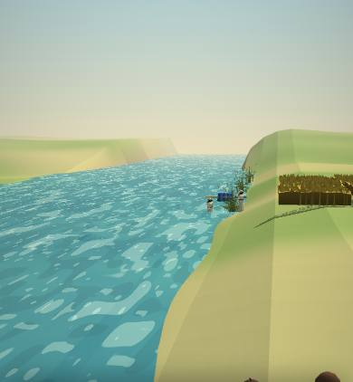
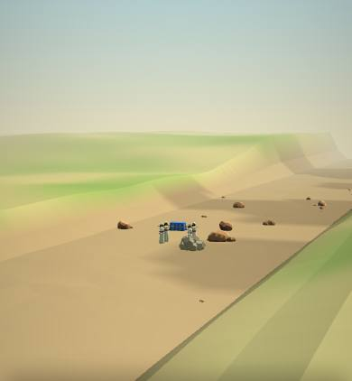
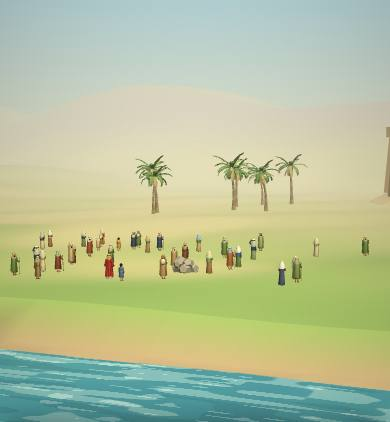
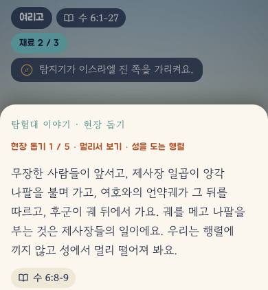
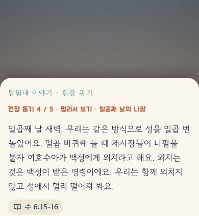
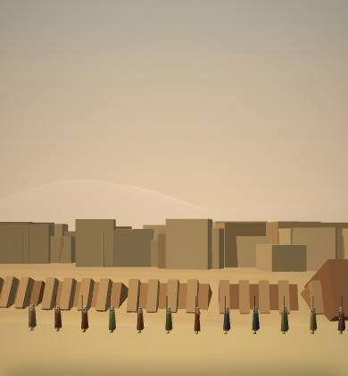

# 감수 자료 · 시대 5. 가나안 정복

자료 판 `32f936f1` · `node tools/make_review_pack.js`가 만든 파일입니다(손으로 고치지 않습니다). 게임에 나오는 문장은 글자 그대로이고, 성경 본문은 싣지 않았습니다(장절만).

#### 시대5·안내 · 시대 안내

*5. 가나안 정복*
- 최현 박사의 통신(탐험대 이야기): 강과 성이 보이는 시대로 넘어왔어. 재료 찾을 곳이 많겠다.
- "이 사이에 성경이 기록한 곳"으로 보여 주는 장절(요약 없이 장절만): 수 1:1-18 · 수 5:1-15 · 수 7:1-23:16 · 수 24:29-33

표시: ☐ 그대로 ☐ 고침 ☐ 뺌 　적을 칸: 

#### 시대5·마무리 · 마무리(기도·실천)

*이 시대 장면들의 한 문장 기도(8~10세)와 한 주 실천(11~13세). 꼴은 "공통·마무리"에서*
- **OT-17 라합과 두 정탐꾼** (수 2:1-24)
  - 8~10세 기도: 하나님, 라합과 두 정탐꾼의 이야기를 성경에서 읽고 기억하게 해 주세요. 예수님의 이름으로 기도합니다. 아멘.
  - 11~13세 실천: 이번 주에 여호수아 2장 8절부터 14절까지 소리 내어 읽어 보세요.
  - 14~19세 기록 물음: 수 2:1-24에서 새로 알게 된 사실을 한 가지 적어 보자.
- **OT-18 요단 강을 건너다** (수 3:1-4:24)
  - 8~10세 기도: 하나님, 요단 강에서 하신 일을 성경에서 읽고 기억하게 해 주세요. 예수님의 이름으로 기도합니다. 아멘.
  - 11~13세 실천: 이번 주에 여호수아 4장 19절부터 24절까지 소리 내어 읽어 보세요.
  - 14~19세 기록 물음: 수 3:1-4:24에서 새로 알게 된 사실을 한 가지 적어 보자.
- **OT-19 여리고 성이 무너지다** (수 6:1-27)
  - 8~10세 기도: 하나님, 여리고에서 있었던 일을 성경에서 읽고 기억하게 해 주세요. 예수님의 이름으로 기도합니다. 아멘.
  - 11~13세 실천: 이번 주에 여호수아 6장 1절부터 16절까지 소리 내어 읽어 보세요.
  - 14~19세 기록 물음: 수 6:1-27에서 새로 알게 된 사실을 한 가지 적어 보자.
- **OT-20 세겜에서 언약을 다시 세움** (수 24:1-28)
  - 8~10세 기도: 하나님, 세겜에서 백성이 한 대답을 성경에서 읽고 기억하게 해 주세요. 예수님의 이름으로 기도합니다. 아멘.
  - 11~13세 실천: 이번 주에 여호수아 24장 14절부터 18절까지 소리 내어 읽어 보세요.
  - 14~19세 기록 물음: 수 24:1-28에서 새로 알게 된 사실을 한 가지 적어 보자.

표시: ☐ 그대로 ☐ 고침 ☐ 뺌 　적을 칸: 

### OT-17 라합과 두 정탐꾼 (수 2:1-24)

- 곳: 여리고, 성벽 위에 있는 라합의 집
- 감수 필수: 아니오
- 화면: 이야기 카드 · 감수 상태: 미감수

#### OT-17·대목 · 대목 글(장면 전체) · 참고

*대목 7개* — 수 2:1-24
- 이 장면에서 검증자가 여쭌 것 4가지는 아래 "검증자가 남긴 것" 항목에 따로 있습니다. 대목 글을 고치실 때는 "대목 몇, 몇 세 글"인지 적어 주세요.
- **대목 1** (수 2:1)
- 8~10세: 여호수아는 싯딤에서 두 사람을 몰래 보내 여리고를 살펴보게 했어요. 두 사람은 라합이라는 여인의 집에 묵었어요.
- 11~13세: 눈의 아들 여호수아는 싯딤에서 두 사람을 정탐꾼으로 몰래 보냈어요. 가서 그 땅과 여리고를 살펴보라고 했어요. 두 사람은 가서 라합이라는 여인의 집에 들어가 묵었어요.
- 14~19세: 눈의 아들 여호수아는 싯딤에서 정탐할 사람 둘을 은밀히 보내며, 가서 그 땅과 여리고를 살펴보라고 했다. 두 사람은 가서 라합이라는 기생의 집에 들어가 거기서 묵었다.
  - 휴의 말: 여기는 여리고야. 저 두 사람은 싯딤에서 왔어. 일지에 적어 둘게.
- **대목 2** (수 2:2-3)
- 8~10세: 여리고 왕은 이스라엘 사람들이 들어왔다는 말을 듣고, 라합에게 그 사람들을 내놓으라고 했어요.
- 11~13세: 누군가 여리고 왕에게, 이스라엘 자손 몇 사람이 이 밤에 땅을 살피러 들어왔다고 알렸어요. 여리고 왕은 라합에게 사람을 보내어, 집에 들어온 사람들을 끌어내라고 했어요. 그들이 온 땅을 살피러 왔다는 것이었어요.
- 14~19세: 어떤 사람이 여리고 왕에게, 이 밤에 이스라엘 자손 가운데 몇 사람이 땅을 살피러 이리로 들어왔다고 알렸다. 여리고 왕은 라합에게 사람을 보내어, 그의 집에 들어간 사람들을 끌어내라고 했다. 그들이 이 온 땅을 살피러 왔다는 것이었다.
  - 최온의 말: 여리고 왕이 라합에게 두 사람을 내놓으라고 했어.
- **대목 3** (수 2:4-7)
- 8~10세: 라합은 두 사람을 지붕에 널어 둔 삼대 속에 숨겨 두었어요. 쫓는 사람들은 요단으로 가는 길로 따라갔어요.
- 11~13세: 라합은 이미 두 사람을 지붕으로 데리고 올라가, 지붕에 널어놓은 삼대 속에 숨겨 두었어요. 라합은 그 사람들이 오기는 했지만 어디서 왔는지 몰랐고, 어두워져 성문을 닫을 때쯤 나갔으니 어디로 갔는지도 모른다고 했어요. 서둘러 따라가면 따라잡을 것이라고도 했어요. 쫓는 사람들은 요단으로 가는 길을 따라 나루턱까지 갔고, 그들이 나가자 성문이 닫혔어요.
- 14~19세: 그 여인은 두 사람을 이미 숨겨 두고 있었다. 그는 그 사람들이 자기에게 오기는 했으나 어디서 왔는지 알지 못했고, 날이 어두워 성문을 닫을 때쯤 나갔으니 어디로 갔는지도 알지 못한다고 했으며, 급히 따라가면 따라잡을 것이라고 말했다. 그러나 실제로는 그가 두 사람을 지붕으로 데리고 올라가, 지붕에 벌여 놓은 삼대 속에 숨겨 둔 것이었다. 쫓는 사람들은 요단으로 가는 길을 따라 나루턱까지 갔고, 그들이 나가자마자 성문이 닫혔다.
  - 최온의 말: 지붕 위에 삼대가 널려 있어. 두 사람은 그 속에 숨어 있어.
- **대목 4** (수 2:8-11)
- 8~10세: 라합은 지붕에 올라와, 여호와께서 이 땅을 이스라엘에게 주신 줄 안다고 말했어요. 여호와는 하늘과 땅의 하나님이시라고 했어요.
- 11~13세: 두 사람이 눕기 전에 라합이 지붕으로 올라와 말했어요. 여호와께서 이 땅을 이스라엘에게 주신 줄을 안다고 했어요. 여호와께서 홍해 물을 마르게 하신 일과, 이스라엘이 요단 저편에 있는 아모리 사람의 두 왕인 시혼과 옥에게 한 일을 들었다고 했어요. 그리고 이스라엘의 하나님 여호와는 위로 하늘과 아래로 땅의 하나님이시라고 했어요.
- 14~19세: 두 사람이 아직 눕기 전에 라합이 지붕 위로 올라와 말했다. 그는 여호와께서 이 땅을 이스라엘에게 주신 줄을 안다고 했고, 자기들이 이스라엘을 몹시 두려워하며 이 땅에 사는 사람들이 다 이스라엘 앞에서 마음이 녹았다고 했다. 이스라엘이 애굽에서 나올 때 여호와께서 그들 앞에서 홍해 물을 마르게 하신 일과, 이스라엘이 요단 저편 아모리 사람의 두 왕 시혼과 옥을 모두 멸한 일을 들었기 때문이라고 했다. 그 소식을 듣자 곧 마음이 녹았고 이스라엘 때문에 사람마다 정신을 잃었다고 했으며, 이스라엘의 하나님 여호와는 위로 하늘과 아래로 땅의 하나님이시라고 말했다.
  - 온우의 말: 라합이 여호와에 대해 무엇이라고 말했는지, 2장 11절에서 확인해 보자.
- **대목 5** (수 2:12-14)
- 8~10세: 라합은 자기 가족을 살려 달라고 부탁했어요. 두 사람은 라합이 이 일을 남에게 알리지 않으면 그렇게 하겠다고 했어요.
- 11~13세: 라합은 자기가 두 사람을 잘 대해 주었으니, 두 사람도 자기 아버지의 집을 잘 대해 달라고 부탁했어요. 부모와 형제자매와 그들에게 딸린 사람을 모두 살려 주겠다고 여호와의 이름으로 맹세하고, 진실한 표를 달라고 했어요. 두 사람은 라합이 이 일을 누설하지 않으면, 여호와께서 이 땅을 주실 때에 라합을 인자하고 진실하게 대하겠다고 대답했어요.
- 14~19세: 라합은 자기가 두 사람을 선대했으니 그들도 자기 아버지의 집을 선대하여, 부모와 남녀 형제와 그들에게 딸린 모든 사람을 살려 죽음에서 건져 내겠다고 여호와의 이름으로 맹세하고 진실한 표를 달라고 청했다. 두 사람은 라합이 이 일을 누설하지 않으면 자기들의 생명으로 대신하겠다고까지 말했고, 여호와께서 이 땅을 주실 때에 라합을 인자하고 진실하게 대하겠다고 대답했다.
  - 휴의 말: 라합이 부탁했고, 두 사람이 대답했어. 주고받은 말을 순서대로 적어 둘게.
- **대목 6** (수 2:15-21)
- 8~10세: 라합은 성벽 위에 있는 집의 창에서 두 사람을 줄로 달아 내려 주었어요. 두 사람이 떠난 뒤, 라합은 그들이 말한 대로 창문에 붉은 줄을 맸어요.
- 11~13세: 라합의 집은 성벽 위에 있었고, 라합은 두 사람을 창에서 줄로 달아 내려 주었어요. 라합은 쫓는 사람들과 마주치지 않도록 산으로 가서 사흘 동안 숨어 있으라고 했어요. 두 사람은 자기들이 이 땅에 들어올 때 그 창에 붉은 줄을 매고, 부모와 형제와 아버지의 가족을 모두 집에 모으라고 했어요. 라합은 그 말대로 하겠다고 하고 두 사람을 보낸 뒤 붉은 줄을 창문에 맸어요.
- 14~19세: 라합은 두 사람을 창에서 줄로 달아 내렸다. 그의 집이 성벽 위에 있어 그가 성벽 위에 살았기 때문이다. 라합은 쫓는 사람들과 마주칠까 염려되니 산으로 가서 사흘 동안 숨어 있다가, 그들이 돌아간 뒤에 길을 가라고 했다. 두 사람은 자기들이 이 땅에 들어올 때 자기들을 달아 내린 창에 이 붉은 줄을 매고, 부모와 형제와 아버지의 가족을 다 집에 모으라고 했다. 집 문을 나서 거리로 나가는 사람의 피는 그 사람 자신의 머리로 돌아가고, 라합과 함께 집 안에 있는 사람에게 누가 손을 대면 그 피는 자기들의 머리로 돌아올 것이라고 했다. 또 라합이 이 일을 누설하면 자기들은 그 맹세에서 벗어난다고 했다. 라합은 그 말대로 하겠다고 하고 그들을 보낸 뒤, 붉은 줄을 창문에 맸다.
  - 최온의 말: 성벽 위에 있는 집 창문에 붉은 줄이 매여 있어!
- **대목 7** (수 2:22-24)
- 8~10세: 두 사람은 산에서 사흘을 머문 뒤 강을 건너 여호수아에게 돌아갔어요. 겪은 일을 모두 여호수아에게 알렸어요.
- 11~13세: 두 사람은 산에 이르러, 쫓는 사람들이 돌아갈 때까지 사흘 동안 머물렀어요. 쫓는 사람들은 길에서 두루 찾았지만 만나지 못했어요. 두 사람은 산에서 내려와 강을 건너 여호수아에게 가서 겪은 일을 모두 알렸어요. 여호와께서 그 온 땅을 자기들 손에 주셨고, 그 땅에 사는 사람들이 모두 자기들 앞에서 마음이 녹았다고 말했어요.
- 14~19세: 두 사람은 산에 이르러 쫓는 사람들이 돌아갈 때까지 사흘을 거기 머물렀고, 쫓는 사람들은 길에서 두루 찾았으나 만나지 못했다. 그 뒤 두 사람은 산에서 내려와 강을 건넜고, 눈의 아들 여호수아에게 돌아가 겪은 일을 모두 알렸다. 그들은 참으로 여호와께서 그 온 땅을 자기들 손에 넘겨주셨으며, 그 땅에 사는 모든 사람이 자기들 앞에서 마음이 녹았다고 말했다.
  - 휴의 말: 여리고에서 산으로, 산에서 사흘, 그다음 강을 건너 여호수아에게. 순서대로 적었어.

#### OT-17·동행1 · 동행 인물 문답

*라합에게 묻기* — 수 2:12-13
- 동행 인물: 라합 (이 자리에 있다는 근거 수 2:1, 사건과 관문 뒤에 문답)
- 휴의 물음: 두 사람에게 무엇을 부탁하셨어요?
- 답 8~10세: 라합은 자기가 두 사람에게 잘해 주었으니, 자기 부모와 형제들을 살려 주겠다고 여호와의 이름으로 맹세해 달라고 부탁했어요.
- 답 11~13세: 라합은 자기가 두 사람을 잘 대해 주었으니, 두 사람도 자기 아버지의 집을 잘 대해 달라고 부탁했어요. 부모와 형제자매와 그들에게 딸린 사람을 모두 살려 주겠다고 여호와의 이름으로 맹세하고, 진실한 표를 달라고 했어요.
- 답 14~19세: 라합은 자기가 두 사람을 선대했으니 그들도 자기 아버지의 집을 선대해 달라고 청했다. 부모와 남녀 형제와 그들에게 딸린 모든 사람을 살려 죽음에서 건져 내겠다고 여호와의 이름으로 맹세하고, 진실한 표를 달라고 했다.
- 아이가 펼 곳: 수 2:12

표시: ☐ 그대로 ☐ 고침 ☐ 뺌 　적을 칸: 

#### OT-17·동행2 · 동행 인물 문답

*라합에게 묻기* — 수 2:16
- 동행 인물: 라합 (이 자리에 있다는 근거 수 2:1, 사건과 관문 뒤에 문답)
- 온우의 물음: 두 사람을 내려 보낼 때 어디로 가라고 하셨어요?
- 답 8~10세: 라합은 두 사람에게, 쫓는 사람들과 마주치지 않게 산으로 가서 사흘 동안 숨어 있으라고 말했어요.
- 답 11~13세: 라합은 쫓는 사람들이 두 사람을 만날까 두렵다고 했어요. 그래서 산으로 가서 사흘 동안 숨어 있다가, 쫓는 사람들이 돌아간 뒤에 길을 가라고 말했어요.
- 답 14~19세: 라합은 쫓는 사람들이 두 사람을 만날까 두렵다며, 산으로 가서 사흘 동안 숨어 있다가 쫓는 사람들이 돌아간 뒤에 갈 길을 가라고 말했다.
- 아이가 펼 곳: 수 2:16

표시: ☐ 그대로 ☐ 고침 ☐ 뺌 　적을 칸: 

#### OT-17·돕기1 · 손으로 하는 돕기

*탐험 일지 정리하기* — 수 2:22-24
- 돕는 상대: 라합
- 8~10세: 두 사람은 여호수아에게 돌아갔어요. 우리는 성에서 멀찍이 떨어진 곳에서, 그동안 지켜본 것을 탐험 일지에 정리해요.
- 11~13세: 두 사람은 여호수아에게 돌아갔어요. 우리는 성에서 멀찍이 떨어진 곳에서, 지켜본 것을 탐험 일지에 정리해요. 본 곳과 본 물건을 적고, 성경에서 다시 읽을 절에 표시해요.
- 14~19세: 두 사람은 여호수아에게 돌아가 겪은 일을 모두 알렸다. 탐험대는 성에서 멀찍이 떨어진 곳에서, 지켜본 것을 탐험 일지에 정리한다. 이것은 성경의 사건이 아니라 탐험대의 일이다. 본 곳과 본 물건을 적고, 성경에서 다시 읽을 절에 표시해 둔다.
  - 누르는 일 1: 본 곳 적기
  - 누르는 일 2: 본 물건 적기
  - 누르는 일 3: 다시 읽을 절 표시하기
  - 마친 뒤 휴의 말: 본 곳과 본 물건을 다 적었어. 이제 성경에서 하나씩 확인해 보자.

표시: ☐ 그대로 ☐ 고침 ☐ 뺌 　적을 칸: 

#### OT-17·뜻 · 뜻 묻기

*이 일은 무슨 뜻이에요?* — 수 2:9-11
- 최온의 물음: 두 사람이 여리고에 온 이 일은 무슨 뜻이에요?
- 답하는 사람: 라합
- 답 8~10세: 라합은 두 사람에게, 여호와께서 이 땅을 이스라엘에게 주신 줄을 안다고 말했어요. 이스라엘의 하나님 여호와는 위로 하늘과 아래로 땅의 하나님이시라고 했어요.
- 답 11~13세: 라합은 두 사람에게, 여호와께서 이 땅을 이스라엘에게 주신 줄을 안다고 말했어요. 여호와께서 홍해의 물을 말리신 일과, 이스라엘이 요단 저편 아모리 사람의 두 왕에게 한 일을 들었다고 했어요. 그리고 이스라엘의 하나님 여호와는 위로 하늘과 아래로 땅의 하나님이시라고 했어요.
- 답 14~19세: 라합은 두 사람에게, 여호와께서 이 땅을 이스라엘에게 주신 줄을 안다고 말했다. 이스라엘이 애굽에서 나올 때 여호와께서 홍해의 물을 말리신 일과, 이스라엘이 요단 저편의 두 아모리 왕 시혼과 옥에게 한 일을 듣고 그 땅 사람들의 마음이 녹았다고 했다. 그리고 이스라엘의 하나님 여호와는 위로 하늘과 아래로 땅의 하나님이시라고 말했다.
- **성경을 펴서 뜻 확인하기**
- 8~10세 · 찾아 읽고 고르기: 성경책에서 여호수아 2장 9절을 찾아 읽어 보세요. (수 2:9)
  - 물음: 라합은 여호와께서 이 땅을 누구에게 주신 줄을 안다고 했나요?
  - 맞는 보기: 두 사람이 속한 이스라엘
  - 다른 보기: 여리고 왕 (본문에 없음)
  - 다른 보기: 애굽 사람들 (본문에 없음)
- 11~13세 · 찾아 읽고 고르기: 성경책에서 여호수아 2장 9절부터 11절까지 읽어 보세요. (수 2:9-11)
  - 물음: 라합이 그 땅 사람들의 마음이 녹았다고 한 까닭은 무엇인가요?
  - 맞는 보기: 여호와께서 홍해를 마르게 하신 일과, 요단 저편 두 왕 시혼과 옥을 이스라엘이 멸한 일을 들었기 때문에
  - 다른 보기: 여호와께서 요단 물을 말리시고 이스라엘을 건너게 하신 일을 들었기 때문에 (수 5:1)
  - 다른 보기: 이스라엘 군대가 성 밖에 진을 친 것을 보았기 때문에 (본문에 없음)
- 14~19세 · 찾아 읽고 고르기: 여호수아 2장 9절과 24절을 함께 찾아 읽어 보자. (수 2:9 · 수 2:24)
  - 물음: 라합이 지붕에서 두 사람에게 한 말과, 두 사람이 돌아가 여호수아에게 한 말을 이어 읽으면 무엇이 같은가?
  - 맞는 보기: 라합도 두 사람도, 여호와께서 그 땅을 이스라엘에게 주셨고 그 땅 사람들이 이스라엘 앞에서 마음이 녹았다고 말했다
  - 다른 보기: 라합은 그렇게 말했지만, 두 사람은 그 땅을 차지하기 어렵다고 알렸다 (본문에 없음)
  - 다른 보기: 두 사람은 그렇게 알렸지만, 라합은 여호와를 알지 못한다고 말했다 (본문에 없음)

표시: ☐ 그대로 ☐ 고침 ☐ 뺌 　적을 칸: 

#### OT-17·오늘1 · 오늘의 물음

*최현 박사가 답함* — 수 2:18 · 수 2:21
- 물음: 라합이 창문에 맨 붉은 줄은 무슨 뜻이에요?
- 답 8~10세: 두 사람은 자기들이 이 땅에 들어올 때 그 창에 붉은 줄을 매어 두라고 라합에게 말했어요. 라합은 그 말대로 붉은 줄을 창문에 맸어요. 성경은 여기까지 말해요.
- 답 11~13세: 두 사람은 자기들이 이 땅에 들어올 때 자기들을 달아 내린 창에 이 붉은 줄을 매고, 가족을 모두 집에 모으라고 라합에게 말했어요. 라합은 그 말대로 하겠다고 하고 붉은 줄을 창문에 맸어요. 성경은 두 사람이 한 말과 라합이 한 일까지 적어요.
- 답 14~19세: 두 사람은 자기들이 이 땅에 들어올 때 자기들을 달아 내린 창에 이 붉은 줄을 매고, 부모와 형제와 아버지의 가족을 다 집에 모으라고 라합에게 말했다(수 2:18). 라합은 그 말대로 하겠다고 하고 두 사람을 보낸 뒤 붉은 줄을 창문에 맸다(수 2:21). 본문은 두 사람이 한 말과 라합이 한 일까지 적고, 붉은 줄이 따로 무엇을 뜻하는지는 풀어 말하지 않는다.

표시: ☐ 그대로 ☐ 고침 ☐ 뺌 　적을 칸: 

#### OT-17·화면 · 화면 원칙 · 참고

*이야기 카드 장면: 하나님 표현과 그리지 않는 것* — 수 2:1-24
- 하나님 표현: 이 본문에는 하나님이 말씀하시거나 나타나시는 대목이 없다. 여호와의 이름은 라합과 두 사람의 말 속에만 나온다(수 2:9-12, 2:14, 2:24). 불·구름·빛을 만들지 않는다. 형상 없음
  - 그리지 않는 것: 하나님의 형상
  - 그리지 않는 것: 라합의 직업을 그림으로 드러내는 묘사(본문은 낱말 하나로만 적는다, 수 2:1)
  - 그리지 않는 것: 두 사람이 쫓는 사람들과 싸우거나 붙잡히는 모습(본문은 만나지 못했다고 한다, 수 2:22)
  - 그리지 않는 것: 라합의 가족이 그 자리에 있는 모습(이 장에서는 라합과 두 사람의 말로만 나온다, 수 2:13, 2:18)
  - 그리지 않는 것: 두 사람의 이름을 지어 붙이는 것
  - 그리지 않는 것: 달아 내린 줄과 붉은 줄이 같은 줄인지 단정하는 그림(수 2:15, 2:18은 따로 적는다)
  - 그리지 않는 것: 붉은 줄에 다른 뜻을 덧붙이는 그림이나 자막(신약과의 연결은 감수 전)
  - 그리지 않는 것: 여리고 왕의 궁전이나 왕의 생김새(본문에 없음)
  - 그리지 않는 것: 아이들이 두 사람을 숨겨 주거나 쫓는 사람들에게 말을 거는 것(목격자다)

#### OT-17·미해결1 · 검증자가 남긴 것

*라합이 왕의 사람들에게 한 말(수 2:4-5)을 평가 없이 본문 차례대로만 둘까요?*
- 검증 기록(OT-17 라합과 두 정탐꾼): 라합이 왕의 사람들에게 한 말(수 2:4-5)은 본문이 바로 이어 적는 사실(수 2:6)과 다르다. 자료는 평가 없이 본문의 차례대로만 적었다. 아이에게 덧붙일 말이 필요한지는 감수 때 정한다.
  - 지금 게임의 글 · 대목 3 · 11~13세: 라합은 이미 두 사람을 지붕으로 데리고 올라가, 지붕에 널어놓은 삼대 속에 숨겨 두었어요. 라합은 그 사람들이 오기는 했지만 어디서 왔는지 몰랐고, 어두워져 성문을 닫을 때쯤 나갔으니 어디로 갔는지도 모른다고 했어요. 서둘러 따라가면 따라잡을 것이라고도 했어요. 쫓는 사람들은 요단으로 가는 길을 따라 나루턱까지 갔고, 그들이 나가자 성문이 닫혔어요.
  - 지금 게임의 글 · 대목 3 · 14~19세: 그 여인은 두 사람을 이미 숨겨 두고 있었다. 그는 그 사람들이 자기에게 오기는 했으나 어디서 왔는지 알지 못했고, 날이 어두워 성문을 닫을 때쯤 나갔으니 어디로 갔는지도 알지 못한다고 했으며, 급히 따라가면 따라잡을 것이라고 말했다. 그러나 실제로는 그가 두 사람을 지붕으로 데리고 올라가, 지붕에 벌여 놓은 삼대 속에 숨겨 둔 것이었다. 쫓는 사람들은 요단으로 가는 길을 따라 나루턱까지 갔고, 그들이 나가자마자 성문이 닫혔다.
  - 덧붙임: 8~10세 글에는 라합이 왕의 사람들에게 한 말이 없다.

표시: ☐ 지금대로 ☐ 바꿈 ☐ 의논 필요 　적을 칸: 

#### OT-17·미해결2 · 검증자가 남긴 것

*수 2:1의 라합을 13세까지는 "여인", 14~19세는 본문 낱말로 적은 것을 그대로 둘까요?*
- 검증 기록(OT-17 라합과 두 정탐꾼): 라합을 8~10세·11~13세 문장은 "여인"으로, 14~19세 문장은 본문의 낱말로 적었다(수 2:1. 6:17, 6:25에도 같은 낱말). 서로 어긋나는 사실은 아니다. 표현은 감수 때 확인한다.
  - 지금 게임의 글 · 대목 1 · 8~10세: 여호수아는 싯딤에서 두 사람을 몰래 보내 여리고를 살펴보게 했어요. 두 사람은 라합이라는 여인의 집에 묵었어요.
  - 지금 게임의 글 · 대목 1 · 11~13세: 눈의 아들 여호수아는 싯딤에서 두 사람을 정탐꾼으로 몰래 보냈어요. 가서 그 땅과 여리고를 살펴보라고 했어요. 두 사람은 가서 라합이라는 여인의 집에 들어가 묵었어요.
  - 지금 게임의 글 · 대목 1 · 14~19세: 눈의 아들 여호수아는 싯딤에서 정탐할 사람 둘을 은밀히 보내며, 가서 그 땅과 여리고를 살펴보라고 했다. 두 사람은 가서 라합이라는 기생의 집에 들어가 거기서 묵었다.

표시: ☐ 지금대로 ☐ 바꿈 ☐ 의논 필요 　적을 칸: 

#### OT-17·미해결3 · 검증자가 남긴 것

*수 2:21(창문에 맨 붉은 줄)을 뜻풀이 없이 말씀 카드로 남겨도 될까요?*
- 검증 기록(OT-17 라합과 두 정탐꾼): 말씀 카드 둘째 장(수 2:21, 붉은 줄)은 사실만 담은 제목이다. 붉은 줄에 다른 뜻을 덧붙이는 것은 그리지 않는 것 목록로 막혀 있지만, 이 절을 카드로 남길지는 감수 때 정한다.
  - 지금 게임의 글 · 말씀 카드 2: 창문에 맨 붉은 줄

표시: ☐ 지금대로 ☐ 바꿈 ☐ 의논 필요 　적을 칸: 

#### OT-17·미해결4 · 검증자가 남긴 것

*라합을 아이들과 동행하며 묻고 답하는 인물로 두어도 될까요? (수 2:12-13, 2:16)*
- 검증 기록(임무 독립 대조): (감수 때 확인) 라합을 동행 인물로 두는 것. 받아들여지지 않으면 동행 인물을 null로 바꾼다(여호수아의 말은 수 2:1의 한 마디뿐이다).
  - 지금 게임의 글 · 동행 인물: 라합
  - 지금 게임의 글 · 동행 문답 1 · 아이의 물음: 두 사람에게 무엇을 부탁하셨어요?
  - 지금 게임의 글 · 동행 문답 1 · 답 · 8~10세: 라합은 자기가 두 사람에게 잘해 주었으니, 자기 부모와 형제들을 살려 주겠다고 여호와의 이름으로 맹세해 달라고 부탁했어요.
  - 지금 게임의 글 · 동행 문답 2 · 아이의 물음: 두 사람을 내려 보낼 때 어디로 가라고 하셨어요?
  - 지금 게임의 글 · 동행 문답 2 · 답 · 8~10세: 라합은 두 사람에게, 쫓는 사람들과 마주치지 않게 산으로 가서 사흘 동안 숨어 있으라고 말했어요.

표시: ☐ 지금대로 ☐ 바꿈 ☐ 의논 필요 　적을 칸: 

#### OT-17·기타 · 그 밖의 글(참고) · 참고

*통신·재료·관문·탐지기 물음·곁에서 보기·말씀 카드* — 수 2:1-24
- **최현 박사의 통신(탐험대 이야기)**
- 8~10세: 최현 박사예요. 타임머신 계기판의 바늘 하나가 부러졌어요. 여리고 성 밖에서 가늘고 곧은 재료를 찾아봐요.
- 11~13세: 최현 박사예요. 비상 착륙 때 계기판 바늘이 부러져서 눈금을 읽을 수가 없어요. 이 시대에는 우리 부속이 없으니, 여리고 성 밖에서 바늘 대신 쓸 가늘고 곧은 재료를 찾아야 해요.
- 14~19세: 최현 박사다. 비상 착륙으로 계기판 바늘이 부러졌고 지금은 통신만 이어져 있다. 이 시대에는 부속이 없으니 여리고 성 밖에서 가늘고 곧은 재료를 구해 바늘을 대신 만들어야 한다.
- **수리 재료(탐험대 이야기)**
- 재료: 가는 돌 조각 (수 2:1)
  - 박사의 말: 가늘고 곧은 돌 조각을 부러진 계기판 바늘 대신 쓸 수 있어요.
  - 얻는 방법: 성과 성문, 라합의 집 쪽으로는 가지 않는다. 성에서 멀찍이 떨어진 성 밖 땅에서 가늘고 곧은 돌 조각 하나를 줍는다.
  - 얻었을 때 아이의 말: 가늘고 곧은 돌 조각을 주웠어! 성에서 멀찍이 떨어진 성 밖 땅에 있었네.
- **관문 물음**
- 관문 1 8~10세 · 찾아 읽고 고르기: 성경책에서 여호수아 2장 6절을 찾아 읽어 보세요. (수 2:6)
  - 물음: 라합은 두 사람을 어디에 숨겼나요?
  - 맞는 보기: 지붕 위에 널어 둔 삼대 속
  - 다른 보기: 마당의 우물 속 (삼하 17:18)
  - 다른 보기: 성문 옆 망대 위 (본문에 없음)
- 관문 2 8~10세 · 여러 개 고르기: 성경책에서 여호수아 2장 18절을 찾아 읽어 보세요. (수 2:18)
  - 물음: 두 사람이 이 땅에 들어올 때 라합의 집에 모아 두라고 한 사람을 모두 고르세요.
  - 맞는 보기: 라합의 부모
  - 다른 보기: 여리고 왕의 신하들 (본문에 없음)
  - 맞는 보기: 라합의 형제
  - 다른 보기: 성문을 지키는 사람들 (본문에 없음)
  - 맞는 보기: 라합의 아버지의 가족
- 관문 1 11~13세 · 찾아 읽고 고르기: 성경책에서 여호수아 2장 2절과 3절을 읽어 보세요. (수 2:2-3)
  - 물음: 여리고 왕이 라합에게 사람을 보내, 그 집에 온 사람들을 내놓으라고 한 까닭은 무엇인가요?
  - 맞는 보기: 그 사람들이 온 땅을 살피러 왔기 때문에
  - 다른 보기: 그 사람들이 성문을 부수었기 때문에 (본문에 없음)
  - 다른 보기: 그 사람들이 왕의 물건을 가져갔기 때문에 (본문에 없음)
- 관문 2 11~13세 · 순서 맞추기: 성경책에서 여호수아 2장 21절부터 23절까지 읽고, 일어난 차례대로 눌러 보세요. (수 2:21-23)
  - 차례 1: 라합이 두 사람을 떠나보냈다
  - 차례 2: 두 사람이 산에 이르러 사흘을 머물렀다
  - 차례 3: 두 사람이 산을 내려와 강을 건넜다
  - 차례 4: 두 사람이 여호수아에게 가서 겪은 일을 모두 알렸다
- 관문 1 14~19세 · 찾아 읽고 고르기: 여호수아 2장 7절과 22절을 함께 찾아 읽어 보자. (수 2:7 · 수 2:22)
  - 물음: 쫓는 사람들이 간 길과 두 사람이 머문 곳을 이어 보면, 쫓는 사람들이 두 사람을 만나지 못한 것은 어떻게 된 일인가?
  - 맞는 보기: 쫓는 사람들은 요단으로 가는 길을 따라 나루턱까지 갔고, 두 사람은 산에 가서 사흘을 머물렀다
  - 다른 보기: 쫓는 사람들은 산으로 갔고, 두 사람은 나루턱 근처에 숨어 있었다 (본문에 없음)
  - 다른 보기: 쫓는 사람들은 성 안만 뒤졌고, 두 사람은 그날 밤 곧바로 강을 건넜다 (본문에 없음)
- 관문 2 14~19세 · 구절과 내용 잇기: 여호수아 2장 1절, 15절, 23절을 찾아 읽고, 구절마다 맞는 내용을 이어 보자. (수 2:1 · 수 2:15 · 수 2:23)
  - 잇기: 여호수아가 몰래 두 사람을 보내 그 땅과 여리고를 살피게 했다 (수 2:1)
  - 잇기: 라합이 성벽 위에 있는 자기 집 창에서 두 사람을 줄로 내려 주었다 (수 2:15)
  - 잇기: 두 사람이 산을 떠나 강 건너 여호수아에게 돌아갔다 (수 2:23)
  - 이은 뒤 글: 세 곳을 이으면, 싯딤에서 보낸 두 사람은 성벽 위 라합의 집 창으로 내려와, 산을 떠나 강을 건너 여호수아에게 돌아갔다.
- **곁에서 보기 · 함께 머물기**
- 보기: 지켜보기 · 지붕의 삼대 (수 2:6)
  - 8~10세: 라합은 두 사람을 지붕으로 데리고 올라가, 지붕에 널어 둔 삼대 속에 숨겼어요. 우리는 숨기는 일에 끼지 않고, 삼대에도 손대지 않아요.
  - 11~13세: 라합은 이미 두 사람을 지붕으로 데리고 올라가, 지붕 위에 널어 둔 삼대 속에 숨겨 두었어요. 두 사람을 숨긴 것은 라합이 한 일이에요. 우리는 그 일에 끼지 않고 성 밖에서 멀찍이 바라보기만 해요.
  - 14~19세: 라합은 이미 두 사람을 지붕으로 이끌고 올라가, 지붕 위에 널어 둔 삼대 속에 숨겨 두었다(2:4, 2:6). 두 사람을 숨긴 것은 라합이 한 일이다. 탐험대는 숨기는 일에 끼지 않고 삼대에도 손대지 않으며, 성 밖에서 멀찍이 바라본다.
  - 온우의 말: 두 사람이 어디에 숨었는지는 2장 6절에 적혀 있어.
- 보기: 지켜보기 · 창문의 붉은 줄 (수 2:21)
  - 8~10세: 라합은 두 사람을 보낸 뒤 붉은 줄을 창문에 맸어요. 우리는 그 줄에 손대지 않고 바라봐요.
  - 11~13세: 두 사람은 자기들을 달아 내린 그 창에 이 붉은 줄을 매어 두라고 했어요. 라합은 그 말대로 하겠다고 하고, 두 사람을 보낸 뒤 붉은 줄을 창문에 맸어요. 우리는 그 줄에 손대지 않고 바라보기만 해요.
  - 14~19세: 두 사람은 자기들이 이 땅에 들어올 때, 자기들을 달아 내린 창에 이 붉은 줄을 매어 두라고 했다(2:18). 라합은 그 말대로 하겠다고 하고 두 사람을 떠나보낸 뒤 붉은 줄을 창문에 맸다(2:21). 줄을 매는 것은 라합이 한 일이다. 탐험대는 그 줄에 손대지 않고 바라본다.
- **말씀 카드**
- 카드: 하늘과 땅의 하나님 (수 2:11)
- 카드: 창문에 맨 붉은 줄 (수 2:21)
- **곳과 사람(설계 메모, 화면에 그릴 때의 근거)**
- 곳: 여리고, 성벽 위에 있는 라합의 집
- 곳(설계): 여리고, 성벽 위에 있는 라합의 집과 그 지붕(수 2:1, 2:6, 2:15)
- 땅: 성벽과 성문(수 2:5, 2:7, 2:15), 요단으로 가는 길과 나루턱(수 2:7), 산(수 2:16, 2:22), 강(수 2:23). 때는 밤(수 2:2, 2:5)
  - 사람: 여호수아(수 2:1)
  - 사람: 정탐하러 간 두 사람(수 2:1). 이름은 본문에 없음
  - 사람: 라합(수 2:1)
  - 사람: 여리고 왕(수 2:2)
  - 사람: 왕이 보낸 사람들, 쫓는 사람들(수 2:3, 2:7)
  - 물건: 지붕에 벌여 놓은 삼대(수 2:6)
  - 물건: 성문(수 2:5, 2:7)
  - 물건: 성벽 위의 집과 창, 달아 내린 줄(수 2:15)
  - 물건: 붉은 줄(수 2:18, 2:21)
  - 절정 장면: 이야기 카드로 잇는 장면. 3D로 만들지 않는다

### OT-18 요단 강을 건너다 (수 3:1-4:24)

- 곳: 요단 강과 길갈
- 감수 필수: 아니오
- 화면: 3D 장면 · 감수 상태: 미감수

#### OT-18·대목 · 대목 글(장면 전체) · 참고

*대목 7개* — 수 3:1-4:24
- 이 장면에서 검증자가 여쭌 것 1가지는 아래 "검증자가 남긴 것" 항목에 따로 있습니다. 대목 글을 고치실 때는 "대목 몇, 몇 세 글"인지 적어 주세요.
- **대목 1** (수 3:1-6)
- 8~10세: 이스라엘 백성은 싯딤을 떠나 요단 강가에 와서 묵었어요. 관리들은 언약궤를 따라가되 가까이 가지는 말라고 알렸어요.
- 11~13세: 여호수아는 아침 일찍 일어나 이스라엘 사람들과 함께 싯딤을 떠났고, 요단에 이르러서는 건너지 않고 거기서 묵었어요. 사흘 뒤에 관리들이 진을 두루 다니며, 레위 사람 제사장들이 언약궤를 메는 것을 보면 그 뒤를 따르라고 했어요. 언약궤와는 이천 규빗쯤 떨어지고 가까이 가지 말라고 했어요. 여호수아는 백성에게 스스로 성결하게 하라고 했고, 제사장들에게는 언약궤를 메고 백성보다 앞서 건너라고 했어요.
- 14~19세: 여호수아는 아침 일찍 일어나 이스라엘 사람들과 함께 싯딤을 떠났고, 요단에 이르러서는 건너지 않고 거기서 묵었다. 사흘 뒤에 관리들이 진 가운데를 두루 다니며, 레위 사람 제사장들이 여호와의 언약궤를 메는 것을 보면 있던 곳을 떠나 그 뒤를 따르라고 명했다. 다만 언약궤와 백성 사이를 이천 규빗쯤 떨어지게 하고 가까이 가지 말라고 했는데, 전에 지나 본 적이 없는 길이니 그렇게 해야 갈 길을 알 것이라고 했다. 여호수아는 백성에게 스스로 성결하게 하라고 하며, 여호와께서 내일 그들 가운데 놀라운 일을 행하실 것이라고 말했다. 또 제사장들에게 언약궤를 메고 백성보다 앞서 건너라고 하자, 그들이 언약궤를 메고 백성 앞에서 나아갔다.
  - 휴의 말: 싯딤을 떠나 요단 강가까지 왔어. 여기서 사흘이 지났다고 일지에 적어 둘게.
- **대목 2** (수 3:7-13)
- 8~10세: 하나님은 모세와 함께하셨듯이 여호수아와도 함께하심을 백성이 알게 하겠다고 하셨어요. 여호수아는 제사장들이 강물에 발을 디디면 흐르던 물이 멈출 거라고 알렸어요.
- 11~13세: 하나님은 여호수아에게, 오늘부터 온 이스라엘이 보는 앞에서 그를 크게 하여, 모세와 함께 있었던 것처럼 그와 함께 있는 것을 알게 하겠다고 하셨어요. 언약궤를 멘 제사장들에게는 요단 물가에 이르면 요단에 들어서라고 명하게 하셨어요. 여호수아는 백성을 불러 하나님 여호와의 말씀을 들으라고 했어요. 제사장들이 요단 물에 발을 디디고 멈추어 서면, 위에서 흘러내리던 물이 끊어져 쌓일 것이라고 했어요.
- 14~19세: 여호와께서는 여호수아에게, 오늘부터 온 이스라엘이 보는 앞에서 그를 크게 하여, 모세와 함께 있었던 것처럼 그와 함께 있는 것을 그들이 알게 하겠다고 하셨다. 또 언약궤를 멘 제사장들에게 요단 물가에 이르면 요단에 들어서라고 명하게 하셨다. 여호수아는 이스라엘 자손을 불러 하나님 여호와의 말씀을 들으라고 했다. 살아 계신 하나님이 그들 가운데 계셔서 가나안, 헷, 히위, 브리스, 기르가스, 아모리, 여부스 족속을 그들 앞에서 반드시 쫓아내실 줄을 이 일로 알게 될 것이라고 했다. 온 땅의 주의 언약궤가 그들보다 앞서 요단으로 들어간다고 했고, 지파마다 한 사람씩 열두 명을 뽑으라고 했다. 그리고 궤를 멘 제사장들이 요단 물에 발을 디디고 멈추어 서면, 위에서 흘러내리던 물이 끊어져 쌓여 설 것이라고 했다.
  - 온우의 말: 하나님이 여호수아에게 하신 말씀은 3장 7절과 8절에 있어. 성경책에서 직접 읽어 보자.
- **대목 3** (수 3:14-16)
- 8~10세: 곡식을 거두는 때라 강물이 언덕까지 넘쳤어요. 제사장들의 발이 물에 닿자 위에서 흐르던 물이 멈추어 멀리 쌓였어요!
- 11~13세: 백성이 요단을 건너려고 장막을 떠날 때, 언약궤를 멘 제사장들이 백성보다 앞서 갔어요. 요단은 곡식을 거두는 때면 늘 언덕까지 넘쳤어요. 궤를 멘 제사장들이 물가에 발을 담그자, 위에서 흘러내리던 물이 멈추어 멀리 아담이라는 성읍 쪽에 쌓였어요. 염해로 흘러가던 물은 완전히 끊어졌고, 백성은 여리고 앞쪽으로 건넜어요.
- 14~19세: 백성이 요단을 건너려고 장막을 떠날 때, 언약궤를 멘 제사장들이 백성보다 앞서 갔다. 요단은 곡식을 거두는 때면 늘 언덕까지 넘쳤다. 궤를 멘 사람들이 요단에 이르러 제사장들의 발이 물가에 잠기자, 위에서 흘러내리던 물이 그쳐 아주 멀리 사르단 가까이에 있는 아담 읍 쪽에 일어나 쌓였다. 아라바의 바다 곧 염해 쪽으로 흘러가던 물은 완전히 끊어졌고, 백성은 여리고 앞쪽으로 곧장 건넜다.
  - 최온의 말: 강물이 언덕까지 넘치고 있었는데, 위에서 내려오던 물이 멈췄어!
- **대목 4** (수 3:17)
- 8~10세: 제사장들은 궤를 멘 채 강 한가운데의 마른 땅에 서 있었어요. 그동안 온 백성이 마른 땅으로 걸어서 강을 건넜어요.
- 11~13세: 제사장들은 여호와의 언약궤를 멘 채 요단 한가운데 마른 땅에 굳게 서 있었어요. 그동안 온 이스라엘 백성이 마른 땅을 걸어 요단을 건넜어요.
- 14~19세: 제사장들은 여호와의 언약궤를 멘 채 요단 한가운데의 마른 땅에 굳게 서 있었고, 온 이스라엘 백성은 마른 땅을 밟고 지나 요단을 다 건넜다.
  - 최온의 말: 제사장들이 강 한가운데 서 있어. 발밑이 마른 땅이야!
- **대목 5** (수 4:1-9)
- 8~10세: 지파마다 한 사람씩 뽑힌 열두 사람이 강 가운데서 돌을 하나씩 가져왔어요. 여호수아는 이 돌들이 표징이 될 거라고 했어요.
- 11~13세: 온 백성이 건너기를 마치자, 하나님은 지파마다 한 사람씩 열두 사람을 뽑아, 제사장들의 발이 굳게 섰던 요단 가운데서 돌 열두 개를 가져다가 그날 밤 묵을 곳에 두게 하라고 하셨어요. 여호수아는 열두 사람을 불러 돌을 하나씩 어깨에 메라고 했어요. 훗날 자손이 이 돌들이 무슨 뜻이냐고 물으면, 여호와의 언약궤 앞에서 요단 물이 끊어졌다고 말해 주라고 했어요. 이스라엘 자손은 그대로 했어요.
- 14~19세: 온 백성이 요단을 다 건너자 여호와께서 여호수아에게 말씀하셨다. 지파마다 한 사람씩 열두 사람을 뽑아, 요단 가운데 제사장들의 발이 굳게 섰던 곳에서 돌 열둘을 가져다가 그날 밤 묵을 곳에 두게 하라는 것이었다. 여호수아는 미리 세워 둔 열두 사람을 불러, 요단 가운데 여호와의 궤 앞으로 들어가 지파 수대로 돌을 하나씩 어깨에 메라고 했다. 이것이 그들 가운데 표징이 될 것이며, 훗날 자손이 이 돌들의 뜻을 물으면 여호와의 언약궤 앞에서 요단 물이 끊어졌다고 말하라고 했다. 이 돌들이 이스라엘 자손에게 영원한 기념이 될 것이라고 했다. 이스라엘 자손은 여호수아가 명한 대로 돌 열둘을 묵을 곳으로 가져다 두었다. 여호수아는 또 요단 가운데, 언약궤를 멘 제사장들의 발이 섰던 곳에도 돌 열둘을 세웠다.
  - 휴의 말: 돌은 열두 개야. 지파 수대로 한 사람이 하나씩 멨어. 일지에 적어 둘게.
- **대목 6** (수 4:14-18)
- 8~10세: 하나님의 말씀대로 제사장들이 요단에서 올라왔어요. 제사장들의 발이 뭍을 밟자 강물이 다시 흘러 언덕까지 넘쳤어요.
- 11~13세: 그날 여호와께서 온 이스라엘이 보는 앞에서 여호수아를 크게 하셨어요. 하나님은 여호수아에게, 궤를 멘 제사장들을 요단에서 올라오게 하라고 하셨어요. 여호수아가 그대로 명하자 제사장들이 요단 가운데서 나왔어요. 그들의 발바닥이 뭍을 밟자마자 요단 물이 제자리로 돌아와 전처럼 언덕까지 넘쳤어요.
- 14~19세: 그날 여호와께서 온 이스라엘이 보는 앞에서 여호수아를 크게 하셨으므로, 백성은 여호수아가 살아 있는 동안 모세를 두려워하던 것처럼 그를 두려워했다. 여호와께서는 여호수아에게, 증거궤를 멘 제사장들이 요단에서 올라오도록 명하라고 하셨다. 여호수아가 제사장들에게 요단에서 올라오라고 명하자, 제사장들이 여호와의 언약궤를 메고 요단 한가운데에서 올라왔다. 그들의 발바닥이 뭍을 밟는 그때에 요단 물이 제자리로 도로 흘러, 전과 같이 언덕까지 넘쳤다.
  - 최온의 말: 제사장들이 올라오니까 물이 다시 흘러. 또 언덕까지 넘쳐!
- **대목 7** (수 4:19-24)
- 8~10세: 백성은 길갈에 진을 쳤고, 여호수아는 요단에서 가져온 돌 열두 개를 거기 세웠어요. 훗날 자손이 물으면 마른 땅으로 요단을 건넌 일을 알려 주라고 했어요.
- 11~13세: 첫째 달 곧 정월 십일에 백성은 요단에서 올라와, 여리고 동쪽 경계에 있는 길갈에 진을 쳤어요. 여호수아는 요단에서 가져온 돌 열두 개를 길갈에 세우고 말했어요. 훗날 자손이 이 돌이 무슨 뜻이냐고 물으면, 이스라엘이 마른 땅을 밟고 요단을 건넜다고 알려 주라고 했어요. 여호와께서 홍해를 말리셨던 것처럼 요단 물도 마르게 하여 건너게 하셨다고 했어요.
- 14~19세: 첫째 달 곧 정월 십일에 백성은 요단에서 올라와 여리고 동쪽 경계인 길갈에 진을 쳤다. 여호수아는 요단에서 가져온 돌 열두 개를 길갈에 세우고 이스라엘 자손에게 말했다. 훗날 자손이 아버지에게 이 돌이 무슨 뜻이냐고 묻거든, 이스라엘이 이 요단을 마른 땅을 밟고 건넜다는 것을 알려 주라고 했다. 하나님 여호와께서 요단 물을 마르게 하여 건너게 하신 것이 홍해를 말려 건너게 하신 것과 같다고 했다. 이는 땅의 모든 백성이 여호와의 손이 능하심을 알게 하고, 이스라엘이 하나님 여호와를 영원히 경외하게 하려 하심이라고 했다.
  - 온우의 말: 이 돌들이 무슨 뜻인지, 여호수아가 한 말을 4장 21절부터 24절에서 확인하자.

#### OT-18·동행1 · 동행 인물 문답

*여호수아에게 묻기* — 수 4:5-7
- 동행 인물: 여호수아 (이 자리에 있다는 근거 수 4:20, 사건과 관문 뒤에 문답)
- 휴의 물음: 열두 사람에게는 무엇을 하라고 하셨어요?
- 답 8~10세: 여호수아는 열두 사람에게, 요단 가운데 여호와의 궤 앞으로 들어가 돌을 하나씩 어깨에 메라고 말했어요. 그 돌들이 표징이 될 것이라고 했어요.
- 답 11~13세: 여호수아는 열두 사람에게, 요단 가운데 여호와의 궤 앞으로 들어가 지파 수대로 돌을 하나씩 어깨에 메라고 말했어요. 이것이 표징이 될 것이라고 했어요. 훗날 자손이 이 돌들의 뜻을 물으면, 여호와의 언약궤 앞에서 요단 물이 끊어졌다고 말해 주라고 했어요.
- 답 14~19세: 여호수아는 열두 사람에게, 요단 가운데 여호와의 궤 앞으로 들어가 이스라엘 자손의 지파 수대로 저마다 돌 하나씩을 어깨에 메라고 말했다. 이것이 그들 가운데 표징이 될 것이며, 훗날 자손이 이 돌들의 뜻을 물으면 언약궤가 요단을 건널 때 그 앞에서 요단 물이 끊어졌다고 말해 주라고 했다. 이 돌들이 이스라엘 자손에게 영원한 기념이 될 것이라고 했다.
- 아이가 펼 곳: 수 4:7

표시: ☐ 그대로 ☐ 고침 ☐ 뺌 　적을 칸: 

#### OT-18·동행2 · 동행 인물 문답

*여호수아에게 묻기* — 수 4:21-22
- 동행 인물: 여호수아 (이 자리에 있다는 근거 수 4:20, 사건과 관문 뒤에 문답)
- 최온의 물음: 길갈에 세운 이 돌들은 무슨 뜻이에요?
- 답 8~10세: 여호수아는 훗날 자손이 이 돌의 뜻을 물으면, 이스라엘이 마른 땅을 걸어서 이 요단 강을 건넜다고 알려 주라고 말했어요.
- 답 11~13세: 여호수아는 이스라엘 자손에게 말했어요. 훗날 자손이 아버지에게 이 돌이 무슨 뜻이냐고 묻거든, 이스라엘이 마른 땅을 걸어서 이 요단 강을 건넜다고 알려 주라고 했어요.
- 답 14~19세: 여호수아는 이스라엘 자손에게, 훗날 자손이 아버지에게 이 돌이 무슨 뜻이냐고 묻거든 이스라엘이 마른 땅을 걸어서 이 요단 강을 건넜다는 것을 알게 하라고 말했다.
- 아이가 펼 곳: 수 4:22

표시: ☐ 그대로 ☐ 고침 ☐ 뺌 　적을 칸: 

#### OT-18·돕기1 · 손으로 하는 돕기

*떠날 짐 꾸리기* — 수 3:14
- 돕는 상대: 요단 강가의 이스라엘 백성
- 8~10세: 백성은 요단을 건너려고 곧 장막을 떠나요. 우리는 진 가장자리의 한 집 식구들 곁에서 짐 꾸리는 일을 도와요.
- 11~13세: 제사장들이 언약궤를 메고 앞서가면, 백성은 장막을 떠나 멀찍이 그 뒤를 따라가요. 우리는 언약궤에서 멀리 떨어진 진 가장자리의 한 집 식구들 곁에서, 떠날 짐을 꾸리는 일을 도와요.
- 14~19세: 백성은 강을 건너려고 곧 장막을 떠나게 된다(3:14). 탐험대는 언약궤와 제사장들에게서 멀리 떨어진 진 가장자리의 한 집 식구들 곁에서, 떠날 짐을 꾸리는 일을 돕는다. 이것은 성경에 적힌 일이 아니라 탐험대 이야기다. 탐험대는 백성과 함께 강을 건너지는 않는다.
  - 누르는 일 1: 짐 보따리 묶기
  - 누르는 일 2: 짐을 들어 건네주기
  - 누르는 일 3: 장막 앞 자리 정리하기
  - 마친 뒤 휴의 말: 짐을 다 꾸렸어. 이 집 식구들은 언약궤 뒤를 멀찍이 따라갈 거야.

표시: ☐ 그대로 ☐ 고침 ☐ 뺌 　적을 칸: 

#### OT-18·뜻 · 뜻 묻기

*물이 끊어진 일은 무슨 뜻이에요?* — 수 4:23-24
- 온우의 물음: 요단 물이 끊어지고 모두가 마른 땅으로 건넌 이 일은 무슨 뜻이에요?
- 답하는 사람: 여호수아
- 답 8~10세: 여호수아는 이 일을 훗날 자손에게 알려 주라고 말했어요. 여호와께서 요단 물을 마르게 하신 것은 홍해를 말리신 것과 같았고, 땅의 모든 백성이 여호와의 손이 강하심을 알게 하시려는 것이라고 했어요.
- 답 11~13세: 여호수아는 훗날 자손에게 이렇게 알려 주라고 했어요. 여호와께서 요단 물을 말리셔서 건너게 하신 것이, 홍해를 말리시고 건너게 하신 것과 같았다는 것이에요. 그것은 땅의 모든 백성이 여호와의 손이 강하심을 알게 하고, 이스라엘이 여호와를 길이 경외하게 하시려는 것이라고 했어요.
- 답 14~19세: 여호수아는 이스라엘 자손에게, 훗날 자손이 이 돌들의 뜻을 물을 때 이것을 알게 하라고 말했다. 여호와께서 그들 앞에서 요단 물을 말리셔서 다 건너게 하신 것이, 홍해를 말리시고 건너게 하신 것과 같았다는 것이다. 이는 땅의 모든 백성이 여호와의 손이 강하심을 알게 하고, 그들이 하나님 여호와를 길이 경외하게 하시려는 것이라고 했다.
- **성경을 펴서 뜻 확인하기**
- 8~10세 · 찾아 읽고 고르기: 성경책에서 여호수아 4장 23절을 찾아 읽어 보세요. (수 4:23)
  - 물음: 여호수아는 요단 물을 마르게 하신 일이 무엇과 같았다고 했나요?
  - 맞는 보기: 홍해를 말리신 일
  - 다른 보기: 반석에서 물이 나오게 하신 일 (본문에 없음)
  - 다른 보기: 쓴 물을 달게 하신 일 (본문에 없음)
- 11~13세 · 찾아 읽고 고르기: 성경책에서 여호수아 4장 23절과 24절을 읽어 보세요. (수 4:23-24)
  - 물음: 여호수아는 여호와께서 요단 물을 마르게 하신 까닭을 무엇이라고 했나요?
  - 맞는 보기: 온 땅의 백성이 여호와의 손이 강하심을 알고, 이스라엘이 여호와를 영원히 경외하게 하시려고
  - 다른 보기: 이스라엘이 싸우지 않고 그 땅을 차지하게 하시려고 (본문에 없음)
  - 다른 보기: 요단 물이 다시는 언덕에 넘치지 않게 하시려고 (본문에 없음)
- 14~19세 · 찾아 읽고 고르기: 여호수아 3장 10절과 4장 24절을 함께 찾아 읽어 보자. (수 3:10 · 수 4:24)
  - 물음: 물이 끊어지기 전에 여호수아가 한 말과 건넌 뒤에 한 말을 이어 읽으면, 이 일로 누가 무엇을 알게 된다고 했는가?
  - 맞는 보기: 이스라엘은 사시는 하나님이 그들 가운데 계셔서 그 땅의 족속들을 쫓아내실 것을 알게 되고, 땅의 모든 백성은 여호와의 손이 강하심을 알게 된다고 했다
  - 다른 보기: 이스라엘만 알게 되고, 다른 백성은 아무것도 알지 못하게 된다고 했다 (본문에 없음)
  - 다른 보기: 이 일을 아무에게도 말하지 말라고 했다 (본문에 없음)

표시: ☐ 그대로 ☐ 고침 ☐ 뺌 　적을 칸: 

#### OT-18·오늘1 · 오늘의 물음

*최현 박사가 답함* — 수 3:15-16 · 수 4:23
- 물음: 흐르던 강물이 어떻게 멈출 수 있었어요?
- 답 8~10세: 제사장들이 물가에 발을 담그자 위에서 흘러내리던 물이 멈추었어요. 여호수아는 여호와께서 요단 물을 마르게 하셨다고 말했어요. 어떻게 멈추었는지는 성경이 더 말하지 않아요.
- 답 11~13세: 궤를 멘 제사장들이 물가에 발을 담그자, 위에서 흘러내리던 물이 그쳐 아주 멀리 아담이라는 성읍 쪽에 쌓였어요. 여호수아는 하나님 여호와께서 요단 물을 마르게 하셨다고 말했어요. 물이 어떤 방법으로 멈추었는지는 성경이 더 말하지 않아요.
- 답 14~19세: 궤를 멘 제사장들이 물가에 발을 담그자 위에서 흘러내리던 물이 그쳐 아주 멀리 사르단 가까이의 아담 읍 쪽에 쌓였고, 염해로 흘러가던 물은 끊어졌다(수 3:15-16). 여호수아는 하나님 여호와께서 요단 물을 마르게 하여 건너게 하셨다고 말했다(수 4:23). 물이 어떤 방법으로 멈추었는지는 성경이 더 말하지 않는다.

표시: ☐ 그대로 ☐ 고침 ☐ 뺌 　적을 칸: 

#### OT-18·오늘2 · 오늘의 물음

*최현 박사가 답함* — 수 4:20-22
- 물음: 길갈에 세운 그 돌들은 지금도 남아 있어요?
- 답 8~10세: 여호수아는 요단에서 가져온 돌 열두 개를 길갈에 세웠어요. 훗날 자손이 그 뜻을 물으면 알려 주라고 했어요. 성경은 여기까지 말해요.
- 답 11~13세: 여호수아는 요단에서 가져온 돌 열두 개를 길갈에 세웠어요. 그리고 훗날 자손이 이 돌이 무슨 뜻이냐고 물으면, 이스라엘이 마른 땅을 걸어 요단을 건넜다고 알려 주라고 했어요. 그 돌들이 지금도 남아 있는지는 이 본문에 적혀 있지 않아요.
- 답 14~19세: 여호수아는 요단에서 가져온 돌 열두 개를 길갈에 세우고(수 4:20), 훗날 자손이 아버지에게 이 돌의 뜻을 묻거든 이스라엘이 마른 땅을 걸어서 요단을 건넜다는 것을 알게 하라고 했다(수 4:21-22). 그 돌들이 오늘 어디에 있는지, 남아 있는지는 이 본문에 적혀 있지 않다.

표시: ☐ 그대로 ☐ 고침 ☐ 뺌 　적을 칸: 

#### OT-18·3D · 3D 설정

*3D로 만든 장면: 본문에 없는 배치·생김새* — 수 3:1-4:24
- 하나님 표현: 말씀 자막만(수 3:7-8, 4:1-3, 4:15-16). 이 본문에는 불·구름·빛이 적혀 있지 않으므로 만들지 않는다. 형상 없음. 음성은 소리로 만들지 않음. 언약궤는 제사장들이 멘 궤로만 그리고 빛나게 꾸미지 않는다
  - 그리지 않는 것: 하나님의 형상, 물을 막는 손이나 하늘에서 내려오는 빛줄기
  - 그리지 않는 것: 좌우에 선 물 벽(그것은 홍해 본문의 표현이다, 출 14:22. 요단은 위쪽 멀리서 쌓이고 아래쪽은 끊어졌다, 수 3:16)
  - 그리지 않는 것: 여호수아가 지팡이를 들거나 강 위로 손을 내미는 모습(본문에 없음)
  - 그리지 않는 것: 언약궤에서 빛이 나오는 것, 궤를 열거나 손으로 만지는 모습
  - 그리지 않는 것: 백성이 언약궤에 바짝 붙어 걷는 모습(이천 규빗쯤 떨어지라고 했다, 수 3:4)
  - 그리지 않는 것: 물이 돌아올 때 사람이 휩쓸리는 그림(본문에 없음, 수 4:18)
  - 그리지 않는 것: 돌에 글자나 무늬를 새긴 모습(본문에 없음)
  - 그리지 않는 것: 아이들이 백성과 함께 강바닥을 건너거나 돌을 옮기는 것(목격자다)
- **3D 장면을 만들며 정한 것(본문에 맞춘 점, 감수가 필요한 설정)**
  - 3D 장면 설정: OT-18 요단 강을 건너다 (수 3:1-4:24). 시대 추리에 쓰던 요단 강 세계(jordan.js)를 그대로 쓴다.
  - 간접 연출(규칙서 13.8, 2026-11-16, 감수 전): 물이 돌아와 넘칠 때 합성 땅울림. 움직임 줄이기 설정이면 흔들지 않는다.
  - 본문에 맞춘 점
  -  - 처음에 요단은 언덕까지 넘친다(수 3:15). 제사장들의 발이 물가에 잠기자 물이 끊어지고 강바닥이 마른다(수 3:15-17).
  -    물이 쌓인 곳은 "심히 멀리" 아담 읍 쪽이므로(수 3:16) 물 벽은 그리지 않는다. 보이는 것은 물이 빠지고 드러난 마른 땅이다.
  -  - 제사장들은 궤를 멘 채 요단 가운데 마른 땅에 서 있고, 백성은 궤에서 멀리 떨어진 하류 쪽으로 건넌다(수 3:4, 3:17).
  -  - 제사장들이 올라와 발바닥이 뭍을 밟자 물이 제자리로 돌아와 언덕까지 넘친다(수 4:18).
  -  - 여호수아는 서 있기만 한다. 지팡이를 들거나 손을 내밀지 않는다. 궤는 덮개로 덮여 있고 빛나지 않는다. 하나님은 말씀 자막으로만.
  - 감수가 필요한 설정: 진과 장막의 자리, 제사장의 수(넷), 백성이 건너는 자리, 제사장들이 올라온 쪽(서쪽으로 둠), 재료가 놓인 곳,
  -   여호수아가 선 자리, 이천 규빗(수 3:4)을 화면에 담으려고 줄인 축척.
  - 세 아이는 동쪽 둑 위에서만 다닌다(목격자).
- **화면 사진(사건을 지켜보는 동안의 화면. 컴퓨터에서 휴대폰 크기로 찍음)**
  - 
  - 
  - 
- **3D 화면에만 나오는 글(도착 글, 사진 도감의 이름·설명, 안내)**
  - 글: 강으로는 내려가지 말자. 우리는 둑 위에서 지켜보는 사람이야.
  - 글: 백성의 진 안으로는 들어가지 말자. 여기서 지켜보자.
  - 탐지기
  - 탐지기 물음 풀기
  - 글: 타임머신이 넓은 강가에 내려앉았어요. 맞은편 멀리 성이 보여요.
  - 글: 강물이 언덕까지 차올랐어. 둑 위에서만 다니자.
  - 다시 읽기 안내: 요단 강을 건넌 이야기를 성경에서 찾아 읽은 뒤 다시 골라 보세요.
  - 떠나기 전 안내: 요단 강을 건너는 장면을 끝까지 지켜봐야 떠날 수 있어요.
  - 이름: 요단 강
  - 설명: 곡식 거두는 때라 언덕까지 넘친 요단
  - 수 3:15
  - 찾는 실마리: 아이들이 선 둑 바로 앞이에요.
  - 이름: 언약궤를 멘 제사장들
  - 설명: 언약궤를 메고 백성보다 앞서 간 제사장들
  - 수 3:14
  - 찾는 실마리: 상류 쪽(오른쪽) 강가를 보세요.
  - 이름: 여호수아
  - 설명: 백성을 이끌던 사람. 아침 일찍 일어나 백성과 함께 요단에 이르렀다
  - 수 3:1
  - 찾는 실마리: 진 가까운 강가에 서 있어요.
  - 이름: 여리고
  - 설명: 백성이 건너간 맞은편의 성
  - 수 3:16
  - 찾는 실마리: 강 건너 멀리 보이는 성이에요.

표시: ☐ 그대로 ☐ 고침 ☐ 뺌 　적을 칸: 

#### OT-18·미해결2 · 검증자가 남긴 것

*길갈의 돌(수 4:20)과 요단 가운데의 돌(수 4:9)을 관계 풀이 없이 따로 둘까요?*
- 검증 기록(OT-18 요단 강을 건너다): 돌 열둘이 두 곳에 나온다(4:8과 4:20의 길갈에 세운 돌, 4:9의 요단 가운데 세운 돌). 자료는 본문대로 따로 적었고(대목 5의 14~19세 글, 화면 설계의 물건 목록) 둘의 관계를 풀이하지 않았다. 그대로 둘지는 감수 때 확인한다.
  - 지금 게임의 글 · 대목 5 · 14~19세: 온 백성이 요단을 다 건너자 여호와께서 여호수아에게 말씀하셨다. 지파마다 한 사람씩 열두 사람을 뽑아, 요단 가운데 제사장들의 발이 굳게 섰던 곳에서 돌 열둘을 가져다가 그날 밤 묵을 곳에 두게 하라는 것이었다. 여호수아는 미리 세워 둔 열두 사람을 불러, 요단 가운데 여호와의 궤 앞으로 들어가 지파 수대로 돌을 하나씩 어깨에 메라고 했다. 이것이 그들 가운데 표징이 될 것이며, 훗날 자손이 이 돌들의 뜻을 물으면 여호와의 언약궤 앞에서 요단 물이 끊어졌다고 말하라고 했다. 이 돌들이 이스라엘 자손에게 영원한 기념이 될 것이라고 했다. 이스라엘 자손은 여호수아가 명한 대로 돌 열둘을 묵을 곳으로 가져다 두었다. 여호수아는 또 요단 가운데, 언약궤를 멘 제사장들의 발이 섰던 곳에도 돌 열둘을 세웠다.
  - 지금 게임의 글 · 대목 7 · 14~19세: 첫째 달 곧 정월 십일에 백성은 요단에서 올라와 여리고 동쪽 경계인 길갈에 진을 쳤다. 여호수아는 요단에서 가져온 돌 열두 개를 길갈에 세우고 이스라엘 자손에게 말했다. 훗날 자손이 아버지에게 이 돌이 무슨 뜻이냐고 묻거든, 이스라엘이 이 요단을 마른 땅을 밟고 건넜다는 것을 알려 주라고 했다. 하나님 여호와께서 요단 물을 마르게 하여 건너게 하신 것이 홍해를 말려 건너게 하신 것과 같다고 했다. 이는 땅의 모든 백성이 여호와의 손이 능하심을 알게 하고, 이스라엘이 하나님 여호와를 영원히 경외하게 하려 하심이라고 했다.
  - 지금 게임의 글 · 화면 설계의 물건: 요단 가운데 제사장들의 발이 섰던 곳에 세운 돌 열둘(수 4:9)
  - 지금 게임의 글 · 화면 설계의 물건: 길갈에 세운 열두 돌(수 4:20)

표시: ☐ 지금대로 ☐ 바꿈 ☐ 의논 필요 　적을 칸: 

#### OT-18·기타 · 그 밖의 글(참고) · 참고

*통신·재료·관문·탐지기 물음·곁에서 보기·말씀 카드* — 수 3:1-4:24
- **최현 박사의 통신(탐험대 이야기)**
- 8~10세: 최현 박사예요. 타임머신이 비상 착륙하면서 렌즈와 안테나와 용수철이 망가졌어요. 요단 강가에서 탐지기가 가리키는 곳을 찾아 대신 쓸 재료를 구해 봐요.
- 11~13세: 최현 박사예요. 요단 강가에 비상 착륙하면서 렌즈와 안테나와 용수철이 망가졌어요. 이 시대에는 우리 부속이 없으니, 탐지기가 가리키는 곳에서 대신 쓸 재료를 하나씩 찾아야 해요. 사람들 사이로는 들어가지 말고 멀찍이서 찾아봐요.
- 14~19세: 최현 박사다. 요단 강가에 비상 착륙하면서 렌즈, 안테나, 용수철이 망가졌고 지금은 통신만 이어져 있다. 이 시대에는 부속이 없으니 탐지기가 가리키는 곳마다 재료를 구해 세 부속을 대신 만들어야 한다.
- **수리 재료(탐험대 이야기)**
- 재료: 강가 진흙 (수 3:15)
  - 박사의 말: 진흙을 얇게 펴서 말린 뒤 가운데에 바늘구멍을 뚫으면, 바늘구멍 사진기처럼 렌즈 대신 쓸 수 있어요.
  - 얻는 방법: 장막 사이로 들어가지 않고, 언약궤와 제사장들이 있는 쪽에서 멀리 떨어진 진 가장자리 강가 언덕에서 진흙을 한 덩이 떠 낸다. 강물에는 손대지 않는다.
  - 얻었을 때 아이의 말: 진흙을 한 덩이 떠 냈어! 장막들에서 떨어진 진 가장자리 강가야.
- 재료: 곡식 이삭 (수 3:15)
  - 박사의 말: 이삭 끝의 가늘고 긴 까끄라기를 세우면 안테나 대신 쓸 수 있어요.
  - 얻는 방법: 강바닥 쪽으로 내려가지 않고, 물이 닿지 않는 언덕 위쪽 땅에 떨어져 있는 곡식 이삭 하나를 줍는다.
  - 얻었을 때 아이의 말: 곡식 이삭을 주웠어! 물이 닿지 않는 언덕 위쪽에 떨어져 있었네.
- 재료: 마른 짚 (수 3:15)
  - 박사의 말: 마른 짚 몇 가닥을 꼬아 둥글게 감으면 용수철 대신 쓸 수 있어요.
  - 얻는 방법: 강바닥으로 내려가지 않고, 강 아래쪽 언덕 위에 떨어져 있는 마른 짚 몇 가닥을 줍는다.
  - 얻었을 때 아이의 말: 마른 짚 몇 가닥을 주웠어! 강 아래쪽 언덕 위에 떨어져 있었네.
- **관문 물음**
- 관문 1 8~10세 · 찾아 읽고 고르기: 성경책에서 여호수아 4장 5절을 찾아 읽어 보세요. (수 4:5)
  - 물음: 여호수아는 열두 사람에게 돌을 하나씩 어디에 메라고 했나요?
  - 맞는 보기: 어깨
  - 다른 보기: 머리 위 (본문에 없음)
  - 다른 보기: 나귀 등 (본문에 없음)
- 관문 2 8~10세 · 여러 개 고르기: 성경책에서 여호수아 4장 18절을 찾아 읽어 보세요. (수 4:18)
  - 물음: 제사장들이 요단에서 나올 때 일어난 일을 모두 고르세요.
  - 맞는 보기: 제사장들이 언약궤를 메고 강 가운데서 나왔어요
  - 다른 보기: 제사장들이 언약궤를 강가에 내려놓았어요 (본문에 없음)
  - 맞는 보기: 제사장들이 발로 뭍을 밟았어요
  - 맞는 보기: 요단 물이 제자리로 돌아와 다시 언덕까지 넘쳤어요
  - 다른 보기: 강물이 꽁꽁 얼어붙었어요 (본문에 없음)
- 관문 1 11~13세 · 찾아 읽고 고르기: 성경책에서 여호수아 3장 5절과 6절을 읽어 보세요. (수 3:5-6)
  - 물음: 여호수아가 백성에게 스스로 성결하게 하라고 한 까닭은 무엇인가요?
  - 맞는 보기: 내일 여호와께서 그들 가운데 놀라운 일을 행하실 것이기 때문에
  - 다른 보기: 내일 큰 잔치를 열 것이기 때문에 (본문에 없음)
  - 다른 보기: 내일 새 장막을 칠 것이기 때문에 (본문에 없음)
- 관문 2 11~13세 · 순서 맞추기: 성경책에서 여호수아 4장 15절부터 19절까지 읽고, 일어난 차례대로 눌러 보세요. (수 4:15-19)
  - 차례 1: 하나님이 여호수아에게 제사장들을 강에서 나오게 하라고 하셨다
  - 차례 2: 여호수아가 그 말씀대로 제사장들에게 명했다
  - 차례 3: 제사장들이 뭍을 밟자 요단 물이 다시 흘렀다
  - 차례 4: 백성이 강에서 올라와 길갈에 진을 쳤다
- 관문 1 14~19세 · 찾아 읽고 고르기: 여호수아 3장 13절과 16절을 함께 찾아 읽어 보자. (수 3:13 · 수 3:16)
  - 물음: 여호수아가 미리 한 말과 그 뒤에 일어난 일을 이어 읽으면 어떠한가?
  - 맞는 보기: 여호수아는 제사장들이 강물에 발을 딛고 서면 위쪽 물이 끊어져 쌓일 것이라고 했고, 그대로 위쪽에서 내려오던 물이 멈추어 멀리 아담 읍 쪽에 쌓였다
  - 다른 보기: 여호수아는 물이 끊어질 것이라고 했지만, 물은 그대로 흘러 백성이 헤엄쳐 건넜다 (본문에 없음)
  - 다른 보기: 여호수아는 아무 말도 하지 않았고, 물은 갑자기 바다 쪽에 쌓였다 (본문에 없음)
- 관문 2 14~19세 · 구절과 내용 잇기: 여호수아 3장 7절, 4장 10절, 4장 12절, 4장 14절을 찾아 읽고, 구절마다 맞는 내용을 이어 보자. (수 3:7 · 수 4:10 · 수 4:12 · 수 4:14)
  - 잇기: 모세와 함께하셨듯이 여호수아와 함께하심을 온 이스라엘이 알게 하겠다고 하셨다 (수 3:7)
  - 잇기: 궤를 멘 제사장들은 명하신 일이 다 끝날 때까지 강 가운데 서 있었고, 백성은 서둘러 건넜다 (수 4:10)
  - 잇기: 르우벤 자손, 갓 자손, 므낫세 반 지파가 모세의 말대로 무장하고 앞서 건넜다 (수 4:12)
  - 잇기: 그날 백성이 여호수아를 모세처럼 두려워했다 (수 4:14)
  - 이은 뒤 글: 네 곳을 이으면, 하나님은 모세와 함께하셨듯 여호수아와 함께하겠다고 하셨고, 요단을 건너는 일은 모세가 명한 대로 이루어졌으며, 그날 백성은 여호수아를 모세처럼 두려워했다.
- **3D 탐지기 물음**
- 부품 1: 렌즈
  - 부품: lens
  - 있는 곳: 탐지기가 요단 강가에 친 장막들 쪽을 가리켜요.
  - 휴의 말: 탐지기 바늘이 강가의 장막 쪽으로 돌아갔어. 장막 사이로 들어가지는 말고 바깥쪽에서 찾자.
  - 찾았을 때: 렌즈를 찾았어! 장막들에서 떨어진 진 가장자리에 있었네.
- 탐지기 1 8~10세 · 찾아 읽고 고르기: 성경책에서 여호수아 3장 1절을 찾아 읽어 보세요. (수 3:1)
  - 물음: 이스라엘 사람들은 싯딤을 떠나 어느 강에 이르러 묵었나요?
  - 맞는 보기: 요단 강
  - 다른 보기: 나일 강 (본문에 없음)
  - 다른 보기: 유브라데 강 (본문에 없음)
- 탐지기 1 11~13세 · 찾아 읽고 고르기: 성경책에서 여호수아 3장 3절과 4절을 읽어 보세요. (수 3:3-4)
  - 물음: 관리들이 백성에게 언약궤와 이천 규빗쯤 떨어져 따라가라고 한 까닭은 무엇인가요?
  - 맞는 보기: 그래야 갈 길을 알 수 있는데, 전에 그 길을 지나가 본 적이 없었기 때문에
  - 다른 보기: 언약궤 앞에 적군이 숨어 있었기 때문에 (본문에 없음)
  - 다른 보기: 강물이 백성에게 튀지 않게 하려고 (본문에 없음)
- 탐지기 1 14~19세 · 찾아 읽고 고르기: 여호수아 3장 1절과 14절을 함께 찾아 읽어 보자. (수 3:1 · 수 3:14)
  - 물음: 백성이 요단 가에서 묵은 일과 요단을 건너려고 떠날 때의 일을 이어 읽으면, 백성과 제사장들은 어떻게 했는가?
  - 맞는 보기: 백성은 요단에 이르러 건너기 전에 거기서 묵었고, 건너려고 장막을 떠날 때에는 제사장들이 언약궤를 메고 앞장섰다
  - 다른 보기: 백성은 요단에 이르자 그날로 바로 건넜고, 언약궤는 백성 뒤에서 따라왔다 (본문에 없음)
  - 다른 보기: 백성은 장막을 요단 가에 그대로 두고, 제사장들보다 먼저 건넜다 (본문에 없음)
- 부품 2: 안테나
  - 부품: antenna
  - 있는 곳: 탐지기가 물이 넘치는 요단 강 언덕 쪽을 가리켜요.
  - 최온의 말: 강물이 언덕까지 차올라 있어! 저기 제사장들이 언약궤를 메고 강 쪽으로 가고 있어.
  - 찾았을 때: 안테나가 여기 있었네! 물이 닿지 않는 언덕 위쪽이야.
- 탐지기 2 8~10세 · 찾아 읽고 고르기: 성경책에서 여호수아 3장 15절을 찾아 읽어 보세요. (수 3:15)
  - 물음: 제사장들이 요단에 이르렀을 때 요단 강물은 어땠나요?
  - 맞는 보기: 언덕까지 넘치고 있었어요
  - 다른 보기: 꽁꽁 얼어 있었어요 (본문에 없음)
  - 다른 보기: 발목까지만 얕게 흘렀어요 (본문에 없음)
- 탐지기 2 11~13세 · 찾아 읽고 고르기: 성경책에서 여호수아 3장 14절과 15절을 읽어 보세요. (수 3:14-15)
  - 물음: 그때 요단 강물이 언덕까지 넘쳐 있었던 까닭은 무엇인가요?
  - 맞는 보기: 곡식을 거두는 때에는 요단이 늘 언덕까지 넘쳤기 때문에
  - 다른 보기: 며칠 동안 큰비가 내렸기 때문에 (본문에 없음)
  - 다른 보기: 산에서 눈이 녹아 물이 내려왔기 때문에 (본문에 없음)
- 탐지기 2 14~19세 · 찾아 읽고 고르기: 여호수아 3장 15절과 4장 18절을 함께 찾아 읽어 보자. (수 3:15 · 수 4:18)
  - 물음: 제사장들이 강에 들어서기 전과 강에서 올라온 뒤의 요단 물을 견주어 보면 어떠했는가?
  - 맞는 보기: 들어서기 전에는 곡식 거두는 때라 언덕까지 넘치고 있었고, 제사장들의 발바닥이 뭍을 밟자 물이 제자리로 돌아와 전처럼 언덕까지 넘쳤다
  - 다른 보기: 들어서기 전에는 말라 있었고, 올라온 뒤에 처음으로 물이 흘렀다 (본문에 없음)
  - 다른 보기: 들어서기 전에는 언덕까지 넘쳤지만, 올라온 뒤에는 다시는 넘치지 않았다 (본문에 없음)
- 부품 3: 용수철
  - 부품: spring
  - 있는 곳: 탐지기가 강 아래쪽 언덕을 가리켜요.
  - 온우의 말: 언덕 위까지만 가자. 강바닥으로 내려가지는 말자. 우리는 지켜보는 사람이야.
  - 찾았을 때: 용수철을 찾았어! 강 아래쪽 언덕 위에 있었네.
- 탐지기 3 8~10세 · 찾아 읽고 고르기: 성경책에서 여호수아 3장 16절을 찾아 읽어 보세요. (수 3:16)
  - 물음: 염해 쪽으로 흘러가던 요단 물은 어떻게 되었나요?
  - 맞는 보기: 완전히 끊어졌어요
  - 다른 보기: 두 배로 불어났어요 (본문에 없음)
  - 다른 보기: 얼음처럼 굳었어요 (본문에 없음)
- 탐지기 3 11~13세 · 찾아 읽고 고르기: 성경책에서 여호수아 3장 15절과 16절을 읽어 보세요. (수 3:15-16)
  - 물음: 백성이 여리고 앞쪽으로 바로 건널 수 있었던 까닭은 무엇인가요?
  - 맞는 보기: 위에서 흘러내리던 물은 멈추어 멀리 쌓이고, 염해로 흘러가던 물은 끊어졌기 때문에
  - 다른 보기: 백성이 강 위에 다리를 놓았기 때문에 (본문에 없음)
  - 다른 보기: 강물이 얕아서 걸어서 건널 만했기 때문에 (본문에 없음)
- 탐지기 3 14~19세 · 찾아 읽고 고르기: 여호수아 3장 8절과 17절을 함께 찾아 읽어 보자. (수 3:8 · 수 3:17)
  - 물음: 제사장들에게 명하라고 하신 말씀과 실제로 제사장들이 한 일을 이어 읽으면 어떠한가?
  - 맞는 보기: 하나님은 궤를 멘 제사장들이 물가에 닿으면 강에 들어서라고 명하게 하셨고, 제사장들은 강 한가운데의 마른 땅에 흔들림 없이 서 있었다
  - 다른 보기: 하나님은 강가에 서서 기다리라고 하셨고, 제사장들은 끝까지 강에 들어가지 않았다 (본문에 없음)
  - 다른 보기: 하나님은 언약궤를 강물에 띄우라고 하셨고, 제사장들은 궤를 물 위에 두었다 (본문에 없음)
- **곁에서 보기 · 함께 머물기**
- 머물기: 언약궤와 멀찍이 떨어져 (수 3:3-4)
  - 8~10세: 관리들은 언약궤를 따라가되, 가까이 가지 말고 멀찍이 떨어지라고 했어요. 우리도 언약궤에서 멀리 떨어진 곳에서 기다려요.
  - 11~13세: 관리들은 진을 다니며, 제사장들이 언약궤를 메고 가는 것을 보거든 그 뒤를 따르되 이천 규빗쯤 떨어지고 가까이 가지 말라고 했어요. 우리도 백성처럼 언약궤에서 멀찍이 떨어진 곳에서 기다려요.
  - 14~19세: 관리들은 진을 두루 다니며, 제사장들이 언약궤를 메는 것을 보거든 자기 곳을 떠나 그 뒤를 따르되 그 사이를 이천 규빗쯤 두고 가까이 가지 말라고 명했다(3:3-4). 탐험대도 백성처럼 언약궤에서 멀찍이 떨어져, 사람들 사이로 들어가지 않고 기다린다.
  - 단추 글: 멀찍이 떨어져 기다리기
  - 휴의 말: 언약궤 가까이는 가지 않아. 멀리서 기다리자.
- 보기: 멀리서 보기 · 강 가운데 선 제사장들 (수 3:17)
  - 8~10세: 제사장들은 언약궤를 멘 채 강 한가운데 마른 땅에 서 있었어요. 우리는 강바닥으로 내려가지 않고 언덕에서 바라봐요.
  - 11~13세: 제사장들이 언약궤를 멘 채 강 한가운데의 마른 땅에 흔들림 없이 서 있고, 그동안 백성이 건너가요. 언약궤를 메는 것은 제사장들의 일이에요. 우리는 강바닥으로 내려가지 않고 언덕에서 바라봐요.
  - 14~19세: 제사장들이 언약궤를 멘 채 강 한가운데의 마른 땅에 흔들림 없이 서 있는 동안, 온 이스라엘이 마른 땅으로 걸어 건너갔다(3:17). 궤를 메는 것은 제사장들의 일이다(3:6, 3:8). 탐험대는 궤에 다가가지 않고 강바닥으로도 내려가지 않은 채 언덕에서 지켜본다.
- 보기: 멀리서 보기 · 열두 사람이 멘 돌 (수 4:4-5)
  - 8~10세: 여호수아는 지파마다 한 사람씩 뽑힌 열두 사람에게, 요단 가운데서 돌을 하나씩 어깨에 메라고 했어요. 우리는 돌을 옮기지 않고 바라봐요.
  - 11~13세: 여호수아는 지파마다 한 사람씩 뽑아 둔 열두 사람을 불러, 요단 가운데로 들어가 돌을 하나씩 어깨에 메라고 했어요. 돌을 메는 것은 그 열두 사람의 일이에요. 우리는 돌에 손대지 않고 언덕에서 바라봐요.
  - 14~19세: 여호수아는 이스라엘 자손 가운데 지파마다 한 사람씩 준비해 둔 열두 사람을 불러, 요단 한가운데로 들어가 여호와의 궤 앞에서 저마다 돌 하나씩을 어깨에 메라고 했다(4:4-5). 돌을 메는 일은 뽑힌 열두 사람의 몫이다. 탐험대는 돌에 손대지 않고 언덕에서 지켜본다.
- **말씀 카드**
- 카드: 마른 땅으로 건넌 요단 (수 3:17)
- 카드: 여호와의 손이 능하심 (수 4:24)
- **곳과 사람(설계 메모, 화면에 그릴 때의 근거)**
- 곳: 요단 강과 길갈
- 곳(설계): 여리고 앞쪽의 요단 강가(수 3:15-16). 기존 요단 강 자산을 쓴다(장면표)
- 땅: 곡식을 거두는 때라 언덕까지 넘치는 요단 강(수 3:15), 강가의 이스라엘 진과 장막(수 3:1-2, 3:14), 물이 끊어진 뒤 드러난 강 가운데의 마른 땅(수 3:17), 건넌 쪽의 여리고 평지(수 4:13). 물이 쌓인 곳은 '심히 멀리' 사르단에 가까운 아담 읍 쪽이므로(수 3:16) 가까이 선 물 벽으로 그리지 않고, 위쪽 물이 끊겨 강바닥이 드러나는 것으로 나타낸다. 아이들은 강가 언덕에서 지켜보고 강바닥과 언약궤 가까이로 가지 않는다(탐험대 이야기, 수 3:4)
  - 사람: 여호수아(수 3:1)
  - 사람: 관리들(수 3:2)
  - 사람: 언약궤를 멘 레위 사람 제사장들(수 3:3, 3:14)
  - 사람: 이스라엘 백성(수 3:14, 3:17)
  - 사람: 지파마다 한 사람씩 뽑힌 열두 사람(수 4:4)
  - 사람: 무장하고 앞서 건넌 르우벤 자손, 갓 자손, 므낫세 반 지파(수 4:12-13)
  - 물건: 언약궤(수 3:3). 이 본문은 모양을 말하지 않는다. 채를 꿰어 메는 궤라는 것은 출 25:10-15
  - 물건: 백성의 장막(수 3:14)
  - 물건: 열두 사람이 어깨에 멘 돌 열둘(수 4:5, 4:8)
  - 물건: 요단 가운데 제사장들의 발이 섰던 곳에 세운 돌 열둘(수 4:9)
  - 물건: 길갈에 세운 열두 돌(수 4:20)
  - 절정 장면: 제사장들의 발이 물가에 잠기자 위에서 흘러내리던 물이 그쳐 쌓임(수 3:15-16). 제사장들이 요단 가운데 마른 땅에 서고 온 백성이 건넘(수 3:17)

### OT-19 여리고 성이 무너지다 (수 6:1-27)

- 곳: 여리고
- 감수 필수: 예 — 재앙과 심판(수 6:17, 6:21, 6:24, 6:26) / 구약 사건의 신약적 의미(히 11:30)
- 화면: 3D 장면 · 감수 상태: 미감수

#### OT-19·대목 · 대목 글(장면 전체)

*대목 7개* — 수 6:1-27
- 이 장면에서 검증자가 여쭌 것 2가지는 아래 "검증자가 남긴 것" 항목에 따로 있습니다. 대목 글을 고치실 때는 "대목 몇, 몇 세 글"인지 적어 주세요.
- **대목 1** (수 6:1-5)
- 8~10세: 여리고는 굳게 닫혀 아무도 드나들지 못했어요. 하나님은 엿새 동안은 날마다 한 번, 일곱째 날에는 일곱 번 성을 돌라고 여호수아에게 말씀하셨어요.
- 11~13세: 여리고는 이스라엘 자손 때문에 굳게 닫혔고 드나드는 사람이 없었어요. 하나님은 여호수아에게, 여리고와 그 왕과 용사들을 그의 손에 넘겨주었다고 하셨어요. 모든 군사가 엿새 동안 날마다 성을 한 번씩 돌고, 일곱째 날에는 일곱 번 돌며 제사장들이 나팔을 불라고 하셨어요. 나팔을 길게 부는 소리가 들릴 때 백성이 큰 소리로 외치면 성벽이 무너져 내릴 것이라고 하셨어요.
- 14~19세: 여리고는 이스라엘 자손 때문에 굳게 닫혀서 드나드는 사람이 없었다. 여호와께서는 여호수아에게, 여리고와 그 왕과 용사들을 그의 손에 넘겨주었다고 하셨다. 모든 군사가 성 둘레를 날마다 한 번씩 엿새 동안 돌고, 제사장 일곱이 양각 나팔 일곱을 들고 언약궤 앞에서 가라고 하셨다. 일곱째 날에는 성을 일곱 번 돌며 제사장들이 나팔을 불라고 하셨다. 제사장들이 양각 나팔을 길게 불어 그 소리가 들리면 백성이 다 큰 소리로 외치라고 하셨고, 그러면 성벽이 무너져 내릴 것이니 백성은 저마다 앞으로 올라가라고 하셨다.
  - 온우의 말: 하나님이 여호수아에게 하신 말씀은 6장 2절부터 5절에 있어. 성경책에서 직접 읽어 보자.
- **대목 2** (수 6:6-11)
- 8~10세: 여호수아는 외치라고 할 때까지 아무 말도 하지 말라고 했어요. 나팔을 부는 제사장들과 언약궤가 성을 한 번 돌았고, 무리는 진으로 돌아와 잤어요.
- 11~13세: 여호수아는 제사장들에게 언약궤를 메게 하고, 제사장 일곱은 양각 나팔 일곱을 들고 여호와의 궤 앞에서 가게 했어요. 무장한 사람들이 나팔 부는 제사장들보다 앞에 서고, 후군은 궤 뒤를 따랐어요. 여호수아는 백성에게, 외치라고 명하는 날까지 외치지도 말고 입에서 아무 말도 내지 말라고 했어요. 그날 여호와의 궤가 성을 한 번 돌았고, 무리는 진으로 돌아와 잤어요.
- 14~19세: 눈의 아들 여호수아는 제사장들을 불러 언약궤를 메게 하고, 제사장 일곱은 양각 나팔 일곱을 들고 여호와의 궤 앞에서 가라고 했다. 백성에게는 나아가 성을 돌되 무장한 사람들이 여호와의 궤보다 앞서 가라고 했다. 여호수아의 말이 끝나자 제사장 일곱이 양각 나팔 일곱을 들고 나팔을 불며 나아갔고, 여호와의 언약궤가 그 뒤를 따랐다. 무장한 사람들은 나팔 부는 제사장들보다 앞에 섰고 후군은 궤 뒤를 따랐으며, 제사장들은 가면서 나팔을 불었다. 여호수아는 백성에게, 자기가 외치라고 명하는 날까지는 외치지도 말고 소리를 들리게 하지도 말며 입에서 아무 말도 내지 말라고 명했다. 이렇게 여호와의 궤가 성을 한 번 돌았고, 무리는 진으로 돌아와 진에서 잤다.
  - 휴의 말: 행렬 순서를 적을게. 무장한 사람들, 나팔 부는 제사장 일곱, 언약궤, 그리고 후군이야.
- **대목 3** (수 6:12-14)
- 8~10세: 다음 날에도 똑같이 성을 한 바퀴 돈 뒤 진으로 돌아왔어요. 엿새 동안 이렇게 했어요.
- 11~13세: 여호수아는 아침 일찍 일어났고, 제사장들은 여호와의 궤를 멨어요. 제사장 일곱이 양각 나팔을 불며 궤 앞에서 갔어요. 둘째 날에도 성을 한 번 돌고 진으로 돌아왔고, 엿새 동안 이렇게 했어요.
- 14~19세: 여호수아가 아침 일찍 일어났고 제사장들이 여호와의 궤를 멨다. 제사장 일곱은 양각 나팔 일곱을 들고 여호와의 궤 앞에서 계속 나아가며 나팔을 불었고, 무장한 사람들은 그들보다 앞서 가고 후군은 궤 뒤를 따랐다. 둘째 날에도 성을 한 번 돌고 진으로 돌아왔으며, 엿새 동안 이와 같이 했다.
  - 최온의 말: 오늘도 제사장들이 나팔을 불면서 성을 돌고 있어.
- **대목 4** (수 6:15-19)
- 8~10세: 일곱째 날에는 새벽부터 성을 일곱 번 돌았어요. 일곱 번째에 나팔이 울리자, 여호수아는 여호와께서 이 성을 주셨으니 외치라고 했어요.
- 11~13세: 일곱째 날에는 새벽 일찍 일어나 같은 방식으로 성을 일곱 번 돌았어요. 일곱 번째로 돌 때 제사장들이 나팔을 불었고, 여호수아는 백성에게 외치라고 하며 여호와께서 이 성을 주셨다고 했어요. 이 성과 그 안의 모든 것은 여호와께 바치되, 라합과 그 집에 함께 있는 사람은 살리라고 했어요. 라합이 이스라엘이 보낸 사람들을 숨겨 주었기 때문이라고 했어요.
- 14~19세: 일곱째 날 새벽에 그들은 일찍 일어나 같은 방식으로 성을 일곱 번 돌았다. 성을 일곱 번 돈 것은 그날뿐이었다. 일곱 번째로 돌 때 제사장들이 나팔을 불자 여호수아는 백성에게 외치라고 하며, 여호와께서 이 성을 그들에게 주셨다고 했다. 이 성과 그 안에 있는 것은 모두 여호와께 바쳐야 하되, 기생 라합과 그 집에 함께 있는 사람은 모두 살리라고 했는데, 라합이 이스라엘이 보낸 사자들을 숨겼기 때문이라고 했다. 또 바칠 물건을 스스로 삼가라고 하며, 그것을 취하면 이스라엘 진이 바쳐진 것이 되어 화를 당하게 될까 두렵다고 했다. 은과 금, 동과 철 기구는 다 여호와께 구별된 것이니 여호와의 곳간에 들이라고 했다.
  - 온우의 말: 여호수아가 백성에게 한 말은 6장 16절부터 19절에 있어. 성경책에서 확인하자.
- **대목 5** (수 6:20)
- 8~10세: 나팔 소리를 들은 백성이 크게 외치자 성벽이 무너져 내렸어요! 백성은 저마다 곧장 성 안으로 들어갔어요.
- 11~13세: 백성이 외치고 제사장들이 나팔을 불었어요. 나팔 소리를 들은 백성이 크게 소리 질러 외치자 성벽이 무너져 내렸어요. 백성은 저마다 앞으로 나아가 성에 들어가 그 성을 차지했어요.
- 14~19세: 백성은 외쳤고 제사장들은 나팔을 불었다. 백성이 나팔 소리를 듣고 크게 소리 질러 외치자 성벽이 무너져 내렸고, 백성은 저마다 곧장 앞으로 나아가 성 안으로 들어갔고 그 성을 차지했다.
  - 최온의 말: 성벽이 무너져 내렸어!
- **대목 6** (수 6:21-25)
- 8~10세: 이스라엘은 성 안에 있는 것을 다 멸했어요. 정탐했던 두 사람은 맹세한 대로 라합과 그 가족을 이끌어 냈어요.
- 11~13세: 이스라엘은 성 안에 있는 것을 다 멸했어요. 여호수아는 그 땅을 정탐했던 두 사람에게, 맹세한 대로 라합과 그에게 딸린 모든 것을 이끌어 내라고 했어요. 두 사람은 라합과 그 부모와 형제와 친족을 이끌어 내어 이스라엘 진 밖에 두었어요. 무리는 성을 불살랐고, 라합은 이스라엘 가운데서 살게 되었어요.
- 14~19세: 그들은 성 안에 있는 것을 다 멸하되, 남자와 여자, 젊은이와 늙은이, 소와 양과 나귀를 칼날로 멸했다. 여호수아는 그 땅을 정탐한 두 사람에게, 그 여인의 집에 들어가 맹세한 대로 그와 그에게 딸린 모든 것을 이끌어 내라고 했다. 정탐한 젊은이들이 들어가 라합과 그 부모와 형제와 그에게 딸린 모든 것과 친족까지 다 이끌어 내어 이스라엘 진 밖에 두었다. 무리는 성읍과 그 안의 모든 것을 불로 살랐고, 은과 금, 동과 철 기구는 여호와의 집 곳간에 두었다. 여호수아가 기생 라합과 그 아버지의 가족과 그에게 딸린 모든 것을 살렸으므로 라합은 이스라엘 가운데 살았는데, 여호수아가 여리고를 살피려고 보낸 사자들을 그가 숨겼기 때문이다.
  - 온우의 말: 이 대목은 성경이 적은 만큼만 읽자. 6장 21절부터 25절이야.
- **대목 7** (수 6:26-27)
- 8~10세: 여호수아는 이 성을 다시 쌓는 사람은 저주를 받을 거라고 맹세하며 경고했어요. 하나님이 여호수아와 함께 계셔서 그의 이름이 온 땅에 알려졌어요.
- 11~13세: 그때 여호수아는 맹세로 무리에게 경고했어요. 누구든지 일어나 이 여리고 성을 다시 세우는 사람은 여호와 앞에서 저주를 받을 것이라고 했어요. 여호와께서 여호수아와 함께하셨고, 여호수아의 이름이 그 온 땅에 퍼졌어요.
- 14~19세: 그때 여호수아는 맹세로 무리에게 경고했다. 누구든지 일어나 이 여리고 성을 다시 세우는 사람은 여호와 앞에서 저주를 받아, 기초를 놓을 때 맏아들을 잃고 문을 세울 때 막내아들을 잃을 것이라고 했다. 여호와께서 여호수아와 함께하셨고, 여호수아의 이름이 그 온 땅에 퍼졌다.
  - 휴의 말: 여호수아가 맹세로 한 말과, 여호와께서 여호수아와 함께하셨다는 것을 일지에 적어 둘게.

표시: ☐ 그대로 ☐ 고침 ☐ 뺌 　적을 칸: 

#### OT-19·동행1 · 동행 인물 문답

*여호수아에게 묻기* — 수 6:10
- 동행 인물: 여호수아 (이 자리에 있다는 근거 수 6:6, 사건과 관문 뒤에 문답)
- 휴의 물음: 성을 도는 동안 백성은 왜 아무 말도 하지 않았어요?
- 답 8~10세: 여호수아는 백성에게, 외치라고 하는 날까지는 외치지도 말고 입에서 아무 말도 내지 말라고 명했어요. 그날이 되면 외치라고 했어요.
- 답 11~13세: 여호수아는 백성에게, 외치지도 말고 소리를 내지도 말며 입에서 아무 말도 내지 말라고 명했어요. 자기가 외치라고 명하는 날에 외치라고 했어요.
- 답 14~19세: 여호수아는 백성에게, 외치지도 말고 소리를 들리게 하지도 말며 입에서 아무 말도 내지 말라고 명했다. 그러다가 자기가 외치라고 명하는 날에 외치라고 했다.
- 아이가 펼 곳: 수 6:10

표시: ☐ 그대로 ☐ 고침 ☐ 뺌 　적을 칸: 

#### OT-19·동행2 · 동행 인물 문답

*여호수아에게 묻기* — 수 6:17-19
- 동행 인물: 여호수아 (이 자리에 있다는 근거 수 6:6, 사건과 관문 뒤에 문답)
- 온우의 물음: 여리고 성의 물건은 어떻게 하라고 하셨어요?
- 답 8~10세: 여호수아는 이 성과 그 안의 모든 것은 여호와께 바쳐야 한다고 말했어요. 바칠 물건에 손대지 말라고 했어요.
- 답 11~13세: 여호수아는 이 성과 그 안의 모든 것은 여호와께 바쳐야 한다고 말했어요. 바칠 물건을 스스로 삼가라고 하며, 그것을 가져가면 이스라엘 진이 화를 당하게 될까 두렵다고 했어요. 은과 금, 동과 철 기구는 여호와께 구별된 것이니 여호와의 곳간에 들이라고 했어요.
- 답 14~19세: 여호수아는 이 성과 그 가운데 있는 모든 것은 여호와께 바쳐야 한다고 말했다. 바칠 물건을 스스로 삼가라고 하며, 바친 뒤에 그 가운데 어느 것이든 가져가면 이스라엘 진이 바쳐진 것이 되어 화를 당하게 될까 두렵다고 했다. 은과 금, 동과 철 기구는 다 여호와께 구별된 것이니 여호와의 곳간에 들이라고 했다.
- 아이가 펼 곳: 수 6:18

표시: ☐ 그대로 ☐ 고침 ☐ 뺌 　적을 칸: 

#### OT-19·돕기1 · 손으로 하는 돕기

*진의 잠자리 펴기* — 수 6:11
- 돕는 상대: 여리고 앞 이스라엘 진의 백성
- 8~10세: 성을 한 바퀴 돈 무리가 진으로 돌아왔어요. 우리는 진 가장자리의 한 집 식구들 곁에서 잠자리를 펴는 일을 도와요.
- 11~13세: 그날 성을 한 번 돈 무리는 진으로 돌아와 진에서 잤어요. 우리는 진 가장자리에 머무는 한 집 식구들 곁에서, 밤을 지낼 잠자리를 펴고 짐을 정리하는 일을 도와요.
- 14~19세: 그날 무리는 성을 한 번 돈 뒤 진으로 돌아와 진에서 잤다(6:11). 탐험대는 진 가장자리의 한 집 식구들 곁에서 잠자리를 펴고 짐을 정리하는 일을 돕는다. 이것은 성경에 적힌 일이 아니라 탐험대 이야기다. 성을 도는 일과 외치는 일에는 끼지 않는다.
  - 누르는 일 1: 깔개 펴 주기
  - 누르는 일 2: 짐을 한쪽에 모아 두기
  - 누르는 일 3: 장막 앞 자리 쓸기
  - 마친 뒤 최온의 말: 잠자리를 다 폈어. 이제 우리도 진 가장자리에서 함께 밤을 보내자.

표시: ☐ 그대로 ☐ 고침 ☐ 뺌 　적을 칸: 

#### OT-19·뜻 · 뜻 묻기

*성이 무너진 일은 무슨 뜻이에요?* — 수 6:16
- 최온의 물음: 여리고 성벽이 무너진 이 일은 무슨 뜻이에요?
- 답하는 사람: 여호수아
- 답 8~10세: 여호수아는 일곱째 날 백성에게 외치라고 하면서, 여호와께서 이 성을 그들에게 주셨다고 말했어요.
- 답 11~13세: 일곱 번째로 성을 돌 때 제사장들이 나팔을 불자, 여호수아는 백성에게 외치라고 했어요. 그러면서 여호와께서 이 성을 그들에게 주셨다고 말했어요.
- 답 14~19세: 일곱째 날 일곱 번째로 성을 돌며 제사장들이 나팔을 불자, 여호수아는 백성에게 외치라고 하면서 여호와께서 이 성을 그들에게 주셨다고 말했다.
- **성경을 펴서 뜻 확인하기**
- 8~10세 · 찾아 읽고 고르기: 성경책에서 여호수아 6장 16절을 찾아 읽어 보세요. (수 6:16)
  - 물음: 여호수아는 여호와께서 백성에게 무엇을 주셨다고 했나요?
  - 맞는 보기: 이 성 여리고
  - 다른 보기: 많은 양 떼 (본문에 없음)
  - 다른 보기: 새 장막 (본문에 없음)
- 11~13세 · 찾아 읽고 고르기: 성경책에서 여호수아 6장 15절과 16절을 읽어 보세요. (수 6:15-16)
  - 물음: 일곱째 날 여호수아가 백성에게 외치라고 한 까닭은 무엇인가요?
  - 맞는 보기: 여호와께서 이 성을 그들에게 주셨기 때문에
  - 다른 보기: 성 사람들을 잠에서 깨우려고 (본문에 없음)
  - 다른 보기: 성 안의 라합에게 알리려고 (본문에 없음)
- 14~19세 · 찾아 읽고 고르기: 여호수아 6장 2절과 16절을 함께 찾아 읽어 보자. (수 6:2 · 수 6:16)
  - 물음: 하나님이 여호수아에게 하신 말씀과 여호수아가 백성에게 한 말을 이어 읽으면 어떠한가?
  - 맞는 보기: 하나님은 여리고 성과 그 왕과 용맹한 군사들을 여호수아의 손에 넘겨주었다고 하셨고, 여호수아는 일곱째 날 백성에게 여호와께서 이 성을 주셨다고 하며 외치라고 했다
  - 다른 보기: 하나님은 여리고를 그냥 지나가라고 하셨고, 여호수아는 성을 돌지 말라고 했다 (본문에 없음)
  - 다른 보기: 하나님은 아무 말씀도 하지 않으셨고, 여호수아가 혼자 정했다 (본문에 없음)

표시: ☐ 그대로 ☐ 고침 ☐ 뺌 　적을 칸: 

#### OT-19·신약 · 신약 연결 · ★먼저 볼 13

*14~19세에게만 보임 · 화면에 "감수 전" 표시* — 히 11:30
- 14~19세: 신약의 히브리서 11장 30절은 믿음으로 칠 일 동안 여리고를 두루 돌았을 때 성이 무너졌다고 말한다. 이 연결은 목사님 감수를 마친 뒤 확정한다.
- 보이는 때: 뜻 묻기의 성경 읽기 물음을 맞힌 뒤에 뜹니다. 위 글은 문장 전체가 화면에 그대로 나옵니다("…감수를 마친 뒤 확정한다" 같은 문장이 들어 있으면 그것도 보입니다).

표시: ☐ 그대로 ☐ 고침 ☐ 뺌 　적을 칸: 

#### OT-19·오늘1 · 오늘의 물음

*최현 박사가 답함* — 수 6:5 · 수 6:16 · 수 6:20
- 물음: 소리를 지르면 어떻게 성벽이 무너져요?
- 답 8~10세: 하나님은 백성이 크게 외치면 성벽이 무너져 내릴 것이라고 여호수아에게 말씀하셨어요. 백성이 외치자 성벽이 무너져 내렸어요. 어떻게 무너졌는지는 성경이 더 말하지 않아요.
- 답 11~13세: 하나님은 여호수아에게, 제사장들이 양각 나팔을 길게 불어 그 소리가 들릴 때 백성이 다 크게 외치면 성벽이 무너져 내릴 것이라고 말씀하셨어요. 백성이 나팔 소리를 듣고 크게 외치자 성벽이 무너져 내렸어요. 어떤 방법으로 무너졌는지는 성경이 더 말하지 않아요.
- 답 14~19세: 여호와께서는 여호수아에게, 제사장들이 양각 나팔을 길게 불어 그 소리가 들릴 때 백성이 다 크게 외치면 성벽이 무너져 내릴 것이라고 하셨다(수 6:5). 일곱째 날 여호수아는 외치라고 하면서 여호와께서 이 성을 주셨다고 말했고(수 6:16), 백성이 나팔 소리를 듣고 크게 외치자 성벽이 무너져 내렸다(수 6:20). 성벽이 어떤 방법으로 무너졌는지는 성경이 말하지 않는다.

표시: ☐ 그대로 ☐ 고침 ☐ 뺌 　적을 칸: 

#### OT-19·오늘2 · 오늘의 물음

*최현 박사가 답함* — 수 2:15 · 수 6:20 · 수 6:22-23
- 물음: 라합의 집은 성벽 위에 있었는데, 어떻게 되었어요?
- 답 8~10세: 라합의 집은 성벽 위에 있었어요. 정탐했던 두 사람은 라합의 집에 들어가 라합과 가족을 이끌어 냈어요. 그 집이 어떻게 되었는지는 이 본문에 적혀 있지 않아요.
- 답 11~13세: 라합의 집은 성벽 위에 있었고, 라합은 성벽 위에 살았어요. 여호수아의 말에 따라 정탐했던 두 사람이 라합의 집에 들어가, 라합과 그 부모와 형제와 친족을 이끌어 내어 이스라엘 진 밖에 두었어요. 성벽이 무너질 때 그 집이 어떻게 되었는지는 이 본문에 적혀 있지 않아요.
- 답 14~19세: 라합의 집은 성벽 위에 있어서 라합은 성벽 위에 살았다(수 2:15). 백성이 외치자 성벽이 무너져 내렸고(수 6:20), 정탐한 두 사람은 여호수아의 말대로 라합의 집에 들어가 라합과 그 부모와 형제와 친족까지 다 이끌어 내어 이스라엘 진 밖에 두었다(수 6:22-23). 성벽이 무너질 때 그 집이 어떻게 되었는지는 이 본문에 적혀 있지 않다.

표시: ☐ 그대로 ☐ 고침 ☐ 뺌 　적을 칸: 

#### OT-19·3D · 3D 설정

*3D로 만든 장면: 본문에 없는 배치·생김새* — 수 6:1-27
- 하나님 표현: 말씀 자막만(수 6:2-5). 이 본문에는 불·구름·빛이 적혀 있지 않으므로 만들지 않는다. 형상 없음. 음성은 소리로 만들지 않음
  - 그리지 않는 것: 하나님과 천사의 형상, 성벽을 미는 손이나 하늘에서 내려오는 빛줄기
  - 그리지 않는 것: 땅이 갈라지거나 흔들려 성벽이 무너지는 표현(본문은 외칠 때 무너져 내렸다고만 적고 방법을 말하지 않는다, 수 6:20)
  - 그리지 않는 것: 무너지는 성벽에 깔리는 사람, 칼로 치는 모습, 주검, 피(수 6:21은 글로만 담담하게)
  - 그리지 않는 것: 불타는 성 안의 사람과 짐승(수 6:24는 글로만)
  - 그리지 않는 것: 엿새 동안 백성이 외치거나 말하는 모습(수 6:10)
  - 그리지 않는 것: 행렬의 순서를 바꾸는 것(무장한 사람들, 나팔 부는 제사장 일곱, 언약궤, 후군의 순서다, 수 6:8-9, 6:13)
  - 그리지 않는 것: 성벽 위에서 여리고 사람들이 비웃거나 활을 쏘는 모습(본문에 없음)
  - 그리지 않는 것: 여리고 왕의 모습(수 6:2에 말로만 나온다)
  - 그리지 않는 것: 라합의 집 창문의 붉은 줄을 이 장면에서 눈에 띄게 그리거나 다른 뜻을 덧붙이는 것(이 장에는 붉은 줄이 나오지 않는다. 수 2:21)
  - 그리지 않는 것: 성벽이 무너질 때 성벽 위에 있던 라합의 집이 무너지거나 홀로 남는 모습으로 단정하는 그림(집이 성벽 위에 있었다는 것은 수 2:15, 성벽이 무너진 것은 수 6:20, 두 사람이 그 집에 들어가 이끌어 낸 것은 수 6:22-23. 그 집이 어떻게 되었는지는 본문에 없다)
  - 그리지 않는 것: 아이들이 행렬에 끼어 함께 돌거나 외치는 것, 무너진 성 안으로 들어가는 것(목격자다)
  - 그리지 않는 것: 무너진 여리고의 물건을 줍거나 가져오는 것(수 6:18)
- **3D 장면을 만들며 정한 것(본문에 맞춘 점, 감수가 필요한 설정)**
  - 3D 장면 설정: OT-19 여리고 성이 무너지다 (수 6:1-27).
  - 간접 연출(규칙서 13.8, 2026-11-16, 감수 전): 성벽이 무너져 내릴 때 합성 땅울림과 화면 흔들림. 움직임 줄이기 설정이면 흔들지 않는다.
  - 본문에 맞춘 점
  -  - 성은 굳게 닫혀 있다(수 6:1). 성을 도는 행렬의 차례: 무장한 사람들 → 양각 나팔을 든 제사장 일곱 → 언약궤를 멘 제사장들 → 후군(수 6:8-9, 6:13).
  -  - 엿새 동안 날마다 한 번, 일곱째 날 새벽에 일곱 번 돈다(수 6:3-4, 6:14-15). 행렬은 말하거나 외치지 않는다(수 6:10).
  -  - 나팔 소리와 외침 뒤에 성벽이 무너져 내린다(수 6:20). 땅이 갈라지거나 흔들리지 않는다. 성벽 조각이 바깥으로 쓰러져 가라앉는다.
  -  - 깔리는 사람, 싸움, 주검, 불타는 성 안은 그리지 않는다(수 6:21, 6:24는 글로만). 무너진 뒤 성 안으로 들어가는 모습도 그리지 않는다.
  -  - 궤는 덮개로 덮여 있고 빛나지 않는다. 하나님은 말씀 자막으로만. 라합의 집과 붉은 줄은 그리지 않는다.
  - 감수가 필요한 설정: 성의 크기와 성벽 높이, 성 둘레 길, 진의 자리, 행렬의 사람 수(일부만 그림), 궤를 멘 제사장 수(넷), 여호수아의 자리,
  -   일곱 바퀴를 빠르게 돌려 보여 주는 것, 성벽이 바깥쪽으로 쓰러져 가라앉는 모양(본문은 무너져 내렸다고만 한다).
- **화면 사진(사건을 지켜보는 동안의 화면. 컴퓨터에서 휴대폰 크기로 찍음)**
  - 
  - 
  - 
- **3D 화면에만 나오는 글(도착 글, 사진 도감의 이름·설명, 안내)**
  - 글: 성 쪽으로는 더 가지 말자. 우리는 멀리서 지켜보는 사람이야.
  - 글: 진 안쪽으로는 들어가지 말자.
  - 탐지기
  - 탐지기 물음 풀기
  - 글: 타임머신이 넓은 평지에 내려앉았어요. 멀리 성벽으로 둘린 성이 보여요.
  - 글: 성에서 멀리 떨어진 진 쪽에서만 다니자.
  - 다시 읽기 안내: 여리고 성 이야기를 성경에서 찾아 읽은 뒤 다시 골라 보세요.
  - 떠나기 전 안내: 여리고 성 장면을 끝까지 지켜봐야 떠날 수 있어요.
  - 이름: 여리고 성
  - 설명: 이스라엘 자손 때문에 굳게 닫혀 드나드는 사람이 없던 성
  - 수 6:1
  - 찾는 실마리: 북쪽 멀리 보이는 성을 담아 보세요.
  - 이름: 양각 나팔을 든 제사장들
  - 설명: 양각 나팔 일곱을 들고 여호와의 궤 앞에서 간 제사장 일곱
  - 수 6:8
  - 찾는 실마리: 성을 도는 행렬을 보세요.
  - 이름: 여호와의 언약궤
  - 설명: 제사장들이 메고 성을 돈 여호와의 궤
  - 수 6:6
  - 찾는 실마리: 나팔 부는 제사장들 뒤를 보세요.
  - 이름: 여호수아
  - 설명: 제사장들에게 언약궤를 메게 한 사람
  - 찾는 실마리: 진 앞에 서 있어요.

표시: ☐ 그대로 ☐ 고침 ☐ 뺌 　적을 칸: 

#### OT-19·미해결1 · 검증자가 남긴 것

*8~10세 글에 성 안의 것을 다 멸했다는 한 문장(수 6:21)을 그대로 둘까요?*
- 검증 기록(OT-19 여리고 성이 무너지다): 8~10세 문장에 성 안의 것을 다 멸했다는 사실(수 6:21)이 한 문장으로 들어 있다. 본문대로이며 묘사는 없다. 이 나이에 이 문장을 둘지는 감수 때 정한다(감수 필수 주제: 심판).
  - 지금 게임의 글 · 대목 6 · 8~10세: 이스라엘은 성 안에 있는 것을 다 멸했어요. 정탐했던 두 사람은 맹세한 대로 라합과 그 가족을 이끌어 냈어요.

표시: ☐ 지금대로 ☐ 바꿈 ☐ 의논 필요 　적을 칸: 

#### OT-19·미해결2 · 검증자가 남긴 것

*수 6:17-19의 "바치다", "구별"을 뜻풀이 없이 본문 낱말로만 둘까요?*
- 검증 기록(OT-19 여리고 성이 무너지다): 바침(수 6:17-19)을 대목과 물음에서 본문의 낱말("바치다", "구별")로만 적었다. 아이에게 그 뜻을 풀어 줄지는 감수 때 정한다(감수 필수 주제: 심판).
  - 지금 게임의 글 · 대목 4 · 11~13세: 일곱째 날에는 새벽 일찍 일어나 같은 방식으로 성을 일곱 번 돌았어요. 일곱 번째로 돌 때 제사장들이 나팔을 불었고, 여호수아는 백성에게 외치라고 하며 여호와께서 이 성을 주셨다고 했어요. 이 성과 그 안의 모든 것은 여호와께 바치되, 라합과 그 집에 함께 있는 사람은 살리라고 했어요. 라합이 이스라엘이 보낸 사람들을 숨겨 주었기 때문이라고 했어요.
  - 지금 게임의 글 · 대목 4 · 14~19세: 일곱째 날 새벽에 그들은 일찍 일어나 같은 방식으로 성을 일곱 번 돌았다. 성을 일곱 번 돈 것은 그날뿐이었다. 일곱 번째로 돌 때 제사장들이 나팔을 불자 여호수아는 백성에게 외치라고 하며, 여호와께서 이 성을 그들에게 주셨다고 했다. 이 성과 그 안에 있는 것은 모두 여호와께 바쳐야 하되, 기생 라합과 그 집에 함께 있는 사람은 모두 살리라고 했는데, 라합이 이스라엘이 보낸 사자들을 숨겼기 때문이라고 했다. 또 바칠 물건을 스스로 삼가라고 하며, 그것을 취하면 이스라엘 진이 바쳐진 것이 되어 화를 당하게 될까 두렵다고 했다. 은과 금, 동과 철 기구는 다 여호와께 구별된 것이니 여호와의 곳간에 들이라고 했다.
  - 지금 게임의 글 · 동행 문답 2 · 답 · 8~10세: 여호수아는 이 성과 그 안의 모든 것은 여호와께 바쳐야 한다고 말했어요. 바칠 물건에 손대지 말라고 했어요.
  - 지금 게임의 글 · 동행 문답 2 · 답 · 11~13세: 여호수아는 이 성과 그 안의 모든 것은 여호와께 바쳐야 한다고 말했어요. 바칠 물건을 스스로 삼가라고 하며, 그것을 가져가면 이스라엘 진이 화를 당하게 될까 두렵다고 했어요. 은과 금, 동과 철 기구는 여호와께 구별된 것이니 여호와의 곳간에 들이라고 했어요.
  - 지금 게임의 글 · 동행 문답 2 · 답 · 14~19세: 여호수아는 이 성과 그 가운데 있는 모든 것은 여호와께 바쳐야 한다고 말했다. 바칠 물건을 스스로 삼가라고 하며, 바친 뒤에 그 가운데 어느 것이든 가져가면 이스라엘 진이 바쳐진 것이 되어 화를 당하게 될까 두렵다고 했다. 은과 금, 동과 철 기구는 다 여호와께 구별된 것이니 여호와의 곳간에 들이라고 했다.

표시: ☐ 지금대로 ☐ 바꿈 ☐ 의논 필요 　적을 칸: 

#### OT-19·기타 · 그 밖의 글(참고) · 참고

*통신·재료·관문·탐지기 물음·곁에서 보기·말씀 카드* — 수 6:1-27
- **최현 박사의 통신(탐험대 이야기)**
- 8~10세: 최현 박사예요. 이번에는 전구와 건전지와 손잡이가 망가졌어요. 여리고 성에서 멀찍이 떨어진 곳에서 대신 쓸 재료를 찾아봐요.
- 11~13세: 최현 박사예요. 여리고 가까이에 비상 착륙하면서 전구와 건전지와 손잡이가 망가졌어요. 이 시대에는 우리 부속이 없으니, 탐지기가 가리키는 곳에서 대신 쓸 재료를 하나씩 찾아야 해요. 성에는 가까이 가지 말고요.
- 14~19세: 최현 박사다. 여리고 가까이에 비상 착륙하면서 전구, 건전지, 손잡이가 망가졌고 지금은 통신만 이어져 있다. 이 시대에는 부속이 없으니 탐지기가 가리키는 곳마다, 성에서 멀찍이 떨어진 곳에서 재료를 구해 세 부속을 대신 만들어야 한다.
- **수리 재료(탐험대 이야기)**
- 재료: 고운 모래 (수 6:22)
  - 박사의 말: 고운 모래를 녹여 만든 작은 유리알을 전구 대신 쓸 수 있어요.
  - 얻는 방법: 성에는 다가가지 않는다. 여리고 성에서 멀찍이 떨어진 땅 위에서 고운 모래를 한 줌 담는다. 성에서 나온 것은 줍지 않는다.
  - 얻었을 때 아이의 말: 고운 모래를 한 줌 담았어! 성에서 멀찍이 떨어진 땅 위야.
- 재료: 흙 한 줌 (수 6:11)
  - 박사의 말: 축축한 흙에 타임머신의 쇠붙이 두 개를 꽂아 만든 흙 전지를 건전지 대신 쓸 수 있어요.
  - 얻는 방법: 진 안으로 들어가지 않고, 진 가장자리 빈 땅에서 흙을 한 줌 떠 담는다. 사람들의 물건은 가져오지 않는다.
  - 얻었을 때 아이의 말: 흙을 한 줌 담았어! 이스라엘 진 가장자리야.
- 재료: 둥근 돌 (수 6:22)
  - 박사의 말: 손에 꼭 쥐어지는 둥근 돌을 손잡이 대신 쓸 수 있어요.
  - 얻는 방법: 성벽 쪽으로는 가지 않는다. 성벽이 보이는 곳에서도 멀찍이 떨어져, 진으로 돌아가는 쪽 땅에 박혀 있던 둥근 돌 하나를 줍는다. 성에서 나온 돌은 줍지 않는다.
  - 얻었을 때 아이의 말: 둥근 돌을 찾았어! 성벽에서 멀찍이 떨어진 곳에 있었네.
- **관문 물음**
- 관문 1 8~10세 · 찾아 읽고 고르기: 성경책에서 여호수아 6장 23절을 찾아 읽어 보세요. (수 6:23)
  - 물음: 정탐했던 두 사람은 라합과 그 가족을 이끌어 내어 어디에 두었나요?
  - 맞는 보기: 이스라엘 진 밖
  - 다른 보기: 여리고 성 안 (본문에 없음)
  - 다른 보기: 요단 강 건너편 (본문에 없음)
- 관문 2 8~10세 · 여러 개 고르기: 성경책에서 여호수아 6장 27절을 찾아 읽어 보세요. (수 6:27)
  - 물음: 6장 27절은 여호수아에 대해 무엇을 말하나요? 맞는 것을 모두 고르세요.
  - 맞는 보기: 하나님이 여호수아와 함께 계셨어요
  - 다른 보기: 여호수아가 여리고 성을 다시 쌓았어요 (본문에 없음)
  - 맞는 보기: 여호수아의 이름이 온 땅에 퍼졌어요
  - 다른 보기: 여호수아가 해와 달에게 머무르라고 했어요 (수 10:12)
  - 다른 보기: 백성이 여호수아를 왕으로 세웠어요 (본문에 없음)
- 관문 1 11~13세 · 찾아 읽고 고르기: 성경책에서 여호수아 6장 16절과 17절을 읽어 보세요. (수 6:16-17)
  - 물음: 여호수아가 라합과 그 집에 함께 있는 사람은 살리라고 한 까닭은 무엇인가요?
  - 맞는 보기: 라합이 이스라엘이 보낸 사자들을 숨겼기 때문에
  - 다른 보기: 라합이 이스라엘에게 성문을 열어 주었기 때문에 (본문에 없음)
  - 다른 보기: 라합의 집이 성 밖에 있었기 때문에 (본문에 없음)
- 관문 2 11~13세 · 순서 맞추기: 성경책에서 여호수아 6장 22절부터 25절까지 읽고, 일어난 차례대로 눌러 보세요. (수 6:22-25)
  - 차례 1: 여호수아가 두 정탐꾼에게 라합의 집에 들어가라고 했다
  - 차례 2: 두 사람이 라합과 가족과 친족을 모두 이끌어 냈다
  - 차례 3: 두 사람이 라합의 식구들을 이스라엘 진 바깥에 두었다
  - 차례 4: 라합이 이스라엘 가운데 살게 되었다
- 관문 1 14~19세 · 찾아 읽고 고르기: 여호수아 6장 3~4절과 14~15절을 함께 찾아 읽어 보자. (수 6:3-4 · 수 6:14-15)
  - 물음: 하나님이 명하신 것과 백성이 한 것을 이어 읽으면, 성을 도는 일은 어떠했는가?
  - 맞는 보기: 하나님은 엿새 동안 날마다 한 번씩, 일곱째 날에는 일곱 번 성을 돌라고 하셨고, 백성은 그대로 엿새 동안 한 번씩 돌고 일곱째 날에만 일곱 번 돌았다
  - 다른 보기: 하나님은 일곱 날 모두 일곱 번씩 돌라고 하셨고, 백성은 그대로 했다 (본문에 없음)
  - 다른 보기: 하나님은 하루만 돌라고 하셨지만, 백성은 스스로 일곱 날을 돌았다 (본문에 없음)
- 관문 2 14~19세 · 구절과 내용 잇기: 여호수아 2장 14절, 6장 22절, 6장 25절을 찾아 읽고, 구절마다 맞는 내용을 이어 보자. (수 2:14 · 수 6:22 · 수 6:25)
  - 잇기: 두 사람이 라합에게, 이 일을 누설하지 않으면 그 땅을 받을 때 인자와 진실로 대하겠다고 약속했다 (수 2:14)
  - 잇기: 여호수아가 두 사람에게, 맹세한 대로 라합과 그에게 속한 이들을 이끌어 내라고 했다 (수 6:22)
  - 잇기: 라합은 그 뒤로 이스라엘 백성 가운데서 살게 되었다 (수 6:25)
  - 이은 뒤 글: 세 곳을 이으면, 2장에서 두 사람이 한 약속을 6장에서 여호수아가 그 맹세대로 지키게 했고, 라합은 이스라엘 가운데 살게 되었다.
- **3D 탐지기 물음**
- 부품 1: 전구
  - 부품: bulb
  - 있는 곳: 탐지기가 굳게 닫힌 여리고 성 쪽을 가리켜요.
  - 휴의 말: 탐지기 바늘이 여리고 성 쪽으로 돌아갔어. 성이 굳게 닫혀 있다고 일지에 적어 둘게.
  - 찾았을 때: 전구를 찾았어! 성에서 멀찍이 떨어진 땅 위에 있었네.
- 탐지기 1 8~10세 · 찾아 읽고 고르기: 성경책에서 여호수아 6장 1절을 찾아 읽어 보세요. (수 6:1)
  - 물음: 여리고 성은 어떤 모습이었나요?
  - 맞는 보기: 굳게 닫혀 있었어요
  - 다른 보기: 성문이 활짝 열려 있었어요 (본문에 없음)
  - 다른 보기: 사람들이 줄지어 드나들었어요 (본문에 없음)
- 탐지기 1 11~13세 · 찾아 읽고 고르기: 성경책에서 여호수아 6장 1절과 2절을 읽어 보세요. (수 6:1-2)
  - 물음: 여리고가 굳게 닫혀 드나드는 사람이 없었던 까닭은 무엇인가요?
  - 맞는 보기: 이스라엘 자손 때문에
  - 다른 보기: 애굽 군대가 쳐들어왔기 때문에 (본문에 없음)
  - 다른 보기: 성 안에 큰 잔치가 열렸기 때문에 (본문에 없음)
- 탐지기 1 14~19세 · 찾아 읽고 고르기: 여호수아 2장 7절과 6장 1절을 함께 찾아 읽어 보자. (수 2:7 · 수 6:1)
  - 물음: 2장의 성문과 6장 첫머리의 여리고를 이어 읽으면 어떠한가?
  - 맞는 보기: 2장에서는 쫓는 사람들이 성 밖으로 나간 뒤 성문을 닫았고, 6장에서는 이스라엘 자손 때문에 여리고가 굳게 닫혀 드나드는 사람이 없었다
  - 다른 보기: 2장에서는 성문이 늘 열려 있었고, 6장에서는 성 사람들이 모두 성을 떠났다 (본문에 없음)
  - 다른 보기: 2장과 6장 모두 성문을 활짝 열어 두었다 (본문에 없음)
- 부품 2: 건전지
  - 부품: battery
  - 있는 곳: 탐지기가 이스라엘 진 쪽을 가리켜요.
  - 최온의 말: 진에 장막이 아주 많아. 사람들 물건은 가져가지 말자.
  - 찾았을 때: 건전지가 여기 있었네! 진 가장자리야.
- 탐지기 2 8~10세 · 찾아 읽고 고르기: 성경책에서 여호수아 6장 8절을 찾아 읽어 보세요. (수 6:8)
  - 물음: 성을 돌 때 제사장 일곱 명은 무엇을 불었나요?
  - 맞는 보기: 양각 나팔
  - 다른 보기: 피리 (본문에 없음)
  - 다른 보기: 북 (본문에 없음)
- 탐지기 2 11~13세 · 찾아 읽고 고르기: 성경책에서 여호수아 6장 10절과 11절을 읽어 보세요. (수 6:10-11)
  - 물음: 성을 도는 동안 백성이 아무 소리도 내지 않은 까닭은 무엇인가요?
  - 맞는 보기: 여호수아가 외치라고 명하는 날까지 외치지도 말고 아무 말도 내지 말라고 명했기 때문에
  - 다른 보기: 성 사람들이 잠을 자고 있었기 때문에 (본문에 없음)
  - 다른 보기: 나팔 소리를 잘 들으려고 (본문에 없음)
- 탐지기 2 14~19세 · 찾아 읽고 고르기: 여호수아 6장 11절과 14절을 함께 찾아 읽어 보자. (수 6:11 · 수 6:14)
  - 물음: 첫날과 둘째 날 성을 돈 뒤의 일을 이어 읽으면, 무리는 어떻게 지냈는가?
  - 맞는 보기: 첫날 한 번 돈 뒤 진으로 돌아와 진에서 잤고, 둘째 날에도 한 번 돌고 진으로 돌아왔으며, 엿새 동안 그렇게 했다
  - 다른 보기: 첫날부터 성 앞에 장막을 치고 성 둘레에서 밤을 지냈다 (본문에 없음)
  - 다른 보기: 첫날 한 번 돈 뒤로는 진에 머물며 다시 성을 돌지 않았다 (본문에 없음)
- 부품 3: 손잡이
  - 부품: handle
  - 있는 곳: 탐지기가 여리고 성벽이 보이는 쪽을 가리켜요.
  - 온우의 말: 성벽 가까이는 가지 말자. 여기서 보자. 우리는 지켜보는 사람이야.
  - 찾았을 때: 손잡이를 찾았어! 성벽에서 멀찍이 떨어진 곳에 있었네.
- 탐지기 3 8~10세 · 찾아 읽고 고르기: 성경책에서 여호수아 6장 20절을 찾아 읽어 보세요. (수 6:20)
  - 물음: 백성이 크게 외쳤을 때 성벽은 어떻게 되었나요?
  - 맞는 보기: 무너져 내렸어요
  - 다른 보기: 더 높아졌어요 (본문에 없음)
  - 다른 보기: 그대로 서 있었어요 (본문에 없음)
- 탐지기 3 11~13세 · 찾아 읽고 고르기: 성경책에서 여호수아 6장 15절부터 20절까지 읽어 보세요. (수 6:15-20)
  - 물음: 백성이 저마다 곧장 성 안으로 들어갈 수 있었던 까닭은 무엇인가요?
  - 맞는 보기: 나팔 소리를 듣고 백성이 크게 외치자 성벽이 무너져 내렸기 때문에
  - 다른 보기: 성 사람들이 성문을 열어 주었기 때문에 (본문에 없음)
  - 다른 보기: 성벽 밑으로 길을 팠기 때문에 (본문에 없음)
- 탐지기 3 14~19세 · 찾아 읽고 고르기: 여호수아 6장 5절과 20절을 함께 찾아 읽어 보자. (수 6:5 · 수 6:20)
  - 물음: 하나님이 여호수아에게 미리 하신 말씀과 일곱째 날의 일을 이어 읽으면 어떠한가?
  - 맞는 보기: 하나님은 나팔을 길게 불어 그 소리가 들릴 때 백성이 크게 외치면 성벽이 무너지리라고 하셨고, 그 말씀대로 백성이 나팔 소리를 듣고 크게 외치자 성벽이 무너져 내렸다
  - 다른 보기: 하나님은 성벽을 밀어 넘어뜨리라고 하셨고, 백성은 힘을 모아 성벽을 밀었다 (본문에 없음)
  - 다른 보기: 하나님은 외치라고 하셨지만, 성벽은 그 뒤 여러 날이 지나서 무너졌다 (본문에 없음)
- **곁에서 보기 · 함께 머물기**
- 보기: 멀리서 보기 · 성을 도는 행렬 (수 6:8-9)
  - 8~10세: 무장한 사람들, 나팔을 부는 제사장 일곱, 언약궤, 그 뒤를 따르는 사람들이 차례로 성을 돌아요. 우리는 행렬에 끼지 않고 멀리서 봐요.
  - 11~13세: 무장한 사람들이 앞서고, 제사장 일곱이 양각 나팔을 불며 가고, 여호와의 언약궤가 그 뒤를 따르고, 후군이 궤 뒤에서 가요. 궤를 메고 나팔을 부는 것은 제사장들의 일이에요. 우리는 행렬에 끼지 않고 성에서 멀리 떨어져 봐요.
  - 14~19세: 무장한 사람들이 나팔 부는 제사장들보다 앞서 가고, 제사장 일곱이 양각 나팔 일곱을 잡고 불며 나아가며, 여호와의 언약궤가 그 뒤를 따르고 후군이 궤 뒤에서 걸었다(6:8-9). 궤를 메고 나팔을 부는 것은 제사장들의 일이다(6:6). 탐험대는 행렬에 끼어 성을 돌지 않고, 성에서 멀찍이 떨어져 지켜본다.
- 머물기: 진 가장자리에서 하룻밤 (수 6:11)
  - 8~10세: 무리는 진에서 잤어요. 우리도 진 가장자리에서 함께 밤을 지내요.
  - 11~13세: 그날 여호와의 궤가 성을 한 번 돌았고, 무리는 진으로 돌아와 진에서 잤어요. 우리도 진 가장자리에 머물며 함께 밤을 보내요.
  - 14~19세: 그날 여호와의 궤가 성을 한 번 돌았고, 무리는 진으로 돌아와 진에서 잤다(6:11). 탐험대도 진 안으로 들어가지 않고 진 가장자리에 머물며 함께 밤을 보낸다.
  - 단추 글: 진 가장자리에서 밤 보내기
- 보기: 멀리서 보기 · 일곱째 날의 나팔 (수 6:15-16)
  - 8~10세: 일곱째 날, 무리가 성을 일곱 번 돌았어요. 제사장들이 나팔을 부는 동안 우리는 함께 외치지 않고 멀리서 봐요.
  - 11~13세: 일곱째 날 새벽, 무리는 같은 방식으로 성을 일곱 번 돌았어요. 일곱 바퀴째 돌 때 제사장들이 나팔을 불자 여호수아가 백성에게 외치라고 해요. 외치는 것은 백성이 받은 명령이에요. 우리는 함께 외치지 않고 성에서 멀리 떨어져 봐요.
  - 14~19세: 일곱째 날 새벽에 무리는 일찍 일어나 같은 방식으로 성을 일곱 번 돌았고, 일곱 번 돈 것은 그날뿐이었다(6:15). 일곱 바퀴째 돌 때 제사장들이 나팔을 불자 여호수아가 백성에게 외치라고 했다(6:16). 외치는 것은 백성이 받은 명령이다. 탐험대는 함께 외치지 않고 성에서 멀찍이 떨어져 지켜본다.
  - 온우의 말: 우리는 외치지 않아. 여기서 지켜보기만 하자.
- **말씀 카드**
- 카드: 무너져 내린 성벽 (수 6:20)
- 카드: 여호수아와 함께하심 (수 6:27)
- **곳과 사람(설계 메모, 화면에 그릴 때의 근거)**
- 곳: 여리고
- 곳(설계): 굳게 닫힌 여리고 성과 그 둘레(수 6:1, 6:3), 이스라엘 진(수 6:11)
- 땅: 성벽으로 둘린 여리고 성(수 6:1, 6:5), 성 둘레를 도는 길(수 6:3, 6:11), 이스라엘 진(수 6:11, 6:14). 일곱째 날은 새벽(수 6:15). 본문은 성의 크기와 성벽의 높이, 둘레의 지형을 말하지 않는다. 아이들은 진 쪽, 성과 행렬에서 떨어진 곳에서 지켜본다(탐험대 이야기)
  - 사람: 여호수아(수 6:6)
  - 사람: 양각 나팔을 든 제사장 일곱(수 6:8)
  - 사람: 언약궤를 멘 제사장들(수 6:6, 6:12)
  - 사람: 무장한 사람들(수 6:9)
  - 사람: 후군(수 6:9)
  - 사람: 백성(수 6:10, 6:20)
  - 사람: 그 땅을 정탐한 두 사람(수 6:22-23)
  - 사람: 라합과 그 부모와 형제와 친족(수 6:23)
  - 물건: 양각 나팔 일곱(수 6:4, 6:8)
  - 물건: 여호와의 언약궤(수 6:6, 6:8). 빛나게 꾸미지 않는다
  - 물건: 성벽(수 6:5, 6:20)
  - 물건: 은과 금, 동과 철 기구(수 6:19, 6:24). 글로만 다루고 그리지 않아도 된다
  - 절정 장면: 백성이 나팔 소리를 듣고 크게 외치자 성벽이 무너져 내림(수 6:20). 그 앞의 볼거리는 성을 도는 행렬과 양각 나팔(수 6:8-16)

### OT-20 세겜에서 언약을 다시 세움 (수 24:1-28)

- 곳: 세겜
- 감수 필수: 아니오
- 화면: 이야기 카드 · 감수 상태: 미감수

#### OT-20·대목 · 대목 글(장면 전체) · 참고

*대목 7개* — 수 24:1-28
- 이 장면에서 검증자가 여쭌 것 2가지는 아래 "검증자가 남긴 것" 항목에 따로 있습니다. 대목 글을 고치실 때는 "대목 몇, 몇 세 글"인지 적어 주세요.
- **대목 1** (수 24:1)
- 8~10세: 여호수아는 이스라엘의 모든 지파와 장로들을 세겜에 모았어요. 그들은 하나님 앞에 나와 섰어요.
- 11~13세: 여호수아는 이스라엘의 모든 지파를 세겜에 모으고, 장로들과 우두머리들과 재판장들과 관리들을 불렀어요. 그들은 하나님 앞에 나와 섰어요.
- 14~19세: 여호수아가 이스라엘의 모든 지파를 세겜에 모으고, 이스라엘의 장로들과 우두머리들과 재판장들과 관리들을 부르니 그들이 하나님 앞에 나와 섰다.
  - 휴의 말: 여기는 세겜이야. 모든 지파가 모였다고 일지에 적어 둘게.
- **대목 2** (수 24:2-4)
- 8~10세: 여호수아는 하나님의 말씀을 전했어요. 옛 조상들은 강 저편에서 다른 신들을 섬겼지만, 하나님은 아브라함을 그곳에서 데리고 나와 가나안으로 이끄셨다고 하셨어요.
- 11~13세: 여호수아는 이스라엘의 하나님 여호와의 말씀을 모든 백성에게 전했어요. 하나님은 옛날에 그들의 조상 데라가 강 저편에 살며 다른 신들을 섬겼다고 하셨어요. 하나님은 강 저편에 있던 아브라함을 데리고 나와 가나안 땅으로 이끄시고 이삭을 주셨다고 하셨어요. 이삭에게는 야곱과 에서를 주셨고, 야곱과 그 자손은 애굽으로 내려갔다고 하셨어요.
- 14~19세: 여호수아는 모든 백성에게 이스라엘의 하나님 여호와의 말씀을 전했다. 옛적에 그들의 조상, 곧 아브라함의 아버지이며 나홀의 아버지인 데라가 강 저편에 살며 다른 신들을 섬겼다고 하셨다. 하나님은 강 저편에 있던 그들의 조상 아브라함을 데리고 나와 가나안으로 이끄시고 그 온 땅을 두루 다니게 하셨으며, 그 자손을 번성하게 하시려고 이삭을 주셨다고 하셨다. 이삭에게는 야곱과 에서를 주셨고, 에서에게는 세일 산을 소유로 주셨으며, 야곱과 그 자손들은 애굽으로 내려갔다고 하셨다.
  - 온우의 말: 여호수아가 전하는 하나님의 말씀이야. 24장 2절부터 성경책에서 직접 읽어 보자.
- **대목 3** (수 24:5-7)
- 8~10세: 하나님은 모세와 아론을 보내 조상들을 애굽에서 이끌어 내셨다고 하셨어요. 뒤쫓던 애굽 사람들은 바다로 덮으셨다고 하셨어요.
- 11~13세: 하나님은 모세와 아론을 보내시고 애굽에 재앙을 내리신 뒤에 그들을 인도해 내셨다고 하셨어요. 애굽 사람들이 병거와 마병을 거느리고 홍해까지 뒤쫓아 왔을 때 조상들이 여호와께 부르짖었다고 하셨어요. 하나님은 그들과 애굽 사람들 사이에 흑암을 두시고 바다로 애굽 사람들을 덮으셨다고 하셨어요. 그 뒤 그들은 여러 날을 광야에서 지냈다고 하셨어요.
- 14~19세: 하나님은 모세와 아론을 보내셨고 애굽에 재앙을 내리셨으며, 그 뒤에 그들을 인도해 내셨다고 하셨다. 조상들을 애굽에서 인도해 내어 바다에 이르게 하셨을 때 애굽 사람들이 병거와 마병을 거느리고 홍해까지 뒤쫓았다고 하셨다. 조상들이 여호와께 부르짖자, 하나님이 그들과 애굽 사람들 사이에 흑암을 두시고 바다를 끌어다가 애굽 사람들을 덮으셨다고 하셨다. 하나님이 애굽에서 하신 일을 그들이 눈으로 보았고, 그 뒤 여러 날을 광야에서 지냈다고 하셨다.
  - 최온의 말: 우리가 본 홍해 이야기가 나와!
- **대목 4** (수 24:8-13)
- 8~10세: 하나님은 왕벌을 보내 두 아모리 왕을 쫓아내셨고, 그것은 백성의 칼이나 활로 된 일이 아니라고 하셨어요. 수고하지 않은 땅과 짓지 않은 성읍도 주셨다고 하셨어요.
- 11~13세: 하나님은 그들을 요단 저편 아모리 사람의 땅으로 인도하여 그 땅을 차지하게 하셨다고 하셨어요. 요단을 건너 여리고에 이르렀을 때에도 싸우러 나온 사람들을 그들의 손에 넘겨주셨다고 하셨어요. 왕벌을 보내어 아모리 사람의 두 왕을 쫓아내신 것은 그들의 칼이나 활로 된 일이 아니라고 하셨어요. 그들이 수고하지 않은 땅과 짓지 않은 성읍을 주셨다고 하셨어요.
- 14~19세: 하나님은 그들을 요단 저편에 사는 아모리 사람의 땅으로 인도하셨고, 아모리 사람이 싸우러 나오자 그들의 손에 넘겨주어 그 땅을 차지하게 하셨으며, 아모리 사람을 그들 앞에서 멸하셨다고 하셨다. 모압 왕 십볼의 아들 발락이 이스라엘을 대적하여 브올의 아들 발람을 불러 저주하게 하려 했으나, 하나님이 발람의 말을 들으려 하지 않으셨으므로 발람이 오히려 축복했고 하나님이 그들을 그의 손에서 건져 내셨다고 하셨다. 요단을 건너 여리고에 이르렀을 때에는 여리고 사람과 아모리, 브리스, 가나안, 헷, 기르가스, 히위, 여부스 사람이 싸우러 나왔으나 그들의 손에 넘겨주셨다고 하셨다. 왕벌을 앞서 보내어 아모리 사람의 두 왕을 쫓아내셨으니 그들의 칼이나 활로 한 일이 아니라고 하셨다. 또 그들이 수고하지 않은 땅과 짓지 않은 성읍을 주셔서 그 가운데 살게 하셨고, 심지 않은 포도원과 감람원의 열매를 먹게 하셨다고 하셨다.
  - 휴의 말: 요단 저편, 그다음 요단을 건너 여리고. 지나온 곳을 순서대로 적어 둘게.
- **대목 5** (수 24:14-15)
- 8~10세: 여호수아는 백성에게 여호와만 섬기라고 하며, 섬길 이를 오늘 택하라고 했어요. 자기와 자기 집이 섬길 분은 여호와라고 말했어요.
- 11~13세: 여호수아는 백성에게 여호와를 경외하며 섬기라고 했어요. 조상들이 강 저편과 애굽에서 섬기던 신들을 치워 버리고 여호와만 섬기라고 했어요. 누구를 섬길지 오늘 택하라고 하면서, 자기와 자기 집은 여호와를 섬기겠다고 말했어요.
- 14~19세: 여호수아는 그러므로 이제 여호와를 경외하며 성실하고 진실하게 그분을 섬기라고 했다. 조상들이 강 저편과 애굽에서 섬기던 신들을 치워 버리고 여호와만 섬기라고 했다. 만일 여호와를 섬기는 것이 좋지 않게 보이거든, 조상들이 강 저편에서 섬기던 신들이든 지금 살고 있는 땅 아모리 사람의 신들이든 섬길 이를 오늘 택하라고 했다. 그리고 자기와 자기 집은 여호와를 섬기겠다고 말했다.
  - 온우의 말: 여호수아가 자기와 자기 집에 대해 한 말은 24장 15절에 있어. 성경책에서 확인해 보자.
- **대목 6** (수 24:16-24)
- 8~10세: 백성은 다른 신들을 섬기려고 여호와를 떠나는 일은 결코 없을 거라고 대답했어요. 애굽에서 자기들을 이끌어 내신 여호와를 섬기겠다고 거듭 말했어요.
- 11~13세: 백성은 여호와를 버리고 다른 신들을 섬기는 일은 결코 하지 않겠다고 대답했어요. 여호와께서 자기들과 조상들을 애굽에서 인도해 내시고 지나온 모든 길에서 지켜 주셨기 때문이라고 했어요. 여호수아는 여호와가 거룩하시고 질투하시는 하나님이시니 백성이 여호와를 능히 섬기지 못할 것이라고 했어요. 백성은 아니라고 하며 반드시 여호와를 섬기겠다고 했고, 여호수아는 백성이 스스로 증인이 되었다고 말했어요.
- 14~19세: 백성은 여호와를 버리고 다른 신들을 섬기는 일은 결코 하지 않겠다고 대답했다. 여호와께서 자기들과 조상들을 애굽 땅 종 되었던 집에서 인도해 내시고, 눈앞에서 큰 이적들을 행하시며, 지나온 모든 길과 모든 백성 가운데서 지켜 주셨고, 그 땅에 살던 아모리 사람을 쫓아내셨다는 것이 그 까닭이었다. 그러므로 자기들도 여호와를 섬기겠다고 했다. 여호수아는 그들이 여호와를 능히 섬기지 못할 것이라고 했는데, 여호와는 거룩하신 하나님, 질투하시는 하나님이셔서 그들의 허물과 죄를 용서하지 않으실 것이기 때문이라고 했다. 여호와를 버리고 이방 신들을 섬기면, 복을 내리신 뒤에라도 돌이켜 화를 내리시고 멸하실 것이라고 했다. 백성은 아니라고 하며 반드시 여호와를 섬기겠다고 했다. 여호수아가 그들이 여호와를 택하여 섬기겠다고 했으니 스스로 증인이 되었다고 하자, 그들은 자기들이 증인이라고 대답했다. 여호수아는 그들 가운데 있는 이방 신들을 치워 버리고 이스라엘의 하나님 여호와께로 마음을 돌리라고 했고, 백성은 하나님 여호와를 섬기고 그 목소리를 따르겠다고 했다.
  - 최온의 말: 백성이 여호와를 섬기겠다고 여러 번 대답했어.
- **대목 7** (수 24:25-28)
- 8~10세: 그날 여호수아는 세겜에서 백성과 언약을 세우고, 상수리나무 아래에 큰 돌을 세웠어요. 이 돌이 증거가 될 거라고 말했어요.
- 11~13세: 그날 여호수아는 세겜에서 백성과 언약을 세우고, 그들을 위해 율례와 법도를 정해 주었어요. 이 모든 말씀을 하나님의 율법 책에 적고, 큰 돌을 가져다가 여호와의 성소 곁, 상수리나무 아래에 세웠어요. 여호수아는 이 돌이 증거가 될 것이라고 말했어요. 그리고 백성을 저마다 자기 기업으로 돌려보냈어요.
- 14~19세: 그날 여호수아는 세겜에서 백성과 언약을 세우고 그들을 위해 율례와 법도를 정해 주었다. 여호수아는 이 모든 말씀을 하나님의 율법 책에 적고, 큰 돌을 가져다가 여호와의 성소 곁, 상수리나무 아래에 세웠다. 그는 모든 백성에게, 여호와께서 하신 모든 말씀을 이 돌이 들었으니 이 돌이 증거가 될 것이며, 그들이 하나님을 배반하지 않게 하는 증거가 될 것이라고 말했다. 그러고 나서 백성을 저마다 자기 기업으로 돌려보냈다.
  - 최온의 말: 상수리나무 아래에 큰 돌이 세워졌어.

#### OT-20·동행1 · 동행 인물 문답

*여호수아에게 묻기* — 수 24:13
- 동행 인물: 여호수아 (이 자리에 있다는 근거 수 24:1, 사건과 관문 뒤에 문답)
- 최온의 물음: 하나님이 이스라엘에게 무엇을 주셨다고 전하셨어요?
- 답 8~10세: 여호수아는, 하나님이 이스라엘에게 그들이 수고하지 않은 땅과 짓지 않은 성읍을 주셨다고 말씀하셨다고 전했어요.
- 답 11~13세: 여호수아는, 하나님이 이스라엘에게 그들이 수고하지 않은 땅과 짓지 않은 성읍을 주셔서 그 가운데 살게 하셨다고 말씀하셨다고 전했어요. 심지 않은 포도원과 감람원의 열매도 먹게 하셨다고 말씀하셨다고 했어요.
- 답 14~19세: 여호수아는 이스라엘의 하나님 여호와의 말씀을 전했다. 하나님은 그들이 수고하지 않은 땅과 세우지 않은 성읍을 주셔서 그 가운데 살게 하셨고, 심지 않은 포도원과 감람원의 열매를 먹게 하셨다고 말씀하셨다.
- 아이가 펼 곳: 수 24:13

표시: ☐ 그대로 ☐ 고침 ☐ 뺌 　적을 칸: 

#### OT-20·동행2 · 동행 인물 문답

*여호수아에게 묻기* — 수 24:14
- 동행 인물: 여호수아 (이 자리에 있다는 근거 수 24:1, 사건과 관문 뒤에 문답)
- 온우의 물음: 여호와를 어떻게 섬기라고 하셨어요?
- 답 8~10세: 여호수아는 여호와를 경외하고, 성실하고 진실하게 섬기라고 말했어요. 조상들이 섬기던 신들을 치워 버리고 여호와만 섬기라고 했어요.
- 답 11~13세: 여호수아는 여호와를 경외하고, 성실하고 진실하게 그분을 섬기라고 말했어요. 강 저편과 애굽에서 조상들이 섬기던 신들을 치워 버리고 여호와만 섬기라고 했어요.
- 답 14~19세: 여호수아는 그러므로 이제 여호와를 경외하고, 성실하고 진실하게 그분을 섬기라고 말했다. 강 저편과 애굽에서 조상들이 섬기던 신들을 치워 버리고 여호와만 섬기라고 했다.
- 아이가 펼 곳: 수 24:14

표시: ☐ 그대로 ☐ 고침 ☐ 뺌 　적을 칸: 

#### OT-20·동행3 · 동행 인물 문답

*여호수아에게 묻기* — 수 24:15
- 동행 인물: 여호수아 (이 자리에 있다는 근거 수 24:1, 사건과 관문 뒤에 문답)
- 휴의 물음: 누구를 섬기겠다고 하셨어요?
- 답 8~10세: 여호수아는 자기와 자기 집은 여호와를 섬기겠다고 말했어요.
- 답 11~13세: 여호수아는 백성에게, 여호와를 섬기는 것이 좋지 않게 보이면 섬길 이를 오늘 택하라고 말했어요. 그리고 자기와 자기 집은 여호와를 섬기겠다고 했어요.
- 답 14~19세: 여호수아는 백성에게, 여호와를 섬기는 것이 좋지 않게 보이거든 조상들이 강 저편에서 섬기던 신들이든 지금 사는 땅 아모리 사람의 신들이든 섬길 이를 오늘 택하라고 말했다. 그리고 자기와 자기 집은 여호와를 섬기겠다고 했다.
- 아이가 펼 곳: 수 24:15

표시: ☐ 그대로 ☐ 고침 ☐ 뺌 　적을 칸: 

#### OT-20·돕기1 · 손으로 하는 돕기

*돌아가는 짐 나르기* — 수 24:28
- 돕는 상대: 세겜에 모인 이스라엘 백성
- 8~10세: 여호수아는 백성을 저마다 자기 땅으로 돌려보냈어요. 우리는 돌아가는 한 집 식구들 곁에서 짐을 나르는 일을 도와요.
- 11~13세: 여호수아는 백성을 저마다 자기가 받은 땅으로 돌려보냈어요. 우리는 큰 돌과 상수리나무에서 떨어진 가장자리에서, 돌아가는 한 집 식구들의 짐을 나르는 일을 도와요.
- 14~19세: 여호수아는 백성을 저마다 받은 기업으로 돌려보냈다(24:28). 탐험대는 큰 돌과 상수리나무에서 떨어진 가장자리에서, 돌아갈 채비를 하는 한 집 식구들의 짐을 함께 나른다. 이것은 성경에 적힌 일이 아니라 탐험대 이야기다.
  - 누르는 일 1: 짐 보따리 들어 주기
  - 누르는 일 2: 길 비켜 주기
  - 누르는 일 3: 앉았던 자리 정리하기
  - 마친 뒤 온우의 말: 다 도왔어. 사람들이 저마다 자기 땅으로 돌아가고 있어.

표시: ☐ 그대로 ☐ 고침 ☐ 뺌 　적을 칸: 

#### OT-20·뜻 · 뜻 묻기

*이 큰 돌은 무슨 뜻이에요?* — 수 24:27
- 휴의 물음: 상수리나무 아래 세운 이 큰 돌은 무슨 뜻이에요?
- 답하는 사람: 여호수아
- 답 8~10세: 여호수아는 모든 백성에게, 이 돌이 여호와께서 하신 모든 말씀을 들었으니 증거가 될 것이라고 말했어요. 백성이 하나님을 배반하지 않게 하는 증거라고 했어요.
- 답 11~13세: 여호수아는 모든 백성에게 말했어요. 여호와께서 백성에게 하신 말씀을 이 돌이 다 들었으니, 이 돌이 증거가 될 것이라고요. 그래서 이 돌이, 백성이 자기 하나님을 배반하지 않게 하는 증거가 될 것이라고 했어요.
- 답 14~19세: 여호수아는 모든 백성에게, 여호와께서 백성에게 하신 말씀을 이 돌이 다 들었으니 이 돌이 그들에게 증거가 되리라고 말했다. 그러므로 이 돌이, 그들이 자기 하나님을 배반하지 않게 하는 증거가 되리라고 했다.
- **성경을 펴서 뜻 확인하기**
- 8~10세 · 찾아 읽고 고르기: 성경책에서 여호수아 24장 27절을 찾아 읽어 보세요. (수 24:27)
  - 물음: 여호수아는 이 돌이 무엇이 될 것이라고 했나요?
  - 맞는 보기: 증거
  - 다른 보기: 길을 알려 주는 표지 (본문에 없음)
  - 다른 보기: 왕의 무덤 (본문에 없음)
- 11~13세 · 찾아 읽고 고르기: 성경책에서 여호수아 24장 26절과 27절을 읽어 보세요. (수 24:26-27)
  - 물음: 여호수아가 이 돌이 증거가 될 것이라고 한 까닭은 무엇인가요?
  - 맞는 보기: 여호와께서 백성에게 하신 말씀을 이 돌이 다 들었기 때문에
  - 다른 보기: 그 돌에 율법을 새겨 넣었기 때문에 (본문에 없음)
  - 다른 보기: 그 돌이 하늘에서 내려왔기 때문에 (본문에 없음)
- 14~19세 · 찾아 읽고 고르기: 여호수아 24장 22절과 27절을 함께 찾아 읽어 보자. (수 24:22 · 수 24:27)
  - 물음: 증인과 증거를 말하는 두 곳을 이어 읽으면, 이날의 언약에는 무엇이 증인과 증거가 되었는가?
  - 맞는 보기: 백성은 여호와를 택해 섬기겠다고 했으므로 자기들이 증인이라고 대답했고, 여호수아는 이 돌도 백성이 하나님을 배반하지 않게 하는 증거가 되리라고 했다
  - 다른 보기: 증인은 없었고, 돌은 그냥 길가에 세운 것이라고 했다 (본문에 없음)
  - 다른 보기: 여호수아 혼자만 증인이 되고, 백성은 아무 대답도 하지 않았다 (본문에 없음)

표시: ☐ 그대로 ☐ 고침 ☐ 뺌 　적을 칸: 

#### OT-20·오늘1 · 오늘의 물음

*최현 박사가 답함* — 수 24:31 · 삿 2:10-11
- 물음: 백성은 그 약속을 지켰어요?
- 답 8~10세: 여호수아가 살아 있는 동안, 그리고 그 뒤에 남은 장로들이 사는 동안 이스라엘은 여호와를 섬겼어요. 그 뒤에 자란 다른 세대는 여호와를 알지 못했다고 사사기에 적혀 있어요.
- 답 11~13세: 여호수아서는 여호수아가 살아 있는 동안과, 여호수아 뒤에 살아남아 여호와께서 이스라엘을 위해 하신 일을 아는 장로들이 사는 동안 이스라엘이 여호와를 섬겼다고 적어요. 사사기는 그 세대가 다 세상을 떠난 뒤에 일어난 다른 세대가 여호와를 알지 못했고, 이스라엘 자손이 바알들을 섬겼다고 적어요.
- 답 14~19세: 여호수아서는 이스라엘이 여호수아가 사는 날 동안과, 여호수아 뒤에 살아남아 여호와께서 이스라엘을 위해 하신 모든 일을 아는 장로들이 사는 날 동안 여호와를 섬겼다고 적는다(수 24:31). 사사기는 그 세대가 다 조상에게로 돌아간 뒤에 일어난 다른 세대가 여호와와 그분이 이스라엘을 위해 하신 일을 알지 못했고, 이스라엘 자손이 여호와 앞에서 악을 행하여 바알들을 섬겼다고 적는다(삿 2:10-11).

표시: ☐ 그대로 ☐ 고침 ☐ 뺌 　적을 칸: 

#### OT-20·화면 · 화면 원칙 · 참고

*이야기 카드 장면: 하나님 표현과 그리지 않는 것* — 수 24:1-28
- 하나님 표현: 말씀 자막만(수 24:2-13은 여호수아가 전하는 여호와의 말씀이다). 이 본문에는 불·구름·빛이 적혀 있지 않으므로 만들지 않는다. 형상 없음. 음성은 소리로 만들지 않음
  - 그리지 않는 것: 하나님의 형상
  - 그리지 않는 것: 백성이 이방 신들을 꺼내어 부수거나 묻는 모습(본문은 치워 버리라는 말만 적고, 그렇게 했는지는 말하지 않는다, 수 24:23)
  - 그리지 않는 것: 이방 신들의 생김새를 지어 그리는 것(본문에 없음)
  - 그리지 않는 것: 돌에 글자를 새긴 모습(본문은 율법 책에 적었다고 하고, 돌에 새겼다고 하지 않는다, 수 24:26)
  - 그리지 않는 것: 여호와의 성소의 모습을 지어 그리는 것(본문은 성소 곁이라고만 한다, 수 24:26)
  - 그리지 않는 것: 애굽의 재앙과 홍해, 발람, 왕벌을 새 장면으로 지어 그리는 것(수 24:5-12는 말씀 자막으로만)
  - 그리지 않는 것: 백성이 울거나 무릎 꿇는 등 본문에 없는 몸짓
  - 그리지 않는 것: 아이들이 백성과 함께 대답하거나 돌에 손을 대는 것(목격자다)

#### OT-20·미해결1 · 검증자가 남긴 것

*OT-20 제목의 "언약을 다시 세움"에서 "다시"를 그대로 둘까요? (수 24:25)*
- 검증 기록(OT-20 세겜에서 언약을 다시 세움): 장면 제목(장면표에서 정한 것)의 "다시"는 이 범위의 본문에 없는 낱말이다(수 24:25는 언약을 세웠다고만 한다). 장면표의 제목이어서 고치지 않았다.
  - 지금 게임의 글 · 장면 제목: 세겜에서 언약을 다시 세움

표시: ☐ 지금대로 ☐ 바꿈 ☐ 의논 필요 　적을 칸: 

#### OT-20·미해결2 · 검증자가 남긴 것

*14~19세 글에 죄를 사하지 않으시리라는 여호수아의 말(수 24:19)을 풀이 없이 둘까요?*
- 검증 기록(OT-20 세겜에서 언약을 다시 세움): 14~19세 대목 6에 여호와께서 허물과 죄를 사하지 않으시리라는 여호수아의 말(수 24:19)이 실려 있다. 여호수아의 말로만 적혀 있고 풀이는 없으며, 8~10세·11~13세 문장에는 없다. 이 말을 그대로 둘지는 감수 때 정한다.
  - 지금 게임의 글 · 대목 6 · 14~19세: 백성은 여호와를 버리고 다른 신들을 섬기는 일은 결코 하지 않겠다고 대답했다. 여호와께서 자기들과 조상들을 애굽 땅 종 되었던 집에서 인도해 내시고, 눈앞에서 큰 이적들을 행하시며, 지나온 모든 길과 모든 백성 가운데서 지켜 주셨고, 그 땅에 살던 아모리 사람을 쫓아내셨다는 것이 그 까닭이었다. 그러므로 자기들도 여호와를 섬기겠다고 했다. 여호수아는 그들이 여호와를 능히 섬기지 못할 것이라고 했는데, 여호와는 거룩하신 하나님, 질투하시는 하나님이셔서 그들의 허물과 죄를 용서하지 않으실 것이기 때문이라고 했다. 여호와를 버리고 이방 신들을 섬기면, 복을 내리신 뒤에라도 돌이켜 화를 내리시고 멸하실 것이라고 했다. 백성은 아니라고 하며 반드시 여호와를 섬기겠다고 했다. 여호수아가 그들이 여호와를 택하여 섬기겠다고 했으니 스스로 증인이 되었다고 하자, 그들은 자기들이 증인이라고 대답했다. 여호수아는 그들 가운데 있는 이방 신들을 치워 버리고 이스라엘의 하나님 여호와께로 마음을 돌리라고 했고, 백성은 하나님 여호와를 섬기고 그 목소리를 따르겠다고 했다.
  - 덧붙임: 지금 글은 사하지 않으신다는 말을 용서하지 않으실 것이라고 적는다.

표시: ☐ 지금대로 ☐ 바꿈 ☐ 의논 필요 　적을 칸: 

#### OT-20·기타 · 그 밖의 글(참고) · 참고

*통신·재료·관문·탐지기 물음·곁에서 보기·말씀 카드* — 수 24:1-28
- **최현 박사의 통신(탐험대 이야기)**
- 8~10세: 최현 박사예요. 타임머신의 회전축 하나가 부러졌어요. 세겜 가까이에서 단단하고 곧은 재료를 찾아봐요.
- 11~13세: 최현 박사예요. 세겜 가까이에 비상 착륙하면서 회전축 하나가 부러졌어요. 이 시대에는 우리 부속이 없으니, 회전축 대신 쓸 단단하고 곧은 재료를 찾아야 해요.
- 14~19세: 최현 박사다. 세겜 가까이에 비상 착륙하면서 회전축이 부러졌고 지금은 통신만 이어져 있다. 이 시대에는 부속이 없으니 단단하고 곧은 재료를 구해 회전축을 대신 만들어야 한다.
- **수리 재료(탐험대 이야기)**
- 재료: 감람나무 마른 가지 (수 24:13)
  - 박사의 말: 단단한 감람나무 가지를 부러진 회전축 대신 쓸 수 있어요.
  - 얻는 방법: 모인 백성 사이와 큰 돌, 상수리나무가 있는 곳으로는 가지 않는다. 세겜 가까운 감람원 가장자리 땅에 떨어져 있는 마른 가지 하나를 줍는다. 나무에서 꺾지 않는다.
  - 얻었을 때 아이의 말: 감람나무 마른 가지를 주웠어! 감람원 가장자리 땅에 떨어져 있었네.
- **관문 물음**
- 관문 1 8~10세 · 찾아 읽고 고르기: 성경책에서 여호수아 24장 1절을 찾아 읽어 보세요. (수 24:1)
  - 물음: 여호수아는 이스라엘의 모든 지파를 어디에 모았나요?
  - 맞는 보기: 세겜
  - 다른 보기: 실로 (수 18:1)
  - 다른 보기: 여리고 (본문에 없음)
- 관문 2 8~10세 · 여러 개 고르기: 성경책에서 여호수아 24장 3절을 찾아 읽어 보세요. (수 24:3)
  - 물음: 24장 3절에서 하나님이 아브라함에게 하셨다고 한 일을 모두 고르세요.
  - 맞는 보기: 강 건너편에서 데리고 나오셨어요
  - 다른 보기: 이름을 아브람에서 아브라함으로 바꾸어 주셨어요 (창 17:5)
  - 맞는 보기: 가나안 땅으로 이끄셨어요
  - 맞는 보기: 아들 이삭을 주셨어요
  - 다른 보기: 왕의 자리에 앉히셨어요 (본문에 없음)
- 관문 1 11~13세 · 찾아 읽고 고르기: 성경책에서 여호수아 24장 16절부터 18절까지 읽어 보세요. (수 24:16-18)
  - 물음: 백성이 다른 신들을 섬기지 않고 여호와를 떠나지 않겠다고 한 까닭은 무엇인가요?
  - 맞는 보기: 여호와께서 자기들과 조상들을 애굽에서 이끌어 내시고, 지나온 길에서 지키시고, 그 땅의 아모리 사람을 쫓아내셨기 때문에
  - 다른 보기: 여호와를 버리면 화를 내리실 것이라는 여호수아의 말을 들었기 때문에 (수 24:20)
  - 다른 보기: 여호수아가 큰 돌을 세워 증거로 삼았기 때문에 (수 24:27)
- 관문 2 11~13세 · 순서 맞추기: 성경책에서 여호수아 24장 5절부터 7절까지 읽고, 일어난 차례대로 눌러 보세요. (수 24:5-7)
  - 차례 1: 하나님이 모세와 아론을 애굽에 보내셨다
  - 차례 2: 애굽 사람들이 병거와 마병을 이끌고 홍해까지 뒤쫓았다
  - 차례 3: 조상들이 여호와께 부르짖었다
  - 차례 4: 하나님이 바다로 애굽 사람들을 덮으셨다
  - 차례 5: 백성이 여러 날 광야에서 살았다
- 관문 1 14~19세 · 찾아 읽고 고르기: 여호수아 24장 2절과 15절을 함께 찾아 읽어 보자. (수 24:2 · 수 24:15)
  - 물음: 옛 조상의 일과 여호수아가 한 말을 이어 읽으면, 강 저편에서 다른 신들을 섬긴 조상은 누구이고 여호수아는 백성에게 무엇을 하라고 했는가?
  - 맞는 보기: 조상 데라는 강 저편에서 다른 신들을 섬겼는데, 여호수아는 백성에게 섬길 이를 오늘 택하라고 하며 자기와 자기 집이 섬길 분은 여호와라고 했다
  - 다른 보기: 두 곳 어디에도 그 조상의 이름은 나오지 않고, 여호수아는 백성에게 섬길 이를 오늘 택하라고 했다 (본문에 없음)
  - 다른 보기: 조상 데라는 강 저편에서 다른 신들을 섬겼는데, 여호수아는 백성이 택할 수 없다고 하며 자기가 대신 정하겠다고 했다 (본문에 없음)
- 관문 2 14~19세 · 구절과 내용 잇기: 여호수아 24장 16절, 21절, 24절을 찾아 읽고, 구절마다 맞는 내용을 이어 보자. (수 24:16 · 수 24:21 · 수 24:24)
  - 잇기: 백성이 다른 신들을 섬기려고 여호와를 떠나는 일은 결코 없을 것이라고 했다 (수 24:16)
  - 잇기: 백성이 아니라고 하며, 자기들은 반드시 여호와를 섬기겠다고 했다 (수 24:21)
  - 잇기: 백성이 여호와를 섬기고 그 목소리에 귀 기울이겠다고 했다 (수 24:24)
  - 이은 뒤 글: 세 곳을 이으면, 백성은 여호수아의 말에 거듭 여호와를 섬기겠다고 대답했다.
- **곁에서 보기 · 함께 머물기**
- 머물기: 모인 백성 가장자리에서 (수 24:1-2)
  - 8~10세: 이스라엘의 모든 지파가 세겜에 모여 하나님 앞에 섰어요. 우리는 사람들 사이로 들어가지 않고 가장자리에서 함께 들어요.
  - 11~13세: 여호수아가 이스라엘의 지파들을 모두 세겜에 불러 모으고, 장로들과 우두머리들과 재판장들과 관리들을 불렀어요. 그들이 하나님 앞에 나와 섰어요. 우리는 사람들 사이로 들어가지 않고 가장자리에 머물며 함께 들어요.
  - 14~19세: 여호수아가 이스라엘의 지파들을 모두 세겜에 불러 모으고 장로와 우두머리와 재판장과 관리들을 부르자, 그들이 하나님 앞에 나와 섰다(24:1). 여호수아가 온 백성에게 말하기 시작했다(24:2). 탐험대는 백성 사이로 들어가지 않고 가장자리에 머물며 함께 듣는다. 백성이 대답할 때에도 함께 대답하지 않는다.
  - 단추 글: 가장자리에서 함께 듣기
  - 온우의 말: 백성이 대답할 때 우리는 함께 대답하지 않고 듣기만 하자.
- 보기: 곁에서 보기 · 율법 책과 큰 돌 (수 24:25-26)
  - 8~10세: 여호수아는 하나님의 율법 책에 이 말씀을 모두 적고, 큰 돌을 상수리나무 아래에 세웠어요. 우리는 책과 돌에 손대지 않고 바라봐요.
  - 11~13세: 그날 여호수아는 세겜에서 백성과 언약을 세웠어요. 하나님의 율법 책에 이 말씀을 모두 적고, 큰 돌을 가져다가 여호와의 성소 곁 상수리나무 아래에 세웠어요. 그것은 여호수아가 한 일이에요. 우리는 책과 돌에 손대지 않고 바라봐요.
  - 14~19세: 그날 여호수아는 세겜에서 백성과 언약을 세우고 율례와 법도를 정해 주었다(24:25). 그리고 하나님의 율법 책에 이 말씀을 모두 적고, 큰 돌을 가져다가 여호와의 성소 곁, 상수리나무 밑에 세웠다(24:26). 이것은 여호수아가 한 일이다. 탐험대는 책과 돌에 손대지 않고 바라본다.
- **말씀 카드**
- 카드: 나와 내 집은 (수 24:15)
- 카드: 증거가 된 돌 (수 24:27)
- **곳과 사람(설계 메모, 화면에 그릴 때의 근거)**
- 곳: 세겜
- 곳(설계): 세겜(수 24:1), 여호와의 성소 곁에 있는 상수리나무 아래(수 24:26)
- 땅: 본문은 세겜이라는 지명과 여호와의 성소 곁의 상수리나무만 말한다(수 24:1, 24:26). 산과 성의 모습, 때와 날씨는 이 본문에 없다
  - 사람: 여호수아(수 24:1)
  - 사람: 이스라엘의 모든 지파(수 24:1)
  - 사람: 장로들, 우두머리들, 재판장들, 관리들(수 24:1)
  - 물건: 하나님의 율법 책(수 24:26)
  - 물건: 큰 돌(수 24:26)
  - 물건: 상수리나무(수 24:26)
  - 절정 장면: 이야기 카드로 잇는 장면. 3D로 만들지 않는다

