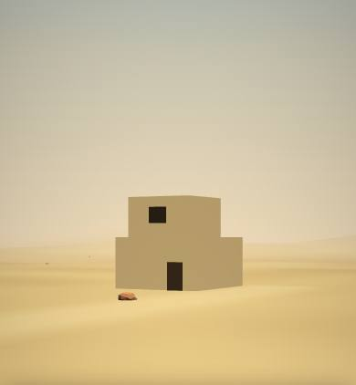
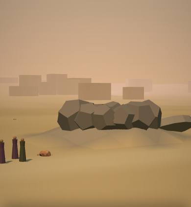
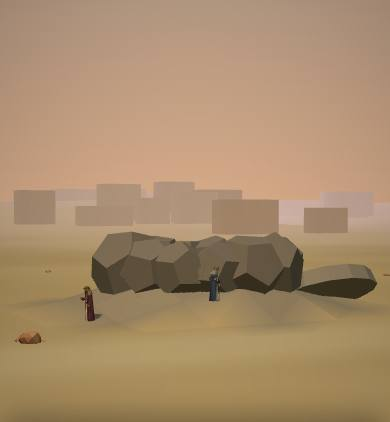

# 감수 자료 · 시대 9. 유다와 포로

자료 판 `a4be56af` · `node tools/make_review_pack.js`가 만든 파일입니다(손으로 고치지 않습니다). 게임에 나오는 문장은 글자 그대로이고, 성경 본문은 싣지 않았습니다(장절만).

#### 시대9·안내 · 시대 안내

*9. 유다와 포로*
- 최현 박사의 통신(탐험대 이야기): 남쪽 유다의 시대야. 멀리 큰 강의 나라도 잡히는구나.
- "이 사이에 성경이 기록한 곳"으로 보여 주는 장절(요약 없이 장절만): 왕하 18:1-12 · 왕하 20:1-21:26 · 왕하 23:4-24:20 · 왕하 25:22-30 · 단 1:1-5:31 · 단 7:1-12:13

표시: ☐ 그대로 ☐ 고침 ☐ 뺌 　적을 칸: 

#### 시대9·마무리 · 마무리(기도·실천)

*이 시대 장면들의 한 문장 기도(8~10세)와 한 주 실천(11~13세). 꼴은 "공통·마무리"에서*
- **OT-33 히스기야의 기도와 앗수르** (왕하 18:13-19:37)
  - 8~10세 기도: 하나님, 히스기야가 편지를 하나님 앞에 펴 놓고 기도한 이야기를 기억하게 해 주세요. 예수님의 이름으로 기도합니다. 아멘.
  - 11~13세 실천: 이번 주에 열왕기하 19장 14절부터 19절까지 소리 내어 읽어 보세요.
  - 14~19세 기록 물음: 왕하 18:13-19:37에서 새로 알게 된 사실을 한 가지 적어 보자.
- **OT-34 요시야와 율법책** (왕하 22:1-23:3)
  - 8~10세 기도: 하나님, 요시야 왕이 율법책의 말씀을 들은 이야기를 기억하게 해 주세요. 예수님의 이름으로 기도합니다. 아멘.
  - 11~13세 실천: 이번 주에 열왕기하 23장 1절부터 3절까지 소리 내어 읽어 보세요.
  - 14~19세 기록 물음: 왕하 22:1-23:3에서 새로 알게 된 사실을 한 가지 적어 보자.
- **OT-35 예루살렘이 무너지고 바벨론으로 끌려감** (왕하 25:1-21)
  - 8~10세 기도: 하나님, 예루살렘이 무너진 이야기를 성경에서 읽고 기억하게 해 주세요. 예수님의 이름으로 기도합니다. 아멘.
  - 11~13세 실천: 이번 주에 열왕기하 25장 8절부터 12절까지 소리 내어 읽어 보세요.
  - 14~19세 기록 물음: 왕하 25:1-21에서 새로 알게 된 사실을 한 가지 적어 보자.
- **OT-36 사자 굴의 다니엘** (단 6:1-28)
  - 8~10세 기도: 하나님, 다니엘이 전에 하던 대로 기도한 이야기를 기억하게 해 주세요. 예수님의 이름으로 기도합니다. 아멘.
  - 11~13세 실천: 이번 주에 다니엘 6장 16절부터 23절까지 소리 내어 읽어 보세요.
  - 14~19세 기록 물음: 단 6:1-28에서 새로 알게 된 사실을 한 가지 적어 보자.

표시: ☐ 그대로 ☐ 고침 ☐ 뺌 　적을 칸: 

### OT-33 히스기야의 기도와 앗수르 (왕하 18:13-19:37)

- 곳: 예루살렘, 여호와의 전
- 감수 필수: 예 — 재앙과 심판(왕하 19:7, 19:28, 19:35-37)
- 화면: 이야기 카드 · 감수 상태: 미감수

#### OT-33·대목 · 대목 글(장면 전체)

*대목 7개* — 왕하 18:13-19:37
- 이 장면에서 검증자가 여쭌 것 4가지는 아래 "검증자가 남긴 것" 항목에 따로 있습니다. 대목 글을 고치실 때는 "대목 몇, 몇 세 글"인지 적어 주세요.
- **대목 1** (왕하 18:13-16)
- 8~10세: 히스기야 왕 때에 앗수르 왕 산헤립이 쳐들어와서 유다의 튼튼한 성읍들을 빼앗았어요. 히스기야는 앗수르 왕에게 은과 금을 주었어요.
- 11~13세: 히스기야 왕 제십사년, 앗수르의 왕 산헤립이 올라와서 유다의 튼튼한 성읍들을 빼앗았어요. 히스기야는 라기스에 있는 앗수르 왕에게 사람을 보내어, 떠나 돌아가 달라고 하며 왕이 지우는 것을 감당하겠다고 했어요. 앗수르 왕은 은 삼백 달란트와 금 삼십 달란트를 내라고 했고, 히스기야는 여호와의 전과 왕궁 곳간의 은을 다 주었어요.
- 14~19세: 히스기야 왕 제십사년, 앗수르의 왕 산헤립이 올라와서 유다의 견고한 성읍들을 모두 쳐서 빼앗았다. 유다 왕 히스기야는 라기스로 사람을 보내어, 자기가 잘못했다고 하며 떠나 돌아가 달라고, 왕이 지우는 것을 감당하겠다고 했다. 앗수르 왕은 은 삼백 달란트와 금 삼십 달란트를 정했다. 히스기야는 여호와의 전에 있던 은과 왕궁 곳간의 은을 모두 내주었고, 여호와의 전 문에서 벗긴 금과 자기가 기둥들에 입혔던 금까지 주었다.
  - 휴의 말: 히스기야 왕 십사년, 앗수르 왕의 이름은 산헤립. 일지에 적어 둘게.
- **대목 2** (왕하 18:17-25)
- 8~10세: 앗수르 왕은 큰 군대를 예루살렘으로 보냈어요. 앗수르 왕이 보낸 랍사게는 히스기야가 무엇을 믿고 있느냐고 물었어요.
- 11~13세: 앗수르 왕은 다르단과 랍사리스와 랍사게를 큰 군대와 함께 라기스에서 예루살렘으로 보냈어요. 그들은 윗못 수도 곁, 세탁자의 밭에 있는 큰 길에 섰어요. 엘리야김과 셉나와 요아가 그들에게 나가자, 랍사게는 히스기야가 누구를 믿고 앗수르 왕을 거역하느냐고 물었어요.
- 14~19세: 앗수르 왕은 다르단과 랍사리스와 랍사게를 큰 군대와 함께 라기스에서 예루살렘으로 보내어 히스기야 왕을 치게 했다. 그들은 윗못 수도 곁, 세탁자의 밭에 있는 큰 길에 이르러 섰고, 왕을 부르자 힐기야의 아들 엘리야김, 서기관 셉나, 아삽의 아들인 사관 요아가 나갔다. 랍사게는 앗수르 왕의 말이라며, 히스기야가 누구를 믿고 거역하느냐고 물었다. 애굽을 믿는 것은 상한 갈대 지팡이에 기대는 것과 같다고 했고, 여호와를 믿는다고 하겠지만 히스기야가 그 산당과 제단을 없애지 않았느냐고 했다.
  - 최온의 말: 큰 군대가 예루살렘 앞 큰 길에 와서 섰어. 성에서 세 사람이 나갔어.
- **대목 3** (왕하 18:26-37)
- 8~10세: 랍사게는 성 위의 백성이 다 듣도록 유다 말로 크게 외치며, 여호와께서 건지신다는 히스기야의 말에 귀 기울이지 말라고 했어요. 백성은 한 마디도 대답하지 않았어요.
- 11~13세: 엘리야김과 셉나와 요아는 성 위의 백성이 듣지 않도록 아람 말로 해 달라고 했어요. 그러나 랍사게는 일어서서 유다 말로 크게 외쳤어요. 히스기야에게 속지 말고, 여호와께서 건지신다는 말도 듣지 말라고 했어요. 백성은 왕이 대답하지 말라고 명했기 때문에 잠잠했어요.
- 14~19세: 엘리야김과 셉나와 요아는 자기들이 알아들으니 아람 말로 하고, 성 위에 있는 백성이 듣는 데서 유다 말로 하지 말아 달라고 했다. 그러나 랍사게는 일어서서 유다 말로 크게 외쳤다. 히스기야에게 속지 말라고, 여호와께서 반드시 건지신다는 말을 듣지 말고 앗수르 왕에게 항복하고 나오라고 했다. 여러 나라의 신들 가운데 누가 자기 땅을 앗수르 왕에게서 건졌느냐고, 그런데 여호와가 예루살렘을 건지겠느냐고도 했다. 백성은 잠잠하여 한 마디도 대답하지 않았는데, 왕이 대답하지 말라고 명했기 때문이다. 세 사람은 옷을 찢고 히스기야에게 가서 랍사게의 말을 전했다.
  - 최온의 말: 저 사람이 크게 외치는데 성 위의 사람들은 아무 대답도 안 해.
- **대목 4** (왕하 19:1-7)
- 8~10세: 히스기야 왕은 그 말을 듣고 옷을 찢고 굵은 베를 두른 채 여호와의 전으로 갔어요. 왕이 보낸 사람들에게 선지자 이사야는 여호와께서 두려워하지 말라고 하셨다고 전했어요.
- 11~13세: 히스기야 왕은 그 말을 듣고 옷을 찢고, 굵은 베를 두르고 여호와의 전으로 들어갔어요. 엘리야김과 셉나와 제사장들 가운데 장로들을 아모스의 아들인 선지자 이사야에게 보내어, 남아 있는 사람들을 위해 기도해 달라고 했어요. 이사야는 여호와의 말씀을 전했어요. 여호와께서는 앗수르 왕의 신하들에게 들은 말 때문에 두려워하지 말라고 하셨고, 앗수르 왕을 자기 나라로 돌아가게 하겠다고 하셨어요.
- 14~19세: 히스기야 왕은 듣고 옷을 찢고, 굵은 베를 두르고 여호와의 전으로 들어갔다. 엘리야김과 셉나와 제사장들 가운데 장로들에게 굵은 베를 입혀 아모스의 아들인 선지자 이사야에게 보내어, 랍사게가 살아 계신 하나님을 훼방했으니 남아 있는 사람들을 위해 기도해 달라고 했다. 이사야는 여호와의 말씀을 전했다. 여호와께서는 앗수르 왕의 신하들이 여호와를 능욕한 말 때문에 두려워하지 말라고 하셨다. 또 앗수르 왕이 풍문을 듣고 자기 나라로 돌아가게 하고, 그 나라에서 칼에 죽게 하겠다고 하셨다.
  - 온우의 말: 이사야가 전한 여호와의 말씀은 19장 6절과 7절에 있어. 성경책에서 직접 읽어 보자.
- **대목 5** (왕하 19:8-19)
- 8~10세: 앗수르 왕이 다시 사람을 보내 편지를 전했어요. 히스기야는 여호와의 전에 올라가 그 편지를 여호와 앞에 펼쳐 놓고 기도했어요.
- 11~13세: 앗수르 왕은 다시 히스기야에게 사자들을 보내어, 히스기야가 믿는 하나님이 예루살렘을 앗수르 왕에게 넘기지 않으신다는 말에 속지 말라고 했어요. 히스기야는 편지를 받아 읽고 여호와의 전에 올라가서 그것을 여호와 앞에 펴 놓았어요. 그리고 여호와만 홀로 하나님이시라고 아뢰며, 앗수르 왕의 손에서 구원해 달라고 기도했어요.
- 14~19세: 랍사게는 돌아가 립나에서 싸우고 있는 앗수르 왕을 만났다. 앗수르 왕은 구스 왕 디르하가가 싸우러 나온다는 말을 듣고 다시 히스기야에게 사자들을 보내어, 네가 믿는 하나님이 예루살렘을 넘겨주지 않는다는 말에 속지 말라고 했다. 히스기야는 사자의 손에서 편지를 받아 읽고 여호와의 전에 올라가 그것을 여호와 앞에 펴 놓고 기도했다. 그는 여호와만 천하 만국에 홀로 하나님이시며 하늘과 땅을 지으신 분이라고 아뢰었다. 앗수르 왕들이 불에 던진 여러 나라의 신들은 사람의 손으로 만든 나무와 돌일 뿐이라고 했다. 그리고 이제 구원해 주셔서 천하 만국이 여호와만 홀로 하나님이신 줄 알게 해 달라고 구했다.
  - 최온의 말: 왕이 편지를 들고 여호와의 전으로 올라갔어. 편지를 펴 놓고 기도해.
- **대목 6** (왕하 19:20-34)
- 8~10세: 이사야는 여호와께서 히스기야의 기도를 들으셨다고 전했어요. 여호와께서는 앗수르 왕이 이 성에 이르지 못할 것이며, 이 성을 지켜 구원하겠다고 하셨어요.
- 11~13세: 아모스의 아들인 선지자 이사야가 히스기야 왕에게 여호와의 말씀을 전했어요. 여호와께서는 히스기야가 앗수르 왕 산헤립 때문에 드린 기도를 들었다고 하셨어요. 앗수르 왕은 이 성에 이르지 못하고 화살도 쏘지 못한 채 오던 길로 돌아갈 것이라고 하셨어요. 여호와께서 이 성을 보호하여 구원하겠다고 하셨어요.
- 14~19세: 아모스의 아들인 이사야가 히스기야 왕에게 사람을 보내어 이스라엘의 하나님 여호와의 말씀을 전했다. 여호와께서는 히스기야가 앗수르 왕 산헤립 때문에 드린 기도를 들었다고 하셨다. 앗수르 왕이 소리를 높여 훼방한 상대는 이스라엘의 거룩한 분이라고 하셨고, 그를 오던 길로 돌이키겠다고 하셨다. 앗수르 왕은 이 성에 이르지 못하고, 화살을 쏘지도 방패를 세우지도 토성을 쌓지도 못한 채 오던 길로 돌아갈 것이라고 하셨다. 여호와께서는 자신을 위하여, 또 자신의 종 다윗을 위하여 이 성을 지키고 구원하겠다고 하셨다.
  - 온우의 말: 여호와께서 이 성을 두고 하신 말씀은 32절부터 34절에 있어. 우리가 지어내지 말고 성경책에서 읽자.
- **대목 7** (왕하 19:35-37)
- 8~10세: 그날 밤, 여호와의 사자가 앗수르 군대의 진을 쳤어요. 앗수르 왕 산헤립은 떠나서 니느웨로 돌아갔어요.
- 11~13세: 그날 밤, 여호와의 사자가 나와, 앗수르 진에 있던 군사 십팔만 오천 명을 쳤어요. 아침 일찍 일어나 보니 그들은 모두 죽어 있었어요. 앗수르 왕 산헤립은 떠나 돌아가서 니느웨에 머물렀어요.
- 14~19세: 그날 밤, 여호와의 사자가 나와, 앗수르 진에 있던 군사 십팔만 오천 명을 쳤다. 아침 일찍 일어나 보니 그들은 모두 죽어 있었다. 앗수르 왕 산헤립은 떠나 돌아가서 니느웨에 머물렀다. 그가 자기 신 니스록에게 경배하고 있을 때 아드람멜렉과 사레셀이 그를 칼로 쳐 죽이고 아라랏 땅으로 달아났고, 그의 아들 에살핫돈이 뒤를 이어 왕이 되었다.
  - 휴의 말: 밤에 일어난 일이고, 산헤립이 돌아간 곳은 니느웨야. 순서대로 적어 둘게.

표시: ☐ 그대로 ☐ 고침 ☐ 뺌 　적을 칸: 

#### OT-33·동행1 · 동행 인물 문답

*이사야에게 묻기* — 왕하 19:6-7
- 동행 인물: 이사야 (이 자리에 있다는 근거 왕하 19:2, 사건과 관문 뒤에 문답)
- 최온의 물음: 이사야 선지자님, 히스기야 왕이 보낸 사람들에게 뭐라고 전하셨어요?
- 답 8~10세: 이사야는 여호와께서 앗수르 사람들이 한 말 때문에 두려워하지 말라고 하셨다고 전했어요.
- 답 11~13세: 이사야는 신하들에게, 그들의 주인에게 여호와의 말씀을 전하라고 했어요. 여호와께서 앗수르 왕의 신하들이 여호와를 욕한 말 때문에 두려워하지 말라고 하셨고, 앗수르 왕이 소문을 듣고 자기 나라로 돌아가게 하겠다고 하셨다고 전했어요.
- 답 14~19세: 이사야는 신하들에게, 그들의 주인에게 여호와의 말씀을 이렇게 알리라고 했다. 여호와께서는 앗수르 왕의 신하들이 여호와를 능욕한 말 때문에 두려워하지 말라고 하셨다. 또 앗수르 왕에게 한 영을 두어, 그가 풍문을 듣고 본국으로 돌아가게 하고 그 나라에서 칼에 쓰러지게 하겠다고 하셨다고 전했다.
- 아이가 펼 곳: 왕하 19:6

표시: ☐ 그대로 ☐ 고침 ☐ 뺌 　적을 칸: 

#### OT-33·동행2 · 동행 인물 문답

*이사야에게 묻기* — 왕하 19:20-34
- 동행 인물: 이사야 (이 자리에 있다는 근거 왕하 19:2, 사건과 관문 뒤에 문답)
- 휴의 물음: 히스기야 왕이 편지를 펴 놓고 기도한 다음에는 무엇을 전하셨어요?
- 답 8~10세: 이사야는 여호와께서 히스기야의 기도를 들으셨다고 전했어요. 앗수르 왕은 이 성에 들어오지 못하고, 여호와께서 이 성을 지켜 구원하시겠다고 하셨다고 전했어요.
- 답 11~13세: 이사야는 히스기야에게 사람을 보내어, 여호와께서 산헤립 때문에 드린 기도를 들으셨다고 전했어요. 앗수르 왕은 이 성에 이르지 못하고 화살도 쏘지 못한 채 오던 길로 돌아갈 것이라고 하셨대요. 여호와께서 자신과 종 다윗을 위하여 이 성을 지켜 구원하시겠다고 하셨다고 전했어요.
- 답 14~19세: 이사야는 히스기야에게 기별하여, 이스라엘의 하나님 여호와께서 산헤립 때문에 드린 기도를 들으셨다고 전했다. 여호와께서는 앗수르 왕이 이 성에 이르지 못하고, 화살을 쏘지도 방패를 세우지도 토성을 쌓지도 못한 채 오던 길로 돌아가리라고 하셨다. 또 자신을 위하여, 그리고 자신의 종 다윗을 위하여 이 성을 지켜 구원하시겠다고 하셨다고 전했다.
- 아이가 펼 곳: 왕하 19:34

표시: ☐ 그대로 ☐ 고침 ☐ 뺌 　적을 칸: 

#### OT-33·동행3 · 동행 인물 문답

*이사야에게 묻기* — 왕하 19:29-31
- 동행 인물: 이사야 (이 자리에 있다는 근거 왕하 19:2, 사건과 관문 뒤에 문답)
- 온우의 물음: 전하신 말씀 가운데 징조에 관한 것도 있었어요? 성경책에서 찾아보고 싶어요.
- 답 8~10세: 이사야는 여호와께서 징조를 말씀하셨다고 전했어요. 올해와 다음 해에는 저절로 난 것을 먹고, 셋째 해에는 심고 거두어 먹게 된다고 하셨대요.
- 답 11~13세: 이사야는 여호와께서 징조를 말씀하셨다고 전했어요. 올해에는 저절로 자라난 것을, 다음 해에는 거기서 다시 난 것을 먹고, 셋째 해에는 심고 거두며 포도원을 가꾸어 그 열매를 먹게 된다고 하셨어요. 또 유다 집안에서 피하여 남은 사람들이 다시 아래로 뿌리를 내리고 위로 열매를 맺을 것이라고 하셨다고 전했어요.
- 답 14~19세: 이사야는 여호와께서 보이실 징조를 말씀하셨다고 전했다. 그해에는 저절로 자라난 것을, 이듬해에는 거기서 다시 난 것을 먹고, 셋째 해에는 심고 거두며 포도원을 가꾸어 그 열매를 먹으리라는 것이었다. 또 유다 집안에서 피하여 남은 사람들이 다시 아래로 뿌리를 내리고 위로 열매를 맺을 것이며, 남은 사람들이 예루살렘과 시온 산에서 나올 것이라고 하셨다. 여호와의 열심이 이 일을 이루시리라고 하셨다고 전했다.
- 아이가 펼 곳: 왕하 19:29

표시: ☐ 그대로 ☐ 고침 ☐ 뺌 　적을 칸: 

#### OT-33·돕기1 · 손으로 하는 돕기

*성 위의 백성 곁에서 자리 내어 주기* — 왕하 18:26
- 돕는 상대: 예루살렘 성 위의 백성
- 8~10세: 성 위에는 백성이 있어요. 성경에 적힌 일은 아니지만, 우리는 그 곁에서 사람들이 앉고 지나다닐 자리를 내어 주며 도와요.
- 11~13세: 앗수르 군대가 큰 길에 와 서 있고, 성 위에는 백성이 있어요. 이것은 성경에 적힌 일이 아니라 탐험대가 곁에서 거드는 일이에요. 우리는 백성이 앉고 지나다닐 자리를 내어 주며 조용히 도와요.
- 14~19세: 앗수르 군대가 윗못 수도 곁 큰 길에 와 서 있고(18:17), 성 위에는 백성이 있다(18:26). 탐험대는 그 곁에서 백성이 앉고 지나다닐 자리를 내어 주며 조용히 거든다. 본문에 적힌 일이 아니라 탐험대의 일이며, 왕의 신하들과 랍사게가 나누는 말에는 끼지 않는다.
  - 누르는 일 1: 지나다니는 사람에게 비켜서기
  - 누르는 일 2: 앉을 자리 내어 드리기
  - 누르는 일 3: 백성 곁에 조용히 서기
  - 마친 뒤 휴의 말: 자리를 다 내어 드렸어. 이제 성 위 사람들 곁에 조용히 있자.

표시: ☐ 그대로 ☐ 고침 ☐ 뺌 　적을 칸: 

#### OT-33·뜻 · 뜻 묻기

*성 위에서 들은 말의 뜻* — 왕하 19:21-28
- 온우의 물음: 이사야 선지자님, 랍사게가 성 위의 사람들에게 외친 말은 하나님 앞에서 어떤 말이었어요?
- 답하는 사람: 이사야
- 답 8~10세: 이사야는 여호와께서 앗수르 왕을 두고 하신 말씀을 전했어요. 앗수르 왕이 꾸짖고 훼방한 분은 이스라엘의 거룩하신 분이라고 하셨대요. 그 교만한 말이 여호와께 들렸으니 그를 오던 길로 돌려보내겠다고 하셨다고 전했어요.
- 답 11~13세: 이사야는 여호와께서 앗수르 왕을 두고 하신 말씀을 히스기야에게 전했어요. 앗수르 왕이 소리를 높여 꾸짖고 훼방한 상대는 이스라엘의 거룩하신 분이라고 하셨어요. 그리고 그가 여호와께 품은 분노와 교만한 말이 여호와의 귀에 들렸으니, 그를 오던 길로 돌려보내겠다고 하셨다고 전했어요.
- 답 14~19세: 이사야는 여호와께서 앗수르 왕을 두고 하신 말씀을 히스기야에게 전했다(19:20-21). 여호와께서는 앗수르 왕이 누구를 꾸짖고 훼방했으며 누구를 향해 소리를 높였느냐고 물으시고, 이스라엘의 거룩하신 분께 그리하였다고 하셨다(19:22). 또 그가 여호와께 품은 분노와 교만한 말이 여호와의 귀에 들렸으므로 그를 오던 길로 돌려보내겠다고 하셨다고 전했다(19:28).
- **성경을 펴서 뜻 확인하기**
- 8~10세 · 찾아 읽고 고르기: 성경책에서 열왕기하 19장 22절을 찾아 읽어 보세요. (왕하 19:22)
  - 물음: 앗수르 왕이 소리를 높여 훼방한 상대는 누구라고 하셨나요?
  - 맞는 보기: 이스라엘의 거룩하신 분
  - 다른 보기: 바벨론 왕 (본문에 없음)
  - 다른 보기: 애굽 왕 바로 (왕하 18:21)
- 11~13세 · 찾아 읽고 고르기: 성경책에서 열왕기하 19장 27절과 28절을 읽어 보세요. (왕하 19:27-28)
  - 물음: 여호와께서 앗수르 왕을 오던 길로 돌려보내겠다고 하신 까닭은 무엇인가요?
  - 맞는 보기: 앗수르 왕이 여호와께 품은 분노와 교만한 말이 여호와의 귀에 들렸기 때문에
  - 다른 보기: 앗수르 왕이 히스기야에게서 은과 금을 더 받았기 때문에 (본문에 없음)
  - 다른 보기: 앗수르 왕의 군대가 길을 잃었기 때문에 (본문에 없음)
- 14~19세 · 찾아 읽고 고르기: 열왕기하 18장 35절, 19장 4절, 19장 22절을 함께 찾아 읽어 보자. (왕하 18:35 · 왕하 19:4 · 왕하 19:22)
  - 물음: 세 곳을 이어 읽으면, 랍사게와 앗수르 왕의 말은 누구를 향한 것이었다고 성경은 말하는가?
  - 맞는 보기: 랍사게는 여호와께서도 예루살렘을 건지지 못하신다고 했고, 히스기야는 그것을 살아 계신 하나님을 훼방한 말이라고 했으며, 여호와께서도 앗수르 왕이 이스라엘의 거룩하신 분을 훼방했다고 하셨다
  - 다른 보기: 랍사게의 말은 히스기야 한 사람만을 향한 말이었고, 여호와께서는 그 말에 대해 아무 말씀도 하지 않으셨다 (본문에 없음)
  - 다른 보기: 히스기야는 랍사게의 말이 옳다고 하며 앗수르 왕에게 항복하겠다고 했다 (본문에 없음)

표시: ☐ 그대로 ☐ 고침 ☐ 뺌 　적을 칸: 

#### OT-33·오늘1 · 오늘의 물음

*최현 박사가 답함* — 왕하 19:20 · 왕하 20:1 · 왕하 20:5
- 물음: 하나님은 사람이 드리는 기도를 들으세요?
- 답 8~10세: 이사야는 여호와께서 히스기야의 기도를 들으셨다고 전했어요. 히스기야가 병들었을 때에도 여호와께서 그의 기도를 들으셨다고 하셨어요.
- 답 11~13세: 열왕기하는 히스기야가 앗수르 왕의 편지를 여호와 앞에 펴 놓고 기도하자, 여호와께서 그 기도를 들으셨다는 말씀을 이사야가 전했다고 적어요. 히스기야가 병들었을 때에도 여호와께서는 그의 기도를 듣고 눈물을 보셨다고 하셨어요. 성경이 이 두 일에서 말하는 것은 여기까지예요.
- 답 14~19세: 열왕기하 19장에서 이사야는, 히스기야가 산헤립 때문에 드린 기도를 여호와께서 들으셨다는 말씀을 전했다. 20장에서도 여호와께서는 이사야를 다시 보내어, 병든 히스기야에게 그의 기도를 듣고 눈물을 보았으니 그를 낫게 하겠다고 하셨다. 이 두 본문은 히스기야의 기도에 대해 말한다. 성경은 여기까지 말한다.

표시: ☐ 그대로 ☐ 고침 ☐ 뺌 　적을 칸: 

#### OT-33·오늘2 · 오늘의 물음

*최현 박사가 답함* — 왕하 19:15 · 왕하 19:18-19
- 물음: 사람이 나무나 돌로 만든 것도 신이 될 수 있어요?
- 답 8~10세: 히스기야는 기도하면서, 그런 신들은 신이 아니라 사람이 손으로 만든 나무와 돌이라고 아뢰었어요. 그리고 여호와는 하늘과 땅을 지으신 분이라고 아뢰었어요.
- 답 11~13세: 히스기야는 여호와께 기도하면서, 앗수르 왕들이 여러 나라의 신들을 불에 던져 없앤 것은 그것들이 신이 아니라 사람의 손으로 만든 나무와 돌이었기 때문이라고 아뢰었어요. 그리고 여호와만 천하 만국에 홀로 하나님이시며 하늘과 땅을 지으셨다고 아뢰었어요.
- 답 14~19세: 히스기야의 기도에 따르면, 앗수르 왕들이 여러 나라의 신들을 불에 던져 없앤 것은 그것들이 신이 아니고 사람의 손으로 만든 나무와 돌일 뿐이었기 때문이다. 히스기야는 여호와만 천하 만국에 홀로 하나님이시고 하늘과 땅을 지으신 분이라고 아뢰며, 천하 만국이 이것을 알게 해 달라고 구했다. 성경은 여기까지 말한다.

표시: ☐ 그대로 ☐ 고침 ☐ 뺌 　적을 칸: 

#### OT-33·화면 · 화면 원칙

*이야기 카드 장면: 하나님 표현과 그리지 않는 것* — 왕하 18:13-19:37
- 하나님 표현: 말씀 자막만. 여호와의 말씀은 선지자 이사야가 전한 말로 온다(왕하 19:6-7, 19:20-34). 이 본문에는 불·구름·빛이 없으므로 만들지 않는다. 형상 없음. 음성은 소리로 만들지 않음
  - 그리지 않는 것: 하나님의 형상, 여호와의 사자(천사)의 형상, 앗수르 진에 내리는 빛이나 칼(왕하 19:35는 글로만)
  - 그리지 않는 것: 앗수르 진의 주검, 피, 쓰러지는 군사(왕하 19:35는 글로만 담담하게)
  - 그리지 않는 것: 산헤립이 칼에 죽는 모습(왕하 19:37은 글로만)
  - 그리지 않는 것: 랍사게의 거친 말(왕하 18:27)을 글이나 그림으로 옮기는 것
  - 그리지 않는 것: 성 위의 백성이 랍사게에게 대꾸하거나 야유하는 모습(왕하 18:36에서 백성은 대답하지 않았다)
  - 그리지 않는 것: 히스기야가 기도할 때의 자세나 표정, 눈물(본문은 편지를 펴 놓고 기도했다고만 적는다, 왕하 19:14-15)
  - 그리지 않는 것: 여호와의 전 안의 언약궤와 그룹을 그리는 것(왕하 19:15는 기도의 말로만)
  - 그리지 않는 것: 앗수르 군대가 예루살렘 성을 향해 활을 쏘거나 토성을 쌓는 모습(왕하 19:32)
  - 그리지 않는 것: 심판의 까닭이나 뜻을 풀이하는 글이나 그림(감수 전)
  - 그리지 않는 것: 세 아이가 왕이나 선지자, 군사에게 말을 걸거나 사건에 끼어드는 것(목격자다)

표시: ☐ 그대로 ☐ 고침 ☐ 뺌 　적을 칸: 

#### OT-33·미해결1 · 검증자가 남긴 것

*11세 이상 글에 군사 18만 5천 명과 산헤립의 죽음(왕하 19:35, 19:37)을 그대로 둘까요?*
- 검증 기록(OT-33 히스기야의 기도와 앗수르): 11~13세와 14~19세 대목 7에 십팔만 오천 명이 죽은 사실(19:35)이, 14~19세 대목 4와 7에 산헤립이 칼에 죽게 된다는 말씀과 그 일(19:7, 19:37)이 본문대로 들어 있다. 묘사는 없다. 8~10세 문장에는 죽음이 없다. 이 수위는 감수 때 정한다(감수 필수 주제: 심판).
  - 지금 게임의 글 · 대목 7 · 11~13세: 그날 밤, 여호와의 사자가 나와, 앗수르 진에 있던 군사 십팔만 오천 명을 쳤어요. 아침 일찍 일어나 보니 그들은 모두 죽어 있었어요. 앗수르 왕 산헤립은 떠나 돌아가서 니느웨에 머물렀어요.
  - 지금 게임의 글 · 대목 7 · 14~19세: 그날 밤, 여호와의 사자가 나와, 앗수르 진에 있던 군사 십팔만 오천 명을 쳤다. 아침 일찍 일어나 보니 그들은 모두 죽어 있었다. 앗수르 왕 산헤립은 떠나 돌아가서 니느웨에 머물렀다. 그가 자기 신 니스록에게 경배하고 있을 때 아드람멜렉과 사레셀이 그를 칼로 쳐 죽이고 아라랏 땅으로 달아났고, 그의 아들 에살핫돈이 뒤를 이어 왕이 되었다.
  - 지금 게임의 글 · 대목 4 · 14~19세: 히스기야 왕은 듣고 옷을 찢고, 굵은 베를 두르고 여호와의 전으로 들어갔다. 엘리야김과 셉나와 제사장들 가운데 장로들에게 굵은 베를 입혀 아모스의 아들인 선지자 이사야에게 보내어, 랍사게가 살아 계신 하나님을 훼방했으니 남아 있는 사람들을 위해 기도해 달라고 했다. 이사야는 여호와의 말씀을 전했다. 여호와께서는 앗수르 왕의 신하들이 여호와를 능욕한 말 때문에 두려워하지 말라고 하셨다. 또 앗수르 왕이 풍문을 듣고 자기 나라로 돌아가게 하고, 그 나라에서 칼에 죽게 하겠다고 하셨다.
  - 지금 게임의 글 · 동행 문답 1 · 답 · 14~19세: 이사야는 신하들에게, 그들의 주인에게 여호와의 말씀을 이렇게 알리라고 했다. 여호와께서는 앗수르 왕의 신하들이 여호와를 능욕한 말 때문에 두려워하지 말라고 하셨다. 또 앗수르 왕에게 한 영을 두어, 그가 풍문을 듣고 본국으로 돌아가게 하고 그 나라에서 칼에 쓰러지게 하겠다고 하셨다고 전했다.

표시: ☐ 지금대로 ☐ 바꿈 ☐ 의논 필요 　적을 칸: 

#### OT-33·미해결2 · 검증자가 남긴 것

*왕하 19:37의 두 사람이 산헤립의 아들이라는 말을 넣지 않고 그대로 둘까요?*
- 검증 기록(OT-33 히스기야의 기도와 앗수르): 19:37에서 KJV는 아드람멜렉과 사레셀을 산헤립의 아들들이라고 하나, 개역한글에는 그 말이 없다. 자료는 한국어 성경을 따라 두 사람의 관계를 적지 않았다. 덧붙일지는 감수 때 정한다.
  - 지금 게임의 글 · 대목 7 · 14~19세: 그날 밤, 여호와의 사자가 나와, 앗수르 진에 있던 군사 십팔만 오천 명을 쳤다. 아침 일찍 일어나 보니 그들은 모두 죽어 있었다. 앗수르 왕 산헤립은 떠나 돌아가서 니느웨에 머물렀다. 그가 자기 신 니스록에게 경배하고 있을 때 아드람멜렉과 사레셀이 그를 칼로 쳐 죽이고 아라랏 땅으로 달아났고, 그의 아들 에살핫돈이 뒤를 이어 왕이 되었다.

표시: ☐ 지금대로 ☐ 바꿈 ☐ 의논 필요 　적을 칸: 

#### OT-33·미해결3 · 검증자가 남긴 것

*랍사게가 외칠 때 아이들이 성 위 백성 곁에 있는 설정(왕하 18:26-36)을 둘까요?*
- 검증 기록(물음의 세 단계·현장 돕기): 아이들이 랍사게가 외치는 동안 성 위의 백성 곁에 머무는 설정(18:26-36). 13.6의 머물기로는 맞으나 포위된 성이라는 자리를 목회자가 확인한다.
  - 지금 게임의 글 · 현장 돕기 단계 2 · 제목: 성 위에서 함께 잠잠히
  - 지금 게임의 글 · 현장 돕기 단계 2 · 8~10세: 랍사게가 성 위의 백성에게 유다 말로 크게 외쳤어요. 백성은 한 마디도 대답하지 않아요. 우리도 그들 곁에서 함께 잠잠히 있어요.
  - 지금 게임의 글 · 현장 돕기 단계 2 · 11~13세: 랍사게가 성 위의 백성이 다 듣도록 유다 말로 크게 외쳤어요. 백성은 잠잠하고 한 마디도 대답하지 않아요. 우리도 성 위의 백성 곁에서 아무 말도 하지 않고 함께 있어요.
  - 지금 게임의 글 · 현장 돕기 단계 2 · 14~19세: 랍사게는 성 위의 백성이 듣는 데서 유다 말로 크게 외쳤다(18:26-28). 백성은 잠잠했고 한 마디도 대답하지 않았다(18:36). 탐험대도 성 위의 백성 곁에서 아무 말 없이 함께 머문다.
  - 지금 게임의 글 · 현장 돕기 단계 1 · 제목: 성 위의 백성 곁에서 자리 내어 주기
  - 지금 게임의 글 · 현장 돕기 단계 1 · 8~10세: 성 위에는 백성이 있어요. 성경에 적힌 일은 아니지만, 우리는 그 곁에서 사람들이 앉고 지나다닐 자리를 내어 주며 도와요.

표시: ☐ 지금대로 ☐ 바꿈 ☐ 의논 필요 　적을 칸: 

#### OT-33·미해결4 · 검증자가 남긴 것

*앗수르 왕을 향한 심판의 말씀과 그 까닭(왕하 19:22, 19:28)을 묻고 답하게 둘까요?*
- 검증 기록(물음의 세 단계·현장 돕기): 뜻 묻기가 앗수르 왕에 대한 심판의 말씀(19:22, 19:28)을 담고, 11~13세 성경 읽기가 그 까닭(19:28)을 묻는다. 본문의 말 그대로이지만 그리지 않는 것 목록의 "심판의 까닭이나 뜻을 풀이하는 글(감수 전)"에 닿는다.
  - 지금 게임의 글 · 현장 돕기 단계 4 · 뜻 묻기의 답 · 8~10세: 이사야는 여호와께서 앗수르 왕을 두고 하신 말씀을 전했어요. 앗수르 왕이 꾸짖고 훼방한 분은 이스라엘의 거룩하신 분이라고 하셨대요. 그 교만한 말이 여호와께 들렸으니 그를 오던 길로 돌려보내겠다고 하셨다고 전했어요.
  - 지금 게임의 글 · 현장 돕기 단계 4 · 뜻 묻기의 답 · 11~13세: 이사야는 여호와께서 앗수르 왕을 두고 하신 말씀을 히스기야에게 전했어요. 앗수르 왕이 소리를 높여 꾸짖고 훼방한 상대는 이스라엘의 거룩하신 분이라고 하셨어요. 그리고 그가 여호와께 품은 분노와 교만한 말이 여호와의 귀에 들렸으니, 그를 오던 길로 돌려보내겠다고 하셨다고 전했어요.
  - 지금 게임의 글 · 현장 돕기 단계 4 · 뜻 묻기의 답 · 14~19세: 이사야는 여호와께서 앗수르 왕을 두고 하신 말씀을 히스기야에게 전했다(19:20-21). 여호와께서는 앗수르 왕이 누구를 꾸짖고 훼방했으며 누구를 향해 소리를 높였느냐고 물으시고, 이스라엘의 거룩하신 분께 그리하였다고 하셨다(19:22). 또 그가 여호와께 품은 분노와 교만한 말이 여호와의 귀에 들렸으므로 그를 오던 길로 돌려보내겠다고 하셨다고 전했다(19:28).
  - 지금 게임의 글 · 현장 돕기 단계 4 · 성경 읽기 물음 · 11~13세: 여호와께서 앗수르 왕을 오던 길로 돌려보내겠다고 하신 까닭은 무엇인가요?
  - 지금 게임의 글 · 현장 돕기 단계 4 · 성경 읽기 물음의 보기 · 11~13세: 앗수르 왕이 여호와께 품은 분노와 교만한 말이 여호와의 귀에 들렸기 때문에
  - 지금 게임의 글 · 그리지 않는 것: 심판의 까닭이나 뜻을 풀이하는 글이나 그림(감수 전)

표시: ☐ 지금대로 ☐ 바꿈 ☐ 의논 필요 　적을 칸: 

#### OT-33·기타 · 그 밖의 글(참고) · 참고

*통신·재료·관문·탐지기 물음·곁에서 보기·말씀 카드* — 왕하 18:13-19:37
- **최현 박사의 통신(탐험대 이야기)**
- 8~10세: 여기는 예루살렘이에요. 비상 착륙하면서 냉각수가 다 새어 버렸어요. 기계를 식힐 물을 구해 주세요.
- 11~13세: 타임머신이 유다의 예루살렘 가까이에 비상 착륙했어요. 냉각수가 새어 나가서 기계가 뜨거워지고 있어요. 이 시대에는 냉각수가 없으니, 그곳에서 구할 수 있는 물로 대신 채워야 해요.
- 14~19세: 타임머신은 예루살렘 가까이에 비상 착륙했다. 냉각수가 새어 나가 기관이 달아오르고 있다. 이 시대에는 냉각수가 없으니 그곳에서 얻을 수 있는 물로 대신 채워야 한다. 성 위의 백성 곁에서 거들 일이 있어도, 왕과 신하들과 군사들의 일에는 끼어들지 말고 지켜보아야 한다.
- **수리 재료(탐험대 이야기)**
- 재료: 윗못 물 (왕하 18:17)
  - 박사의 말: 윗못 수도의 물을 냉각수 대신 쓸 수 있어요.
  - 얻는 방법: 앗수르 사람들이 서 있던 큰 길에서 멀리 떨어진 곳까지 수도를 따라가서, 흐르는 물을 가져간 빈 통에 조금 받았다. 다른 사람이 길어 둔 물에는 손대지 않았다.
  - 얻었을 때 아이의 말: 물을 받았어! 큰 길에서 멀리 떨어진 윗못 수도에서 떴어.
- **관문 물음**
- 관문 1 8~10세 · 찾아 읽고 고르기: 성경책에서 열왕기하 18장 13절을 찾아 읽어 보세요. (왕하 18:13)
  - 물음: 산헤립이 쳐들어왔을 때 유다를 다스리던 왕은 누구였나요?
  - 맞는 보기: 히스기야
  - 다른 보기: 요시야 (왕하 22:1)
  - 다른 보기: 다윗 (삼하 5:4)
- 관문 2 8~10세 · 여러 개 고르기: 성경책에서 열왕기하 19장 1절을 찾아 읽어 보세요. (왕하 19:1)
  - 물음: 히스기야 왕이 그 말을 듣고 한 일을 모두 고르세요.
  - 맞는 보기: 옷을 찢었어요
  - 맞는 보기: 굵은 베를 입었어요
  - 다른 보기: 편지를 여호와 앞에 펼쳐 두었어요 (왕하 19:14)
  - 맞는 보기: 여호와의 전으로 갔어요
  - 다른 보기: 성 위에 올라가 랍사게에게 대답했어요 (본문에 없음)
- 관문 1 11~13세 · 찾아 읽고 고르기: 성경책에서 열왕기하 18장 28절부터 36절까지 읽어 보세요. (왕하 18:28-36)
  - 물음: 랍사게가 유다 말로 크게 외칠 때, 성 위의 백성이 한 마디도 대답하지 않은 까닭은 무엇인가요?
  - 맞는 보기: 왕이 대답하지 말라고 명령했기 때문에
  - 다른 보기: 랍사게의 말을 알아듣지 못했기 때문에 (본문에 없음)
  - 다른 보기: 모두 성 안 깊은 곳에 숨어 있었기 때문에 (본문에 없음)
- 관문 2 11~13세 · 순서 맞추기: 성경책에서 열왕기하 19장 8절부터 15절까지 읽고, 일어난 차례대로 눌러 보세요. (왕하 19:8-15)
  - 차례 1: 랍사게가 립나에서 싸우고 있는 앗수르 왕을 만났다
  - 차례 2: 구스 왕 디르하가가 싸우러 나온다는 소식이 앗수르 왕에게 들렸다
  - 차례 3: 앗수르 왕이 사자들을 다시 보내 히스기야에게 말을 전하게 했다
  - 차례 4: 히스기야가 사자에게서 편지를 받아 읽었다
  - 차례 5: 히스기야는 그 편지를 펴 놓고 여호와께 기도했다
- 관문 1 14~19세 · 찾아 읽고 고르기: 열왕기하 18장 30절, 19장 10절, 19장 34절을 함께 찾아 읽어 보자. (왕하 18:30 · 왕하 19:10 · 왕하 19:34)
  - 물음: 랍사게의 말과 앗수르 왕의 편지, 그리고 이사야가 전한 여호와의 말씀을 이어 읽으면 무엇이 보이는가?
  - 맞는 보기: 앗수르 쪽은 여호와께서 이 성을 건지신다는 말을 듣지 말고, 하나님이 이 성을 넘기지 않으신다는 말에 속지 말라고 했지만, 여호와께서는 이 성을 지켜 구원하시겠다고 하셨다
  - 다른 보기: 앗수르 쪽도 여호와께서 이 성을 지키실 것이라고 인정했다 (본문에 없음)
  - 다른 보기: 여호와께서는 이 성을 앗수르 왕에게 넘기겠다고 하셨다 (본문에 없음)
- 관문 2 14~19세 · 구절과 내용 잇기: 열왕기하 18장 14절, 17절, 19장 33절, 36절을 찾아 읽고, 구절마다 맞는 내용을 이어 보자. (왕하 18:14 · 왕하 18:17 · 왕하 19:33 · 왕하 19:36)
  - 잇기: 히스기야가 앗수르 왕에게 떠나 돌아가 달라고 청했다 (왕하 18:14)
  - 잇기: 앗수르 왕이 큰 군대를 라기스에서 예루살렘으로 보냈다 (왕하 18:17)
  - 잇기: 여호와께서 앗수르 왕이 이 성에 이르지 못하고 오던 길로 돌아가리라고 하셨다 (왕하 19:33)
  - 잇기: 산헤립은 니느웨로 돌아가 거기 머물렀다 (왕하 19:36)
  - 이은 뒤 글: 네 곳을 이으면, 히스기야가 떠나 달라고 청한 뒤에도 앗수르 왕은 큰 군대를 보냈지만, 여호와께서는 그가 오던 길로 돌아가리라고 하셨고 산헤립은 니느웨로 돌아갔다.
- **곁에서 보기 · 함께 머물기**
- 머물기: 성 위에서 함께 잠잠히 (왕하 18:36)
  - 8~10세: 랍사게가 성 위의 백성에게 유다 말로 크게 외쳤어요. 백성은 한 마디도 대답하지 않아요. 우리도 그들 곁에서 함께 잠잠히 있어요.
  - 11~13세: 랍사게가 성 위의 백성이 다 듣도록 유다 말로 크게 외쳤어요. 백성은 잠잠하고 한 마디도 대답하지 않아요. 우리도 성 위의 백성 곁에서 아무 말도 하지 않고 함께 있어요.
  - 14~19세: 랍사게는 성 위의 백성이 듣는 데서 유다 말로 크게 외쳤다(18:26-28). 백성은 잠잠했고 한 마디도 대답하지 않았다(18:36). 탐험대도 성 위의 백성 곁에서 아무 말 없이 함께 머문다.
  - 단추 글: 함께 잠잠히 있기
  - 최온의 말: 우리도 아무 말 안 할게. 성 위의 사람들 곁에 가만히 있자.
- 보기: 곁에서 보기 · 굵은 베를 입고 가는 사람들 (왕하 19:2)
  - 8~10세: 엘리야김과 셉나와 제사장들 가운데 장로들이 굵은 베를 입고 선지자 이사야에게 가요. 히스기야 왕이 보낸 사람들이에요. 우리는 따라가지 않고 곁에서 봐요.
  - 11~13세: 히스기야 왕은 엘리야김과 셉나와 제사장들 가운데 장로들을 굵은 베 차림으로 선지자 이사야에게 보냈어요. 이사야에게 왕의 말을 전하는 일은 왕이 보낸 사람들이 해요. 우리는 따라가지 않고 곁에서 봐요.
  - 14~19세: 히스기야는 엘리야김과 서기관 셉나, 제사장 가운데 장로들을 굵은 베를 입힌 채 선지자 이사야에게 보냈다(19:2). 이사야에게 왕의 말을 전하는 일은 왕이 보낸 사람들의 일이다. 탐험대는 따라가지 않고 곁에서 본다.
  - 휴의 말: 굵은 베를 입은 사람들이 이사야에게 갔어. 누가 갔는지 일지에 적어 둘게.
- **말씀 카드**
- 카드: 홀로 하나님이신 여호와 (왕하 19:15)
- 카드: 이 성을 보호하여 구원하시겠다는 말씀 (왕하 19:34)
- **곳과 사람(설계 메모, 화면에 그릴 때의 근거)**
- 곳: 예루살렘, 여호와의 전
- 곳(설계): 예루살렘(왕하 18:17), 윗못 수도 곁 세탁자의 밭에 있는 큰 길(왕하 18:17), 여호와의 전(왕하 19:1, 19:14)
- 땅: 성 위에 백성이 있는 예루살렘 성(왕하 18:26)과 그 앞의 큰 길(왕하 18:17). 히스기야가 '올라간' 여호와의 전(왕하 19:14). 본문은 성과 길, 앗수르 진의 생김새와 크기를 말하지 않는다
  - 사람: 유다 왕 히스기야(왕하 18:13-14)
  - 사람: 앗수르 왕이 보낸 다르단, 랍사리스, 랍사게와 큰 군대(왕하 18:17)
  - 사람: 힐기야의 아들 엘리야김, 서기관 셉나, 아삽의 아들 사관 요아(왕하 18:18)
  - 사람: 성 위에 있는 백성(왕하 18:26, 18:36)
  - 사람: 제사장들 가운데 장로들(왕하 19:2)
  - 사람: 아모스의 아들 선지자 이사야(왕하 19:2, 19:20)
  - 사람: 앗수르 왕의 사자들(왕하 19:9, 19:14)
  - 사람: 앗수르 왕 산헤립은 라기스와 립나, 니느웨에 있다(왕하 18:14, 19:8, 19:36). 예루살렘 앞에는 세우지 않는다
  - 물건: 히스기야와 신하들이 입은 굵은 베, 찢은 옷(왕하 18:37, 19:1-2)
  - 물건: 앗수르 왕의 편지(왕하 19:14)
  - 물건: 여호와의 전 문과 기둥(왕하 18:16). 금을 벗기는 모습은 그리지 않아도 된다
  - 물건: 상한 갈대 지팡이, 말 이천 필, 포도와 무화과는 랍사게의 말 속에만 나온다(왕하 18:21, 18:23, 18:31). 물건으로 만들지 않는다
  - 절정 장면: 3D로 만들지 않고 이야기 카드로 잇는 장면

### OT-34 요시야와 율법책 (왕하 22:1-23:3)

- 곳: 예루살렘, 여호와의 전
- 감수 필수: 아니오
- 화면: 이야기 카드 · 감수 상태: 미감수

#### OT-34·대목 · 대목 글(장면 전체) · 참고

*대목 7개* — 왕하 22:1-23:3
- 이 장면에서 검증자가 여쭌 것 3가지는 아래 "검증자가 남긴 것" 항목에 따로 있습니다. 대목 글을 고치실 때는 "대목 몇, 몇 세 글"인지 적어 주세요.
- **대목 1** (왕하 22:1-2)
- 8~10세: 요시야는 여덟 살에 왕이 되었어요. 요시야는 여호와께서 보시기에 바르게 행했어요.
- 11~13세: 요시야는 여덟 살에 왕이 되어 예루살렘에서 삼십일 년 동안 다스렸어요. 그는 여호와께서 보시기에 바르게 행했고, 조상 다윗의 길을 따라 걸으며 왼쪽으로도 오른쪽으로도 치우치지 않았어요.
- 14~19세: 요시야는 여덟 살에 왕위에 올라 예루살렘에서 삼십일 년 동안 다스렸다. 어머니의 이름은 여디다로, 보스갓 사람 아다야의 딸이다. 요시야는 여호와께서 보시기에 바르게 행했고, 조상 다윗이 걸은 모든 길을 따르며 왼쪽으로도 오른쪽으로도 치우치지 않았다.
  - 휴의 말: 여기는 예루살렘이야. 요시야는 여덟 살에 왕이 되었대. 일지에 적어 둘게.
- **대목 2** (왕하 22:3-7)
- 8~10세: 요시야 왕은 서기관 사반을 여호와의 전에 보냈어요. 백성이 드린 은을 일꾼들에게 주어 여호와의 전의 낡은 곳을 고치게 했어요.
- 11~13세: 요시야 왕 십팔년에 왕은 서기관 사반을 여호와의 전에 보냈어요. 대제사장 힐기야에게 가서 백성이 여호와의 전에 드린 은을 세어, 일을 감독하는 사람들에게 맡기라고 했어요. 그 은을 목수와 건축자와 미장이에게 주고, 나무와 다듬은 돌을 사서 여호와의 전을 고치게 했어요.
- 14~19세: 요시야 왕 십팔년에 왕은 므술람의 손자요 아살리야의 아들인 서기관 사반을 여호와의 전에 보냈다. 대제사장 힐기야에게 올라가서, 문을 지키는 사람들이 백성에게서 거둔 은을 세어 여호와의 전의 일을 감독하는 사람들에게 맡기라고 했다. 그 은을 목수와 건축자와 미장이에게 주고, 나무와 다듬은 돌을 사서 전의 낡은 곳을 고치게 하라는 것이었다. 맡긴 은은 따로 셈하지 않았는데, 그들이 진실하게 일했기 때문이다.
  - 최온의 말: 여호와의 전에서 일하는 목수와 건축자와 미장이가 있어. 낡은 곳을 고친대.
- **대목 3** (왕하 22:8-10)
- 8~10세: 대제사장 힐기야가 율법책을 여호와의 전에서 찾았어요. 힐기야는 그 책을 사반에게 주었고, 사반은 왕 앞에서 그 책을 읽었어요.
- 11~13세: 대제사장 힐기야는 서기관 사반에게, 여호와의 전에서 율법책을 발견했다고 말하고 그 책을 주었어요. 사반은 그 책을 읽었어요. 그리고 왕에게 돌아가 은을 감독하는 사람들에게 넘긴 일을 알리고, 힐기야가 책을 주었다고 말한 뒤 왕 앞에서 그 책을 읽었어요.
- 14~19세: 대제사장 힐기야는 서기관 사반에게, 자기가 여호와의 전에서 율법책을 발견했다고 말하고 그 책을 건넸다. 사반은 그것을 읽었다. 사반은 왕에게 돌아가, 왕의 신하들이 전에 있던 은을 쏟아 일을 감독하는 사람들에게 넘겼다고 보고했다. 또 제사장 힐기야가 자기에게 책을 주었다고 알리고 왕 앞에서 그것을 읽었다.
  - 최온의 말: 힐기야가 책을 사반에게 건넸어. 사반이 그 책을 왕 앞에서 읽고 있어.
- **대목 4** (왕하 22:11-13)
- 8~10세: 왕은 율법책의 말을 듣자 곧 자기 옷을 찢었어요. 그리고 힐기야와 신하들에게, 이 책에 적힌 말씀을 두고 여호와께 여쭈어 보라고 했어요.
- 11~13세: 왕은 율법책의 말을 듣자 곧 자기 옷을 찢었어요. 왕은 제사장 힐기야와 아히감과 악볼과 서기관 사반과 아사야에게, 자기와 백성과 온 유다를 위하여 이 책의 말씀에 대하여 여호와께 여쭈어 보라고 했어요. 조상들이 이 책의 말씀을 듣지 않고 그대로 행하지 않았다고 왕은 말했어요.
- 14~19세: 왕은 율법책의 말을 듣자 곧 자기 옷을 찢었다. 왕은 제사장 힐기야와 사반의 아들 아히감, 미가야의 아들 악볼, 서기관 사반, 그리고 아사야에게 명했다. 가서 자기와 백성과 온 유다를 위하여, 발견한 이 책의 말씀에 대하여 여호와께 여쭈어 보라는 것이었다. 왕은 조상들이 이 책의 말씀을 듣지 않고 거기 적힌 대로 행하지 않았으므로 여호와께서 내리신 진노가 크다고 말했다.
  - 휴의 말: 순서를 적어 둘게. 책을 발견하고, 사반이 읽고, 왕이 듣고 옷을 찢었어.
- **대목 5** (왕하 22:14-17)
- 8~10세: 힐기야와 신하들은 예루살렘에 사는 여선지 훌다에게 갔어요. 훌다는 여호와께서 그 책에 적힌 말대로 이곳에 재앙을 내리겠다고 하셨다고 전했어요.
- 11~13세: 힐기야와 아히감과 악볼과 사반과 아사야는 여선지 훌다에게 갔어요. 훌다는 살룸의 아내이고 예루살렘 둘째 구역에 살았어요. 훌다는 여호와의 말씀을 전했는데, 여호와께서는 유다 왕이 읽은 책의 모든 말대로 이곳과 여기 사는 사람들에게 재앙을 내리겠다고 하셨어요. 이 백성이 여호와를 버리고 다른 신에게 분향했기 때문이라고 하셨어요.
- 14~19세: 제사장 힐기야와 아히감과 악볼과 사반과 아사야는 여선지 훌다에게 가서 이야기했다. 훌다는 예복을 맡은 살룸의 아내인데, 살룸은 할하스의 손자요 디과의 아들이다. 훌다는 예루살렘 둘째 구역에 살았다. 훌다는 이스라엘의 하나님 여호와의 말씀을 전했다. 여호와께서는 유다 왕이 읽은 책의 모든 말대로 이곳과 여기 사는 사람들에게 재앙을 내리겠다고 하셨다. 이 백성이 여호와를 버리고 다른 신에게 분향하며 자기들 손으로 한 모든 일로 여호와를 노엽게 했기 때문이며, 이곳을 향한 진노가 꺼지지 않을 것이라고 하셨다.
  - 온우의 말: 훌다가 전한 여호와의 말씀은 16절과 17절에 있어. 지어내지 말고 성경책에서 직접 읽어 보자.
- **대목 6** (왕하 22:18-20)
- 8~10세: 여호와께서는 요시야 왕에게도 말씀을 주셨어요. 왕이 그 말을 듣고 여호와 앞에서 자기를 낮추고 옷을 찢고 울었으므로, 여호와께서도 왕의 말을 들었다고 하셨어요.
- 11~13세: 훌다는 여호와께 여쭈라고 사람들을 보낸 유다 왕에게 주시는 말씀도 전했어요. 왕이 이곳에 대한 말을 듣고 마음이 부드러워져 여호와 앞에서 자기를 낮추고 옷을 찢고 울었으므로, 여호와께서도 왕의 말을 들었다고 하셨어요. 왕은 이곳에 내릴 재앙을 눈으로 보지 않을 것이라고 하셨어요. 사람들은 돌아가 왕에게 그대로 알렸어요.
- 14~19세: 훌다는 여호와께 여쭈라고 그들을 보낸 유다 왕에게 주시는 말씀도 전했다. 이곳과 여기 사는 사람들이 빈 터가 되고 저주가 되리라는 말을 왕이 듣고, 마음이 부드러워져 여호와 앞에서 자기를 낮추고 옷을 찢고 통곡했으므로 여호와께서도 왕의 말을 들었다고 하셨다. 그러므로 왕은 조상들에게 돌아가 평안히 묘실에 들어갈 것이며, 이곳에 내릴 모든 재앙을 눈으로 보지 않을 것이라고 하셨다. 보냄을 받은 사람들은 왕에게 돌아가 그대로 보고했다.
  - 온우의 말: 왕에게 주신 말씀은 19절과 20절이야. 같이 찾아서 읽어 보자.
- **대목 7** (왕하 23:1-3)
- 8~10세: 왕은 모든 백성과 함께 여호와의 전에 올라가 언약책의 말씀을 읽어 들려주었어요. 그리고 왕이 여호와 앞에 언약을 세웠고, 백성도 다 그 언약을 따르기로 했어요.
- 11~13세: 왕은 유다와 예루살렘의 모든 장로를 모았어요. 그리고 유다 사람들과 예루살렘 주민과 제사장들과 선지자들, 어린 사람부터 나이 든 사람까지 모든 백성과 함께 여호와의 전에 올라갔어요. 왕은 여호와의 전에서 찾아낸 언약책의 말씀을 모두 읽어 들려주었어요. 왕은 대 위에 서서 마음을 다해 여호와를 따르고 그 계명을 지키겠다고 여호와 앞에서 언약을 세웠고, 백성도 다 그 언약을 따르기로 했어요.
- 14~19세: 왕은 사람을 보내어 유다와 예루살렘의 장로들을 모두 자기 앞으로 불러 모았다. 왕이 여호와의 전에 올라갈 때 유다 사람들과 예루살렘 주민, 제사장들과 선지자들, 어린 사람부터 나이 든 사람까지 모든 백성이 함께했다. 왕은 여호와의 전에서 찾아낸 언약책의 말씀을 모두 읽어 그들에게 들려주었다. 왕은 대 위에 서서 여호와 앞에서 언약을 세웠다. 마음과 성품을 다해 여호와를 따르고 그분의 계명과 법도와 율례를 지켜, 이 책에 적힌 언약의 말씀을 이루겠다는 것이었다. 백성도 다 그 언약을 따르기로 했다.
  - 최온의 말: 어린 사람도 어른도 다 모였어. 왕이 책을 읽어 준 다음 대 위에 서서 언약을 세우고 있어.

#### OT-34·동행1 · 동행 인물 문답

*훌다에게 묻기* — 왕하 22:15-17
- 동행 인물: 훌다 (이 자리에 있다는 근거 왕하 22:14, 사건과 관문 뒤에 문답)
- 휴의 물음: 훌다 선지자님, 왕이 보낸 사람들에게 뭐라고 전하셨어요?
- 답 8~10세: 훌다는 여호와께서 그 책에 적힌 말대로 이곳에 재앙을 내리시겠다고 하셨다고 전했어요. 백성이 여호와를 버리고 다른 신에게 분향했기 때문이라고 하셨대요.
- 답 11~13세: 훌다는 사람들에게, 그들을 보낸 사람에게 여호와의 말씀을 알리라고 했어요. 여호와께서 유다 왕이 읽은 책의 모든 말대로 이곳과 여기 사는 사람들에게 재앙을 내리시겠다고 하셨다는 것이에요. 이 백성이 여호와를 버리고 다른 신에게 분향하여 여호와를 노엽게 했기 때문이라고 하셨다고 전했어요.
- 답 14~19세: 훌다는 이스라엘의 하나님 여호와의 말씀이라며, 그들을 보낸 사람에게 이렇게 알리라고 했다. 여호와께서는 유다 왕이 읽은 책의 모든 말대로 이곳과 그 주민에게 재앙을 내리시겠다고 하셨다. 이 백성이 여호와를 버리고 다른 신들에게 분향하며 자기 손으로 한 모든 일로 여호와를 노엽게 했으므로, 이곳을 향한 진노가 꺼지지 않으리라고 하셨다고 전했다.
- 아이가 펼 곳: 왕하 22:16

표시: ☐ 그대로 ☐ 고침 ☐ 뺌 　적을 칸: 

#### OT-34·동행2 · 동행 인물 문답

*훌다에게 묻기* — 왕하 22:18-20
- 동행 인물: 훌다 (이 자리에 있다는 근거 왕하 22:14, 사건과 관문 뒤에 문답)
- 최온의 물음: 요시야 왕에게는 뭐라고 전하셨어요?
- 답 8~10세: 훌다는 왕이 여호와 앞에서 자기를 낮추고 울었으므로 여호와께서도 왕의 말을 들으셨다고 전했어요. 왕은 이곳에 내릴 재앙을 눈으로 보지 않을 것이라고 하셨대요.
- 답 11~13세: 훌다는 여호와께 물으라고 사람들을 보낸 유다 왕에게 전할 말씀도 일렀어요. 왕이 이곳에 대한 말씀을 듣고 마음이 부드러워져 여호와 앞에서 자기를 낮추고 옷을 찢고 울었으므로, 여호와께서도 왕의 말을 들으셨다고 하셨어요. 그래서 왕은 평안히 묘실에 들어가고, 이곳에 내릴 재앙을 눈으로 보지 않을 것이라고 하셨다고 전했어요.
- 답 14~19세: 훌다는 여호와께 묻게 하려고 사람들을 보낸 유다 왕에게 전할 여호와의 말씀도 일렀다. 이곳과 그 주민이 빈 터가 되고 저주가 되리라는 말씀을 왕이 듣고, 마음이 부드러워져 여호와 앞에서 자기를 낮추고 옷을 찢고 울었으므로 여호와께서도 왕의 말을 들으셨다고 하셨다. 그러므로 왕을 조상들에게로 돌아가 평안히 묘실에 들게 하시고, 이곳에 내리실 모든 재앙을 왕이 눈으로 보지 않게 하시리라고 하셨다고 전했다.
- 아이가 펼 곳: 왕하 22:19

표시: ☐ 그대로 ☐ 고침 ☐ 뺌 　적을 칸: 

#### OT-34·돕기1 · 손으로 하는 돕기

*함께 올라가는 길 거들기* — 왕하 23:2
- 돕는 상대: 예루살렘의 백성
- 8~10세: 어린 사람부터 나이 든 사람까지 모든 백성이 왕과 함께 여호와의 전으로 올라가요. 성경에 적힌 일은 아니지만, 우리는 그 곁에서 함께 걸으며 길을 거들어요.
- 11~13세: 나이를 가리지 않고 모든 백성이 왕과 함께 여호와의 전으로 올라가요. 이것은 성경에 적힌 일이 아니라 탐험대가 곁에서 거드는 일이에요. 우리는 길을 비켜 주고, 나이 든 사람과 어린 사람 곁에서 천천히 함께 걸어요.
- 14~19세: 유다 사람들과 예루살렘 주민, 제사장들과 선지자들, 나이를 가리지 않고 모든 백성이 왕과 함께 여호와의 전으로 올라간다(23:2). 탐험대는 그 곁에서 길을 비켜 주고 나이 든 사람과 어린 사람의 걸음을 거든다. 본문에 적힌 일이 아니라 탐험대의 일이며, 왕과 제사장들의 일과 언약책에는 손대지 않는다.
  - 누르는 일 1: 길 가운데서 비켜서기
  - 누르는 일 2: 나이 든 분 곁에서 천천히 걷기
  - 누르는 일 3: 어린아이가 무리를 놓치지 않게 곁에 있기
  - 마친 뒤 최온의 말: 어린 사람도 나이 든 사람도 다 함께 올라왔어.

표시: ☐ 그대로 ☐ 고침 ☐ 뺌 　적을 칸: 

#### OT-34·뜻 · 뜻 묻기

*왕이 세운 언약은 무슨 뜻이에요?* — 왕하 23:3
- 최온의 물음: 왕이 대 위에서 세운 언약은 무슨 뜻이에요?
- 답하는 사람: 최현 박사
- 답 8~10세: 성경은 왕이 여호와 앞에서, 마음을 다해 여호와를 따르고 이 책에 적힌 언약의 말씀을 이루겠다고 언약을 세웠다고 적어요. 백성도 다 그 언약을 따르기로 했어요(23:3).
- 답 11~13세: 요시야 왕은 율법책의 말씀을 듣고, 조상들이 이 책의 말씀을 듣지 않고 그대로 행하지 않았다고 말했어요(22:13). 대 위에서 세운 언약은 마음과 성품을 다해 여호와를 따르고 계명·법도·율례를 지켜, 이 책에 적힌 언약의 말씀을 이루겠다는 것이었어요(23:3). 백성도 다 그 언약을 따르기로 했어요.
- 답 14~19세: 요시야는 율법책의 말을 듣고, 조상들이 이 책의 말씀을 듣지 않고 거기 적힌 대로 행하지 않았다고 말했다(22:13). 대 위에서 여호와 앞에 세운 언약은 마음과 성품을 다하여 여호와를 따르고 그분의 계명·법도·율례를 지켜, 이 책에 적힌 언약의 말씀을 이루겠다는 것이었다(23:3). 백성도 다 그 언약을 따르기로 했다. 성경은 이 언약에 대해 이만큼 말한다.
- **성경을 펴서 뜻 확인하기**
- 8~10세 · 찾아 읽고 고르기: 성경책에서 열왕기하 23장 3절을 찾아 읽어 보세요. (왕하 23:3)
  - 물음: 왕은 이 책에 적힌 무엇을 이루겠다고 했나요?
  - 맞는 보기: 언약의 말씀
  - 다른 보기: 성을 새로 쌓는 일 (본문에 없음)
  - 다른 보기: 다른 나라와 싸워 이기는 일 (본문에 없음)
- 11~13세 · 찾아 읽고 고르기: 성경책에서 열왕기하 22장 11절부터 13절까지 읽어 보세요. (왕하 22:11-13)
  - 물음: 요시야 왕이 여호와의 진노가 크다고 말한 까닭은 무엇인가요?
  - 맞는 보기: 조상들이 이 책의 말씀을 듣지 않고, 거기 적힌 대로 행하지 않았기 때문에
  - 다른 보기: 백성이 여호와의 전에 은을 드리지 않았기 때문에 (본문에 없음)
  - 다른 보기: 사반이 책을 늦게 가져왔기 때문에 (본문에 없음)
- 14~19세 · 찾아 읽고 고르기: 열왕기하 22장 13절과 23장 3절을 함께 찾아 읽어 보자. (왕하 22:13 · 왕하 23:3)
  - 물음: 두 곳을 이어 읽으면, 왕이 세운 언약은 조상들이 한 일과 어떻게 다른가?
  - 맞는 보기: 왕은 조상들이 이 책의 말씀을 듣지 않고 행하지 않았다고 말했고, 이 책에 적힌 언약의 말씀을 이루겠다고 언약을 세웠다
  - 다른 보기: 조상들도 이 책의 말씀을 다 지켰고, 왕은 그것을 이어 가겠다고 했다 (본문에 없음)
  - 다른 보기: 왕은 이 책의 말씀을 고쳐서 새 법을 세우겠다고 했다 (본문에 없음)

표시: ☐ 그대로 ☐ 고침 ☐ 뺌 　적을 칸: 

#### OT-34·오늘1 · 오늘의 물음

*최현 박사가 답함* — 왕하 22:1-2 · 대하 34:3 · 왕하 23:2
- 물음: 어린 나이에도 하나님을 찾을 수 있어요?
- 답 8~10세: 요시야는 여덟 살에 왕이 되었고, 여호와께서 보시기에 바르게 행했어요. 역대하는 요시야가 아직 어릴 때 하나님을 찾기 시작했다고 적어요.
- 답 11~13세: 열왕기하는 요시야가 여덟 살에 왕이 되었고, 여호와 보시기에 바르게 행하여 왼쪽으로도 오른쪽으로도 치우치지 않았다고 적어요. 역대하는 그가 왕이 된 지 팔 년째, 아직 어릴 때에 조상 다윗의 하나님을 찾기 시작했다고 적어요. 또 요시야가 언약책을 읽어 줄 때 어린 사람부터 나이 든 사람까지 모든 백성이 함께 있었어요.
- 답 14~19세: 열왕기하는 요시야가 여덟 살에 왕위에 올랐고 여호와 보시기에 정직하게 행하여 좌우로 치우치지 않았다고 기록한다. 역대하는 그가 즉위한 지 팔 년, 아직 어렸을 때 조상 다윗의 하나님을 찾기 시작했다고 기록한다. 또 왕이 언약책을 읽어 들려줄 때 백성은 나이를 가리지 않고 모두 함께 있었다. 성경은 여기까지 말한다.

표시: ☐ 그대로 ☐ 고침 ☐ 뺌 　적을 칸: 

#### OT-34·오늘2 · 오늘의 물음

*최현 박사가 답함* — 왕하 22:8 · 왕하 22:13
- 물음: 율법책이 왜 성전에서 발견됐어요? 잃어버렸던 거예요?
- 답 8~10세: 성경은 힐기야가 여호와의 전에서 율법책을 발견했다고만 말해요. 어떻게 거기 있었는지는 말하지 않아요.
- 답 11~13세: 성경은 대제사장 힐기야가 여호와의 전에서 율법책을 발견했다고 적어요. 그 책이 왜, 언제부터 거기 있었는지는 말하지 않아요. 다만 요시야 왕은 조상들이 이 책의 말씀을 듣지 않고 그대로 행하지 않았다고 말했어요.
- 답 14~19세: 본문은 힐기야가 여호와의 전에서 율법책을 발견했다고만 기록하고, 그 책이 어떻게 그곳에 있었는지는 말하지 않는다. 요시야는 조상들이 이 책의 말씀을 듣지 않고 거기 기록된 대로 행하지 않았다고 말했다. 성경은 여기까지 말한다.

표시: ☐ 그대로 ☐ 고침 ☐ 뺌 　적을 칸: 

#### OT-34·화면 · 화면 원칙 · 참고

*이야기 카드 장면: 하나님 표현과 그리지 않는 것* — 왕하 22:1-23:3
- 하나님 표현: 말씀 자막만. 여호와의 말씀은 여선지 훌다가 전한 말로 온다(왕하 22:15-20). 이 본문에는 불·구름·빛이 없으므로 만들지 않는다. 형상 없음. 음성은 소리로 만들지 않음
  - 그리지 않는 것: 하나님의 형상, 훌다에게 내리는 빛이나 음성(왕하 22:15-20은 글로만)
  - 그리지 않는 것: 율법책이 빛나거나 저절로 펼쳐지는 표현(본문에 없음)
  - 그리지 않는 것: 힐기야가 책을 발견하는 순간의 모습이나 자리(왕하 22:8은 발견했다는 말로만 적는다)
  - 그리지 않는 것: 책에 적힌 글귀를 지어내어 보여 주는 것(본문은 사반이 읽은 대목을 말하지 않는다)
  - 그리지 않는 것: 요시야의 나이를 이 장면에서 여덟 살로 그리는 것(책을 발견한 때는 요시야 왕 십팔년이다, 왕하 22:1, 22:3)
  - 그리지 않는 것: 훌다가 말한 재앙을 그림으로 보여 주는 것(왕하 22:16-17은 글로만 담담하게)
  - 그리지 않는 것: 요시야와 훌다의 본문에 없는 표정이나 속마음, 대사
  - 그리지 않는 것: 우상을 없애는 일(왕하 23:4 뒤는 이 장면의 범위 밖이다)
  - 그리지 않는 것: 세 아이가 왕이나 제사장, 훌다에게 말을 걸거나 책에 손을 대는 것(목격자다)

#### OT-34·미해결1 · 검증자가 남긴 것

*왕하 23:3에서 왕이 선 곳을 개역한글대로 '대 위'로 적고 그려도 될까요?*
- 검증 기록(OT-34 요시야와 율법책): 23:3에서 개역한글은 왕이 "대 위에" 섰다고 하고, KJV는 기둥 곁에 섰다고 한다. 자료(대목 7, 화면 설계의 물건 목록의 "왕이 선 대")는 한국어 성경을 따랐다. 그림으로 만들 때는 본문이 대의 생김새를 말하지 않는다는 점과 함께 감수 때 확인한다.
  - 지금 게임의 글 · 대목 7 · 11~13세: 왕은 유다와 예루살렘의 모든 장로를 모았어요. 그리고 유다 사람들과 예루살렘 주민과 제사장들과 선지자들, 어린 사람부터 나이 든 사람까지 모든 백성과 함께 여호와의 전에 올라갔어요. 왕은 여호와의 전에서 찾아낸 언약책의 말씀을 모두 읽어 들려주었어요. 왕은 대 위에 서서 마음을 다해 여호와를 따르고 그 계명을 지키겠다고 여호와 앞에서 언약을 세웠고, 백성도 다 그 언약을 따르기로 했어요.
  - 지금 게임의 글 · 대목 7 · 14~19세: 왕은 사람을 보내어 유다와 예루살렘의 장로들을 모두 자기 앞으로 불러 모았다. 왕이 여호와의 전에 올라갈 때 유다 사람들과 예루살렘 주민, 제사장들과 선지자들, 어린 사람부터 나이 든 사람까지 모든 백성이 함께했다. 왕은 여호와의 전에서 찾아낸 언약책의 말씀을 모두 읽어 그들에게 들려주었다. 왕은 대 위에 서서 여호와 앞에서 언약을 세웠다. 마음과 성품을 다해 여호와를 따르고 그분의 계명과 법도와 율례를 지켜, 이 책에 적힌 언약의 말씀을 이루겠다는 것이었다. 백성도 다 그 언약을 따르기로 했다.
  - 지금 게임의 글 · 화면 설계의 물건: 왕이 선 대(왕하 23:3)
  - 지금 게임의 글 · 화면 설계의 땅: 고치고 있는 여호와의 전(왕하 22:5-6)과 왕이 언약책을 읽어 들려주고 대 위에 서서 언약을 세운 여호와의 전(왕하 23:2-3). 본문은 전과 대의 생김새, 율법책이 놓여 있던 자리를 말하지 않는다
  - 지금 게임의 글 · 현장 돕기 단계 4 · 제목: 곁에서 보기 · 대 위에서 세운 언약
  - 지금 게임의 글 · 대목 7 · 아이의 말: 어린 사람도 어른도 다 모였어. 왕이 책을 읽어 준 다음 대 위에 서서 언약을 세우고 있어.

표시: ☐ 지금대로 ☐ 바꿈 ☐ 의논 필요 　적을 칸: 

#### OT-34·미해결3 · 검증자가 남긴 것

*아이들이 백성과 함께 여호와의 전에 올라가 언약책 낭독을 듣는 설정(왕하 23:2)을 둘까요?*
- 검증 기록(물음의 세 단계·현장 돕기): 아이들이 모든 백성과 함께 여호와의 전에 올라가 언약책 낭독을 듣는 설정(23:2).
  - 지금 게임의 글 · 현장 돕기 단계 3 · 제목: 모인 백성 곁에서 함께 듣기
  - 지금 게임의 글 · 현장 돕기 단계 3 · 8~10세: 어린 사람부터 나이 든 사람까지 모든 백성이 왕과 함께 여호와의 전에 올라갔어요. 왕이 언약책의 말씀을 읽어 들려줘요. 우리도 백성 곁에서 함께 들어요.
  - 지금 게임의 글 · 현장 돕기 단계 3 · 11~13세: 유다 사람들과 예루살렘 주민, 제사장들과 선지자들, 어린 사람부터 나이 든 사람까지 모두 왕과 함께 여호와의 전에 올라갔어요. 왕이 전에서 찾아낸 언약책의 말씀을 모두 읽어 들려줘요. 우리도 모인 백성 곁에서 조용히 함께 들어요.
  - 지금 게임의 글 · 현장 돕기 단계 3 · 14~19세: 유다 사람들과 예루살렘 주민, 제사장들과 선지자들, 나이를 가리지 않고 모든 백성이 왕과 함께 여호와의 전에 올라갔다(23:2). 왕은 전에서 찾아낸 언약책의 말씀을 모두 읽어 무리에게 들려준다. 탐험대도 모인 백성 곁에서 조용히 함께 듣는다.
  - 지금 게임의 글 · 현장 돕기 단계 2 · 제목: 함께 올라가는 길 거들기
  - 지금 게임의 글 · 현장 돕기 단계 2 · 8~10세: 어린 사람부터 나이 든 사람까지 모든 백성이 왕과 함께 여호와의 전으로 올라가요. 성경에 적힌 일은 아니지만, 우리는 그 곁에서 함께 걸으며 길을 거들어요.

표시: ☐ 지금대로 ☐ 바꿈 ☐ 의논 필요 　적을 칸: 

#### OT-34·미해결4 · 검증자가 남긴 것

*언약의 뜻을 왕의 말(왕하 22:13)과 언약 내용(23:3)만으로 답해도 될까요?*
- 검증 기록(물음의 세 단계·현장 돕기): 뜻 묻기를 왕의 말(22:13)과 언약의 내용(23:3)으로 최현 박사가 전하는 방식.
  - 지금 게임의 글 · 현장 돕기 단계 5 · 아이의 물음: 왕이 대 위에서 세운 언약은 무슨 뜻이에요?
  - 지금 게임의 글 · 현장 돕기 단계 5 · 뜻 묻기의 답 · 8~10세: 성경은 왕이 여호와 앞에서, 마음을 다해 여호와를 따르고 이 책에 적힌 언약의 말씀을 이루겠다고 언약을 세웠다고 적어요. 백성도 다 그 언약을 따르기로 했어요(23:3).
  - 지금 게임의 글 · 현장 돕기 단계 5 · 뜻 묻기의 답 · 11~13세: 요시야 왕은 율법책의 말씀을 듣고, 조상들이 이 책의 말씀을 듣지 않고 그대로 행하지 않았다고 말했어요(22:13). 대 위에서 세운 언약은 마음과 성품을 다해 여호와를 따르고 계명·법도·율례를 지켜, 이 책에 적힌 언약의 말씀을 이루겠다는 것이었어요(23:3). 백성도 다 그 언약을 따르기로 했어요.
  - 지금 게임의 글 · 현장 돕기 단계 5 · 뜻 묻기의 답 · 14~19세: 요시야는 율법책의 말을 듣고, 조상들이 이 책의 말씀을 듣지 않고 거기 적힌 대로 행하지 않았다고 말했다(22:13). 대 위에서 여호와 앞에 세운 언약은 마음과 성품을 다하여 여호와를 따르고 그분의 계명·법도·율례를 지켜, 이 책에 적힌 언약의 말씀을 이루겠다는 것이었다(23:3). 백성도 다 그 언약을 따르기로 했다. 성경은 이 언약에 대해 이만큼 말한다.

표시: ☐ 지금대로 ☐ 바꿈 ☐ 의논 필요 　적을 칸: 

#### OT-34·기타 · 그 밖의 글(참고) · 참고

*통신·재료·관문·탐지기 물음·곁에서 보기·말씀 카드* — 왕하 22:1-23:3
- **최현 박사의 통신(탐험대 이야기)**
- 8~10세: 여기는 예루살렘이에요. 부속을 꽉 끼워 두던 쐐기가 빠져서 기계가 흔들려요. 쐐기 대신 쓸 단단한 조각을 찾아 주세요.
- 11~13세: 타임머신이 유다의 예루살렘에 비상 착륙했어요. 부속을 고정하던 쐐기가 빠져서 기계가 덜컹거려요. 이 시대에는 맞는 쐐기가 없으니, 그곳에서 구할 수 있는 단단한 조각으로 대신해야 해요.
- 14~19세: 타임머신은 예루살렘에 비상 착륙했다. 부속을 고정하던 쐐기가 빠져 기계가 흔들린다. 이 시대에는 맞는 쐐기가 없으니 그곳에서 얻을 수 있는 단단한 조각을 찾아 대신 끼워야 한다. 왕과 제사장, 일꾼들의 일에는 끼어들지 말고, 남의 물건에는 손대지 말아야 한다.
- **수리 재료(탐험대 이야기)**
- 재료: 납작한 돌 조각 (왕하 22:1)
  - 박사의 말: 납작하고 단단한 돌 조각을 빠진 쐐기 대신 끼워 쓸 수 있어요.
  - 얻는 방법: 돌을 찾을 때는 여호와의 전 쪽으로 가지 않았다. 전에서 멀리 떨어진 예루살렘 길가 땅에 굴러 있던 납작한 돌 조각 하나를 주웠다. 일하는 사람들이 쓰는 재목과 다듬은 돌에는 손대지 않았다.
  - 얻었을 때 아이의 말: 납작한 돌 조각을 주웠어! 여호와의 전에서 멀리 떨어진 길가 땅에 굴러 있었어.
- **관문 물음**
- 관문 1 8~10세 · 찾아 읽고 고르기: 성경책에서 열왕기하 22장 1절을 찾아 읽어 보세요. (왕하 22:1)
  - 물음: 요시야는 몇 살에 왕이 되었나요?
  - 맞는 보기: 여덟 살
  - 다른 보기: 열두 살 (왕하 21:1)
  - 다른 보기: 서른 살 (삼하 5:4)
- 관문 2 8~10세 · 여러 개 고르기: 성경책에서 열왕기하 22장 6절을 찾아 읽어 보세요. (왕하 22:6)
  - 물음: 여호와의 전을 고치도록 은을 받을 사람을 모두 고르세요.
  - 맞는 보기: 목수
  - 다른 보기: 문을 지키는 사람 (왕하 22:4)
  - 맞는 보기: 건축자
  - 다른 보기: 군사 (본문에 없음)
  - 맞는 보기: 미장이
- 관문 1 11~13세 · 찾아 읽고 고르기: 성경책에서 열왕기하 22장 3절부터 7절까지 읽어 보세요. (왕하 22:3-7)
  - 물음: 여호와의 전을 고치는 일을 맡은 사람들에게 넘긴 은을 따로 셈하지 않은 까닭은 무엇인가요?
  - 맞는 보기: 그들이 진실하게 일했기 때문에
  - 다른 보기: 은이 너무 많아 셀 수 없었기 때문에 (본문에 없음)
  - 다른 보기: 왕이 일을 서둘러 마치라고 명했기 때문에 (본문에 없음)
- 관문 2 11~13세 · 순서 맞추기: 성경책에서 열왕기하 22장 8절부터 13절까지 읽고, 일어난 차례대로 눌러 보세요. (왕하 22:8-13)
  - 차례 1: 힐기야가 율법책을 발견했다며 사반에게 건넸다
  - 차례 2: 사반이 왕에게 돌아가 은을 넘긴 일을 알렸다
  - 차례 3: 사반이 왕 앞에서 그 책을 읽었다
  - 차례 4: 왕이 책의 말을 듣고 옷을 찢었다
  - 차례 5: 왕이 신하들에게 여호와께 여쭈어 보라고 명했다
- 관문 1 14~19세 · 찾아 읽고 고르기: 열왕기하 22장 8절, 10절, 23장 2절을 함께 찾아 읽어 보자. (왕하 22:8 · 왕하 22:10 · 왕하 23:2)
  - 물음: 세 곳을 이어 읽으면, 여호와의 전에서 발견된 책의 말씀은 누구에게까지 읽혔는가?
  - 맞는 보기: 서기관 사반이 먼저 읽었고, 다음에 왕 앞에서 읽혔으며, 끝에는 왕이 여호와의 전에 함께 올라간 모든 백성에게 읽어 들려주었다
  - 다른 보기: 힐기야가 발견한 책은 제사장들만 읽고 백성에게는 읽어 주지 않았다 (본문에 없음)
  - 다른 보기: 왕이 그 책을 처음 읽은 곳은 훌다의 집이었다 (본문에 없음)
- 관문 2 14~19세 · 구절과 내용 잇기: 열왕기하 22장 3절, 14절, 23장 1절을 찾아 읽고, 구절마다 맞는 내용을 이어 보자. (왕하 22:3 · 왕하 22:14 · 왕하 23:1)
  - 잇기: 왕이 서기관 사반에게 여호와의 전에 가라고 했다 (왕하 22:3)
  - 잇기: 왕이 보낸 다섯 사람이 여선지 훌다를 찾아갔다 (왕하 22:14)
  - 잇기: 왕이 사람을 보내 장로들을 모두 자기에게 불러 모았다 (왕하 23:1)
  - 이은 뒤 글: 세 곳을 이으면, 왕은 처음에 사반을 여호와의 전으로 보냈고, 책의 말씀을 들은 뒤에는 사람들을 훌다에게 보내 여쭈었으며, 그 뒤에 장로들을 불러 모았다.
- **곁에서 보기 · 함께 머물기**
- 보기: 곁에서 보기 · 전을 고치는 일꾼들 (왕하 22:5-6)
  - 8~10세: 목수, 건축자, 미장이가 여호와의 전의 낡은 곳을 고쳐요. 이 일은 은을 받은 일꾼들이 해요. 우리는 나무와 돌에 손대지 않고 곁에서 봐요.
  - 11~13세: 백성이 드린 은은 일을 감독하는 사람들에게 맡겨졌고, 목수, 건축자, 미장이가 그 은을 받아 여호와의 전을 고쳐요. 나무와 다듬은 돌도 그 일을 하려고 사들인 것이에요. 우리는 손대지 않고 곁에서 봐요.
  - 14~19세: 백성이 여호와의 전에 바친 은은 일을 감독하는 사람들에게 맡겨졌고, 목수, 건축자, 미장이가 그 은을 받아 전의 낡은 곳을 고친다(22:5-6). 나무와 다듬은 돌도 그 일을 하려고 산 것이다. 탐험대는 일꾼들의 일과 재료에 손대지 않고 곁에서 본다.
  - 최온의 말: 나무랑 돌은 일꾼들 거야. 우리는 손대지 말고 보기만 하자.
- 머물기: 모인 백성 곁에서 함께 듣기 (왕하 23:2)
  - 8~10세: 어린 사람부터 나이 든 사람까지 모든 백성이 왕과 함께 여호와의 전에 올라갔어요. 왕이 언약책의 말씀을 읽어 들려줘요. 우리도 백성 곁에서 함께 들어요.
  - 11~13세: 유다 사람들과 예루살렘 주민, 제사장들과 선지자들, 어린 사람부터 나이 든 사람까지 모두 왕과 함께 여호와의 전에 올라갔어요. 왕이 전에서 찾아낸 언약책의 말씀을 모두 읽어 들려줘요. 우리도 모인 백성 곁에서 조용히 함께 들어요.
  - 14~19세: 유다 사람들과 예루살렘 주민, 제사장들과 선지자들, 나이를 가리지 않고 모든 백성이 왕과 함께 여호와의 전에 올라갔다(23:2). 왕은 전에서 찾아낸 언약책의 말씀을 모두 읽어 무리에게 들려준다. 탐험대도 모인 백성 곁에서 조용히 함께 듣는다.
  - 단추 글: 백성 곁에서 함께 듣기
  - 온우의 말: 누가 함께 올라왔는지는 23장 2절에 있어. 우리는 조용히 곁에서 듣자.
- 보기: 곁에서 보기 · 대 위에서 세운 언약 (왕하 23:3)
  - 8~10세: 왕은 대 위에 선 채 여호와 앞에서 언약을 세워요. 백성도 다 그 언약을 따르기로 해요. 우리는 끼어들지 않고 곁에서 봐요.
  - 11~13세: 왕은 대 위에 선 채 여호와 앞에서 언약을 세워요. 백성도 다 그 언약을 따르기로 해요. 언약을 세우는 일은 본문이 왕이 했다고 적은 일이에요. 우리는 끼어들지 않고 곁에서 봐요.
  - 14~19세: 왕은 대 위에 선 채 여호와 앞에서 언약을 세운다(23:3). 백성도 다 그 언약을 따르기로 한다. 언약을 세우는 일은 본문이 왕이 했다고 적은 일이다. 탐험대는 끼어들지 않고 곁에서 본다.
  - 휴의 말: 왕은 대 위에 서 있어. 백성도 다 따르기로 했다고 일지에 적어 둘게.
- **말씀 카드**
- 카드: 좌우로 치우치지 않은 왕 (왕하 22:2)
- 카드: 마음을 다하고 성품을 다하여 (왕하 23:3)
- **곳과 사람(설계 메모, 화면에 그릴 때의 근거)**
- 곳: 예루살렘, 여호와의 전
- 곳(설계): 예루살렘(왕하 22:1), 여호와의 전(왕하 22:3-5, 23:2), 예루살렘 둘째 구역(왕하 22:14)
- 땅: 고치고 있는 여호와의 전(왕하 22:5-6)과 왕이 언약책을 읽어 들려주고 대 위에 서서 언약을 세운 여호와의 전(왕하 23:2-3). 본문은 전과 대의 생김새, 율법책이 놓여 있던 자리를 말하지 않는다
  - 사람: 요시야 왕(왕하 22:1)
  - 사람: 서기관 사반(왕하 22:3)
  - 사람: 대제사장 힐기야(왕하 22:4, 22:8)
  - 사람: 여호와의 전의 일을 감독하는 사람들, 목수와 건축자와 미장이(왕하 22:5-6)
  - 사람: 사반의 아들 아히감, 미가야의 아들 악볼, 아사야(왕하 22:12)
  - 사람: 여선지 훌다(왕하 22:14)
  - 사람: 유다와 예루살렘의 모든 장로(왕하 23:1)
  - 사람: 유다 사람들과 예루살렘 주민, 제사장들과 선지자들, 어린 사람부터 나이 든 사람까지 모든 백성(왕하 23:2)
  - 물건: 율법책, 곧 언약책(왕하 22:8, 23:2). 빛나게 꾸미지 않는다
  - 물건: 백성이 여호와의 전에 드린 은(왕하 22:4)
  - 물건: 재목과 다듬은 돌(왕하 22:6)
  - 물건: 왕이 선 대(왕하 23:3)
  - 절정 장면: 3D로 만들지 않고 이야기 카드로 잇는 장면

### OT-35 예루살렘이 무너지고 바벨론으로 끌려감 (왕하 25:1-21)

- 곳: 예루살렘, 여리고 평지, 하맛 땅
- 감수 필수: 예 — 재앙과 심판(왕하 25:7, 25:9-10, 25:21)
- 화면: 이야기 카드 · 감수 상태: 미감수

#### OT-35·대목 · 대목 글(장면 전체)

*대목 7개* — 왕하 25:1-21
- 이 장면에서 검증자가 여쭌 것 5가지는 아래 "검증자가 남긴 것" 항목에 따로 있습니다. 대목 글을 고치실 때는 "대목 몇, 몇 세 글"인지 적어 주세요.
- **대목 1** (왕하 25:1-2)
- 8~10세: 바벨론 왕 느부갓네살이 모든 군대를 데리고 예루살렘을 치러 왔어요. 군대는 성을 빙 둘러 에워쌌어요.
- 11~13세: 시드기야 왕 구년 열째 달 십일에 바벨론 왕 느부갓네살이 모든 군대를 이끌고 예루살렘을 치러 올라왔어요. 그들은 진을 치고 성 둘레에 토성을 쌓았어요. 성은 시드기야 왕 십일년까지 에워싸여 있었어요.
- 14~19세: 시드기야 왕 구년 열째 달 십일에 바벨론 왕 느부갓네살이 모든 군대를 이끌고 예루살렘을 치려고 올라왔다. 그들은 진을 치고 성 사방에 토성을 쌓았다. 성은 시드기야 왕 십일년까지 에워싸여 있었다.
  - 휴의 말: 시드기야 왕 구년 열째 달 십일. 바벨론 군대가 예루살렘을 에워쌌어. 날짜를 적어 둘게.
- **대목 2** (왕하 25:3-4)
- 8~10세: 성 안에는 먹을 것이 다 떨어졌어요. 성벽에 구멍이 뚫렸고, 군사들은 밤중에 성을 빠져나가 달아났어요.
- 11~13세: 넷째 달 구일에는 성 안에 기근이 심해서 백성의 양식이 다 떨어졌어요. 성벽에 구멍이 뚫리자 군사들은 모두 밤을 타서, 두 성벽 사이 왕의 동산 옆에 있는 문으로 달아나 아라바 쪽 길로 갔어요.
- 14~19세: 넷째 달 구일에는 성 안에 기근이 심하여 그 땅 백성의 양식이 다 떨어졌다. 갈대아 사람들이 성을 에워싸고 있는 가운데 성벽에 구멍이 뚫렸고, 군사들은 모두 밤을 타서, 두 성벽 사이 왕의 동산 옆에 있는 문 길로 달아나 아라바 쪽 길로 갔다.
  - 최온의 말: 밤중에 군사들이 두 성벽 사이에 있는 문으로 빠져나가고 있어.
- **대목 3** (왕하 25:5-7)
- 8~10세: 갈대아 군사가 시드기야 왕을 뒤쫓아 여리고 평지에서 붙잡았어요. 왕은 사슬에 묶여 바벨론으로 끌려갔어요.
- 11~13세: 갈대아 군사가 왕을 뒤쫓아 여리고 평지에서 따라잡자, 왕의 군사들은 모두 왕을 떠나 흩어졌어요. 갈대아 군사는 왕을 붙잡아 바벨론 왕에게 끌고 갔고, 거기서 왕은 심문을 받았어요. 시드기야의 아들들은 죽임을 당했고, 시드기야는 두 눈을 잃은 채 사슬에 묶여 바벨론으로 끌려갔어요.
- 14~19세: 갈대아 군사가 왕을 뒤쫓아 여리고 평지에서 따라잡자, 왕의 군사는 모두 그를 떠나 흩어졌다. 갈대아 군사는 왕을 붙잡아 바벨론 왕에게 끌고 갔고, 거기서 그를 심문했다. 그들은 시드기야의 아들들을 그가 보는 앞에서 죽였고, 시드기야의 두 눈을 뽑은 뒤 사슬로 묶어 바벨론으로 끌고 갔다.
  - 휴의 말: 왕이 붙잡힌 곳은 여리고 평지야. 일지에 적어 둘게.
- **대목 4** (왕하 25:8-10)
- 8~10세: 바벨론 왕의 신하 느부사라단이 와서 여호와의 전과 왕궁과 예루살렘의 모든 집을 불살랐어요. 갈대아 군대는 예루살렘의 성벽을 헐었어요.
- 11~13세: 바벨론 왕 느부갓네살 십구년 다섯째 달 칠일에, 바벨론 왕의 신하 느부사라단이 예루살렘에 왔어요. 그는 여호와의 전과 왕궁을 불사르고, 예루살렘의 모든 집을 귀한 사람의 집까지 다 불살랐어요. 그를 따르는 갈대아 온 군대는 예루살렘을 둘러싼 성벽을 헐었어요.
- 14~19세: 바벨론 왕 느부갓네살 십구년 다섯째 달 칠일에, 바벨론 왕의 신하로 시위대를 거느린 느부사라단이 예루살렘에 왔다. 그는 여호와의 전과 왕궁을 불사르고, 귀인의 집을 비롯해 예루살렘에 있는 집을 모두 불살랐다. 그를 따르는 갈대아 온 군대는 예루살렘을 사방으로 둘러싼 성벽을 헐었다.
  - 최온의 말: 여호와의 전이 불타고 있어. 성벽도 헐리고 있어.
- **대목 5** (왕하 25:11-12)
- 8~10세: 느부사라단은 성에 남아 있던 백성을 사로잡아 갔어요. 가난한 사람들은 그 땅에 남겨서 포도원을 가꾸고 농사를 짓게 했어요.
- 11~13세: 느부사라단은 성 안에 남아 있던 백성과 바벨론 왕에게 항복한 사람들과 그 밖에 남은 무리를 모두 사로잡아 갔어요. 가난한 백성은 그 땅에 남겨 두어 포도원을 가꾸는 사람과 농부가 되게 했어요.
- 14~19세: 느부사라단은 성 안에 남아 있던 백성과 바벨론 왕에게 항복한 사람들과 그 밖에 남은 무리를 모두 사로잡아 갔다. 다만 가난한 백성은 그 땅에 남겨 두어 포도원을 가꾸는 사람과 농부가 되게 했다.
  - 온우의 말: 누가 끌려가고 누가 남았는지는 11절과 12절에 있어. 성경책에서 확인해 보자.
- **대목 6** (왕하 25:13-17)
- 8~10세: 갈대아 사람들은 여호와의 전에 있던 놋기둥 둘과 놋바다를 깨뜨려서, 놋을 바벨론으로 가져갔어요. 느부사라단은 금과 은으로 만든 그릇들도 가져갔어요.
- 11~13세: 갈대아 사람들은 여호와의 전에 있던 놋기둥 둘과 받침들과 놋바다를 깨뜨려서, 놋을 바벨론으로 가져갔어요. 가마와 부삽과 불집게와 숟가락, 섬길 때 쓰던 놋그릇도 모두 가져갔어요. 느부사라단은 금으로 만든 것과 은으로 만든 것도 가져갔어요. 솔로몬이 여호와의 전을 위해 만든 기둥 둘과 바다와 받침들은 그 놋의 무게를 헤아릴 수 없었어요.
- 14~19세: 갈대아 사람들은 여호와의 전에 있던 놋기둥 둘과 받침들과 놋바다를 깨뜨려서, 놋을 바벨론으로 가져갔다. 가마와 부삽과 불집게와 숟가락, 섬길 때 쓰던 놋그릇도 모두 가져갔다. 느부사라단은 불을 옮기는 그릇과 주발들도, 금으로 만든 것은 금으로 은으로 만든 것은 은으로 가져갔다. 솔로몬이 여호와의 전을 위해 만든 기둥 둘과 바다 하나와 받침들은 그 놋의 무게를 헤아릴 수 없었다. 기둥 하나는 높이가 십팔 규빗이고 꼭대기에는 높이 삼 규빗의 놋머리가 있었으며, 머리를 두른 그물과 석류도 다 놋이었다.
  - 휴의 말: 놋기둥 둘, 받침들, 놋바다. 가져간 것을 차례대로 적어 둘게.
- **대목 7** (왕하 25:18-21)
- 8~10세: 느부사라단은 대제사장과 여러 사람을 잡아 바벨론 왕에게 데려갔어요. 이렇게 유다는 사로잡혀 자기 땅을 떠났어요.
- 11~13세: 느부사라단은 대제사장 스라야, 부제사장 스바냐, 전 문지기 세 사람, 그리고 성 안에 있던 사람들을 잡아 하맛 땅에 있던 바벨론 왕에게 데려갔어요. 바벨론 왕은 거기서 그들을 죽였어요. 이렇게 유다는 사로잡혀 자기 땅을 떠났어요.
- 14~19세: 느부사라단은 대제사장 스라야, 부제사장 스바냐, 그리고 전 문지기 세 사람을 붙잡았다. 또 성 안에서 군사를 거느린 내시 한 사람, 왕의 시종 다섯 사람, 백성을 군사로 모으는 장관의 서기관 한 사람, 그리고 백성 육십 명을 잡았다. 느부사라단이 그들을 하맛 땅에 있던 바벨론 왕에게 데려가자, 바벨론 왕은 거기서 그들을 쳐 죽였다. 이렇게 유다는 사로잡혀 자기 땅을 떠났다.
  - 온우의 말: 이 이야기의 마지막 문장은 21절에 있어. 성경책에서 직접 읽어 보자.

표시: ☐ 그대로 ☐ 고침 ☐ 뺌 　적을 칸: 

#### OT-35·돕기1 · 손으로 하는 돕기

*남은 사람들 곁에서 밭일 거들기* — 왕하 25:12
- 돕는 상대: 그 땅에 남은 가난한 백성
- 8~10세: 가난한 사람들은 그 땅에 남아 포도원을 가꾸고 농사를 짓게 되었어요. 성경에 적힌 일은 아니지만, 우리는 그 곁에서 밭일을 조금 거들어요.
- 11~13세: 느부사라단은 가난한 백성을 그 땅에 남겨 포도원을 가꾸는 사람과 농부가 되게 했어요. 이것은 성경에 적힌 일이 아니라 탐험대가 곁에서 거드는 일이에요. 우리는 포도원 안에는 들어가지 않고, 밭에서 돌을 골라내는 일을 조금 거들어요.
- 14~19세: 가난한 백성은 그 땅에 남겨져 포도원을 가꾸는 사람과 농부가 되었다(25:12). 탐험대는 그 곁에서 밭의 돌을 골라내는 일을 조금 거든다. 본문에 적힌 일이 아니라 탐험대의 일이다. 포도원 안에는 들어가지 않고, 그들의 물건을 가져오지 않는다.
  - 누르는 일 1: 밭의 돌 골라내기
  - 누르는 일 2: 흙덩이 잘게 부수기
  - 누르는 일 3: 골라낸 돌 밭 가로 옮기기
  - 마친 뒤 최온의 말: 밭이 조금 정리됐어. 포도원 안에는 들어가지 않았어.

표시: ☐ 그대로 ☐ 고침 ☐ 뺌 　적을 칸: 

#### OT-35·뜻 · 뜻 묻기

*유다가 자기 땅을 떠난 일은 무슨 뜻이에요?* — 왕하 24:20
- 휴의 물음: 예루살렘이 무너지고 유다가 자기 땅을 떠난 일은 무슨 뜻이에요?
- 답하는 사람: 최현 박사
- 답 8~10세: 이 장면의 본문은 그 뜻을 따로 말하지 않아요. 바로 앞에서 열왕기하는 여호와께서 예루살렘과 유다에게 진노하셨다고 적어요. 요시야 때 훌다는, 백성이 여호와를 버리고 다른 신에게 분향했다는 여호와의 말씀을 전했어요.
- 답 11~13세: 이 장면의 본문(열왕기하 25장 1절부터 21절)은 그 뜻을 따로 말하지 않아요. 바로 앞 24장 20절은 여호와께서 예루살렘과 유다에게 진노하셔서 그들을 그 앞에서 쫓아내시기에 이르렀다고 적어요. 요시야 때 여선지 훌다는, 백성이 여호와를 버리고 다른 신에게 분향했으므로 이곳에 재앙을 내리시겠다는 여호와의 말씀을 전했어요.
- 답 14~19세: 이 장면의 본문은 그 뜻을 따로 말하지 않는다. 바로 앞의 열왕기하 24장 20절은 여호와께서 예루살렘과 유다에게 진노하셔서 그들을 그 앞에서 쫓아내시기에 이르렀다고 기록한다. 요시야 때 훌다는, 이 백성이 여호와를 버리고 다른 신들에게 분향했으므로 이곳에 재앙을 내리시겠다는 말씀을 전했다(22:15-17). 그리고 25장 21절은 유다가 사로잡혀 본토를 떠났다고 적는다. 성경은 여기까지 말한다.
- **성경을 펴서 뜻 확인하기**
- 8~10세 · 찾아 읽고 고르기: 성경책에서 열왕기하 24장 20절을 찾아 읽어 보세요. (왕하 24:20)
  - 물음: 여호와께서 누구에게 진노하셨다고 적혀 있나요?
  - 맞는 보기: 예루살렘과 유다
  - 다른 보기: 바벨론과 갈대아 (렘 50:13)
  - 다른 보기: 앗수르와 애굽 (본문에 없음)
- 11~13세 · 찾아 읽고 고르기: 성경책에서 열왕기하 22장 15절부터 17절까지 읽어 보세요. (왕하 22:15-17)
  - 물음: 훌다가 전한 말씀에서, 여호와께서 이곳에 재앙을 내리시겠다고 하신 까닭은 무엇인가요?
  - 맞는 보기: 백성이 여호와를 버리고 다른 신들에게 향을 피워 여호와를 노엽게 했기 때문에
  - 다른 보기: 바벨론 왕이 예루살렘을 미워했기 때문에 (본문에 없음)
  - 다른 보기: 요시야 왕이 율법책을 읽지 않았기 때문에 (본문에 없음)
- 14~19세 · 찾아 읽고 고르기: 열왕기하 22장 16절과 17절, 24장 20절, 25장 21절을 함께 찾아 읽어 보자. (왕하 22:16-17 · 왕하 24:20 · 왕하 25:21)
  - 물음: 세 곳을 이어 읽으면, 성경은 유다가 자기 땅을 떠난 일에 대해 무엇을 말하는가?
  - 맞는 보기: 훌다는 백성이 여호와를 버렸으므로 이곳에 재앙이 내리리라는 말씀을 전했고, 열왕기하는 여호와의 진노가 그들을 그 앞에서 쫓아내시기에 이르렀다고 적으며, 유다는 사로잡혀 본토를 떠났다
  - 다른 보기: 유다가 땅을 떠난 것은 아무 까닭 없이 우연히 일어난 일이라고 성경은 말한다 (본문에 없음)
  - 다른 보기: 훌다는 이곳에 재앙이 결코 내리지 않으리라고 전했다 (본문에 없음)

표시: ☐ 그대로 ☐ 고침 ☐ 뺌 　적을 칸: 

#### OT-35·오늘1 · 오늘의 물음

*최현 박사가 답함* — 대하 36:20 · 왕하 25:27-30
- 물음: 끌려간 사람들은 그 뒤에 어떻게 되었어요?
- 답 8~10세: 역대하는 끌려간 사람들이 바사 나라가 다스릴 때까지 바벨론 왕과 그 자손의 종이 되었다고 적어요. 열왕기하의 마지막에는 사로잡혀 가 있던 유다 왕 여호야긴이 옥에서 풀려났다고 적어요.
- 답 11~13세: 역대하는 칼을 피한 사람들이 바벨론으로 끌려가 바사 나라가 다스릴 때까지 바벨론 왕과 그 자손의 종이 되었다고 적어요. 열왕기하의 마지막 부분은, 여호야긴 왕이 바벨론에 끌려간 지 서른일곱 해째에 바벨론 왕이 그를 옥에서 풀어 주고 평생 자기 앞에서 먹게 했다고 적어요.
- 답 14~19세: 역대하는 칼에서 벗어난 사람들이 바벨론으로 사로잡혀 가서, 바사 나라가 다스릴 때까지 갈대아 왕과 그 자손의 종이 되었다고 기록한다. 열왕기하는, 여호야긴 왕이 끌려간 지 서른일곱 해째에 바벨론 왕 에윌므로닥이 그를 옥에서 내어 높여 주고, 죄수의 옷을 바꾸게 하며 평생 자기 앞에서 먹게 했다는 기록으로 끝난다. 성경은 여기까지 말한다.

표시: ☐ 그대로 ☐ 고침 ☐ 뺌 　적을 칸: 

#### OT-35·화면 · 화면 원칙

*이야기 카드 장면: 하나님 표현과 그리지 않는 것* — 왕하 25:1-21
- 하나님 표현: 이 본문에는 하나님의 말씀과 불·구름·빛이 적혀 있지 않다. 하나님을 나타내는 표현을 만들지 않는다. 형상 없음
  - 그리지 않는 것: 하나님의 형상, 하늘에서 내리는 불이나 빛(여호와의 전을 불사른 것은 느부사라단이다, 왕하 25:9)
  - 그리지 않는 것: 시드기야의 아들들이 죽는 모습과 시드기야가 눈을 잃는 모습(왕하 25:7은 글로만 담담하게)
  - 그리지 않는 것: 하맛 땅에서 사람들이 죽임을 당하는 모습(왕하 25:21은 글로만)
  - 그리지 않는 것: 굶주린 사람들을 자극적으로 그리는 것(왕하 25:3은 양식이 떨어졌다고만 적는다)
  - 그리지 않는 것: 불타는 집 안의 사람, 주검, 피
  - 그리지 않는 것: 사로잡혀 가는 백성의 본문에 없는 표정이나 울음, 대사
  - 그리지 않는 것: 언약궤를 가져가는 모습(이 본문의 목록에는 언약궤가 없다, 왕하 25:13-17)
  - 그리지 않는 것: 예루살렘이 무너진 까닭이나 뜻을 풀이하는 글이나 그림(이 범위의 본문은 까닭을 말하지 않는다. 감수 전)
  - 그리지 않는 것: 세 아이가 군사나 백성에게 말을 걸거나 사건에 끼어드는 것, 여호와의 전의 기구에 손을 대는 것(목격자다)

표시: ☐ 그대로 ☐ 고침 ☐ 뺌 　적을 칸: 

#### OT-35·미해결1 · 검증자가 남긴 것

*왕하 25:4에서 아라바 길로 간 이를 개역한글대로 군사들로 적은 것을 그대로 둘까요?*
- 검증 기록(OT-35 예루살렘이 무너지고 바벨론으로 끌려감): 25:4에서 개역한글은 군사들이 아라바 길로 간 것처럼 읽히고, KJV는 왕이 그 길로 갔다고 한다. 자료의 11~13세 글·14~19세 글는 한국어 성경을 따랐다(25:5에서 왕을 쫓아간 것과는 어긋나지 않는다). 그대로 둘지 감수 때 확인한다.
  - 지금 게임의 글 · 대목 2 · 11~13세: 넷째 달 구일에는 성 안에 기근이 심해서 백성의 양식이 다 떨어졌어요. 성벽에 구멍이 뚫리자 군사들은 모두 밤을 타서, 두 성벽 사이 왕의 동산 옆에 있는 문으로 달아나 아라바 쪽 길로 갔어요.
  - 지금 게임의 글 · 대목 2 · 14~19세: 넷째 달 구일에는 성 안에 기근이 심하여 그 땅 백성의 양식이 다 떨어졌다. 갈대아 사람들이 성을 에워싸고 있는 가운데 성벽에 구멍이 뚫렸고, 군사들은 모두 밤을 타서, 두 성벽 사이 왕의 동산 옆에 있는 문 길로 달아나 아라바 쪽 길로 갔다.

표시: ☐ 지금대로 ☐ 바꿈 ☐ 의논 필요 　적을 칸: 

#### OT-35·미해결2 · 검증자가 남긴 것

*11세 이상 글에 시드기야의 아들들과 두 눈의 일(왕하 25:7), 하맛의 죽음(25:21)을 둘까요?*
- 검증 기록(OT-35 예루살렘이 무너지고 바벨론으로 끌려감): 11~13세와 14~19세 대목 3에 시드기야의 아들들이 죽임을 당하고 시드기야가 두 눈을 잃은 일(25:7), 대목 7에 하맛 땅에서 사람들이 죽임을 당한 일(25:21)이 본문대로 들어 있다. 묘사는 없다. 수위는 감수 때 정한다(감수 필수 주제: 심판).
  - 지금 게임의 글 · 대목 3 · 11~13세: 갈대아 군사가 왕을 뒤쫓아 여리고 평지에서 따라잡자, 왕의 군사들은 모두 왕을 떠나 흩어졌어요. 갈대아 군사는 왕을 붙잡아 바벨론 왕에게 끌고 갔고, 거기서 왕은 심문을 받았어요. 시드기야의 아들들은 죽임을 당했고, 시드기야는 두 눈을 잃은 채 사슬에 묶여 바벨론으로 끌려갔어요.
  - 지금 게임의 글 · 대목 3 · 14~19세: 갈대아 군사가 왕을 뒤쫓아 여리고 평지에서 따라잡자, 왕의 군사는 모두 그를 떠나 흩어졌다. 갈대아 군사는 왕을 붙잡아 바벨론 왕에게 끌고 갔고, 거기서 그를 심문했다. 그들은 시드기야의 아들들을 그가 보는 앞에서 죽였고, 시드기야의 두 눈을 뽑은 뒤 사슬로 묶어 바벨론으로 끌고 갔다.
  - 지금 게임의 글 · 대목 7 · 11~13세: 느부사라단은 대제사장 스라야, 부제사장 스바냐, 전 문지기 세 사람, 그리고 성 안에 있던 사람들을 잡아 하맛 땅에 있던 바벨론 왕에게 데려갔어요. 바벨론 왕은 거기서 그들을 죽였어요. 이렇게 유다는 사로잡혀 자기 땅을 떠났어요.
  - 지금 게임의 글 · 대목 7 · 14~19세: 느부사라단은 대제사장 스라야, 부제사장 스바냐, 그리고 전 문지기 세 사람을 붙잡았다. 또 성 안에서 군사를 거느린 내시 한 사람, 왕의 시종 다섯 사람, 백성을 군사로 모으는 장관의 서기관 한 사람, 그리고 백성 육십 명을 잡았다. 느부사라단이 그들을 하맛 땅에 있던 바벨론 왕에게 데려가자, 바벨론 왕은 거기서 그들을 쳐 죽였다. 이렇게 유다는 사로잡혀 자기 땅을 떠났다.

표시: ☐ 지금대로 ☐ 바꿈 ☐ 의논 필요 　적을 칸: 

#### OT-35·미해결4 · 검증자가 남긴 것

*심판 장면에 머물기를 두고, 그 뜻을 왕하 24:20과 22:15-17로 답하는 것을 둘까요?*
- 검증 기록(물음의 세 단계·현장 돕기): 심판 장면(감수 필수)에 머무는 단계를 둔 것, 뜻 묻기를 24:20과 훌다의 말씀(22:15-17)으로 답하는 것. 그리지 않는 것 목록의 "무너진 까닭이나 뜻을 풀이하는 글(감수 전)"과 앞의 오늘의 물음 1과 같은 판단이 필요하다.
  - 지금 게임의 글 · 현장 돕기 단계 4 · 아이의 물음: 예루살렘이 무너지고 유다가 자기 땅을 떠난 일은 무슨 뜻이에요?
  - 지금 게임의 글 · 현장 돕기 단계 4 · 뜻 묻기의 답 · 8~10세: 이 장면의 본문은 그 뜻을 따로 말하지 않아요. 바로 앞에서 열왕기하는 여호와께서 예루살렘과 유다에게 진노하셨다고 적어요. 요시야 때 훌다는, 백성이 여호와를 버리고 다른 신에게 분향했다는 여호와의 말씀을 전했어요.
  - 지금 게임의 글 · 현장 돕기 단계 4 · 뜻 묻기의 답 · 11~13세: 이 장면의 본문(열왕기하 25장 1절부터 21절)은 그 뜻을 따로 말하지 않아요. 바로 앞 24장 20절은 여호와께서 예루살렘과 유다에게 진노하셔서 그들을 그 앞에서 쫓아내시기에 이르렀다고 적어요. 요시야 때 여선지 훌다는, 백성이 여호와를 버리고 다른 신에게 분향했으므로 이곳에 재앙을 내리시겠다는 여호와의 말씀을 전했어요.
  - 지금 게임의 글 · 현장 돕기 단계 4 · 뜻 묻기의 답 · 14~19세: 이 장면의 본문은 그 뜻을 따로 말하지 않는다. 바로 앞의 열왕기하 24장 20절은 여호와께서 예루살렘과 유다에게 진노하셔서 그들을 그 앞에서 쫓아내시기에 이르렀다고 기록한다. 요시야 때 훌다는, 이 백성이 여호와를 버리고 다른 신들에게 분향했으므로 이곳에 재앙을 내리시겠다는 말씀을 전했다(22:15-17). 그리고 25장 21절은 유다가 사로잡혀 본토를 떠났다고 적는다. 성경은 여기까지 말한다.
  - 지금 게임의 글 · 현장 돕기 단계 1 · 제목: 남은 사람들 곁에 머물기
  - 지금 게임의 글 · 그리지 않는 것: 예루살렘이 무너진 까닭이나 뜻을 풀이하는 글이나 그림(이 범위의 본문은 까닭을 말하지 않는다. 감수 전)

표시: ☐ 지금대로 ☐ 바꿈 ☐ 의논 필요 　적을 칸: 

#### OT-35·미해결5 · 검증자가 남긴 것 · ★먼저 볼 28

*8~10세에게 여호와께서 누구에게 진노하셨는지(왕하 24:20) 묻는 물음을 둘까요?*
- 검증 기록(물음의 세 단계·현장 돕기): 8~10세 성경 읽기가 여호와께서 진노하신 대상을 묻는 수위(24:20).
  - 지금 게임의 글 · 현장 돕기 단계 4 · 성경 읽기 물음 · 8~10세: 여호와께서 누구에게 진노하셨다고 적혀 있나요?
  - 지금 게임의 글 · 현장 돕기 단계 4 · 성경 읽기 물음의 보기 · 8~10세: 예루살렘과 유다

표시: ☐ 지금대로 ☐ 바꿈 ☐ 의논 필요 　적을 칸: 

#### OT-35·미해결6 · 검증자가 남긴 것

*심판 장면에서 남은 가난한 백성의 밭일을 아이들이 거드는 설정(왕하 25:12)을 둘까요?*
- 검증 기록(놀이 다양화·돕기 넓힘·8~10세 글): 작성자가 적은 대로, 심판 장면(감수 필수)에서 남은 가난한 사람들의 밭일을 거드는 설정. 25:12는 그들을 농부가 "되게 하였다"고 적을 뿐 그때 밭일을 했다고는 적지 않으며, 바로 뒤 대목(25:13)에서 갈대아 사람들이 전의 놋을 가져간다. 그 사이에 곁의 일을 두는 것이 괜찮은지 목회자가 확인한다.
  - 지금 게임의 글 · 현장 돕기 단계 2 · 제목: 남은 사람들 곁에서 밭일 거들기
  - 지금 게임의 글 · 현장 돕기 단계 2 · 8~10세: 가난한 사람들은 그 땅에 남아 포도원을 가꾸고 농사를 짓게 되었어요. 성경에 적힌 일은 아니지만, 우리는 그 곁에서 밭일을 조금 거들어요.
  - 지금 게임의 글 · 현장 돕기 단계 2 · 11~13세: 느부사라단은 가난한 백성을 그 땅에 남겨 포도원을 가꾸는 사람과 농부가 되게 했어요. 이것은 성경에 적힌 일이 아니라 탐험대가 곁에서 거드는 일이에요. 우리는 포도원 안에는 들어가지 않고, 밭에서 돌을 골라내는 일을 조금 거들어요.
  - 지금 게임의 글 · 현장 돕기 단계 2 · 14~19세: 가난한 백성은 그 땅에 남겨져 포도원을 가꾸는 사람과 농부가 되었다(25:12). 탐험대는 그 곁에서 밭의 돌을 골라내는 일을 조금 거든다. 본문에 적힌 일이 아니라 탐험대의 일이다. 포도원 안에는 들어가지 않고, 그들의 물건을 가져오지 않는다.

표시: ☐ 지금대로 ☐ 바꿈 ☐ 의논 필요 　적을 칸: 

#### OT-35·기타 · 그 밖의 글(참고) · 참고

*통신·재료·관문·탐지기 물음·곁에서 보기·말씀 카드* — 왕하 25:1-21
- **최현 박사의 통신(탐험대 이야기)**
- 8~10세: 여기는 예루살렘 가까이예요. 전선을 묶어 두던 끈이 끊어졌어요. 끈 대신 쓸 질긴 것을 찾아 주세요.
- 11~13세: 타임머신이 유다의 예루살렘 가까이에 비상 착륙했어요. 전선을 묶어 두던 끈이 끊어져서 줄이 늘어졌어요. 이 시대에는 맞는 끈이 없으니, 그곳에서 구할 수 있는 질긴 것으로 대신 묶어야 해요.
- 14~19세: 타임머신은 예루살렘 가까이에 비상 착륙했다. 전선을 묶어 두던 끈이 끊어졌다. 이 시대에는 맞는 끈이 없으니 그곳에서 얻을 수 있는 질긴 것으로 대신 묶어야 한다. 군사들의 일에는 끼어들지 말고 떨어진 곳에서 지켜보아야 한다. 그 땅에 남은 사람들을 곁에서 거들게 되어도 그들의 물건을 가져오지 않고, 포도원 안과 여호와의 전의 기구에는 손대지 않는다.
- **수리 재료(탐험대 이야기)**
- 재료: 포도 덩굴 (왕하 25:12)
  - 박사의 말: 질긴 포도 덩굴을 끊어진 끈 대신 쓸 수 있어요.
  - 얻는 방법: 포도원 안에는 들어가지 않았다. 포도원 밖 길가에 떨어져 있던 마른 포도 덩굴 한 가닥을 주웠다. 아무에게서도 가져오지 않았다.
  - 얻었을 때 아이의 말: 포도 덩굴을 주웠어! 포도원 밖 길가에 떨어져 있었어.
- **관문 물음**
- 관문 1 8~10세 · 찾아 읽고 고르기: 성경책에서 열왕기하 25장 1절을 찾아 읽어 보세요. (왕하 25:1)
  - 물음: 예루살렘을 치려고 군대를 다 이끌고 온 왕은 누구인가요?
  - 맞는 보기: 바벨론 왕 느부갓네살
  - 다른 보기: 앗수르 왕 산헤립 (왕하 18:13)
  - 다른 보기: 애굽 왕 바로 (본문에 없음)
- 관문 2 8~10세 · 여러 개 고르기: 성경책에서 열왕기하 25장 9절을 찾아 읽어 보세요. (왕하 25:9)
  - 물음: 느부사라단이 불사른 것을 모두 고르세요.
  - 맞는 보기: 여호와의 전
  - 다른 보기: 예루살렘을 둘러싼 성벽 (왕하 25:10)
  - 맞는 보기: 왕궁
  - 다른 보기: 포도원 (본문에 없음)
  - 맞는 보기: 예루살렘의 집들
- 관문 1 11~13세 · 찾아 읽고 고르기: 성경책에서 열왕기하 25장 4절부터 6절까지 읽어 보세요. (왕하 25:4-6)
  - 물음: 시드기야 왕이 여리고 평지에서 붙잡힐 때 왕 곁에 군사가 없었던 까닭은 무엇인가요?
  - 맞는 보기: 갈대아 군사가 쫓아와 따라잡자, 왕의 군사들이 모두 왕을 떠나 흩어졌기 때문에
  - 다른 보기: 왕이 군사들을 성 안에 남겨 두고 혼자 떠났기 때문에 (본문에 없음)
  - 다른 보기: 왕이 군사들을 먼저 예루살렘으로 돌려보냈기 때문에 (본문에 없음)
- 관문 2 11~13세 · 순서 맞추기: 성경책에서 열왕기하 25장 8절부터 13절까지 읽고, 일어난 차례대로 눌러 보세요. (왕하 25:8-13)
  - 차례 1: 바벨론 왕의 신하 느부사라단이 왔다
  - 차례 2: 느부사라단이 여호와의 전과 왕궁과 집들을 불살랐다
  - 차례 3: 갈대아 군대가 예루살렘 둘레의 성벽을 헐었다
  - 차례 4: 성 안에 남은 백성이 사로잡혀 갔다
  - 차례 5: 갈대아 사람들이 여호와의 전의 놋을 깨뜨려 바벨론으로 가져갔다
- 관문 1 14~19세 · 찾아 읽고 고르기: 열왕기하 25장 9절, 13절, 15절을 함께 찾아 읽어 보자. (왕하 25:9 · 왕하 25:13 · 왕하 25:15)
  - 물음: 세 곳을 이어 읽으면, 여호와의 전은 어떻게 되었는가?
  - 맞는 보기: 느부사라단이 전을 불살랐고, 갈대아 사람들은 놋기둥과 받침과 놋바다는 깨뜨려 놋만 실어 갔으며, 금과 은으로 만든 그릇도 가져갔다
  - 다른 보기: 전은 그대로 남았고 기구들만 바벨론으로 옮겨졌다 (본문에 없음)
  - 다른 보기: 갈대아 사람들은 전을 고쳐서 자기 신들의 당으로 삼았다 (본문에 없음)
- 관문 2 14~19세 · 구절과 내용 잇기: 열왕기하 25장 1절, 4절, 10절을 찾아 읽고, 구절마다 맞는 내용을 이어 보자. (왕하 25:1 · 왕하 25:4 · 왕하 25:10)
  - 잇기: 바벨론 군대가 진을 치고 성 둘레에 토성을 쌓았다 (왕하 25:1)
  - 잇기: 성벽에 구멍이 뚫리자 군사들이 밤중에 빠져나갔다 (왕하 25:4)
  - 잇기: 느부사라단을 따르는 군대가 성벽을 사방으로 헐었다 (왕하 25:10)
  - 이은 뒤 글: 세 곳을 이으면, 토성으로 에워싸인 성의 성벽에 구멍이 뚫려 군사들이 빠져나갔고, 뒤에는 느부사라단을 따르는 군대가 성벽을 사방으로 헐었다.
- **곁에서 보기 · 함께 머물기**
- 머물기: 남은 사람들 곁에 머물기 (왕하 25:12)
  - 8~10세: 많은 사람이 사로잡혀 갔어요. 가난한 사람들은 그 땅에 남았어요. 우리는 남은 사람들 곁에 함께 머물러요.
  - 11~13세: 느부사라단은 성 안에 남아 있던 백성을 사로잡아 갔지만, 가난한 백성은 그 땅에 남겨 두었어요. 그들은 포도원을 가꾸고 농사를 지을 사람들이에요. 우리는 남은 사람들 곁에 조용히 머물러요.
  - 14~19세: 성 안에 남아 있던 백성과 항복한 사람들과 남은 무리는 사로잡혀 갔고(25:11), 가난한 백성은 그 땅에 남아 포도원을 가꾸는 사람과 농부가 되었다(25:12). 탐험대는 남은 사람들 곁에 조용히 머문다. 그들의 물건은 가져오지 않는다.
  - 단추 글: 남은 사람들 곁에 머물기
  - 최온의 말: 남은 사람들 곁에 조용히 있자. 그들의 물건에는 손대지 않을게.
- 보기: 곁에서 보기 · 실려 가는 여호와의 전 기구 (왕하 25:13-15)
  - 8~10세: 갈대아 사람들이 여호와의 전의 놋기둥과 놋바다를 깨뜨려 놋을 가져가요. 우리는 전의 기구에 손대지 않고 멀리서 봐요.
  - 11~13세: 갈대아 사람들이 여호와의 전의 놋기둥과 받침과 놋바다를 깨뜨려 놋을 바벨론으로 가져가요. 섬길 때 쓰던 그릇들도 가져가요. 우리는 여호와의 전 기구에 손대지 않고 멀리서 봐요.
  - 14~19세: 갈대아 사람들이 여호와의 전의 놋기둥과 받침과 놋바다를 깨뜨려 놋을 바벨론으로 실어 가고, 섬길 때 쓰던 놋그릇도 가져간다(25:13-14). 시위대 장관은 금과 은으로 만든 그릇도 가져간다(25:15). 탐험대는 여호와의 전 기구에 손대지 않고 멀리서 본다.
  - 온우의 말: 가져간 것은 13절부터 15절까지 적혀 있어. 우리는 손대지 않고 멀리서 보자.
- **말씀 카드**
- 카드: 불살라진 여호와의 전 (왕하 25:9)
- 카드: 사로잡혀 본토를 떠난 유다 (왕하 25:21)
- **곳과 사람(설계 메모, 화면에 그릴 때의 근거)**
- 곳: 예루살렘, 여리고 평지, 하맛 땅
- 곳(설계): 예루살렘(왕하 25:1), 여리고 평지(왕하 25:5), 하맛 땅 립나(왕하 25:6, 25:21. 개역한글의 표기)
- 땅: 사방에 토성이 쌓인 예루살렘 성(왕하 25:1), 두 성벽 사이 왕의 동산 곁의 문과 아라바로 가는 길(왕하 25:4), 여리고 평지(왕하 25:5). 본문은 성과 토성의 높이, 길의 생김새를 말하지 않는다
  - 사람: 바벨론 왕 느부갓네살과 그의 모든 군대(왕하 25:1)
  - 사람: 유다 왕 시드기야와 그의 군사들(왕하 25:2, 25:4-5)
  - 사람: 갈대아 군사(왕하 25:4-5)
  - 사람: 바벨론 왕의 신하 느부사라단(왕하 25:8)
  - 사람: 성에 남아 있던 백성, 바벨론 왕에게 항복한 사람들(왕하 25:11)
  - 사람: 그 땅에 남겨진 가난한 백성(왕하 25:12)
  - 사람: 대제사장 스라야, 부제사장 스바냐, 전 문지기 세 사람(왕하 25:18)
  - 사람: 성 안에서 잡힌 사람들(왕하 25:19)
  - 물건: 토성(왕하 25:1)
  - 물건: 예루살렘 성벽(왕하 25:4, 25:10)
  - 물건: 사슬(왕하 25:7)
  - 물건: 여호와의 전의 놋기둥 둘, 받침들, 놋바다(왕하 25:13, 25:16-17). 깨뜨리는 모습은 그리지 않아도 된다
  - 물건: 가마, 부삽, 불집게, 숟가락, 놋그릇, 불 옮기는 그릇, 주발(왕하 25:14-15). 글로만 다루어도 된다
  - 물건: 포도원(왕하 25:12)
  - 절정 장면: 3D로 만들지 않고 이야기 카드로 잇는 장면

### OT-36 사자 굴의 다니엘 (단 6:1-28)

- 곳: 다리오 왕의 나라, 다니엘의 집, 사자 굴
- 감수 필수: 아니오
- 화면: 3D 장면 · 감수 상태: 미감수

#### OT-36·대목 · 대목 글(장면 전체) · 참고

*대목 7개* — 단 6:1-28
- 이 장면에서 검증자가 여쭌 것 4가지는 아래 "검증자가 남긴 것" 항목에 따로 있습니다. 대목 글을 고치실 때는 "대목 몇, 몇 세 글"인지 적어 주세요.
- **대목 1** (단 6:1-3)
- 8~10세: 다리오 왕은 나라를 다스릴 사람 백이십 명을 세우고, 그 위에 총리 셋을 두었어요. 다니엘은 그 셋 가운데 한 사람이었어요.
- 11~13세: 다리오는 나라를 다스릴 사람 백이십 명을 세우고 그 위에 총리 셋을 두었는데, 다니엘이 그 가운데 하나였어요. 다니엘이 다른 총리들과 다스리는 사람들보다 뛰어났으므로, 왕은 그를 세워 온 나라를 다스리게 하려고 했어요.
- 14~19세: 다리오는 방백(나라를 다스리도록 세운 사람) 백이십 명을 세워 온 나라를 다스리게 하고, 그 위에 총리 셋을 두었다. 다니엘이 그 가운데 하나였다. 방백들이 맡은 일을 총리들에게 알리게 해서, 왕이 손해를 보지 않게 하려는 것이었다. 다니엘은 민첩한 마음을 지녀 다른 총리들과 방백들보다 뛰어났으므로, 왕은 그를 세워 온 나라를 다스리게 하려고 했다.
  - 휴의 말: 총리는 셋, 그 가운데 한 사람이 다니엘이야. 일지에 적어 둘게.
- **대목 2** (단 6:4-9)
- 8~10세: 다니엘의 허물을 찾지 못한 총리들과 다스리는 사람들은, 삼십 일 동안 왕 말고 다른 누구에게 무엇을 구하는 사람은 사자 굴에 넣는 법을 세워 달라고 했어요. 왕은 그 글에 도장을 찍었어요.
- 11~13세: 총리들과 다스리는 사람들은 나라 일에서 다니엘을 고소할 틈을 찾으려 했지만 찾지 못했어요. 다니엘이 충성되어 아무 허물이 없었기 때문이에요. 그들은 왕에게 나아가, 삼십 일 동안 왕 말고 어떤 신이나 사람에게 무엇이든 구하는 사람은 사자 굴에 던져 넣는다는 금령을 세워 달라고 했어요. 다리오 왕은 그 조서에 도장을 찍었어요.
- 14~19세: 총리들과 방백들은 나라 일에서 다니엘을 고소할 틈을 찾으려 했으나 아무 틈도 허물도 찾지 못했다. 그가 충성되어 그릇함도 허물도 없었기 때문이다. 그들은 다니엘의 하나님의 율법에 관한 일이 아니면 고소할 틈을 얻지 못하겠다고 말했다. 그래서 모여 왕에게 나아가, 이제부터 삼십 일 동안 왕 말고 어떤 신이나 사람에게 무엇이든 구하는 사람은 사자 굴에 던져 넣는다는 금령을 세워 달라고 했다. 또 메대와 바사의 고치지 못하는 규례를 따라 그 조서에 도장을 찍어, 다시 고치지 못하게 해 달라고 했다. 다리오 왕은 조서에 도장을 찍어 금령을 내렸다.
  - 최온의 말: 사람들이 왕 앞에 모였어. 왕이 글에 도장을 찍었어.
- **대목 3** (단 6:10)
- 8~10세: 다니엘은 그 글에 도장이 찍힌 것을 알고도 집에 돌아갔어요. 예루살렘 쪽으로 창이 열린 방에서, 전에 하던 대로 하루 세 번 무릎 꿇어 기도하고 하나님께 감사했어요.
- 11~13세: 다니엘은 조서에 도장이 찍힌 것을 알고도 자기 집으로 돌아갔어요. 그의 방에는 예루살렘 쪽으로 열린 창이 있었어요. 다니엘은 거기서 전에 하던 대로 하루 세 번 무릎을 꿇고 기도하며 하나님께 감사했어요.
- 14~19세: 다니엘은 조서에 도장이 찍힌 것을 알고도 자기 집으로 돌아갔다. 그는 예루살렘 쪽으로 창이 열린 자기 방에서, 전에 늘 하던 대로 날마다 세 번씩 무릎을 꿇고 기도하며 자기 하나님께 감사했다.
  - 휴의 말: 창은 예루살렘 쪽으로 열려 있고, 기도는 하루 세 번. 적어 둘게.
- **대목 4** (단 6:11-15)
- 8~10세: 그 사람들이 다니엘이 기도한 일을 왕에게 알리자, 왕은 몹시 근심하며 해가 질 때까지 다니엘을 건져 내려고 애썼어요. 그러나 그들은 왕이 세운 법은 고칠 수 없다고 말했어요.
- 11~13세: 그 사람들은 모여서 다니엘이 자기 하나님께 기도하며 구하는 것을 발견했어요. 그들은 왕에게 나아가, 사로잡혀 온 유다 사람 다니엘이 금령을 돌아보지 않고 하루 세 번 기도한다고 알렸어요. 왕은 몹시 근심하며 해가 질 때까지 다니엘을 건져 내려고 힘썼어요. 그러나 그들은 다시 와서, 왕이 세운 금령은 고칠 수 없다고 말했어요.
- 14~19세: 그 사람들은 함께 모여, 다니엘이 자기 하나님께 기도하며 구하고 있는 것을 찾아냈다. 그들은 왕에게 나아가 금령에 도장을 찍지 않았느냐고 물었고, 왕은 그 일이 메대와 바사의 고치지 못하는 규례대로 확실하다고 대답했다. 그러자 그들은 사로잡혀 온 유다 자손 가운데 다니엘이 왕과 금령을 돌아보지 않고 하루 세 번씩 기도한다고 아뢰었다. 왕은 이 말을 듣고 몹시 근심하여, 다니엘을 구하려고 마음을 쓰며 해가 질 때까지 그를 건져 내려고 힘을 다했다. 그 무리는 다시 왕에게 모여 와서, 메대와 바사의 규례로는 왕이 세운 금령과 법도를 고치지 못한다고 말했다.
  - 최온의 말: 해가 지고 있어. 왕은 아직도 다니엘을 건져 내려고 애쓰고 있어.
- **대목 5** (단 6:16-18)
- 8~10세: 왕의 명령으로 다니엘은 사자 굴에 던져졌고, 왕은 다니엘이 늘 섬기는 하나님이 그를 구해 주실 것이라고 말했어요. 사람들은 돌을 굴려다가 굴 어귀를 막았어요.
- 11~13세: 왕이 명하자 사람들이 다니엘을 끌고 와서 사자 굴에 던져 넣었어요. 왕은 다니엘에게, 그가 늘 섬기는 하나님이 그를 구해 주실 것이라고 말했어요. 돌을 굴려다가 굴 어귀를 막았고, 왕은 자기 도장과 귀인들의 도장을 찍어 봉했어요. 왕은 궁으로 돌아가 밤새도록 아무것도 먹지 않았고 잠도 자지 않았어요.
- 14~19세: 왕이 명하자 사람들이 다니엘을 끌고 와서 사자 굴에 던져 넣었다. 왕은 다니엘에게, 그가 항상 섬기는 그의 하나님이 그를 구원하실 것이라고 말했다. 돌을 굴려다가 굴 어귀를 막았고, 왕은 자기 도장과 귀인들의 도장을 찍어 봉했다. 다니엘에게 내린 처분을 바꾸지 못하게 하려는 것이었다. 왕은 궁으로 돌아가 밤새도록 금식했고, 자기 앞에서 풍악을 그치게 했으며 잠을 자지 않았다.
  - 온우의 말: 왕이 다니엘에게 한 말은 16절에 있어. 성경책에서 확인해 보자.
- **대목 6** (단 6:19-23)
- 8~10세: 이튿날 새벽 왕이 급히 사자 굴로 가서 부르자, 다니엘은 하나님이 천사를 보내 사자들의 입을 막으셨다고 대답했어요. 굴에서 올라온 다니엘의 몸은 조금도 상하지 않았어요.
- 11~13세: 이튿날 새벽에 왕은 일어나 급히 사자 굴로 갔어요. 굴 가까이에 이르러 슬픈 소리로 다니엘을 부르며, 하나님이 사자들에게서 그를 구하실 수 있었느냐고 물었어요. 다니엘은 하나님이 천사를 보내어 사자들의 입을 막으셔서 사자들이 자기를 해치지 않았다고 대답했어요. 왕은 몹시 기뻐하며 다니엘을 굴에서 올리게 했고, 다니엘의 몸은 조금도 상하지 않았어요.
- 14~19세: 이튿날 왕은 새벽에 일어나 급히 사자 굴로 갔다. 다니엘이 있는 굴 가까이에 이르러 슬피 소리 질러, 살아 계신 하나님의 종 다니엘을 부르며 그가 항상 섬기는 하나님이 사자들에게서 그를 구원하실 수 있었느냐고 물었다. 다니엘은 왕에게, 자기 하나님이 천사를 보내셔서 사자들의 입을 봉하셨고, 그래서 사자들이 자기를 상하게 하지 않았다고 대답했다. 자기에게 죄 없음이 하나님 앞에 밝히 드러났고, 왕에게도 해를 끼치지 않았다고 했다. 왕은 몹시 기뻐하며 다니엘을 굴에서 올리라고 명했다. 올리고 보니 그의 몸은 조금도 상하지 않았는데, 그가 자기 하나님을 의뢰했기 때문이다.
  - 온우의 말: 다니엘이 왕에게 한 대답은 22절에 있어. 우리가 덧붙이지 말고 성경책에서 읽어 보자.
- **대목 7** (단 6:24-28)
- 8~10세: 다리오 왕은 온 땅에 글을 보내어, 자기 나라 사람들은 모두 다니엘의 하나님을 두려워하며 떨라고 했어요. 그분은 살아 계신 하나님이시고, 다니엘을 사자의 입에서 구하셨다고 썼어요.
- 11~13세: 왕의 명으로 다니엘을 참소한 사람들과 그 아내와 자식들이 사자 굴에 던져졌어요. 그 뒤 다리오 왕은 온 땅의 모든 백성에게 조서를 내려, 자기 나라 사람들은 모두 다니엘의 하나님 앞에서 떨고 두려워하라고 했어요. 그분은 살아 계신 하나님이시고 영원히 변하지 않으시며, 다니엘을 사자의 입에서 구하셨다고 썼어요. 다니엘은 다리오 왕 때와 바사 사람 고레스 왕 때에 형통했어요.
- 14~19세: 왕의 명령으로 다니엘을 참소한 사람들이 끌려왔고, 그들은 처자들과 함께 사자 굴에 던져졌다. 그들이 굴 바닥에 닿기도 전에 사자들이 그들을 움켰다. 그 뒤 다리오 왕은 온 땅의 모든 백성과 나라와 말이 다른 사람들에게 조서를 내렸다. 자기 나라가 다스리는 곳의 사람들은 모두 다니엘의 하나님 앞에서 떨고 두려워해야 한다고 했다. 그분은 살아 계신 하나님이시고 영원히 변하지 않으시며, 그 나라는 망하지 않고 그 권세는 끝이 없다고 썼다. 또 그분은 구원하시고 건져 내시며 하늘과 땅에서 이적과 기사를 행하시는 분으로, 다니엘을 사자의 입에서 구하셨다고 썼다. 다니엘은 다리오 왕이 다스리던 때와 바사 사람 고레스 왕이 다스리던 때에 형통했다.
  - 휴의 말: 다리오 왕의 조서는 온 땅의 모든 백성에게 보낸 거야. 일지에 적어 둘게.

#### OT-36·동행1 · 동행 인물 문답

*다니엘에게 묻기* — 단 6:21
- 동행 인물: 다니엘 (이 자리에 있다는 근거 단 6:2-3, 사건과 관문 뒤에 문답)
- 휴의 물음: 다니엘 님, 왕이 새벽에 굴에 와서 불렀을 때 맨 처음 뭐라고 대답하셨어요?
- 답 8~10세: 다니엘은 먼저 왕에게 오래오래 사시라고 인사했어요.
- 답 11~13세: 다니엘은 왕의 물음에 먼저 이렇게 대답했어요. 왕이 오래오래 사시기를 바란다고요.
- 답 14~19세: 다니엘은 왕에게 먼저, 왕이 영원히 살기를 바란다고 아뢰었다.
- 아이가 펼 곳: 단 6:21

표시: ☐ 그대로 ☐ 고침 ☐ 뺌 　적을 칸: 

#### OT-36·동행2 · 동행 인물 문답

*다니엘에게 묻기* — 단 6:22
- 동행 인물: 다니엘 (이 자리에 있다는 근거 단 6:2-3, 사건과 관문 뒤에 문답)
- 최온의 물음: 사자들은 왜 다니엘 님을 해치지 않았어요?
- 답 8~10세: 다니엘은 하나님이 천사를 보내어 사자들의 입을 막으셨다고 말했어요. 그래서 사자들이 자기를 해치지 않았다고 했어요.
- 답 11~13세: 다니엘은 왕에게, 자기 하나님이 천사를 보내어 사자들의 입을 막으셨다고 말했어요. 그래서 사자들이 자기를 상하게 하지 않았다고 했어요.
- 답 14~19세: 다니엘은 왕에게, 자기 하나님이 천사를 보내셔서 사자들의 입을 봉하셨고 그래서 사자들이 자기를 상하게 하지 않았다고 말했다.
- 아이가 펼 곳: 단 6:22

표시: ☐ 그대로 ☐ 고침 ☐ 뺌 　적을 칸: 

#### OT-36·동행3 · 동행 인물 문답

*다니엘에게 묻기* — 단 6:22
- 동행 인물: 다니엘 (이 자리에 있다는 근거 단 6:2-3, 사건과 관문 뒤에 문답)
- 온우의 물음: 다니엘 님은 왕에게 잘못한 일이 있었어요?
- 답 8~10세: 다니엘은 왕 앞에서도 해를 끼친 일이 없다고 말했어요.
- 답 11~13세: 다니엘은 하나님 앞에서 자기에게 죄가 없음이 밝히 드러났다고 말했어요. 그리고 왕 앞에서도 해를 끼친 일이 없다고 말했어요.
- 답 14~19세: 다니엘은 하나님 앞에서 자기의 죄 없음이 분명히 드러났다고 말했다. 또 왕 앞에서도 자기는 해를 끼친 일이 없다고 아뢰었다.
- 아이가 펼 곳: 단 6:22

표시: ☐ 그대로 ☐ 고침 ☐ 뺌 　적을 칸: 

#### OT-36·돕기1 · 손으로 하는 돕기

*일지에 그날의 때 적기* — 단 6:14-19
- 돕는 상대: 다니엘
- 8~10세: 이건 탐험대의 일이에요. 우리는 빈터에서 탐험 일지를 펴고, 해 질 때와 밤과 새벽에 있었던 일을 차례대로 적어요.
- 11~13세: 이것은 성경에 적힌 일이 아니라 탐험대의 일이에요. 우리는 굴에서 멀리 떨어진 빈터에서 탐험 일지를 펴고, 해가 질 때까지와 밤새와 이튿날 새벽에 있었던 일을 성경책을 보며 차례대로 적어요.
- 14~19세: 탐험대는 굴에서 떨어진 빈터에서 탐험 일지를 편다. 해가 질 때까지(6:14), 밤새(6:18), 이튿날 새벽(6:19)에 있었던 일을 성경책을 보며 차례대로 적는다. 본문에 적힌 일이 아니라 탐험대의 일이며, 굴과 돌과 도장에는 다가가지 않는다.
  - 누르는 일 1: 해 질 때의 일 적기(6장 14절)
  - 누르는 일 2: 밤의 일 적기(6장 18절)
  - 누르는 일 3: 새벽의 일 적기(6장 19절)
  - 마친 뒤 휴의 말: 해 질 때, 밤, 새벽. 때를 차례대로 다 적었어.
  - 대표에게 넘긴 물음(참고, OT-36·미해결7): 돕는 상대가 없을 때 아이들의 일지 적기(단 6:14-19)를 '손으로 하는 돕기'로 볼까요? 검증자는 이것을 운영 문제로 보아 대표 결재지에 올렸습니다. 신학 판단이 필요하다고 보시면 적는 칸에 적어 주세요.

표시: ☐ 그대로 ☐ 고침 ☐ 뺌 　적을 칸: 

#### OT-36·뜻 · 뜻 묻기

*사자 굴에서 건져진 일은 무슨 뜻이에요?* — 단 6:25-27
- 최온의 물음: 다니엘이 사자 굴에서 상하지 않고 올라온 일은 무슨 뜻이에요?
- 답하는 사람: 최현 박사
- 답 8~10세: 다니엘 6장 끝에서 다리오 왕은 온 땅에 조서를 내렸어요. 다니엘의 하나님은 살아 계신 하나님이시고, 다니엘을 사자의 입에서 건져 내셨다고 썼어요(6:26-27).
- 답 11~13세: 다니엘 6장 끝에서 다리오 왕은 온 땅의 모든 백성에게 조서를 내렸어요. 자기 나라 사람들은 모두 다니엘의 하나님을 떨며 두려워하라고 했고, 그분은 살아 계신 하나님이시며 영원히 변하지 않으신다고 썼어요. 그분은 구원하시고 건져 내시는 분으로서 다니엘을 사자의 입에서 건져 내셨다고 썼어요(6:26-27).
- 답 14~19세: 다니엘 6장 끝에서 다리오 왕은 온 땅의 모든 백성과 나라와 말이 다른 사람들에게 조서를 내렸다(6:25). 왕은 자기 나라 사람들은 모두 다니엘의 하나님을 떨며 두려워해야 한다고 했고, 그분이 살아 계신 하나님이시며 영원히 변하지 않으시고, 그 나라는 망하지 않으며 그 권세는 끝이 없다고 썼다(6:26). 또 그분은 구원하시고 건져 내시며 하늘과 땅에서 이적과 기사를 베푸시는 분으로서 다니엘을 사자의 입에서 건져 내셨다고 썼다(6:27). 성경은 여기까지 말한다.
- **성경을 펴서 뜻 확인하기**
- 8~10세 · 찾아 읽고 고르기: 성경책에서 다니엘 6장 27절을 찾아 읽어 보세요. (단 6:27)
  - 물음: 다리오 왕은 하나님이 다니엘을 무엇에서 벗어나게 하셨다고 썼나요?
  - 맞는 보기: 사자의 입
  - 다른 보기: 불타는 풀무 (단 3:26)
  - 다른 보기: 깊은 바다 (본문에 없음)
- 11~13세 · 찾아 읽고 고르기: 성경책에서 다니엘 6장 25절부터 27절까지 읽어 보세요. (단 6:25-27)
  - 물음: 다리오 왕이 자기 나라 사람들에게 다니엘의 하나님을 떨며 두려워하라고 한 까닭은 무엇인가요?
  - 맞는 보기: 그분은 살아 계신 하나님이시고 영원히 변하지 않으시며, 다니엘을 사자의 입에서 건져 내셨기 때문에
  - 다른 보기: 다니엘이 왕보다 높은 사람이 되었기 때문에 (본문에 없음)
  - 다른 보기: 고레스 왕이 그렇게 하라고 명했기 때문에 (본문에 없음)
- 14~19세 · 찾아 읽고 고르기: 다니엘 6장 22절, 23절, 27절을 함께 찾아 읽어 보자. (단 6:22 · 단 6:23 · 단 6:27)
  - 물음: 세 곳을 이어 읽으면, 다니엘이 상하지 않은 일을 다니엘과 본문과 다리오 왕은 각각 어떻게 말하는가?
  - 맞는 보기: 다니엘은 하나님이 천사를 보내 사자들의 입을 봉하셨다고 했고, 본문은 그가 자기 하나님을 믿고 의지했기 때문이라고 적으며, 다리오 왕은 하나님이 다니엘을 사자의 입에서 건져 내셨다고 썼다
  - 다른 보기: 세 곳 모두 사자들이 그날 밤 굶주리지 않았기 때문이라고 말한다 (본문에 없음)
  - 다른 보기: 다니엘은 스스로 사자들을 물리쳤다고 했고, 왕은 그것을 칭찬했다 (본문에 없음)

표시: ☐ 그대로 ☐ 고침 ☐ 뺌 　적을 칸: 

#### OT-36·오늘1 · 오늘의 물음

*최현 박사가 답함* — 단 6:10 · 왕상 8:48-49
- 물음: 다니엘은 왜 예루살렘 쪽으로 열린 창에서 기도했어요?
- 답 8~10세: 다니엘 6장은 그 까닭을 말하지 않아요. 솔로몬은 자기가 지은 성전을 두고, 백성이 사로잡혀 간 땅에서 이 성과 성전 쪽을 향해 기도하면 들어 달라고 구했어요. 두 이야기가 이어진다고 성경이 직접 말하지는 않아요.
- 답 11~13세: 다니엘 6장은 다니엘이 예루살렘 쪽으로 열린 창에서 기도했다고만 적고, 까닭은 말하지 않아요. 솔로몬은 자기가 지은 성전을 두고 드린 기도에서, 백성이 사로잡혀 간 땅에서 주께 돌아와 조상에게 주신 땅과 택하신 성과 성전 쪽을 향해 기도하면 하늘에서 들어 달라고 구했어요. 다니엘 6장이 이 기도와 이어진다고 성경이 직접 말하지는 않아요.
- 답 14~19세: 다니엘 6장은 다니엘이 예루살렘 쪽으로 열린 창에서 기도했다고 기록할 뿐, 그 까닭은 말하지 않는다. 솔로몬은 자기가 지은 성전을 두고 드린 기도에서, 백성이 사로잡혀 간 적국의 땅에서 온 마음으로 돌아와 조상에게 주신 땅과 택하신 성과 성전 있는 쪽을 향해 기도하면 하늘에서 들어 달라고 구했다. 다니엘 6장이 이 기도를 가리킨다고 성경이 직접 말하지는 않는다. 성경은 여기까지 말한다.

표시: ☐ 그대로 ☐ 고침 ☐ 뺌 　적을 칸: 

#### OT-36·오늘2 · 오늘의 물음

*최현 박사가 답함* — 단 6:7-10
- 물음: 다니엘은 기도하면 사자 굴에 던져진다는 것을 알고 있었어요?
- 답 8~10세: 다니엘은 그 금령에 왕의 도장이 찍힌 것을 알았어요. 그래도 집에 돌아가 전에 하던 대로 하루 세 번 기도했어요.
- 답 11~13세: 금령은 삼십 일 동안 왕 말고 다른 신이나 사람에게 구하는 사람을 사자 굴에 던져 넣는다는 것이었어요. 성경은 다니엘이 그 글에 왕의 도장이 찍힌 것을 알았지만, 자기 집에 가서 전에 하던 대로 기도했다고 적어요. 그때 다니엘의 속마음은 적지 않아요.
- 답 14~19세: 금령의 내용은 삼십 일 동안 왕 외에 어느 신이나 사람에게 구하는 자를 사자 굴에 던져 넣는다는 것이었다. 성경은 다니엘이 그 글에 왕의 도장이 찍혔음을 알았으나, 자기 집에 가서 전에 하던 대로 하루 세 번 무릎을 꿇고 기도하며 하나님께 감사했다고 기록한다. 그때 다니엘이 무엇을 생각했는지는 적지 않는다. 성경은 여기까지 말한다.

표시: ☐ 그대로 ☐ 고침 ☐ 뺌 　적을 칸: 

#### OT-36·3D · 3D 설정

*3D로 만든 장면: 본문에 없는 배치·생김새* — 단 6:1-28
- 하나님 표현: 이 본문에는 하나님이 직접 하신 말씀과 불·구름·빛이 적혀 있지 않으므로 만들지 않는다. 하나님이 하신 일은 다니엘의 말(단 6:22)과 다리오의 조서(단 6:26-27)를 옮긴 글 자막으로만 전한다. 형상 없음. 천사도 그리지 않는다
  - 그리지 않는 것: 하나님의 형상, 천사의 형상(단 6:22는 다니엘의 말로만 전한다)
  - 그리지 않는 것: 사자의 입을 막는 손이나 빛, 굴 안을 비추는 빛줄기
  - 그리지 않는 것: 굴 안에서 다니엘이 기도하거나 사자를 쓰다듬거나 사자에 기대어 자는 모습(본문은 굴 안에서 다니엘이 한 일을 말하지 않는다)
  - 그리지 않는 것: 사자가 다니엘에게 달려들다 멈추는 모습 같은 본문에 없는 움직임
  - 그리지 않는 것: 다니엘을 참소한 사람들과 그 처자들이 굴에 던져지는 모습, 사자가 사람을 해치는 모습(단 6:24는 글로만 담담하게)
  - 그리지 않는 것: 다니엘의 나이와 겉모습을 본문에 없는 설정으로 꾸미는 것
  - 그리지 않는 것: 다니엘이 창가에서 기도하는 모습을 가까이에서 들여다보는 구도, 기도의 말을 지어내는 것(단 6:10은 기도의 말을 적지 않는다)
  - 그리지 않는 것: 총리들과 방백들이 다니엘의 집 안에 숨어 엿보는 모습(단 6:11은 모여서 발견했다고만 적는다)
  - 그리지 않는 것: 왕의 본문에 없는 표정이나 속마음, 대사
  - 그리지 않는 것: 세 아이가 다니엘이나 왕에게 말을 걸거나 굴 안으로 들어가는 것, 돌과 도장에 손을 대는 것(목격자다)
- **3D 장면을 만들며 정한 것(본문에 맞춘 점, 감수가 필요한 설정)**
  - 3D 장면 설정: OT-36 사자 굴의 다니엘 (단 6:1-28).
  - 간접 연출(규칙서 13.8, 2026-11-16, 감수 전): 굴을 봉한 밤에 합성 낮은 고동(긴장). 사자의 모습과 소리는 만들지 않는다(6:22). 움직임 줄이기 설정이면 흔들지 않는다.
  - 본문에 맞춘 점
  -  - 창가의 다니엘은 멀리서만 보인다(가까이 들여다보지 않는다). 기도의 말은 지어내지 않는다.
  -  - 해 질 때까지 왕이 근심하고(6:14), 다니엘을 굴에 넣은 뒤 돌로 어귀를 막고 도장을 찍는다(6:16-17). 밤(6:18), 이튿날 새벽(6:19).
  -  - 굴은 땅의 구덩이와 어귀(본문은 크기·깊이·사자의 수를 말하지 않는다). 굴 안은 보이지 않는다. 사자의 입을 막는 손·빛·천사는 그리지 않는다.
  -  - 다니엘이 굴에서 올려지고 몸에 상한 데가 없다(6:23). 6:24의 일은 그리지 않는다(글로만).
  - 감수가 필요한 설정: 왕궁·굴·집의 자리와 생김새, 도시, 사람 수, 굴의 생김새(구덩이와 어귀를 막는 돌), 다니엘과 왕의 생김새,
  -   사자를 보이지 않게 한 것(6:16, 6:22), 다니엘을 굴에서 올린 사람들(6:23)을 그리지 않고 어귀 가장자리에서 올라오게 한 것.
  - 세 아이는 남쪽 빈터에서만 다닌다. 굴과 집과 왕궁 가까이에 가지 않는다(목격자).
- **화면 사진(사건을 지켜보는 동안의 화면. 컴퓨터에서 휴대폰 크기로 찍음)**
  - 
  - 
  - 
- **3D 화면에만 나오는 글(도착 글, 사진 도감의 이름·설명, 안내)**
  - 글: 굴과 집 쪽으로는 가지 말자. 우리는 멀리서 지켜보는 사람이야.
  - 글: 이 빈터 안에서만 다니자.
  - 탐지기
  - 탐지기 물음 풀기
  - 글: 타임머신이 큰 도시 바깥의 빈터에 내려앉았어요. 멀리 왕궁이 보여요.
  - 글: 빈터 안에서만 다니자. 집과 왕궁에는 가까이 가지 말자.
  - 다시 읽기 안내: 다니엘 이야기를 성경에서 찾아 읽은 뒤 다시 골라 보세요.
  - 떠나기 전 안내: 사자 굴 장면을 끝까지 지켜봐야 떠날 수 있어요.
  - 이름: 다니엘의 집
  - 설명: 위층 방에 예루살렘 쪽으로 열린 창이 있는 집
  - 단 6:10
  - 찾는 실마리: 동쪽(오른쪽)을 보세요.
  - 이름: 사자 굴
  - 설명: 사람을 던져 넣고 어귀를 돌로 막은 굴
  - 단 6:16-17
  - 찾는 실마리: 가운데 바위 둔덕을 보세요.
  - 이름: 다리오 왕
  - 설명: 조서에 도장을 찍고, 이튿날 새벽에 급히 사자 굴로 간 왕
  - 단 6:9, 6:19
  - 찾는 실마리: 왕궁 앞에서 찾아보세요.

표시: ☐ 그대로 ☐ 고침 ☐ 뺌 　적을 칸: 

#### OT-36·미해결1 · 검증자가 남긴 것

*참소한 사람들과 가족이 굴에 던져진 일(단 6:24) 때문에 이 장면을 감수 필수로 할까요?*
- 검증 기록(OT-36 사자 굴의 다니엘): 장면표는 이 장면을 감수 필수 "아니오"로 두었지만, 11~13세와 14~19세 대목 7에 다니엘을 참소한 사람들과 그 처자들이 굴에 던져지고 사자들이 그들을 움킨 일(6:24)이 들어 있다. 묘사는 없고 8~10세에는 없다. 감수 필수 표시는 장면표대로 false로 두었다. 감수 필수 주제(심판)로 볼지 목회자 판단이 필요하다.
  - 지금 게임의 글 · 대목 7 · 11~13세: 왕의 명으로 다니엘을 참소한 사람들과 그 아내와 자식들이 사자 굴에 던져졌어요. 그 뒤 다리오 왕은 온 땅의 모든 백성에게 조서를 내려, 자기 나라 사람들은 모두 다니엘의 하나님 앞에서 떨고 두려워하라고 했어요. 그분은 살아 계신 하나님이시고 영원히 변하지 않으시며, 다니엘을 사자의 입에서 구하셨다고 썼어요. 다니엘은 다리오 왕 때와 바사 사람 고레스 왕 때에 형통했어요.
  - 지금 게임의 글 · 대목 7 · 14~19세: 왕의 명령으로 다니엘을 참소한 사람들이 끌려왔고, 그들은 처자들과 함께 사자 굴에 던져졌다. 그들이 굴 바닥에 닿기도 전에 사자들이 그들을 움켰다. 그 뒤 다리오 왕은 온 땅의 모든 백성과 나라와 말이 다른 사람들에게 조서를 내렸다. 자기 나라가 다스리는 곳의 사람들은 모두 다니엘의 하나님 앞에서 떨고 두려워해야 한다고 했다. 그분은 살아 계신 하나님이시고 영원히 변하지 않으시며, 그 나라는 망하지 않고 그 권세는 끝이 없다고 썼다. 또 그분은 구원하시고 건져 내시며 하늘과 땅에서 이적과 기사를 행하시는 분으로, 다니엘을 사자의 입에서 구하셨다고 썼다. 다니엘은 다리오 왕이 다스리던 때와 바사 사람 고레스 왕이 다스리던 때에 형통했다.
  - 지금 게임의 글 · 그리지 않는 것: 다니엘을 참소한 사람들과 그 처자들이 굴에 던져지는 모습, 사자가 사람을 해치는 모습(단 6:24는 글로만 담담하게)

표시: ☐ 지금대로 ☐ 바꿈 ☐ 의논 필요 　적을 칸: 

#### OT-36·미해결2 · 검증자가 남긴 것

*단 6:2의 다니엘을 개역한글대로 총리 셋 '가운데 하나'로 적은 것을 그대로 둘까요?*
- 검증 기록(OT-36 사자 굴의 다니엘): 6:2에서 개역한글은 다니엘이 총리 셋 "가운데 하나"라고 하고, KJV는 그 가운데 첫째라고 한다. 자료(대목 1, 순서 맞추기 항목 1)는 한국어 성경을 따랐다. 감수 때 확인한다.
  - 지금 게임의 글 · 대목 1 · 8~10세: 다리오 왕은 나라를 다스릴 사람 백이십 명을 세우고, 그 위에 총리 셋을 두었어요. 다니엘은 그 셋 가운데 한 사람이었어요.
  - 지금 게임의 글 · 대목 1 · 11~13세: 다리오는 나라를 다스릴 사람 백이십 명을 세우고 그 위에 총리 셋을 두었는데, 다니엘이 그 가운데 하나였어요. 다니엘이 다른 총리들과 다스리는 사람들보다 뛰어났으므로, 왕은 그를 세워 온 나라를 다스리게 하려고 했어요.
  - 지금 게임의 글 · 대목 1 · 14~19세: 다리오는 방백(나라를 다스리도록 세운 사람) 백이십 명을 세워 온 나라를 다스리게 하고, 그 위에 총리 셋을 두었다. 다니엘이 그 가운데 하나였다. 방백들이 맡은 일을 총리들에게 알리게 해서, 왕이 손해를 보지 않게 하려는 것이었다. 다니엘은 민첩한 마음을 지녀 다른 총리들과 방백들보다 뛰어났으므로, 왕은 그를 세워 온 나라를 다스리게 하려고 했다.
  - 지금 게임의 글 · 대목 1 · 아이의 말: 총리는 셋, 그 가운데 한 사람이 다니엘이야. 일지에 적어 둘게.
  - 덧붙임: 검증 기록이 말한 차례 맞추기 첫 항목에는 지금 이 말이 없다. 첫 대목 글과 아이 말에만 있다.

표시: ☐ 지금대로 ☐ 바꿈 ☐ 의논 필요 　적을 칸: 

#### OT-36·미해결4 · 검증자가 남긴 것

*다니엘의 기도(단 6:10) 곁에 솔로몬의 기도(왕상 8:48-49)를 나란히 보여도 될까요?*
- 검증 기록(임무 독립 대조): 오늘의 물음 1이 솔로몬의 기도(왕상 8:48-49)를 함께 보인 것: 두 본문이 이어진다고 성경이 직접 말하지 않는다는 말이 세 단계에 있어 그대로 두었으나, 나란히 놓는 것 자체가 풀이로 읽힐 수 있다. 감수 때 확인(작성자와 같은 판단).
  - 지금 게임의 글 · 오늘의 물음 1 · 물음: 다니엘은 왜 예루살렘 쪽으로 열린 창에서 기도했어요?
  - 지금 게임의 글 · 오늘의 물음 1 · 답 · 8~10세: 다니엘 6장은 그 까닭을 말하지 않아요. 솔로몬은 자기가 지은 성전을 두고, 백성이 사로잡혀 간 땅에서 이 성과 성전 쪽을 향해 기도하면 들어 달라고 구했어요. 두 이야기가 이어진다고 성경이 직접 말하지는 않아요.
  - 지금 게임의 글 · 오늘의 물음 1 · 답 · 11~13세: 다니엘 6장은 다니엘이 예루살렘 쪽으로 열린 창에서 기도했다고만 적고, 까닭은 말하지 않아요. 솔로몬은 자기가 지은 성전을 두고 드린 기도에서, 백성이 사로잡혀 간 땅에서 주께 돌아와 조상에게 주신 땅과 택하신 성과 성전 쪽을 향해 기도하면 하늘에서 들어 달라고 구했어요. 다니엘 6장이 이 기도와 이어진다고 성경이 직접 말하지는 않아요.
  - 지금 게임의 글 · 오늘의 물음 1 · 답 · 14~19세: 다니엘 6장은 다니엘이 예루살렘 쪽으로 열린 창에서 기도했다고 기록할 뿐, 그 까닭은 말하지 않는다. 솔로몬은 자기가 지은 성전을 두고 드린 기도에서, 백성이 사로잡혀 간 적국의 땅에서 온 마음으로 돌아와 조상에게 주신 땅과 택하신 성과 성전 있는 쪽을 향해 기도하면 하늘에서 들어 달라고 구했다. 다니엘 6장이 이 기도를 가리킨다고 성경이 직접 말하지는 않는다. 성경은 여기까지 말한다.

표시: ☐ 지금대로 ☐ 바꿈 ☐ 의논 필요 　적을 칸: 

#### OT-36·미해결5 · 검증자가 남긴 것

*건져진 일의 뜻을 다리오 왕의 조서(단 6:25-27)로 최현 박사가 답해도 될까요?*
- 검증 기록(물음의 세 단계·현장 돕기): 뜻 묻기를 다니엘이 아니라 최현 박사가 다리오의 조서로 답하는 방식.
  - 지금 게임의 글 · 현장 돕기 단계 4 · 아이의 물음: 다니엘이 사자 굴에서 상하지 않고 올라온 일은 무슨 뜻이에요?
  - 지금 게임의 글 · 현장 돕기 단계 4 · 뜻 묻기의 답 · 8~10세: 다니엘 6장 끝에서 다리오 왕은 온 땅에 조서를 내렸어요. 다니엘의 하나님은 살아 계신 하나님이시고, 다니엘을 사자의 입에서 건져 내셨다고 썼어요(6:26-27).
  - 지금 게임의 글 · 현장 돕기 단계 4 · 뜻 묻기의 답 · 11~13세: 다니엘 6장 끝에서 다리오 왕은 온 땅의 모든 백성에게 조서를 내렸어요. 자기 나라 사람들은 모두 다니엘의 하나님을 떨며 두려워하라고 했고, 그분은 살아 계신 하나님이시며 영원히 변하지 않으신다고 썼어요. 그분은 구원하시고 건져 내시는 분으로서 다니엘을 사자의 입에서 건져 내셨다고 썼어요(6:26-27).
  - 지금 게임의 글 · 현장 돕기 단계 4 · 뜻 묻기의 답 · 14~19세: 다니엘 6장 끝에서 다리오 왕은 온 땅의 모든 백성과 나라와 말이 다른 사람들에게 조서를 내렸다(6:25). 왕은 자기 나라 사람들은 모두 다니엘의 하나님을 떨며 두려워해야 한다고 했고, 그분이 살아 계신 하나님이시며 영원히 변하지 않으시고, 그 나라는 망하지 않으며 그 권세는 끝이 없다고 썼다(6:26). 또 그분은 구원하시고 건져 내시며 하늘과 땅에서 이적과 기사를 베푸시는 분으로서 다니엘을 사자의 입에서 건져 내셨다고 썼다(6:27). 성경은 여기까지 말한다.

표시: ☐ 지금대로 ☐ 바꿈 ☐ 의논 필요 　적을 칸: 

#### OT-36·기타 · 그 밖의 글(참고) · 참고

*통신·재료·관문·탐지기 물음·곁에서 보기·말씀 카드* — 단 6:1-28
- **최현 박사의 통신(탐험대 이야기)**
- 8~10세: 여기는 다리오 왕이 다스리는 나라예요. 비상 착륙하면서 렌즈가 깨지고 용수철이 끊어지고 안테나가 부러졌어요. 대신 쓸 재료 세 가지를 찾아 주세요.
- 11~13세: 타임머신이 다리오 왕이 다스리는 나라에 비상 착륙했어요. 렌즈가 깨지고 용수철이 끊어지고 안테나가 부러져서 통신만 겨우 이어져 있어요. 이 시대에는 그런 부속이 없으니, 그곳에서 구할 수 있는 재료 세 가지로 대신 만들어야 해요.
- 14~19세: 타임머신은 다리오 왕이 다스리는 나라에 비상 착륙했다. 렌즈가 깨지고 용수철이 끊어지고 안테나가 부러져 통신만 겨우 이어져 있다. 이 시대에는 맞는 부속이 없으니 그곳에서 얻을 수 있는 재료 세 가지로 대신 만들어야 한다. 탐지기가 가리키는 곳으로 가되, 어떤 일에도 끼어들지 말고 떨어진 곳에서 지켜보아야 한다.
- **수리 재료(탐험대 이야기)**
- 재료: 마른 잎 (단 6:10)
  - 박사의 말: 마른 잎에 작은 구멍을 뚫으면 렌즈 대신 쓸 수 있어요.
  - 얻는 방법: 다니엘의 집이 건너다보이는 빈터 땅에 떨어져 있던 마른 잎 하나를 주웠다. 집과 창에는 다가가지 않았다.
  - 얻었을 때 아이의 말: 마른 잎을 주웠어! 다니엘의 집이 건너다보이는 빈터에 떨어져 있었어.
- 재료: 가는 나뭇가지 (단 6:17)
  - 박사의 말: 휘었다가 다시 펴지는 가는 나뭇가지를 용수철 대신 쓸 수 있어요.
  - 얻는 방법: 굴 어귀에서 멀찍이 떨어진 땅 위에 떨어져 있던 가는 나뭇가지 하나를 주웠다. 굴 가까이에는 가지 않았다.
  - 얻었을 때 아이의 말: 가는 나뭇가지를 주웠어! 굴 어귀에서 멀찍이 떨어진 땅 위에 있었어.
- 재료: 마른 풀 줄기 (단 6:18-19)
  - 박사의 말: 마른 풀 줄기 여러 가닥을 꼬아서 안테나 줄 대신 쓸 수 있어요.
  - 얻는 방법: 왕궁과 사자 굴이 건너다보이는 빈터, 굴에서 떨어진 땅에 떨어져 있던 마른 풀 줄기 몇 가닥을 주웠다. 왕궁 쪽으로는 가지 않았다.
  - 얻었을 때 아이의 말: 마른 풀 줄기를 주웠어! 왕궁과 사자 굴이 건너다보이는 빈터에 있었어.
- **관문 물음**
- 관문 1 8~10세 · 찾아 읽고 고르기: 성경책에서 다니엘 6장 16절을 찾아 읽어 보세요. (단 6:16)
  - 물음: 다니엘은 어디에 던져졌나요?
  - 맞는 보기: 사자 굴
  - 다른 보기: 불타는 풀무 (단 3:21)
  - 다른 보기: 물 없는 구덩이 (창 37:24)
- 관문 2 8~10세 · 여러 개 고르기: 성경책에서 다니엘 6장 20절을 찾아 읽어 보세요. (단 6:20)
  - 물음: 왕이 다니엘이 있는 굴 가까이에 와서 한 일을 모두 고르세요.
  - 맞는 보기: 슬픈 목소리로 다니엘을 불렀어요
  - 다른 보기: 밤새 아무것도 먹지 않았어요 (단 6:18)
  - 맞는 보기: 다니엘을 살아 계신 하나님의 종이라고 불렀어요
  - 다른 보기: 굴 안으로 내려갔어요 (본문에 없음)
  - 맞는 보기: 다니엘의 하나님이 그를 사자들에게서 구하실 수 있었느냐고 물었어요
- 관문 1 11~13세 · 찾아 읽고 고르기: 성경책에서 다니엘 6장 1절부터 3절까지 읽어 보세요. (단 6:1-3)
  - 물음: 다리오 왕이 다니엘을 세워 온 나라를 다스리게 하려고 한 까닭은 무엇인가요?
  - 맞는 보기: 다니엘이 마음이 민첩하여 다른 총리들과 방백들보다 뛰어났기 때문에
  - 다른 보기: 다니엘이 왕의 친척이었기 때문에 (본문에 없음)
  - 다른 보기: 다니엘이 가장 나이가 많았기 때문에 (본문에 없음)
- 관문 2 11~13세 · 순서 맞추기: 성경책에서 다니엘 6장 4절부터 9절까지 읽고, 일어난 차례대로 눌러 보세요. (단 6:4-9)
  - 차례 1: 총리들과 방백들은 다니엘의 허물을 찾으려 했으나 찾지 못했다
  - 차례 2: 그들은 다니엘의 하나님의 율법에 관한 일 말고는 틈이 없다고 했다
  - 차례 3: 그들이 모여 왕에게 나아갔다
  - 차례 4: 삼십 일 동안 왕 말고 누구에게도 구하지 못하게 하는 금령을 세워 달라고 했다
  - 차례 5: 다리오 왕이 그 글에 도장을 찍었다
- 관문 1 14~19세 · 찾아 읽고 고르기: 다니엘 6장 9절, 14절, 15절을 함께 찾아 읽어 보자. (단 6:9 · 단 6:14 · 단 6:15)
  - 물음: 세 곳을 이어 읽으면, 왕이 해가 질 때까지 애썼는데도 다니엘을 건져 내지 못한 정황은 어떠한가?
  - 맞는 보기: 왕은 이미 금령의 조서에 도장을 찍었고, 해가 질 때까지 다니엘을 건지려고 힘을 다했지만, 그 무리는 왕이 세운 금령과 법도는 고칠 수 없다고 말했다
  - 다른 보기: 왕은 다니엘을 건지고 싶지 않아서 아무것도 하지 않았다 (본문에 없음)
  - 다른 보기: 왕이 금령을 고치려 하자 다니엘이 스스로 굴로 가겠다고 했다 (본문에 없음)
- 관문 2 14~19세 · 구절과 내용 잇기: 다니엘 6장 3절, 5절, 28절을 찾아 읽고, 구절마다 맞는 내용을 이어 보자. (단 6:3 · 단 6:5 · 단 6:28)
  - 잇기: 민첩한 마음을 지녀 다른 총리들과 방백들보다 뛰어났다 (단 6:3)
  - 잇기: 고소하려는 사람들이, 그의 하나님의 율법에 관한 일이 아니면 틈을 얻지 못하겠다고 말했다 (단 6:5)
  - 잇기: 다리오와 고레스가 다스리던 때에 형통했다 (단 6:28)
  - 이은 뒤 글: 세 곳을 이으면, 다니엘은 뛰어났고 그를 고소하려는 사람들조차 그의 하나님의 율법에 관한 일 말고는 틈을 찾지 못했으며, 다니엘은 다리오와 고레스가 다스리던 때에 형통했다.
- **3D 탐지기 물음**
- 부품 1: 렌즈
  - 부품: lens
  - 있는 곳: 탐지기가 창이 예루살렘 쪽으로 열린 다니엘의 집 쪽을 가리켜요.
  - 휴의 말: 탐지기 바늘이 다니엘의 집 쪽으로 돌아갔어. 창이 예루살렘 쪽으로 열려 있다고 일지에 적어 둘게.
  - 찾았을 때: 렌즈를 찾았어! 다니엘의 집에서 조금 떨어진 곳에 놓여 있었네.
- 탐지기 1 8~10세 · 찾아 읽고 고르기: 성경책에서 다니엘 6장 10절을 찾아 읽어 보세요. (단 6:10)
  - 물음: 다니엘은 하루에 몇 번 기도했나요?
  - 맞는 보기: 세 번
  - 다른 보기: 한 번 (본문에 없음)
  - 다른 보기: 일곱 번 (본문에 없음)
- 탐지기 1 11~13세 · 찾아 읽고 고르기: 성경책에서 다니엘 6장 7절부터 10절까지 읽어 보세요. (단 6:7-10)
  - 물음: 다니엘이 자기 집에서 기도한 일이 금령을 어긴 일이 되는 까닭은 무엇인가요?
  - 맞는 보기: 금령은 삼십 일 동안 왕 말고 다른 누구에게 빌어도 사자 굴에 넣는다는 것이었는데, 다니엘은 자기 하나님께 기도하며 감사했기 때문에
  - 다른 보기: 다니엘이 창을 닫지 않고 기도했기 때문에 (본문에 없음)
  - 다른 보기: 다니엘이 왕궁 안에서 기도했기 때문에 (본문에 없음)
- 탐지기 1 14~19세 · 찾아 읽고 고르기: 다니엘 6장 10절과 13절을 함께 찾아 읽어 보자. (단 6:10 · 단 6:13)
  - 물음: 다니엘이 하루 세 번 기도한 일을 10절과 13절은 각각 어떻게 말하는가?
  - 맞는 보기: 10절은 다니엘이 금령을 알고도 전에 하던 대로 무릎 꿇어 기도하고 하나님께 감사했다고 적고, 13절에서 고소한 사람들은 그가 왕과 금령을 돌아보지 않고 기도한다고 아뢰었다
  - 다른 보기: 10절과 13절 모두 다니엘이 금령 때문에 기도를 그쳤다고 적는다 (본문에 없음)
  - 다른 보기: 10절은 다니엘이 몰래 숨어서 기도했다고 적고, 13절은 아무도 그것을 보지 못했다고 적는다 (본문에 없음)
- 부품 2: 용수철
  - 부품: spring
  - 있는 곳: 탐지기가 사자 굴 어귀 쪽을 가리켜요.
  - 온우의 말: 굴 가까이는 가지 말자. 우리는 지켜보는 사람이야.
  - 찾았을 때: 용수철을 찾았어! 굴 어귀에서 멀찍이 떨어진 땅 위에 있었어.
- 탐지기 2 8~10세 · 찾아 읽고 고르기: 성경책에서 다니엘 6장 17절을 찾아 읽어 보세요. (단 6:17)
  - 물음: 사자 굴 어귀를 무엇으로 막았나요?
  - 맞는 보기: 돌
  - 다른 보기: 나무 문 (본문에 없음)
  - 다른 보기: 쇠 그물 (본문에 없음)
- 탐지기 2 11~13세 · 찾아 읽고 고르기: 성경책에서 다니엘 6장 16절과 17절을 읽어 보세요. (단 6:16-17)
  - 물음: 굴 어귀를 막은 돌에 왕의 도장과 귀인들의 도장을 찍어 봉한 까닭은 무엇인가요?
  - 맞는 보기: 다니엘에게 내린 처분을 바꾸지 못하게 하려고
  - 다른 보기: 사자들이 굴 밖으로 나오지 못하게 하려고 (본문에 없음)
  - 다른 보기: 굴이 어디 있는지 사람들에게 알리려고 (본문에 없음)
- 탐지기 2 14~19세 · 찾아 읽고 고르기: 다니엘 6장 16절, 18절, 19절을 함께 찾아 읽어 보자. (단 6:16 · 단 6:18 · 단 6:19)
  - 물음: 세 곳을 이어 읽으면, 다니엘이 굴에 있던 밤에 왕은 어떠했는가?
  - 맞는 보기: 굴에 넣을 때 다니엘에게 그가 늘 섬기는 하나님이 구원하시리라고 말했고, 궁에 돌아가 밤새 금식하며 풍악을 그치게 하고 잠을 자지 않았으며, 새벽이 되자 급히 굴로 갔다
  - 다른 보기: 왕은 궁에서 밤새 잔치를 열고 편히 잠들었다 (본문에 없음)
  - 다른 보기: 왕은 밤새 굴 어귀를 지키며 서 있었다 (본문에 없음)
- 부품 3: 안테나
  - 부품: antenna
  - 있는 곳: 탐지기가 왕궁과 사자 굴 사이 쪽을 가리켜요.
  - 최온의 말: 저기 왕궁이 보여. 굴에서 떨어진 쪽에서만 찾자.
  - 찾았을 때: 안테나를 찾았어! 왕궁과 사자 굴이 건너다보이는 빈터에 있었네.
- 탐지기 3 8~10세 · 찾아 읽고 고르기: 성경책에서 다니엘 6장 23절을 찾아 읽어 보세요. (단 6:23)
  - 물음: 굴에서 올라온 다니엘의 몸은 어땠나요?
  - 맞는 보기: 다친 데가 하나도 없었어요
  - 다른 보기: 다리를 다쳤어요 (본문에 없음)
  - 다른 보기: 옷이 다 찢어졌어요 (본문에 없음)
- 탐지기 3 11~13세 · 찾아 읽고 고르기: 성경책에서 다니엘 6장 19절부터 23절까지 읽어 보세요. (단 6:19-23)
  - 물음: 굴에서 올린 다니엘의 몸이 조금도 상하지 않은 까닭을 본문은 무엇이라고 적나요?
  - 맞는 보기: 다니엘이 자기 하나님을 의뢰했기 때문에
  - 다른 보기: 사자들이 이미 배불리 먹었기 때문에 (본문에 없음)
  - 다른 보기: 왕이 몰래 사자들을 묶어 두게 했기 때문에 (본문에 없음)
- 탐지기 3 14~19세 · 찾아 읽고 고르기: 다니엘 6장 20절과 22절을 함께 찾아 읽어 보자. (단 6:20 · 단 6:22)
  - 물음: 새벽에 왕이 한 물음과 다니엘의 대답을 이어 읽으면 무엇이 보이는가?
  - 맞는 보기: 왕은 다니엘이 늘 섬기는 하나님이 사자에게서 그를 구원하실 수 있었느냐고 물었고, 다니엘은 하나님이 천사를 보내 사자들의 입을 봉하셔서 사자들이 자기를 해치지 않았다고 대답했다
  - 다른 보기: 왕은 다니엘을 꾸짖었고, 다니엘은 아무 대답도 하지 않았다 (본문에 없음)
  - 다른 보기: 다니엘은 사자들이 원래 순해서 자기를 해치지 않았다고 대답했다 (본문에 없음)
- **곁에서 보기 · 함께 머물기**
- 보기: 곁에서 보기 · 창이 열린 방의 기도 (단 6:10)
  - 8~10세: 다니엘이 집에 돌아가 전에 하던 대로 무릎을 꿇고 기도해요. 우리는 집에 다가가지 않고 빈터에서 멀리 봐요.
  - 11~13세: 다니엘은 조서에 도장이 찍힌 것을 알고도 집에 돌아가, 예루살렘 쪽으로 창이 열린 방에서 전에 하던 대로 기도하며 하나님께 감사해요. 기도는 다니엘이 하는 일이에요. 우리는 집에 다가가지 않고 빈터에서 멀리 봐요.
  - 14~19세: 다니엘은 조서에 도장이 찍힌 것을 알고도 집에 돌아가, 예루살렘 쪽으로 창이 열린 방에서 전에 하던 대로 무릎 꿇어 기도하고 하나님께 감사한다(6:10). 본문은 그 기도의 말을 적지 않는다. 탐험대는 집과 창에 다가가지 않고 빈터에서 멀리 본다.
  - 최온의 말: 다니엘이 집에 돌아갔어. 우리는 집 쪽으로 가지 말고 멀리서만 보자.
- 머물기: 새벽까지 기다리기 (단 6:18-19)
  - 8~10세: 왕은 궁으로 돌아가 아무것도 먹지 않고 잠도 자지 않아요. 우리도 굴에서 멀리 떨어진 빈터에서 새벽을 기다려요.
  - 11~13세: 굴 어귀는 돌로 막히고 도장으로 봉해졌어요. 왕은 궁으로 돌아가 금식하며 잠을 자지 않아요. 우리는 굴에 다가가지 않고, 멀리 떨어진 빈터에서 새벽을 기다려요.
  - 14~19세: 굴 어귀는 돌로 막혀 왕과 귀인들의 도장으로 봉해졌다(6:17). 왕은 궁에 돌아가 금식하며, 풍악을 그치게 하고 잠을 자지 않는다(6:18). 탐험대는 굴에 다가가지 않고, 멀리 떨어진 빈터에서 새벽이 오기를 기다린다.
  - 단추 글: 빈터에서 새벽 기다리기
  - 온우의 말: 굴 가까이는 가지 않을 거야. 여기서 새벽까지 기다리자.
- **말씀 카드**
- 카드: 전에 하던 대로 하루 세 번 (단 6:10)
- 카드: 사시는 하나님 (단 6:26)
- **곳과 사람(설계 메모, 화면에 그릴 때의 근거)**
- 곳: 다리오 왕의 나라, 다니엘의 집, 사자 굴
- 곳(설계): 사자 굴과 그 어귀(단 6:16-17), 예루살렘 쪽으로 창이 열린 방이 있는 다니엘의 집(단 6:10), 왕궁(단 6:18)
- 땅: 사자 굴은 사람을 던져 넣고(단 6:16) 끌어 올리는(단 6:23) 곳이며 굴 밑이 있다(단 6:24). 어귀는 돌을 굴려다가 막는다(단 6:17). 때는 해 질 무렵(단 6:14), 밤(단 6:18), 이튿날 새벽(단 6:19)으로 이어진다. 본문은 굴의 크기와 깊이, 사자의 수, 다니엘의 집과 왕궁과 굴 사이의 거리와 지형, 도시의 이름을 말하지 않는다. 아이들은 굴 어귀와 다니엘의 집에서 떨어진 곳에서 지켜본다(탐험대 이야기)
  - 사람: 다리오 왕(단 6:1, 6:9)
  - 사람: 다니엘(단 6:2)
  - 사람: 총리들과 방백들(단 6:4, 6:6)
  - 사람: 다니엘을 끌어다가 굴에 넣고 굴에서 올린 사람들(단 6:16, 6:23)
  - 물건: 사자들(단 6:16, 6:22)
  - 물건: 굴 어귀를 막은 돌(단 6:17)
  - 물건: 돌을 봉한 왕의 도장과 귀인들의 도장 자국(단 6:17)
  - 물건: 도장이 찍힌 조서(단 6:9-10)
  - 물건: 예루살렘 쪽으로 열린 창(단 6:10)
  - 절정 장면: 장면표에 압도 장면 후보가 없다. 볼거리는 굴과 돌, 사자(단 6:16-17)

