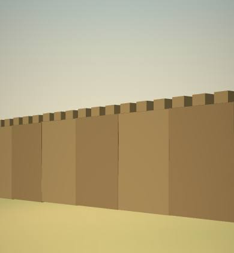
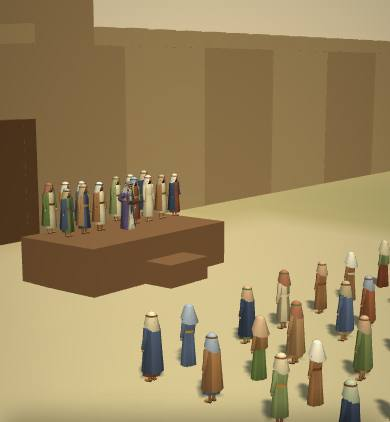
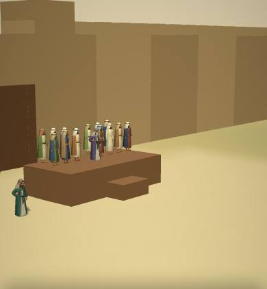

# 감수 자료 · 시대 10. 귀환

자료 판 `aa452a59` · `node tools/make_review_pack.js`가 만든 파일입니다(손으로 고치지 않습니다). 게임에 나오는 문장은 글자 그대로이고, 성경 본문은 싣지 않았습니다(장절만).

#### 시대10·안내 · 시대 안내

*10. 귀환*
- 최현 박사의 통신(탐험대 이야기): 마지막 시대야. 무너진 곳을 다시 쌓는 소리가 통신에 섞여 들려.
- "이 사이에 성경이 기록한 곳"으로 보여 주는 장절(요약 없이 장절만): 스 2:1-3:7 · 스 4:1-6:13 · 스 6:19-10:44 · 에 1:1-3:15 · 에 5:1-6:14 · 에 8:1-10:3 · 느 1:1-2:10 · 느 3:1-6:14 · 느 6:17-7:73 · 느 8:13-13:31 · 말 1:1-2:17 · 말 3:2-18

표시: ☐ 그대로 ☐ 고침 ☐ 뺌 　적을 칸: 

#### 시대10·마무리 · 마무리(기도·실천)

*이 시대 장면들의 한 문장 기도(8~10세)와 한 주 실천(11~13세). 꼴은 "공통·마무리"에서*
- **OT-37 고레스의 조서와 성전을 다시 지음** (스 1:1-11)
  - 8~10세 기도: 하나님, 예루살렘에 하나님의 전을 다시 지은 이야기를 기억하게 해 주세요. 예수님의 이름으로 기도합니다. 아멘.
  - 11~13세 실천: 이번 주에 에스라 3장 8절부터 13절까지 소리 내어 읽어 보세요.
  - 14~19세 기록 물음: 스 1:1-11, 3:8-13, 6:14-18에서 새로 알게 된 사실을 한 가지 적어 보자.
- **OT-38 에스더** (에 4:1-17)
  - 8~10세 기도: 하나님, 에스더와 모르드개의 이야기를 성경에서 읽고 기억하게 해 주세요. 예수님의 이름으로 기도합니다. 아멘.
  - 11~13세 실천: 이번 주에 에스더 4장 10절부터 17절까지 소리 내어 읽어 보세요.
  - 14~19세 기록 물음: 에 4:1-17, 7:1-10에서 새로 알게 된 사실을 한 가지 적어 보자.
- **OT-39 느헤미야의 성벽과 율법책 낭독** (느 2:11-20)
  - 8~10세 기도: 하나님, 예루살렘 성벽과 율법책 읽은 이야기를 성경에서 읽고 기억하게 해 주세요. 예수님의 이름으로 기도합니다. 아멘.
  - 11~13세 실천: 이번 주에 느헤미야 8장 1절부터 12절까지 소리 내어 읽어 보세요.
  - 14~19세 기록 물음: 느 2:11-20, 6:15-16, 8:1-12에서 새로 알게 된 사실을 한 가지 적어 보자.
- **OT-40 말라기, 약속을 기다림** (말 3:1)
  - 8~10세 기도: 하나님, 말라기에 적힌 하나님의 말씀을 성경에서 읽고 기억하게 해 주세요. 예수님의 이름으로 기도합니다. 아멘.
  - 11~13세 실천: 이번 주에 말라기 4장 1절부터 6절까지 소리 내어 읽어 보세요.
  - 14~19세 기록 물음: 말 3:1, 4:1-6에서 새로 알게 된 사실을 한 가지 적어 보자.

표시: ☐ 그대로 ☐ 고침 ☐ 뺌 　적을 칸: 

### OT-37 고레스의 조서와 성전을 다시 지음 (스 1:1-11)

- 곳: 바사 왕 고레스의 나라, 바벨론, 유다 예루살렘
- 감수 필수: 아니오
- 화면: 이야기 카드 · 감수 상태: 미감수

#### OT-37·대목 · 대목 글(장면 전체) · 참고

*대목 7개* — 스 1:1-11
- 이 장면에서 검증자가 여쭌 것 4가지는 아래 "검증자가 남긴 것" 항목에 따로 있습니다. 대목 글을 고치실 때는 "대목 몇, 몇 세 글"인지 적어 주세요.
- **대목 1** (스 1:1-4)
- 8~10세: 바사 왕 고레스가 왕이 된 첫해에, 여호와께서 고레스의 마음을 움직이셨어요. 왕은 온 나라에 조서를 내려, 하나님의 백성은 예루살렘으로 올라가 여호와의 전을 지으라고 했어요.
- 11~13세: 바사 왕 고레스가 다스린 첫해에 여호와께서 고레스 왕의 마음을 움직이셨어요. 예레미야의 입으로 하신 말씀을 이루시려는 것이었어요. 왕은 온 나라에 알리고 조서도 내려, 하나님의 백성은 누구든지 유다 예루살렘으로 올라가 여호와의 전을 지으라고 했어요.
- 14~19세: 바사 왕 고레스의 원년에, 여호와께서는 예레미야의 입으로 하신 말씀을 이루시려고 고레스 왕의 마음을 움직이셨다. 고레스는 온 나라에 알리고 글로도 내렸다. 그 조서에서 고레스는 하늘의 하나님 여호와께서 세상 모든 나라를 자기에게 주셨고 유다 예루살렘에 전을 지으라고 자기에게 명하셨다고 했다. 그 백성 된 사람은 누구든지 예루살렘으로 올라가 여호와의 전을 지으라고 했고, 그들이 머물러 살던 곳의 사람들은 은과 금과 물건과 짐승으로 돕고 하나님의 전을 위한 예물도 기쁘게 드리라고 했다.
  - 온우의 말: 예레미야의 입으로 하신 말씀을 이루시려는 것이었대. 에스라 1장 1절에서 확인해 보자.
- **대목 2** (스 1:5-6)
- 8~10세: 유다와 베냐민의 족장들, 제사장들, 레위 사람들, 그리고 하나님이 마음을 움직이신 사람들이 모두 올라가려고 일어났어요. 둘레에 사는 사람들은 은그릇과 금과 짐승으로 도왔어요.
- 11~13세: 유다와 베냐민의 족장들, 제사장들, 레위 사람들이 일어났어요. 하나님이 마음을 움직이셔서 올라가 예루살렘에 여호와의 전을 지으려는 사람들도 모두 일어났어요. 그 둘레의 사람들은 은그릇과 금과 물건과 짐승과 보물로 돕고 예물도 기쁘게 드렸어요.
- 14~19세: 유다와 베냐민의 족장들, 제사장들, 레위 사람들, 그리고 하나님께 마음이 감동되어 올라가 예루살렘에 여호와의 전을 지으려는 사람들이 모두 일어났다. 그 둘레의 사람들은 은그릇과 금, 그 밖의 물건, 짐승, 보물로 그들을 도왔고 그 밖에 예물도 기쁘게 드렸다.
  - 휴의 말: 일어난 사람들을 적어 둘게. 유다와 베냐민의 족장들, 제사장들, 레위 사람들.
- **대목 3** (스 1:7-11)
- 8~10세: 고레스 왕은 느부갓네살이 옛날에 예루살렘에서 가져간 여호와의 전 그릇들을 꺼냈어요. 세스바살이 그 그릇들을 모두 예루살렘으로 가지고 왔어요.
- 11~13세: 고레스 왕은 여호와의 전 그릇들을 꺼냈어요. 느부갓네살이 옛날에 예루살렘에서 가져다가 자기 신들의 당에 둔 그릇들이에요. 고지기 미드르닷이 그릇을 세어 유다 목백 세스바살에게 넘겼어요. 세스바살은 사로잡혔던 사람들이 바벨론에서 예루살렘으로 올 때 그 그릇들을 다 가지고 왔어요.
- 14~19세: 고레스 왕은 여호와의 전 그릇들을 꺼냈다. 느부갓네살이 옛적에 예루살렘에서 가져다가 자기 신들의 당에 둔 것이다. 고지기 미드르닷을 시켜 그것을 꺼내 세어서 유다 목백 세스바살에게 넘기게 했다. 본문은 금반 서른, 은반 천, 칼 스물아홉, 금대접 서른, 은대접 사백열, 그 밖의 그릇 천을 적고, 금그릇과 은그릇이 모두 오천사백이라고 한다. 사로잡혔던 사람들이 바벨론에서 예루살렘으로 올라올 때 세스바살이 그 그릇들을 다 가지고 왔다.
  - 최온의 말: 금그릇이랑 은그릇이 정말 많아! 하나하나 세어서 넘겨주고 있어.
- **대목 4** (스 3:8-11)
- 8~10세: 예루살렘에 온 지 이 년째 이월에 스룹바벨과 예수아와 돌아온 사람들이 일을 시작했고, 건축자들이 여호와의 전 기초를 놓았어요. 제사장들은 나팔을, 레위 사람들은 제금을 잡고 여호와를 찬송했어요.
- 11~13세: 예루살렘에 있는 하나님의 전에 이른 지 이 년째 이월에 스룹바벨과 예수아와 돌아온 사람들이 일을 시작했어요. 스무 살 이상인 레위 사람들을 세워 일을 감독하게 했어요. 건축자들이 여호와의 전 기초를 놓을 때, 예복을 입은 제사장들은 나팔을, 아삽 자손인 레위 사람들은 제금을 들고 여호와를 찬송했어요. 모든 백성도 기초가 놓인 것을 보고 큰 소리로 즐겁게 외쳤어요.
- 14~19세: 예루살렘에 있는 하나님의 전에 이른 지 이 년째 되는 해 이월에, 스룹바벨(스알디엘의 아들)과 예수아(요사닥의 아들), 그 형제인 제사장들과 레위 사람들, 사로잡혔다가 예루살렘에 돌아온 모든 사람이 일을 시작했다. 스무 살 이상인 레위 사람들을 세워 여호와의 전 일을 감독하게 했다. 건축자들이 전의 기초를 놓을 때, 예복을 입은 제사장들은 나팔을, 아삽 자손인 레위 사람들은 제금을 들고 섰다. 그들은 이스라엘 왕 다윗이 정한 대로 여호와를 찬송했다. 그들은 여호와는 선하시고 이스라엘을 향한 그 인자하심이 영원하다고 서로 화답하며 감사했고, 모든 백성은 기초가 놓인 것을 보고 여호와를 찬송하며 큰 소리로 외쳤다.
  - 최온의 말: 제사장들은 나팔을, 레위 사람들은 제금을 들고 있어! 사람들이 큰 소리로 외치고 있어.
- **대목 5** (스 3:12-13)
- 8~10세: 첫 성전을 보았던 노인들은 큰 소리로 울었고, 다른 많은 사람은 기뻐서 외쳤어요. 그 소리가 멀리까지 들렸어요.
- 11~13세: 제사장들, 레위 사람들, 족장들 가운데에는 첫 성전을 보았던 노인이 여럿 있었어요. 그들은 이 전의 기초가 놓이는 것을 보고 큰 소리로 울었고, 또 여러 사람은 기뻐서 크게 외쳤어요. 백성이 외치는 소리가 멀리까지 들려서, 기뻐하는 소리와 우는 소리를 가려낼 수 없었어요.
- 14~19세: 제사장들, 레위 사람들, 족장들 가운데에는 첫 성전을 보았던 노인이 여럿 있었다. 그들은 이제 이 전의 기초가 놓이는 것을 보고 큰 소리로 울었고, 또 많은 사람은 기뻐하며 크게 외쳤다. 백성이 크게 외쳐 그 소리가 멀리까지 들렸으므로, 사람들은 기뻐 외치는 소리와 우는 소리를 가려낼 수 없었다.
  - 휴의 말: 우는 소리와 기뻐 외치는 소리가 함께 들려. 어느 쪽 소리인지 가려낼 수 없다고 일지에 적어 둘게.
- **대목 6** (스 6:14-15)
- 8~10세: 유다의 장로들은 선지자 학개와 스가랴의 권면을 받아 전을 잘 지어 나갔어요. 전을 다 지은 날은 다리오 왕 육년 아달월 삼일이었어요.
- 11~13세: 유다 사람의 장로들은 선지자 학개와 스가랴가 권면하여 전 짓는 일을 잘 해 나갔어요. 이스라엘 하나님의 명령을 따르고, 바사의 왕 고레스, 다리오, 아닥사스다가 내린 조서를 따라 전을 지었어요. 전을 다 지은 날은 다리오 왕 육년 아달월 삼일이었어요.
- 14~19세: 유다 사람의 장로들은 선지자 학개와 스가랴(잇도의 손자)가 권면하였으므로 전 짓는 일이 잘되어 갔다. 그들은 이스라엘 하나님의 명령을 따르고, 바사의 왕 고레스, 다리오, 아닥사스다가 내린 조서를 따라 전을 지어 마쳤다. 전 짓는 일을 마친 날은 다리오 왕 육년 아달월 삼일이었다.
  - 휴의 말: 전을 다 지은 날짜가 적혀 있어. 다리오 왕 육년 아달월 삼일. 일지에 적어 둘게.
- **대목 7** (스 6:16-18)
- 8~10세: 이스라엘 자손과 제사장들, 레위 사람들, 그 밖에 사로잡혔던 사람들의 자손이 기쁘게 하나님의 전 봉헌식을 했어요. 제사장과 레위 사람을 세워서, 예루살렘에서 하나님 섬기는 일을 맡게 했어요.
- 11~13세: 이스라엘 자손과 제사장들, 레위 사람들, 그 밖에 사로잡혔던 사람들의 자손이 기쁘게 하나님의 전 봉헌식을 했어요. 수소 백 마리와 숫양 이백 마리와 어린 양 사백 마리를 드렸고, 이스라엘 지파의 수대로 숫염소 열두 마리를 온 이스라엘을 위한 속죄제로 드렸어요. 그리고 모세의 책에 적힌 대로 제사장과 레위 사람을 차례대로 세워서, 예루살렘에서 하나님 섬기는 일을 맡게 했어요.
- 14~19세: 이스라엘 자손과 제사장들, 레위 사람들, 그 밖에 사로잡혔던 사람들의 자손이 기쁘게 하나님의 전 봉헌식을 했다. 봉헌식에서 수소 백 마리, 숫양 이백 마리, 어린 양 사백 마리를 드렸고, 이스라엘 지파의 수대로 숫염소 열두 마리를 온 이스라엘을 위한 속죄제로 드렸다. 또 제사장은 분반을 따라, 레위 사람은 반차를 따라 세워서 예루살렘에서 하나님 섬기는 일을 맡게 했는데, 모세의 책에 적힌 대로 한 것이다.
  - 온우의 말: 모세의 책에 적힌 대로 했대. 에스라 6장 18절에서 확인해 보자.

#### OT-37·돕기1 · 손으로 하는 돕기

*길 떠날 짐 묶기 거들기* — 스 1:5
- 돕는 상대: 사로잡혔다가 돌아온 백성
- 8~10세: 예루살렘으로 올라가려는 사람들이 일어났어요. 성경에 적힌 일은 아니지만, 우리는 그 곁에서 사람들이 자기 짐 보따리를 묶는 일만 거들어요. 둘레 사람들이 건네는 물건과 예물에는 손대지 않아요.
- 11~13세: 하나님이 마음을 움직이신 사람들이 예루살렘으로 올라가려고 일어났어요. 이것은 성경에 적힌 일이 아니라 탐험대가 곁에서 거드는 일이에요. 둘레 사람들이 건네는 은그릇과 금과 짐승, 예물에는 손대지 않고, 길 떠날 사람들이 자기 짐 보따리를 묶는 것만 거들어요.
- 14~19세: 유다와 베냐민의 족장들, 제사장들, 레위 사람들, 그리고 하나님께 마음이 감동된 사람들이 예루살렘으로 올라가려고 일어났다(1:5). 탐험대는 그 곁에서 길 떠날 사람들이 자기 짐 보따리를 묶는 일을 거든다. 본문에 적힌 일이 아니라 탐험대의 일이다. 둘레 사람들이 건네는 물건과 짐승, 하나님의 전을 위한 예물(1:6), 여호와의 전 그릇에는 손대지 않는다.
  - 누르는 일 1: 짐 보따리 끈 묶기
  - 누르는 일 2: 묶은 보따리 한곳에 모으기
  - 누르는 일 3: 길 떠날 자리 정리하기
  - 마친 뒤 휴의 말: 짐을 다 묶었어. 주고받는 물건이랑 예물에는 손대지 않았어.

표시: ☐ 그대로 ☐ 고침 ☐ 뺌 　적을 칸: 

#### OT-37·뜻 · 뜻 묻기

*기초가 놓였을 때 부른 찬송의 뜻* — 스 3:11
- 온우의 물음: 전의 기초가 다시 놓인 일은 무슨 뜻이에요?
- 답하는 사람: 최현 박사
- 답 8~10세: 에스라서는 여호와께서 예레미야를 통해 하신 말씀을 이루시려고 고레스의 마음을 움직이셨다고 적어요. 기초가 놓이자 제사장들과 레위 사람들은, 여호와는 선하시고 이스라엘을 향한 그분의 인자하심은 영원하다고 찬송했어요.
- 답 11~13세: 에스라서는 여호와께서 예레미야를 통해 하신 말씀을 이루시려고 고레스의 마음을 움직이셨고, 고레스가 예루살렘에 여호와의 전을 지으라는 조서를 내렸다고 적어요(1:1-3). 전의 기초가 놓이자 제사장들과 레위 사람들은 여호와께 감사하며, 여호와는 선하시고 이스라엘을 향한 그분의 인자하심은 영원하다고 서로 화답하며 찬송했어요(3:11). 모든 백성도 기초가 놓인 것을 보고 여호와께 찬송했어요.
- 답 14~19세: 에스라서는 여호와께서 예레미야를 통해 하신 말씀을 이루시려고 고레스 왕의 마음을 감동시키셨고, 고레스가 예루살렘에 여호와의 전을 지으라는 조서를 내렸다고 기록한다(1:1-3). 전의 기초가 놓일 때 제사장들과 레위 사람들은 여호와께 감사드리며, 주는 선하시고 이스라엘을 향한 그분의 인자하심은 영원하다고 서로 화답하며 찬송했다(3:11). 모든 백성도 기초가 놓인 것을 보고 여호와께 찬송하며 크게 외쳤다. 성경은 이 일에 대해 이만큼 말한다.
- **성경을 펴서 뜻 확인하기**
- 8~10세 · 찾아 읽고 고르기: 성경책에서 에스라 3장 11절을 찾아 읽어 보세요. (스 3:11)
  - 물음: 제사장들과 레위 사람들은 찬송하며, 여호와의 무엇이 영원하다고 했나요?
  - 맞는 보기: 인자하심
  - 다른 보기: 성벽 (본문에 없음)
  - 다른 보기: 금과 은 (본문에 없음)
- 11~13세 · 찾아 읽고 고르기: 성경책에서 에스라 3장 10절과 11절을 읽어 보세요. (스 3:10-11)
  - 물음: 모든 백성이 크게 외치며 여호와께 찬송한 까닭은 무엇인가요?
  - 맞는 보기: 여호와의 전 기초가 놓인 것을 보았기 때문에
  - 다른 보기: 고레스 왕이 예루살렘에 왔기 때문에 (본문에 없음)
  - 다른 보기: 전을 다 지어 봉헌식을 했기 때문에 (스 6:16)
- 14~19세 · 찾아 읽고 고르기: 에스라 1장 1절과 3장 11절을 함께 찾아 읽어 보자. (스 1:1 · 스 3:11)
  - 물음: 두 곳을 이어 읽으면, 전의 기초가 다시 놓인 일에 대해 성경은 무엇을 말하는가?
  - 맞는 보기: 이 일은 여호와께서 예레미야를 통해 하신 말씀을 이루시려고 고레스의 마음을 움직이신 데서 시작되었고, 기초가 놓이자 제사장들과 레위 사람들은 여호와의 선하심과 영원한 인자하심을 찬송했다
  - 다른 보기: 이 일은 고레스가 스스로 생각해 낸 일이었고, 기초가 놓일 때 아무도 찬송하지 않았다 (본문에 없음)
  - 다른 보기: 이 일은 예레미야가 직접 예루살렘에 와서 시작했고, 백성은 그를 찬송했다 (본문에 없음)

표시: ☐ 그대로 ☐ 고침 ☐ 뺌 　적을 칸: 

#### OT-37·오늘1 · 오늘의 물음

*최현 박사가 답함* — 스 1:1 · 대하 36:21-23 · 렘 25:11-12 · 렘 29:10
- 물음: 예레미야의 입으로 하신 말씀은 어떤 말씀이었어요?
- 답 8~10세: 에스라 1장 1절은 그 말씀이 무엇인지 적지 않아요. 역대하 36장은 같은 일을 적으면서 칠십 년을 함께 말해요. 예레미야서에는 바벨론에서 칠십 년이 차면 백성을 이곳으로 돌아오게 하겠다는 여호와의 말씀이 있어요.
- 답 11~13세: 에스라 1장 1절은 예레미야의 입으로 하신 말씀이 무엇인지 따로 적지 않아요. 역대하 36장 21절은 땅이 황폐하여 칠십 년을 지낸 일을 두고 예레미야의 입으로 하신 말씀이 이루어졌다고 적고, 바로 다음 절에서 고레스의 조서를 이야기해요. 예레미야 29장 10절에는 바벨론에서 칠십 년이 차면 백성을 이곳으로 돌아오게 하겠다고 하신 여호와의 말씀이 있어요.
- 답 14~19세: 에스라 1:1은 그 말씀의 내용을 적지 않는다. 역대하 36:21은 땅이 황폐하여 안식하며 칠십 년을 지낸 일을 두고 예레미야의 입으로 하신 여호와의 말씀이 이루어졌다고 하고, 이어지는 36:22-23은 고레스의 조서를 에스라 1장과 거의 같은 말로 적는다. 예레미야 25:11-12와 29:10에는 칠십 년에 대한 여호와의 말씀이 있고, 29:10은 바벨론에서 칠십 년이 차면 백성을 이곳으로 돌아오게 하겠다고 한다. 성경은 여기까지 말한다.

표시: ☐ 그대로 ☐ 고침 ☐ 뺌 　적을 칸: 

#### OT-37·오늘2 · 오늘의 물음

*최현 박사가 답함* — 스 1:1 · 스 6:22 · 스 7:27
- 물음: 하나님은 다른 나라 왕의 마음도 움직이세요?
- 답 8~10세: 에스라서는 여호와께서 바사 왕 고레스의 마음을 움직이셨다고 적어요. 같은 책에는 여호와께서 앗수르 왕의 마음을 돌이키셔서 하나님의 전 짓는 일을 돕게 하셨다는 말씀도 있어요.
- 답 11~13세: 에스라서는 여호와께서 바사 왕 고레스의 마음을 움직이셨다고 적어요. 같은 책에는 여호와께서 앗수르 왕의 마음을 돌이키셔서 하나님의 전 짓는 일을 돕게 하셨다는 말씀도 있어요. 에스라도 여호와께서 왕이 예루살렘에 있는 여호와의 전을 아름답게 꾸미려는 마음을 품게 하셨다고 찬송했어요.
- 답 14~19세: 에스라 1:1은 여호와께서 바사 왕 고레스의 마음을 감동시키셨다고 적는다. 같은 책 6:22는 여호와께서 앗수르 왕의 마음을 돌이켜 그들이 하나님의 전 일을 하는 손을 힘 있게 하셨다고 하고, 7:27에서 에스라는 여호와께서 왕으로 하여금 예루살렘에 있는 여호와의 전을 아름답게 꾸미려는 마음을 품게 하셨다고 송축한다. 이 책은 이런 일을 여호와께서 하셨다고 적을 뿐, 어떻게 하셨는지는 말하지 않는다.

표시: ☐ 그대로 ☐ 고침 ☐ 뺌 　적을 칸: 

#### OT-37·화면 · 화면 원칙 · 참고

*이야기 카드 장면: 하나님 표현과 그리지 않는 것* — 스 1:1-11
- 하나님 표현: 말씀 자막만. 이 본문 범위에는 하나님이 직접 말씀하시는 대목이 없다. 여호와께서 고레스의 마음을 움직이신 일(스 1:1)과 사람들의 마음을 감동시키신 일(스 1:5)은 글로만 적는다. 불·구름·빛은 본문에 없으므로 만들지 않는다. 형상 없음. 음성은 소리로 만들지 않음
  - 그리지 않는 것: 하나님의 형상, 고레스에게 비치는 빛이나 들리는 음성(스 1:1은 마음을 움직이셨다고만 한다)
  - 그리지 않는 것: 느부갓네살의 신들의 당과 신상(스 1:7은 글로만)
  - 그리지 않는 것: 전의 본문에 없는 크기·꾸밈·기구를 지어내 그리는 것
  - 그리지 않는 것: 노인들이 운 까닭을 풀이하는 글이나 그림(스 3:12는 첫 성전을 보았던 노인들이 이 전의 기초가 놓이는 것을 보고 울었다고만 한다. 그 밖의 까닭은 이 범위에 없다)
  - 그리지 않는 것: 제물을 잡는 모습을 가까이서 보여 주는 그림(스 6:17은 멀리서)
  - 그리지 않는 것: 바벨론에서 예루살렘으로 오는 길의 풍경과 사건을 지어내는 것(이 범위에 없음)
  - 그리지 않는 것: 세 아이가 그릇이나 기초 돌에 손대거나 전 짓는 일을 돕는 것(목격자다)

#### OT-37·미해결1 · 검증자가 남긴 것

*스 1:4, 1:6에서 둘레 사람들이 예물도 드렸다는 개역한글 읽기를 그대로 둘까요?*
- 검증 기록(OT-37 고레스의 조서와 성전을 다시 지음): 스 1:4와 1:6의 예물: 개역한글은 머물던 곳의 사람들(사면 사람들)이 예물도 드린 것으로 읽히고, KJV는 그 예물 말고도 도왔다고만 해서 누가 예물을 드렸는지 말하지 않는다. 대목 1의 14~19세 글, 대목 2의 11~13세 글·14~19세 글는 한국어 성경을 따랐다.
  - 지금 게임의 글 · 대목 2 · 11~13세: 유다와 베냐민의 족장들, 제사장들, 레위 사람들이 일어났어요. 하나님이 마음을 움직이셔서 올라가 예루살렘에 여호와의 전을 지으려는 사람들도 모두 일어났어요. 그 둘레의 사람들은 은그릇과 금과 물건과 짐승과 보물로 돕고 예물도 기쁘게 드렸어요.
  - 지금 게임의 글 · 대목 2 · 14~19세: 유다와 베냐민의 족장들, 제사장들, 레위 사람들, 그리고 하나님께 마음이 감동되어 올라가 예루살렘에 여호와의 전을 지으려는 사람들이 모두 일어났다. 그 둘레의 사람들은 은그릇과 금, 그 밖의 물건, 짐승, 보물로 그들을 도왔고 그 밖에 예물도 기쁘게 드렸다.
  - 지금 게임의 글 · 대목 1 · 14~19세: 바사 왕 고레스의 원년에, 여호와께서는 예레미야의 입으로 하신 말씀을 이루시려고 고레스 왕의 마음을 움직이셨다. 고레스는 온 나라에 알리고 글로도 내렸다. 그 조서에서 고레스는 하늘의 하나님 여호와께서 세상 모든 나라를 자기에게 주셨고 유다 예루살렘에 전을 지으라고 자기에게 명하셨다고 했다. 그 백성 된 사람은 누구든지 예루살렘으로 올라가 여호와의 전을 지으라고 했고, 그들이 머물러 살던 곳의 사람들은 은과 금과 물건과 짐승으로 돕고 하나님의 전을 위한 예물도 기쁘게 드리라고 했다.

표시: ☐ 지금대로 ☐ 바꿈 ☐ 의논 필요 　적을 칸: 

#### OT-37·미해결2 · 검증자가 남긴 것

*스 6:14의 스가랴를 개역한글대로 '잇도의 손자'로 적은 것을 그대로 둘까요?*
- 검증 기록(OT-37 고레스의 조서와 성전을 다시 지음): 스 6:14의 스가랴: 개역한글은 잇도의 손자, KJV는 잇도의 아들로 적는다. 대목 6의 14~19세 글와 화면 설계의 사람 목록은 한국어 성경을 따랐다.
  - 지금 게임의 글 · 대목 6 · 14~19세: 유다 사람의 장로들은 선지자 학개와 스가랴(잇도의 손자)가 권면하였으므로 전 짓는 일이 잘되어 갔다. 그들은 이스라엘 하나님의 명령을 따르고, 바사의 왕 고레스, 다리오, 아닥사스다가 내린 조서를 따라 전을 지어 마쳤다. 전 짓는 일을 마친 날은 다리오 왕 육년 아달월 삼일이었다.
  - 지금 게임의 글 · 화면 설계의 사람: 유다 사람의 장로들, 선지자 학개와 잇도의 손자 스가랴(스 6:14)

표시: ☐ 지금대로 ☐ 바꿈 ☐ 의논 필요 　적을 칸: 

#### OT-37·미해결3 · 검증자가 남긴 것 · ★먼저 볼 29

*하나님이 다른 나라 왕의 마음도 움직이시느냐는 물음과 답(스 1:1, 6:22, 7:27)을 둘까요?*
- 검증 기록(임무 독립 대조): 오늘의 물음 2는 하나님의 주권(규칙서 3.5)에 닿는다. 본문의 사실만 적혀 있다. 감수 때 확인(작성자와 같은 판단).
  - 지금 게임의 글 · 오늘의 물음 2 · 물음: 하나님은 다른 나라 왕의 마음도 움직이세요?
  - 지금 게임의 글 · 오늘의 물음 2 · 답 · 8~10세: 에스라서는 여호와께서 바사 왕 고레스의 마음을 움직이셨다고 적어요. 같은 책에는 여호와께서 앗수르 왕의 마음을 돌이키셔서 하나님의 전 짓는 일을 돕게 하셨다는 말씀도 있어요.
  - 지금 게임의 글 · 오늘의 물음 2 · 답 · 11~13세: 에스라서는 여호와께서 바사 왕 고레스의 마음을 움직이셨다고 적어요. 같은 책에는 여호와께서 앗수르 왕의 마음을 돌이키셔서 하나님의 전 짓는 일을 돕게 하셨다는 말씀도 있어요. 에스라도 여호와께서 왕이 예루살렘에 있는 여호와의 전을 아름답게 꾸미려는 마음을 품게 하셨다고 찬송했어요.
  - 지금 게임의 글 · 오늘의 물음 2 · 답 · 14~19세: 에스라 1:1은 여호와께서 바사 왕 고레스의 마음을 감동시키셨다고 적는다. 같은 책 6:22는 여호와께서 앗수르 왕의 마음을 돌이켜 그들이 하나님의 전 일을 하는 손을 힘 있게 하셨다고 하고, 7:27에서 에스라는 여호와께서 왕으로 하여금 예루살렘에 있는 여호와의 전을 아름답게 꾸미려는 마음을 품게 하셨다고 송축한다. 이 책은 이런 일을 여호와께서 하셨다고 적을 뿐, 어떻게 하셨는지는 말하지 않는다.

표시: ☐ 지금대로 ☐ 바꿈 ☐ 의논 필요 　적을 칸: 

#### OT-37·미해결5 · 검증자가 남긴 것

*예물과 전 그릇에는 손대지 않고 '자기 짐'만 거든다는 선(스 1:5-6)으로 충분할까요?*
- 검증 기록(놀이 다양화·돕기 넓힘·8~10세 글): 작성자가 적은 대로, "자기 짐"만 거든다는 선이 충분한지. 1:6의 도움(은그릇·금·물건·짐승)은 올라가는 사람들에게 준 것이라 그들의 짐과 섞일 수 있어, 글은 둘레 사람들이 건네는 물건 전체에 손대지 않는다고 적는다.
  - 지금 게임의 글 · 현장 돕기 단계 1 · 8~10세: 예루살렘으로 올라가려는 사람들이 일어났어요. 성경에 적힌 일은 아니지만, 우리는 그 곁에서 사람들이 자기 짐 보따리를 묶는 일만 거들어요. 둘레 사람들이 건네는 물건과 예물에는 손대지 않아요.
  - 지금 게임의 글 · 현장 돕기 단계 1 · 11~13세: 하나님이 마음을 움직이신 사람들이 예루살렘으로 올라가려고 일어났어요. 이것은 성경에 적힌 일이 아니라 탐험대가 곁에서 거드는 일이에요. 둘레 사람들이 건네는 은그릇과 금과 짐승, 예물에는 손대지 않고, 길 떠날 사람들이 자기 짐 보따리를 묶는 것만 거들어요.
  - 지금 게임의 글 · 현장 돕기 단계 1 · 14~19세: 유다와 베냐민의 족장들, 제사장들, 레위 사람들, 그리고 하나님께 마음이 감동된 사람들이 예루살렘으로 올라가려고 일어났다(1:5). 탐험대는 그 곁에서 길 떠날 사람들이 자기 짐 보따리를 묶는 일을 거든다. 본문에 적힌 일이 아니라 탐험대의 일이다. 둘레 사람들이 건네는 물건과 짐승, 하나님의 전을 위한 예물(1:6), 여호와의 전 그릇에는 손대지 않는다.
  - 지금 게임의 글 · 현장 돕기 단계 1 · 제목: 길 떠날 짐 묶기 거들기
  - 지금 게임의 글 · 현장 돕기 단계 1 · 마친 뒤 말: 짐을 다 묶었어. 주고받는 물건이랑 예물에는 손대지 않았어.

표시: ☐ 지금대로 ☐ 바꿈 ☐ 의논 필요 　적을 칸: 

#### OT-37·기타 · 그 밖의 글(참고) · 참고

*통신·재료·관문·탐지기 물음·곁에서 보기·말씀 카드* — 스 1:1-11
- **최현 박사의 통신(탐험대 이야기)**
- 8~10세: 최현 박사예요. 비상 착륙 때 통신기 받침이 헐거워져서 소리가 자꾸 끊겨요. 둘레에서 부드러운 것을 찾아 틈을 메워 주세요.
- 11~13세: 최현 박사예요. 여기는 바사 왕 고레스의 나라예요. 비상 착륙 때 통신기 받침이 헐거워져서 소리가 자꾸 끊겨요. 이 시대에는 맞는 부속이 없으니 그 자리에서 구할 수 있는 부드러운 것으로 틈을 메워야 해요.
- 14~19세: 최현 박사다. 여기는 바사 왕 고레스의 나라다. 비상 착륙 때 통신기 받침이 헐거워져 소리가 자꾸 끊긴다. 이 시대에는 맞는 부속이 없으니, 그 자리에서 구할 수 있는 부드러운 것으로 받침의 틈을 메워 흔들림을 막아야 한다.
- **수리 재료(탐험대 이야기)**
- 재료: 짐승 털 (스 1:6)
  - 박사의 말: 짐승 털을 뭉쳐서 헐거워진 통신기 받침의 틈을 메우는 완충재 대신 쓸 수 있어요.
  - 얻는 방법: 짐승들이 지나간 길가 땅에 떨어진 털 뭉치를 줍는다. 짐승에게 다가가거나 사람들이 주고받는 물건에 손대지 않는다.
  - 얻었을 때 아이의 말: 짐승 털을 찾았어! 짐승들이 지나간 길가 땅에 떨어져 있었어.
- **관문 물음**
- 관문 1 8~10세 · 찾아 읽고 고르기: 성경책에서 에스라 1장 1절을 찾아 읽어 보세요. (스 1:1)
  - 물음: 여호와께서 누구의 마음을 움직이셨나요?
  - 맞는 보기: 바사 왕 고레스
  - 다른 보기: 바벨론 왕 느부갓네살 (스 1:7)
  - 다른 보기: 다리오 왕 (스 6:15)
- 관문 2 8~10세 · 여러 개 고르기: 성경책에서 에스라 3장 10절을 찾아 읽어 보세요. (스 3:10)
  - 물음: 기초를 놓을 때 제사장과 레위 사람이 한 일을 모두 고르세요.
  - 맞는 보기: 제사장들이 나팔을 들었어요
  - 다른 보기: 제사장들이 기초 돌을 날랐어요 (본문에 없음)
  - 맞는 보기: 레위 사람들이 제금을 잡았어요
  - 다른 보기: 율법책을 읽고 그 뜻을 풀어 주었어요 (느 8:8)
  - 맞는 보기: 다윗이 정한 대로 여호와를 찬송했어요
- 관문 1 11~13세 · 찾아 읽고 고르기: 성경책에서 에스라 1장 1절부터 4절까지 읽어 보세요. (스 1:1-4)
  - 물음: 여호와께서 고레스 왕의 마음을 움직이신 까닭은 무엇인가요?
  - 맞는 보기: 예레미야를 통해 하신 말씀이 이루어지게 하시려고
  - 다른 보기: 고레스가 여호와께 제사를 드리며 구했기 때문에 (본문에 없음)
  - 다른 보기: 유다 백성이 왕에게 돌려보내 달라고 청했기 때문에 (본문에 없음)
- 관문 2 11~13세 · 순서 맞추기: 성경책에서 에스라 1장 5절부터 11절까지 읽고, 일어난 차례대로 눌러 보세요. (스 1:5-11)
  - 차례 1: 유다와 베냐민의 족장들, 제사장들, 레위 사람들이 올라가려고 일어났다
  - 차례 2: 둘레 사람들이 은그릇, 금, 짐승으로 도왔다
  - 차례 3: 고레스 왕이 여호와의 전 그릇들을 꺼냈다
  - 차례 4: 고지기 미드르닷이 그릇을 세어 세스바살에게 넘겼다
  - 차례 5: 세스바살이 그 그릇들을 다 가지고 예루살렘으로 왔다
- 관문 1 14~19세 · 찾아 읽고 고르기: 에스라 1장 3절과 3장 8절을 함께 찾아 읽어 보자. (스 1:3 · 스 3:8)
  - 물음: 고레스의 조서와 3장 8절을 이어 읽으면 무엇이 보이는가?
  - 맞는 보기: 조서는 그 백성 된 사람은 누구든지 예루살렘으로 올라가 여호와의 전을 지으라고 했고, 사로잡혔다가 돌아온 사람들은 예루살렘에 이른 지 이 년째 이월에 그 일을 시작했다
  - 다른 보기: 조서가 내리자마자 그날로 전이 다 지어졌다 (본문에 없음)
  - 다른 보기: 조서는 예루살렘에 가지 말고 바벨론에 전을 지으라고 했다 (본문에 없음)
- 관문 2 14~19세 · 구절과 내용 잇기: 에스라 3장 10절, 6장 14절, 6장 18절을 찾아 읽고, 구절마다 맞는 내용을 이어 보자. (스 3:10 · 스 6:14 · 스 6:18)
  - 잇기: 다윗이 정한 대로 여호와를 찬송했다 (스 3:10)
  - 잇기: 하나님의 명령과 세 왕의 조서를 따라 전을 다 지었다 (스 6:14)
  - 잇기: 모세의 책에 적힌 대로 제사장과 레위 사람을 세워 하나님을 섬기게 했다 (스 6:18)
  - 이은 뒤 글: 세 곳을 이으면, 기초를 놓을 때의 찬송은 다윗이 정한 대로, 전 짓는 일은 하나님의 명령과 왕들의 조서를 따라, 섬기는 일은 모세의 책에 적힌 대로 했다.
- **곁에서 보기 · 함께 머물기**
- 보기: 곁에서 보기 · 세어서 넘기는 그릇 (스 1:8)
  - 8~10세: 고레스 왕이 여호와의 전 그릇들을 꺼냈어요. 고지기 미드르닷이 그릇을 세어 세스바살에게 넘겨요. 우리는 그릇에 손대지 않고 곁에서 봐요.
  - 11~13세: 고레스 왕은 느부갓네살이 예전에 예루살렘에서 가져갔던 여호와의 전 그릇들을 꺼냈어요. 고지기 미드르닷이 그것을 세어 세스바살에게 넘겨요. 그릇을 세고 넘기는 일은 본문이 정한 사람들이 해요. 우리는 손대지 않고 곁에서 봐요.
  - 14~19세: 고레스 왕은 고지기 미드르닷을 시켜 여호와의 전 그릇을 꺼내 세어 세스바살에게 넘기게 했다(1:8). 세스바살은 유다의 목백이다. 이 그릇은 느부갓네살이 예전에 예루살렘에서 가져가 자기 신들의 당에 둔 것이다(1:7). 탐험대는 여호와의 전 그릇에 손대지 않고 곁에서 본다.
  - 휴의 말: 그릇을 센 사람은 미드르닷, 받은 사람은 세스바살. 일지에 적어 둘게.
- 보기: 곁에서 보기 · 나팔과 제금을 든 찬송 (스 3:10)
  - 8~10세: 건축자들이 여호와의 전 기초를 놓아요. 제사장들은 나팔을, 레위 사람들은 제금을 잡고 여호와를 찬송해요. 우리는 기초 돌에 손대지 않고 곁에서 봐요.
  - 11~13세: 건축자들이 여호와의 전 기초를 놓을 때, 예복 차림의 제사장들은 나팔을, 레위 사람들(아삽 자손)은 제금을 잡고 서서 다윗이 정한 대로 여호와를 찬송해요. 찬송을 맡은 일은 제사장들과 레위 사람들이 해요. 우리는 곁에서 봐요.
  - 14~19세: 건축자들이 여호와의 전 기초를 놓는다. 예복 차림의 제사장들은 나팔을, 레위 사람들(아삽 자손)은 제금을 잡고 서서, 이스라엘 왕 다윗이 정한 대로 여호와를 찬송한다(3:10). 이 일은 본문이 제사장들과 레위 사람들이 했다고 적은 일이다. 탐험대는 기초 돌과 악기에 손대지 않고 곁에서 본다.
  - 온우의 말: 찬송을 맡은 사람들이야. 다윗이 정한 대로 했다는 말은 3장 10절에 있어.
- 머물기: 백성 곁에 함께 서 있기 (스 3:11-13)
  - 8~10세: 기초가 놓인 것을 보고 백성이 크게 외쳐요. 첫 성전을 보았던 노인들은 큰 소리로 울어요. 우리는 백성 곁에 함께 서 있어요.
  - 11~13세: 기초가 놓인 것을 보고 모든 백성이 여호와께 찬송하며 크게 외쳐요. 첫 성전을 보았던 노인들은 큰 소리로 울고, 여러 사람은 기뻐 외쳐요. 우리는 끼어들지 않고 백성 곁에 함께 서 있어요.
  - 14~19세: 모든 백성이 여호와의 전 기초가 놓인 것을 보고 여호와께 찬송하며 크게 외친다(3:11). 첫 성전을 보았던 노인들은 이 전의 기초가 놓이는 것을 보고 큰 소리로 울고, 여러 사람은 기뻐 외친다(3:12). 탐험대는 끼어들지 않고 백성 곁에 함께 서 있다. 그 소리는 멀리까지 들린다.
  - 단추 글: 백성 곁에 서 있기
  - 최온의 말: 우는 사람도 있고 기뻐 외치는 사람도 있어. 우리는 곁에 가만히 서 있을게.
- **말씀 카드**
- 카드: 그 인자하심이 영원하시도다 (스 3:11)
- 카드: 즐거이 행한 봉헌식 (스 6:16)
- **곳과 사람(설계 메모, 화면에 그릴 때의 근거)**
- 곳: 바사 왕 고레스의 나라, 바벨론, 유다 예루살렘
- 곳(설계): 바사 왕 고레스의 나라(스 1:1), 바벨론(스 1:11), 유다 예루살렘(스 1:2-3), 예루살렘 하나님의 전 터(스 3:8-10)
- 땅: 이야기 카드로 잇는다. 예루살렘에서 여호와의 전 기초가 놓이는 자리(스 3:10)와 다 지어진 전(스 6:15). 이 본문 범위는 전의 크기와 생김새, 바벨론에서 예루살렘으로 오는 길, 둘레의 땅을 말하지 않으므로 멀리서 본 모습으로만 나타낸다
  - 사람: 바사 왕 고레스(스 1:1)
  - 사람: 유다와 베냐민의 족장들, 제사장들, 레위 사람들(스 1:5)
  - 사람: 고지기 미드르닷, 유다 목백 세스바살(스 1:8, 1:11)
  - 사람: 스알디엘의 아들 스룹바벨, 요사닥의 아들 예수아(스 3:8)
  - 사람: 하나님의 전 일꾼들을 감독한 사람들: 예수아와 그 아들들과 형제들, 갓미엘과 그 아들들, 유다 자손, 헤나닷 자손과 그 형제 레위 사람들(스 3:9)
  - 사람: 건축자들(스 3:10)
  - 사람: 예복을 입은 제사장들, 아삽 자손 레위 사람들(스 3:10)
  - 사람: 첫 성전을 보았던 노인들과 모든 백성(스 3:11-12)
  - 사람: 유다 사람의 장로들, 선지자 학개와 잇도의 손자 스가랴(스 6:14)
  - 물건: 고레스의 조서(스 1:1). 글자의 모양은 본문에 없음
  - 물건: 은그릇, 금, 물건, 짐승, 보물(스 1:6)
  - 물건: 여호와의 전 그릇들: 금반, 은반, 칼, 금대접, 은대접(스 1:7-11). 멀리서 세는 모습으로만
  - 물건: 나팔과 제금(스 3:10)
  - 물건: 여호와의 전 기초(스 3:10). 돌의 크기와 모양은 본문에 없음
  - 물건: 봉헌식에 드린 수소, 숫양, 어린 양, 숫염소(스 6:17). 멀리서만
  - 절정 장면: 3D로 만들지 않고 이야기 카드로 잇는 장면

### OT-38 에스더 (에 4:1-17)

- 곳: 수산 궁, 대궐 문 앞 성중 광장
- 감수 필수: 아니오
- 화면: 이야기 카드 · 감수 상태: 미감수

#### OT-38·대목 · 대목 글(장면 전체) · 참고

*대목 7개* — 에 4:1-17
- 이 장면에서 검증자가 여쭌 것 6가지는 아래 "검증자가 남긴 것" 항목에 따로 있습니다. 대목 글을 고치실 때는 "대목 몇, 몇 세 글"인지 적어 주세요.
- **대목 1** (에 4:1-3)
- 8~10세: 모르드개는 일어난 일을 모두 알고, 옷을 찢고 굵은 베 옷을 입고 재를 뒤집어쓴 채 성 안에서 크게 울었어요. 왕의 명령이 전해진 곳마다 유다인들도 크게 슬퍼하며 금식했어요.
- 11~13세: 모르드개는 일어난 일을 모두 알고 옷을 찢었어요. 굵은 베를 입고 재를 뒤집어쓰고 성 안으로 나가 큰 소리로 울었어요. 굵은 베를 입은 사람은 대궐 문 안으로 들어갈 수 없어서 대궐 문 앞까지만 갔어요. 왕의 명령이 이른 도마다 유다인이 크게 슬퍼하며 금식하고 울부짖었어요.
- 14~19세: 모르드개는 일어난 일을 모두 알고 자기 옷을 찢었다. 굵은 베를 입고 재를 뒤집어쓴 채 성 가운데로 나가 큰 소리로 통곡했다. 그는 대궐 문 앞까지만 갔는데, 굵은 베를 입은 사람은 대궐 문 안으로 들어갈 수 없었기 때문이다. 왕의 명령과 조서가 이른 도마다 유다인이 크게 애통하며 금식하고 울며 부르짖었고, 굵은 베를 입고 재 위에 누운 사람이 많았다.
  - 최온의 말: 저분이 굵은 베를 입고 재를 뒤집어쓰고 크게 울고 있어. 무슨 일일까?
- **대목 2** (에 4:4-9)
- 8~10세: 왕후 에스더는 몹시 근심하여 내시 하닥을 모르드개에게 보내 무슨 일인지 알아보게 했어요. 모르드개는 유다인을 없애라는 조서의 초본을 주며, 에스더가 왕에게 나아가 민족을 위해 구하게 해 달라고 했어요.
- 11~13세: 에스더의 시녀와 내시가 와서 이 일을 알리자 왕후는 몹시 근심했어요. 모르드개에게 입을 옷을 보냈지만 모르드개는 받지 않았어요. 에스더는 내시 하닥을 보내 무슨 일이며 무슨 까닭인지 알아보게 했어요. 모르드개는 하만이 유다인을 없애려고 한 일을 말하고, 조서의 초본을 주며 에스더가 왕에게 나아가 자기 민족을 위해 구하게 해 달라고 했어요.
- 14~19세: 에스더의 시녀와 내시가 와서 알리자 왕후는 몹시 근심했다. 굵은 베를 벗기려고 모르드개에게 입을 옷을 보냈으나 그는 받지 않았다. 에스더는 왕이 자기를 가까이에서 섬기게 한 내시 하닥을 불러, 무슨 일이며 무슨 까닭인지 알아보게 했다. 하닥은 모르드개가 있는 대궐 문 앞 성중 광장으로 갔다. 모르드개는 자기가 당한 모든 일을 말했고, 하만이 유다인을 없애려고 왕의 창고에 바치겠다고 한 은이 정확히 얼마인지도 말했다. 또 수산 궁에서 내려진, 유다인을 진멸하라는 조서의 초본을 하닥에게 주어 에스더에게 보이고 알리게 했다. 그리고 에스더가 왕에게 나아가 자기 민족을 위해 간절히 구하도록 부탁하게 했다. 하닥은 돌아와서 에스더에게 모르드개의 말을 전했다.
  - 휴의 말: 하닥이 간 곳은 대궐 문 앞 성중 광장이야. 모르드개가 조서의 초본을 건넸어. 일지에 적어 둘게.
- **대목 3** (에 4:10-12)
- 8~10세: 에스더는 하닥을 시켜, 부르지 않았는데 왕에게 나아가면 죽게 되고 왕이 금홀을 내밀어야만 산다는 법이 있다고 대답했어요. 그리고 자기는 왕에게 부름을 받지 못한 지 삼십 일이 되었다고 했어요.
- 11~13세: 에스더는 하닥을 시켜 모르드개에게 대답했어요. 남자든 여자든 부르지 않았는데 안뜰에 들어가 왕 앞에 나아가면 죽이는 법이 있고, 왕이 금홀을 내밀어야만 산다고 했어요. 에스더는 자기가 왕에게 부름을 받지 못한 지 벌써 삼십 일이라고 했어요.
- 14~19세: 에스더는 하닥에게 모르드개에게 전할 말을 주었다. 왕의 신하들과 각 도의 백성이 다 아는 대로, 남자든 여자든 부름 없이 안뜰로 들어가 왕 앞에 나아가는 사람은 죽이는 법 하나뿐이고, 왕이 금홀을 내밀어 주는 사람만 산다는 것이었다. 그리고 자기가 부름을 받아 왕 앞에 나아가지 못한 지가 벌써 삼십 일이라고 했다. 에스더의 말은 모르드개에게 전해졌다.
  - 온우의 말: 에스더가 말한 법은 에스더 4장 11절에 있어. 성경책에서 읽어 보자.
- **대목 4** (에 4:13-14)
- 8~10세: 모르드개는 왕궁에 있다고 혼자만 피할 수 있다고 생각하지 말라고 다시 전했어요. 에스더가 왕후가 된 것이 이때를 위한 것인지 누가 알겠느냐고도 했어요.
- 11~13세: 모르드개가 에스더에게 회답했어요. 왕궁에 있다고 해서 모든 유다인 가운데 혼자만 피할 수 있다고 생각하지 말라고 했어요. 이때에 잠잠하면 유다인은 다른 데서 놓임과 구원을 얻겠지만 에스더와 그 아버지 집은 멸망할 것이라고 했어요. 에스더가 왕후의 자리를 얻은 것이 이때를 위한 것인지 누가 알겠느냐고 했어요.
- 14~19세: 모르드개는 에스더에게 이렇게 회답하게 했다. 왕궁에 있다고 해서 모든 유다인 가운데 홀로 화를 면하리라고 생각하지 말라는 것이었다. 이때에 에스더가 입을 다물고 있으면 유다인은 다른 곳에서 놓임과 구원을 얻겠지만 에스더와 그 아버지의 집은 멸망할 것이라고 했다. 또 에스더가 왕후의 자리에 오른 것이 바로 이런 때를 위한 것인지 누가 알겠느냐고 했다.
  - 휴의 말: 말을 전하는 사람이 두 사람 사이를 오가고 있어. 이번에는 모르드개의 회답이야. 13절과 14절이라고 적어 둘게.
- **대목 5** (에 4:15-17)
- 8~10세: 에스더는 수산의 유다인을 다 모아 사흘 동안 자기를 위해 금식해 달라고 하고, 그런 뒤에 왕에게 나아가겠다고 했어요. 모르드개는 가서 에스더가 말한 대로 다 했어요.
- 11~13세: 에스더가 모르드개에게 회답했어요. 수산에 있는 유다인을 다 모아 자기를 위해 금식하되, 사흘 동안 밤낮으로 먹지도 마시지도 말아 달라고 했어요. 자기도 시녀들과 함께 그렇게 금식한 뒤에 규례를 어기고 왕에게 나아가겠다고 했고, 죽게 되면 죽겠다고 했어요. 모르드개는 가서 에스더가 말한 대로 다 했어요.
- 14~19세: 에스더는 모르드개에게 회답하게 했다. 가서 수산에 있는 유다인을 모두 모으고 자기를 위해 금식하되, 사흘 동안 밤에도 낮에도 먹지도 마시지도 말아 달라는 것이었다. 자기도 시녀들과 함께 그렇게 금식하고, 그런 다음 규례를 어기고서 왕 앞에 나아가겠다고 했으며, 죽게 되면 죽겠다고 했다. 모르드개는 가서 에스더가 시킨 대로 모두 했다.
  - 최온의 말: 에스더가 사흘 동안 먹지도 마시지도 않겠대. 시녀들도 함께래.
- **대목 6** (에 7:1-6)
- 8~10세: 왕과 하만이 에스더의 잔치에 왔을 때, 에스더는 자기와 자기 민족을 살려 달라고 왕에게 구했어요. 그리고 대적은 하만이라고 말했어요.
- 11~13세: 왕과 하만이 왕후 에스더의 잔치에 왔어요. 둘째 날 잔치에서 왕은 에스더에게 소원이 무엇인지 다시 물으며, 나라의 절반이라도 들어주겠다고 했어요. 에스더는 자기 생명과 자기 민족을 달라고 구했어요. 왕이 그런 일을 마음에 품은 사람이 누구냐고 묻자, 에스더는 대적과 원수가 이 악한 하만이라고 대답했어요.
- 14~19세: 왕과 하만이 다시 왕후 에스더의 잔치에 왔다. 이 둘째 날 잔치 자리에서 왕은 에스더에게 소청이 무엇이냐고 다시 묻고, 나라의 절반이라도 그대로 해 주겠다고 했다. 에스더는 왕이 좋게 여긴다면 자기의 생명과 자기의 민족을 자기에게 달라고 구했다. 자기와 자기 민족이 팔려서 죽임을 당하고 진멸을 당하게 되었다고 했고, 종으로 팔렸을 뿐이라면 잠잠했을 것이라고 했다. 아하수에로 왕이 감히 그런 일을 마음에 품은 자가 누구이며 어디 있느냐고 묻자, 에스더는 대적과 원수가 바로 이 악한 하만이라고 했다. 하만은 왕과 왕후 앞에서 두려워했다.
  - 최온의 말: 잔치 자리에 왕과 하만이 왔어. 왕이 에스더에게 무엇을 원하는지 묻고 있어.
- **대목 7** (에 7:7-10)
- 8~10세: 왕은 노하여 후원으로 나갔다가 돌아왔어요. 왕은 하만이 모르드개를 달려고 세워 둔 나무에 하만을 달라고 했고, 왕의 노가 그쳤어요.
- 11~13세: 왕은 노하여 잔치 자리에서 일어나 왕궁 후원으로 나갔어요. 하만은 왕이 자기에게 화를 내리기로 한 줄 알고 왕후 에스더에게 살려 달라고 구했어요. 내시 하르보나는 하만이 모르드개를 달려고 준비한 높이 오십 규빗의 나무가 하만의 집에 서 있다고 왕에게 아뢰었어요. 왕은 하만을 그 나무에 달라고 했고, 그대로 된 뒤에 왕의 노가 그쳤어요.
- 14~19세: 왕은 노하여 잔치 자리에서 일어나 왕궁 후원으로 나갔다. 하만은 왕이 자기에게 화를 내리기로 마음을 정한 줄 알고, 일어서서 왕후 에스더에게 자기 생명을 구했다. 왕이 후원에서 잔치 자리로 돌아왔을 때 하만은 에스더가 앉은 걸상 위에 엎드려 있었다. 왕은 하만이 궁 안 자기 앞에서 왕후에게까지 함부로 하려 하느냐고 말했고, 그 말이 떨어지자 사람들이 하만의 얼굴을 가렸다. 왕을 모시는 내시 하르보나는, 왕을 위해 충성된 말로 알린 모르드개를 달려고 하만이 높이 오십 규빗 되는 나무를 준비했는데 그것이 지금 하만의 집에 서 있다고 아뢰었다. 왕은 하만을 거기에 달라고 명했다. 사람들은 하만이 모르드개를 달려고 준비한 그 나무에 하만을 달았고, 왕의 노가 그쳤다.
  - 휴의 말: 왕이 후원으로 나갔다가 다시 잔치 자리로 돌아왔어. 일어난 일을 순서대로 적어 둘게.

#### OT-38·동행1 · 동행 인물 문답

*모르드개에게 묻기* — 에 4:8
- 동행 인물: 모르드개 (이 자리에 있다는 근거 에 4:1-2, 사건과 관문 뒤에 문답)
- 최온의 물음: 에스더 왕후에게 무엇을 부탁했어요?
- 답 8~10세: 모르드개는 에스더가 왕에게 나아가 자기 민족을 위해 간절히 구하라고 부탁했어요.
- 답 11~13세: 모르드개는 유다인을 없애라는 조서의 초본을 하닥에게 주어 에스더에게 보여 주게 했어요. 그리고 에스더가 왕에게 나아가 그 앞에서 자기 민족을 위해 간절히 구하라고 부탁했어요.
- 답 14~19세: 모르드개는 수산 궁에서 내린, 유다인을 진멸하라는 조서의 초본을 하닥에게 주어 에스더에게 보이고 알리게 했다. 그리고 하닥을 통해, 에스더가 왕에게 나아가 그 앞에서 자기 민족을 위해 간절히 구하라고 부탁했다.
- 아이가 펼 곳: 에 4:8

표시: ☐ 그대로 ☐ 고침 ☐ 뺌 　적을 칸: 

#### OT-38·동행2 · 동행 인물 문답

*모르드개에게 묻기* — 에 4:13
- 동행 인물: 모르드개 (이 자리에 있다는 근거 에 4:1-2, 사건과 관문 뒤에 문답)
- 휴의 물음: 에스더 왕후는 왕궁에 있으니까 괜찮지 않았어요?
- 답 8~10세: 모르드개는 에스더에게, 왕궁에 있다고 혼자만 피할 수 있다고 생각하지 말라고 전했어요.
- 답 11~13세: 모르드개는 에스더에게, 왕궁에 있다고 해서 모든 유다인 가운데 혼자만 피할 수 있으리라고 생각하지 말라고 회답했어요.
- 답 14~19세: 모르드개는 에스더에게, 왕궁에 있으니 모든 유다인 가운데 홀로 화를 면하리라고 생각하지 말라고 회답했다.
- 아이가 펼 곳: 에 4:13

표시: ☐ 그대로 ☐ 고침 ☐ 뺌 　적을 칸: 

#### OT-38·돕기1 · 손으로 하는 돕기

*모여 오는 사람들에게 길 비켜 주기* — 에 4:16-17
- 돕는 상대: 모르드개
- 8~10세: 모르드개가 에스더의 말대로 수산의 유다인을 모으러 가요. 성경에 적힌 일은 아니지만, 우리는 금식에는 끼지 않고 모여 오는 사람들에게 길을 비켜 주며 도와요.
- 11~13세: 모르드개는 가서 에스더가 말한 대로 수산의 유다인을 모아요. 이것은 성경에 적힌 일이 아니라 탐험대가 곁에서 거드는 일이에요. 우리는 금식에는 끼지 않고, 모여 오는 사람들이 지나가도록 길을 비켜 주고 자리를 내어 줘요.
- 14~19세: 에스더는 수산의 유다인을 다 모아 자기를 위해 금식해 달라고 했고(4:16), 모르드개는 가서 그 말대로 다 행했다(4:17). 탐험대는 그 곁에서 모여 오는 사람들이 지나가도록 길을 비켜 주고 자리를 내어 준다. 본문에 적힌 일이 아니라 탐험대의 일이며, 금식과 왕궁의 일에는 끼지 않는다.
  - 누르는 일 1: 길 가운데서 비켜서기
  - 누르는 일 2: 지나가는 사람들에게 자리 내어 주기
  - 누르는 일 3: 떠들지 않고 조용히 기다리기
  - 마친 뒤 온우의 말: 사람들이 다 지나갔어. 금식은 그 사람들이 하는 일이니까 우리는 곁에서 보자.

표시: ☐ 그대로 ☐ 고침 ☐ 뺌 　적을 칸: 

#### OT-38·뜻 · 뜻 묻기

*에스더가 왕에게 구한 일은 무슨 뜻이에요?* — 에 4:14
- 온우의 물음: 모르드개 님, 에스더 왕후가 자기 민족을 위해 왕에게 구한 일은 무슨 뜻이 있어요?
- 답하는 사람: 모르드개
- 답 8~10세: 모르드개는 에스더가 이때에 잠잠하면 유다인은 다른 데서 구원을 얻겠지만 에스더와 그 집안은 망할 것이라고 했어요. 에스더가 왕후가 된 것이 이런 때를 위한 것인지 누가 알겠느냐고도 했어요.
- 답 11~13세: 모르드개는 이때에 에스더가 잠잠하면 유다인은 다른 데서 놓임과 구원을 얻겠지만, 에스더와 그 아버지의 집은 멸망할 것이라고 말했어요. 그리고 에스더가 왕후의 자리에 오른 것이 이런 때를 위한 것인지 누가 알겠느냐고 말했어요.
- 답 14~19세: 모르드개는 이때 에스더가 입을 다물고 있으면 유다인은 다른 곳에서 놓임과 구원을 얻겠지만 에스더와 그 아버지의 집은 멸망할 것이라고 했다. 그리고 에스더가 왕후의 자리를 얻은 것이 이런 때를 위함이 아닌지 누가 알겠느냐고 말했다.
- **성경을 펴서 뜻 확인하기**
- 8~10세 · 찾아 읽고 고르기: 성경책에서 에스더 4장 14절을 찾아 읽어 보세요. (에 4:14)
  - 물음: 모르드개는 에스더가 왕후의 자리를 얻은 것이 어떤 때를 위함인지 누가 아느냐고 했나요?
  - 맞는 보기: 이 때
  - 다른 보기: 잔치 때 (본문에 없음)
  - 다른 보기: 전쟁 때 (본문에 없음)
- 11~13세 · 찾아 읽고 고르기: 성경책에서 에스더 4장 13절과 14절을 읽어 보세요. (에 4:13-14)
  - 물음: 모르드개가 에스더에게, 왕궁에 있다고 홀로 화를 면하리라 생각하지 말라고 한 까닭은 무엇인가요?
  - 맞는 보기: 에스더가 이때에 잠잠하면 유다인은 다른 데서 구원을 얻겠지만, 에스더와 그 아버지의 집은 멸망할 것이기 때문에
  - 다른 보기: 왕궁이 곧 불에 탈 것이기 때문에 (본문에 없음)
  - 다른 보기: 왕이 에스더를 이미 내쫓기로 했기 때문에 (본문에 없음)
- 14~19세 · 찾아 읽고 고르기: 에스더 4장 8절, 14절, 16절을 함께 찾아 읽어 보자. (에 4:8 · 에 4:14 · 에 4:16)
  - 물음: 세 곳을 이어 읽으면, 에스더가 왕에게 나아가기로 하기까지 무엇이 있었는가?
  - 맞는 보기: 모르드개는 왕에게 나아가 민족을 위해 간절히 구하라고 부탁했고, 왕후의 자리가 이런 때를 위한 것인지 누가 알겠느냐고 했으며, 에스더는 금식한 뒤에 규례를 어기면서까지 왕 앞에 나아가겠다고 했다
  - 다른 보기: 모르드개는 에스더에게 왕궁에 가만히 있으라고 했고, 에스더는 그 말을 따랐다 (본문에 없음)
  - 다른 보기: 에스더는 모르드개의 말을 듣지 않고 하만에게 먼저 도움을 구했다 (본문에 없음)

표시: ☐ 그대로 ☐ 고침 ☐ 뺌 　적을 칸: 

#### OT-38·오늘1 · 오늘의 물음

*최현 박사가 답함* — 에 4:11 · 에 4:16
- 물음: 에스더는 왜 죽게 되면 죽겠다고 했어요?
- 답 8~10세: 에스더는 부르지 않았는데 왕에게 나아가면 죽이는 법이 있다고 말했어요. 그 규례를 어기고 왕에게 나아가겠다고 하면서, 죽게 되면 죽겠다고 했어요.
- 답 11~13세: 에스더서 4장 11절을 보면, 부름을 받지 않고 안뜰에 들어가 왕에게 나아가는 사람은 왕이 금홀을 내밀지 않으면 죽이는 법이 있었어요. 에스더는 사흘 동안 금식한 뒤에 그 규례를 어기고 왕에게 나아가겠다고 하면서 그렇게 말했어요. 그때 에스더의 마음이 어떠했는지는 성경에 적혀 있지 않아요.
- 답 14~19세: 에스더 4:11에서 에스더는 부름 없이 안뜰에 들어가 왕에게 나아가는 사람은 죽이는 법 하나뿐이고 왕이 금홀을 내밀어야만 산다고 전했다. 4:16에서는 자기와 시녀들이 금식한 뒤에 규례를 어기고 왕에게 나아가겠다고 하면서, 죽으면 죽겠다고 했다. 성경은 에스더의 말을 이만큼 적고, 그때 에스더의 속마음은 적지 않는다.

표시: ☐ 그대로 ☐ 고침 ☐ 뺌 　적을 칸: 

#### OT-38·오늘2 · 오늘의 물음

*최현 박사가 답함* — 에 4:3 · 에 4:16 · 스 8:21-23
- 물음: 금식은 왜 하는 거예요?
- 답 8~10세: 에스더서에는 유다인들이 크게 슬퍼하며 금식했다고 적혀 있어요. 에스더는 왕에게 나아가기 전에 자기를 위해 사흘 동안 금식해 달라고 했어요. 에스라서에는 하나님 앞에서 스스로 낮추고 평탄한 길을 구하려고 금식했다는 말이 있어요.
- 답 11~13세: 에스더서에는 왕의 조서가 이른 곳마다 유다인이 크게 슬퍼하며 금식했다고 적혀 있어요. 에스더는 왕에게 나아가기 전에, 수산의 유다인을 다 모아 자기를 위해 사흘 밤낮 먹지도 마시지도 말고 금식해 달라고 했어요. 에스라서에서 에스라는 하나님 앞에서 스스로 낮추고 평탄한 길을 구하려고 금식을 선포했고, 하나님이 그 간구를 들으셨다고 적었어요.
- 답 14~19세: 에스더 4:3은 왕의 조서가 이른 도마다 유다인이 크게 애통하며 금식했다고 하고, 4:16에서 에스더는 자기를 위해 사흘 밤낮 먹지도 마시지도 말고 금식해 달라고 했다. 에스라 8:21-23에서 에스라는 하나님 앞에서 스스로 낮추고 평탄한 길을 구하려고 금식을 선포했고, 금식하며 간구하자 하나님이 들어주셨다고 적는다. 에스더서는 에스더를 위해 금식해 달라고 한 데까지만 적는다.

표시: ☐ 그대로 ☐ 고침 ☐ 뺌 　적을 칸: 

#### OT-38·화면 · 화면 원칙 · 참고

*이야기 카드 장면: 하나님 표현과 그리지 않는 것* — 에 4:1-17
- 하나님 표현: 이 본문 범위에는 하나님의 이름과 하나님이 하신 말씀이 적혀 있지 않다. 불·구름·빛·말씀 자막을 만들지 않는다. 형상 없음
  - 그리지 않는 것: 하나님의 형상, 하늘에서 내리는 빛이나 음성(이 본문에 없음)
  - 그리지 않는 것: 하만이 나무에 달리는 모습(에 7:10은 글로만 담담하게)
  - 그리지 않는 것: 하만이 걸상 위에 엎드린 모습과 왕의 말(에 7:8)을 그림으로 옮기는 것(14~19세 글로만)
  - 그리지 않는 것: 에스더가 안뜰에 서고 왕이 금홀을 내미는 모습(에 5:1-2는 범위 밖이다)
  - 그리지 않는 것: 에스더와 모르드개가 기도하는 말을 지어 넣는 것(에 4:16은 금식만 적는다)
  - 그리지 않는 것: 에스더·모르드개·하만의 본문에 없는 표정과 속마음, 대사
  - 그리지 않는 것: 유다인을 멸하는 모습을 상상해 그리는 것(조서의 내용은 글로만, 에 4:8)
  - 그리지 않는 것: 세 아이가 하닥을 따라가 말을 전하거나 잔치 자리에 들어가는 것(목격자다)

#### OT-38·미해결1 · 검증자가 남긴 것

*진멸 조서(에 4:7-8, 7:4)와 하만이 나무에 달린 일(7:9-10) 때문에 감수 필수로 할까요?*
- 검증 기록(OT-38 에스더): 장면표에서 감수 필수가 아니지만, 유다인을 진멸하라는 조서(에 4:7-8, 7:4)와 하만이 나무에 달린 일(에 7:9-10)이 들어 있다. 문장은 담담하고 그림으로 그리지 않게 되어 있다. 감수 필수로 둘지는 대표와 목회자가 정한다.
  - 지금 게임의 글 · 대목 7 · 8~10세: 왕은 노하여 후원으로 나갔다가 돌아왔어요. 왕은 하만이 모르드개를 달려고 세워 둔 나무에 하만을 달라고 했고, 왕의 노가 그쳤어요.
  - 지금 게임의 글 · 대목 7 · 11~13세: 왕은 노하여 잔치 자리에서 일어나 왕궁 후원으로 나갔어요. 하만은 왕이 자기에게 화를 내리기로 한 줄 알고 왕후 에스더에게 살려 달라고 구했어요. 내시 하르보나는 하만이 모르드개를 달려고 준비한 높이 오십 규빗의 나무가 하만의 집에 서 있다고 왕에게 아뢰었어요. 왕은 하만을 그 나무에 달라고 했고, 그대로 된 뒤에 왕의 노가 그쳤어요.
  - 지금 게임의 글 · 대목 7 · 14~19세: 왕은 노하여 잔치 자리에서 일어나 왕궁 후원으로 나갔다. 하만은 왕이 자기에게 화를 내리기로 마음을 정한 줄 알고, 일어서서 왕후 에스더에게 자기 생명을 구했다. 왕이 후원에서 잔치 자리로 돌아왔을 때 하만은 에스더가 앉은 걸상 위에 엎드려 있었다. 왕은 하만이 궁 안 자기 앞에서 왕후에게까지 함부로 하려 하느냐고 말했고, 그 말이 떨어지자 사람들이 하만의 얼굴을 가렸다. 왕을 모시는 내시 하르보나는, 왕을 위해 충성된 말로 알린 모르드개를 달려고 하만이 높이 오십 규빗 되는 나무를 준비했는데 그것이 지금 하만의 집에 서 있다고 아뢰었다. 왕은 하만을 거기에 달라고 명했다. 사람들은 하만이 모르드개를 달려고 준비한 그 나무에 하만을 달았고, 왕의 노가 그쳤다.
  - 지금 게임의 글 · 대목 6 · 14~19세: 왕과 하만이 다시 왕후 에스더의 잔치에 왔다. 이 둘째 날 잔치 자리에서 왕은 에스더에게 소청이 무엇이냐고 다시 묻고, 나라의 절반이라도 그대로 해 주겠다고 했다. 에스더는 왕이 좋게 여긴다면 자기의 생명과 자기의 민족을 자기에게 달라고 구했다. 자기와 자기 민족이 팔려서 죽임을 당하고 진멸을 당하게 되었다고 했고, 종으로 팔렸을 뿐이라면 잠잠했을 것이라고 했다. 아하수에로 왕이 감히 그런 일을 마음에 품은 자가 누구이며 어디 있느냐고 묻자, 에스더는 대적과 원수가 바로 이 악한 하만이라고 했다. 하만은 왕과 왕후 앞에서 두려워했다.
  - 지금 게임의 글 · 대목 2 · 14~19세: 에스더의 시녀와 내시가 와서 알리자 왕후는 몹시 근심했다. 굵은 베를 벗기려고 모르드개에게 입을 옷을 보냈으나 그는 받지 않았다. 에스더는 왕이 자기를 가까이에서 섬기게 한 내시 하닥을 불러, 무슨 일이며 무슨 까닭인지 알아보게 했다. 하닥은 모르드개가 있는 대궐 문 앞 성중 광장으로 갔다. 모르드개는 자기가 당한 모든 일을 말했고, 하만이 유다인을 없애려고 왕의 창고에 바치겠다고 한 은이 정확히 얼마인지도 말했다. 또 수산 궁에서 내려진, 유다인을 진멸하라는 조서의 초본을 하닥에게 주어 에스더에게 보이고 알리게 했다. 그리고 에스더가 왕에게 나아가 자기 민족을 위해 간절히 구하도록 부탁하게 했다. 하닥은 돌아와서 에스더에게 모르드개의 말을 전했다.
  - 지금 게임의 글 · 대목 2 · 8~10세: 왕후 에스더는 몹시 근심하여 내시 하닥을 모르드개에게 보내 무슨 일인지 알아보게 했어요. 모르드개는 유다인을 없애라는 조서의 초본을 주며, 에스더가 왕에게 나아가 민족을 위해 구하게 해 달라고 했어요.

표시: ☐ 지금대로 ☐ 바꿈 ☐ 의논 필요 　적을 칸: 

#### OT-38·미해결2 · 검증자가 남긴 것

*에 7:8 왕의 말을 14~19세 글에서 '함부로 하려 하느냐'로 누그러뜨린 것을 둘까요?*
- 검증 기록(OT-38 에스더): 에 7:8의 왕의 말을 14~19세 문장에서 "함부로 하려 하느냐"로 누그러뜨렸다. 본문의 낱말은 더 직접적이다. 이 정도로 둘지는 감수 때 정한다.
  - 지금 게임의 글 · 대목 7 · 14~19세: 왕은 노하여 잔치 자리에서 일어나 왕궁 후원으로 나갔다. 하만은 왕이 자기에게 화를 내리기로 마음을 정한 줄 알고, 일어서서 왕후 에스더에게 자기 생명을 구했다. 왕이 후원에서 잔치 자리로 돌아왔을 때 하만은 에스더가 앉은 걸상 위에 엎드려 있었다. 왕은 하만이 궁 안 자기 앞에서 왕후에게까지 함부로 하려 하느냐고 말했고, 그 말이 떨어지자 사람들이 하만의 얼굴을 가렸다. 왕을 모시는 내시 하르보나는, 왕을 위해 충성된 말로 알린 모르드개를 달려고 하만이 높이 오십 규빗 되는 나무를 준비했는데 그것이 지금 하만의 집에 서 있다고 아뢰었다. 왕은 하만을 거기에 달라고 명했다. 사람들은 하만이 모르드개를 달려고 준비한 그 나무에 하만을 달았고, 왕의 노가 그쳤다.

표시: ☐ 지금대로 ☐ 바꿈 ☐ 의논 필요 　적을 칸: 

#### OT-38·미해결3 · 검증자가 남긴 것

*에 4:14의 '다른 데'가 무엇을 가리키는지 풀이하지 않고 본문대로만 둘까요?*
- 검증 기록(OT-38 에스더): 에 4:14에서 모르드개가 말한 "다른 데"를 자료는 "다른 데서/다른 곳에서"로만 적고 무엇을 가리키는지 풀이하지 않았다. 이 범위에는 하나님의 이름이 없다. 풀이를 더할지는 목회자 판단이다.
  - 지금 게임의 글 · 대목 4 · 11~13세: 모르드개가 에스더에게 회답했어요. 왕궁에 있다고 해서 모든 유다인 가운데 혼자만 피할 수 있다고 생각하지 말라고 했어요. 이때에 잠잠하면 유다인은 다른 데서 놓임과 구원을 얻겠지만 에스더와 그 아버지 집은 멸망할 것이라고 했어요. 에스더가 왕후의 자리를 얻은 것이 이때를 위한 것인지 누가 알겠느냐고 했어요.
  - 지금 게임의 글 · 대목 4 · 14~19세: 모르드개는 에스더에게 이렇게 회답하게 했다. 왕궁에 있다고 해서 모든 유다인 가운데 홀로 화를 면하리라고 생각하지 말라는 것이었다. 이때에 에스더가 입을 다물고 있으면 유다인은 다른 곳에서 놓임과 구원을 얻겠지만 에스더와 그 아버지의 집은 멸망할 것이라고 했다. 또 에스더가 왕후의 자리에 오른 것이 바로 이런 때를 위한 것인지 누가 알겠느냐고 했다.
  - 지금 게임의 글 · 현장 돕기 단계 4 · 뜻 묻기의 답 · 8~10세: 모르드개는 에스더가 이때에 잠잠하면 유다인은 다른 데서 구원을 얻겠지만 에스더와 그 집안은 망할 것이라고 했어요. 에스더가 왕후가 된 것이 이런 때를 위한 것인지 누가 알겠느냐고도 했어요.
  - 지금 게임의 글 · 현장 돕기 단계 4 · 뜻 묻기의 답 · 11~13세: 모르드개는 이때에 에스더가 잠잠하면 유다인은 다른 데서 놓임과 구원을 얻겠지만, 에스더와 그 아버지의 집은 멸망할 것이라고 말했어요. 그리고 에스더가 왕후의 자리에 오른 것이 이런 때를 위한 것인지 누가 알겠느냐고 말했어요.
  - 지금 게임의 글 · 현장 돕기 단계 4 · 뜻 묻기의 답 · 14~19세: 모르드개는 이때 에스더가 입을 다물고 있으면 유다인은 다른 곳에서 놓임과 구원을 얻겠지만 에스더와 그 아버지의 집은 멸망할 것이라고 했다. 그리고 에스더가 왕후의 자리를 얻은 것이 이런 때를 위함이 아닌지 누가 알겠느냐고 말했다.
  - 지금 게임의 글 · 현장 돕기 단계 4 · 성경 읽기 물음 · 11~13세: 에스더가 이때에 잠잠하면 유다인은 다른 데서 구원을 얻겠지만, 에스더와 그 아버지의 집은 멸망할 것이기 때문에

표시: ☐ 지금대로 ☐ 바꿈 ☐ 의논 필요 　적을 칸: 

#### OT-38·미해결4 · 검증자가 남긴 것

*슬픔의 옷인 굵은 베(에 4:1-3)의 실오라기를 수리 재료로 써도 될까요?*
- 검증 기록(임무 독립 대조): 굵은 베는 슬픔의 옷이다(4:1-3). 그 실오라기를 수리 재료로 쓰는 것이 아이에게 어떻게 비칠지 감수 때 확인(작성자와 같은 판단). 이 범위의 다른 물건(재, 에스더가 보낸 옷, 걸상, 나무)은 더 마땅하지 않다.
  - 지금 게임의 글 · 재료 1: 굵은 베 실
  - 지금 게임의 글 · 재료 1 · 얻는 방법: 성 안 길가 땅에 떨어진 굵은 베 실오라기를 줍는다. 사람이 입은 옷에는 손대지 않고, 대궐 문 안으로는 들어가지 않는다.
  - 지금 게임의 글 · 재료 1 · 박사의 말: 굵은 베 실을 여러 가닥 꼬아서 끊어진 안테나 줄 대신 쓸 수 있어요.

표시: ☐ 지금대로 ☐ 바꿈 ☐ 의논 필요 　적을 칸: 

#### OT-38·미해결5 · 검증자가 남긴 것

*아이들이 굵은 베를 입은 모르드개 곁에 머무는 설정(에 4:6-9)을 둘까요?*
- 검증 기록(물음의 세 단계·현장 돕기): 아이들이 대궐 문 앞 광장에서 굵은 베를 입은 모르드개 곁에 머무는 설정(4:6).
  - 지금 게임의 글 · 현장 돕기 단계 1 · 제목: 광장에서 함께 기다리기
  - 지금 게임의 글 · 현장 돕기 단계 1 · 8~10세: 하닥이 대궐 문 앞 광장의 모르드개에게 왔다가, 그 말을 가지고 에스더에게 돌아갔어요. 우리는 광장에서 모르드개 곁에 머물며 기다려요.
  - 지금 게임의 글 · 현장 돕기 단계 1 · 11~13세: 에스더가 보낸 내시 하닥이 대궐 문 앞 광장으로 모르드개를 찾아왔어요. 하닥은 모르드개의 말과 조서 초본을 가지고 에스더에게 돌아갔어요. 우리는 하닥을 따라가지 않고, 광장에서 모르드개 곁에 머물며 기다려요.
  - 지금 게임의 글 · 현장 돕기 단계 1 · 14~19세: 하닥은 대궐 문 앞 광장으로 모르드개를 찾아와 그의 말을 듣고 조서 초본을 받아(4:6-8), 에스더에게 돌아가 그 말을 전했다(4:9). 탐험대는 하닥을 따라가지 않는다. 광장에서 모르드개 곁에 머물며 에스더의 대답을 기다린다.

표시: ☐ 지금대로 ☐ 바꿈 ☐ 의논 필요 　적을 칸: 

#### OT-38·미해결7 · 검증자가 남긴 것

*금식하러 모이는 사람들에게 길을 비켜 주는 돕기(에 4:16-17)를 둘까요?*
- 검증 기록(놀이 다양화·돕기 넓힘·8~10세 글): 작성자가 물은 대로, 금식하러 모이는 사람들에게 길을 비켜 주는 설정. 위와 같이 끼는 것으로 읽히지 않는다고 보지만, 13.7(감수 전)의 곁의 일이 종교적 모임 곁에 놓이는 첫 경우여서 목회자가 확인한다.
  - 지금 게임의 글 · 현장 돕기 단계 2 · 제목: 모여 오는 사람들에게 길 비켜 주기
  - 지금 게임의 글 · 현장 돕기 단계 2 · 8~10세: 모르드개가 에스더의 말대로 수산의 유다인을 모으러 가요. 성경에 적힌 일은 아니지만, 우리는 금식에는 끼지 않고 모여 오는 사람들에게 길을 비켜 주며 도와요.
  - 지금 게임의 글 · 현장 돕기 단계 2 · 11~13세: 모르드개는 가서 에스더가 말한 대로 수산의 유다인을 모아요. 이것은 성경에 적힌 일이 아니라 탐험대가 곁에서 거드는 일이에요. 우리는 금식에는 끼지 않고, 모여 오는 사람들이 지나가도록 길을 비켜 주고 자리를 내어 줘요.
  - 지금 게임의 글 · 현장 돕기 단계 2 · 14~19세: 에스더는 수산의 유다인을 다 모아 자기를 위해 금식해 달라고 했고(4:16), 모르드개는 가서 그 말대로 다 행했다(4:17). 탐험대는 그 곁에서 모여 오는 사람들이 지나가도록 길을 비켜 주고 자리를 내어 준다. 본문에 적힌 일이 아니라 탐험대의 일이며, 금식과 왕궁의 일에는 끼지 않는다.

표시: ☐ 지금대로 ☐ 바꿈 ☐ 의논 필요 　적을 칸: 

#### OT-38·기타 · 그 밖의 글(참고) · 참고

*통신·재료·관문·탐지기 물음·곁에서 보기·말씀 카드* — 에 4:1-17
- **최현 박사의 통신(탐험대 이야기)**
- 8~10세: 최현 박사예요. 비상 착륙 때 안테나 줄이 끊어졌어요. 실이 될 만한 것을 찾아서 줄을 이어 주세요.
- 11~13세: 최현 박사예요. 여기는 수산이에요. 비상 착륙 때 안테나 줄이 끊어져서 통신이 약해요. 이 시대에는 맞는 부속이 없으니 그 자리에서 구할 수 있는 질긴 실로 줄을 이어야 해요.
- 14~19세: 최현 박사다. 여기는 수산이다. 비상 착륙 때 안테나 줄이 끊어져 통신이 약하다. 맞는 부속이 없으니 그 자리에서 구할 수 있는 질긴 실을 여러 가닥 꼬아 줄을 이어야 한다.
- **수리 재료(탐험대 이야기)**
- 재료: 굵은 베 실 (에 4:1)
  - 박사의 말: 굵은 베 실을 여러 가닥 꼬아서 끊어진 안테나 줄 대신 쓸 수 있어요.
  - 얻는 방법: 성 안 길가 땅에 떨어진 굵은 베 실오라기를 줍는다. 사람이 입은 옷에는 손대지 않고, 대궐 문 안으로는 들어가지 않는다.
  - 얻었을 때 아이의 말: 굵은 베 실을 찾았어! 성 안 길가 땅에 떨어져 있었어.
- **관문 물음**
- 관문 1 8~10세 · 찾아 읽고 고르기: 성경책에서 에스더 4장 1절을 찾아 읽어 보세요. (에 4:1)
  - 물음: 모르드개는 옷을 찢고 무엇을 입었나요?
  - 맞는 보기: 굵은 베
  - 다른 보기: 왕의 옷 (에 6:11)
  - 다른 보기: 갑옷 (본문에 없음)
- 관문 2 8~10세 · 여러 개 고르기: 성경책에서 에스더 4장 4절을 찾아 읽어 보세요. (에 4:4)
  - 물음: 에스더 4장 4절에 적힌 일을 모두 고르세요.
  - 맞는 보기: 왕후가 몹시 근심했어요
  - 다른 보기: 에스더가 잔치를 베풀었어요 (에 7:1)
  - 맞는 보기: 에스더가 모르드개에게 입을 옷을 보냈어요
  - 다른 보기: 에스더가 광장에 나가 모르드개를 만났어요 (본문에 없음)
  - 맞는 보기: 모르드개는 그 옷을 받지 않았어요
- 관문 1 11~13세 · 찾아 읽고 고르기: 성경책에서 에스더 4장 1절과 2절을 읽어 보세요. (에 4:1-2)
  - 물음: 모르드개가 대궐 문 앞까지만 간 까닭은 무엇인가요?
  - 맞는 보기: 굵은 베를 입은 사람은 대궐 문 안으로 들어갈 수 없었기 때문에
  - 다른 보기: 왕이 모르드개를 궁에서 내보내라고 명했기 때문에 (본문에 없음)
  - 다른 보기: 에스더가 궁으로 오지 말라고 전했기 때문에 (본문에 없음)
- 관문 2 11~13세 · 순서 맞추기: 성경책에서 에스더 7장 1절부터 7절까지 읽고, 일어난 차례대로 눌러 보세요. (에 7:1-7)
  - 차례 1: 왕과 하만이 에스더가 베푼 잔치에 다시 왔다
  - 차례 2: 에스더가 자기 생명과 자기 민족을 달라고 왕에게 구했다
  - 차례 3: 에스더가 대적과 원수는 하만이라고 말했다
  - 차례 4: 왕이 노하여 일어나 후원으로 나갔다
  - 차례 5: 하만이 왕후 앞에서 살려 달라고 빌었다
- 관문 1 14~19세 · 찾아 읽고 고르기: 에스더 4장 7절과 7장 4절을 함께 찾아 읽어 보자. (에 4:7 · 에 7:4)
  - 물음: 에스더가 잔치에서 자기와 자기 민족이 팔렸다고 한 말은 무엇과 이어지는가?
  - 맞는 보기: 유다인을 없애려고 하만이 왕의 창고에 은을 내겠다고 했고, 에스더는 자기와 자기 민족이 팔려서 멸망당하게 되었다고 왕에게 말했다
  - 다른 보기: 에스더는 유다인이 종으로 팔려 가게 되어 기뻐했다 (본문에 없음)
  - 다른 보기: 모르드개가 은을 받고 유다인을 왕에게 팔았다 (본문에 없음)
- 관문 2 14~19세 · 구절과 내용 잇기: 에스더 4장 6절, 9절, 12절, 17절을 찾아 읽고, 구절마다 맞는 내용을 이어 보자. (에 4:6 · 에 4:9 · 에 4:12 · 에 4:17)
  - 잇기: 하닥이 광장으로 모르드개를 찾아갔다 (에 4:6)
  - 잇기: 하닥이 에스더에게 돌아가 모르드개가 한 말을 알렸다 (에 4:9)
  - 잇기: 에스더의 말이 모르드개에게 전해졌다 (에 4:12)
  - 잇기: 모르드개는 에스더가 시킨 대로 모두 행했다 (에 4:17)
  - 이은 뒤 글: 네 곳을 이으면, 하닥이 광장과 에스더 사이를 오가며 두 사람의 말을 서로 전했고, 끝내 모르드개는 에스더가 시킨 대로 했다.
- **곁에서 보기 · 함께 머물기**
- 머물기: 광장에서 함께 기다리기 (에 4:6-9)
  - 8~10세: 하닥이 대궐 문 앞 광장의 모르드개에게 왔다가, 그 말을 가지고 에스더에게 돌아갔어요. 우리는 광장에서 모르드개 곁에 머물며 기다려요.
  - 11~13세: 에스더가 보낸 내시 하닥이 대궐 문 앞 광장으로 모르드개를 찾아왔어요. 하닥은 모르드개의 말과 조서 초본을 가지고 에스더에게 돌아갔어요. 우리는 하닥을 따라가지 않고, 광장에서 모르드개 곁에 머물며 기다려요.
  - 14~19세: 하닥은 대궐 문 앞 광장으로 모르드개를 찾아와 그의 말을 듣고 조서 초본을 받아(4:6-8), 에스더에게 돌아가 그 말을 전했다(4:9). 탐험대는 하닥을 따라가지 않는다. 광장에서 모르드개 곁에 머물며 에스더의 대답을 기다린다.
  - 단추 글: 광장에서 기다리기
  - 온우의 말: 하닥이 오가는 길은 따라가지 말자. 여기 광장에서 기다리자.
- 보기: 곁에서 보기 · 에스더의 말대로 하는 모르드개 (에 4:16-17)
  - 8~10세: 에스더는 수산의 유다인을 모아 자기를 위해 금식해 달라고 했고, 모르드개는 그 말대로 다 해요. 금식하는 일에 우리는 끼지 않고 곁에서 봐요.
  - 11~13세: 에스더는 수산의 유다인을 모두 모아 사흘 밤낮 자기를 위해 금식해 달라고 했어요. 모르드개는 가서 그 말대로 다 해요. 금식은 그 사람들이 하는 일이에요. 우리는 끼지 않고 곁에서 봐요.
  - 14~19세: 에스더는 수산의 유다인을 모두 모아 자기를 위해 사흘 밤낮 금식해 달라고 했다(4:16). 모르드개는 가서 에스더가 시킨 대로 다 한다(4:17). 금식은 본문이 그 사람들이 한다고 적은 일이다. 탐험대는 끼지 않고 곁에서 본다.
  - 휴의 말: 모르드개가 에스더의 말대로 하러 갔어. 17절이라고 일지에 적어 둘게.
- **말씀 카드**
- 카드: 이 때를 위함이 아닌지 (에 4:14)
- 카드: 죽으면 죽으리이다 (에 4:16)
- **곳과 사람(설계 메모, 화면에 그릴 때의 근거)**
- 곳: 수산 궁, 대궐 문 앞 성중 광장
- 곳(설계): 수산(에 4:16), 수산 궁(에 4:8), 대궐 문 앞 성중 광장(에 4:6), 왕후 에스더의 잔치 자리와 왕궁 후원(에 7:1, 7:7-8)
- 땅: 이야기 카드로 잇는다. 대궐 문과 그 앞의 성중 광장(에 4:2, 4:6), 잔치 자리와 그 곁의 왕궁 후원(에 7:7-8). 본문은 궁과 광장, 후원의 크기와 생김새를 말하지 않으므로 멀리서 본 모습으로만 나타낸다
  - 사람: 모르드개(에 4:1)
  - 사람: 각 도의 유다인(에 4:3). 글로만
  - 사람: 왕후 에스더(에 4:4)
  - 사람: 에스더의 시녀와 내시(에 4:4)
  - 사람: 내시 하닥(에 4:5-6)
  - 사람: 아하수에로 왕(에 7:1, 7:5)
  - 사람: 하만(에 7:1, 7:6)
  - 사람: 왕을 모신 내시 하르보나(에 7:9)
  - 물건: 찢은 옷, 굵은 베, 재(에 4:1)
  - 물건: 에스더가 보낸 옷(에 4:4)
  - 물건: 수산 궁에서 내린 조서의 초본(에 4:8). 글자의 모양은 본문에 없음
  - 물건: 금홀(에 4:11). 이 범위에서는 에스더의 말 속에만 나온다
  - 물건: 잔치 자리와 에스더가 앉은 걸상(에 7:2, 7:8)
  - 물건: 높이 오십 규빗 되는 나무(에 7:9). 하르보나의 말로만 전하고 그리지 않는다
  - 절정 장면: 3D로 만들지 않고 이야기 카드로 잇는 장면

### OT-39 느헤미야의 성벽과 율법책 낭독 (느 2:11-20)

- 곳: 예루살렘, 골짜기 문, 수문 앞 광장
- 감수 필수: 아니오
- 화면: 3D 장면 · 감수 상태: 미감수

#### OT-39·대목 · 대목 글(장면 전체) · 참고

*대목 7개* — 느 2:11-20
- 이 장면에서 검증자가 여쭌 것 4가지는 아래 "검증자가 남긴 것" 항목에 따로 있습니다. 대목 글을 고치실 때는 "대목 몇, 몇 세 글"인지 적어 주세요.
- **대목 1** (느 2:11-16)
- 8~10세: 느헤미야는 예루살렘에 온 지 사흘 만에, 밤에 몇 사람과 함께 골짜기 문으로 나가 성벽을 살펴보았어요. 성벽은 다 무너져 있었고 성문은 불에 타 있었어요.
- 11~13세: 느헤미야는 예루살렘에 이르러 사흘을 머문 뒤, 밤에 일어나 몇 사람과 함께 나갔어요. 하나님이 예루살렘을 위해 하게 하신 일을 아직 아무에게도 말하지 않았어요. 골짜기 문으로 나가 분문까지 가면서 보니 성벽은 다 무너져 있었고 성문은 불에 타 있었어요. 샘문과 왕의 못까지 갔을 때에는 타고 간 짐승이 지나갈 자리가 없었어요.
- 14~19세: 느헤미야는 예루살렘에 이르러 사흘을 지냈다. 그는 자기 하나님이 마음을 움직여 예루살렘을 위해 하게 하신 일을 누구에게도 말하지 않은 채, 밤에 일어나 몇 사람과 함께 나갔다. 짐승은 그가 탄 것 하나뿐이었다. 그 밤에 골짜기 문으로 나가 용정을 지나 분문에 이르기까지 살펴보니, 예루살렘 성벽은 다 무너져 있었고 성문들은 불에 타 있었다. 더 나아가 샘문과 왕의 못까지 가자 타고 간 짐승이 지나갈 자리가 없었다. 그는 시내를 따라 올라가며 성벽을 살핀 뒤, 돌아서 골짜기 문으로 들어왔다. 방백들은 그가 어디에 갔고 무엇을 했는지 알지 못했다. 그는 그때까지 유다 사람들에게도, 제사장들과 귀인들과 방백들에게도, 그 밖에 일하는 사람들에게도 그 일을 알리지 않았다.
  - 최온의 말: 밤인데 몇 사람이 성 밖으로 나가고 있어. 성벽이 다 무너져 있고 성문은 불에 탔어.
- **대목 2** (느 2:17-18)
- 8~10세: 느헤미야는 예루살렘 성을 다시 쌓자고 하며, 하나님의 선한 손이 자기를 도우신 일을 들려주었어요. 사람들은 일어나 건축하자고 하며 힘을 냈어요.
- 11~13세: 그 뒤에 느헤미야는 사람들에게 말했어요. 예루살렘이 황폐하고 성문이 불탔으니, 성을 다시 쌓아 더는 수치를 당하지 말자고 했어요. 하나님의 선한 손이 자기를 도우신 일과 왕이 자기에게 한 말도 전했어요. 사람들은 일어나 건축하자고 하며 모두 힘을 내어 이 좋은 일을 하려고 했어요.
- 14~19세: 그 뒤에 느헤미야는 그들에게 말했다. 자기들이 당한 어려움은 그들도 보는 바와 같아서 예루살렘은 황폐하고 성문은 불탔으니, 예루살렘 성을 다시 쌓아 더는 수치를 당하지 말자는 것이었다. 또 하나님의 선한 손이 자기를 도우신 일과 왕이 자기에게 한 말을 전했다. 그러자 그들은 일어나 건축하자고 말했고, 모두 힘을 내어 이 좋은 일을 하려고 했다.
  - 휴의 말: 밤에 성벽을 살펴본 다음에야 사람들에게 말했어. 순서를 일지에 적어 둘게.
- **대목 3** (느 2:19-20)
- 8~10세: 산발랏과 도비야와 게셈은 이 말을 듣고 비웃었어요. 느헤미야는 하늘의 하나님이 자기들을 잘되게 하실 것이라고 대답했어요.
- 11~13세: 호론 사람 산발랏, 암몬 사람 도비야, 아라비아 사람 게셈은 이 말을 듣고 업신여기며 비웃었어요. 왕을 배반하려는 것이냐고 했어요. 느헤미야는 하늘의 하나님이 형통하게 하실 것이니 그분의 종인 자기들이 일어나 건축하겠다고 대답했어요.
- 14~19세: 호론 사람 산발랏, 종이었던 암몬 사람 도비야, 아라비아 사람 게셈은 그 말을 듣고 그들을 업신여기며 비웃었다. 하는 일이 무엇이냐, 왕을 배반하려는 것이냐고 했다. 느헤미야는 하늘의 하나님이 자기들을 형통하게 하실 것이니 그분의 종인 자기들이 일어나 건축하겠다고 대답했다. 그리고 그들에게는 예루살렘에서 아무 몫도, 권리도, 기억될 것도 없다고 했다.
  - 온우의 말: 느헤미야가 뭐라고 대답했는지는 느헤미야 2장 20절에 있어. 성경책에서 확인해 보자.
- **대목 4** (느 6:15-16)
- 8~10세: 성벽 쌓는 일은 오십이 일 만에 끝났어요. 대적들은 이 일을 하나님이 이루신 것을 알고 두려워했어요.
- 11~13세: 성벽 쌓는 일은 오십이 일 만인 엘룰월 이십오일에 끝났어요. 모든 대적과 둘레의 이방 사람들은 이 소식을 듣고 모두 두려워하며 낙담했어요. 이 일을 하나님이 이루셨다는 것을 알았기 때문이에요.
- 14~19세: 성벽 쌓는 일은 오십이 일 만인 엘룰월 이십오일에 끝났다. 모든 대적과 둘레의 이방 사람들은 이 소식을 듣고 모두 두려워하며 스스로 낙담했다. 이 일을 하나님이 이루셨다는 것을 그들이 알았기 때문이다.
  - 최온의 말: 저것 봐! 무너져 있던 성벽이 다 쌓였어.
- **대목 5** (느 8:1-3)
- 8~10세: 칠월에 수문 앞 광장에 모인 모든 백성은 학사 에스라에게 모세의 율법책을 가져와 달라고 청했어요. 에스라는 새벽부터 정오까지 율법책을 읽었어요.
- 11~13세: 칠월이 되자 모든 백성이 한꺼번에 수문 앞 광장에 모였어요. 그리고 학사 에스라에게 모세의 율법책을 가져와 달라고 청했어요. 칠월 일일에 제사장 에스라는 율법책을 들고 남자와 여자, 알아들을 만한 모든 사람 앞에 나왔어요. 그는 새벽부터 정오까지 읽었고, 백성은 모두 율법책에 귀를 기울였어요.
- 14~19세: 이스라엘 자손이 자기들의 성읍에 살고 있었는데, 칠월이 되자 모든 백성이 한꺼번에 수문 앞 광장에 모였다. 그들은 모세의 율법책을 가져와 달라고 학사 에스라에게 청했다. 여호와께서 이스라엘에게 명하여 주신 율법책이다. 칠월 일일에 제사장 에스라는 율법책을 들고 남자와 여자, 알아들을 만한 모든 회중 앞에 나왔다. 그는 수문 앞 광장에서 새벽부터 정오까지 그들 앞에서 읽었고, 모든 백성이 율법책에 귀를 기울였다.
  - 휴의 말: 여기는 수문 앞 광장이야. 칠월 일일, 새벽부터 정오까지. 일지에 적어 둘게.
- **대목 6** (느 8:4-8)
- 8~10세: 나무 강단에 선 에스라가 책을 펴자 모든 백성이 일어섰어요. 레위 사람들은 백성이 율법을 깨닫도록 뜻을 풀어 주었어요.
- 11~13세: 학사 에스라는 이 일을 위해 만든 나무 강단에 섰어요. 에스라가 모든 백성이 보는 앞에서 책을 펴자 백성이 다 일어섰어요. 에스라가 여호와를 송축하자 백성은 손을 들고 아멘 아멘 하고 응답했고, 몸을 굽히고 얼굴을 땅에 댄 채 여호와께 경배했어요. 레위 사람들은 율법책을 읽고 뜻을 풀어 주어 백성이 깨닫게 했어요.
- 14~19세: 학사 에스라는 이 일을 위해 따로 만든 나무 강단에 섰다. 본문은 그 오른쪽에 선 여섯 사람과 왼쪽에 선 일곱 사람의 이름을 적는다. 에스라는 모든 백성보다 높은 곳에 서 있었고, 그들이 보는 앞에서 책을 폈다. 책을 펴자 모든 백성이 일어섰다. 에스라가 크신 하나님 여호와를 송축하자 모든 백성은 손을 들고 아멘 아멘 하고 응답했고, 몸을 굽히고 얼굴을 땅에 댄 채 여호와께 경배했다. 예수아와 바니와 세레뱌를 비롯한 사람들과 레위 사람들은 제자리에 서 있는 백성에게 율법을 깨닫게 했다. 그들은 하나님의 율법책을 읽고 그 뜻을 풀어 주어, 백성이 읽어 주는 것을 다 깨닫게 했다.
  - 최온의 말: 에스라가 책을 펴자 사람들이 모두 서서 들었어. 그리고 다 함께 몸을 굽혀 엎드렸어.
- **대목 7** (느 8:9-12)
- 8~10세: 율법의 말씀을 듣고 우는 백성에게, 느헤미야와 에스라와 레위 사람들은 오늘은 여호와의 성일이니 울지 말라고 했어요. 백성은 돌아가서 먹고 마셨고, 음식을 나누어 주며 크게 기뻐했어요.
- 11~13세: 백성은 율법의 말씀을 듣고 모두 울었어요. 총독 느헤미야와 에스라와 레위 사람들은 오늘은 하나님 여호와의 성일이라고 하며, 슬퍼하지도 울지도 말라고 했어요. 느헤미야는 가서 기름진 것을 먹고 단것을 마시며 준비하지 못한 사람에게 나누어 주라고 했고, 여호와를 기뻐하는 것이 그들의 힘이라고 했어요. 백성은 돌아가서 먹고 마셨고, 음식을 나누어 주며 크게 기뻐했는데, 읽어 들려준 말씀을 밝히 알았기 때문이에요.
- 14~19세: 백성은 율법의 말씀을 듣고 모두 울었다. 총독 느헤미야와 제사장이며 학사인 에스라와 백성을 가르치던 레위 사람들은 모든 백성에게, 오늘은 그들의 하나님 여호와의 성일이라고 하며, 슬퍼하지도 울지도 말라고 했다. 느헤미야는 또 가서 살진 것을 먹고 단것을 마시며 준비하지 못한 사람에게는 나누어 주라고 했다. 이날은 주의 성일이니 근심하지 말라고 했고, 여호와를 기뻐하는 것이 그들의 힘이라고 했다. 레위 사람들도 오늘은 성일이니 조용히 하고 근심하지 말라며 모든 백성을 진정시켰다. 모든 백성은 돌아가서 먹고 마셨고, 음식을 나누어 주며 크게 기뻐했다. 읽어 들려준 말씀을 그들이 밝히 알았기 때문이다.
  - 온우의 말: 백성이 왜 크게 기뻐했는지는 느헤미야 8장 12절 끝에 적혀 있어. 성경책에서 확인해 보자.

#### OT-39·동행1 · 동행 인물 문답

*느헤미야에게 묻기* — 느 2:17
- 동행 인물: 느헤미야 (이 자리에 있다는 근거 느 8:9, 사건과 관문 뒤에 문답)
- 최온의 물음: 밤에 성벽을 살펴본 다음에 사람들에게 뭐라고 했어요?
- 답 8~10세: 느헤미야는 예루살렘이 황폐하고 성문이 불탔으니, 성을 다시 쌓아 더는 수치를 당하지 말자고 말했어요.
- 답 11~13세: 느헤미야는 사람들에게, 자기들이 겪는 어려움을 그들도 보고 있다고 말했어요. 예루살렘이 황폐하고 성문이 불탔으니 예루살렘 성을 다시 쌓아 더는 수치를 당하지 말자고 했어요.
- 답 14~19세: 느헤미야는 자기들이 당한 곤경을 그들도 보고 있다고 말하고, 예루살렘이 황폐하고 성문이 불탔으니 예루살렘 성을 다시 쌓아 다시는 수치를 받지 말자고 했다.
- 아이가 펼 곳: 느 2:17

표시: ☐ 그대로 ☐ 고침 ☐ 뺌 　적을 칸: 

#### OT-39·동행2 · 동행 인물 문답

*느헤미야에게 묻기* — 느 2:20
- 동행 인물: 느헤미야 (이 자리에 있다는 근거 느 8:9, 사건과 관문 뒤에 문답)
- 휴의 물음: 비웃는 사람들에게는 뭐라고 대답했어요?
- 답 8~10세: 느헤미야는 하늘의 하나님이 자기들을 잘되게 하실 것이니, 그분의 종인 자기들이 일어나 성을 쌓겠다고 대답했어요.
- 답 11~13세: 느헤미야는 하늘의 하나님이 자기들을 형통하게 하실 것이니, 그분의 종인 자기들이 일어나 건축하겠다고 대답했어요. 그리고 비웃는 사람들에게는 예루살렘에서 아무 몫도, 권리도, 기억될 것도 없다고 말했어요.
- 답 14~19세: 느헤미야는 하늘의 하나님이 자기들을 형통하게 하실 것이므로 그분의 종인 자기들이 일어나 건축하겠다고 대답했다. 그리고 비웃는 그들에게는 예루살렘에서 아무 기업도, 권리도, 기억될 것도 없다고 했다.
- 아이가 펼 곳: 느 2:20

표시: ☐ 그대로 ☐ 고침 ☐ 뺌 　적을 칸: 

#### OT-39·돕기1 · 손으로 하는 돕기

*준비하지 못한 사람에게 나누어 주기* — 느 8:10-12
- 돕는 상대: 수문 앞 광장에 모였던 백성의 한 집
- 8~10세: 느헤미야가 가서 먹고 마시고, 준비하지 못한 사람에게 나누어 주라고 했어요. 우리는 이 집 식구들이 음식을 나누어 주는 일을 도와요.
- 11~13세: 광장에서 돌아간 백성은 느헤미야가 말한 대로 먹고 마시며, 준비하지 못한 사람에게 음식을 나누어 줘요. 우리는 이 집 식구들 곁에서 나누어 줄 몫을 나르는 일을 도와요.
- 14~19세: 느헤미야는 백성에게 가서 기름진 것을 먹고 단것을 마시며, 준비하지 못한 사람에게는 나누어 주라고 했다(8:10). 모든 백성은 돌아가서 먹고 마셨고, 음식을 나누며 크게 기뻐했다(8:12). 탐험대는 이 집 식구들이 준비하지 못한 사람에게 몫을 나누어 주는 일을 돕는다.
  - 누르는 일 1: 나누어 줄 음식 들어 주기
  - 누르는 일 2: 준비하지 못한 사람에게 가져가기
  - 누르는 일 3: 몫을 건네주기
  - 마친 뒤 최온의 말: 준비하지 못한 사람에게도 몫이 갔어. 다들 크게 기뻐하고 있어.

표시: ☐ 그대로 ☐ 고침 ☐ 뺌 　적을 칸: 

#### OT-39·뜻 · 뜻 묻기

*먹고 나누며 기뻐한 일은 무슨 뜻이에요?* — 느 8:9-10
- 온우의 물음: 느헤미야 님, 울던 백성에게 먹고 마시고 나누어 주라고 한 것은 무슨 뜻이에요?
- 답하는 사람: 느헤미야
- 답 8~10세: 느헤미야는 오늘은 여호와의 성일이라며 슬퍼하지도 울지도 말라고 했어요. 여호와를 기뻐하는 것이 그들의 힘이라고 말했어요.
- 답 11~13세: 느헤미야는 에스라와 레위 사람들과 함께, 오늘은 하나님 여호와의 성일이라고 하며 슬퍼하지도 울지도 말라고 했어요. 그리고 가서 기름진 것을 먹고 단것을 마시며 준비하지 못한 사람에게 나누어 주라고 했어요. 여호와를 기뻐하는 것이 그들의 힘이라고 했어요.
- 답 14~19세: 느헤미야는 에스라와 백성을 가르치던 레위 사람들과 함께, 오늘은 그들의 하나님 여호와의 성일이라고 하며 슬퍼하지도 울지도 말라고 했다. 또 가서 기름진 것을 먹고 단것을 마시며 준비하지 못한 사람에게 나누어 주라고 했고, 이날은 주께 거룩한 날이니 근심하지 말라고 했다. 여호와를 기뻐하는 것이 그들의 힘이라고 말했다.
- **성경을 펴서 뜻 확인하기**
- 8~10세 · 찾아 읽고 고르기: 성경책에서 느헤미야 8장 10절을 찾아 읽어 보세요. (느 8:10)
  - 물음: 느헤미야는 무엇이 백성의 힘이라고 했나요?
  - 맞는 보기: 여호와를 기뻐함
  - 다른 보기: 높은 성벽 (본문에 없음)
  - 다른 보기: 많은 군사 (본문에 없음)
- 11~13세 · 찾아 읽고 고르기: 성경책에서 느헤미야 8장 9절부터 11절까지 읽어 보세요. (느 8:9-11)
  - 물음: 느헤미야와 에스라와 레위 사람들이 백성에게 슬퍼하지도 울지도 말라고 한 까닭은 무엇인가요?
  - 맞는 보기: 오늘은 여호와의 성일이고, 여호와를 기뻐함이 그들의 힘이기 때문에
  - 다른 보기: 율법책을 다 읽어 더 들을 것이 없었기 때문에 (본문에 없음)
  - 다른 보기: 대적들이 우는 소리를 들을까 봐 (본문에 없음)
- 14~19세 · 찾아 읽고 고르기: 느헤미야 8장 9절, 10절, 12절을 함께 찾아 읽어 보자. (느 8:9 · 느 8:10 · 느 8:12)
  - 물음: 세 곳을 이어 읽으면, 율법의 말씀을 듣고 울던 백성은 어떻게 되었는가?
  - 맞는 보기: 율법의 말씀을 들으며 모두 울었는데, 느헤미야와 에스라와 레위 사람들이 성일이니 울지 말라 했고, 느헤미야가 먹고 마시며 나누어 주라고 하자, 백성은 들은 말씀을 밝히 깨달아 그대로 하며 크게 즐거워했다
  - 다른 보기: 백성은 끝까지 울다가 저마다 집으로 흩어졌다 (본문에 없음)
  - 다른 보기: 느헤미야는 백성에게 사흘 동안 금식하라고 했다 (본문에 없음)

표시: ☐ 그대로 ☐ 고침 ☐ 뺌 　적을 칸: 

#### OT-39·오늘1 · 오늘의 물음

*최현 박사가 답함* — 느 3:1-2 · 느 3:32 · 느 4:6 · 느 6:16
- 물음: 성벽을 어떻게 오십이 일 만에 다 쌓았어요?
- 답 8~10세: 느헤미야 3장에는 제사장들과 여러 사람이 저마다 한 부분씩 맡아 성벽을 쌓은 일이 적혀 있어요. 느헤미야는 백성이 마음을 들여 일했다고 적었어요.
- 답 11~13세: 느헤미야 3장에는 대제사장과 제사장들, 여리고 사람들, 금장색과 상고들까지 많은 사람이 저마다 한 부분씩 맡아 성벽과 문을 쌓고 고친 일이 적혀 있어요. 느헤미야는 백성이 마음을 들여 일했다고 적었어요. 대적들은 이 일을 하나님이 이루셨다는 것을 알았다고 해요.
- 답 14~19세: 느헤미야 3장은 대제사장 엘리아십과 제사장들, 여리고 사람들, 금장색과 상고들처럼 많은 사람이 저마다 맡은 부분을 쌓거나 고친 일을 차례로 적는다. 4:6은 백성이 마음을 들여 일했다고 하고, 6:16은 대적들이 이 일을 하나님이 이루신 줄 알았다고 한다. 오십이 일 만에 마친 일에 대해 성경은 이만큼 말한다.

표시: ☐ 그대로 ☐ 고침 ☐ 뺌 　적을 칸: 

#### OT-39·3D · 3D 설정

*3D로 만든 장면: 본문에 없는 배치·생김새* — 느 2:11-20
- 하나님 표현: 말씀 자막만. 이 본문 범위에는 하나님이 직접 말씀하시는 대목이 없다. 에스라가 읽은 율법책의 내용은 본문에 적혀 있지 않으므로 낭독 소리와 자막으로 지어내지 않는다. 불·구름·빛은 본문에 없으므로 만들지 않는다. 형상 없음
  - 그리지 않는 것: 하나님의 형상, 하늘에서 내리는 빛이나 음성
  - 그리지 않는 것: 성벽을 쌓는 과정과 싸움 채비를 지어내 보여 주는 것(느 3-4장은 범위 밖이다. 이 범위는 일이 끝났다고만 적는다, 느 6:15)
  - 그리지 않는 것: 느헤미야가 탄 짐승을 말이나 나귀로 단정해 글이나 대사에 적는 것(느 2:12)
  - 그리지 않는 것: 산발랏·도비야·게셈이 무기를 들거나 성을 공격하는 모습(느 2:19는 비웃는 말만 적는다)
  - 그리지 않는 것: 에스라가 읽는 율법의 구절을 지어내 들려주는 것(느 8:3, 8:8)
  - 그리지 않는 것: 백성이 운 까닭을 풀이하는 글이나 그림(느 8:9는 율법의 말씀을 듣고 울었다고만 한다)
  - 그리지 않는 것: 엎드려 경배하는 백성의 얼굴과 우는 얼굴을 가까이서 보여 주는 것(느 8:6, 8:9는 멀리서)
  - 그리지 않는 것: 세 아이가 성벽의 돌, 율법책, 나무 강단에 손대거나 모인 백성 사이에 끼어드는 것(목격자다)
- **3D 장면을 만들며 정한 것(본문에 맞춘 점, 감수가 필요한 설정)**
  - 3D 장면 설정: OT-39 느헤미야의 성벽과 율법책 낭독 (느 2:11-20, 6:15-16, 8:1-12).
  - 아이들이 다니는 때: 성벽이 무너져 있을 때(2:13). 재료 1은 밤(2:12-15), 재료 2·3은 그 뒤 낮.
  - 본문에 맞춘 점
  -  - 무너진 성벽과 불탄 성문(2:13). 밤에 느헤미야가 짐승을 타고 몇 사람과 골짜기 문으로 나가 성벽을 살피고 다시 들어온다(2:12-15).
  -    짐승과 탄 사람은 어떤 짐승인지 정하지 않고 어둠 속 그림자로만.
  -  - 성벽을 쌓는 과정은 보여 주지 않는다(느 3-4장은 범위 밖). 6:15 대목에서 다 쌓은 모습으로 바뀐다.
  -  - 산발랏·도비야·게셈은 멀리서 서 있기만 한다(2:19, 무기·공격 없음).
  -  - 수문 앞 광장에 백성이 모이고(8:1), 에스라가 나무 강단에 선다(8:4. 오른쪽에 여섯, 왼쪽에 일곱, 모두 어른 남자). 백성은 서서 듣고(8:5),
  -    무릎을 꿇어 몸을 굽힌다(8:6. 손을 드는 모습은 멀리서라 그리지 않는다). 그 뒤 돌아가 먹고 마신다(8:12). 모두 멀리서.
  -  - 율법의 구절과 낭독 소리는 지어내지 않는다. 얼굴을 가까이 보이지 않는다.
  - 감수가 필요한 설정: 성벽의 높이·재료·자리, 문과 광장의 생김새, 광장이 성벽 바깥에 있는 것(본문은 말하지 않는다), 사람 수, 강단의 모양.
- **화면 사진(사건을 지켜보는 동안의 화면. 컴퓨터에서 휴대폰 크기로 찍음)**
  - 
  - 
  - 
- **3D 화면에만 나오는 글(도착 글, 사진 도감의 이름·설명, 안내)**
  - 글: 성벽 쪽으로는 더 가지 말자. 우리는 지켜보는 사람이야.
  - 글: 광장 안으로는 들어가지 말자.
  - 글: 이 비탈 위에서만 다니자.
  - 탐지기
  - 탐지기 물음 풀기
  - 글: 타임머신이 성 밖 비탈에 내려앉았어요. 밤이에요. 성벽이 무너져 있어요.
  - 글: 성벽에는 가까이 가지 말자. 이 비탈 위에서만 다니자.
  - 다시 읽기 안내: 느헤미야의 성벽 이야기를 성경에서 찾아 읽은 뒤 다시 골라 보세요.
  - 떠나기 전 안내: 성벽 장면을 끝까지 지켜봐야 떠날 수 있어요.
  - 이름: 예루살렘 성벽
  - 설명: 무너졌던 성벽. 오십이 일 만에 다 쌓았다
  - 느 2:13, 6:15
  - 찾는 실마리: 북쪽 성벽을 담아 보세요.
  - 이름: 골짜기 문
  - 설명: 느헤미야가 밤에 나가 성벽을 살핀 문
  - 느 2:13
  - 찾는 실마리: 서쪽 성문을 보세요.
  - 이름: 느헤미야
  - 설명: 예루살렘에 이르러 성을 다시 쌓자고 한 사람
  - 느 2:17
  - 찾는 실마리: 성벽 가까이에서 찾아보세요.
  - 이름: 수문 앞 광장
  - 설명: 모든 백성이 한꺼번에 모인 광장
  - 느 8:1
  - 찾는 실마리: 동쪽 성문 앞을 보세요.

표시: ☐ 그대로 ☐ 고침 ☐ 뺌 　적을 칸: 

#### OT-39·미해결1 · 검증자가 남긴 것

*느 8:10의 말한 사람을 개역한글대로 느헤미야로 적은 것을 그대로 둘까요?*
- 검증 기록(OT-39 느헤미야의 성벽과 율법책 낭독): 느 8:10에서 말한 사람을 개역한글은 느헤미야로 적고, KJV는 "그"라고만 한다. 대목 7의 11~13세 글·14~19세 글와 카드 2(느 8:10)는 한국어 성경을 따랐다.
  - 지금 게임의 글 · 대목 7 · 11~13세: 백성은 율법의 말씀을 듣고 모두 울었어요. 총독 느헤미야와 에스라와 레위 사람들은 오늘은 하나님 여호와의 성일이라고 하며, 슬퍼하지도 울지도 말라고 했어요. 느헤미야는 가서 기름진 것을 먹고 단것을 마시며 준비하지 못한 사람에게 나누어 주라고 했고, 여호와를 기뻐하는 것이 그들의 힘이라고 했어요. 백성은 돌아가서 먹고 마셨고, 음식을 나누어 주며 크게 기뻐했는데, 읽어 들려준 말씀을 밝히 알았기 때문이에요.
  - 지금 게임의 글 · 대목 7 · 14~19세: 백성은 율법의 말씀을 듣고 모두 울었다. 총독 느헤미야와 제사장이며 학사인 에스라와 백성을 가르치던 레위 사람들은 모든 백성에게, 오늘은 그들의 하나님 여호와의 성일이라고 하며, 슬퍼하지도 울지도 말라고 했다. 느헤미야는 또 가서 살진 것을 먹고 단것을 마시며 준비하지 못한 사람에게는 나누어 주라고 했다. 이날은 주의 성일이니 근심하지 말라고 했고, 여호와를 기뻐하는 것이 그들의 힘이라고 했다. 레위 사람들도 오늘은 성일이니 조용히 하고 근심하지 말라며 모든 백성을 진정시켰다. 모든 백성은 돌아가서 먹고 마셨고, 음식을 나누어 주며 크게 기뻐했다. 읽어 들려준 말씀을 그들이 밝히 알았기 때문이다.
  - 지금 게임의 글 · 말씀 카드 2: 여호와를 기뻐하는 것이 힘
  - 지금 게임의 글 · 현장 돕기 단계 4 · 뜻 묻기의 답 · 8~10세: 느헤미야는 오늘은 여호와의 성일이라며 슬퍼하지도 울지도 말라고 했어요. 여호와를 기뻐하는 것이 그들의 힘이라고 말했어요.
  - 지금 게임의 글 · 현장 돕기 단계 4 · 성경 읽기 물음 · 8~10세: 느헤미야는 무엇이 백성의 힘이라고 했나요?

표시: ☐ 지금대로 ☐ 바꿈 ☐ 의논 필요 　적을 칸: 

#### OT-39·미해결2 · 검증자가 남긴 것

*느 8:1 앞부분을 개역한글의 절 나눔대로 8:1로 적은 것을 그대로 둘까요?*
- 검증 기록(OT-39 느헤미야의 성벽과 율법책 낭독): 느 8:1 앞부분(이스라엘 자손이 자기 성읍에 거함, 칠월)을 KJV는 7:73 끝에 둔다. 대목 5의 14~19세 글는 한국어 성경의 절 나눔을 따랐다.
  - 지금 게임의 글 · 대목 5 · 14~19세: 이스라엘 자손이 자기들의 성읍에 살고 있었는데, 칠월이 되자 모든 백성이 한꺼번에 수문 앞 광장에 모였다. 그들은 모세의 율법책을 가져와 달라고 학사 에스라에게 청했다. 여호와께서 이스라엘에게 명하여 주신 율법책이다. 칠월 일일에 제사장 에스라는 율법책을 들고 남자와 여자, 알아들을 만한 모든 회중 앞에 나왔다. 그는 수문 앞 광장에서 새벽부터 정오까지 그들 앞에서 읽었고, 모든 백성이 율법책에 귀를 기울였다.

표시: ☐ 지금대로 ☐ 바꿈 ☐ 의논 필요 　적을 칸: 

#### OT-39·미해결4 · 검증자가 남긴 것

*성일에 아이들이 한 집의 나누어 줄 몫 나르기를 돕는 설정(느 8:10-12)을 둘까요?*
- 검증 기록(물음의 세 단계·현장 돕기): 아이들이 성일에 한 집을 도와 몫을 나르는 설정(8:10-12).
  - 지금 게임의 글 · 현장 돕기 단계 3 · 제목: 준비하지 못한 사람에게 나누어 주기
  - 지금 게임의 글 · 현장 돕기 단계 3 · 8~10세: 느헤미야가 가서 먹고 마시고, 준비하지 못한 사람에게 나누어 주라고 했어요. 우리는 이 집 식구들이 음식을 나누어 주는 일을 도와요.
  - 지금 게임의 글 · 현장 돕기 단계 3 · 11~13세: 광장에서 돌아간 백성은 느헤미야가 말한 대로 먹고 마시며, 준비하지 못한 사람에게 음식을 나누어 줘요. 우리는 이 집 식구들 곁에서 나누어 줄 몫을 나르는 일을 도와요.
  - 지금 게임의 글 · 현장 돕기 단계 3 · 14~19세: 느헤미야는 백성에게 가서 기름진 것을 먹고 단것을 마시며, 준비하지 못한 사람에게는 나누어 주라고 했다(8:10). 모든 백성은 돌아가서 먹고 마셨고, 음식을 나누며 크게 기뻐했다(8:12). 탐험대는 이 집 식구들이 준비하지 못한 사람에게 몫을 나누어 주는 일을 돕는다.

표시: ☐ 지금대로 ☐ 바꿈 ☐ 의논 필요 　적을 칸: 

#### OT-39·미해결5 · 검증자가 남긴 것

*방백들이 몰랐던 까닭을 느헤미야가 알리지 않아서라고 묻는 물음(느 2:12-16)을 둘까요?*
- 검증 기록(물음의 세 단계·현장 돕기): 톱니바퀴 11~13세 글(2:12-16)의 까닭: 본문은 방백들이 몰랐다는 것과 느헤미야가 알리지 않았다는 것을 나란히 적는다(2:16, 2:12). 까닭을 지어낸 것은 아니어서 그대로 두었다. 지나친지 볼 것.
  - 지금 게임의 글 · 탐지기 물음 1 · 11~13세: 방백들이 느헤미야가 어디에 갔고 무엇을 했는지 알지 못한 까닭은 무엇인가요?
  - 지금 게임의 글 · 탐지기 물음 1 · 보기 · 11~13세: 느헤미야가 그 일을 아무에게도 말하지 않고 밤에 몇 사람과만 나갔기 때문에

표시: ☐ 지금대로 ☐ 바꿈 ☐ 의논 필요 　적을 칸: 

#### OT-39·기타 · 그 밖의 글(참고) · 참고

*통신·재료·관문·탐지기 물음·곁에서 보기·말씀 카드* — 느 2:11-20
- **최현 박사의 통신(탐험대 이야기)**
- 8~10세: 최현 박사예요. 비상 착륙 때 타임머신의 톱니바퀴와 나침반 바늘과 나사가 망가졌어요. 탐지기가 가리키는 곳에서 대신 쓸 것을 하나씩 찾고, 사람들을 도울 때는 그들이 하는 평범한 일만 도와요.
- 11~13세: 최현 박사예요. 타임머신이 예루살렘에 비상 착륙하면서 톱니바퀴와 나침반 바늘과 나사가 망가졌어요. 이 시대에는 맞는 부속이 없으니, 탐지기가 가리키는 곳에서 구할 수 있는 것으로 하나씩 대신 만들어야 해요. 그곳 사람들을 돕게 되면 그들이 하는 평범한 일만 돕고, 성벽 쌓는 일이나 율법책과 강단에는 손대지 말아요.
- 14~19세: 최현 박사다. 여기는 예루살렘이다. 비상 착륙 때 타임머신의 톱니바퀴, 나침반 바늘, 나사가 망가졌다. 맞는 부속이 없으니 탐지기가 가리키는 세 곳에서 구할 수 있는 것으로 하나씩 대신 만들어야 한다. 그곳 사람들을 돕게 되면 본문이 그들이 했다고 적은 평범한 일만 돕자. 성벽 쌓는 일과 율법책, 나무 강단에는 손대지 않는다.
- **수리 재료(탐험대 이야기)**
- 재료: 숯 조각 (느 2:13)
  - 박사의 말: 숯 조각은 깎기 쉬워서, 둥글게 다듬고 가장자리에 홈을 내면 톱니바퀴 대신 쓸 수 있어요.
  - 얻는 방법: 골짜기 문 밖, 무너진 성벽에서 조금 떨어진 땅에 떨어진 숯 조각을 줍는다. 불탄 성문과 무너진 성벽에는 손대지 않고, 느헤미야 일행이 지나는 길에는 다가가지 않는다.
  - 얻었을 때 아이의 말: 숯 조각을 찾았어! 골짜기 문 밖, 무너진 성벽에서 조금 떨어진 땅에 있었네.
- 재료: 얇은 돌 조각 (느 6:15)
  - 박사의 말: 얇고 길쭉한 돌 조각을 다듬으면 나침반 바늘 대신 쓸 수 있어요.
  - 얻는 방법: 성벽이 올려다보이는 비탈 땅에 굴러 있던 얇은 돌 조각을 줍는다. 성벽에는 손대지 않는다.
  - 얻었을 때 아이의 말: 얇은 돌 조각을 찾았어! 성벽이 올려다보이는 비탈에 있었네.
- 재료: 마른 나뭇가지 (느 8:1)
  - 박사의 말: 마른 나뭇가지를 깎아 끝을 뾰족하게 하면 나사 대신 박는 나무못으로 쓸 수 있어요.
  - 얻는 방법: 수문 앞 광장 가장자리 땅에 떨어진 작은 마른 나뭇가지를 줍는다. 광장 가운데로는 들어가지 않는다.
  - 얻었을 때 아이의 말: 마른 나뭇가지를 찾았어! 광장 가장자리 땅에 떨어져 있었어.
- **관문 물음**
- 관문 1 8~10세 · 찾아 읽고 고르기: 성경책에서 느헤미야 8장 1절을 찾아 읽어 보세요. (느 8:1)
  - 물음: 율법책을 들으려고 모든 백성이 모인 곳은 어디인가요?
  - 맞는 보기: 수문 앞 광장
  - 다른 보기: 골짜기 문 밖 (느 2:13)
  - 다른 보기: 왕의 못 (느 2:14)
- 관문 2 8~10세 · 여러 개 고르기: 성경책에서 느헤미야 8장 6절을 찾아 읽어 보세요. (느 8:6)
  - 물음: 에스라가 여호와를 송축할 때 백성이 한 일을 모두 고르세요.
  - 맞는 보기: 손을 들었어요
  - 다른 보기: 나팔을 들고 찬송했어요 (스 3:10)
  - 맞는 보기: 아멘 아멘 하고 응답했어요
  - 다른 보기: 왕 만세를 외쳤어요 (삼상 10:24)
  - 맞는 보기: 엎드려 얼굴을 땅에 대고 경배했어요
- 관문 1 11~13세 · 찾아 읽고 고르기: 성경책에서 느헤미야 2장 17절과 18절을 읽어 보세요. (느 2:17-18)
  - 물음: 사람들이 일어나 건축하자고 하며 힘을 낸 까닭은 무엇인가요?
  - 맞는 보기: 느헤미야가 성을 다시 쌓자고 하며, 하나님이 선한 손으로 자기를 도우신 일과 왕이 한 말을 전했기 때문에
  - 다른 보기: 왕이 군대를 보내 성벽을 쌓으라고 명했기 때문에 (본문에 없음)
  - 다른 보기: 산발랏과 도비야가 함께 쌓자고 했기 때문에 (본문에 없음)
- 관문 2 11~13세 · 순서 맞추기: 성경책에서 느헤미야 8장 1절부터 6절까지 읽고, 일어난 차례대로 눌러 보세요. (느 8:1-6)
  - 차례 1: 백성이 한꺼번에 수문 앞 광장에 모여 율법책을 가져와 달라고 청했다
  - 차례 2: 칠월 일일, 에스라가 책을 들고 모인 사람들 앞에 나왔다
  - 차례 3: 에스라가 책을 펴자 백성이 다 일어섰다
  - 차례 4: 에스라가 크신 하나님을 높여 송축했다
  - 차례 5: 백성이 엎드려 여호와께 경배했다
- 관문 1 14~19세 · 찾아 읽고 고르기: 느헤미야 1장 3절과 2장 13절을 함께 찾아 읽어 보자. (느 1:3 · 느 2:13)
  - 물음: 느헤미야가 전해 들은 소식과 예루살렘에 와서 밤에 직접 본 것을 이어 읽으면 무엇이 보이는가?
  - 맞는 보기: 먼저 예루살렘 성이 헐리고 성문들이 불탔다는 말을 들었고, 예루살렘에 와서 밤에 직접 살펴보니 정말 성벽은 다 무너졌고 성문은 불에 타 있었다
  - 다른 보기: 들은 소식과 달리, 와서 보니 성벽은 튼튼하게 서 있었다 (본문에 없음)
  - 다른 보기: 느헤미야는 소식만 듣고 예루살렘에는 가 보지 않았다 (본문에 없음)
- 관문 2 14~19세 · 구절과 내용 잇기: 느헤미야 1장 4절, 2장 12절, 2장 18절, 6장 16절을 찾아 읽고, 구절마다 맞는 내용을 이어 보자. (느 1:4 · 느 2:12 · 느 2:18 · 느 6:16)
  - 잇기: 소식을 듣고 여러 날 울며 슬퍼했고, 금식하며 하나님께 기도했다 (느 1:4)
  - 잇기: 하나님이 그의 마음에 두신 일을 아무에게도 말하지 않고 밤에 나갔다 (느 2:12)
  - 잇기: 선한 손으로 하나님이 자기를 도우신 일을 사람들에게 들려주었다 (느 2:18)
  - 잇기: 대적들이 이 일을 하나님이 이루신 줄 알고 두려워했다 (느 6:16)
  - 이은 뒤 글: 네 곳을 이으면, 느헤미야는 소식을 듣고 하나님께 기도했고, 하나님이 그의 마음에 두신 일을 처음에는 아무에게도 말하지 않다가 하나님이 도우신 일을 사람들에게 들려주었으며, 일이 끝나자 대적들도 하나님이 이루신 줄 알았다.
- **3D 탐지기 물음**
- 부품 1: 톱니바퀴
  - 부품: gear
  - 있는 곳: 탐지기가 골짜기 문 쪽을 가리켜요.
  - 휴의 말: 탐지기 바늘이 골짜기 문 쪽으로 돌아갔어. 느헤미야 일행이 지나가는 길에서는 떨어져서 찾자. 일지에 적어 둘게.
  - 찾았을 때: 톱니바퀴를 찾았어! 골짜기 문 밖, 무너진 성벽에서 조금 떨어진 땅에 있었네.
- 탐지기 1 8~10세 · 찾아 읽고 고르기: 성경책에서 느헤미야 2장 13절을 찾아 읽어 보세요. (느 2:13)
  - 물음: 느헤미야가 밤에 본 예루살렘 성벽은 어땠나요?
  - 맞는 보기: 다 무너져 있었어요
  - 다른 보기: 높고 튼튼하게 서 있었어요 (본문에 없음)
  - 다른 보기: 물에 잠겨 있었어요 (본문에 없음)
- 탐지기 1 11~13세 · 찾아 읽고 고르기: 성경책에서 느헤미야 2장 12절부터 16절까지 읽어 보세요. (느 2:12-16)
  - 물음: 방백들이 느헤미야가 어디에 갔고 무엇을 했는지 알지 못한 까닭은 무엇인가요?
  - 맞는 보기: 느헤미야가 그 일을 아무에게도 말하지 않고 밤에 몇 사람과만 나갔기 때문에
  - 다른 보기: 방백들이 그때 예루살렘을 떠나 있었기 때문에 (본문에 없음)
  - 다른 보기: 느헤미야가 낮에 사람들 몰래 성 밖에 숨어 있었기 때문에 (본문에 없음)
- 탐지기 1 14~19세 · 찾아 읽고 고르기: 느헤미야 2장 13절과 15절을 함께 찾아 읽어 보자. (느 2:13 · 느 2:15)
  - 물음: 두 곳을 이어 읽으면, 느헤미야가 밤에 성벽을 살핀 길은 어떠했는가?
  - 맞는 보기: 골짜기 문으로 나가 용정을 지나 분문까지 가며 무너진 성벽과 불탄 성문을 보았고, 시내를 따라 올라가며 살핀 뒤 다시 골짜기 문으로 들어왔다
  - 다른 보기: 수문으로 나가 광장을 지나 다시 수문으로 들어왔다 (본문에 없음)
  - 다른 보기: 골짜기 문으로 나간 뒤 성 밖에서 밤을 지내고 아침에 돌아왔다 (본문에 없음)
- 부품 2: 나침반 바늘
  - 부품: needle
  - 있는 곳: 탐지기가 성벽 쪽을 가리켜요.
  - 최온의 말: 성벽에는 손대지 말자. 이 비탈에서만 찾자.
  - 찾았을 때: 나침반 바늘이 여기 있었네! 성벽이 올려다보이는 비탈이야.
- 탐지기 2 8~10세 · 찾아 읽고 고르기: 성경책에서 느헤미야 6장 15절을 찾아 읽어 보세요. (느 6:15)
  - 물음: 성벽 쌓는 일은 며칠 만에 끝났나요?
  - 맞는 보기: 오십이 일
  - 다른 보기: 칠 일 (본문에 없음)
  - 다른 보기: 사흘 (느 2:11)
- 탐지기 2 11~13세 · 찾아 읽고 고르기: 성경책에서 느헤미야 6장 15절과 16절을 읽어 보세요. (느 6:15-16)
  - 물음: 성벽 일이 끝났다는 소식에 대적과 둘레의 이방 사람들이 두려워하며 낙담한 까닭은 무엇인가요?
  - 맞는 보기: 이 일을 하나님이 이루셨다는 것을 그들이 알았기 때문에
  - 다른 보기: 성벽 위에 군사가 많이 서 있는 것을 보았기 때문에 (본문에 없음)
  - 다른 보기: 바사 왕이 그들을 벌하겠다고 했기 때문에 (본문에 없음)
- 탐지기 2 14~19세 · 찾아 읽고 고르기: 느헤미야 2장 17절과 6장 15절을 함께 찾아 읽어 보자. (느 2:17 · 느 6:15)
  - 물음: 느헤미야가 사람들에게 한 말과 그 뒤의 일을 이어 읽으면 무엇이 보이는가?
  - 맞는 보기: 느헤미야는 예루살렘이 황폐하고 성문이 불탔으니 성을 다시 쌓아 더는 수치를 당하지 말자고 했고, 그 일은 오십이 일 만인 엘룰월 이십오일에 끝났다
  - 다른 보기: 느헤미야는 성을 쌓지 말자고 했고, 성벽은 끝내 쌓이지 않았다 (본문에 없음)
  - 다른 보기: 느헤미야는 성전을 다시 짓자고 했고, 그 일은 칠 년 만에 끝났다 (본문에 없음)
- 부품 3: 나사
  - 부품: screw
  - 있는 곳: 탐지기가 수문 앞 광장 쪽을 가리켜요.
  - 온우의 말: 광장 가장자리까지만 가자. 우리는 지켜보는 사람이야.
  - 찾았을 때: 나사를 찾았어! 광장 가장자리에 굴러가 있었어.
- 탐지기 3 8~10세 · 찾아 읽고 고르기: 성경책에서 느헤미야 8장 4절을 찾아 읽어 보세요. (느 8:4)
  - 물음: 학사 에스라는 무엇 위에 섰나요?
  - 맞는 보기: 나무 강단
  - 다른 보기: 성벽 꼭대기 (본문에 없음)
  - 다른 보기: 큰 바위 (본문에 없음)
- 탐지기 3 11~13세 · 찾아 읽고 고르기: 성경책에서 느헤미야 8장 7절과 8절을 읽어 보세요. (느 8:7-8)
  - 물음: 레위 사람들이 율법책을 읽어 주며 뜻을 풀어 준 까닭은 무엇인가요?
  - 맞는 보기: 백성이 읽어 주는 것을 다 깨닫게 하려고
  - 다른 보기: 백성이 율법책을 외워서 시험을 보게 하려고 (본문에 없음)
  - 다른 보기: 에스라가 목이 쉬어 더 읽을 수 없었기 때문에 (본문에 없음)
- 탐지기 3 14~19세 · 찾아 읽고 고르기: 느헤미야 8장 1절, 3절, 5절을 함께 찾아 읽어 보자. (느 8:1 · 느 8:3 · 느 8:5)
  - 물음: 세 곳을 이어 읽으면, 율법책을 대하는 백성의 모습은 어떠했는가?
  - 맞는 보기: 백성이 먼저 에스라에게 율법책을 가져오라고 청했고, 새벽부터 정오까지 귀를 기울였으며, 에스라가 책을 펼 때 모두 일어섰다
  - 다른 보기: 에스라가 억지로 백성을 모았고, 백성은 듣다가 모두 돌아갔다 (본문에 없음)
  - 다른 보기: 백성은 앉은 채로 책을 나누어 받아 저마다 읽었다 (본문에 없음)
- **곁에서 보기 · 함께 머물기**
- 보기: 곁에서 보기 · 밤에 성벽을 살피는 일행 (느 2:12-13)
  - 8~10세: 밤에 느헤미야가 몇 사람과 함께 골짜기 문으로 나가 성벽을 살펴요. 우리는 따라가지 않고 멀리서 봐요.
  - 11~13세: 느헤미야는 하나님이 마음에 두신 일을 아직 아무에게도 말하지 않고, 밤에 몇 사람과 함께 골짜기 문으로 나가 무너진 성벽을 살펴요. 성벽을 살피는 일은 느헤미야 일행이 해요. 우리는 따라가지 않고 멀리서 봐요.
  - 14~19세: 느헤미야는 하나님이 그의 마음에 두신 일을 누구에게도 말하지 않은 채, 밤에 두어 사람과 함께 나간다(2:12). 그는 골짜기 문으로 나가 무너진 성벽과 불탄 성문을 살핀다(2:13). 탐험대는 그 일행을 따라가지 않고, 길에서 떨어진 곳에서 멀리 본다.
  - 온우의 말: 느헤미야 일행은 따라가지 말자. 어느 문으로 나갔는지는 2장 13절에 있어.
- 머물기: 광장 가장자리에서 함께 듣기 (느 8:3)
  - 8~10세: 에스라가 수문 앞 광장에서 율법책을 읽어요. 모든 백성이 귀를 기울여요. 우리도 광장 가장자리에서 함께 들어요.
  - 11~13세: 에스라가 수문 앞 광장에서 남자와 여자, 알아들을 만한 모든 사람 앞에서 율법책을 읽어요. 모든 백성이 귀를 기울여요. 우리는 모인 사람들 사이로 들어가지 않고, 광장 가장자리에서 함께 들어요.
  - 14~19세: 에스라가 수문 앞 광장에서 남자와 여자, 알아들을 만한 모든 사람 앞에서 율법책을 읽는다. 모든 백성이 그 책에 귀를 기울인다(8:3). 탐험대는 모인 백성 사이로 끼어들지 않고, 광장 가장자리에서 함께 귀를 기울인다.
  - 단추 글: 가장자리에서 함께 듣기
  - 온우의 말: 우리는 여기 가장자리에서 들을게. 가운데로는 들어가지 말자.
- **말씀 카드**
- 카드: 하늘의 하나님이 형통케 하시리니 (느 2:20)
- 카드: 여호와를 기뻐하는 것이 힘 (느 8:10)
- **곳과 사람(설계 메모, 화면에 그릴 때의 근거)**
- 곳: 예루살렘, 골짜기 문, 수문 앞 광장
- 곳(설계): 예루살렘(느 2:11). 골짜기 문과 무너진 성벽(느 2:13), 다시 쌓은 성벽(느 6:15), 수문 앞 광장(느 8:1)
- 땅: 성 둘레에 골짜기 문, 용정, 분문(느 2:13), 샘문과 왕의 못(느 2:14), 시내(느 2:15)가 있다. 성벽은 다 무너지고 성문은 불탄 모습(느 2:13)에서 다 쌓은 모습(느 6:15)으로 바뀐다. 수문 앞 광장과 나무 강단(느 8:1, 8:4)이 있다. 광장이 성벽의 안쪽인지 바깥쪽인지는 이 범위에 없다. 성벽을 살피는 일은 밤(느 2:12-15), 율법책 낭독은 새벽부터 정오까지다(느 8:3). 이 본문 범위는 성벽의 높이와 재료, 문과 광장의 생김새와 크기를 말하지 않는다
  - 사람: 느헤미야(느 2:11-12. 이 대목은 '나'로 적혀 있고, 느 1:1이 이 글을 느헤미야의 말이라고 밝힌다). 느 8:9에서는 총독 느헤미야로 나온다
  - 사람: 밤에 함께 나간 몇 사람(느 2:12). 누구인지는 본문에 없음
  - 사람: 유다 사람들, 제사장들, 귀인들, 방백들, 그 밖에 일하는 사람들(느 2:16-18)
  - 사람: 호론 사람 산발랏, 암몬 사람 도비야, 아라비아 사람 게셈(느 2:19). 멀리서만
  - 사람: 학사이며 제사장인 에스라(느 8:1-2, 8:9)
  - 사람: 강단에서 에스라의 오른쪽에 선 여섯 사람과 왼쪽에 선 일곱 사람(느 8:4)
  - 사람: 백성에게 율법을 깨닫게 한 레위 사람들(느 8:7)
  - 사람: 남자와 여자, 알아들을 만한 모든 백성(느 8:2-3)
  - 물건: 느헤미야가 탄 짐승 한 마리(느 2:12). 어떤 짐승인지는 본문에 없으므로 어둠 속 그림자로만
  - 물건: 무너진 성벽과 불탄 성문(느 2:13)
  - 물건: 다 쌓은 성벽(느 6:15)
  - 물건: 모세의 율법책(느 8:1-2, 8:5). 책의 생김새는 본문에 없음
  - 물건: 특별히 지은 나무 강단(느 8:4)
  - 절정 장면: 장면표에 압도 장면 후보가 없다. 볼거리는 무너진 성벽과 다시 쌓은 성벽, 수문 앞 광장(느 2:13, 6:15, 8:1)

### OT-40 말라기, 약속을 기다림 (말 3:1)

- 곳: 여호와께서 말라기로 이스라엘에게 하신 말씀. 말씀 속에 주께서 임하실 전과 호렙이 나온다
- 감수 필수: 예 — 구약 사건의 신약적 의미(말 3:1, 4:2, 4:5-6) / 재앙과 심판(말 4:1, 4:3, 4:6)
- 화면: 이야기 카드 · 감수 상태: 미감수

#### OT-40·대목 · 대목 글(장면 전체)

*대목 6개* — 말 3:1
- 이 장면에서 검증자가 여쭌 것 6가지는 아래 "검증자가 남긴 것" 항목에 따로 있습니다. 대목 글을 고치실 때는 "대목 몇, 몇 세 글"인지 적어 주세요.
- **대목 1** (말 3:1)
- 8~10세: 만군의 여호와께서는 사자를 보내어 여호와 앞에서 길을 준비하게 하겠다고 하셨어요. 백성이 찾는 주께서 갑자기 그 전에 오실 것이라고도 하셨어요.
- 11~13세: 만군의 여호와께서 말씀하셨어요. 자기의 사자를 보내겠고, 그 사자가 여호와 앞에서 길을 준비할 것이라고 하셨어요. 또 백성이 찾는 주께서 갑자기 그 전에 임하실 것이며, 곧 백성이 사모하는 언약의 사자가 올 것이라고 하셨어요.
- 14~19세: 만군의 여호와께서는 자기의 사자를 보내겠다고 하셨고, 그 사자가 여호와 앞에서 길을 예비할 것이라고 하셨다. 또 그들이 구하는 주께서 갑자기 그 전에 임하실 것이며, 곧 그들이 사모하는 언약의 사자가 올 것이라고 하셨다.
  - 온우의 말: 이 대목은 모두 여호와께서 하신 말씀이야. 우리가 지어내면 안 되니까 성경책에서 직접 읽어 보자.
- **대목 2** (말 4:1)
- 8~10세: 여호와께서는 뜨거운 풀무불 같은 날이 올 것이라고 하셨어요. 교만한 사람과 악을 행하는 사람은 그날에 지푸라기 같을 것이라고 하셨어요.
- 11~13세: 만군의 여호와께서는 뜨겁게 타는 풀무불 같은 날이 올 것이라고 하셨어요. 교만한 사람과 악을 행하는 사람은 모두 지푸라기 같을 것이라고 하셨어요. 그날이 그들을 살라서 뿌리도 가지도 남기지 않을 것이라고 하셨어요.
- 14~19세: 만군의 여호와께서는 맹렬한 풀무불 같은 날이 이를 것이라고 하셨다. 교만한 사람과 악을 행하는 사람은 모두 초개, 곧 지푸라기 같을 것이며, 다가오는 그날이 그들을 살라 뿌리도 가지도 남기지 않을 것이라고 하셨다.
  - 휴의 말: 말씀에 풀무불 같은 날이 나와. 말라기 4장 1절이라고 일지에 적어 둘게.
- **대목 3** (말 4:2-3)
- 8~10세: 여호와의 이름을 경외하는 사람들에게는 의로운 해가 떠오를 것이라고 하셨어요. 그들은 외양간에서 나온 송아지처럼 뛸 것이라고 하셨어요.
- 11~13세: 여호와께서는 그 이름을 경외하는 사람들에게 의로운 해가 떠올라 치료하는 빛을 비출 것이라고 하셨어요. 그들은 나가서 외양간에서 나온 송아지처럼 뛸 것이라고 하셨어요. 또 여호와께서 정하신 날에 악인은 그들의 발바닥 밑의 재와 같을 것이라고 하셨어요.
- 14~19세: 여호와께서는 그 이름을 경외하는 이들에게는 의로운 해가 떠올라 치료하는 광선을 비출 것이며, 그들이 나가서 외양간에서 나온 송아지처럼 뛸 것이라고 하셨다. 또 그들이 악인을 밟을 것이며, 여호와께서 정하신 날에 악인이 그들의 발바닥 밑의 재와 같을 것이라고 하셨다. 본문은 이것이 만군의 여호와의 말씀이라고 적는다.
  - 최온의 말: 의로운 해가 떠오를 거래! 외양간에서 나온 송아지처럼 뛸 거라는 말씀도 있어.
- **대목 4** (말 4:4)
- 8~10세: 여호와께서는 모세에게 명하신 법을 기억하라고 하셨어요. 호렙에서 온 이스라엘을 위해 주신 법이에요.
- 11~13세: 여호와께서는 자기의 종 모세에게 명하신 법을 기억하라고 하셨어요. 호렙에서 온 이스라엘을 위해 명하신 율례와 법도예요.
- 14~19세: 여호와께서는 자기의 종 모세에게 호렙에서 명하신 법, 곧 온 이스라엘을 위한 율례와 법도를 기억하라고 하셨다.
  - 휴의 말: 호렙과 모세라는 이름이 나와. 일지에 적어 둘게.
- **대목 5** (말 4:5)
- 8~10세: 여호와께서는 선지자 엘리야를 보내겠다고 하셨어요. 여호와의 크고 두려운 날이 오기 전에 보내겠다고 하셨어요.
- 11~13세: 여호와께서는 선지자 엘리야를 백성에게 보내겠다고 하셨어요. 여호와의 크고 두려운 날이 오기 전에 보내겠다고 하셨어요.
- 14~19세: 여호와께서는 여호와의 크고 두려운 날이 이르기에 앞서 선지자 엘리야를 그들에게 보내겠다고 하셨다.
  - 최온의 말: 엘리야라는 이름이 나왔어! 선지자 엘리야를 보내겠다고 하셨대.
- **대목 6** (말 4:6)
- 8~10세: 여호와께서는 엘리야가 아버지의 마음을 자녀에게로, 자녀의 마음을 아버지에게로 돌이키게 할 것이라고 하셨어요.
- 11~13세: 여호와께서는 엘리야가 아버지의 마음을 자녀에게로, 자녀들의 마음을 아버지에게로 돌이키게 할 것이라고 하셨어요. 돌이키지 않으면 여호와께서 와서 저주로 그 땅을 칠까 한다고 하셨어요.
- 14~19세: 여호와께서는 엘리야가 아버지의 마음을 자녀에게로, 자녀들의 마음을 그 아버지에게로 돌이키게 할 것이라고 하셨다. 돌이키지 않으면 여호와께서 와서 저주로 그 땅을 치실까 한다고 하셨다. 말라기는 이 말씀으로 끝난다.
  - 온우의 말: 말라기는 4장 6절에서 끝나. 성경책을 펴서 그 절까지 직접 읽어 보자.

표시: ☐ 그대로 ☐ 고침 ☐ 뺌 　적을 칸: 

#### OT-40·돕기1 · 손으로 하는 돕기

*마지막 절을 일지에 옮겨 적기* — 말 4:6
- 돕는 상대: 돕는 상대 없음(이 장면은 만군의 여호와의 말씀뿐이다)
- 8~10세: 이건 탐험대의 일이에요. 우리는 펴 둔 성경책을 보며, 말라기의 마지막 절인 4장 6절을 탐험 일지에 옮겨 적어요.
- 11~13세: 이것은 성경에 적힌 일이 아니라 탐험대의 일이에요. 우리는 펴 둔 성경책을 보며 말라기의 마지막 절인 4장 6절을 탐험 일지에 또박또박 옮겨 적고, 장과 절도 함께 적어 둬요.
- 14~19세: 탐험대는 펴 둔 성경책을 보며 말라기의 마지막 절(4:6)을 탐험 일지에 옮겨 적는다. 본문에 적힌 일이 아니라 탐험대의 일이다. 말씀의 뜻을 풀이하는 말은 덧붙이지 않고, 장과 절을 함께 적어 둔다.
  - 누르는 일 1: 성경책에서 말라기 4장 6절 펴기
  - 누르는 일 2: 마지막 절을 일지에 옮겨 적기
  - 누르는 일 3: 장과 절 적어 두기
  - 마친 뒤 휴의 말: 말라기 4장 6절, 일지에 다 옮겨 적었어.

표시: ☐ 그대로 ☐ 고침 ☐ 뺌 　적을 칸: 

#### OT-40·뜻 · 뜻 묻기

*말라기의 마지막 말씀은 무슨 뜻이에요?* — 말 4:5-6
- 최온의 물음: 엘리야를 보내시겠다는 말라기의 마지막 말씀은 무슨 뜻이에요?
- 답하는 사람: 최현 박사
- 답 8~10세: 말라기는 여호와께서 크고 두려운 날 전에 선지자 엘리야를 보내시겠다고 하셨다고 적어요. 엘리야는 아버지와 자녀의 마음을 서로에게로 돌이키게 할 것이라고 하셨어요. 그 엘리야가 누구인지는 말라기에 적혀 있지 않아요.
- 답 11~13세: 말라기 4장 5절과 6절은 여호와께서 크고 두려운 날이 오기 전에 선지자 엘리야를 보내시겠다고 하신 말씀이에요. 엘리야는 아버지의 마음을 자녀에게로, 자녀의 마음을 아버지에게로 돌이키게 할 것이고, 돌이키지 않으면 여호와께서 오셔서 저주로 그 땅을 치실까 한다고 하셨어요. 말라기는 그 엘리야가 누구인지는 더 말하지 않아요.
- 답 14~19세: 말라기 4:5-6에서 여호와께서는 크고 두려운 여호와의 날이 이르기 전에 선지자 엘리야를 보내시겠다고 하셨다. 엘리야는 아버지의 마음을 자녀에게로, 자녀들의 마음을 그 아버지에게로 돌이키게 할 것이며, 돌이키지 않으면 여호와께서 와서 저주로 그 땅을 치실까 한다고 하셨다. 3:1에서도 여호와께서는 사자를 보내 자기보다 앞서 길을 준비하게 하시겠다고 하셨다. 말라기는 그 사자와 엘리야가 누구인지 풀이하지 않는다. 성경은 여기까지 말한다.
- **성경을 펴서 뜻 확인하기**
- 8~10세 · 찾아 읽고 고르기: 성경책에서 말라기 4장 6절을 찾아 읽어 보세요. (말 4:6)
  - 물음: 엘리야는 누구의 마음을 누구에게로 돌이키게 할 것이라고 하셨나요?
  - 맞는 보기: 아버지의 마음은 자녀에게로, 자녀의 마음은 아버지에게로
  - 다른 보기: 왕의 마음은 백성에게로, 백성의 마음은 왕에게로 (본문에 없음)
  - 다른 보기: 제사장의 마음은 성전으로, 백성의 마음은 제사장에게로 (본문에 없음)
- 11~13세 · 찾아 읽고 고르기: 성경책에서 말라기 4장 5절과 6절을 읽어 보세요. (말 4:5-6)
  - 물음: 아버지와 자녀의 마음을 돌이켜야 하는 까닭으로 여호와께서는 무엇을 말씀하셨나요?
  - 맞는 보기: 돌이키지 않으면 여호와께서 오셔서 저주로 그 땅을 치실까 한다고 하셨어요
  - 다른 보기: 돌이키면 무너진 성벽이 저절로 다시 쌓인다고 하셨어요 (본문에 없음)
  - 다른 보기: 돌이키지 않아도 아무 일이 없다고 하셨어요 (본문에 없음)
- 14~19세 · 찾아 읽고 고르기: 말라기 4장 4절, 5절, 6절을 함께 찾아 읽어 보자. (말 4:4 · 말 4:5 · 말 4:6)
  - 물음: 말라기의 마지막 세 절을 이어 읽으면, 여호와께서는 무엇을 하라고 하시고 무엇을 하시겠다고 하셨는가?
  - 맞는 보기: 호렙에서 모세에게 명하신 법을 기억하라고 하셨고, 크고 두려운 날 전에 선지자 엘리야를 보내시겠다고 하셨으며, 그가 아버지와 자녀의 마음을 서로에게 돌아서게 하리라고 하셨다
  - 다른 보기: 모세의 법은 잊으라고 하시고, 새 선지자를 기다리지 말라고 하셨다 (본문에 없음)
  - 다른 보기: 엘리야에게 호렙으로 돌아가 모세의 법을 새로 받으라고 하셨다 (본문에 없음)

표시: ☐ 그대로 ☐ 고침 ☐ 뺌 　적을 칸: 

#### OT-40·오늘1 · 오늘의 물음

*최현 박사가 답함* — 말 1:1
- 물음: 말라기는 누구예요?
- 답 8~10세: 말라기 1장 1절은 이 책이 여호와께서 말라기를 통해 이스라엘에게 하신 말씀이라고 적어요. 말라기가 어디 사람인지, 언제 말씀을 전했는지는 이 책에 적혀 있지 않아요.
- 답 11~13세: 말라기 1장 1절은 이 책이 여호와께서 말라기를 통해 이스라엘에게 하신 말씀이라고 소개해요. 이 책은 말라기의 집안이나 고향, 말씀을 전한 때와 곳은 적지 않아요. 성경은 여기까지 말해요.
- 답 14~19세: 말라기 1:1은 이 책을 여호와께서 말라기로 말미암아 이스라엘에게 하신 말씀이라고 소개한다. 이 책은 말라기의 집안이나 고향, 말씀을 전한 때와 곳을 적지 않는다. 성경은 여기까지 말한다.

표시: ☐ 그대로 ☐ 고침 ☐ 뺌 　적을 칸: 

#### OT-40·오늘2 · 오늘의 물음

*최현 박사가 답함* — 말 4:4 · 출 3:1 · 신 4:10 · 신 5:2
- 물음: 호렙은 어떤 곳이에요?
- 답 8~10세: 말라기 4장 4절은 여호와께서 호렙에서 모세에게 명하신 법을 기억하라고 하셨다고 적어요. 호렙은 모세가 양 떼를 치다가 이른 하나님의 산이에요. 모세는 여호와께서 호렙 산에서 이스라엘과 언약을 세우셨다고 말했어요.
- 답 11~13세: 말라기 4장 4절은 여호와께서 호렙에서 온 이스라엘을 위해 모세에게 명하신 법을 기억하라고 하셨다고 적어요. 출애굽기 3장 1절에서 호렙은 모세가 장인 이드로의 양 떼를 이끌고 이른 하나님의 산이에요. 신명기 5장 2절에서 모세는 여호와께서 호렙 산에서 이스라엘과 언약을 세우셨다고 말했어요.
- 답 14~19세: 말라기 4:4는 여호와께서 호렙에서 온 이스라엘을 위해 모세에게 명하신 법, 곧 율례와 법도를 기억하라고 하셨다고 적는다. 호렙은 출애굽기 3:1에서 모세가 이드로의 양 떼를 이끌고 이른 하나님의 산으로 나온다. 신명기 4:10과 5:2에서 모세는 이스라엘이 호렙 산에서 여호와 앞에 섰던 날과, 여호와께서 그곳에서 이스라엘과 언약을 세우신 일을 말한다.

표시: ☐ 그대로 ☐ 고침 ☐ 뺌 　적을 칸: 

#### OT-40·화면 · 화면 원칙

*이야기 카드 장면: 하나님 표현과 그리지 않는 것* — 말 3:1
- 하나님 표현: 말씀 자막만. 범위 전체가 만군의 여호와의 말씀이며(말 3:1, 4:1, 4:3), 아이는 자막의 장절을 따라 성경책에서 직접 읽는다. 풀무불과 해는 말씀 속의 비유이므로 불·구름·빛의 장면으로 만들지 않는다. 형상 없음. 음성은 소리로 만들지 않음
  - 그리지 않는 것: 하나님의 형상
  - 그리지 않는 것: 여호와의 사자, 언약의 사자, 선지자 엘리야를 사람의 모습으로 그리는 것(말 3:1, 4:5는 글로만)
  - 그리지 않는 것: 의로운 해를 사람의 모습이나 얼굴로 그리는 것(말 4:2)
  - 그리지 않는 것: 불에 타는 사람, 밟히는 사람을 그리는 것(말 4:1, 4:3은 글로만 담담하게)
  - 그리지 않는 것: 신약의 인물이나 사건을 글이나 그림으로 잇는 것, 사자와 엘리야가 누구인지 풀이하는 것(감수 전)
  - 그리지 않는 것: 이 말씀 뒤에 흐른 세월의 길이처럼 본문에 없는 내용을 적는 것
  - 그리지 않는 것: 심판의 까닭이나 뜻을 풀이하는 글이나 그림(감수 전)
  - 그리지 않는 것: 말라기가 말씀을 전하는 모습과 듣는 백성의 반응을 지어내는 것(이 범위에 없음)

표시: ☐ 그대로 ☐ 고침 ☐ 뺌 　적을 칸: 

#### OT-40·미해결1 · 검증자가 남긴 것

*말 3:1의 사자와 4:5의 엘리야가 누구인지 풀이하지 않고 본문대로만 둘까요?*
- 검증 기록(OT-40 말라기, 약속을 기다림): 말 3:1의 사자, 주, 언약의 사자와 말 4:5의 엘리야를 본문대로만 적고 누구인지 풀이하지 않았다(감수 필수: 구약 사건의 신약적 의미). 이대로 둘지는 목회자가 정한다.
  - 지금 게임의 글 · 대목 1 · 11~13세: 만군의 여호와께서 말씀하셨어요. 자기의 사자를 보내겠고, 그 사자가 여호와 앞에서 길을 준비할 것이라고 하셨어요. 또 백성이 찾는 주께서 갑자기 그 전에 임하실 것이며, 곧 백성이 사모하는 언약의 사자가 올 것이라고 하셨어요.
  - 지금 게임의 글 · 대목 1 · 14~19세: 만군의 여호와께서는 자기의 사자를 보내겠다고 하셨고, 그 사자가 여호와 앞에서 길을 예비할 것이라고 하셨다. 또 그들이 구하는 주께서 갑자기 그 전에 임하실 것이며, 곧 그들이 사모하는 언약의 사자가 올 것이라고 하셨다.
  - 지금 게임의 글 · 대목 5 · 11~13세: 여호와께서는 선지자 엘리야를 백성에게 보내겠다고 하셨어요. 여호와의 크고 두려운 날이 오기 전에 보내겠다고 하셨어요.
  - 지금 게임의 글 · 대목 5 · 14~19세: 여호와께서는 여호와의 크고 두려운 날이 이르기에 앞서 선지자 엘리야를 그들에게 보내겠다고 하셨다.
  - 지금 게임의 글 · 현장 돕기 단계 3 · 뜻 묻기의 답 · 14~19세: 말라기 4:5-6에서 여호와께서는 크고 두려운 여호와의 날이 이르기 전에 선지자 엘리야를 보내시겠다고 하셨다. 엘리야는 아버지의 마음을 자녀에게로, 자녀들의 마음을 그 아버지에게로 돌이키게 할 것이며, 돌이키지 않으면 여호와께서 와서 저주로 그 땅을 치실까 한다고 하셨다. 3:1에서도 여호와께서는 사자를 보내 자기보다 앞서 길을 준비하게 하시겠다고 하셨다. 말라기는 그 사자와 엘리야가 누구인지 풀이하지 않는다. 성경은 여기까지 말한다.
  - 지금 게임의 글 · 그리지 않는 것: 신약의 인물이나 사건을 글이나 그림으로 잇는 것, 사자와 엘리야가 누구인지 풀이하는 것(감수 전)

표시: ☐ 지금대로 ☐ 바꿈 ☐ 의논 필요 　적을 칸: 

#### OT-40·미해결2 · 검증자가 남긴 것

*말 3:1('길을 예비할 사자')과 4:2('의로운 해')를 말씀 카드로 지금 제목대로 둘까요?*
- 검증 기록(OT-40 말라기, 약속을 기다림): 말씀 카드 두 장(말 3:1 "길을 예비할 사자", 말 4:2 "의로운 해")이 감수 주제에 닿는 절이다. 카드로 남길지와 제목은 감수 때 정한다.
  - 지금 게임의 글 · 말씀 카드 1: 길을 예비할 사자
  - 지금 게임의 글 · 말씀 카드 2: 의로운 해

표시: ☐ 지금대로 ☐ 바꿈 ☐ 의논 필요 　적을 칸: 

#### OT-40·미해결3 · 검증자가 남긴 것

*말 4:6 끝을 개역한글대로 '치실까 한다'는 꼴로 적은 것을 그대로 둘까요?*
- 검증 기록(OT-40 말라기, 약속을 기다림): 말 4:6 끝을 개역한글은 돌이키지 않으면 치실까 한다는 꼴로, KJV는 치지 않도록 하려는 꼴로 적는다. 대목 6의 11~13세 글·14~19세 글는 한국어 성경을 따랐다.
  - 지금 게임의 글 · 대목 6 · 11~13세: 여호와께서는 엘리야가 아버지의 마음을 자녀에게로, 자녀들의 마음을 아버지에게로 돌이키게 할 것이라고 하셨어요. 돌이키지 않으면 여호와께서 와서 저주로 그 땅을 칠까 한다고 하셨어요.
  - 지금 게임의 글 · 대목 6 · 14~19세: 여호와께서는 엘리야가 아버지의 마음을 자녀에게로, 자녀들의 마음을 그 아버지에게로 돌이키게 할 것이라고 하셨다. 돌이키지 않으면 여호와께서 와서 저주로 그 땅을 치실까 한다고 하셨다. 말라기는 이 말씀으로 끝난다.
  - 지금 게임의 글 · 현장 돕기 단계 3 · 성경 읽기 물음 · 11~13세: 돌이키지 않으면 여호와께서 오셔서 저주로 그 땅을 치실까 한다고 하셨어요

표시: ☐ 지금대로 ☐ 바꿈 ☐ 의논 필요 　적을 칸: 

#### OT-40·미해결5 · 검증자가 남긴 것

*악을 행하는 자를 비긴 말인 지푸라기(말 4:1)를 수리 재료로 써도 될까요?*
- 검증 기록(임무 독립 대조): 지푸라기가 교만한 자와 악을 행하는 자를 비긴 말(4:1)과 겹쳐 보일 수 있다. 감수 때 확인(작성자와 같은 판단).
  - 지금 게임의 글 · 재료 1: 지푸라기
  - 지금 게임의 글 · 재료 1 · 얻는 방법: 타임머신이 내린 자리 둘레 땅에 흩어진 지푸라기 몇 가닥을 줍는다.
  - 지금 게임의 글 · 재료 1 · 박사의 말: 속이 빈 지푸라기 몇 가닥을 묶으면 찌그러진 공기 관 대신 쓸 수 있어요.
  - 지금 게임의 글 · 대목 2 · 8~10세: 여호와께서는 뜨거운 풀무불 같은 날이 올 것이라고 하셨어요. 교만한 사람과 악을 행하는 사람은 그날에 지푸라기 같을 것이라고 하셨어요.

표시: ☐ 지금대로 ☐ 바꿈 ☐ 의논 필요 　적을 칸: 

#### OT-40·미해결7 · 검증자가 남긴 것

*말 4:2-3에서 해가 떠오르는 것을 뛰는 까닭으로 묻는 11~13세 물음을 둘까요?*
- 검증 기록(물음의 세 단계·현장 돕기): 관문 11~13세 글 첫 물음(4:2-3)은 개역한글 4:2에서 해가 떠오른다는 말과 뛰리라는 말을 잇는 이음말을 까닭으로 읽는다. 한국어 본문의 이음말로는 맞으나 KJV는 이어 적기만 한다. 관문 11~13세 글 둘째(4:5-6)와 성경 읽기 11~13세 글(4:5-6)가 같은 범위를 두 번 읽게 하는 것(답은 다르다)과 함께 볼 것.
  - 지금 게임의 글 · 관문 물음 1 · 11~13세: 여호와의 이름을 경외하는 사람들이 외양간을 나온 송아지처럼 뛰게 되는 것은 무엇 때문이라고 하셨나요?
  - 지금 게임의 글 · 관문 물음 1 · 보기 · 11~13세: 의로운 해가 떠올라 치료하는 빛을 비추기 때문에
  - 지금 게임의 글 · 현장 돕기 단계 3 · 성경 읽기 물음 · 11~13세: 아버지와 자녀의 마음을 돌이켜야 하는 까닭으로 여호와께서는 무엇을 말씀하셨나요?
  - 덧붙임: 검증 기록이 함께 보라고 한 둘째 관문 물음은 지금 4장 1-5절 차례 맞추기로 되어 있어, 4장 5-6절을 읽는 곳은 성경 읽기 하나다.

표시: ☐ 지금대로 ☐ 바꿈 ☐ 의논 필요 　적을 칸: 

#### OT-40·미해결8 · 검증자가 남긴 것

*8~10세 답의 '그 엘리야가 누구인지 말라기에 없다'(말 4:5-6)는 문장을 둘까요?*
- 검증 기록(물음의 세 단계·현장 돕기): 뜻 묻기의 8~10세 답 끝 문장(그 엘리야가 누구인지는 말라기에 적혀 있지 않다는 말)이 어린 아이에게 오히려 물음을 남기는지. 신약 연결을 14~19세에 "감수 전"으로 둘지는 목회자가 정한다.
  - 지금 게임의 글 · 현장 돕기 단계 3 · 뜻 묻기의 답 · 8~10세: 말라기는 여호와께서 크고 두려운 날 전에 선지자 엘리야를 보내시겠다고 하셨다고 적어요. 엘리야는 아버지와 자녀의 마음을 서로에게로 돌이키게 할 것이라고 하셨어요. 그 엘리야가 누구인지는 말라기에 적혀 있지 않아요.

표시: ☐ 지금대로 ☐ 바꿈 ☐ 의논 필요 　적을 칸: 

#### OT-40·기타 · 그 밖의 글(참고) · 참고

*통신·재료·관문·탐지기 물음·곁에서 보기·말씀 카드* — 말 3:1
- **최현 박사의 통신(탐험대 이야기)**
- 8~10세: 최현 박사예요. 비상 착륙 때 타임머신의 가는 공기 관 하나가 찌그러졌어요. 속이 빈 가는 대롱을 찾아 주세요.
- 11~13세: 최현 박사예요. 비상 착륙 때 타임머신의 가는 공기 관 하나가 찌그러져서 바람이 잘 통하지 않아요. 이 시대에는 맞는 부속이 없으니, 그 자리에서 구할 수 있는 속이 빈 가는 것으로 대신해야 해요.
- 14~19세: 최현 박사다. 비상 착륙 때 타임머신의 가는 공기 관 하나가 찌그러져 바람이 통하지 않는다. 맞는 부속이 없으니 그 자리에서 구할 수 있는, 속이 빈 가는 대롱으로 대신해야 한다.
- **수리 재료(탐험대 이야기)**
- 재료: 지푸라기 (말 4:1)
  - 박사의 말: 속이 빈 지푸라기 몇 가닥을 묶으면 찌그러진 공기 관 대신 쓸 수 있어요.
  - 얻는 방법: 타임머신이 내린 자리 둘레 땅에 흩어진 지푸라기 몇 가닥을 줍는다.
  - 얻었을 때 아이의 말: 지푸라기를 찾았어! 타임머신이 내린 자리 둘레 땅에 흩어져 있었어.
- **관문 물음**
- 관문 1 8~10세 · 찾아 읽고 고르기: 성경책에서 말라기 4장 2절을 찾아 읽어 보세요. (말 4:2)
  - 물음: 여호와의 이름을 경외하는 사람들은 무엇처럼 뛸 것이라고 하셨나요?
  - 맞는 보기: 외양간을 나온 송아지
  - 다른 보기: 바위 위의 산양 (본문에 없음)
  - 다른 보기: 사슴 (사 35:6)
- 관문 2 8~10세 · 여러 개 고르기: 성경책에서 말라기 3장 1절을 찾아 읽어 보세요. (말 3:1)
  - 물음: 이 절에서 여호와께서 하신 말씀을 모두 고르세요.
  - 맞는 보기: 사자를 보내겠다고 하셨어요
  - 다른 보기: 모세의 법을 기억하라고 하셨어요 (말 4:4)
  - 맞는 보기: 그 사자가 앞서 길을 준비할 거라고 하셨어요
  - 다른 보기: 선지자 엘리야를 보내겠다고 하셨어요 (말 4:5)
  - 맞는 보기: 주께서 갑자기 그 전에 오실 거라고 하셨어요
- 관문 1 11~13세 · 찾아 읽고 고르기: 성경책에서 말라기 4장 2절과 3절을 읽어 보세요. (말 4:2-3)
  - 물음: 여호와의 이름을 경외하는 사람들이 외양간을 나온 송아지처럼 뛰게 되는 것은 무엇 때문이라고 하셨나요?
  - 맞는 보기: 의로운 해가 떠올라 치료하는 빛을 비추기 때문에
  - 다른 보기: 풀무불이 다 꺼졌기 때문에 (본문에 없음)
  - 다른 보기: 외양간 문이 활짝 열렸기 때문에 (본문에 없음)
- 관문 2 11~13세 · 순서 맞추기: 성경책에서 말라기 4장 1절부터 5절까지 읽고, 말씀이 나오는 차례대로 눌러 보세요. (말 4:1-5)
  - 차례 1: 교만한 사람과 악한 일을 하는 사람은 지푸라기 같으리라고 하셨다
  - 차례 2: 이름을 경외하는 이들은 외양간을 나온 송아지처럼 뛰리라고 하셨다
  - 차례 3: 호렙에서 모세에게 명하신 법을 기억하라고 하셨다
  - 차례 4: 크고 두려운 날 전에 선지자 엘리야를 보내겠다고 하셨다
- 관문 1 14~19세 · 찾아 읽고 고르기: 말라기 3장 1절과 4장 5절을 함께 찾아 읽어 보자. (말 3:1 · 말 4:5)
  - 물음: 두 곳에서 여호와께서 보내시겠다고 하신 이는 각각 무엇을 하거나 언제 오는가?
  - 맞는 보기: 3장 1절의 사자는 여호와보다 앞서 길을 준비하고, 4장 5절의 선지자 엘리야는 크고 두려운 여호와의 날 전에 온다
  - 다른 보기: 두 곳 모두 이미 온 사람을 가리키며, 다시는 보내지 않겠다고 하셨다 (본문에 없음)
  - 다른 보기: 3장 1절의 사자는 성벽을 쌓고, 4장 5절의 엘리야는 성전을 짓는다 (본문에 없음)
- 관문 2 14~19세 · 구절과 내용 잇기: 말라기 3장 1절, 4장 1절, 4장 2절을 찾아 읽고, 구절마다 맞는 내용을 이어 보자. (말 3:1 · 말 4:1 · 말 4:2)
  - 잇기: 그들이 사모하는 언약의 사자가 오리라 (말 3:1)
  - 잇기: 풀무불 같은 날이 오면 교만한 사람과 악한 사람은 지푸라기 같으리라 (말 4:1)
  - 잇기: 그 이름을 경외하는 이들에게는 의로운 해가 떠오르고 치료하는 빛이 비치리라 (말 4:2)
  - 이은 뒤 글: 세 곳을 이으면, 여호와께서는 언약의 사자가 오리라고 하셨고, 풀무불 같은 날에 교만한 사람과 악한 사람은 지푸라기 같겠지만 그 이름을 경외하는 이들에게는 의로운 해가 떠오르리라고 하셨다.
- **곁에서 보기 · 함께 머물기**
- 머물기: 마지막 절에 머물기 (말 4:6)
  - 8~10세: 말라기는 4장 6절에서 끝나요. 우리는 성경책을 덮지 않고 이 마지막 절을 한 번 더 읽으며 머물러요.
  - 11~13세: 말라기는 엘리야가 아버지와 자녀의 마음을 서로에게로 돌이키게 하리라는 말씀이 적힌 4장 6절로 끝나요. 우리는 성경책을 덮지 않고, 이 마지막 절을 한 번 더 읽으며 잠시 머물러요.
  - 14~19세: 말라기는 엘리야가 아버지의 마음을 자녀에게로, 자녀들의 마음을 아버지에게로 돌이키게 하리라는 말씀과, 돌이키지 않으면 여호와께서 저주로 그 땅을 치실까 한다는 말씀으로 끝난다(4:6). 탐험대는 성경책을 덮지 않고 이 마지막 절을 한 번 더 읽으며 잠시 머문다. 이 말씀 뒤의 일은 이 범위에 적혀 있지 않다.
  - 단추 글: 마지막 절에 머물기
  - 온우의 말: 성경책은 덮지 말자. 마지막 절을 한 번 더 천천히 읽자.
- **말씀 카드**
- 카드: 길을 예비할 사자 (말 3:1)
- 카드: 의로운 해 (말 4:2)
- **곳과 사람(설계 메모, 화면에 그릴 때의 근거)**
- 곳: 여호와께서 말라기로 이스라엘에게 하신 말씀. 말씀 속에 주께서 임하실 전과 호렙이 나온다
- 곳(설계): 이 본문 범위는 말씀이 전해진 곳을 말하지 않는다. 말씀 속에 나오는 곳은 주께서 임하실 전(말 3:1)과 호렙(말 4:4)뿐이다
- 땅: 이야기 카드로 잇는다. 사건의 장면이 없고 범위 전체가 여호와의 말씀이므로, 배경을 꾸미지 않고 말씀 자막과 성경책을 펴는 화면으로 만든다
  - 사람: 이 범위에는 행동하는 인물이 없다. 범위 전체가 만군의 여호와의 말씀이다(말 3:1, 4:1, 4:3)
  - 사람: 말씀 속에 이름이 나오는 모세(말 4:4)와 선지자 엘리야(말 4:5). 장면에 세우지 않는다
  - 물건: 말씀 속의 비유로만 나오는 것: 풀무불, 초개, 뿌리와 가지(말 4:1), 해와 광선, 외양간에서 나온 송아지(말 4:2), 재(말 4:3). 사건의 물건으로 만들지 않는다
  - 절정 장면: 3D로 만들지 않고 이야기 카드로 잇는 장면

